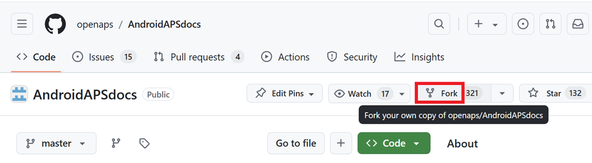
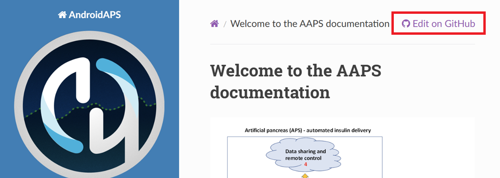
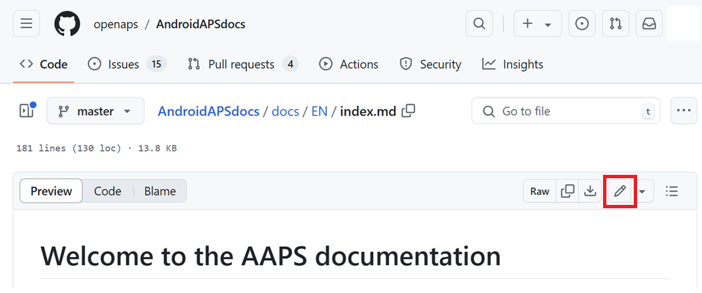
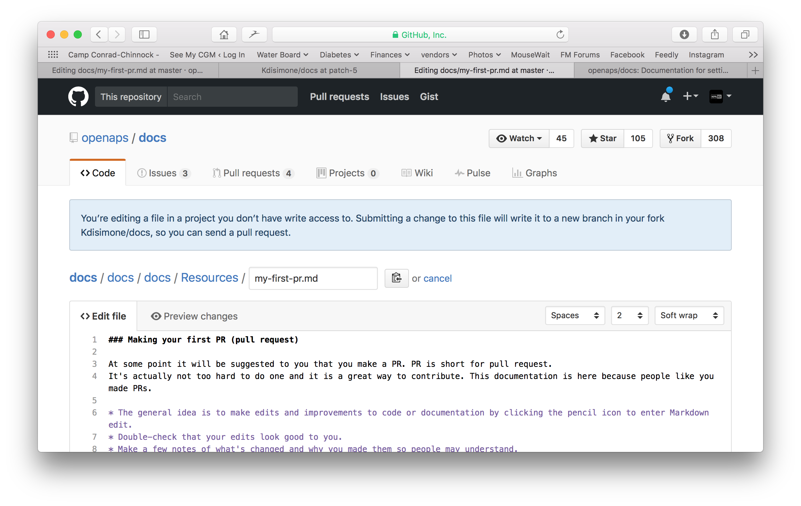
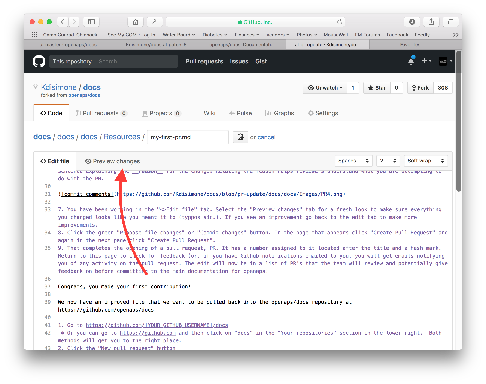
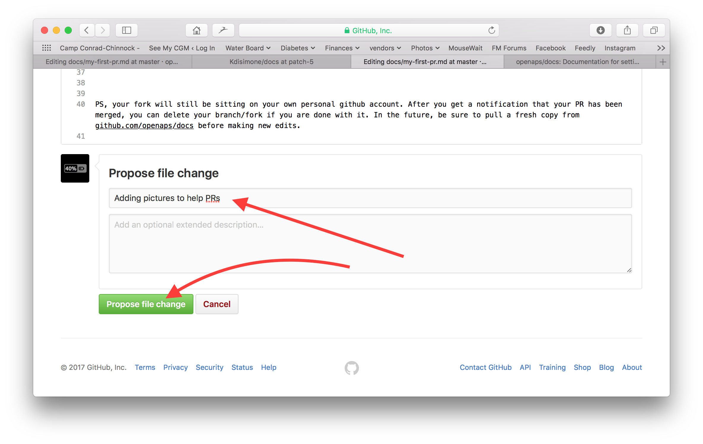
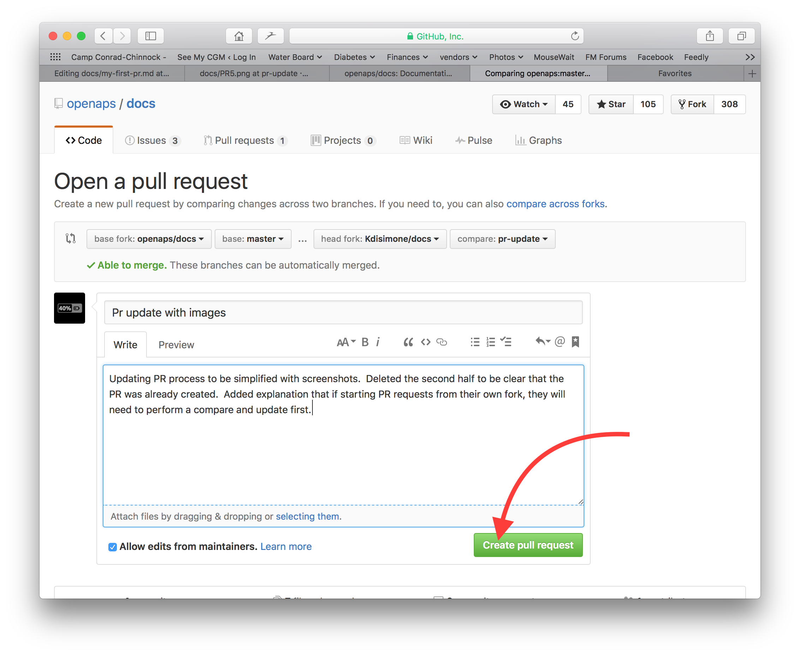
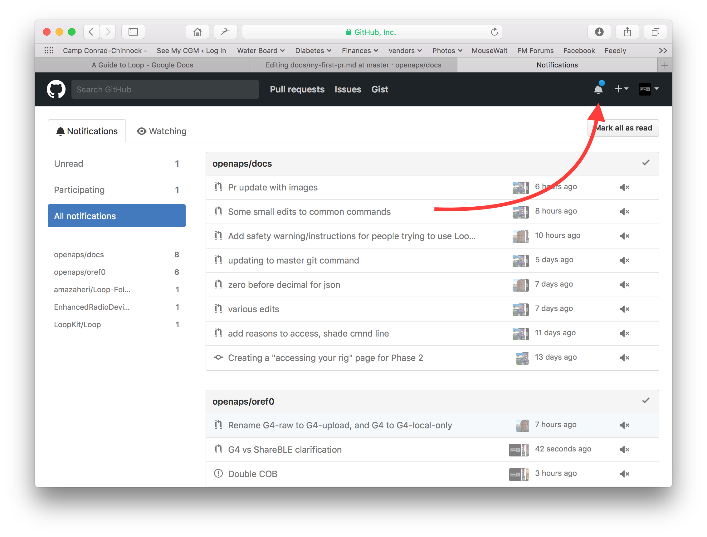
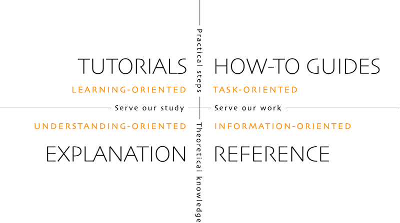

# Kaip redaguoti dokumentaciją

**Šis aprašymas skirtas tik angliškos dokumentacijos redagavimui. Visa nauja informacija pirmiausia turi būti įrašyta angliškai. Jei norite versti į kitas kalbas (ačiū), naudokite [crowdin](https://crowdin.com/project/androidapsdocs).**

Patarimų, kaip formatuoti tekstą (antraštes, paryškinimą...) ir kurti nuorodas, rasite šio puslapio skyriuje [„Kodo sintaksė“](#edit-the-docs-code-syntax).

## Bendra informacija

Jei turite klausimų, atsiliepimų ar naujų idėjų, susisiekite su dokumentacijos komanda per [discord](https://discord.gg/4fQUWHZ4Mw).

Kada nors jums gali būti pasiūlyta sukurti pull request (PR). Būtent taip jūsų dokumentacijos pakeitimai patenka į AAPS tinklalapius, kurie saugomi GitHub. Sukurti PR iš tikrųjų nėra labai sunku, ir tai puikus būdas prisidėti. Šią dokumentaciją dabar skaitote todėl, kad tokie žmonės kaip jūs kūrė PR. Nebijokite suklysti ar netyčia redaguoti ne tų dokumentų. Jūsų pakeitimai peržiūrimi prieš juos sujungiant su „oficialia“ AAPS dokumentacijos saugykla. Šio proceso metu netyčia sugadinti originalų negalite. Bendra eiga tokia:

- Taisykite ir tobulinkite kodą ar dokumentaciją, redaguodami esamą turinį.
- Dar kartą patikrinkite, ar jūsų pakeitimai atrodo gerai.
- Trumpai užsirašykite, kas pakeista, kad kiti suprastų jūsų pakeitimus.
- Sukurkite pull request – juo paprašysite administratorių priimti jūsų pakeitimus.
- Jie peržiūrės pakeitimus ir (1) juos sujungs (merge), (2) parašys jums komentarą apie pakeitimus arba (3) pradės naują dokumentą su jūsų pakeitimais.

(Pastaba: jei jums lengviau mokytis žiūrint, [čia](https://youtu.be/4b6tsL0_kzg) yra YouTube vaizdo įrašas, kuriame parodyta, kaip kuriamas PR.)

Pavyzdyje redaguosime AndroidAPSdocs. Tai galima padaryti bet kuriame Windows kompiuteryje, Mac ir pan. (bet kuriame kompiuteryje su interneto ryšiu).

1. Eikite į <https://github.com/openaps/AndroidAPSdocs> ir viršuje dešinėje spauskite Fork, kad susikurtumėte savo saugyklos kopiją.



2. Atidarykite bet kurį puslapį ir pereikite į puslapį, kurį norite redaguoti. Galite spausti nuorodą "Edit in GitHub" (redaguoti GitHub) viršutiniame dešiniajame kampe. Tai galima tik angliškuose puslapiuose. 



Arba spauskite pieštuko piktogramą, kuri rodoma redaguojamo puslapio turinio viršutinėje juostoje. Tam turite būti prisijungę prie savo Github paskyros (jei jos neturite, susikurti ją paprasta).



3. Bet kuri iš 2 žingsnio parinkčių sukurs naują atšaką JŪSŲ saugykloje. Joje bus išsaugoti jūsų pakeitimai. Pakeiskite failą.

Dokumentacijos puslapiams naudojame markdown. Failų plėtinys yra ".md". Markdown specifikacija nėra fiksuota, todėl šiuo metu savo markdown failams naudojame myst_parser. Atidžiai naudokite teisingą sintaksę, kaip [aprašyta toliau](#edit-the-docs-code-syntax).



4. Dirbote kortelėje "<>Edit file" (redaguoti failą). Pasirinkite kortelę "Preview changes" (peržiūrėti pakeitimus) ir šviežiu žvilgsniu patikrinkite, ar viskas, ką pakeitėte, atrodo taip, kaip norėjote (patikrinkite rašybos klaidas). Jei matote, ką dar reikia pataisyti, grįžkite į redagavimo kortelę ir tęskite taisymą. 



5. Baigę redaguoti, slinkite į puslapio apačią. Apačioje esančiame laukelyje parašykite komentarą teksto lauke "Add an optional extended description..." (papildomas aprašymas). Numatytajame pavadinime yra failo pavadinimas. Pabandykite parašyti sakinį, kuris paaiškina pakeitimo **priežastį**. Nurodyta priežastis padeda peržiūrintiems suprasti, ką norite padaryti šiuo PR.



6. Spauskite žalią mygtuką "Propose file changes" arba "Commit changes" (pasiūlyti / įrašyti pakeitimus). Atsidariusiame puslapyje spauskite "Create Pull Request", o kitame puslapyje dar kartą spauskite "Create Pull Request".



7. Taip pull request (PR) sukurtas. GitHub suteikia PR numerį. Jis rodomas po pavadinimo, po grotelių ženklo. Grįžkite į šį puslapį ir patikrinkite, ar yra atsiliepimų (arba, jei GitHub pranešimai siunčiami jums el. paštu, gausite laiškus apie kiekvieną PR veiksmą). Pakeitimas dabar bus PR sąraše. Komanda jį peržiūrės ir, galbūt, parašys atsiliepimą, prieš įtraukdama į pagrindinę AAPS dokumentaciją! Jei norite patikrinti, kaip sekasi jūsų PR, savo GitHub paskyroje viršutiniame dešiniajame kampe spauskite varpelio piktogramą ir pamatysite visus savo PR.



PS: jūsų fork ir atšaka liks jūsų asmeninėje GitHub paskyroje. Gavę pranešimą, kad jūsų PR sujungtas (merged), galite ištrinti savo atšaką, jei jos nebereikia (kai PR uždaromas arba sujungiamas, 7 žingsnio pranešimų srityje bus nuoroda atšakai ištrinti). Jei ir toliau redaguosite šiuo būdu, visada pradėsite nuo naujausios AndroidAPSdocs saugyklų versijos. Jei PR pradėsite kitu būdu (pvz., redaguodami nuo savo fork saugyklos master atšakos), pirmiausia turėsite atnaujinti savo saugyklą: atlikite "compare" (palyginimą) ir sujunkite visus pakeitimus, atsiradusius nuo paskutinio jūsų fork atnaujinimo. Žmonės dažnai pamiršta atnaujinti savo saugyklas, todėl rekomenduojame naudoti aukščiau aprašytą PR būdą, kol išmoksite atlikti "compare".

(edit-the-docs-code-syntax)=

## Kodo sintaksė

Dokumentacijos puslapiams naudojame markdown. Failų plėtinys yra ".md".

Markdown – tai labai paprasta teksto formatavimo kalba, kuri atskiria teksto turinį nuo jo formatavimo.

Rašantysis tik, pvz., pažymi antraštę kaip 1 lygio antraštę, o markdown procesorius apdorodamas sukuria reikiamą HTML kodą, kad antraštė būtų rodoma HTML.

Tikslas yra toks:

- rašantysis pirmiausia galvotų apie tekstą, o ne apie formatavimą,
- markdown tekstu būtų galima keistis tarp skirtingų markdown įrankių, o ne naudoti, pvz., uždarus (proprietary) įrankius, tokius kaip Microsoft Word, ir
- iš vieno markdown failo galima sukurti kelis išvesties formatus.

Markdown nėra visiškai fiksuotas standartas, todėl stengiamės kuo labiau laikytis standarto, kad

- lengvai pakeisti markdown įrankius, kai reikia arba kai to pareikalauja tolesnė markdown įrankių ir markdown SaaS paslaugų raida, ir
- galėtume naudoti vertimo paslaugas ir versti anglų kalbą į kitą kalbą, pvz., prancūzų ar vokiečių. Jos gali dirbti su markdown, bet ne su sudėtingais formatavimo kodais, nes negali atskirti turinio nuo išdėstymo, o tai gali būti lemtinga.

### Antraštės

- 1 lygio antraštė: `# headline`
- 2 lygio antraštė: `## headline`
- 3 lygio antraštė: `### headline`
- 4 lygio antraštė: `#### headline`

Stenkitės nenaudoti gilesnių antraščių lygių.

### Teksto formatavimas

- **paryškintas**: `**text**`
- *kursyvas*: `*text*`
- ***paryškintas kursyvas***: `***text***`

### Numeruotas sąrašas

    1. pirmas
    1. antras
    1. trečias
    

1. pirmas
2. antras
3. trečias

### Nenumeruotas sąrašas

    - vienas elementas
    - kitas elementas
    - ir dar vienas elementas
    

- vienas elementas
- kitas elementas
- ir dar vienas elementas

### Kelių lygių sąrašas

Sąrašą sąraše sukursite, kai kitą lygį atitrauksite 4 tarpais daugiau į dešinę nei ankstesnį.

    1. pirmas
    1. antras
    1. trečias
      1. vienas elementas
      1. kitas elementas
      1. ir dar vienas elementas
    1. keturi
    1. penki
    1. šeši
    

1. pirmas
2. antras
3. trečias 
    1. vienas elementas
    2. kitas elementas
    3. ir dar vienas elementas
4. keturi
5. penki
6. šeši

### Paveikslėliai

Paveikslėliui įterpti naudokite šią markdown sintaksę.

- paveikslėliai: ``

Paveikslėlis turi būti PNG arba JPEG formato.

Paveikslėlių pavadinimai turi atitikti vieną iš šių pavadinimų taisyklių. Pavyzdyje naudoju plėtinį png. Jei naudojate JPEG, naudokite plėtinį jpeg.

- `filename-image-xx.png`, kur xx – unikalus dviženklis paveikslėlio numeris šiame faile.
- `filename-image-xx.png`, kur xx – prasmingas pavadinimas, kurį pasirenka md failo autorius.

Paveikslėliai yra anglų kalbos aplanke images, o į kitas kalbas Crowdin juos perkelia automatiškai. Jums nieko daryti nereikia!

Šiuo metu paveikslėlių neverčiame: paveikslėliuose turi būti **kuo mažiau teksto**, kad jie būtų suprantami ir anglų kalbos nemokantiems skaitytojams.

(make-a-PR-image-size)= Naudokite tinkamo dydžio paveikslėlius, kad juos būtų galima perskaityti kompiuteryje, planšetėje ir telefone.

- Tinklalapių ekrano nuotraukos turi būti ne platesnės kaip **1050 pikselių**.
- Procesų diagramos turi būti ne platesnės kaip **1050 pikselių**.
- Programėlės ekrano nuotraukos turi būti ne platesnės kaip **500 pikselių**. Jei nebūtina, nedėkite jų vienos šalia kitos.
- Laikrodžio (**Wear OS**) ekrano nuotraukos turi būti ne platesnės kaip **360 pikselių**. Niekada nedidinkite mažesnės ekrano nuotraukos.

### Nuorodos

#### Išorinės nuorodos

Išorinės nuorodos – tai nuorodos į kitas svetaines.

- išorinė nuoroda: `[alt text](www.url.tld)`

#### Vidinės nuorodos į md failo pradžią

Vidinės nuorodos į puslapius – tai nuorodos į md failo, esančio mūsų serveryje, pradžią.

- vidinė nuoroda į .md puslapį: `[alt text](../folder/file.md)`

#### Vidinės nuorodos į pavadintas žymes tekste

Vidinės nuorodos į pavadintas žymes tekste – tai nuorodos į bet kurią md failo, esančio mūsų serveryje, vietą, kurioje nustatyta žymė nuorodai.

Tikslinio md failo vietoje, į kurią norite pereiti, pridėkite pavadintą žymę (named reference).

`(name-of-my-md-file-this-is-my-fancy-named-reference)=`

Pavadinta žymė turi būti unikali visuose AndroidAPSDocs md failuose, ne tik tame md faile, kuriame ji yra!

Todėl gera praktika – pradėti failo pavadinimu, o po jo rašyti savo pasirinktą žymės pavadinimą.

Naudokite tik mažąsias raides, o žodžius junkite brūkšneliais.

Tada savo rašomame tekste nurodykite šią žymę tokia nuoroda.

- Vidinės nuorodos į pavadintas žymes tekste: `[alt text](name-of-my-md-file-this-is-my-fancy-named-reference)`

### Pastabos, įspėjimai, suskleidžiamos pastabos

Į dokumentaciją galite įterpti pastabų ir įspėjimų langelius.

Be to, išsamiai informacijai galite pridėti suskleidžiamas pastabas, kad detalėmis nesidomintys naudotojai neatsisakytų skaityti teksto. Naudokite juos saikingai, nes dokumentacija turi būti kuo lengviau skaitoma.

#### Notes

    ```{admonition} Pastabos antraštė
    :class: note
    Tai pastaba.
    ```
    

```{admonition} Pastabos antraštė :class: note Tai pastaba.

    <br />#### Įspėjimai
    
    ````
    ```{admonition} Įspėjimas
    :class: warning
    Tai įspėjimas.
    

    ```{admonition} Įspėjimo antraštė 
    :class: warning
    Tai įspėjimas.
    ```
    
    #### Suskleidžiamos pastabos
    
    

    {admonition} išsamesnė informacija besidomintiems skaitytojams
    :class: dropdown
    
    Ši pastaba suskleista,
    todėl čia galite įrašyti ilgesnį tekstą,
    ir jis neužims daug vietos puslapyje.
    

````

```{admonition} išsamesnė informacija besidomintiems skaitytojams :class: dropdown Ši pastaba suskleista, todėl čia galite įrašyti ilgesnį tekstą, ir jis neužims daug vietos puslapyje.

```

## Lentelės

Venkite lentelių su ilgais tekstais: Markdown kalboje jų turinį sunku sutvarkyti, jos dažniausiai netelpa telefono ekrano plotyje ir po vertimo greičiausiai bus rodomos kitaip.

## Stiliaus vadovas

### Turinys

1. Patarimai, kaip rašyti angliškai

2. Pastabos apie AAPS tekstų rašymą

3. Naudingos nuorodos

###  1\. Patarimai, kaip rašyti angliškai

#### Rašykite skaitytojui tinkama kalba

Kur tik įmanoma, rašykite paprasta anglų kalba. Tai padeda skaitytojams, kuriems anglų kalba nėra gimtoji, ir palengvina AAPS dokumentų vertimą į kitas kalbas. Rašykite taip, lyg kalbėtumėte su naudotoju: įsivaizduokite, kad sėdite prie stalo priešais žmogų, kuriam rašote. Atminkite: dauguma AAPS naudotojų nėra programuotojai. Ir pačiame diabete yra daug žargono ir santrumpų. Turėkite omenyje, kad kai kuriems diagnozė nustatyta neseniai, jie gali turėti mažiau patirties su diabetu nei jūs arba būti mokyti kitaip. Jei naudojate trumpinį ar santrumpą, pirmą kartą parašykite visą pavadinimą, o santrumpą iš karto po jo skliaustuose, pvz., „super micro bolus (SMB)“. Taip pat pridėkite nuorodą į terminų žodyną. Techninius terminus, kurių skaitytojas gali nežinoti, taip pat galima pridėti skliaustuose.

Vietoj: *“What causes high postprandial BG peaks in closed loop?”*

Rašykite: *“What causes a high BG peak **after lunch** (postprandial) in closed loop?”*

##### Rašykite paprastais, visiems suprantamais žodžiais

Alternatyvių žodžių sąrašą nuo A iki Z, kad tekstas būtų lengviau suprantamas, rasite čia:

<https://www.plainenglish.co.uk/the-a-z-of-alternative-words.html>

#### Privatumo ir licencijų klausimai:

Ypač įrašydami vaizdo įrašus ar darydami ekrano nuotraukas, neatskleiskite savo asmeninių duomenų (API rakto, slaptažodžių). Įsitikinkite, kad YouTube turinys nėra viešai matomas sąraše (not listed) ir jį galima peržiūrėti tik per nuorodą iš dokumentacijos. Neatkreipkite dėmesio į medžiagą, kuri pažeidžia autorių teises (BYODA ir pan.).

#### Rašykite trumpus sakinius, kalbėkite iš esmės

- Aiškiame tekste vidutinis sakinio ilgis yra 15–20 žodžių.

- Tai nereiškia, kad visi sakiniai turi būti vienodo ilgio. Rašykite glaustai. Įvairinkite tekstą: maišykite trumpus sakinius (kaip ankstesnis) su ilgesniais (kaip šis).

- Viename sakinyje laikykitės vienos pagrindinės minties ir galbūt dar vienos susijusios.

- Kartais vis tiek parašysite ilgą sakinį, ypač kai bandysite paaiškinti sudėtingą dalyką. Bet daugumą ilgų sakinių galima kaip nors suskaidyti.

- Atsisakykite silpnų žodžių: „you can“, „there is/are/were“, „in order to“.

- Raktinius žodžius rašykite pavadinimų, sakinių ir pastraipų pradžioje.

- Būkite vaizdūs! Kur tik įmanoma, pridėkite trumpą diagramą, ekrano nuotrauką ar vaizdo įrašą.

#### Nebijokite duoti nurodymų

Liepiamoji nuosaka – greičiausias būdas duoti nurodymus, bet rašantieji kartais bijo liepti ir rašo „you should do this“ (jūs turėtumėte tai padaryti), o ne tiesiog „do this“ (padarykite tai). Galbūt žmonės nerimauja, kad liepimai skamba per griežtai. Dažnai tai galima išspręsti priekyje pridėjus žodį 'please'. Tačiau jei kažką būtina padaryti, geriau nerašyti ‘please’, nes taip skaitytojas gauna galimybę atsisakyti.

Vietoj: *“You should just think of it as a complete statement.”*

Rašykite: *“Think of it as a complete statement.”*

#### Dažniausiai naudokite veikiamąją, o ne neveikiamąją rūšį

**Veikiamosios rūšies** veiksmažodžio pavyzdys:

- *“The pump (subject) delivers (verb) the insulin (object).”*

Čia “delivers” yra veikiamosios rūšies veiksmažodis. Sakinyje pirmiausia pasakoma, kas tiekia, o tik paskui – kas tiekiama.

**Neveikiamosios rūšies** veiksmažodžio pavyzdys:

- *“The insulin (subject) is delivered (verb) by the pump (object).”*

Čia *“delivered”* yra neveikiamosios rūšies veiksmažodis. Palyginti su veikiamosios rūšies sakiniu, veiksnys ir papildinys sukeisti vietomis. Sakinys tapo ilgesnis, nes reikėjo pridėti „is“ ir „by the“. Taip pat apsvarstykite galimybę sakinį pradėti veikiamosios rūšies veiksmažodžiu.

Vietoj: *“You can connect your pump with the phone through the AAPS pump menu, and there are a number of pumps available for you to connect with.”*

Rašykite: *“Connect your desired pump to the phone through the AAPS pump menu.”*

Neveikiamoji rūšis gali sukelti problemų:

- Ji gali painioti.

- Dėl jos tekstas dažnai tampa ištęstas.

- Dėl jos tekstas tampa mažiau gyvas.

##### Kada neveikiamoji rūšis tinka

Kartais neveikiamąją rūšį naudoti tinka.

- Kad tekstas skambėtų švelniau – 'this bill has not been paid' (neveikiamoji) skamba švelniau nei 'you have not paid this bill' (veikiamoji).

- Kad išvengtumėte kaltinimo – 'a mistake was made' (neveikiamoji), o ne 'You made a mistake' (veikiamoji).

- Kai nežinote, kas atlieka veiksmą – 'the England team has been picked'.

- Jei taip tiesiog skamba geriau.

#### Venkite sudaiktavimų

Sudaiktavimas – tai pavadinimas to, kas nėra fizinis daiktas, pavyzdžiui, proceso, metodo ar jausmo. Sudaiktavimai sudaromi iš veiksmažodžių.

Pavyzdžiui:

| Veiksmažodis | Sudaiktavimas |
| ------------ | ------------- |
| complete     | completion    |
| introduce    | introduction  |
| provide      | provision     |
| fail         | failure       |

Jie dažnai vartojami **vietoj** veiksmažodžių, iš kurių kilę, bet tada atrodo, lyg nieko iš tikrųjų nevyktų. Jei jų per daug, tekstas tampa labai nuobodus ir sunkiai skaitomas.

Vietoj: *“The implementation of the method has been done by a team.”*

Rašykite: *“A team has implemented the method.”*

#### Kur tinka, naudokite sąrašus

Sąrašai puikiai tinka informacijai suskaidyti. Yra du pagrindiniai sąrašų tipai:

- Vientisas sakinys, kurio pradžioje, viduryje ar pabaigoje išvardyti keli punktai.

- Atskiri punktai su įžanginiu sakiniu.

Aukščiau esančiame sąraše kiekvienas punktas yra pilnas sakinys, todėl kiekvienas prasideda didžiąja raide ir baigiasi tašku. Naudokite ženklelius, o ne skaičius ar raides: jie atkreipia dėmesį į kiekvieną punktą ir neprideda papildomos informacijos.

#### Mitų griovimas

- Sakinį galite pradėti žodžiais **and, but, because, so arba however**.

- Galite atskirti bendraties dalis (split infinitive). Taigi galite rašyti **“to boldly go”**.

- Sakinį galite baigti prielinksniu. Tiesą sakant, tai yra tai, **we should stand up for** (ką turėtume ginti).

- Ir **jūs** galite tą patį **žodį** sakinyje pavartoti du kartus, jei **jūs** nerandate geresnio **žodžio**.

#### Rašymo stiliaus pritaikymas pagal tikslą

Kad dokumentacija būtų aiški ir trumpa, skirtingas jos dalis rašome skirtingais stiliais.

Įžangos, pagrindų ir žinių plėtojimo skyriams naudojamas „paaiškinimo“ stilius.

AAPS kūrimo, konfigūravimo ir kai kuriems trikčių šalinimo skyriams naudojamas „instrukcijos“ (How-to-guide) stilius (su minimaliais paaiškinimais).

Mokomoji medžiaga padeda mokiniui įgyti pagrindinių įgūdžių. Naudotojas **mokysis darydamas**.



#####  Mokomoji medžiaga (pvz., kaip išmokyti vaiką plakti kiaušinių baltymus)

- pasakotojas kreipiasi tiesiai į skaitytoją: In this tutorial **you** will (we) retais atvejais galima naudoti, kad būtų perteiktas požiūris „mes tai darome kartu“

- Būsimasis laikas -> parodyti galutinį tikslą

- Liepiamoji nuosaka -> atlikti užduotis -> konkretūs žingsniai, venkite abstrakčių sąvokų

- Būtasis laikas -> parodyti atliktas užduotis -> greiti ir iš karto matomi rezultatai

- Minimalūs paaiškinimai -> tik tai, kas būtina užduočiai atlikti – **kas ir kodėl**

- Nekalbėkite apie parinktis / alternatyvas / …. Jokio dviprasmiškumo

- Perėjimai tarp žingsnių: žingsnį baikite sakiniu, kuris logiškai veda į kitą žingsnį. Pavyzdys: *You have now installed the Let’s Encrypt client, but before obtaining certificates, you need to make sure that all required ports are open. To do this, you will update your firewall settings in the next step.*

- **Mokomosios medžiagos** pavadinimas (1 lygio antraštė)

- Įžanga (be antraštės)

- Būtinos sąlygos (2 lygio antraštė)

- Žingsniai:

- 1 žingsnis – pirmas veiksmas (2 lygio antraštė)

- 2 žingsnis – kitas veiksmas (2 lygio antraštė)

- n žingsnis – paskutinis veiksmas (2 lygio antraštė)

- Išvados (2 lygio antraštė)
    
    - **Mokomosios medžiagos kalba**
        
        *In this tutorial, you will… (šioje mokomojoje medžiagoje jūs…)*
        
        Aprašykite, ką besimokantysis atliks (pastaba: ne „you will learn…“ (jūs išmoksite…)).
        
        *First, do x. Now, do y. Now that you have done y, do z.*
        
        Jokios vietos dviprasmiškumui ar abejonėms.
        
        *We must always do x before we do y because… (see Explanation for more details).*
        
        Veiksmus paaiškinkite kuo trumpiau ir kuo paprastesne kalba. Pateikite nuorodą į išsamesnį paaiškinimą.
        
        *The output should look something like this…*
        
        Aiškiai pasakykite besimokančiajam, ko tikėtis.
        
        *Notice that… Remember that…*
        
        Duokite besimokančiajam daug užuominų, kad jis galėtų įsitikinti, jog eina teisingu keliu, ir susiorientuotų.
        
        *You have built a secure, three-layer hylomorphic stasis engine…*
        
        Aprašykite (ir saikingai pagirkite), ką besimokantysis pasiekė (pastaba: ne „you have learned…“ (jūs išmokote…))

#####  Instrukcijos (pvz., receptas)

Instrukcijos tikslas – padėti jau įgudusiam naudotojui teisingai atlikti konkrečią užduotį.

- KAIP

- pasakotojas kreipiasi tiesiai į skaitytoją: In this guide **you** will

- Būsimasis laikas -> parodyti galutinį tikslą

- Sąlyginė liepiamoji nuosaka -> kad gautumėte X, darykite Y -> konkretūs žingsniai, venkite abstrakčių sąvokų

- Minimalūs paaiškinimai -> tik tai, kas būtina užduočiai atlikti -> **kas ir kodėl**

- Nekalbėkite apie parinktis / alternatyvas / …. Jokio dviprasmiškumo, bet galite pateikti nuorodą į žinyno ar paaiškinimo įrašą

- **Instrukcija**: pavadinimas (1 lygio antraštė)

- Įžanginė pastraipa

- Nebūtinos būtinos sąlygos (pastraipa arba 2 lygio antraštė, jei jų daugiau nei 1)

- Žingsniai:

- 1 žingsnis – pirmas veiksmas (2 lygio antraštė)

- 2 žingsnis – kitas veiksmas (2 lygio antraštė)

- n žingsnis – paskutinis veiksmas (2 lygio antraštė)

- Baigiamoji pastraipa
    
    - **Instrukcijų kalba**
        
        *This guide shows you how to… (ši instrukcija parodys, kaip…)*
        
        Aiškiai aprašykite problemą ar užduotį, kurią naudotojas išspręs pagal šią instrukciją.
        
        *If you want x, do y. To achieve w, do z.*
        
        Naudokite sąlyginę liepiamąją nuosaką.
        
        *Refer to the x reference guide for a full list of options.*
        
        Neperkraukite praktinės instrukcijos viskuo, ką naudotojas galėtų daryti su x.

#####  Paaiškinimas (pvz., mokslinis paaiškinimas, kodėl plakami kiaušinių baltymai sutirštėja)

Paaiškinimas paaiškina, pagilina ir praplečia skaitytojo supratimą apie temą.

- KODĖL

- Pradėkite žodžiu **Apie**

- Pateikite kontekstą, pridėkite nuorodas į VISUS susijusius šaltinius

- Aptarkite parinktis / alternatyvas

- Nemokykite ir nepateikite žinyno informacijos (pridėkite nuorodas į ją)

- Nurodykite tai, kas nežinoma, kas keičiasi ir pan.…

- **Apie**: pavadinimas (1 lygio antraštė)

- Įžanga (be antraštės)

- Nebūtinos būtinos sąlygos (2 lygio antraštė)

- 1 potemė (2 lygio antraštė)

- Išvados (2 lygio antraštė)
    
    - **Paaiškinimo kalba**
    
    *The reason for x is because historically, y…*
    
    Paaiškinkite.
    
    *W is better than z, because…*
    
    Kur tinka, pateikite vertinimų ir net nuomonių.
    
    *An x in system y is analogous to a w in system z. However…*
    
    Pateikite kontekstą, kuris padeda skaitytojui.
    
    *Some users prefer w (because z). This can be a good approach, but…*
    
    Palyginkite alternatyvas.
    
    *An x interacts with a y as follows:…*
    
    Atskleiskite vidinį mechanizmo veikimą, kad būtų aišku, kodėl kažkas veikia būtent taip.

### 2\. Pastabos apie AAPS tekstų rašymą ir atnaujinimą

#### Autorius ir redaktorius

Rašant ar atnaujinant AAPS dokumentaciją, laikykite, kad procesas susideda iš dviejų etapų. Juos gali atlikti tas pats žmogus skirtingu metu arba keli žmonės.

**Autorius (pvz., jūs!)** glaustai ir lyg kalbėdamas parašo ar pataiso dokumentacijos skyrių, tada perduoda jį redaktoriui.

**Redaktorius (pvz., kitas AAPS naudotojas arba tas, kuris gauna pull request)** patikrina, ar laikomasi stiliaus vadovo, pataiso skyrių, kad jis būtų aiškus ir suprantamas, ir išbraukia kuo daugiau žodžių (ypač mokomosios medžiagos ir instrukcijų skyriuose). Gali padėti tekstą perskaityti garsiai.

#### Bendrieji AAPS dalykai

- Gliukozės reikšmes kiekvieną kartą nurodykite ir mg/dL, ir mmol/L (jei įmanoma, taip darykite ir ekrano nuotraukose).

- Dėl nuoseklumo rašykite „AAPS“, o ne „Android APS“.

- Aiškiai nurodykite, kuriai Android Studio / AAPS versijai rašote arba iš kurios versijos padarytos ekrano nuotraukos.

### 3\. Naudingos nuorodos

<https://dev.readthedocs.io/en/latest/style-guide.html>

[Diátaxis (diataxis.fr)](https://diataxis.fr/)

[Technical Writer Style Guide Examples | Technical Writer HQ](https://technicalwriterhq.com/writing/technical-writing/technical-writer-style-guide/)

[DigitalOcean's Technical Writing Guidelines | DigitalOcean](https://www.digitalocean.com/community/tutorials/digitalocean-s-technical-writing-guidelines)

[Top 10 tips for Microsoft style and voice - Microsoft Style Guide | Microsoft Learn](https://learn.microsoft.com/en-us/style-guide/top-10-tips-style-voice?source=recommendations)

<https://www.plainenglish.co.uk/how-to-write-in-plain-english.html>

<https://developers.google.com/style>

<https://www.mongodb.com/docs/meta/style-guide/screenshots/screenshot-guidelines/>