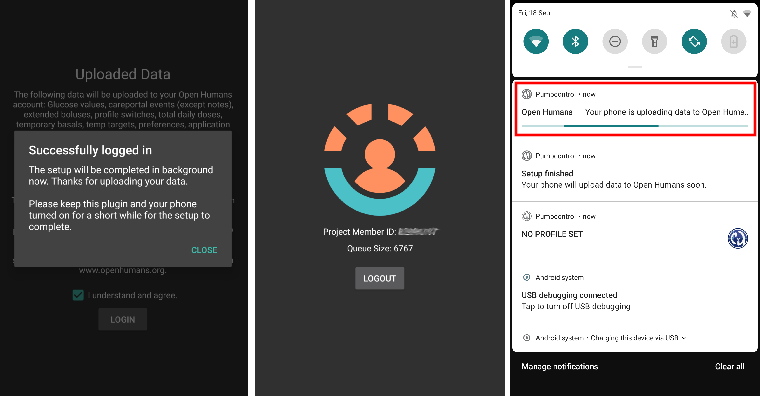

# Open Humans duomenų įkėlimas

## Paaukokite savo duomenis mokslui

Galite padėti bendruomenei, paaukodami savo duomenis moksliniams tyrimams! Tai padeda mokslininkams perduoti žinias kitiems, kurti naujas mokslines idėjas ir plačiau išgarsinti atvirojo kodo uždarojo ciklo sistemas. AAPS gali sinchronizuoti jūsų duomenis su [Open Humans](https://www.openhumans.org) – platforma, kurioje galite įkelti, susieti ir saugoti savo asmeninius duomenis, pavyzdžiui, genetinius, aktyvumo ir sveikatos duomenis.

Jūs visiškai kontroliuojate, kas vyksta su jūsų duomenimis ir kuriuos projektus norite remti, suteikdami jiems prieigą prie savo duomenų. Priklausomai nuo projekto, prie kurio prisijungėte, duomenys vertinami ir naudojami skirtingais būdais ir skirtingu mastu.

Į jūsų Open Humans paskyrą bus įkelti šie duomenys:

- Glucose values
- Terapijos įrašai (išskyrus pastabas)
- Extended boluses
- Profilio keitimai
- Bendros paros dozės
- Laikinos bazės
- Laikini tikslai
- Nustatymai
- Programos versija
- Įrenginio modelis
- Ekrano dydis

Slapta ar asmeninė informacija, pavyzdžiui, jūsų Nightscout URL ar API slaptažodis (API secret), nebus įkelta.

## Sąranka

1. Jei dar neturite, susikurkite paskyrą [Open Humans](https://www.openhumans.org) svetainėje. Jei norite, galite naudoti esamą Google arba Facebook paskyrą.
2. Įjunkite **Open Humans** įskiepį skiltyje [**Konfigūracija** > **Ryšys**](../SettingUpAaps/ConfigBuilder.md).


3. **Open Humans** kortelėje spauskite **Parametrai**. Galite leisti įkelti duomenis tik tada, kai telefonas naudoja Wi-Fi (**Tik per Wi‑Fi**) ir (arba) kai jis kraunamas (**Tik įkraunant**).


4. **Open Humans** kortelėje spauskite **Atidaryti įskiepį**, tada spauskite **Sąranka**.


5. Ekrane **Sveiki atvykę į Open Humans** spauskite **Toliau**. Atidžiai perskaitykite ekraną **Sutikimas**: jame rodomos naudojimosi sąlygos ir kurie duomenys įkeliami, o kurie ne.
6. Įjunkite **Aš suprantu ir sutinku.** (1) ir spauskite **Prisijungti prie Open Humans** (2).


7. Bus atidaryta Open Humans svetainė. Prisijunkite savo prisijungimo duomenimis.
8. Nuspręskite, ar norite paslėpti savo narystę AAPS Uploader projekte viešame Open Humans profilyje (1).
9. Spustelėkite **Authorize project** (leisti projektui) (2).


```{admonition} Older screenshot
:class: note
Aukščiau esančiose ekrano nuotraukose rodoma ankstesnė Open Humans svetainės versija ir dar senas projekto pavadinimas **AndroidAPS Uploader**. Veiksmai tie patys.
```

10. Grįžus į **AAPS**, ekrane **Paskutiniai štrichai** klausiama, ar norite tęsti. Spauskite **Tęsti**.
11. Palaukite, kol pasirodys **Užbaigta!**, tada spauskite **Uždaryti**. Nuo šiol jūsų telefonas retkarčiais įkels duomenis fone.
12. **Open Humans** įskiepio ekrane dabar rodomas jūsų **Projekto nario ID**. Jei norite pradėti įkėlimą iš karto, spauskite **Įkelti dabar**.
13. Jei norite nebeįkelti duomenų į Open Humans, spauskite **Atsijungti**.
14. Android pranešimas informuos jus apie vykstantį įkėlimą.



```{admonition} Older screenshot
:class: note
Aukščiau esanti ekrano kopija yra iš ankstesnės **AAPS** versijos. **AAPS** 4 versijoje patvirtinimo ekranai yra **Paskutiniai štrichai** ir **Užbaigta!**, eilės dydžio nėra, o mygtukai yra **Įkelti dabar** ir **Atsijungti**.
```

15. Savo duomenis galite tvarkyti prisijungę prie [Open Humans svetainės](https://www.openhumans.org).


## Dalijimosi galimybės

### [Projektas 'OPEN'](https://www.open-diabetes.eu/)

Projektas 'OPEN' sujungia tarptautinį ir tarpsektorinį konsorciumą: pacientus novatorius, gydytojus, socialinių mokslų ir kompiuterijos mokslininkus bei pacientų teises ginančias organizacijas. Jie tiria įvairius savadarbių dirbtinės kasos sistemų (DIY APS) aspektus. Šias sistemas naudoja vis daugiau žmonių, sergančių diabetu. Daugiau informacijos rasite jų [svetainėje](https://www.open-diabetes.eu/).

2020 m. rugsėjį projektas 'OPEN' pradėjo [apklausą](https://survey.open-diabetes.eu/), kurioje galima ir paaukoti į Open Humans įkeltus duomenis. [Instrukcija](https://open-diabetes.eu/en/open-survey/survey-tutorials/), kaip paaukoti savo duomenis projektui 'OPEN', yra jų svetainėje ir pačioje apklausoje.

### [OpenAPS Data Commons](https://www.openhumans.org/activity/openaps-data-commons/)

OpenAPS Data Commons sukurta tam, kad DIYAPS bendruomenės duomenų rinkiniais būtų galima paprastai dalytis moksliniams tyrimams. Duomenimis dalijamasi ir su įprastais tyrėjais, kurie atlieka įprastus mokslinius tyrimus, ir su bendruomenės grupėmis ar asmenimis, kurie nori peržiūrėti duomenis savo tyrimų projektuose. OpenAPS Data Commons naudoja platformą 'Open Humans', kad žmonės galėtų lengvai įkelti savo DIYAPS (įskaitant AAPS, Loop ir OpenAPS) duomenis ir jais dalytis.

Savo duomenis į Open Humans galite perkelti vienu iš trijų būdų:

1. naudokite AAPS įkėlimo funkciją, kad perkeltumėte duomenis į Open Humans
2. naudokite Nightscout Data Transfer, kad perkeltumėte duomenis į Open Humans
3. rankiniu būdu įkelkite duomenų failus į Open Humans.

Kai susikursite paskyrą ir jūsų duomenys pradės keliauti į Open Humans, jei norite, prisijunkite ir prie OpenAPS Data Commons, kad paaukotumėte savo duomenis moksliniams tyrimams.

## Terms of Use

Tai atvirojo kodo įrankis, kuris kopijuos jūsų duomenis į [Open Humans](https://www.openhumans.org). Mes neturime teisės dalytis jūsų duomenimis su trečiosiomis šalimis be jūsų aiškaus leidimo. Projekto ir programėlės gaunami duomenys identifikuojami atsitiktiniu naudotojo ID ir saugiai perduodami tik į Open Humans paskyrą, jei jūs tam leidžiate. Įkėlimą galite sustabdyti ir įkeltus duomenis ištrinti bet kada per [www.openhumans.org](https://www.openhumans.org). Atkreipkite dėmesį, kad kai kurie duomenis gaunantys projektai to gali nepalaikyti.

Taip pat žr. [Open Humans naudojimosi sąlygas](https://www.openhumans.org/terms/).

## Duomenų privatumas

Open Humans saugo jūsų privatumą: kiekvienam projektui jums suteikiamas atskiras skaitinis ID. Taip projektai gali jus atpažinti, bet ne nustatyti jūsų tapatybę. AAPS įkeliamas programos ID (Application ID) yra panašus ir padeda tik administruoti duomenis. Daugiau informacijos rasite čia:

- [Open Humans duomenų naudojimo politika](https://www.openhumans.org/data-use/)
- [Open Humans BDAR (GDPR)](https://www.openhumans.org/gdpr/)
