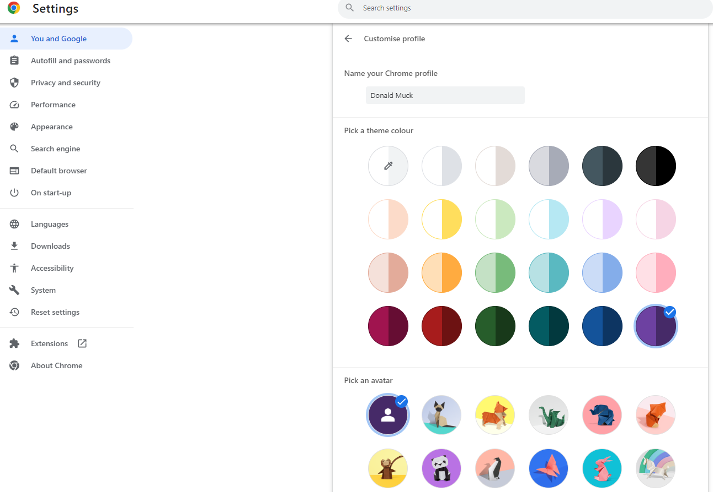
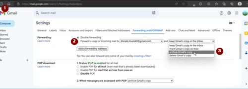

# A dedicated Google account for AAPS (optional)

Some **AAPS** users prefer to use their main email account for **AAPS** as well. Kiti **AAPS** naudotojai (arba juos prižiūrintys asmenys) susikuria atskirą **AAPS** el. pašto paskyrą. Tai nebūtina, o žemiau pateikiame pavyzdį, kaip tai padaryti.

Jei nenorite kurti atskiros **AAPS** Gmail paskyros, galite iš karto pereiti į kitą skyrių [AAPS kūrimas](../SettingUpAaps/BuildingAaps.md).

```{admonition} Advantages of a dedicated Google account for AAPS
:class: dropdown

- Su atskira Google Drive vieta nerizikuojate, kad funkcija **Eksportuoti nustatymus** užpildys jūsų asmeninės Google Drive vietos limitą.
- Kiekviena **AAPS** versija (ir pagalbinės programėlės, pvz., xDrip, BYODA ir kt.) bus saugoma vienoje vietoje, nepriklausomai nuo jūsų kompiuterio. If your PC or phone is stolen/lost/broken you will still have access.
- Kai sąranka vienoda, pagalba internetu paprastesnė, nes naudotojų aplankų struktūra panaši.
- Priklausomai nuo sąrankos (žr. žemiau), bendruomenėje galėsite bendrauti kitu vardu (slapyvardžiu), o tai gali apsaugoti jūsų privatumą. 
- Vaikai, sergantys 1 tipo diabetu, gali toliau naudoti savo „kasdienę“ nepilnamečio el. pašto paskyrą, o **AAPS** ir susijusioms funkcijoms, kurioms reikia suaugusiojo paskyros, naudoti atskirą paskyrą.
- Gmail leidžia vienu telefono numeriu užregistruoti iki 4 paskyrų.
```

## How to set up a dedicated Google account for AAPS

(⌛About 10 minutes)


Requirements:

* Turite kompiuterį su Windows (Windows 10 arba naujesne) ir Android telefoną (Android 12 arba naujesnį), kuriame veiks **AAPS** programėlė. Abiejuose įrenginiuose turi būti įdiegti visi naujausi saugos naujinimai, interneto ryšys ir administratoriaus teisės, nes kai kuriems žingsniams reikia atsisiųsti ir įdiegti programas.
* Android telefone jau nustatytas jūsų asmeninis „kasdienis“ el. pašto adresas, pvz., Gmail paskyra.

```{admonition} Things to consider when setting up your new account
:class: dropdown
- Dėl privatumo galite naudoti ne savo vardą, o su paskyra susijusį pavadinimą (pvz., t1dsuperstar). You can then use it in **AAPS** public forums while keeping your own identity private. Since Google requires a recovery email and phone number, it is still traceable.
- Naujoji **AAPS** paskyra tapatybei patvirtinti naudos tą patį telefono numerį kaip ir jūsų „_kasdienė_“ paskyra. Tapatybei patvirtinti ji naudos „kasdienį“ el. pašto adresą;
- Nustatysime el. laiškų peradresavimą, kad visi laiškai, siunčiami į naująją AAPS paskyrą, būtų peradresuojami į pagrindinę paskyrą (taip nereikės tikrinti dviejų pašto dėžučių);
- Savo _kasdienei_ Gmail paskyrai ir AAPS Gmail paskyrai naudokite skirtingus slaptažodžius
- Jei vienai Gmail paskyrai naudojate Google „2-step verification“ (dviejų veiksmų patvirtinimą, dar vadinamą kelių veiksnių autentifikavimu), verta jį įjungti abiem Gmail paskyroms.
- Jei planuojate naudoti Google „Passkeys“ (prieigos raktus), užregistruokite kelis įrenginius. This is so you don’t lock yourself out. Tai darykite tik įrenginiuose, prie kurių niekas kitas negali prieiti (_t. y._ ne kompiuteryje su bendra paskyra, kurią gali atrakinti kiti žmonės).
```


```{admonition} Video Walkthrough!
:class: note
Spustelėkite [čia](<https://drive.google.com/file/d/1dMZTIolO-kd2eB0soP7boEVtHeCDEQBF/view?usp=drive_link>), kad pamatytumėte vaizdo įrašą, kaip sukurti atskirą Google paskyrą.
```

 These are the steps outlined in the video:

In this example: 
- Jūsų esama „_kasdienė_“ Google paskyra yra <donald.muck42@gmail.com>; 
- Jūsų nauja „_AAPS_“ Gmail paskyra bus: <donald.muck42.aaps@gmail.com>; 


### Eikite į <https://myaccount.google.com> 

 Jei jau esate prisijungę prie Google, būsite nukreipti į savo „kasdienės“ paskyros puslapį **My Account** (mano paskyra). (1) Puslapio viršuje dešinėje spustelėkite savo profilio nuotrauką (šiuo atveju tai paprastas ) (2) pasirinkite „_add another account_“ (pridėti kitą paskyrą).


### Įveskite NAUJOS atskiros paskyros duomenis: 

- Įveskite naujos paskyros duomenis: 
- Paskyros sukūrimas
- „for my personal use“ (asmeniniam naudojimui). 


### Įveskite savo asmens duomenis:
 - Įveskite vardą
 - pavardę
 - gimimo datą (turite būti pilnametis)

### Pasirinkite NAUJĄ el. pašto adresą ir slaptažodį

Šiame pavyzdyje prie esamo Donald Muck adreso pridedama „.AAPS“…\
Nustatykite slaptažodį

### Įveskite telefono numerį, kuriuo galima gauti patvirtinimo SMS

Gmail atsiųs unikalų kodą, kurį reikės įvesti patvirtinimui.

### Įveskite atkūrimo el. pašto adresą

Šiuo atveju tai bus jūsų esamas „_kasdienis_“ el. pašto adresas…

### Paskyros sąrankos užbaigimas

Gmail parodys paskyros pavadinimą. Bus paprašyta sutikti su Gmail taisyklėmis ir sąlygomis bei patvirtinti suasmeninimo nustatymus.

### Naujo profilio rodinio pritaikymas

Dabar turėtumėte matyti Gmail puslapį MyAccount su nauja **AAPS** el. pašto paskyra. Pagal numatytuosius nustatymus profilio nuotrauka bus pirmoji jūsų vardo raidė. Pakeiskite ją į kažką išskirtinio, kad paskyrų nesupainiotumėte… šiame pavyzdyje Donald.Muck.AAPS vietoj  pasirinko .

\


### Atidarykite Gmail svetainę abiejuose languose ir sukonfigūruokite naują paskyrą

Kad nereikėtų stebėti atskiros el. pašto paskyros, peradresuokite visus laiškus iš naujos **AAPS** paskyros į savo kasdienę paskyrą\
Ši dalis gali būti šiek tiek paini, nes teks perjunginėti tarp abiejų paskyrų. Kad būtų paprasčiau, atidarykite 2 atskirus naršyklės langus vieną virš kito:

1. Perkelkite esamą naršyklės langą į ekrano viršų ir pakeiskite jo dydį, kad jis užimtų tik maždaug viršutinę ekrano pusę…
2. Užduočių juostoje dešiniuoju pelės mygtuku spustelėkite naršyklės logotipą
3. Meniu pasirinkite „New Window“ (naujas langas)... ir pakeiskite jo dydį, kad jis užimtų tik apatinę ekrano pusę.

Kiekviename naršyklės lange atidarykite <https://gmail.com>. Įsitikinkite, kad asmeninė paskyra yra viršuje, o nauja **AAPS** paskyra apačioje ir kad ją lengva atpažinti pagal profilio nuotrauką viršutiniame dešiniajame kampe. Jei reikia, paskyrą visada galite perjungti spustelėję profilio nuotrauką ir pasirinkę reikiamą paskyrą.



Jūsų Gmail pradiniai puslapiai turėtų atrodyti taip:\


 ### Naujoje Gmail paskyroje (apatiniame lange) atidarykite Gmail nustatymus…

- Spustelėkite krumpliaratį kairėje nuo profilio nuotraukos
- tada pasirinkite „**See all Settings**“ (žiūrėti visus nustatymus)


### Peradresavimo nustatymas…

- Spustelėkite nustatymų skirtuką „Forwarding and POP/IMAP“ (peradresavimas ir POP/IMAP)
- Spustelėkite „add a forwarding address“ (pridėti peradresavimo adresą)
- Pridėkite savo „kasdienį“ el. pašto adresą
- Gmail atsiųs patvirtinimo kodą į jūsų „kasdienį“ el. pašto adresą.
- Grįžkite į savo kasdienį profilį ir spustelėkite nuorodą, kad patvirtintumėte peradresavimą (arba paimkite kodą iš Gmail patvirtinimo laiško savo „kasdieniame“ Gmail lange ir nukopijuokite jį į „naujos AAPS paskyros“ Gmail langą).

Teks kelis kartus perjunginėti langus, bet taip, tikrindami „kasdienės“ paskyros laiškus, matysite ir iš AAPS paskyros peradresuotus laiškus, pavyzdžiui, Gmail įspėjimus.


### Peradresuoto el. pašto adreso patvirtinimas

- „Kasdienėje“ Gmail paskyroje (viršutiniame lange) gausite laišką „Gmail forwarding Confirmation“ (Gmail peradresavimo patvirtinimas).
- Atidarykite jį ir spustelėkite nuorodą užklausai patvirtinti („click the link to confirm the request“)

### Peradresuotų laiškų archyvavimas naujoje AAPS Gmail paskyroje (apatinis langas)

<!---->

1. Atnaujinkite apatinį langą
2. Pažymėkite „forward incoming email“ (peradresuoti gaunamus laiškus)
3. Ir pasirinkite archyvuoti Gmail kopiją (kad nauja pašto dėžutė liktų tvarkinga)
4. Slinkite iki pat apačios ir išsaugokite pakeitimus\
   


Sveikiname! Now you have created an AAPS-dedicated Google account. Kitas žingsnis – [sukurti AAPS programėlę](../SettingUpAaps/BuildingAaps.md).