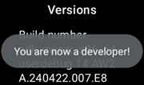

# AAPS nustatymas Wear OS laikrodyje

Toliau pateiktos instrukcijos taikomos **AAPS Wear** APK, kurį turite susikurti patys. Jei jo dar nesukūrėte, žr. [šį vadovą](../WearOS/BuildingAapsWearOS.md). Kurdami būtinai naudokite tą pačią raktų saugyklą (keystore), kurią naudojote telefono **AAPS** APK.

Dalis informacijos tinka ir **AAPSClient** bei **PumpControl** **Wear** APK. Kiekviena **Wear** programėlė bendrauja su ją atitinkančia telefono programėle. Pavyzdžiui, programėlė **AAPSClient Wear** gali rodyti **AAPSClient** duomenis, bet ne **AAPS** duomenis. Kai kartu įdiegtos kelios kliento versijos (**AAPSClient**, **AAPSClient2**, **AAPSClient3**), kiekvienos versijos plytelės turi mažą antraštę tos versijos spalva, kad braukdami jas atskirtumėte.

## Wear OS versijos ir suderinamumas

(wearos-watchface-changes)=

### Wear OS ciferblatų pakeitimai (poveikis AAPS ciferblatams)

```{admonition} Why newer Wear OS watches break AAPS watchfaces
:class: warning

2025 m. birželį Google [paskelbė apie pakeitimus](https://android-developers.googleblog.com/2025/06/upcoming-changes-to-wear-os-watch-faces.html): senasis ciferblatų variklis (AndroidX / Wearable Support Library, arba „WSL“) palaipsniui atsisakomas, o vietoj jo naudojamas naujesnis deklaratyvus **Watch Face Format**. **AAPS** pasirinktiniai ciferblatai sukurti su senuoju varikliu, todėl kuo naujesnė Wear OS versija, tuo didesnė tikimybė, kad AAPS ciferblatas veiks netinkamai arba visai neveiks.

Tai liečia tik **ciferblatus** – AAPS **ekrano elementai**, plytelės ir nuotolinio valdymo funkcijos nepaveiktos. Dėl to **Wear OS laikrodžio programinės įrangos / sistemos atnaujinimas gali sugadinti AAPS ciferblatus**, o grąžinti laikrodį į senesnę Wear OS versiją vėliau neįmanoma. Jei jūsų AAPS ciferblatas dabar veikia, **išjunkite automatinius laikrodžio atnaujinimus**.
```

Toliau esančioje lentelėje parodyta, kaip Google pakeitimas paveikia AAPS (senojo variklio) ciferblatus pagal Wear OS versiją:

| Wear OS versija         | Bazinė Android versija | API lygis | Poveikis AAPS (seniesiems) ciferblatams                                                                                                                                                 |
| ----------------------- | ---------------------- | --------- | --------------------------------------------------------------------------------------------------------------------------------------------------------------------------------------- |
| Wear OS 6               | Android 16             | 36        | **Senieji ciferblatai nebeprieinami** – vietoj jų AAPS įdiegia [Watch Face Format ciferblatą](#wearos-aaps-v4-watchface): jūsų pasirinktinį ciferblatą arba AAPS V4 elementų ciferblatą |
| Wear OS 5               | Android 14             | 34        | **Didelis** – aktyvusis (interaktyvusis) režimas dažnai neveikia, ekrano elementai sustingsta, animacijos sustoja                                                                       |
| Wear OS 4               | Android 13             | 33        | **Vidutinis** – ribojimas, praleisti atnaujinimai, daliniai gedimai                                                                                                                     |
| Wear OS 3.0 / 3.2 / 3.5 | Android 11             | 30        | **Mažas** – senasis variklis dar palaikomas                                                                                                                                             |

Jei jūsų laikrodžio versijoje AAPS ciferblatai veikia nepatikimai, AAPS duomenis galite rodyti per **ekrano elementus** suderinamame ciferblate arba naudoti [GlucoDataHandler](https://play.google.com/store/apps/details?id=de.michelinside.glucodatahandler) su ekrano elementu. Duomenis jam siunčia **AAPS** įskiepis [Išorinės susietos programėlės](#external-companion-apps). Laikrodžiuose su **Wear OS 6 ir naujesne** AAPS įdiegia pakaitinį ciferblatą, sukurtą nauju formatu – žr. toliau.

(wearos-aaps-v4-watchface)=

### Wear OS 6 ir naujesnė – AAPS įdiegiamas ciferblatas

Laikrodžiai su **Wear OS 6 arba naujesne** negali naudoti klasikinių AAPS ciferblatų kaip ciferblatų. Šiems laikrodžiams AAPS laikrodžio programėlė turi du ciferblatus, sukurtus naujuoju Google formatu **Watch Face Format**. Wear OS leidžia programėlei įdiegti tik **vieną** ciferblatą, todėl jūs pasirenkate, kuris iš dviejų bus laikrodyje:

- **Pasirinktinis ciferblatas** (numatytasis): rodo pasirinktinį ciferblatą, kurį įkėlėte iš telefono mygtuku **Įkelti ciferblatą** (žr. [AAPS ciferblato pasirinkimas](#WearOS_changing-to-AAPS-watchface)). Laikrodis jūsų dizainą piešia kaip paveikslėlį, todėl veikia visi esami pasirinktiniai ciferblatai. Ekrano elementų vietos, kurias gali turėti pasirinktinis ciferblatas, šiame paveikslėlyje **neprieinamos**, nes Wear OS elementų duomenis perduoda tik tikram ciferblatui. Ilgai spauskite ciferblatą, kad pasiektumėte vienintelį jo nustatymą: ar visada įjungtas ekranas rodo paprastą laikrodį, ar jūsų pritemdytą dizainą.
- **Elementų ciferblatas** (**AAPS V4** ciferblatas): jo **septynios ekrano elementų vietos** jau **iš anksto nustatytos su AAPS duomenimis**: KG reikšmė, AIO, AAO, [KG grafiko ekrano elementas](#Watchfaces-complications), valandinė bazė / laikinas tikslas ir **Veikimo režimas** piktograma viršutinėje kairėje vietoje (palieskite ją, kad pakeistumėte ciklo režimą iš laikrodžio). Palieskite laiką viršuje, kad atidarytumėte laikrodžio žadintuvo programėlę. Ką rodo kiekviena vieta, galite pakeisti ciferblato redaktoriuje.

Pasirenkate telefone: atidarykite įskiepį **Išmanieji laikrodžiai** ir skiltyje **Ciferblatas įdiegtas laikrodyje** pasirinkite vieną iš dviejų. Ši kortelė rodoma tik tada, kai prijungtas laikrodis su Wear OS 6 arba naujesne. **AAPS** paprašo patvirtinti, nes laikrodis ciferblatą pakeičia iš karto. Pakeitus **Elementų ciferblatą** kitu, ciferblato redaktoriuje pakeisti ekrano elementai taip pat grąžinami į numatytuosius. Patvirtinimo pranešime tai nurodyta. Kol pasirinktas **Elementų ciferblatas**, pasirinktinio ciferblato mygtukai paslėpti, o vietoj jų rodoma ciferblato peržiūra. Jei įkeliate pasirinktinį ciferblatą, kai pasirinktas **Elementų ciferblatas**, **AAPS** primena, kad reikia pasirinkti **Pasirinktinis ciferblatas**, kad jį matytumėte laikrodyje.

- Pasirinktas ciferblatas **įdiegiamas ir įjungiamas automatiškai**, kai AAPS laikrodžio programėlė pirmą kartą paleidžiama tokiame laikrodyje, ir **atnaujinamas automatiškai** kartu su laikrodžio programėle.
- Jei ciferblatą pašalinote, laikrodžio AAPS **Pagrindinis meniu** apačioje atsiranda punktas **Įdiegti ciferblatą** – palieskite jį, kad įdiegtumėte iš naujo.

Kai prijungtas laikrodis su Wear OS 5 arba senesne, kortelė **Ciferblatas įdiegtas laikrodyje** visai nerodoma (jos veikimui reikia Wear OS 6); ten klasikiniai ciferblatai veikia kaip anksčiau.

(wearos-complications-watchface-setup)=

### Elementų ciferblatas – rekomenduojama sąranka

**Elementų ciferblatas** turi septynias ekrano elementų vietas. Ilgai spauskite ciferblatą, palieskite **Tinkinti** (Customize) ir kiekvienai vietai pasirinkite duomenų šaltinį. Vietos sunumeruotos kaip ciferblato redaktoriuje: **1** kairėje, **2** centre, **3** dešinėje, **4** grafikas, **5** apačioje, **6** viršuje kairėje ir **7** viršuje dešinėje.

| Numatytoji sąranka                                                                                | Alternatyvi sąranka                                                                                    |
| ------------------------------------------------------------------------------------------------- | ------------------------------------------------------------------------------------------------------ |
|  |  |

| Vieta | Padėtis          | Numatyta                                                              | Alternatyva                                    |
| ----- | ---------------- | --------------------------------------------------------------------- | ---------------------------------------------- |
| 1     | Kairėje          | AIO ikonėlė                                                           | AAO & AIO                                      |
| 2     | Centre           | Kraujo gliukozė                                                       | Kraujo gliukozė                                |
| 3     | Dešinėje         | AAO ikonėlė                                                           | VB & tikslas                                   |
| 4     | Grafikas         | KG grafikas                                                           | KG grafikas                                    |
| 5     | Apačioje         | VB & tikslas                                                          | Telefono baterija                              |
| 6     | Viršuje kairėje  | Veikimo režimas                                                       | Veikimo režimas                                |
| 7     | Viršuje dešinėje | Telefono baterija arba programėlės nuoroda **Nutildyti AAPS aliarmą** | Programėlės nuoroda **Nutildyti AAPS aliarmą** |

Nuoroda **Nutildyti AAPS aliarmą** pasirenkama iš laikrodžio ekrano elementų **Programėlės nuoroda** (App shortcut). Ją palietus, nutildomas telefone skambantis aliarmas.

```{tip}
Laikrodyje įjunkite **Visada įjungtas ekranas** (Always-on display) (**Nustatymai** > **Ekranas**). Tada ciferblatas rodo jūsų gliukozę ir nuleidus ranką, o ne tuščią ekraną ar paprastą laikrodį.
```

```{admonition} No complication data while the watch is locked
:class: note
Jei skiltyje **Nustatymai** > **Sauga ir privatumas** nustatytas **Užrakto tipas** (Lock type), užrakintas laikrodis slepia ekrano elementų duomenis, o ciferblatas rodo tuščias vietas, kol jo neatrakinsite. Kad duomenys liktų matomi, tame pačiame meniu išjunkite **Slėpti informaciją** (Hide information).
```

### Wear OS 3

**AAPS Wear** APK įdiekite su [Wear Installer 2](https://youtu.be/abgN4jQqHb0?si=5L7WUeYMSd_8IdPV), Easy Fire Tools (aprašyta toliau) arba ADB.  
**AAPS Wear** veikia be apribojimų.

(BuildingAapsWearOs-WearOS5)=

### Wear OS 4 ir Wear OS 5

Pavyzdžiui: Galaxy Watch 4, 5, 6, 7 ir Ultra arba Pixel Watch, kurie dar **neatnaujinti** iki Wear OS 6. Versiją patikrinkite skiltyje **Nustatymai** > **Apie laikrodį** > **Programinė įranga**.

**AAPS Wear** APK įdiekite su [Wear Installer 2](https://youtu.be/abgN4jQqHb0?si=5L7WUeYMSd_8IdPV) (Wear OS 5 atveju vadovaukitės [šiuo vaizdo įrašu](https://www.youtube.com/watch?v=yef_qGvcCnk)). Visos **AAPS Wear** funkcijos veikia, bet klasikiniai **AAPS** ciferblatai riboti, kaip aprašyta lentelėje aukščiau: Wear OS 4 jie ribojami, Wear OS 5 dažnai neveikia.

```{admonition} Wear OS 5
:class: warning
Wear OS 5 laikrodyje AAPS ciferblatą reikia pasirinkti su Wear Installer 2 iškart įdiegus Wear programėlę: diegimo pabaigoje programa pasiūlo ciferblatą **AAPS (Custom)**. Jei netyčia pakeisite ciferblatą kitu, diegimą pakartokite. Gali būti neįmanoma pakeisti ciferblato nustatymų (Tamsus, Vienodos spalvos skirtukas ir kt.).

Jei klasikinis ciferblatas jums dabar veikia, **išjunkite automatinius laikrodžio atnaujinimus**: kitas programinės įrangos atnaujinimas greičiausiai jį sugadins. Jei vis tiek atnaujinsite iki Wear OS 6, perskaitykite skyrių aukščiau: tada **AAPS** įdiegia savo ciferblatą naujuoju formatu.
```

Jei ciferblatas veikia per daug nepatikimai, vietoj jo apsvarstykite [GlucoDataHandler](https://play.google.com/store/apps/details?id=de.michelinside.glucodatahandler) su ekrano elementu. Tam **AAPS** turi būti įjungtas įskiepis [Išorinės susietos programėlės](#external-companion-apps).

### Wear OS 6 ir naujesnė

Pavyzdžiui: Galaxy Watch 4 ir naujesni su One UI 8 Watch, Pixel Watch po 2025 m. atnaujinimo. Dauguma Galaxy ir Pixel laikrodžių šį atnaujinimą jau gavo.

**AAPS Wear** APK įdiekite su [Wear Installer 2](https://youtu.be/abgN4jQqHb0?si=5L7WUeYMSd_8IdPV). Klasikiniai ciferblatai neprieinami; **AAPS** automatiškai įdiegia telefone pasirinktą ciferblatą, žr. [AAPS įdiegiamas ciferblatas](#wearos-aaps-v4-watchface). **AAPS Wear** veikia be apribojimų.

## Kaip nustatyti Samsung Galaxy Watch 4 išmanųjį laikrodį su **AAPS**

Šiame skyriuje laikoma, kad išmanieji laikrodžiai jums visai nauji. Čia rasite trumpą populiaraus laikrodžio **Galaxy Watch 4** apžvalgą, o po jos – žingsnis po žingsnio vadovą, kaip laikrodyje nustatyti **AAPS**.

_Šis vadovas parašytas Galaxy Watch su Wear OS 3._ Wear OS 4 ir naujesnėse versijose laikrodis paprašo **susiejimo kodo**, kai telefonas ar kompiuteris jungiasi per ADB. Tai palaiko ir Wear Installer 2, ir [toliau](#BuildingAapsWearOs-WearOS5-TShoot) aprašytas būdas su terminalu.

Čia rasite pagrindinius nustatymo vadovus laikrodžiams [Galaxy Watch 5](https://www.youtube.com/watch?v=Y5upzOIxwTU) ir [Galaxy Watch 6](https://www.youtube.com/watch?v=D6bq20KzPW0)

## Pirmoji pažintis su išmaniuoju laikrodžiu

Kai pagal aukščiau esantį vaizdo įrašą atliksite pagrindinį laikrodžio nustatymą, telefone atidarykite Play parduotuvę ir atsisiųskite šias programėles: "Galaxy Wearable", “Samsung” ir “Easy Fire tools” arba "Wear Installer 2".

YouTube yra daug kitų autorių vaizdo įrašų, kurie padės susipažinti su nauju išmaniuoju laikrodžiu, pavyzdžiui:

[https://www.youtube.com/watch?v=tSVkqWNmO2c](https://www.youtube.com/watch?v=tSVkqWNmO2c)

Programėlėje „Galaxy Wearable“ taip pat yra naudojimo instrukcija. Telefone atidarykite Galaxy Wearable, suraskite laikrodį ir pabandykite susieti laikrodį su telefonu. Priklausomai nuo versijos, gali būti paprašyta iš Play parduotuvės įdiegti dar vieną programėlę „galaxy watch 4 plugin“ (jos atsisiuntimas užtrunka). Įdiekite ją telefone ir vėl pabandykite susieti laikrodį su telefonu programėlėje Wearable. Pereikite per kelis meniu ir pažymėkite norimus nustatymus.

## Samsung paskyros sukūrimas

El. pašto paskyroje, kurią naudojate Samsung paskyrai sukurti, turi būti nurodyta tokia gimimo data, kad naudotojui būtų bent 13 metų. Kitaip Samsung leidimus patvirtinti labai sunku. Jei vaikui iki 13 metų sukūrėte Gmail paskyrą ir naudojate šį el. pašto adresą, jos negalite paprasčiausiai pakeisti į suaugusiojo paskyrą. Vienas iš būdų tai apeiti – pakeisti dabartinę gimimo datą taip, kad dabartinis amžius būtų 12 metų ir 364 dienos. Kitą dieną paskyra bus pakeista į suaugusiojo paskyrą, ir galėsite tęsti Samsung paskyros kūrimą.

(remote-control-transferring-the-aaps-wear-app-onto-your-aaps-phone)=

## **AAPS** Wear programėlės perkėlimas į **AAPS** telefoną

Wear.apk failą iš Android Studio į telefoną galite perkelti vienu iš būdų:

a) USB laidu nukopijuokite **AAPS** Wear APK failą į telefoną, o tada įdiekite jį į laikrodį rankiniu būdu (side-load). Perkelkite Wear.apk USB laidu į telefono aplanką „Atsisiuntimai“ (Downloads); arba

b) iškirpkite Wear.apk iš Android Studio ir įklijuokite į savo Google Drive.


AAPS į laikrodį rankiniu būdu galite įdiegti su: 1) Wear Installer 2 2) Easy Fire tools 3) Android Debug Bridge (ADB) Čia rekomenduojame Wear Installer 2, nes vaizdo įraše instrukcijos ir eiga paaiškintos labai aiškiai. Jei Wear Installer 2 jums neveikia, išbandykite Easy Fire Tools arba ADB – abu aprašyti toliau.

### **AAPS** Wear diegimas iš telefono į laikrodį su Wear Installer 2

 

Wear Installer 2, kurią sukūrė [Malcolm Bryant](https://www.youtube.com/@Freepoc), galima atsisiųsti iš Google Play į telefoną. Su ja AAPS Wear programėlę galima rankiniu būdu įdiegti į laikrodį. Programėlėje yra patogus [vaizdo įrašas](https://youtu.be/abgN4jQqHb0?si=5L7WUeYMSd_8IdPV) apie diegimą rankiniu būdu.

```{tip}
Wear OS 5 laikrodžiams vadovaukitės [šiuo vaizdo įrašu](https://www.youtube.com/watch?v=yef_qGvcCnk).
Trikčių šalinimo patarimai – [toliau](#BuildingAapsWearOs-WearOS5-TShoot).
```

Čia rasite visą reikiamą informaciją (vaizdo įrašą geriausia atidaryti kitame įrenginyje, kad galėtumėte jį žiūrėti ir tuo pačiu nustatyti telefoną).

Kaip sakoma vaizdo įraše, baigę laikrodyje išjunkite ADB derinimą, kad be reikalo neeikvotumėte išmaniojo laikrodžio baterijos.

Arba (bet ne su Wear OS 5) galite:

### **AAPS** Wear diegimas į laikrodį su Easy Fire tools

1) Iš Play parduotuvės į telefoną atsisiųskite _[Easy Fire Tools](https://play.google.com/store/apps/details?id=de.agondev.easyfiretools&hl=en)_


2) Laikrodyje įjunkite kūrėjo režimą (kai laikrodis nustatytas ir prijungtas prie telefono):

Eikite į **Nustatymai** > **Sistema** > **Apie** > **Versijos** (meniu pavadinimai skiriasi pagal laikrodžio gamintoją – kai kuriuose laikrodžiuose tai **Apie laikrodį** > **Programinės įrangos informacija** > **Programinės įrangos versija**).


Greitai kelis kartus palieskite **Versijos numeris** (arba **Programinės įrangos versija**), kol pranešimas parodys, kad dabar esate kūrėjas.



Grįžkite į **Nustatymai** > **Sistema**: dabar rodomas naujas meniu **Kūrėjo parinktys**.

Skiltyje **Kūrėjo parinktys** įjunkite **ADB derinimas** ir **Belaidis derinimas** ir patvirtinkite užklausas. Tada belaidžio derinimo ekrane rodomas laikrodžio **IP adresas ir prievadas**, maždaug toks: **192.168.1.214** : 5555. Jums reikia tik IP adreso (čia **192.168.1.214**), o ne prievado numerio po dvitaškio. Atminkite, kad IP adresas gali keistis, pavyzdžiui, kiekvieną kartą, kai AAPS pradedate naudoti naujame telefone.


3 ŽINGSNIS) Telefone į Easy Fire tools įveskite IP adresą, _pvz._ **192.168.1.214** (atidarykite meniu kairėje (☰), nustatymus ir įveskite IP adresą).


Tada spauskite kištukinio lizdo piktogramą viršuje dešinėje. Prisijungus jis taps žalias.


4 ŽINGSNIS) Vadovaukitės [šiomis instrukcijomis](https://wearablestouse.com/blog/2022/01/04/install-apps-apk-samsung-galaxy-watch-4/?utm_content=cmp-true), kad su Easy Fire tools rankiniu būdu įdiegtumėte (t. y. perkeltumėte) aaps-wear.apk į išmanųjį laikrodį


(BuildingAapsWearOs-WearOS5-TShoot)=

### Terminalo naudojimas
Prijunkite išmanųjį laikrodį ir kompiuterį prie to paties Wi-Fi tinklo.

- ADB atsisiųskite iš: https://developer.android.com/tools/releases/platform-tools
- Atidarykite terminalą.
- Windows sistemoje diske `C:` sukurkite naują aplanką `adb`. Atidarykite anksčiau atsisiųstą failą `platform-tools-latest-windows.zip`. Nukopijuokite visus failus iš `platform-tools` į `C:\adb` ir atidarykite šį aplanką komandų eilutėje (dešiniuoju pelės mygtuku ir „Atidaryti terminale“). Įveskite toliau pateiktą komandą, kad nustatytumėte kelią į aplanką, kuriame yra ADB: `setx PATH "%PATH%;C:\adb"`
- Mac kompiuteryje, užuot diegę rankiniu būdu, galite naudoti homebrew: `brew install android-platform-tools`

Laikrodyje:
- Eikite į Nustatymai → Apie laikrodį → **Programinės įrangos informacija** (Software Information)
- 7 kartus palieskite „Programinės įrangos versija“, kol pamatysite pranešimą, kad kūrėjo režimas įjungtas.
- Eikite į Nustatymai → Kūrėjo parinktys. Įjunkite **ADB derinimas** (ADB debugging)
- Eikite į Nustatymai → Kūrėjo parinktys → Belaidis derinimas → **Susieti naują įrenginį** (Pair new device)

Pamatysite Wi-Fi susiejimo kodą, IP adresą ir prievadą:


- Terminale: `adb pair ipaddress:port` Pvz. `adb pair 10.10.1.125:36299`
- Būsite paprašyti įvesti susiejimo kodą. Įveskite jį.
- Pamatysite atsakymą:<br> `Successfully paired to 10.10.1.125:36299 [guid=adb-RXXXW20LMKJY-eh5zBj]`<br>
- Terminale įveskite: <br>`adb devices`.<br> Turėtumėte pamatyti maždaug tokį tekstą:<br> `List of devices attached`<br> `10.10.1.125:36299  offline`<br> `adb-RFAW20LMKJY-eh5zBj._adb-tls-connect._tcp   device`<br>

- Dabar kompiuteryje eikite į aplanką, kuriame yra Wear APK, ir įveskite<br> `adb install wear-full.apk` <br>vietoj wear-full.apk įrašydami savo APK failo pavadinimą.
- Pamatysite:<br> `Performing Streamed Install`<br> `Success`


(wear-os-5-troubleshooting)=

### Bendrieji trikčių šalinimo patarimai Wear OS 5

- Nenaudokite Wi-Fi modemo (tethering). Tai neveiks.
- Telefone ADB derinimo įjungti nereikia (tik laikrodyje). Telefone išjunkite ADB derinimą.
- Junkitės prie savo vietinio tinklo, kuriame telefonas ir laikrodis mato vienas kitą (nenaudokite svečių Wi-Fi tinklo).
- Telefonas ir laikrodis turi būti tame pačiame tinkle ir prijungti prie to paties Wi-Fi įrenginio. Ypač problemų gali kelti Wi-Fi kartotuvai arba prieigos taškai.
- Būkite netoli pagrindinio maršrutizatoriaus, tada paleiskite iš naujo ir telefoną, ir laikrodį.

**Susiejimas:**

- Laikrodis: Belaidis derinimas – užsirašykite IP adresą.
- Wear Installer: Wear Installer programėlėje įveskite IP adresą.
- Pasirinkite „Susieti naują“ (Pair new), užsirašykite rodomą susiejimo kodą ir prievado numerį.
- Wear Installer: įveskite susiejimo kodą + tarpą + prievado numerį.
- Wear Installer turėtų pranešti, kad susiejimas pavyko. Jei nepranešė, uždarykite Wear Installer ir bandykite dar kartą.

Susieję turėtumėte galėti įdiegti AAPS Wear APK:

- Uždarykite ir vėl paleiskite Wear Installer.
- Belaidžio derinimo ekrane užsirašykite IP adresą ir prievado numerį ir patikrinkite / įveskite juos Wear Installer programėlėje.
- Pastaba: šis prievado numeris skiriasi nuo to, kuris buvo naudotas susiejimui!

## Ryšio tarp laikrodžio ir telefono nustatymas **AAPS** programėlėje

Paskutinis žingsnis – nustatyti **AAPS** telefone, kad jis bendrautų su **Wear.apk** laikrodyje. Tam įjunkite Wear įskiepį:

* Telefone atidarykite **AAPS** programėlę

* Atidarykite **meniu** (☰) viršutiniame kairiajame kampe ir eikite į **Konfigūracija** > **Ryšys**

* Pažymėkite langelį **Išmanieji laikrodžiai**


Kad galėtumėte leisti bolusą ar atlikti kitus veiksmus iš laikrodžio, taip pat įjunkite **Valdymas per Wear** skiltyje [Nustatymai > Išmanieji laikrodžiai](#preferences-wear).

Norėdami pakeisti į kitą **AAPS** ciferblatą, laikrodžio pagrindiniame ekrane paspauskite ir palaikykite ciferblatą ir bakstelėkite **Customize**. Tada braukite į dešinę, kol pamatysite visus **AAPS** ciferblatus.

Jei **AAPS** Wear.apk sėkmingai įdiegtas į išmanųjį laikrodį, tai atrodys taip:


Kai kuriuose išmaniuosiuose laikrodžiuose, pvz., Samsung Galaxy, Samsung Galaxy papildomose funkcijose (Advanced Features) turi būti **įjungtas** „Nuotolinis ryšys“ (Remote Connection), kad **Wear.apk** & **AAPS** veiktų nuotoliniu būdu per Wi-Fi.


(wear-os-watch-phone-communication)=

### **AAPS** laikrodžio ir **AAPS** telefono ryšio trikčių šalinimas

1.  Jei EasyFire tools neprisijungia arba gaunate pranešimą ‘authorisation failed’ > patikrinkite, ar teisingai įvestas IP adresas.
2.  Patikrinkite, ar išmanusis laikrodis prijungtas prie interneto (o ne tik prie telefono per Bluetooth).
3.  Patikrinkite, ar **AAPS** telefonas ir išmanusis laikrodis susieti Samsung programėlėje.
4.  Taip pat gali padėti telefono ir išmaniojo laikrodžio paleidimas iš naujo (t. y. išjungti ir vėl įjungti)
5.  Jei Wear.apk pavyko atsisiųsti į telefoną, bet negaunate KG duomenų, _patikrinkite_, ar į laikrodį įdiegėte teisingą **AAPS** Wear APK: kūrimo naršyklėje laikrodžio programėlė yra failas `aaps-wear-….apk`, žr. [Wear AAPS programėlės kūrimas](../WearOS/BuildingAapsWearOS.md). Jei įdiegėte bet kurį iš šių failų: a) **AAPSClient** Wear APK (kai telefone veikia **AAPS**); b) `.aab` failą; arba c) failą, kurio pavadinime yra žodis ‘debug’, vadinasi, kurdami nepasirinkote teisingo Wear OS APK.
6.  Patikrinkite, ar maršrutizatorius neizoliuoja įrenginių vienas nuo kito.

Daugiau trikčių šalinimo patarimų rasite [čia](https://freepoc.org/wear-installer-help-page/#:~:text=If%20you%20are%20having%20problems,your%20phone%20and%20your%20watch.)

(WearOS_changing-to-AAPS-watchface)=

## AAPS ciferblato pasirinkimas Wear OS laikrodyje

Standartiniame AAPS Wear OS APK kūrime yra keli ciferblatai. Kai laikrodyje įdiegsite AAPS Wear APK, jie bus prieinami. Štai kaip pasirinkti vieną iš jų:

1. Laikrodyje (jei jis su Wear OS) ilgai spauskite dabartinį ciferblatą, kad atsidarytų ciferblatų pasirinkimo ekranas. Slinkite iki galo į dešinę, kol pamatysite mygtuką „Pridėti ciferblatą“ (Add Watch Face), ir jį pasirinkite


2. Slinkite sąrašu, kol rasite „AAPS (Custom)“ (priklausomai nuo laikrodžio, įdiegtų programėlių ciferblatai rodomi skiltyje „Atsisiųsta“ (Downloaded) arba sugrupuoti pagal programėlę), ir spauskite paveikslėlio vidurį, kad pridėtumėte jį į dabartinių ciferblatų sąrašą. Nesijaudinkite dėl to, kaip dabar atrodo ciferblatas „AAPS (Custom)“. Kitame žingsnyje pasirinksite norimą išvaizdą.


3. Dabar telefone atidarykite AAPS ir atidarykite Wear įskiepį: **Konfigūracija** > **Ryšys** > **Išmanieji laikrodžiai** > **Atidaryti įskiepį** (jei įskiepis neįjungtas, pirmiausia pažymėkite **Išmanieji laikrodžiai**).


4. Spauskite mygtuką „Įkelti ciferblatą“ ir pasirinkite jums patinkantį ciferblatą


5. Pažiūrėkite į laikrodį: ciferblatas „AAPS (Custom)“ dabar turėtų rodyti jūsų pasirinktą išvaizdą. Palaukite kelias sekundes, kol jis atsinaujins. Telefono ekrane **Išmanieji laikrodžiai** dabar rodomas įkelto ciferblato pavadinimas ir jo peržiūra. **Ciferblato info** rodo ciferblato informaciją ir jame esančius laukus, o **Daugiau ciferblatų** atidaro [mainų svetainę](../ExchangeSiteCustomWatchfaces/index.md), kurioje galite atsisiųsti kitų pasirinktinių ciferblatų. Dabar galite pritaikyti ekrano elementus ir kt.: ilgai spauskite ciferblatą, tada ciferblato paveikslėlyje spauskite mygtuką „Tinkinti“ (Customize).

```{admonition} Complications on a custom watchface
:class: note
Pasirinktiniai ciferblatai, sukurti su pasirinktinio ciferblato formato 3.0 ar naujesne versija, gali turėti iki penkių ekrano elementų vietų. Jų padėtį ir dydį nustato ciferblatas (**Elementų išdėstymas**). Laikrodyje ilgai spauskite ciferblatą, palieskite **Tinkinti** (Customize) ir palieskite nuo **1 elementas** iki **5 elementas**, kad pasirinktumėte kiekvienoje vietoje rodomą duomenų šaltinį. Tos pačios eilutės rodomos laikrodžio AAPS programėlėje skiltyje **Nustatymai** > **AAPS(Custom)**; palietus eilutę, atsidaro tas pats pasirinkimo langas. **Elementų tipų prioritetas** nustato, ar vieta pirmenybę teikia reikšmei arba skalei, tekstui ar piktogramai, kai duomenų šaltinis siūlo kelis variantus. Pakeistas prioritetas taikomas tik kitą kartą, kai tai vietai pasirinksite duomenų šaltinį.

Šios vietos veikia tik laikrodžiuose su **Wear OS 5 arba senesne**, kuriuose pasirinktinis ciferblatas veikia kaip tikras ciferblatas. Laikrodžiuose su **Wear OS 6 ir naujesne** pasirinktinis ciferblatas rodomas kaip paveikslėlis be ekrano elementų vietų, ir 1 bei 2 žingsnių aukščiau atlikti nereikia: įsitikinkite, kad telefono įskiepio **Išmanieji laikrodžiai** skiltyje **Ciferblatas įdiegtas laikrodyje** pasirinktas **Pasirinktinis ciferblatas** (žr. [AAPS įdiegiamas ciferblatas](#wearos-aaps-v4-watchface)).
```

## AAPSv2 ciferblatas – paaiškinimai


A – laikas nuo paskutinio ciklo vykdymo

B – NGJ reikšmė

C – minutės nuo paskutinės NGJ reikšmės

D – pokytis, palyginti su paskutine NGJ reikšme (mmol arba mg/dL)

E – vidutinis NGJ reikšmės pokytis per paskutines 15 minučių

F – telefono baterija

G – valandinė bazė (įprastai rodoma V/val, o laikinos valandinės bazės metu – %)

H – BGI (blood glucose impact, poveikis gliukozei kraujyje) -> kiek KG „turėtų“ kilti arba kristi vien dėl insulino veikimo.

I – angliavandeniai (aktyvūs angliavandeniai | i-AV ateityje)

J – aktyvus insulinas (iš bolusų | iš valandinės bazės)
