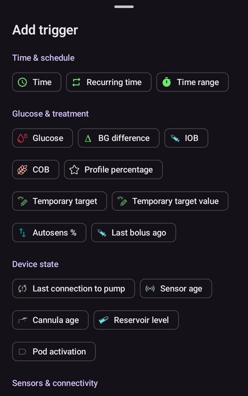

# Slik bruker du Autotune-pluginen

Autotune-pluginen er en implementering av OpenAPS-algoritmen Autotune i AAPS. Den analyserer den nylige AAPS-historikken din og foreslår justeringer av basaldosene, ISF og IK.

Autotune-pluginen er tilgjengelig i AAPS-versjoner siden [3.4](#version3400), men er skjult som standard.

(autotune-how-autotune-calculates-adjustments)=
## Slik beregner Autotune justeringer

Autotune ser tilbake på den nylige AAPS-historikken din – CGM-målinger, boluser, karbohydrater og midlertidige basaler – og finner ut hvor **Profilen** din (basaldoser, ISF, IK) ikke helt stemmer med det som faktisk skjedde med BS.

For hvert 5-minutters datapunkt sammenligner den den **faktiske BS-endringen** din med endringen Profilen din predikerte, og sorterer avviket i én av tre grupper:

* avvik som skjedde uten aktive karbohydrater og uten insulinaktivitet (brukes til å justere **basaldoser**, time for time),
* avvik som skjedde etter en bolus/korreksjon uten karbohydrater (brukes til å justere **ISF**), eller
* avvik som skjedde mens karbohydrater ble absorbert (brukes til å justere **IK**).

Deretter ser den på mønsteret i avvikene i hver gruppe (med persentiler i stedet for et enkelt gjennomsnitt, slik at noen få støyende datapunkter ikke forvrenger resultatet) og foreslår en ny verdi for den timen/parameteren.

For at ingen enkelt kjøring skal overkorrigere, flytter hver Autotune-kjøring en verdi bare en del av veien mot det dataene tilsier: opptil 10 % for ISF og IK, og opptil 20 % for hvert basalsegment. Den samlede endringen begrenses i tillegg av innstillingene **Autosens maksimum** / **Autosens minimum** (se [Andre innstillinger](#autotune-other-settings) nedenfor) – de samme grensene som begrenser Autosens. Derfor er Autotune ment å kjøres gjentatte ganger (dag etter dag, eller hver natt) i stedet for at du stoler på én enkelt kjøring: resultatene bør nærme seg gradvis, og et stort hopp i én kjøring er et tegn på at du bør dobbeltsjekke dataene dine (glemte karbohydrater, en dårlig sensordag _osv._) i stedet for å stole blindt på det.

Autotune kan kjøres på tre måter: manuelt som en enkeltkjøring fra pluginen (som beskrevet nedenfor), automatisk hver natt via en [automasjonsregel](#autotune-run-autotune-with-an-automation-rule), eller – helt utenfor AAPS – som et frittstående kommandolinjeverktøy på eksporterte data, som er slik noen veiledninger fra fellesskapet beskriver bruk uten en telefon som aktivt kjører AAPS.

*Den underliggende oref0-algoritmen med alle matematiske detaljer finner du i [OpenAPS sin Autotune-dokumentasjon](https://openaps.readthedocs.io/en/latest/docs/Customize-Iterate/autotune.html).*

## Vise Autotune-pluginen

Opprett en tom fil med navnet `enable_autotune` i undermappen `extra` i [AAPS-mappen](#preferences-maintenance-settings) på telefonen din.

***MERK: Sjekk i AAPS-innstillingene hvor AAPS-mappen din er, og at du har lagt filen i riktig mappe. Flere brukere har lagt filen i feil mappe.***


Start **AAPS** på nytt. Åpne så **menyen** (☰), velg **Konfigurasjon**, deretter kategorien **Generelt**, og kryss av for **Autotune**. Kortet viser da **Innstillinger** og **Åpne plugin**:


## Autotune-brukergrensesnittet

Trykk på **Åpne plugin** på **Autotune**-kortet for å åpne Autotune-skjermen:


- I nedtrekksmenyen Profil velger du inngangsprofilen du vil justere (som standard er den aktive profilen din valgt)
  - Merk: Hver gang du velger en ny profil, fjernes de forrige resultatene, og **Antall dager med data** settes til standardverdien
- Så er **Antall dager med data** (kalt **Antall dager** i eldre versjoner) for å velge hvor mange dager som brukes i beregningen for å justere profilen din. Minste verdi er 1 dag, og største verdi er 30 dager. Dette tallet bør ikke være for lite, slik at du får riktige, trinnvise og jevne resultater (over 7 dager for hver beregning)
  - Merk: Hver gang du endrer **Antall dager med data**, fjernes de forrige resultatene
- Siste beregning er en lenke som henter fram den siste gyldige beregningen din. Hvis du ikke har kjørt Autotune i dag, eller hvis forrige resultat ble fjernet fordi du endret en beregningsparameter ovenfor, kan du hente fram parameterne og resultatene fra den siste vellykkede kjøringen.
- Varsel viser deg for eksempel informasjon om den valgte profilen (hvis du har flere IK-verdier eller flere ISF-verdier)
  - Merk: Autotune-beregningen virker bare med én enkelt IK-verdi og én enkelt ISF-verdi. Det finnes for tiden ingen Autotune-algoritme som kan justere IK eller ISF med døgnvariasjon. Hvis inngangsprofilen din har flere verdier, ser du i varselfeltet gjennomsnittsverdien som brukes for å justere profilen din.
- Knappen Sjekk inngangsprofil åpner profilvisningen, slik at du raskt kan kontrollere profilen din (enheter, IK, ISF, basal og mål)
  - Merk: Autotune justerer bare IK (én verdi), ISF (én verdi) og basal (med døgnvariasjon). Enheter og mål blir uendret i resultatprofilen.

- «Kjør Autotune» starter Autotune-beregningen med den valgte profilen og det valgte antallet dager med data
  - Merk: Autotune-beregningen kan ta lang tid. Når den er startet, kan du bytte til et annet skjermbilde (hovedskjermen, ...) og komme tilbake til Autotune-pluginen senere for å se resultatene

  

- Under kjøringen ser du så delresultater nedenfor

  - Merk: Under kjøringen er innstillingene låst, så du kan ikke lenger endre valgt inngangsprofil eller antall dager. Du må vente til den pågående beregningen er ferdig hvis du vil starte en ny kjøring med andre parametere.

  

- Når Autotune-beregningen er ferdig, ser du resultatet (den justerte profilen) og fire knapper nedenfor.

  

- Det er viktig å alltid sammenligne inngangsprofilen (kolonnen «Profil»), resultatprofilen (kolonnen «Justert») og den prosentvise endringen for hver verdi (kolonnen «%»).

- For basaldoser ser du også antall «manglende dager». Du har manglende dager når Autotune ikke har nok data kategorisert som «Basal» til å justere basaldosen for dette tidsrommet (for eksempel etter hvert måltid, når karbohydrater absorberes). Dette tallet bør være så lavt som mulig, særlig når basalen er viktig (for eksempel om natten eller sent på ettermiddagen)

- Knappen «Sammenlign profiler» åpner profilsammenligningen. Inngangsprofilen er blå, og resultatprofilen (kalt «Justert») er rød.

  - Merk: I eksempelet nedenfor har inngangsprofilen døgnvariasjon for IK og ISF, men den beregnede resultatprofilen har én enkelt verdi. Hvis det er viktig for deg å få en resultatprofil med døgnvariasjon, se [IK- eller ISF-profil med døgnvariasjon](#autotune-circadian-ic-or-isf-profile) nedenfor.

  

- Hvis du stoler på resultatene (lav prosentvis endring mellom inngangsprofilen og resultatprofilen), kan du trykke på knappen «Aktiver profil» og deretter på OK for å bekrefte.

  - «Aktiver profil» oppretter automatisk en ny profil «Justert» i profillisten din (**Administrer → Profil**).
  - Hvis du allerede har en profil med navnet «Justert» i **Administrer → Profil**, oppdateres denne profilen med den beregnede Autotune-profilen før aktiveringen

  

- Hvis du mener at den justerte profilen må tilpasses (for eksempel hvis du synes noen endringer er for store), kan du trykke på knappen «Kopier til lokal profil»

  - En ny profil med prefikset «Justert» og dato og klokkeslett for kjøringen opprettes i **Administrer → Profil**

  

- Du kan deretter redigere den justerte profilen: åpne **Administrer** > **Profil**, sveip til kortet med navnet «Justert» og dato og klokkeslett for kjøringen, og trykk på **Rediger**-knappen (blyanten)

  - verdiene i profilen avrundes i brukergrensesnittet til det pumpen din støtter

  

- Hvis du vil erstatte inngangsprofilen din med Autotune-resultatet, trykker du på knappen «Oppdater inngangsprofil» og bekrefter dialogboksen med OK

  - Merk: Hvis du trykker på «Aktiver profil» etter «Oppdater inngangsprofil», aktiverer du den oppdaterte profilen din og ikke standardprofilen «Justert».

  

- Hvis du har oppdatert inngangsprofilen din, erstattes knappen «Oppdater inngangsprofil» av knappen «Tilbakestill inngangsprofil» (se skjermbildet nedenfor). Slik ser du med en gang om den gjeldende inngangsprofilen din i **Administrer → Profil** allerede inneholder resultatet av siste kjøring eller ikke. Med denne knappen kan du også hente tilbake inngangsprofilen din uten Autotune-resultatet

  


## Autotune-innstillinger

(autotune-plugin-settings)=

### Innstillinger for Autotune-pluginen

  

```{admonition} Only DEV
:class: note
Funksjonen **Bytt profil automatisk** er bare tilgjengelig i utviklermodus (Dev/Engineering mode).
```

- **Bytt profil automatisk** (standard Av): se [Kjøre Autotune med en automasjonsregel](#autotune-run-autotune-with-an-automation-rule) nedenfor. Hvis du setter denne innstillingen til På, oppdateres inngangsprofilen automatisk med den justerte profilen, og den aktiveres.
  - **Vær forsiktig: du må stole på, og kontrollere i flere dager etterpå, at loopen din faktisk blir bedre etter at den justerte profilen er oppdatert og aktivert uten endringer**

- **Kategoriser UAM som basal** (standard Av): Denne innstillingen er for brukere som bruker AAPS uten å registrere karbohydrater (Full UAM). Når den er Av, hindrer den at UAM kategoriseres som basal.
  - Merk: Hvis det er oppdaget minst én time med karbohydratabsorpsjon i løpet av en dag, blir alle data kategorisert som «UAM» kategorisert som basal, uansett denne innstillingen (På eller Av)
- **Standard antall tune-dager** (standard 5): Du kan angi standardverdien med denne innstillingen. Hver gang du velger en ny profil i Autotune-pluginen, erstattes **Antall dager med data** med denne standardverdien
- **Bruk IK/ISF med døgnvariasjon** (standard Av): se [IK- eller ISF-profil med døgnvariasjon](#autotune-circadian-ic-or-isf-profile) nedenfor.

(autotune-other-settings)=
### Andre innstillinger

- Autotune bruker også Autosens maksimum og Autosens minimum for å begrense endringen. Du kan se og endre disse verdiene i [**Innstillinger** > **Absorpsjonsinnstillinger** > **Avanserte innstillinger**](../SettingUpAaps/Preferences.md) (**Autosens maksimum** og **Autosens minimum**).

  


## Avansert funksjon

(autotune-circadian-ic-or-isf-profile)=

### IK- eller ISF-profil med døgnvariasjon

- Hvis du har stor variasjon i IK og/eller ISF i profilen din, og du stoler helt på tidspunktene og variasjonen gjennom døgnet, kan du slå på **Bruk IK/ISF med døgnvariasjon** (kalt «Bruk gjennomsnittlig resultat i circadian IK/ISF» i eldre versjoner)

  - Merk at Autotune-beregningen alltid gjøres med én enkelt verdi, og at døgnvariasjonen ikke justeres av Autotune. Denne innstillingen bruker bare den beregnede gjennomsnittlige endringen for IK og/eller ISF på verdiene dine med døgnvariasjon

- Se på skjermbildet nedenfor den justerte profilen med Bruk gjennomsnittlig endring Av (til venstre) og På (til høyre)

  


### Justere bestemte ukedager

- Hvis du trykker på **øye**-ikonet til høyre for feltet **Antall dager med data**, ser du dagvalget. Du kan velge hvilke ukedager som skal tas med i Autotune-beregningen (på skjermbildet nedenfor ser du et eksempel for «arbeidsdager», der lørdag og søndag er fjernet fra Autotune-beregningen)
  - Hvis antall dager som tas med i Autotune-beregningen er lavere enn **Antall dager med data**, ser du hvor mange dager som tas med, til høyre for dagvelgeren (10 dager i eksempelet nedenfor)
  - Denne innstillingen gir gode resultater bare hvis antall gjenværende dager ikke er for lite (hvis du for eksempel justerer en egen profil for helgedager med bare lørdag og søndag valgt, bør du sette **Antall dager med data** til minst 21 eller 28 for å få med 6 eller 8 dager i Autotune-beregningen)

  

- Under Autotune-beregningen kan du følge framdriften i beregningene («Delvis resultat dag 1 / 4 justert» i eksempelet nedenfor, med lørdag og søndag utelatt)

  


(autotune-run-autotune-with-an-automation-rule)=

## Kjøre Autotune med en automasjonsregel

```{admonition} Only DEV
:class: note
Funksjonen **Bytt profil automatisk** er bare tilgjengelig i utviklermodus (Dev/Engineering mode).
```

Første steg er å definere riktig utløser for en automasjonsregel med Autotune:

Merk: Du finner mer informasjon om hvordan du setter opp en automasjonsregel [her](../DailyLifeWithAaps/Automations.md).

- Du bør velge utløseren Gjentakende tidspunkt: kjør Autotune bare én gang per dag. Autotune er laget for å kjøres daglig (hver nye kjøring flytter seg én dag framover, og profilendringen bør raskt bli bitte liten)

  

- I starten er det best å kjøre Autotune på dagtid, slik at du kan kontrollere resultatene. Hvis du vil kjøre Autotune om natten, må du velge kl. 04:00 eller senere i utløseren for å få med dagen i dag i neste Autotune-beregning.

  

- Deretter kan du velge handlingen **Kjør Autotune** (i gruppen **Loop & insulin**)

  

- Du kan så tilpasse parameterne for handlingen til kjøringen din. I en ny handling viser **Velg profil du vil justere** den første profilen i den lokale profillisten din, feltet **Antall dager** er tomt, og alle dager er valgt. Velg profilen du vil justere, og skriv inn **Antall dager** (1 til 30).

  

- Etter noen dager, hvis du stoler helt på Autotune-resultatene og den prosentvise endringen er lav, kan du slå på «**Bytt profil automatisk**» i [Autotune-innstillingene](#autotune-plugin-settings), slik at den justerte profilen oppdateres og aktiveres automatisk etter beregningen.

Merk: Hvis du vil justere profiler for bestemte ukedager automatisk (for eksempel én profil for «Helgedager» og en annen for «Arbeidsdager»), lager du én regel for hver profil, velger de samme dagene i utløseren og i Autotune-handlingen, setter Antall dager høyt nok til at justeringen sikkert gjøres med minst 6 eller 8 dager, og husker å velge et tidspunkt etter kl. 04:00 i utløseren ...

- Nedenfor ser du et eksempel på en regel som kjører hver arbeidsdag (mandag til fredag) kl. 04:00 og justerer profilen «Normal» med 14 i **Antall dager**, bare arbeidsdager (slik at bare 10 dager tas med i Autotune-beregningen).

  


## Tips og triks

Autotune bruker informasjonen som finnes i databasen din. Hvis du nettopp har installert AAPS på en ny telefon, må du derfor vente flere dager før du kan starte Autotune med nok dager til å få relevante resultater.

Autotune er bare et hjelpemiddel. Det er viktig å sjekke jevnlig om du er enig i den beregnede profilen. Hvis du er i tvil, endre Autotune-innstillingene (for eksempel antall dager), eller kopier resultatene til en lokal profil og tilpass profilen før du bruker den.

Kjør alltid Autotune manuelt i flere dager og kontroller resultatene før du tar dem i bruk. Og først når du stoler helt på Autotune-resultatene, og når endringen mellom forrige profil og den beregnede profilen er blitt bitte liten, begynner du å bruke Automasjon (aldri før)

- Autotune kan virke svært godt for noen brukere og ikke for andre, så **hvis du ikke stoler på Autotune-resultatet, ikke bruk det**

Det er også viktig å analysere Autotune-resultatene for å forstå (eller prøve å forstå) hvorfor Autotune foreslår disse endringene

- du kan få en samlet økning eller reduksjon i styrken på profilen din (for eksempel økt total basal sammen med lavere ISF- og IK-verdier). det kan henge sammen med flere påfølgende dager med Autosens-korreksjon over 100 % (det trengs mer aggressivitet) eller under 100 % (du er mer følsom)
- Noen ganger foreslår Autotune en annen balanse mellom basaldoser og IK/ISF (for eksempel lavere basal og mer aggressiv IK/ISF)

Vi anbefaler at du ikke bruker Autotune i disse tilfellene:

- Du registrerer ikke alle karbohydratene dine
  - Hvis du ikke registrerer karbohydrater du tar for å korrigere en føling, ser Autotune en uventet økning i BS-verdien din og øker basaldosene dine 4 timer tidligere. Det kan være det motsatte av det du trenger for å unngå føling, særlig midt på natten. Derfor er det viktig å registrere alle karbohydrater, særlig korreksjoner for føling.
- Du har mange perioder med oppdaget UAM i løpet av dagen.
  - Har du registrert alle karbohydratene dine, og har du anslått karbohydratene riktig?
  - Alle UAM-perioder: med mindre du ikke registrerer noen karbohydrater i løpet av en dag og «Kategoriser UAM som basal» er slått av, blir alle UAM-periodene dine kategorisert som basal, og det kan øke basalen din mye (langt mer enn nødvendig)

- Karbohydratabsorpsjonen din er svært langsom: hvis det meste av karbohydratabsorpsjonen din beregnes med parameteren min_5m_carbimpact (du ser disse periodene som en liten oransje prikk øverst på COB-kurven), kan COB-beregningen bli feil og gi feil resultater.
  - Når du trener, er du vanligvis mer følsom for insulin, og BS stiger ikke så mye. Under eller etter trening er det derfor vanlig å se noen perioder med langsomme karbohydrater. Men hvis du for ofte har uventet langsom karbohydratabsorpsjon, kan det hende du trenger en profiljustering (høyere IK-verdi), eller at min_5m_carbimpact er satt litt for høyt.
- Du har «svært dårlige dager», for eksempel at du sitter fast i høyt blodsukker i flere timer og trenger en stor mengde insulin for å komme ned i målområdet, eller at du etter et sensorbytte har lange perioder med feil BS-verdier. Hvis du bare har én eller to «dårlige dager» de siste ukene, kan du slå av disse dagene manuelt i Autotune-beregningen for å holde dem utenfor beregningen, og igjen: **kontroller nøye om du kan stole på resultatene**
- Hvis den prosentvise endringen er for stor
  - Du kan prøve å øke antall dager for å få jevnere resultater
