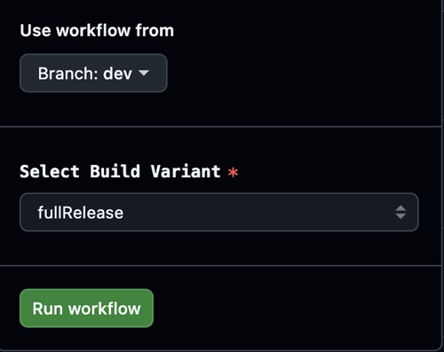

# Utviklingsgrenen (dev)

```{warning}
Dev-grenen er bare for videre utvikling av AAPS. Den bør brukes på en egen telefon for testing, <font color="#FF0000">**ikke til faktisk looping!**</font>
```

Den mest stabile versjonen av AAPS er den i [master-grenen](https://github.com/nightscout/AndroidAPS/tree/master). Det anbefales å holde seg til master-grenen for faktisk looping.

Dev-versjonen av AAPS er bare for utviklere og testere som er komfortable med stacktraces, med å lete gjennom loggfiler og kanskje starte debuggeren for å lage feilrapporter som er nyttige for utviklerne (kort sagt: folk som vet hva de gjør uten hjelp!). Derfor er mange uferdige funksjoner deaktivert. For å aktivere disse funksjonene går du inn i **Engineering Mode** ved å lage en fil med navnet `engineering_mode` i mappen /AAPS/extra. Å aktivere engineering mode kan ødelegge loopen helt.

Dev-grenen er likevel et godt sted for å se hvilke funksjoner som testes, hjelpe til med å luke ut feil og gi tilbakemelding om hvordan de nye funksjonene virker i praksis. Ofte tester folk dev-grenen på en gammel telefon og pumpe til de er trygge på at den er stabil – all bruk av den skjer på egen risiko. Når du tester nye funksjoner, husk at du velger å teste en funksjon som fortsatt er under utvikling. Gjør det på egen risiko og med nødvendig aktsomhet for å holde deg trygg.

Hvis du finner en feil eller tror noe gikk galt mens du brukte dev-grenen, se i [issues-fanen](https://github.com/nightscout/AndroidAPS/issues) for å sjekke om noen andre har funnet den, eller legg den til selv hvis ikke. Jo mer informasjon du kan dele her, desto bedre (ikke glem at du kanskje må dele [loggfilene](../GettingHelp/AccessingLogFiles.md) dine). De nye funksjonene kan også diskuteres på [Discord](https://discord.gg/4fQUWHZ4Mw).

En dev-versjon har en utløpsdato. Det virker upraktisk når den fungerer bra, men det har en hensikt. Når bare én dev-versjon er i omløp, er det lettere å holde oversikt over feilene folk rapporterer. Utviklerne vil ikke havne i en situasjon der det finnes tre versjoner av dev ute hos brukerne, der feil er rettet i noen og ikke i andre, og folk fortsetter å rapportere de som allerede er rettet.

(branch-ci-test)=

## Teste en bestemt gren (branch-ci)

For å bygge en testgren velger du branch-ci, som lar deg velge en bestemt gren for å lage APK-filen. Du kan bruke denne metoden når du trenger å teste dev-grenen.




(github-pr-test)=

## Teste endringene i en pull request (GitHub CI actions deploy)

Tilgjengelig fra 3.3.2.1.dev

- Passer for testere eller de som hjelper til med testing.

```{eval-rst}
.. raw:: html

    <!--crowdin: exclude-->
    <div align="center" style="max-width: 360px; margin: auto; margin-bottom: 2em;">
      <div style="position: relative; width: 100%; aspect-ratio: 9/16;">
        <iframe
          src="https://geo.dailymotion.com/player/x9rdx1q.html?video=x9rdx1q&loop=true&mute=true"
          loading="lazy"
          style="position: absolute; top: 0; left: 0; width: 100%; height: 100%;"
          frameborder="0"
          allowfullscreen>
        </iframe>
      </div>
    </div>
```


- Target repository (mål-repository): repositoryet som inneholder PR-en, i formatet owner/repo. La standardverdien **nightscout/AndroidAPS** stå, med mindre du har fått beskjed om å bruke et annet repository (bare utviklere bør gjøre dette).

- PR number (PR-nummer): Skriv inn nummeret på den PR-en du vil teste.

- PR reference types (PR-referansetyper): Det finnes to alternativer:
    
    - head:
    - Henter det faktiske innholdet fra grenen til forfatteren av PR-en (det vil si den opprinnelige commit-historikken uten noen merge-operasjoner).
    - Dette tilsvarer den opprinnelige tilstanden til PR-grenen, som om den ble hentet direkte fra en fork eller en feature branch.
    
    - merge:
    
    - Henter resultatet av GitHubs forhåndssimulerte merge av PR-en inn i målgrenen (f.eks. dev).
    - Dette er en virtuell merge-commit som GitHub lager automatisk.
    - Denne commiten finnes bare når PR-en ikke har konflikter og kan merges.
    
    - variant:
    
    - Se [variant](#browserbuild-variant)