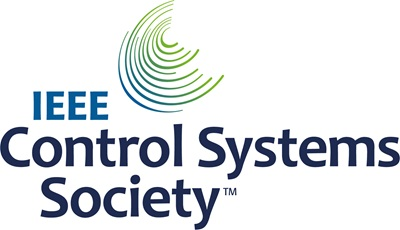

# Full lukket loop

```{contents} In this page
:backlinks: entry
:depth: 2
```

Det mest tiltalende med full lukket loop (**FCL**, Full Closed Loop) er at den kan etterligne en kunstig bukspyttkjertel og gjøre den daglige håndteringen enklere, uten at du må gi bolus til måltider.

Selv om **hybrid lukket loop** («HCL») er basert på en algoritme, krever den fortsatt at brukeren gir boluser manuelt før måltider. Som følge av det kan loopen gå inn i en midlertidig stopp (midlertidig null basal) for å hindre at det gis for mye insulin.

I **FCL** trengs ikke lenger boluser etter måltidsstørrelse: overlat det til algoritmen!  **AAPS** kan håndtere måltider uten at brukeren gir noen bolus og uten karbohydratregistrering, i en modus som kalles «ikke-varslede måltider» **(«UAM»)**. **UAM** lar **AAPS** tåle feil karbohydratregistreringer bedre ved å være mer aggressiv.

## Hva kan du forvente?

Det finnes mange publiserte studier om de gode resultatene **FCL** kan oppnå. Vil du lese mer, se dette:

1)   National Library of Medicine, PubMed [First Use of Open-Source Automated Insulin Delivery AndroidAPS in Full Closed-Loop Scenario: Pancreas4ALL Randomized Pilot Study](https://pubmed.ncbi.nlm.nih.gov/36826996/);

2)  ClinicalTrials.gov National Library of Medicine, Clinical Trial [Feasibility and Safety Study of the Automated Insulin Delivery Closed Loop System Pancreas4ALL (ASAP)](https://www.clinicaltrials.gov/study/NCT04835350?term=Feasibility%20and%20Safety%20Study%20of%20the%20Automated%20Insulin%20Delivery%20Closed%20Loop%20System%20Pancreas4ALL%20(ASAP)&rank=1)

For å lykkes med **FCL** må brukeren:

- sjekke om forutsetningene for **FCL** er oppfylt,
- sette opp **automasjoner** som er tilpasset behovene i den daglige håndteringen, og
- finjustere og tilpasse innstillingene i **AAPS** (særlig **automasjoner**).


## Generelle vurderinger om hvorfor du bør (eller ikke bør) gå fra HCL til FCL

**FCL** passer ikke for alle:

- Noen **FCL**-brukere oppnår en TIR (70–180) på rundt 90 % og HbA1c under 6 %, men andre brukere foretrekker strammere kontroll. Særlig krever det trolig forhåndsbolus å minimere verdier over 140 mg/dL ved et kosthold med raske karbohydrater.
- Justering av **AAPS** kan være krevende. Den passer ikke for brukere som føler at AAPS er overveldende.  Du må sette av noen uker til å tilpasse og finjustere din **FCL**. Å investere denne tiden kan gi bedre resultater og bedre **BS**-kontroll.
- Håndtering av måltider kan bli enklere, men trening kan fortsatt være krevende i **FCL**. De fleste av oss vil gjerne begrense snacks under trening for å holde kroppsvekten under kontroll.
- Det er fortsatt vanskelig å få til en **FCL** for barn (omtales nedenfor).


## Godt justert hybrid lukket loop

Det er lurt å først få på plass en godt justert **HCL** før du vurderer overgangen til **FCL**.  For å lykkes med **FCL** kreves en svært personlig og individuell justering av brukerens innstillinger, slik at **AAPS** kan gi insulin som tett etterligner DIN vellykkede hybride lukkede loop.

**FCL** krever at brukeren setter opp og justerer sine **automasjoner**. Men brukeren må ha en trygg forståelse av sitt eget insulinbehov før start med **FCL**. Feil kan skjules av motsatte feil. Dette kan gi et ustabilt **FCL**-system og gjøre det vanskelig å rette opp senere. Du bør forvente å nå en %TIR med din FCL som er sammenlignbar med den du har i dag med din **HCL**.

**FCL er et gjør-det-selv-oppsett av automasjoner som brukeren bestemmer ved å analysere dataene sine, både fra sin vellykkede HCL og fra de første erfaringene med FCL, når innstillingene justeres.**

## Raskt insulin (Lyumjev, Fiasp)

**FCL** krever raskt insulin.  Dette er for at **FCL**, ved starten av en måltidsrelatert **BS**-stigning, skal klare å holde **BS** i målområdet (etter vanlig definisjon under 180 mg/dL (10 mmol/L)).

En modelleringsstudie (detaljer: se LINK FullLoop V2/mars 2023, avsnitt 2.2 der) kan vise i tall at *raskere insuliner*

Kilde:

 


IEEE Control Systems Magazine, ResearchGate [The Artificial Pancreas and Meal Control: An Overview of Postprandial Glucose Regulation in Type 1 Diabetes](https://www.researchgate.net/publication/322866519_The_Artificial_Pancreas_and_Meal_Control_An_Overview_of_Postprandial_Glucose_Regulation_in_Type_1_Diabetes);

- gir betydelig lavere **BS**-topper enn langsommere insuliner,
- tåle at den første måltidsbolusen kommer et par minutter forsinket, uten at toppene blir uakseptabelt høye, og
- minimere effekten på **BS**-toppen fra ulike karbohydratmengder (måltidsstørrelser).

**FCL** vil neppe fungere godt med annet insulin enn Lyumjev eller Fiasp, med mindre brukeren har et kosthold med svært moderat til lavt karbohydratinnhold.

Men Fiasp eller Lyumjev kan gi hyppige okklusjoner i pumpen, selv etter at ting som kanylelengde er optimalisert. Det er viktig å følge med på hvor lenge kanylen eller podden har sittet. Mange brukere opplever at 48 timer er grensen for insulinets effekt før kanylen/podden svikter.

## Forutsetninger

**BS**-verdier og stabil Bluetooth-tilkobling er nødvendig for at **AAPS** skal kunne yte optimalt uten å tape verdifull tid. **FCL** krever et teknisk stabilt system døgnet rundt:

- **ytelsen til CGM-en** din. CGM-en din bør ikke gi hoppende **BS**-verdier som **FCL** kan feiltolke som tegn på at et måltid starter. På samme måte kan **CGM**-kalibreringer gi hoppende verdier.
- hvordan og hvor eventuell **CGM**-utjevning gjøres, og hva det kan bety for justeringen din. Særlig hvordan delta er definert, og at AAPS gjenkjenner dette som tegn på at et måltid starter.
- Bluetooth-stabilitet for pumpen og CGM-en,
- å unngå (eller i det minste oppdage tidlig) okklusjon i pumpen,
- dataflyten og appene du bruker på telefonen, og forskjeller mellom dagene i sensorens levetid,
- å holde alle **AAPS**-komponenter godt oppladet og ha reservedeler i nærheten, og
- å alltid bytte kanyle (eller pod) tidlig nok til å redusere risikoen for okklusjon,

Det ovenfor vil variere med hvilke **AAPS**-komponenter du har, og med livsstilen din.

## Begrensninger knyttet til måltider

- Å sette opp en **FCL** kan være lettere for folk med et kosthold uten matvarer som gir rask og høy effekt på **BS**, og med måltidsmønstre som ikke varierer vilt fra dag til dag. Det betyr ikke nødvendigvis lavkarbo.

- Fett- eller proteinrikt kosthold, eller langsom fordøyelse/gastroparese, gjør ting lettere, ikke vanskeligere, for **FCL**, fordi sene karbohydrater dekker fint de uunngåelige «halene» av sen virkning fra bolusen som trengs rundt toppen.

### Glykemisk indeks og effekt på blodsukkeret

Utfordringen for **UAM**-modus øker med økende «effekt på blodsukkeret» («EBG», Effect on Blood Glucose)

- Start moderat/lavt, og juster innstillingene i **profilen** din. Først da kan du «teste» måltider med høy **EBG**.
- Vurder en startbolus på < 50 % hvis du spiser noe med svært høy **EBG**.

1) **Ingen EBG**: f.eks. ferskt kjøtt, fisk, egg, bacon, oljer, ost. 2) **Lav EBG**: f.eks. friske grønnsaker og bær, sopp, nøtter, melk, yoghurt, cottage cheese. 3) **Moderat EBG**: f.eks. grovt brød/fullkornsnudler, poteter, villris, havre, tørket frukt. 4) **Høy EBG**: f.eks. hvetebrød, baguette, toast, vafler, kjeks, potetmos, nudler, ris. 5) **Svært høy EBG**: f.eks. sukker, søte drikker, fruktjuice, cornflakes, godteri, søtsaker, potetgull, saltstenger.


De vanskeligste måltidene for **FCL** er de som bare består av matvarer med svært høy og høy **EBG** (se rødt i bildet): Ikke bare skyter **BS** raskt i været, men det er også lite fett/protein/fiber som kan balansere den uunngåelige «halen» av insulinvirkning som kommer når loopen prøver å kontrollere den høye glukosen tidlig.

Uregelmessig inntak av snacks og søte drikker fulle av raske karbohydrater er problematisk for **FCL**.


## Forberedelser til aktivitet/trening

Ved trening eller aktivitet anbefales det, med pumpe eller hybrid lukket loop, at brukeren reduserer **IOB** før treningen.

Med **FCL** er algoritmen justert til å oppdage **UAM** og automatisk gi insulin for å motvirke stigning i **BS**.  Et høyt **midlertidig mål** og en lavere **profilprosent** (som virker allerede rundt måltidsstart) bør settes i god tid før aktivitet.

Uvanlige eller uregelmessige treningsnivåer gir vansker for **FCL**. Trening krever planlegging på forhånd (særlig hvis du vil redusere behovet for redningskarbohydrater/snacks ved lavt BS under trening). Etter en aktiv dag anbefales det å sette en lavere **profilprosent** for natten, etter at kveldsmåltidet er helt fordøyd: sett i **automasjoner** et forhøyet (>100 mg/dL) **BS**-mål, med **Aktiver SMB ved høyt midlertidig mål** slått av i **Innstillinger** i **AAPS**.

## Hindringer for barn

**FCL** kan gi ekstra utfordringer for barn, blant annet:

- Lyumjev eller Fiasp er kanskje ikke tilgjengelig, eller tåles kanskje ikke godt.
- Basaldosen per time kan være svært lav, som gir et dårlig grunnlag for store **SMB-er**.
- Kostholdet kan inneholde mye søtt. Med det typisk lave blodvolumet i en liten kropp er det en sterk tendens til svært høye **BS**-topper.
- Veksthormoner og store endringer i insulinsensitivitet gjør det vanskelig å holde **FCL** riktig justert.


## Aktivere forsterkede SMB-er: sikkerhet

I **HCL** finnes det sikkerhetsbegrensninger for hvor store boluser loopen kan gi automatisk.

**FCL**-loopere trenger ikke lenger å gi en stor bolus rundt måltidsstart. Det betyr at begrensningene på størrelsen av **SMB-er** må utvides, slik at loopen kan gi store nok **SMB-er**.

Hvis du bruker **AAPS** i Master-versjonen, foreslås det at **Innstillinger** i **AAPS** settes opp med den største tillatte **SMB**-størrelsen som **FCL** kan gi (maxUAMSMBBasalMinutes=120, det vil si 2 timer med basal på den tiden av døgnet).

Hvis basaldosen din er svært lav, kan de resulterende **SMB**-grensene bli for lave til å gi nok kontroll over **BS**-stigning etter måltider. En mulig løsning er å unngå kosthold som gir sterke **BS**-topper. Algoritmen [AutoISF](#Open-APS-features-auto-isf) (bare tilgjengelig i et dev-bygg med engineering mode) har en innstilling **SMB maks rekkeviddeforlengelse** som utvider standardmaksimum på 2 timer med basal med en faktor på >1, og lar deg heve standardverdien på 50 % for **SMB leveringsratio**.

**Følg instruksjonene for å la AAPS etterligne bolusene dine med et par SMB-er**.

Sjekk **APS**-plugin-skjermen (**Konfigurasjon → APS → Åpne plugin**) med jevne mellomrom for å se om **SMB-ene** dine får være store nok til å gi insulinet loopen trenger rundt måltidsstart.

Hvis ikke, vil justeringsarbeidet ditt noen ganger være bortkastet!


```{admonition} Boosting **ISF** can become dangerous
:class: danger

Observer/analyser **SMB**-størrelsene nøye kort tid etter at måltidet ditt starter. Juster i steg, og endre ikke mer enn 1 eller 2 parametere om gangen.

Innstillingene i **AAPS** må være godt nok satt opp til å takle ditt (!) utvalg av måltider.
```

## Måltidsgjenkjenning / automasjonene dine for forsterkning

For vellykket **FCL** er **ISF** den viktigste parameteren å justere. Når du bruker **AAPS** Master + **automasjoner**, må et **profilbytte på > 100 % utløses automatisk når et måltid gjenkjennes** (via glukosedeltaer), og gi den skjerpede **ISF**-en.

**AAPS** Master tillater opptil 130 % midlertidig **profil** i **HCL**-modus. Forsterkning av **ISF** gjøres i 3 steg:

- Steg 1 – se på **ISF** som gjelder for denne måltidstimen i **profilen**, og se om for eksempel Autosens foreslår en endring som tar hensyn til kroppens nåværende insulinsensitivitet (de siste timene).
- Steg 2 – bruk en faktor (1/profil-%, som satt i **automasjonen**) for å forsterke **ISF**.
- Steg 3 – sjekk at den foreslåtte **ISF**-en ligger innenfor de satte sikkerhetsgrensene.

### Automasjonsmaler for FCL

Avkrysningsbokser øverst. Du har valget:

- I **automasjonslisten** din kan du slå AV avkrysningen (til venstre for hvert felt) => Dette deaktiverer den **automasjonen**. Du kan for eksempel gjøre dette for alle **FCL**-**automasjoner** knyttet til frokost, for å kjøre **HCL** til frokost.

- For hver **automasjonsregel** kan du krysse av for Brukerhandling => da utføres ikke de definerte handlingene automatisk når betingelsene er oppfylt. I stedet varsler hovedskjermen i **AAPS** deg hver gang din **FCL** ville ha gitt en **SMB** automatisk. Da kan du svare «ja» eller «nei». Dette er svært nyttig i justeringsfasen.

Denne funksjonen kan være nyttig i visse situasjoner, som «foot to floor»-syndromet, der **BS** stiger brått når du står opp om morgenen, men brukeren vil unngå en helt automatisk «frokosten har startet»-respons.

Avsnittet nedenfor gir veiledning om hvordan du setter sammen betingelsene i en **automasjon**, og hvordan du håndterer situasjoner der **AAPS** bør øke (eller redusere) insulintilførselen. Siden **ISF** ikke kan justeres direkte, gjør det samme nytten for vårt formål å sette **profilprosenten** over 100 %.

### Automatiske store SMB-er ved BS-stigning

Nøkkelen til vellykket **FCL**: **i starten av BS-stigninger fra måltider må loopen gi svært store automatiske SMB-er så raskt som mulig** for å «ta igjen» den nødvendige **IOB** som trengs (sammenlign med bolusen du vanligvis gir for et lignende måltid i **HCL**!)

For å få til dette bør data fra din **HCL** analyseres for å finne ut hvilke **deltaer** som kanskje ikke er knyttet til måltider, og hvilke som kanskje er det.

- Siden du kan definere **automasjonen** innenfor et forhåndsdefinert tidsvindu, trenger du bare å analysere der.
- Hvis du spiser svært ulike måltider (for eksempel en frokost med ganske mye karbohydrater, men en lunsj med lite), kan du velge å lage to ulike (sett med) **automasjoner** for hvert av tidsrommene.
- Utelat nettene hvis du av og til ser hopp fra falske lave verdier på grunn av trykk på sensoren («compression lows»)
- Vanligvis holder det å bruke deltaet fra de siste 5 minuttene.
- Men du kan også bruke et av gjennomsnittsdeltaene. Ved å sammenligne deltaene i betingelsene i **automasjonene** dine kan du til og med definere handlinger med ulik aggressivitet, avhengig av om **BS** stiger med akselerasjon eller ikke.

> ( delta – kort gjennomsnittlig delta )>n   er et uttrykk som kan brukes til å oppdage akselerasjon, for å utløse den første **SMB**-en ved første tegn til stigende **BS**. -                                                                             
> Forsiktig: kan ikke brukes med dårlige eller sterkt utjevnede **CGM**-verdier!

En **CGM** med hullete data setter brukeren i en dårlig posisjon, fordi du for sikkerhets skyld må legge inn en ekstra margin i definisjonen av hvilket delta som helt sikkert er tegn på at et måltid har startet. Det betyr:

- **FCL** taper ekstra tid, som gir høyere **BS**-topper og lavere %**TIR**,
- du kan ikke bruke et tidligere eller mindre delta, som også uten et måltid kunne utløse de **SMB-ene** som skal erstatte en brukerbolus i **FCL**.

Dessuten kjennetegnes de første stigningene etter et måltid av at det er **lite IOB** til stede. Med det i tankene kan en automasjon (#1) for en middag se slik ut:


Automasjon #1

Hvis betingelsene er oppfylt, gir **AAPS** 1 eller 2 **SMB-er** i løpet av de neste 12 minuttene, med en forsterket **ISF** i tråd med den satte, forhøyede **profilprosenten** (i eksempelet en forsterkning av insulinReq på 30 %). Så lenge disse betingelsene er oppfylt, forlenges **automasjonsregelen** med nye 12 minutter. Et måltid med lite karbohydrater kan ha en langsommere **BS**-stigning. Den har nytte av en annen automasjon (#2) som slår inn ved lavere delta og gir en svakere insulinforsterkning.


Den samme **automasjonen** vil trolig også slå inn ved måltider med mer karbohydrater, når den bratte stigningen definert i automasjon #1 er over.

Du må «trinne» disse to (+ kanskje en tredje) **automasjonene** slik at de passer med det du ser i måltidene dine (variasjonen) => Å sette passende hoppstørrelser, **IOB**-kriterier og forsterkninger blir en justeringsprosess i flere runder.  Hvis du i tillegg legger inn passende tidsrom i betingelsene, kan du enkelt lage ulike automasjoner for de ulike måltidene dine i løpet av dagen (frokost, lunsj, middag).

Merk at «overflyten» av **IOB** må stoppes allerede i stigningsfasen (!), slik at senvirkningen av **insulinet** («**halen**» etter 3–5 timer) ikke overstiger loopens bremsekapasitet gjennom null-basal (zero-temping, å «ta bort» basal for å redusere risikoen for føling).

Ved store måltider kommer det **noen ganger en ny stigning**. Da har vanligvis også IOB falt litt, og de mer aggressive automasjonene slår inn igjen. (Sjekk at IOB-betingelsen i automasjon #2 ikke er satt for lavt til at dette kan skje.)

Kort etter at noen første **SMB-er** er gitt, kommer en **balansert fase**, der moderat insulintilførsel bør dekke de ekstra karbohydratene som tas opp. (Unntatt ved måltider med lite karbohydrater, der loopen kan se en for svak **BS**-stigning og gå rett over i null-basal (zero-temping) allerede nå.)

Hovedskjermen i **AAPS** (der du ser cob=0 i **UAM** full loop) kan i denne fasen melde om at det trengs flere karbohydrater. I **UAM**-modus betyr det bare at du kan gjøre en svært grov rimelighetssjekk: Er det sannsynlig at denne mengden karbohydrater er i kroppen din, ikke tatt opp ennå fra måltidet for omtrent en time siden (som du ikke ga loopen noen informasjon om)?


### IOB-terskel

Ofte får **automasjonene** #1 og/eller #2 IOB til å stige til nivåer som typisk er nok for **dine** måltider. For personlig justering: se i **HCL**-dataene dine på de høyeste IOB-verdiene ved godt håndterte måltider (ofte: måltidsbolusen din), og over hvilket nivå det kom en føling (eller behov for ekstra karbohydrater) til slutt.

Fornuftige **IOB-terskler**, der du bør redusere aggressiviteten til loopen din, er ikke nødvendigvis de samme for alle måltider. Men særlig i den første timen etter måltidsstart, som er svært avgjørende i **UAM**-modus. Det vil være forskjellig fra bruker til bruker. Hos noen brukere tas det opp omtrent 30 g/time, og da kan det være mulig å definere en meningsfull **IOB** uavhengig av det nøyaktige måltidet.

For spesielle måltider, eller for å senke den hvis det kommer trening etterpå, kan **IOB**-terskelen raskt settes annerledes i **automasjonen** din.

Automasjon (#3), «iobTH nådd => **SMB-er** av», er definert for å avslutte (eller sette på pause, til en ny bølge av karbohydratstigning kommer) den aggressive **SMB**-forsterkningen.


Automasjon #3

Den forteller loopen at over din satte **IOB-terskel** er det bedre å ikke bruke flere **SMB-er**

- Eksempelet gjør det ved å sette TT=111 (som er nokså vilkårlig; velg et tall>100 som du lett kjenner igjen som din automatiske **SMB**-stopp)
- I [Innstillinger → OpenAPS SMB](#Preferences-openaps-smb-settings) i **AAPS** bør du generelt ikke tillate **SMB** ved forhøyet mål.                                                                                                                   
  Insulinet som trengs, må da gis med mye større forsiktighet gjennom flaskehalsen av **midlertidige basaler (TBR)**

**Forsiktig: Automasjon #3 virker bare når det ikke er noe aktivt midlertidig mål (TT).** Så hvis du brukte EatingSoonTT, må det være avsluttet innen da, som vanligvis bør være 30–40 minutter etter måltidsstart.

En måte å gjøre dette på er å sette opp en **automasjon** med en betingelse som avslutter et eventuelt løpende EatingSoonTT når betingelsen **IOB**>65 % * iobTH er oppfylt.
> Måter å jobbe med EatingSoonTT på (et midlertidig mål av typen «Spise snart») Noen loopere setter (ved å trykke på knappen for midlertidig mål, eller automatisk via et senket **BS**-mål i **profilen** hvis måltidstidene er ganske faste) et EatingSoonTT omtrent en time eller mer før måltidsstart, bare for å sikre en lav start-**BS** og litt økt **IOB**. Men hvis vi antar at **FCL** alltid er på vei mot målet, gir dette kanskje ikke mye, og du foretrekker kanskje å definere en **automasjon** som setter et EatingSoonTT når måltidsstart gjenkjennes (glukosedelta, eller akselerasjon = delta > gjennomsnittlig delta). Et lavt **TT** er viktig i denne fasen, fordi loopen beregner hver **SMB** med (predikert glukose minus TT)/sens, så et lavt TT gjør den resulterende insulinReq større.

Etter at de første forsterkede **SMB**-ene er gitt, bør din satte iobTH og **automasjon** #3 gi en god balanse mellom å begrense glukosetoppen og å ikke føre til føling etter måltidet.

Hvis frokosten din avviker mye i karbohydratinnhold fra en vanlig middag, kan det lønne seg å definere **automasjoner** som gjelder på de respektive tidene av døgnet, med ulik **iobTH** (muligens også ulike deltaer og ulik **profilprosent**). Både du, når du definerer måltidsspekteret og innstillingene dine (særlig **iobTH**), og loopen, som håndterer **BS**-kurven etter hvert som den utvikler seg, må godta visse topphøyder for å redusere faren for føling mot slutten av **DIA** for **SMB-ene**.

### Stagnasjon på høye BS-verdier

Hvis du etter et «rikt» måltid ser en langvarig stagnasjon med **høy BS**-verdi, hjelper **automasjon** #4 (nedenfor), «post-meal High», mot fettsyreresistens: Etter måltider med flere retter, stor fet pizza eller raclettekveld kan glukosekurven få to pukler eller, svært ofte, et langstrakt høyt platå.


Automasjon #4


Automasjon #5

Automasjon #4, «post-meal High», passer også i hybrid lukket loop.

I tillegg trengs en avsluttende automasjon #5, «Stop pmH», slik at aggressiviteten i insulintilførselen reduseres så snart glukoseverdien faller. (Ofte vil loopen likevel begrense mer insulin for å hindre føling, fordi den predikerte glukosen allerede går lavt.)

## Forebygging av føling

Kjerneproblemet er at **UAM** **FCL** (uten karbohydratregistrering) **ikke kan vite hvor mange gram karbohydrater som fortsatt er tilgjengelige** for opptak, og som kan bruke opp «hale»-insulinet uten at du får føling av det.

Med forsterkede **SMB-er** «tok **FCL** igjen» det vi tidligere gjorde med en måltidsbolus. Men **på «halen» av insulinvirkningen kan det å hindre føling bli et alvorlig tema**.

Som forberedelse til **FCL** må brukeren se nærmere på **IOB-forløpet over tid** for typiske måltider, og vurdere **når det blir for mye, og hvordan du kan fange opp det ved å justere automasjonene dine**. Det er mulig fordi vi har flere justeringsskruer. Det kan være en utfordring å få dette riktig

Generelt gir det ingen mening å fortsette å optimalisere innstillingene for én type måltid. Når du har en god nok innstilling, for eksempel for en type lunsj du ofte spiser, kan du teste hvordan den virker med andre typer, og hvordan du vil «inngå kompromiss».

For å hindre føling i time 3–5 etter måltidet, reduser aggressiviteten før det samler seg for mye IOB. Konkrete tilnærminger:

- Bli mildere og mildere med **ISF** allerede under glukosestigningen, som i automasjonseksemplene #1 og #2.
- Definer IOB-terskelen der **AAPS** gjøres betydelig mer forsiktig (automasjon #3 ovenfor). Merk at denne **IOB**-en kan overskrides, av den siste **SMB**-en før den trådte i kraft, og deretter videre av midlertidige basaler hvis loopen ser insulinReq. Karbohydrater som tas opp, gir en motbevegelse mot lavere IOB.
- IOB-terskelen kan differensieres etter måltid: Ved å duplisere automasjonene kan du enkelt skille mellom tidsrommene for frokost, lunsj og middag (eller til og med etter sted, som kantinen på jobben eller hos svigermor osv.)
> Du kan dele opp disse tidsrommene enda mer ved å sette ulike TT-er for lavkarbo vs. raske karbohydrater osv., og dermed «kode» ulike måltidsklasser som kan forekomme på denne tiden av døgnet, og hente dem fram med **automasjoner** som er spesielt justert for dem. Dette er trolig ikke nødvendig, med mindre kostholdsvanene dine varierer mye.

Før en spesiell måltidsutfordring kan du heve **IOB**-terskelen, eller gjøre en annen endring i en av automasjonene dine på under 5 sekunder, rett på AAPS-telefonen din (**Administrer → Automasjon**).

Faren for føling noen timer etter måltidet er i hovedsak et spørsmål om måltidet var satt sammen slik at **insulinhalene fra kampen mot hoveddelen av karbohydratene** blir **brukt opp av «forlengede karbohydrater»** (overskytende/forsinket karbohydratopptak/protein/fett/fiber).

Over tid lærer du mønstre og justerer automasjonene dine – kanskje justerer du til og med spisevanene dine litt, for eksempel ved å unne deg en liten(!) sen snack av og til, som kan hjelpe med å holde en god **balanse mellom insulinvirkning og karbohydratopptak** gjennom **hele** måltidstiden (fordøyelse, opptak), og dermed gjøre livet lettere for loopen din (og for deg selv).

### Rekkefølgen på programmerte automasjoner

Det kan oppstå problemer med overlappende definisjoner i **automasjoner**. Eksempel: Problemet er at delta >8 også er delta >5, det vil si at det kan finnes to konkurrerende **automasjoner**. Hva gjør loopen da? Den avgjør alltid etter rekkefølgen **automasjonene** dine har i **Administrer → Automasjon**.  Eksempel: Regelen delta > +8 må komme først (og starte den sterkeste forsterkningen hvis alle betingelsene er oppfylt); deretter kommer kontrollen for delta >5 (og en mildere respons). Gjøres det motsatt, ville regelen delta>8 aldri slå inn, fordi delta>5 allerede gjelder, og saken er avgjort.
> Tips for automasjoner: Det er svært enkelt å endre rekkefølgen. I **Administrer → Automasjon**: trykk og hold på **=**-håndtaket til høyre for en regel, og dra den til en annen plass.

Det er også svært enkelt og raskt å justere betingelser eller handlinger når som helst, på sekunder, rett på AAPS-telefonen din, for eksempel hvis du skal på en helt spesiell matopplevelse. (Men ikke glem å sette den tilbake til normalt for neste dag.)

(full-closed-loop-troubleshooting)=

## Feilsøking

### Slik går du tilbake til hybrid lukket loop

Du kan fjerne avkrysningen på **automasjonene** som hører til din **FCL**, og gå tilbake til å gi bolus til måltider og registrere karbohydrater igjen. Hvis du hadde fjernet knappene **Insulin** eller **Kalkulator** fra hovedskjermen, legg dem tilbake i konfigurasjonen av [Hurtigstart-verktøylinjen](#quicklaunch) (de er alltid tilgjengelige under **Behandlinger** i navigasjonslinjen nederst). Vær klar over at det nå igjen er opp til deg å gi bolus til måltider.

Det kan være lurt å kjøre **FCL** bare for måltider (tidsrom) der **automasjonene** er fullt definert og krysset av, og bare fjerne avkrysningen for de andre måltidstidene der du vil kjøre **HCL** (eller ikke har definert noen ennå, i overgangsperioden).

Det er for eksempel fullt mulig, uten ekstra steg etter at **automasjoner** for middagstidsrommene er definert, å kjøre **FCL** bare for middager, mens frokost og lunsj kjøres i **HCL** slik du er vant til.


### Er forutsetningene for FCL fortsatt til stede?

- Er den grunnleggende **profilen** fortsatt riktig?
- Har **CGM**-kvaliteten blitt dårligere
- Se forutsetningene (ovenfor).

### Glukosen går for høyt

- Måltider gjenkjennes ikke raskt nok
    - Sjekk Bluetooth-(u)stabilitet
    - Sjekk om du kan sette mindre deltaer for å utløse den første **SMB**-en
    - Eksperimenter med en aperitiff eller suppe et par minutter før måltidsstart
- SMB-ene er for svake
    - Sjekk rekkefølgen på **automasjonene** (f.eks.: stort delta før lite delta)
    - Sjekk (i sanntid) på **APS**-plugin-skjermen om profilens basal per time og de satte minuttene (maks 120) begrenser tillatt SMB-størrelse
    - Sjekk (i sanntid) på **APS**-plugin-skjermen om %profil må settes høyere
- Hvis alle innstillingene dine er på grensen, må du kanskje leve med den midlertidige høye verdien, eller tilpasse kostholdet ditt.
> Hvis du er klar til å teste et dev-bygg, gir [AutoISF](#Open-APS-features-auto-isf) også mulighet for enda større SMB-størrelser. Noen brukere tyr også til en liten forhåndsbolus i sin «FCL». Men dette påvirker hvordan glukosekurven, og dermed gjenkjenningen av stigninger og de utløste **SMB-ene**, oppfører seg, og er derfor ikke lett å få til med en overbevisende samlet gevinst.
- En viktig observasjon fra pilotbrukerne var at måten glukose- og IOB-kurvene dine nærmer seg måltidsstart på, betyr mye for hvor høy toppen fra karbohydratene blir: At kurven går nedover (for eksempel mot et satt EatingSoonTT), at det bygges opp litt IOB, og at kurven allerede svinger mot sterk positiv akselerasjon, ser ut til å hjelpe mye for å holde toppene lave.

### Glukosen går for lavt

- Måltider gjenkjennes feilaktig
    - Sjekk om du kan sette større deltaer for å utløse den første **SMB**-en
    - Kryss av for «Brukerhandling» i den aktuelle automasjonen, slik at du i framtiden kan bestemme der og da om automasjonen skal blokkeres når det ikke gjelder et måltid
    - For å hindre at snacks utløser **SMB-er** som for et måltid, sett et TT>100 når du spiser snacks (slik du uansett ville gjort ved trening og ved snacks mot føling)
- SMB-ene gir samlet sett for mye insulin
    - Sjekk (i sanntid) på **APS**-plugin-skjermen om **SMB maks rekkeviddeforlengelse** må settes lavere
    - Sjekk (i sanntid) på **APS**-plugin-skjermen om **profilprosenten** må settes lavere
    - SMB leveringsratio kan trolig settes lavere. Merk at i dette tilfellet virker det over hele linjen for alle **SMB-er** (alle tidsrom),
- Problemer med insulin-«halen» etter måltider
    - Du må kanskje ta en snack (når du ser en prediksjon om føling) eller druesukker (hvis du allerede er i følingssonen). Men merk at karbohydratbehovet loopen kanskje melder om på et tidspunkt, svært sannsynlig er overdrevet, fordi loopen ikke har noen informasjon i det hele tatt om karbohydratinntaket ditt (mens du kanskje kan gjette hvor mye mer, inkludert fra fett og protein, som fortsatt venter på å bli tatt opp).
    - Nyttig informasjon er om problemet hovedsakelig oppstår allerede i stigningsfasen for BS. Da kan en lavere iobTH være en enkel løsning.
    - Hvis behovet for ekstra karbohydrater oppstår ofte, noter hvor mange gram som trengtes (uten å regne med det du eventuelt tok for mye av og som krevde ekstra insulin igjen).  Bruk så IK-verdien i profilen din til å anslå hvor mye mindre insulin **SMB-en** burde ha gitt, og ta med denne informasjonen inn i justeringen din (av **profilprosenten** i **automasjonene**, eller kanskje også din satte iobTH). Dette kan gjelde **SMB-ene** som ble gitt da glukosen var høy, eller også **SMB-ene** under **BS**-stigningen.
    - Det kan godt hende at du rett og slett må godta høyere **BS**-topper for å unngå å gå lavt. Eller bytt til et kosthold med mindre karbohydrater og mer protein og fett.


### Mer informasjon

Sørg for å holde kontakten med andre **FCL**-brukere.

Diskusjon om full lukket loop med automasjoner:

- Engelsk:   [Discord-kanal](https://discord.gg/ChXj8BaKwA)

- Tysk:  [Det tyske Looper Community](https://de.loopercommunity.org/t/ueber-die-kategorie-full-loop/10107)
