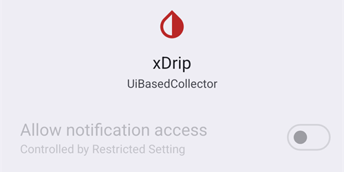
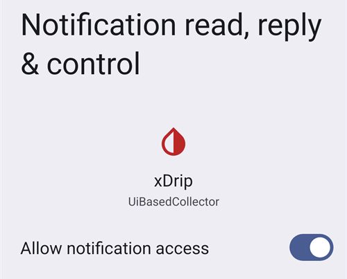

# Dexcom G7, ONE+ og Stelo


## Grunnleggende først

Merk at G7-, ONE+- og Stelo-systemene, i motsetning til G6, ikke jevner ut verdiene, verken i appen eller i mottakeren. Mer om dette finner du [her](https://www.dexcom.com/en-us/faqs/why-does-past-cgm-data-look-different-from-past-data-on-receiver-and-follow-app).

```{admonition} Smoothing method 
Les anbefalingene for [utjevningsmetode](../CompatibleCgms/SmoothingBloodGlucoseData.md) for Dexcom G7/ONE+/Stelo
```

## 1. xDrip (direkte tilkobling til G7, ONE+ eller Stelo)

- xDrip kobler seg til sensoren selv: Avinstaller Dexcom-appen, siden bare én app kan være koblet til sensoren. Hvis du vil beholde Dexcom-appen, bruk [xDrip som hjelpeapp (Companion App)](#DexcomG7-xdrip-companion-app) i stedet.
- Følg instruksjonene her: [xDrip G7, ONE+ og Stelo](https://navid200.github.io/xDrip/docs/Dexcom/G7.html). En ny xDrip-versjon kreves – se den lenkede siden for laveste versjon.
- Velg xDrip i [**Konfigurasjon → BS-kilde**](#Config-Builder-bg-source).

- Juster xDrip-innstillingene etter forklaringene på siden med xDrip-innstillinger: [xDrip](../CompatibleCgms/xDrip.md).

## 2. Build Your Own Dexcom App (bare G7)

```{admonition} Old app version
:class: warning
Dexcom BYODA er nå en svært gammel versjon av appen og kan ikke oppdateres. Ikke tilgjengelig for ONE+ eller Stelo.
```

-   [Build Your Own Dexcom App](https://docs.google.com/forms/d/e/1FAIpQLScD76G0Y-BlL4tZljaFkjlwuqhT83QlFM5v6ZEfO7gCU98iJQ/viewform?fbzx=2196386787609383750) (BYODA) støtter lokal kringkasting til AAPS

-   Denne appen lar deg bruke Dexcom G7 med en hvilken som helst Android-smarttelefon.
-   Avinstaller den opprinnelige Dexcom-appen
-   Installer den nedlastede apk-filen
-   Skriv inn sensorkoden i den modifiserte appen
-   Etter kort tid bør BYODA fange opp signalet fra sensoren.

(DexcomG7-xdrip-companion-app)=

## 3. xDrip som hjelpeapp – Companion App (G7, ONE+ og Stelo)

Den offisielle Dexcom-appen forblir koblet til sensoren. xDrip leser blodsukkerverdiene fra varslingene til Dexcom-appen og sender dem til **AAPS**.

```{admonition} Not a trusted data source
:class: note
**AAPS** regner ikke xDrip i Companion App-modus som en [pålitelig BS-datakilde](#GettingStarted-TrustedBGSource): SMB-er er ikke tillatt hele tiden.
```

### Lese varslingene fra Dexcom-appen

- Behold Dexcom-appen installert og koblet til sensoren. Varslingene fra appen må være synlige: Ikke demp eller skjul dem.
- Last ned og installer [xDrip](https://github.com/NightscoutFoundation/xDrip). Bruk samme blodsukkerenhet i xDrip som i Dexcom-appen.
- I xDrip går du til **Settings** > **Hardware Data Source** og velger **Companion App**.

  

- xDrip ber om tillatelse til å lese varslinger. Trykk på **OK**, velg så **xDrip** i listen og slå på **Tillat tilgang til varsler**.

  

- Hvis **Tillat tilgang til varsler** er nedtonet (*Styrt av begrenset innstilling*), blokkerer Android det fordi xDrip ikke ble installert fra Play Store:

  

  Åpne appinfo for xDrip (trykk og hold på xDrip-ikonet > **Appinfo**), trykk på menyen med tre prikker øverst til høyre og velg **Tillat begrensede innstillinger**. Gå så tilbake til skjermen for varslingstilgang og tillat den.

  

  

- Målingene vises i xDrip når Dexcom-appen viser en ny verdi. Hvis ingenting vises, kan det hende du må starte en sensor i xDrip: Dette påvirker ikke den virkelige sensoren. Stelo gir en måling hvert 15. minutt i denne modusen.

### Companion Bluetooth (G7)

Når Dexcom-appen er koblet til en G7-sensor, kan xDrip også lytte til målingene som sensoren sender til Dexcom-appen over Bluetooth. xDrip kobler seg ikke sammen med sensoren, og du trenger ikke skrive inn sensorkoden: Dexcom-appen beholder kontrollen.

Med **Companion Bluetooth** får xDrip nøyaktig tid og trend for hver måling fra sensoren, i stedet for tidspunktet da varslingen kom, og fyller inn hull fra når telefonen var utenfor rekkevidde (backfill).

- I xDrip går du til **Settings** > **Less common settings** > **Bluetooth Settings** og slår på **Companion Bluetooth**.

  

- Dette fungerer ikke på alle telefoner og Android-versjoner. Slå det av hvis du ser problemer.
- Hvis en gammel Dexcom-sensor fortsatt ligger i telefonens Bluetooth-liste, kan xDrip komme til å lytte til feil sensor: Gå til Android **Innstillinger** > **Tilkoblede enheter** og glem sensorer du ikke bruker lenger.
- Companion Bluetooth er laget for G7. Med ONE+ og Stelo må du bruke varslingene.

### Konfigurasjon i AAPS

- Velg xDrip i [**Konfigurasjon → BS-kilde**](#Config-Builder-bg-source).
- Juster xDrip-innstillingene etter forklaringene på siden med xDrip-innstillinger: [xDrip](../CompatibleCgms/xDrip.md).

## 4. Juggluco (G7 og ONE+)

Versjon 9.0 eller nyere kreves

- Deaktiver appen som tidligere var koblet til sensoren: Avinstaller appen eller bruk «Tvungen stopp» (Force Stop). Slå av tillatelsen «Enheter i nærheten» (Nearby Devices) i appens innstillinger. Begrens appens batteribruk.

- Glem sensoren i Bluetooth-innstillingene: Finn sensoren under sammenkoblede enheter i Android-innstillingene og velg «Glem». Navnet på Dexcom G7-sensorer begynner med DXCM.

- Unngå forstyrrelser fra andre sensorer: Hold gamle Dexcom-sensorer utenfor Bluetooth-rekkevidde.

- Koble G7-sensoren til Juggluco: Åpne Juggluco → Left menu (venstre meny) → Photo (bilde). Skann datamatrisekoden på applikatoren til G7-sensoren. Vent i opptil 5 minutter til Juggluco finner sensoren.

- Krav for sammenkobling: Godta å koble sensoren sammen med Juggluco. Pass på at skjermen ikke er låst under sammenkoblingen. Hvis sammenkoblingen mislykkes, vent 5 minutter før du prøver igjen.

- Unntak: Wear OS-klokker kan koble seg sammen uten at du trykker på en godta-knapp.
