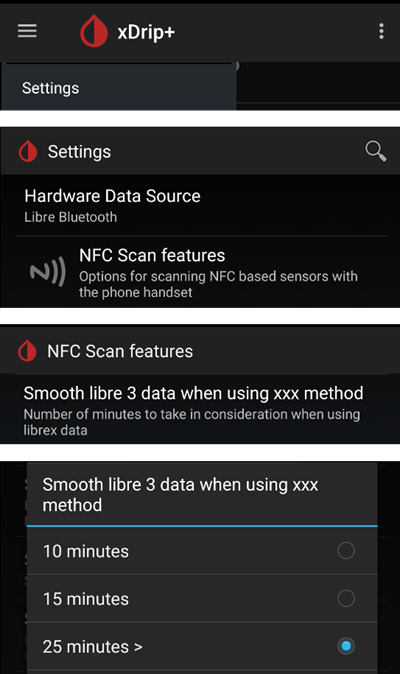

# Freestyle Libre 2 og 2+

Freestyle Libre 2-sensoren er nå en ekte CGM, også med den offisielle appen. LibreLink kan likevel ikke sende data til AAPS. Det finnes flere løsninger for å bruke den med AAPS.

## 1. Bruke en Bluetooth-sender og OOP

Bluetooth-sendere kan brukes med Libre 2 (EU) eller 2+ (EU) og en app med «out of process»-algoritme (OOP). Du kan få blodsukkermålinger hvert 5. minutt som med [Libre 1](./Libre1.md).

Kontroller at senderen og appen du vil bruke, er kompatible med sensoren din og xDrip.

Libre2 OOP (du finner den [her](#Libre2_OOP2)) lager de samme BS-målingene som den originale leseren. AAPS med Libre 2 bruker en utjevning på 10 til 25 minutter for å unngå visse hopp. Se nedenfor: [Utjevning av verdier og råverdier](#libre2-value-smoothing-raw-values). OOP lager målinger hvert 5. minutt med gjennomsnittet av de siste 5 minuttene. Derfor er BS-målingene ikke så jevne, men de stemmer med den originale leseren og følger de «ekte» BS-verdiene raskere. Hvis du prøver å loope med OOP, bør du aktivere alle utjevningsinnstillingene i xDrip.

Det er noen gode grunner til å bruke en Bluetooth-sender:

-   Du kan velge ulike OOP2-kalibreringsstrategier (1): få leserens verdier med «no calibration», kalibrere sensoren som en Libre 1 med «calibrate based on raw», eller til slutt kalibrere de leserlike verdiene med «calibrate based on glucose».  
  Pass på å la OOP1 være deaktivert (2).

    → Hamburger Menu → Settings → Less common settings → Other misc. options


-   Libre 2-sensoren kan brukes i 14,5 dager, som Libre 1
-   8 timers innfylling i ettertid (backfill) støttes fullt ut

Merk: Senderen kan brukes parallelt med LibreLink-appen uten å forstyrre den.

### Start sensor

- → Hamburger Menu (1) → Start sensor (2) → Start sensor (3) → Svar «Not Today» (4).


Dette starter ikke noen Libre2-sensor fysisk, og påvirker den ikke på noen måte. Dette er bare for å fortelle xDrip at en ny sensor leverer blodsukkerverdier. Hvis du har dem, skriver du inn to blodmålte verdier for den første kalibreringen. Nå skal blodsukkerverdiene vises i xDrip hvert 5. minutt. Målinger som er hoppet over, for eksempel fordi du var for langt unna telefonen, blir ikke fylt inn i ettertid.

Etter et sensorbytte oppdager xDrip automatisk den nye sensoren og sletter alle kalibreringsdata. Du kan måle blodsukkeret etter aktivering og gjøre en ny første kalibrering.

### Konfigurer AAPS (bare for looping)

-   I **AAPS** åpner du **menyen** (☰) øverst til venstre, går til **Konfigurasjon** > **BS-kilde** og velger **xDrip+**


-   Hvis AAPS ikke mottar BS-verdier når telefonen er i flymodus, bruker du «Identify receiver» som beskrevet på [siden om xDrip-innstillinger](#xdrip-identify-receiver).

## 2. Bruke direkte tilkobling i xDrip

```{admonition} Libre 2 EU only
:class: warning
xDrip støtter ikke direkte tilkobling til Libre 2 US og AUS.
Bare Libre 2- og 2+-modeller for **EU**.
```

- Følg [disse instruksjonene](./Libre2MinimalL00per.md) for å sette opp xDrip, siden den originale dokumentasjonen lenker til en utdatert OOP2-versjon.
- Følg oppsettinstruksjonene på [siden om xDrip-innstillinger](../CompatibleCgms/xDrip.md).

-   Velg xDrip+ under [Konfigurasjon > BS-kilde](#Config-Builder-bg-source).

(libre2-value-smoothing-raw-values)=

### Utjevning av verdier og råverdier

Teknisk sett overføres den gjeldende blodsukkerverdien til xDrip hvert minutt. Et vektet gjennomsnittsfilter beregner som standard en utjevnet verdi over de siste 25 minuttene. Du kan endre perioden i menyen NFC Scan features.

→ Hamburger menu → Settings → NFC Scan features → Smooth libre 3 data when using xxx method



Dette er obligatorisk for looping. Kurvene ser jevne ut, og loop-resultatene er gode. Råverdiene som alarmene bygger på, hopper litt mer, men tilsvarer verdiene som leseren også viser. I tillegg kan råverdiene vises i xDrip-grafen, slik at du kan reagere i tide på raske endringer. Slå på Less Common Settings \> Advanced Settings for Libre2 \> «show Raw values» og «show Sensors Infos». Da vises råverdiene i tillegg som små hvite prikker, og mer sensorinformasjon er tilgjengelig i systemmenyen.

Råverdiene er svært nyttige når blodsukkeret endrer seg raskt. Selv om prikkene hopper mer, ser du tendensen mye bedre enn med den utjevnede linjen, og kan ta riktige behandlingsvalg.

→ Hamburger menu → Settings → Less common settings → Advanced settings for Libre 2


#### Kalibrering

Du kan kalibrere Libre2 **med en forskyvning på -40 mg/dL til +20 mg/dL \[-2,2 mmol/L til +1,1 mmol/L\]** (skjæringspunkt). Stigningen (slope) kan ikke endres. Kontroller med fingerstikk etter at du har satt en ny sensor, og husk at den kan være unøyaktig de første 12 timene etter innsetting. Siden det kan være store forskjeller fra blodmålingene, bør du kontrollere hver 24. time og kalibrere om nødvendig. Hvis sensoren er helt feil etter noen dager, bør den byttes.

## 3. Bruke Diabox

- Installer [Diabox](https://www.bubblesmartreader.com/_files/ugd/6afd37_f183eabd4fbd44fcac4b1926a79b094f.pdf). Under Settings, Integration aktiverer du Share data with other apps.


- Velg xDrip+ under [Konfigurasjon > BS-kilde](#Config-Builder-bg-source).

## 4. Bruke Juggluco

Se [her](./Juggluco.md).
