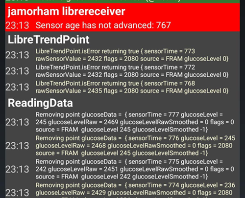

# Slik setter du opp FSL 2 og OOP2 med direkte Bluetooth-tilkobling i xDrip

Overført fra [MinimalL00per](https://www.minimallooper.com/post/how-to-setup-freestyle-libre-2-and-oop2-to-use-a-native-Bluetooth-connection-in-xdrip) til markdown og **revidert/oppdatert**: 25. aug. 2025, psonnera

Nederst i dette dokumentet finner du en liste med definisjoner. Hvis det er ord eller forkortelser du ikke kjenner, kan du *[hoppe ned dit](#minimallooper-definitions)* for en forklaring.

 

## Konfigurasjon

### Maskinvare

- *FSL2 og 2+* **MERK: Versjonene fra USA, Canada, New Zealand og Australia støttes IKKE**

**(VALGFRITT) Reader** (ikke kompatibel med FSL2+)

- Reader 1 (med oppdatert fastvare)

- Reader 2

*MERK: Hvis du planlegger å bruke Reader i denne løsningen, MÅ du STARTE sensoren med READER FØRST. Hvis du ikke gjør det, kan du ikke bruke Reader til å hente målinger fra den aktiverte sensoren. Når sensoren er varmet opp, kan du ta målinger med LL-appen eller xDrip.*

### Programvare

**OOP** - Out of Process Algorithm, en ekstern Android-app (APK) som hjelper til med å hente rådata fra sensoren for å få blodsukkerverdier. xDrip sender innsamlede FSL2 BT-rådata til OOP, og blodsukkerverdier sendes tilbake til xDrip.

- **OOP2**

  - **Fungerer bare med europeiske FSL2/2+-sensorer**

  - Lukket kildekode (ikke tilgjengelig på GitHub)

  - Formålet er å dekryptere de krypterte råverdiene fra sensoren og sende dem tilbake til xDrip. Da kan xDrip brukes enten med rådata, som krever kalibrering, eller gi glukoseverdier som ligner på dem fra Reader 1.

[***xDrip***](https://jamorham.github.io/)

- [*Nightly*](https://github.com/NightscoutFoundation/xDrip/releases) nyeste kildekode, bygget hver natt. Ikke grundig testet

- [*Stable*](https://xdrip-plus-updates.appspot.com/stable/xdrip-plus-latest.apk) nyeste stabile, testede utgivelse.

- **MERK: nye sensorer krever en oppdatert OOP2-app. Derfor anbefales det å bruke minst den nyeste xDrip-utgivelsen (Stable), som passer til den nyeste OOP2.**

 

## Fremgangsmåte

- *Last ned og installer først appene nedenfor*
- *Avinstaller apper som kan komme i konflikt*
- *Slik starter du en FSL2-sensor i direkte Bluetooth-modus med LL og xDrip
  - [*Steg 1: Installere og konfigurere appene*](#minimallooper-step1)
  - [*Steg 2: Konfigurere innstillingene i xDrip*](#minimallooper-step2)
  - [*Steg 3: Sett sensoren på kroppen*](#minimallooper-step3)
  - [*Steg 4: Start LL-appen og start sensoren med den aller første NFC-skanningen*](#minimallooper-step4)
  - [*Steg 5: Åpne xDrip og NFC-SKANN FSL2-sensoren*](#minimallooper-step5)
  - [*Steg 6: Start den nye sensoren i xDrip*](#minimallooper-step6)
  - [*Steg 7: Vent 60 sekunder og NFC-skann sensoren på nytt*](#minimallooper-step7)
  - [*Steg 8: Datainnsamling i 3 til 15 minutter*](#minimallooper-step8)
  - [*Steg 9: Kontroller at sensoren er tilkoblet og leverer data*](#minimallooper-step9)

- *[Merknader](#minimallooper-notes)*
- *[Fordeler](#minimallooper-advantages)*
- *[Ulemper](#minimallooper-disadvantages)*
- <u>*\[Feilsøking\](#minimallooper-troubleshooting)*</u>

## Før du starter

Det anbefales sterkt å følge denne fremgangsmåten med en **ny sensor**. Det er rapportert at det går an å koble til en sensor som allerede er i gang (***se [nedenfor](#minimallooper-started-sensor)***), men det er svært sannsynlig at LL-appen eller Reader lager en ny privat delt nøkkel for kommunikasjonen under tilkoblingen. Det betyr at xDrip etter bindingen ikke kjenner den nye nøkkelen og ikke kan kommunisere med sensoren. Prøv å koble til en sensor som er i gang, på egen risiko, helst mot slutten av sensorens levetid.

### Last ned og installer først appene nedenfor

(Libre2_OOP2)=

- **OOP2** - Versjoner av oop2 finner du her:

  (*Merk: du må være logget inn på Google for å åpne lenken.*)

*[oop2.apk](https://drive.google.com/file/d/1106h2s12b3Ev9gKCTU2G75q8h9ChHjcz/view?usp=sharing)* - OOP2_21_09_25 (05d1989) **2025.09.21** (nyeste versjon)

- **xDrip** - **<u>nyeste versjon</u>** (minimum versjon 2025.09.26) finner du her:

[*xDrip.apk*](https://github.com/NightscoutFoundation/xDrip/releases)

(minimallooper-started-sensor)=

### Hva om sensoren min allerede er startet? Kan jeg fortsatt få målinger i xDrip? JA!

Mange har spurt om denne metoden kan brukes med en sensor som allerede er aktiv, og jeg kan svare et rungende **JA**: du kan starte en sensor som allerede er i gang.

1.  **FØRST** må du passe på at du har gjort konfigurasjonsendringene og innstillingene i xDrip, og installert og konfigurert OOP2 som vist nedenfor.

2.  **DERETTER** går du til *steg 5* og **PASSER PÅ** at du har tvangsavsluttet LL før du starter. Følg så fremgangsmåten helt til slutt.

*MERK: Du kan ikke bruke den aktiverte FSL2-sensoren med FSLReader HVIS DEN ikke ble startet med FSLReader først. Hvis den BLE startet med FSLReader først, kan du **skanne** sensoren og hente målinger BÅDE med Reader og med apper som LL og xDrip.*

## Slik starter du en FSL2-sensor i direkte Bluetooth-modus med LL og xDrip

*MERK: Hvis det er innstillinger i skjermbildene som ikke er merket med en RAMME, og som IKKE er avkrysset (altså deaktivert), så LA DEM VÆRE DEAKTIVERT. Skjermbildene viser en konfigurasjon som fungerer, for ALLE innstillingene som vises. Hvis du vil eksperimentere med å slå andre funksjoner på/av etter at sensoren fungerer, står du fritt til det på egen risiko.*

(minimallooper-step1)=

### Steg 1: Installere og konfigurere appene

**Installer og konfigurer OOP2**, og sjekk at den fungerer ved bare å åpne appen.


**Innstillinger**

- *Use service* (bruk tjeneste) **på**

- *Use foreground service* (bruk forgrunnstjeneste) **på**

- *Timer Duration* (timervarighet) **5 minutter**

  - Endre til **1 sek** hvis du ikke får resultater raskt nok (skjermbildet nedenfor viser denne innstillingen).

**Versjon 2: 93e5cac-2020.12.08 (nyeste versjon)**


**Installer xDrip**, minimum versjon: nyeste utgivelse. Mer dokumentasjon om installasjon og oppsett av xDrip finner du [*her*](../CompatibleCgms/xDrip.md).

(minimallooper-step2)=

### Steg 2: Konfigurere innstillingene i xDrip

**Hardware Data Source** (maskinvare-datakilde): Libre Bluetooth


**NFC Scan features** (NFC-skannefunksjoner): *innstillinger som ikke er nevnt, skal være slått av.*

- *Use NFC feature* (bruk NFC-funksjon): **på**
- *Sensor Age or Expiry* (sensoralder eller utløp): **på**
- *Scan when not in xDrip* (skann når du ikke er i xDrip): **på**
- *Use Any-tag optimized reading method*: **av**, men prøv **på** hvis det er vanskelig å skanne


- *Starting Bluetooth connection with FSL2 sensor* (start Bluetooth-tilkobling til FSL2-sensor): **Always connect to libre2 sensors** (koble alltid til libre2-sensorer)


- *Smooth libre 3 data when using xxx method*: la stå på standard. Øk verdien for sensorer med mye støy, senk den når sensoren er stabil.


**Less Common Settings -\> Bluetooth Settings** (*disse er viktige og kan variere med telefonen/oppsettet ditt*)

- *Turn Bluetooth on* (slå på Bluetooth): **på**
- *Trust Auto-Connect* (stol på automatisk tilkobling): **på**
- *Use Background Scans* (bruk bakgrunnssøk): **på**
- *Always discover services* (finn alltid tjenester): **på**

Du kan sette opp xDrip med QR-koden nedenfor. Du må skanne den (eller laste inn bildet) i xDrip -> Auto Configure.

```{admonition} QR Code
:class: dropdown


```


Når du har skannet QR-koden ovenfor: hvis du har en Samsung-telefon (dette er også nyttig for mange kinesiske merker), skanner du den andre QR-koden nedenfor for å endre innstillingene og få en mer stabil tilkobling:

- *Trust Auto-Connect* (stol på automatisk tilkobling): **av**
- *Use Background Scans* (bruk bakgrunnssøk): **av**

```{admonition} QR Code
:class: dropdown


```


**Advanced settings for FSL2** – avanserte innstillinger for FSL2 (*valgfritt, men nyttig*)

- *show Raw values in Graph* (vis råverdier i grafen): **på**

- *show Sensor info in Status* (vis sensorinfo i status): **på**


**Extra Logging Settings** – ekstra logginnstillinger (*trengs for feilsøking hvis noe ikke fungerer riktig*)

- *Extra tags for logging* (ekstra logg-tagger): skriv inn denne verdien

`BgReading:d,jamorham librereceiver:v,LibreOOPAlgorithm:v,jamorham nsemulator:v,DexCollectionService:v`


(minimallooper-OOPsettings)=

**Less Common Settings -\> Other misc options**

> **Innstillinger for OOP2-konfigurasjon**

- *Out of process Libre algorithm* (Libre-algoritme utenfor prosessen): **AV**

(*PASS PÅ AT DENNE ER **AV** FOR OOP2, ELLERS FÅR DU INGEN MÅLINGER!*)


(minimallooper-step3)=

### Steg 3: Sett sensoren på kroppen

(minimallooper-step4)=

### Steg 4: Start LL-appen og start sensoren med den aller første NFC-skanningen

Start LL-appen, skann den nye sensoren du nettopp satte på, og lukk og deaktiver eller avinstaller så LL-appen. **Du må fortsatt vente hele 60 minutter på at sensoren varmer opp før du går videre og starter sensoren i xDrip**. Ikke stol på målingene før dette, for sensoren kalibrerer seg fortsatt internt og verdiene varierer mye.

#### Steg 4a (VALGFRITT, bruk FSLReader):

**Start FSL2-sensoren (ikke 2+) ved å skanne den med FSLReader i den aller første NFC-skanningen**

Hvis du vil kunne bruke **FSLReader** i tillegg til LL-appen eller xDrip for å lese verdier fra FSL2-sensoren, **må du skanne den nye FSL2-sensoren med FSL Reader FØRST.** Når oppvarmingen av sensoren er ferdig, kan du bruke LL-appen eller xDrip til å skanne målinger.

*MERK: LL-appen trengs bare til den ALLER FØRSTE NFC-skanningen etter at sensoren er satt på. Den sender startsignalet for oppvarmingen. Etterpå MÅ appen deaktiveres (appinnstillinger-\>tvangsavslutt) eller avinstalleres. Du kan bruke den modifiserte 2.3-appen eller de offisielle versjonene, det spiller ingen rolle. Det viktigste er å hindre at LL-appen kjører når xDrip prøver å starte BT-bindingen med sensoren, fordi LL-appen forstyrrer Bluetooth-gjentilkoblingen ved å bryte kommunikasjonen.*

*Det er rapportert at det er nok å slå av **posisjonstillatelsen** for LL-appen i Android-systeminnstillingene for å hindre at den forstyrrer tilkoblingen. Noen få brukere har rapportert at dette fungerer. Igjen: **jeg anbefaler å deaktivere eller avinstallere appen**, men du kan prøve dette hvis du vil eksperimentere.*

(minimallooper-step5)=

### Steg 5: Åpne xDrip og NFC-SKANN FSL2-sensoren

(*Påminnelse! Sørg for at LL er deaktivert (posisjon slått av) eller avinstallert, OG at du har ventet hele 60 minutter slik at sensoren har varmet opp og kalibrert seg internt.*)

**NFC-SKANN** FSL2-sensoren med xDrip. Dette sender et signal til sensoren om å slå på Bluetooth-sammenkobling, slik at bindingsprosessen (bonding) starter. Et lite varsel vises kort nederst på oversiktsskjermen i xDrip med teksten **Scanning** (skanner), etterfulgt av varselet **Scanned OK!** (skannet OK!) når NFC-skanningen av FSL 2-sensoren lyktes.


(minimallooper-step6)=

### Steg 6: Start den nye sensoren i xDrip

På **oversiktsskjermen i xDrip** trykker du på **hamburgermenyen** øverst til venstre. Velg så **Start Sensor** (start sensor).

På skjermen **Start New Sensor** trykker du på **Start Sensor**. Du får spørsmålet **Did you insert it today?** (satte du den på i dag?). Svar ved å trykke på **NOT TODAY** (ikke i dag).


*MERK: Hvis du ved et uhell trykket på «YES, TODAY», må du velge «stop sensor» i hovedmenyen i xDrip og deretter «start sensor» ved å gjøre steg 5 på nytt.*

(minimallooper-step7)=

### Steg 7: Vent 60 sekunder og NFC-skann sensoren på nytt

En ny NFC-skanning trengs for å **LEGGE TIL** sensoren som Bluetooth-enheten xDrip skal hente målingene fra. Når det er fullført, ser du et varsel med teksten **NEW SENSOR STARTED** (ny sensor startet).


Det er en tvungen ventetid på 60 sekunder, fordi sensoren ikke kan skannes mer enn én gang i minuttet under denne prosessen. Hvis sensoren skannes for tidlig, vises advarselen **Not so quickly, wait 60 seconds** (ikke så fort, vent 60 sekunder) på oversiktsskjermen i xDrip.


Åpne hendelsesloggen i xDrip og sjekk at sensoren ble riktig sammenkoblet med xDrip.


(minimallooper-step8)=

### Steg 8: Datainnsamling i 3 til 15 minutter

I løpet av 3 til 15 minutter er det samlet inn nok data til å vise de første verdiene. *Hvis du fortsatt ikke får målinger nå, hjelper det noen ganger å starte telefonen på nytt.*

Hvis du bruker en Samsung (eller et av mange kinesiske telefonmerker) og har problemer med å motta data, skanner du QR-koden nedenfor i xDrip -> Auto Configure.

```{admonition} QR Code
:class: dropdown


```

Den endrer Bluetooth-innstillingene i xDrip til:

- *Trust Auto-Connect* (stol på automatisk tilkobling): **av**
- *Use Background Scans* (bruk bakgrunnssøk): **av**

(minimallooper-step9)=

### Steg 9: Kontroller at sensoren er tilkoblet og leverer data

Trykk på hamburgermenyen øverst til venstre på oversiktsskjermen i xDrip og velg **System Status** (systemstatus). På skjermen System Status (systemstatus) viser feltet **Bluetooth Device:** den aktive enheten med FSL2 sitt Bluetooth-navneformat **ABB___XXXXXXXXXXX**, der X-ene står for sensorens serienummer. Feltet **Connection Status** (tilkoblingsstatus) viser **Connected** (tilkoblet), og feltet **Sensor Start:** viser tidspunktet sensoren ble startet.


På skjermen **BT Device** (sveip til venstre) kan du se flere detaljer om tilkoblingen til sensoren, og du kan bruke denne skjermen til å feilsøke tilkoblinger. Nedenfor er en liste over feltene og hva de brukes til, som hjelp ved feilsøking av tilkoblingen.

*MERK: **<u>IKKE TRYKK PÅ</u> OG ENDRE Bluetooth Pairing fra <u>Disabled</u>** i dette vinduet. Da forsøkes en direkte sammenkobling, den mislykkes (Not bonded) og du må starte hele prosessen på nytt fra steg 5.*


- **Phone Service State:** Siste gang telefonen hadde en BT-tilkobling til sensoren (det bør være mindre enn 5 minutter siden)
- **Bluetooth Device:** Viser gjeldende status for tilkoblingen (enten **Connected** (tilkoblet) eller **Disconnected** (frakoblet))
- **Device Mac Address**: Dette er sensorens maskinvare-ID (MAC-adresse)
- **Bluetooth Pairing**: Denne skal stå på **<u>Disabled, tap to enable</u>** (deaktivert, trykk for å aktivere). Pass på at du IKKE trykker på denne. Hvis du trykker på den ved et uhell, trykker du igjen til den går tilbake til deaktivert.
- **Slowest wake up**: Denne kan du se bort fra. xDrip bruker ikke tiden på å vente på målinger: den begynner å forvente dem etter en viss tid (vanligvis 5 minutter). Hvis det ikke kommer data da, ser du «Woke up early» (våknet tidlig), som betyr at xDrip ventet at data skulle være klare, men det finnes ingen. Slowest wake up er den lengste forsinkelsen som er registrert før data normalt kommer inn.
- **Next Wake up**: Skal si 5 minutter


(minimallooper-notes)=

### Merknader

- **Bruke NFC-skanning i LL ETTER at binding/sammenkobling i xDrip er fullført**: Du kan gjøre NFC-skanninger, men bindingen/sammenkoblingen med xDrip må være fullført først. Se alltid i xDrip om det nærmer seg 5-minuttersmålingen (altså 4 minutter siden). Hvis det er nær 5 min, venter du til den nye BT-målingen har kommet inn, og gjør så NFC-skanningen. Hvis du treffer feil tidspunkt, forstyrrer det BT-prosessen i xDrip, og du får ikke BT-målinger. Det kan ta en stund før den binder seg på nytt og sender igjen, og noen ganger kan sensorens BT-tilkobling bli «stjålet» av LL. Men mellom disse BT-målingene har jeg ikke hatt problemer med å gjøre en NFC-skanning og så deaktivere appen med en gang. Jeg er ikke sikker på om LL må deaktiveres hver gang, men jeg deaktiverer den for å være på den sikre siden.

- **Hva er det som skjer?** Når en Bluetooth-tilkobling opprettes, lages en privat delt nøkkel som trengs for kommunikasjonen mellom sensoren og appen/enheten som kobler til. Det er stor sannsynlighet for at LL-appen eller Reader lager en ny privat delt nøkkel for kommunikasjonen under tilkoblingen. Det betyr at xDrip etter bindingen ikke kjenner den nye nøkkelen og ikke kan kommunisere med sensoren.

  - Flere brukere har rapportert at LL-appen kan startes igjen etter at sensoren er startet og xDrip mottar målinger. I Android-tillatelsene for LL-appen trenger du bare å slå av tillatelsen **Posisjon** (Allow Location). Når dette er gjort, skal du kunne bruke LL-appen og xDrip samtidig. Jeg anbefaler at du ikke velger en standardapp for NFC-skanning, men velger hvilken app som skal lese sensoren ved hver NFC-skanning. Og IKKE GLEM, ved neste sensorbytte, å tvangsavslutte LL-appen etter den første NFC-skanningen som starter oppvarmingen av den nye sensoren. Når sensoren er konfigurert og xDrip mottar målinger, kan du starte LL-appen igjen.

&nbsp;

- **Omstart av telefonen**: Etter omstarten, og etter at du har deaktivert eller tvangsavsluttet appen, HUSK å sjekke at LL-appen IKKE kjører. Jeg foreslår at du tester en omstart for å se om LL starter igjen automatisk. Du kan se i innstillingene for LL-appen under appinnstillingene i Android på telefonen din. Hvis den fortsatt er aktivert, deaktiverer du LL-appen igjen. Å avinstallere LL-appen kan være den eneste måten å unngå dette på. Dette er for å hindre at LL ved et uhell stjeler BT-bindingen. Etter en omstart tar det også de samme 3–15 minuttene å få BT-målinger fra sensoren, så vær tålmodig og planlegg for dette hvis du starter på nytt nær tidspunkter der du trenger en BS-måling for å gi bolus, spise osv.

&nbsp;

- **Innstillinger for batterioptimalisering**: Pass på at du UNNTAR disse appene fra telefonens innstillinger for batterioptimalisering

  - xDrip

  - OOP 2

  - LL

  - AAPS

&nbsp;

- **Bruk av flymodus:** I noen situasjoner må du slå på flymodus (når du flyr ;-), eller om natten når du sover og ikke vil ha Wi-Fi- eller mobilsignaler fra telefonen nær hodet), og dette kan gi problemer med Bluetooth-kommunikasjonen når flymodus aktiveres. Hvis du slår på flymodus på telefonen og deretter aktiverer Bluetooth, mister du blodsukkermålingene. Den eneste løsningen er å starte innsamleren (collector) på nytt i xdrip+ -\> System Status -\> Classic Status Page. Etter at innsamleren ble startet på nytt, kom blodsukkermålingene tilbake.

 

(minimallooper-advantages)=

### Fordeler

- **Modifisert LL-app trengs ikke lenger** Du trenger ikke lenger en modifisert versjon av LL-appen for å hente verdier fra FSL2-sensoren. Du kan bruke den modifiserte LL-appen, men de offisielle versjonene av LL-appen kan starte den første NFC-skanningen på samme måte som den modifiserte appen. Det er ingen forskjell når det gjelder den første NFC-skanningen som starter sensoren.

&nbsp;

- **NFC-skanneenhet fra tredjepart trengs ikke lenger** NFC-skanneenheter fra tredjepart (som Miaomiao, Bubble eller Blucon) trengs ikke lenger *(men kan fortsatt brukes)* for å samle inn målinger, siden sensoren alene nå kan levere dem via Bluetooth. Mindre maskinvare betyr færre ting som kan gå galt, færre enheter å lade og et mer minimalistisk oppsett.

&nbsp;

- **Du kan fortsatt NFC-skanne målinger med FSL2 Reader (versjon 1 med oppdatert fastvare eller versjon 2) NÅR FSL2-sensoren ble startet med FSL Reader FØRST.** Den frittstående FSL2-readeren kan fortsatt brukes til å skanne målinger fra den aktive sensoren etter at den er bundet til xDrip via Bluetooth.

  - Du **MÅ** starte sensoren med den aller første NFC-skanningen, som starter oppvarmingen av sensoren, **med FSL Reader FØRST**. Etter dette kan også andre apper ta NFC-målinger fra den aktiverte sensoren.
- Slik jeg forstår det, vil FSL2-sensoren (så lenge den ikke har opprettet eller prøver å opprette en tilkobling) alltid annonsere at den finnes (og er tilgjengelig) over BLE nøyaktig hvert 2. minutt (synlig på alle Bluetooth-enheter som kan søke etter Bluetooth-enheter). Den enheten som svarer først på denne annonseringen, vinner kappløpet og er den *eneste* enheten som får koble til og lese sensoren, fordi det lages en privat delt nøkkel under tilkoblingen ved NFC-skanningen, og denne nøkkelen brukes til å dekryptere FSL 2-kommunikasjonen. Sensoren er da utilgjengelig for andre enheter som ikke har denne private delte nøkkelen, og som kanskje også prøver å koble til. Det ser ut til at FSL 2-readeren alltid vinner dette kappløpet, uansett «motstander».

&nbsp;

- **Minimalt oppsett av maskinvare** Målet mitt har alltid vært å ha så få medisinske enheter festet på kroppen som mulig. FSL2 i kombinasjon med Omnipod-systemet oppfylte dette målet. Dette er enda viktigere når jeg reiser (både korte og lange avstander), fordi antall ting og settbytter for disse tingene blir færre, og det betyr at jeg har mer plass til annet i bagasjen. Forhåpentligvis kommer det i framtiden en patch-pumpe som bare har et utskiftbart reservoar, der brikken og motoren kan pakkes som en del man beholder og bruker på nytt. Det ville gi mindre avfall og mindre emballasje ved settbytter, som igjen gir mer plass i kofferten til andre ting.

&nbsp;

- **Ikke lenger en times hull ved sensorbytte** Fordi du kan starte en ny sensor med LL-appen ved hjelp av en første NFC-skanning, kan den gamle sensoren fortsette å kjøre og levere målinger via Bluetooth samtidig. Etter 20 minutter kan du få målinger fra den nye sensoren, men det er best å vente 1 time slik at sensoren får kalibrert seg ordentlig internt. Det betyr at du kan stoppe den gamle sensoren og starte den nye (etter at den er satt på og varmet opp med NFC-skanningen i LL en time tidligere), og i løpet av 3 til 15 minutter har du de første kalibreringene og målingene.

&nbsp;

(minimallooper-disadvantages)=

### Ulemper

- **Omstart av telefonen:** Fordi Bluetooth-prosessen må starte på nytt når telefonen starter på nytt, må du først passe på å deaktivere LL-appen manuelt (hvis du ikke avinstallerte den) og være tålmodig til de første målingene kommer (3 til 15 min). Det betyr at du bør planlegge omstarter av telefonen slik at de ikke skjer på kritiske tidspunkter, som ved korreksjonsboluser eller måltider og mellommåltider.

&nbsp;

- **Du kan ikke kjøre LL og xDrip samtidig for Bluetooth-målinger**. LL vil alltid prøve å «stjele» Bluetooth-tilkoblingen til sensoren og binde seg til den. Hvis det skjer, sitter du fast med LL resten av sensorens levetid. Så å kjøre appene samtidig fungerer ikke alltid. Som jeg nevner nedenfor, kan du aktivere LL-appen og gjøre en NFC-skanning for å få LL-målingen (hvis du vil sammenligne, eller hente historikk til deg selv eller til rapporter for behandleren), men du bør deaktivere den så snart du har målingen, og ikke prøve dette innenfor ett minutt før xDrip skal hente sin Bluetooth-måling. Jeg er ikke sikker på hvordan det fungerer å bruke FSL2-readeren mens du gjør dette, men jeg skal teste det senere.
- Flere brukere har rapportert at LL-appen kan startes igjen etter at sensoren er startet og xDrip mottar målinger. I Android-tillatelsene for LL-appen trenger du bare å slå av tillatelsen **Posisjon** (Allow Location). Når dette er gjort, skal du kunne bruke LL-appen og xDrip samtidig. Jeg anbefaler at du ikke velger en standardapp for NFC-skanning, men velger hvilken app som skal lese sensoren ved hver NFC-skanning. Og IKKE GLEM, ved neste sensorbytte, å tvangsavslutte LL-appen etter den første NFC-skanningen som starter oppvarmingen av den nye sensoren. Når sensoren er konfigurert og xDrip mottar målinger, kan du starte LL-appen igjen.

&nbsp;

- **NFC-skanneenheter fra tredjepart kan fortsatt brukes**. Ja, jeg førte dette opp som en ulempe, men jeg ville også påpeke at hvis noe går galt med sensoren og LL tar kontroll over den, kan du alltid falle tilbake på å sette en NFC-skanneenhet på sensoren for å få målinger i xDrip. Du kan også bruke en slik enhet i stedet for en direkte Bluetooth-tilkobling hvis du er mer komfortabel med et oppsett med en NFC-skanneenhet fra tredjepart (Miaomiao, Bubble, Blucon). Noen telefoner fungerer ikke så godt med direkte Bluetooth-binding til sensoren og henting av data. Du kan bruke disse enhetene som reserve eller til vanlig bruk; uansett har du fortsatt dette som et alternativ.
- Hvis du planlegger å bruke **FSL Reader** som NFC-skanneenhet for å ta målinger, MÅ du starte FSL2-sensoren med den **ALLER FØRSTE NFC-skanningen** for å varme opp sensoren med **READER FØRST**.

&nbsp;

- **LV-data lastes ikke opp automatisk** Siden LL-appen ikke har en fast Bluetooth-tilkobling (fordi LL ikke skal kjøre samtidig med xDrip når sensoren aktivt sender Bluetooth-målinger), mottar den ikke målinger automatisk fra sensoren. Det betyr at blodsukkerdata ikke lastes opp automatisk til LV, og dermed heller ikke til andre telefoner med LL. Jeg regner dette som en ulempe, for jeg vet at mange foreldre er avhengige av denne funksjonen, i tillegg til de som må bruke LV-rapportering til behandleren sin. Du kan fortsatt åpne LL-appen og skanne hver 8. time for å få de lagrede dataene fra sensoren inn i LL (3 ganger om dagen, minst hver 8. time, men du trenger trolig flere skanninger for å få med alle 24 timene med data), men igjen er dette en manuell prosess.

&nbsp;

(minimallooper-definitions)=

### Definisjoner

- **BT** - Bluetooth

- **BLE** - Bluetooth Low Energy

- **FSL** - FreeStyle Libre
  - **Libre 1 (FSL1)** - bare NFC. Første versjon av sensoren

  - **Libre 2 (FSL2)** - Bluetooth og NFC. Andre versjon av sensoren.

  - **Libre 3 (FSL3)** - Bluetooth og NFC. Tredje, mindre versjon av sensoren. Støttes ikke av OOP2 (se Juggluco).

- **LL** - LibreLink, **appen** som brukes til å starte sensoren med den første NFC-skanningen

- **LV** - LibreView, skytjeneste for å dele data med diabetesteamet ditt (vurder å bruke Tidepool eller Nightscout)

- **MM** - MiaoMiao, navn på og produsent av en NFC-skanneenhet fra tredjepart som leverer målinger til xDrip via Bluetooth.

- **NFC** - Near Field Communication, en fysisk handling der du holder NFC-leseren på telefonen inntil sensoren for å starte en avlesning. Dette kalles ofte «å skanne sensoren», en «sensorskanning» eller «NFC-skanning». Denne prosessen bruker ikke Bluetooth i det hele tatt.

- **OOP1** - Out of Process Algorithm versjon 1, tredjepartsappen som mottar råverdier (levert til xDrip fra sensoren via Bluetooth eller NFC-skanning) og så bruker en algoritme (svært lik maskinvarealgoritmen på sensorbrikken) til å behandle råverdiene og sende et kalibrert blodsukker (kalibrert av OOP1-algoritmen, ikke av xDrips egne kalibreringer) tilbake til xDrip, som enten viser det eller behandler det videre med xDrips kalibrering (med en blodprøve fra fingeren) om nødvendig.

- **OOP2** - Out of Process Algorithm versjon 2, tredjepartsappen som mottar krypterte data fra FSL 2-sensoren (via Bluetooth eller NFC-skanning) og så dekrypterer dem. Når dataene er dekryptert, sendes de til xDrip.

 

(minimallooper-troubleshooting)=

### Feilsøking

#### Det går ikke å skanne sensoren med NFC

- Pass på at NFC-leseren på telefonen er aktivert i Android-innstillingene.
- NFC-leseren må være kompatibel med **ISO 15693**-tagger. Noen Cubot-telefoner er svært vanskelige å bruke.
- Se i dokumentasjonen til telefonen din for å finne ut hvor NFC-antennen sitter. Hold den inntil sensoren og bli der i 10 sekunder: NFC-avlesning i xDrip tar lengre tid enn i produsentens app eller på readeren.
- Prøv å lukke xDrip før du skanner sensoren.
- Pass på at ingen annen app vil lese sensoren (du kan få et valg mellom ulike apper når du skanner: velg xDrip, men ikke flytt på telefonen).
- Prøv alle kombinasjoner av NFC-innstillingene *Use faster multi-block reading method* og *Use Any-tag optimized reading method* i xDrip. Vit at NFC-skanninger vanligvis er mest pålitelige med begge disse alternativene **av**.

#### Står fast på innsamling av de første målingene

*Merk: FSL 2 regnes ikke som en pålitelig datakilde når den kalibreres manuelt.*

Sett [kalibreringsstrategien i OOP2](#minimallooper-OOPsettings) til «No calibration» (ingen kalibrering) til alt fungerer.

Deretter kan du bestemme om du vil kalibrere eller ikke.


#### Sensoren rapporteres som FSL1


Pass på at du bruker de nyeste versjonene av xDrip og OOP2.

#### Tilkoblingen til sensoren mislykkes

- Kontroller at OOP1 er deaktivert (se [her](#minimallooper-OOPsettings))


- Kontroller at OOP2 ikke settes i dvale av telefonens batterisparingsapper og -innstillinger
- Kontroller at Google Play Protect er deaktivert, siden den vil stoppe OOP2
- Endret du Bluetooth Pairing i System Status? Trykk på den igjen for å sette den tilbake til **<u>Disabled</u>**


#### Manglende målinger

Sjekk at OOP2 viser verdier som ikke er 0 eller -1; det kan være et tegn på at sensoren svikter (eksempel nedenfor i mmol/L).


At sensoralderen ikke går framover, kan også være et tegn på at sensoren har problemer. Det betyr at xDrip mottok en verdi, men forkastet den fordi den ikke var akseptabel (sensorfeil).



#### Start sammenkoblingen av sensoren helt på nytt

1. xDrip-menyen -> Stop sensor (det stopper ikke FSL2, det setter bare xDrip til tilstanden «ikke startet»)
2. xDrip-menyen -> System status -> Forget device (glem enhet)
3. Skann sensoren med NFC i xDrip. Vent minst ett minutt
4. xDrip-menyen -> Start sensor. Vent minst ett minutt
5. Skann sensoren med NFC i xDrip noen ganger, og vent alltid minst ett minutt mellom to skanninger
