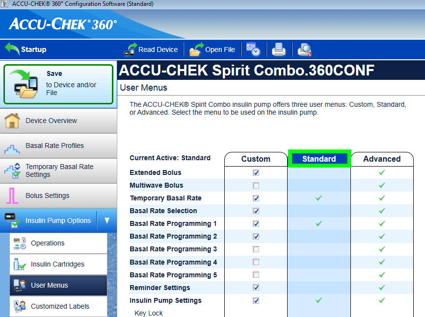

# Accu-Chek Combo

**Denne programvaren er en del av en gjør-det-selv-løsning og er ikke et produkt. Den krever at DU leser, lærer og forstår systemet, også hvordan det brukes. Den tar ikke over hele diabetesbehandlingen for deg, men lar deg forbedre diabetesen din og livskvaliteten din hvis du er villig til å bruke den tiden som trengs. Ikke forhast deg, men gi deg selv tid til å lære. Du alene er ansvarlig for hva du gjør med den.**

```{admonition} Accu-Chek Combo is being phased out
:class: note

Roche trekker seg ut av insulinpumpemarkedet for å rette diabetesporteføljen sin mot Accu-Chek SmartGuide CGM. Roche har varslet at salget av både Accu-Chek Combo og Accu-Chek Insight er avsluttet; den gjenværende Accu-Chek Solo-mikropumpen avvikles også (siste leveranser i Tyskland ved utgangen av 2025). Endringen rulles ut region for region, med start i Tyskland, og andre europeiske markeder ventes å følge etter. Hvis du er avhengig av denne pumpen, bør du planlegge en overgang til en pumpe som støttes.
```

```{contents} Table of contents
:depth: 1
:local: true
```

## Pumpefunksjoner med AAPS

* Kommuniserer med **AAPS** over telefonens innebygde Bluetooth, uten en ekstra kommunikasjonsenhet.
* Automatisk håndtering av sommertid og tidssoner.

## Krav til maskinvare og programvare

* En Roche Accu-Chek Combo (alle fastvareversjoner fungerer).
* En Smartpix- eller Realtyme-enhet sammen med programmet 360 Configuration Software for å konfigurere pumpen. (Roche sender Smartpix-enheter og konfigurasjonsprogrammet gratis til kundene sine på forespørsel.)
* En kompatibel telefon med Android 12 eller nyere. Se [versjonsnotatene](#maintenance-android-version-aaps-version) for detaljer.
* **AAPS**-appen installert på telefonen din.

Noen telefoner kan fungere bedre enn andre, avhengig av hvor god Bluetooth-støtten er, og om de har ekstra, svært aggressiv strømsparing. En liste over telefoner finner du i dokumentet [Telefoner](#Phones-list-of-tested-phones). Vær klar over at dette ikke er en fullstendig liste, og at den gjenspeiler personlige erfaringer fra brukere. Du oppfordres til å legge inn dine egne erfaringer også, og slik hjelpe andre (disse prosjektene handler om å gi noe tilbake).

(combov2-before-you-begin)=
## Før du begynner

**SIKKERHET FØRST** – ikke prøv denne prosessen i en situasjon der du ikke kan rette opp en feil. Ha Smartpix-/Realtyme-enheten din og 360 Configuration Software klar. Regn med å bruke omtrent en time på å sette opp alt og kontrollere at alt fungerer som det skal.

Vær klar over disse begrensningene:

* Forlenget bolus og multiwave-bolus støttes ikke for øyeblikket (du kan bruke [forlengede karbohydrater](../DailyLifeWithAaps/ExtendedCarbs.md) i stedet).
* Bare én basalprofil (den første) støttes.
* Den laveste basaldosen i din **Profil** er 0,05 E/t. **AAPS** avviser en **Profil** med lavere dose. Combo runder basaldoser av til sine egne steg (0,01 E/t under 1 E/t, 0,05 E/t opp til 10 E/t, 0,1 E/t over det). **AAPS** bruker dosene pumpen faktisk gir.
* Midlertidige basaldoser er begrenset til 500 % av gjeldende basaldose. **AAPS** tar hensyn til denne grensen.
* Loopen deaktiveres hvis den aktive profilen på pumpen ikke er profil nr. 1. Dette varer til profil nr. 1 gjøres aktiv. Når det er gjort, vil AAPS neste gang den kobler til (enten av seg selv etter en stund, eller fordi du trykker på **Oppdater** på pumpeskjermen for Accu-Chek Combo) oppdage at profil nr. 1 er den aktive, og slå på loopen igjen.
* Hvis loopen ber om at en pågående TBR avbrytes, setter Combo i stedet en TBR på 90 % eller 110 % i 15 minutter. Grunnen er at en faktisk avbrytelse av en TBR utløser et varsel på pumpen med mange vibrasjoner, og disse vibrasjonene kan ikke slås av.
* Stabiliteten på Bluetooth-tilkoblingen varierer mellom telefoner. Det gir varsler om «pumpe utilgjengelig», der det ikke lenger opprettes forbindelse til pumpen. Hvis den feilen oppstår, sjekker du at Bluetooth er på, trykker på **Oppdater** på pumpeskjermen (**Administrer** > **Pumpe**) for å se om det var et forbigående problem, og hvis det fortsatt ikke opprettes forbindelse, starter du telefonen på nytt, noe som vanligvis løser det.
* Det finnes også et annet problem der en omstart ikke hjelper, men du må trykke på en knapp på pumpen (som nullstiller pumpens Bluetooth-stakk) før pumpen tar imot tilkoblinger fra telefonen igjen.
* Unngå å sette en TBR på pumpen selv, siden loopen tar styringen over TBR-er. Det kan ta opptil 20 minutter å oppdage en ny TBR på pumpen, og virkningen av TBR-en regnes bare med fra det øyeblikket den oppdages. I verste fall kan altså 20 minutter av en TBR mangle i IOB.

Driveren er for øyeblikket skrevet for å støtte disse språkene på Combo. (Dette har ikke noe med språket i AAPS å gjøre – det er språket som vises på Combos egen LCD-skjerm.)

* Engelsk
* Spansk
* Fransk
* Italiensk
* Russisk
* Tyrkisk
* Polsk
* Tsjekkisk
* Ungarsk
* Slovakisk
* Rumensk
* Kroatisk
* Nederlandsk
* Gresk
* Finsk
* Norsk
* Portugisisk
* Svensk
* Dansk
* Tysk
* Slovensk
* Litauisk

**Viktig**: Hvis pumpen din er satt til et språk som ikke står på denne listen, kontakter du utviklerne og setter pumpens språk til ett av språkene på listen. Ellers fungerer ikke driveren som den skal.

## Oppsett av telefonen

Det er svært viktig å sørge for at batterioptimalisering er slått av. AAPS oppdager allerede selv når den er underlagt slik optimalisering, og ber deg i appen om å slå den av. Men på moderne Android-telefoner er Bluetooth _i seg selv_ en app (en systemapp). Og som regel kjører denne «Bluetooth-appen» _med batterioptimalisering slått på som standard_. Resultatet er at Bluetooth kan slutte å svare når telefonen vil spare strøm, fordi den avslutter Bluetooth-appen. Det betyr at batterioptimalisering også må slås av i innstillingene for denne Bluetooth-systemappen. Dessverre er det ulikt fra telefon til telefon hvordan du finner denne Bluetooth-systemappen. I vanlig Android går du til Innstillinger -> Apper -> Se alle N apper (N = antall apper på telefonen din). Åpne så menyen øverst til høyre og trykk på «Vis system», «Vis systemapper» eller «Alle apper». Se nå etter en app som heter «Bluetooth» i den utvidede applisten. Velg den, og trykk på «Batteri» på skjermen «Appinfo». Der slår du av batterioptimalisering (noen ganger kalt «batteribruk»).

## Oppsett av Combo

* Konfigurer pumpen med Accu-Chek 360 Configuration Software. Hvis du ikke har programmet, kontakter du Accu-Chek kundeservice. De sender vanligvis registrerte brukere en CD med «360° Pump Configuration Software» og en SmartPix USB-infrarød tilkoblingsenhet (Realtyme-enheten fungerer også hvis du har den).

  - **Påkrevde innstillinger** (merket grønt på skjermbildene):

     * Sett/la menykonfigurasjonen stå på «Standard». Da viser pumpen bare menyene/handlingene som støttes, og skjuler dem som ikke støttes (forlenget/multiwave-bolus, flere basalprofiler). Bruk av disse begrenser loop-funksjonen, fordi loopen ikke kan kjøre trygt når de er i bruk.
     * Kontroller at _Quick Info Text_ er satt til «QUICK INFO» (uten anførselstegn, du finner det under _Insulin Pump Options_).
     * Sett TBR _Maximum Adjustment_ (maks justering) til 500 %
     * Slå av _Signal End of Temporary Basal Rate_ (varsel når midlertidig basal slutter)
     * Sett TBR _Duration increment_ (steg for varighet) til 15 min
     * Slå på Bluetooth

  - **Anbefalte innstillinger** (merket blått på skjermbildene)

     * Sett alarmen for lav ampulle slik du ønsker
     * Sett en maks bolus som passer behandlingen din, som vern mot feil i programvaren
     * Sett på samme måte en maksimal TBR-varighet som sikkerhet. Tillat minst 3 timer, siden valget for å koble fra pumpen i 3 timer setter 0 % i 3 timer.
     * Slå på tastelåsen på pumpen for å hindre bolus fra pumpen, spesielt hvis pumpen har vært brukt før og hurtigbolus var en vane.
     * Sett tidsavbrudd for skjerm og meny til minimum, henholdsvis 5,5 og 5. Da kan AAPS komme seg raskere etter feilsituasjoner, og det blir færre vibrasjoner ved slike feil

  

  

  

  

## Aktivere driveren og pare den med Combo

* Åpne **menyen** (☰) øverst til venstre, gå til [**Konfigurasjon** > **Pumpe**](../SettingUpAaps/ConfigBuilder.md) og velg **Accu-Chek Combo**.

  

  Når den er valgt, viser kortet **Accu-Chek Combo** to knapper, **Innstillinger** og **Åpne plugin**:

  

  **Innstillinger** åpner innstillingene for Accu-Chek Combo-driveren (se [Innstillinger](#combov2-preferences) nedenfor):

  

  **Åpne plugin** (eller **Administrer** > **Pumpe**) åpner pumpeskjermen for Accu-Chek Combo. Før en pumpe er sammenkoblet, viser den **Ikke sammenkoblet til en pumpe**:

  

* Trykk på **Sammenkobling** på pumpeskjermen. Skjermen **Tilkoble pumpe** åpnes. Følg stegene som vises på skjermen, og trykk så på **Start sammenkobling**. Når Android ber om tillatelse til å gjøre telefonen synlig for andre Bluetooth-enheter, trykker du på **Tillat**. Etter hvert viser Combo en 10-sifret PIN-kode for sammenkobling på skjermen sin, og **AAPS** ber om den. Skriv inn PIN-koden i feltet **10-sifret PIN**.

  

  

  

  De neste bildene er fra en eldre **AAPS**-versjon. Stegene og tekstene er de samme, men skjermbildene ser litt annerledes ut.

  

  

  

* Hvis PIN-koden skrives inn feil, viser **AAPS** **PIN-koden fungerte ikke. Sjekk om det var en skrivefeil. Hvis dette fortsetter å skje, avbryt og prøv å pare enhet på nytt.**

  

* Når **Vellykket sammenkobling med Combo** vises, trykker du på **OK**. Du kommer tilbake til pumpeskjermen, som nå viser pumpestatusen (se [Innholdet på pumpeskjermen for Accu-Chek Combo](#combov2-tab-contents) nedenfor). Knappen **Sammenkobling** erstattes av **Opphev sammenkobling**.

* For å kontrollere oppsettet (med pumpen **koblet fra** alle kanyler, for sikkerhets skyld!) bruker du AAPS til å sette en TBR på 500 % i 15 min og gi en bolus. Pumpen skal nå ha en TBR i gang og bolusen i historikken. AAPS skal også vise den aktive TBR-en og den leverte bolusen.

* På Combo anbefales det å slå på tastelåsen for å hindre bolus fra pumpen, spesielt hvis pumpen har vært brukt før og «hurtigbolus»-funksjonen var en vane.

## Merknader om sammenkobling

Accu-Chek Combo ble utviklet før Bluetooth 4.0 kom ut, og bare ett år etter den aller første Android-versjonen. Derfor er måten den parer seg med andre enheter på, ikke 100 % kompatibel med hvordan det gjøres i Android i dag. For å løse dette helt ville AAPS trenge tillatelser på systemnivå, og de er bare tilgjengelige for systemapper. Slike apper installeres av telefonprodusentene – brukere kan ikke installere systemapper.

Konsekvensen er at sammenkobling aldri blir 100 % problemfri. Spesielt kan Androids dialog for Bluetooth-PIN dukke opp et kort øyeblikk under sammenkoblingen og forsvinne av seg selv. Men noen ganger blir den værende på skjermen og ber om en 4-sifret PIN. (Dette må ikke forveksles med den 10-sifrede PIN-koden for Combo-sammenkobling.) Ikke skriv inn noe, bare trykk på avbryt. Hvis sammenkoblingen ikke fortsetter, følger du instruksjonene på skjermen for å prøve sammenkoblingen på nytt.

(combov2-tab-contents)=
## Innholdet på pumpeskjermen for Accu-Chek Combo

For å åpne pumpeskjermen går du til **Administrer** > **Pumpe**. Når en pumpe er sammenkoblet, viser den denne informasjonen (punktene er listet ovenfra og ned):


1. **Driverstatus**: Driveren kan være i en av disse tilstandene:
   - **Frakoblet**: Det er ingen Bluetooth-tilkobling. Driveren er i denne tilstanden mesteparten av tiden og kobler seg bare til pumpen ved behov – det sparer strøm
   - **Kobler til**
   - **Kontrollerer pumpen**: pumpen er tilkoblet, men driveren gjør nå sikkerhetskontroller for å sikre at alt er i orden og oppdatert
   - **Klar**: driveren er klar til å ta imot kommandoer fra AAPS
   - **Pauset**: pumpen er satt på pause (vises som «stopped» (stoppet) på Combo)
   - En beskrivelse av kommandoen som utføres, for eksempel **Setter basal profil** eller **Oppdaterer pumpestatus**
   - **Feil**: det oppsto en feil. Tilkoblingen ble avsluttet, og en eventuell pågående kommando ble avbrutt
2. **Siste tilkobling**: Hvor mange minutter siden driveren sist koblet seg til Combo. Hvis det går over 30 minutter, vises dette punktet med rød farge
3. **Batteri**: Batterinivå. Combo oppgir bare **Fullt**, **Lavt** eller **Tomt**, og gir ikke noe mer nøyaktig (som en prosent), så bare disse tre nivåene vises her
4. **Reservoar**: Hvor mange enheter (E) insulin det er i reservoaret på Combo nå
5. **Siste bolus**: Hvor mange minutter siden den siste bolusen ble gitt. Hvis ingen bolus er gitt etter at AAPS ble startet, vises ikke dette
6. **Midlertidig basal**: Detaljer om den aktive midlertidige basalen. Hvis ingen er aktiv nå, vises ikke dette
7. **Profilens basal**: Den aktive grunnbasaldosen («grunn» betyr basaldosen uten at noen aktiv TBR påvirker basalfaktoren)
8. **Serienummer**: Combos serienummer slik pumpen oppgir det (dette tilsvarer serienummeret på baksiden av Combo)
9. **Bluetooth adresse**: Combos 6-byte Bluetooth-adresse, vist i formatet `XX:XX:XX:XX:XX:XX`

Mens driveren gjør noe (for eksempel setter en basalprofil), beskriver en boks under listen hva som pågår, med en tynn fremdriftslinje som viser fremdriften.

Combo kan styres via Bluetooth i _fjernterminal_-modus eller i _kommando_-modus. Fjernterminal-modus tilsvarer «fjernkontrollmodus» på Combo-måleren, som etterligner pumpens LCD-skjerm og fire knapper. Noen kommandoer må driveren utføre i denne modusen, siden de ikke finnes i kommando-modus. Den sistnevnte modusen er mye raskere, men som sagt begrenset i hva den kan gjøre. Når fjernterminal-modus er aktiv, vises det gjeldende fjernterminal-skjermbildet i feltet rett over Combo-tegningen. Når driveren bytter til kommando-modus, er dette feltet derimot tomt.

(Du påvirker ikke dette. Driveren bestemmer helt selv hvilken modus den bruker. Dette er bare en merknad så du vet hvorfor du noen ganger ser Combo-skjermbilder i det feltet.)

Nederst finner du disse knappene:

- **Oppdater**: Utløser en umiddelbar oppdatering av pumpestatusen. Den brukes også til å fortelle AAPS at en tidligere oppdaget feil nå er rettet, og at AAPS kan sjekke på nytt at alt er i orden (mer om det nedenfor i [avsnittet om varsler](#combov2-alerts)). Du kan bare trykke på den når driveren er frakoblet, pauset eller i feiltilstand.
- **Opphev sammenkobling**: Opphever sammenkoblingen av Combo med **AAPS** og Android, etter at du har bekreftet **Vil du virkelig oppheve sammenkoblingen av pumpen?**. Når ingen pumpe er sammenkoblet, erstattes denne knappen av **Sammenkobling**.

(combov2-preferences)=
## Innstillinger

Disse innstillingene finnes for Combo-driveren (**Konfigurasjon** > **Pumpe** > **Accu-Chek Combo** > **Innstillinger**, eller innstillingsikonet (tannhjulet) på pumpeskjermen). Punktene er listet ovenfra og ned:

1. **Søkevarighet (i sekunder)**: Under sammenkobling gjør driveren telefonen synlig for pumpen. Dette styrer hvor lenge telefonen er synlig. Som standard er maksimum (300 sekunder = 5 minutter) valgt. Android tillater ikke at telefonen er synlig uten tidsgrense, så en varighet må velges.
2. **Autodetekter og automatisk registrer bytte av insulinreservoar**: Hvis dette er på, registrerer driveren det «reservoarbyttet» som du ellers ville registrert selv med **Administrer** > **Prime/fylling**. Dette er forklart [nærmere nedenfor](#combov2-autodetections).
3. **Autodetekter og automatisk registrer batteribytte**: Hvis dette er på, registrerer driveren det «batteribyttet» som du ellers ville registrert selv med **Administrer** > **Bytte pumpebatteri**. Dette er forklart [nærmere nedenfor](#combov2-autodetections).
4. **Aktiver detaljert Combo logging**: Dette øker mengden logging fra driveren kraftig. **FORSIKTIG**: Ikke slå på dette med mindre en utvikler ber deg om det. Ellers kan dette gi mye støy i **AAPS**-loggene og gjøre dem mindre nyttige.

Sammenkobling og oppheving av sammenkobling gjøres på pumpeskjermen, ikke i innstillingene (se ovenfor).

(combov2-autodetections)=
## Automatisk oppdaging og registrering av batteri- og reservoarbytte

Driveren kan oppdage batteri- og reservoarbytte ved å følge med på batteri- og reservoarnivået. Hvis Combo rapporterte batterinivået som lavt forrige gang pumpestatusen ble oppdatert, og batterinivået nå, under den nye statusoppdateringen, vises som normalt, konkluderer driveren med at brukeren må ha byttet batteri. Samme logikk brukes for reservoarnivået: Hvis det nå er høyere enn før, tolkes det som et reservoarbytte.

Dette fungerer bare hvis batteri og reservoar byttes når nivåene rapporteres som lave, _og_ det nye batteriet og reservoaret er tilstrekkelig fulle.

Disse automatiske oppdagelsene kan slås av i [innstillingene](#combov2-preferences) for driveren.

(combov2-alerts)=
## Varsler (advarsler og feil) og hvordan de håndteres

Combo viser varsler som fjernterminal-skjermbilder. Advarsler vises med en «Wx»-kode (x er et siffer) sammen med en kort beskrivelse. Ett eksempel er «W7», «TBR OVER» (TBR avsluttet). Feil er tilsvarende, men vises med en «Ex»-kode i stedet.

Noen advarsler kvitteres automatisk av driveren. Disse er:

- W1 «reservoir low» (lavt reservoar): driveren gjør dette om til en advarsel om lavt reservoar som vises på hovedskjermen i AAPS
- W2 «battery low» (lavt batteri): driveren gjør dette om til en advarsel om lavt batteri som vises på hovedskjermen i AAPS
- W3, W6, W7, W8: alle disse er bare til informasjon for brukeren, så det er trygt at driveren kvitterer dem automatisk

Andre advarsler kvitteres _ikke_ automatisk. Feil kvitteres dessuten _aldri_ automatisk. Begge håndteres på samme måte: De får driveren til å vise en varseldialog oppå AAPS-skjermen, og de får den også til å avbryte enhver pågående kommando. Driveren går da over i «feil»-tilstanden (se [innholdet på pumpeskjermen for Accu-Chek Combo ovenfor](#combov2-tab-contents)). I denne tilstanden kan ingen kommandoer utføres. Brukeren må håndtere feilen på pumpen. En okklusjonsfeil kan for eksempel kreve at kanylen byttes. Når brukeren har tatt seg av feilen, kan normal drift gjenopptas ved å trykke på **Oppdater** på pumpeskjermen for Accu-Chek Combo. Driveren kobler seg da til Combo og oppdaterer statusen, og sjekker blant annet om en feil fortsatt vises på skjermen. Driveren oppdaterer dessuten pumpestatusen automatisk etter en stund, så det er ikke nødvendig å trykke på knappen manuelt.

Bolus er et spesialtilfelle. Den gis i Combos kommando-modus, som ikke rapporterer midt i en bolus at et varsel har dukket opp. Derfor kan driveren ikke kvittere advarsler automatisk _under_ en bolus. Det betyr dessverre at pumpen piper til bolusen er ferdig. Det vanligste varselet midt i en bolus er W1 «reservoir low» (lavt reservoar). **Ikke** kvitter Combo-advarsler manuelt på selve pumpen under en bolus. Du risikerer å avbryte bolusen. Driveren tar seg av advarselen når bolusen er ferdig.

Varsler som oppstår mens driveren ikke er koblet til Combo, blir ikke lagt merke til av driveren. Combo kan ikke sende varselet til telefonen av seg selv. Det er alltid telefonen som må starte tilkoblingen. Derfor blir varselet stående til driveren kobler seg til pumpen. Du kan trykke på **Oppdater** på pumpeskjermen for å starte en tilkobling og la driveren håndtere varselet med en gang (i stedet for å vente til AAPS selv bestemmer seg for å koble til).

**VIKTIG**: Hvis det oppstår en feil, eller det dukker opp en advarsel som ikke er en av dem som kvitteres automatisk, går driveren inn i feiltilstanden. I den tilstanden **BLOKKERES** loopen til pumpestatusen er oppdatert! Den frigis når pumpestatusen er oppdatert (enten ved at du trykker på **Oppdater** eller ved driverens automatiske oppdatering etter hvert) og ingen feil vises lenger.

## Ting å være oppmerksom på når du bruker Combo

* Husk at dette ikke er et produkt. Spesielt i starten må brukeren følge med på og forstå systemet, begrensningene og hvordan det kan svikte. Det frarådes sterkt å bruke dette systemet hvis personen som bruker det, ikke kan forstå systemet fullt ut.
* På grunn av måten Combos fjernstyring fungerer på, er flere operasjoner (spesielt å sette en basalprofil) trege sammenlignet med andre pumper. Dette er en uheldig begrensning i Combo som ikke kan omgås.
* Ikke sett eller avbryt en TBR på pumpen. Loopen tar styringen over TBR-er og kan ellers ikke fungere pålitelig, siden det ikke er mulig å finne starttidspunktet for en TBR som brukeren har satt på pumpen.
* Ikke trykk på noen knapper på pumpen mens AAPS kommuniserer med pumpen (Bluetooth-logoen vises på pumpen mens den er koblet til AAPS). Det vil bryte Bluetooth-tilkoblingen. Gjør det bare hvis det er problemer med å opprette forbindelse (se [avsnittet «Før du begynner» ovenfor](#combov2-before-you-begin)).
* Ikke trykk på noen knapper mens pumpen gir en bolus. Spesielt må du ikke prøve å kvittere varsler ved å trykke på knapper. Se [avsnittet om varsler](#combov2-alerts) for en mer detaljert forklaring på hvorfor.

## Sjekkliste når det ikke kan opprettes forbindelse med Combo

Driveren gjør sitt beste for å koble til Combo, og bruker et par triks for å få best mulig pålitelighet. Likevel blir det noen ganger ikke opprettet forbindelse. Her er noen steg du kan prøve for å rette på det.

1. Trykk på en knapp på Combo. Noen ganger slutter Combos Bluetooth-stakk å svare og tar ikke imot tilkoblinger lenger. Når du trykker på en knapp på Combo så LCD-skjermen viser noe, nullstilles Bluetooth-stakken. Som oftest er dette det eneste steget som trengs for å løse tilkoblingsproblemene.
2. Start telefonen på nytt. Dette kan være nødvendig hvis problemet ligger i telefonens egen Bluetooth-stakk.
3. Hvis batterilokket på Combo er gammelt, bør du vurdere å bytte det. Gamle batterilokk kan gi problemer med strømforsyningen i Combo, og det påvirker Bluetooth.
4. Hvis tilkoblingsforsøkene fortsatt mislykkes, kan du vurdere å oppheve sammenkoblingen og pare pumpen på nytt.

(combov2-tips-for-basic-usage)=
## Tips for grunnleggende bruk

### Slik sikrer du problemfri drift

* **Ha alltid smarttelefonen med deg**, og legg den ved siden av sengen om natten. Siden pumpen kan ligge bak eller under kroppen din mens du sover, fungerer en høyere plassering (på en hylle eller et brett) best.
* Sørg alltid for at pumpebatteriet er så fullt som mulig. Se batteriavsnittet for tips om batteriet.
* Styr pumpen bare via AAPS-appen når det er mulig. For å gjøre dette enklere slår du på tastelåsen på pumpen under **PUMP SETTINGS / KEY LOCK / ON** (pumpeinnstillinger / tastelås / på). Bare når du bytter batteri eller ampulle, må du bruke tastene på pumpen.


### Pumpen kan ikke nås. Hva gjør du?

#### Slå på alarm for utilgjengelig pumpe
* I **AAPS** trykker du på **Innstillinger**-ikonet (tannhjulet) øverst til høyre på hovedskjermen, går til **Lokale varsler**, slår på **Varsle hvis pumpen ikke kan nås** og setter **Terskel for utilgjengelig pumpe** til **31** minutter.
* Det gir deg nok tid til at alarmen ikke utløses når du går ut av rommet mens telefonen ligger igjen på bordet, men varsler deg hvis pumpen ikke kan nås i lengre tid enn varigheten av en midlertidig basal.

#### Få kontakt med pumpen igjen

* Når AAPS gir alarmen **Pumpe er utilgjengelig**, låser du først opp tastelåsen og **trykker på en tast på pumpen** (for eksempel «ned»-knappen). Så snart pumpeskjermen har slukket, trykker du på **Oppdater** på pumpeskjermen for Accu-Chek Combo (**Administrer** > **Pumpe**). Som oftest fungerer kommunikasjonen igjen da.
* Hvis det ikke hjelper, starter du smarttelefonen på nytt. Etter omstarten aktiveres AAPS på nytt, og en ny tilkobling til pumpen opprettes.

* Tester med ulike smarttelefoner har vist at noen smarttelefoner utløser feilen «pumpe utilgjengelig» oftere enn andre. Se [Telefoner](#Phones-list-of-tested-phones) for smarttelefoner som er testet med godt resultat.

#### Årsaker til og følger av hyppige kommunikasjonsfeil
* På telefoner med **lite minne** (eller **aggressive strømsparingsinnstillinger**) blir AAPS ofte avsluttet. Du merker det ved at behandlingsknappene (Hurtigstart-verktøylinjen) på hovedskjermen ikke vises når du åpner AAPS, fordi systemet starter opp. Dette kan utløse alarmer om «pumpe utilgjengelig» ved oppstart. I feltet **Siste tilkobling** på pumpeskjermen (**Administrer** > **Pumpe**) kan du sjekke når AAPS sist kommuniserte med pumpen.


* Denne feilen kan tappe pumpebatteriet raskere, fordi basalprofilen leses fra pumpen når appen startes på nytt.
* Den øker også sjansen for feilen som gjør at pumpen avviser alle innkommende tilkoblinger til du trykker på en knapp på pumpen.

### Avbrytelse av midlertidig basal mislykkes
* Av og til klarer ikke AAPS å kvittere varselet **TBR CANCELED** (TBR avbrutt) automatisk. Da må du enten trykke på **Oppdater** på pumpeskjermen for Accu-Chek Combo, eller bekrefte alarmen på pumpen.

### Om pumpebatteriet

#### Bytte batteri
* Etter en alarm om **lavt batteri** bør batteriet byttes så snart som mulig, så det alltid er nok strøm til pålitelig Bluetooth-kommunikasjon med smarttelefonen, også når telefonen er litt lenger unna pumpen.
* Selv etter en alarm om **lavt batteri** kan batteriet brukes en god stund. Det anbefales likevel å alltid ha et nytt batteri med deg etter at alarmen om «lavt batteri» har gått.
* Før du bytter batteri, trykker du på **Loop**-symbolet på hovedskjermen og velger **Pause loop** i 1 time.
* Vent til telefonen har kommunisert med pumpen og Bluetooth-logoen på pumpen slukker.


* Lås opp tastelåsen på pumpen, sett pumpen i stoppmodus, bekreft en eventuelt avbrutt midlertidig basal, og bytt batteriet raskt.
* Du trenger ikke stille pumpens klokke på nytt etter batteribyttet: AAPS oppdaterer pumpens dato og klokkeslett automatisk.
* Sett så pumpen tilbake i kjøremodus og velg **Gjenoppta** når du trykker på ikonet **Loop pauset** på hovedskjermen.
* AAPS setter en nødvendig midlertidig basal på nytt når neste blodsukkerverdi kommer.

(Accu-Chek-Combo-Tips-for-Basic-usage-battery-type-and-causes-of-short-battery-life)=
#### Batteritype og årsaker til kort batterilevetid
* Siden intensiv Bluetooth-kommunikasjon bruker mye strøm, bør du bare bruke **batterier av høy kvalitet** som Energizer Ultimate Lithium, «power one»-batteriene fra den «store» Accu-Chek-servicepakken, eller Eneloop-batterier hvis du vil bruke oppladbare batterier.

 

Typisk levetid for de ulike batteritypene er omtrent slik:
* **Energizer Ultimate Lithium**: 4 til 7 uker
* **Power One Alkaline** (Varta) fra servicepakken: 2 til 4 uker
* **Eneloop oppladbare** batterier (BK-3MCCE): 1 til 3 uker

Hvis batterilevetiden din er mye kortere enn områdene ovenfor, bør du sjekke disse mulige årsakene:
* Det finnes noen varianter av det påskrudde batterilokket på Combo-pumpen som delvis kortslutter batteriene og tapper dem raskt. Lokkene uten dette problemet kjenner du igjen på de gullfargede metallkontaktene.
* Hvis pumpens klokke ikke «overlever» et kort batteribytte, er det sannsynlig at kondensatoren som holder klokken i gang under et kort strømbrudd, er ødelagt. I så fall kan det hjelpe å få pumpen byttet av Roche, noe som ikke er noe problem i garantiperioden.
* Smarttelefonens maskinvare og programvare (Android-operativsystemet og Bluetooth-stakken) påvirker også pumpens batterilevetid, selv om de nøyaktige faktorene ennå ikke er helt kjent. Hvis du har mulighet, kan du prøve en annen smarttelefon og sammenligne batterilevetiden.

### Forlenget bolus, multiwave-bolus
OpenAPS-algoritmen støtter ikke en parallell forlenget bolus eller multiwave-bolus. Men en lignende behandling kan oppnås med disse alternativene:
* Bruk **eKarbo** når du registrerer karbohydrater eller bruker boluskalkulatoren: legg inn karbohydratene for hele måltidet og hvor lang tid du forventer at karbohydratene bruker på å komme inn i blodet som glukose. Systemet beregner da små karbohydratmengder jevnt fordelt over hele varigheten. Det gjør at algoritmen gir tilsvarende insulindosering, samtidig som den hele tiden følger med på den samlede stigningen/fallet i blodsukkeret. For noe som ligner en multiwave-bolus kan du også kombinere en mindre bolus med en gang med eKarbo.
* Før du spiser, setter du et midlertidig mål **Spise snart** med glukose 80 (mg/dL, omtrent 4,4 mmol/L) i flere timer (trykk på målet på hovedskjermen, eller **Administrer** > **Midlertidig mål**). Varigheten bør baseres på tidsrommet du ville valgt for en forlenget bolus. Dette holder målet ditt lavere enn vanlig og øker dermed mengden insulin som gis.
* Bruk så **Boluskalkulator** til å legge inn alle karbohydratene i måltidet, men ikke bruk verdiene den foreslår direkte. Hvis du vil gi en bolus som ligner en multiwave-bolus, justerer du insulindosen ned. Avhengig av måltidet må algoritmen nå gi ekstra SMB-er eller høyere midlertidige basaldoser for å motvirke stigningen i blodsukkeret. Her bør du eksperimentere svært forsiktig med sikkerhetsbegrensningene for basaldosen (Maks E/t, Maks basal-IOB) og om nødvendig endre dem midlertidig.

* Ikke bruk forlenget bolus eller multiwave-bolus direkte på pumpen. Driveren støtter dem ikke (se [Før du begynner](#combov2-before-you-begin)). Hvis en multiwave-bolus likevel gis på pumpen, registrerer **AAPS** den fra pumpehistorikken som en vanlig bolus pluss en forlenget bolus, så den telles med i IOB. En forlenget bolus fungerer ikke i et lukket loop-system (se [denne siden](#extended-bolus-and-why-they-wont-work-in-closed-loop-environment) for detaljer).

### Alarmer ved boluslevering
* Etter hver bolus leser driveren pumpens bolushistorikk. Dette er en sikkerhetsmekanisme for å beregne aktivt insulin (IOB) riktig, også når en bolus gis direkte fra pumpen.
* Hvis pumpehistorikken før en bolus inneholder en bolus som **AAPS** ikke kjente til (for eksempel en bolus gitt direkte på pumpen), blir den forespurte bolusen **ikke gitt**, fordi den ble beregnet uten dette insulinet. **AAPS** viser **Pumpehistorikken inneholder en bolus som AAPS ikke kjente til. Den forespurte bolusen ble ikke gitt …** Kontroller bolushistorikken på pumpen og IOB-en din. Hvis det fortsatt er behov for en bolus, beregner du den på nytt. Dette gjelder også når den ukjente bolusen oppdages ved en ny tilkobling.
* Hvis bolusen ble gitt, men pumpehistorikken også inneholdt andre boluser som **AAPS** ikke kjente til, registreres de nå, og **AAPS** ber deg kontrollere IOB før neste bolus.
* Hvis tilkoblingen til pumpen brytes **under** en bolus, registrerer **AAPS** ikke 0 E: den viser hvor mye pumpen hadde gitt da, og advarer om at pumpen fortsatt kan gi resten. **Ikke gi en ny bolus.** **AAPS** leser den faktiske mengden fra pumpehistorikken ved neste tilkobling.
* Hvis tilkoblingen brytes mens **AAPS** sender bolusen, er det ukjent om pumpen mottok den. Kontroller bolushistorikken på pumpen før neste bolus.
* Hvis **AAPS** ikke kan bekrefte at en bolus ble levert, viser den **Boluslevering mislyktes. Det virker som ingen bolus er levert. For å være sikker, sjekk pumpen for å unngå levering av dobbel bolus og gjør evt et nytt forsøk.** Boluser prøves aldri på nytt automatisk.

## Hvor du kan få hjelp

Utviklingen av Combo-driveren gjøres av fellesskapet på **frivillig** basis. Før du ber om hjelp, bør du:

1. **Lese** det aktuelle avsnittet i denne dokumentasjonen for å se hvordan funksjonen skal fungere.
2. **Spørre** på kanalen *#AAPS* på [Discord](https://discord.gg/4fQUWHZ4Mw), eller i en av de andre [fellesskapskanalene](../GettingHelp/WhereCanIGetHelp.md).
3. **Rapportere en feil** ved å søke i [eksisterende saker](https://github.com/nightscout/AndroidAPS/issues); hvis din ikke er der, åpner du en [ny sak](https://github.com/nightscout/AndroidAPS/issues) og legger ved [loggfilene](../GettingHelp/AccessingLogFiles.md) dine.

Når du ber om hjelp, oppgi telefonens merke og modell, Android-versjon, **AAPS**-versjon og en enkel beskrivelse av problemet (hva som ble endret, når det sist virket).
