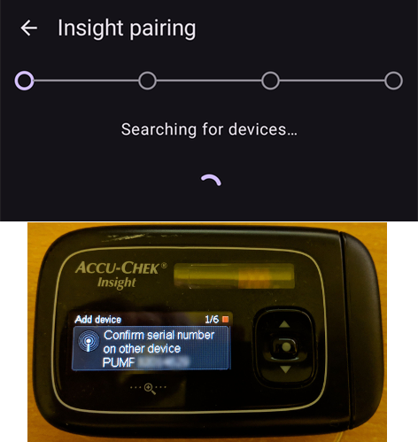

# Accu-Chek Insight

**Denne programvaren er en del av en DIY-løsning for kunstig bukspyttkjertel og er ikke et produkt, men krever at DU leser, lærer og forstår systemet, også hvordan du bruker det. Den gjør ikke all diabetesbehandlingen for deg, men lar deg forbedre diabetesen din og livskvaliteten din, hvis du er villig til å bruke den tiden som trengs. Ikke forhast deg, men gi deg selv tid til å lære. Du alene er ansvarlig for det du gjør med den.**

```{admonition} Accu-Chek Insight fases ut :class: note

Roche trekker seg ut av insulinpumpemarkedet for å konsentrere diabetesporteføljen sin om Accu-Chek SmartGuide CGM. Roche har varslet at salget av både Accu-Chek Combo og Accu-Chek Insight er avsluttet; den gjenværende Accu-Chek Solo-mikropumpen avvikles også (siste leveranser i Tyskland ved utgangen av 2025). Endringen rulles ut region for region, med start i Tyskland, og andre europeiske markeder ventes å følge etter. Støtten for Insight er allerede oppført som avsluttet (se [Pumper som ikke selges lenger](./Future-possible-Pump-Drivers.md)). Hvis du er avhengig av denne pumpen, bør du planlegge en overgang til en pumpe som støttes.

    <br />```{note}
    Før **AAPS** fikk en egen Insight-driver, ble Insight styrt gjennom den separate appen [SightRemote](https://github.com/TebbeUbben/SightRemote). SightRemote trengs ikke lenger og vedlikeholdes ikke: hvis du fortsatt har den installert fra den tiden, avinstaller den og bruk en gjeldende versjon av **AAPS** i stedet.
    

```{contents} Innhold :depth: 1 :local: true

    <br />## Pumpens muligheter med AAPS
    
    * Kommuniserer med **AAPS** over telefonens innebygde Bluetooth, uten ekstra kommunikasjonsenhet.
    * Automatisk håndtering av sommertid og tidssoner.
    
    ## Krav til maskinvare og programvare
    
    * En Roche Accu-Chek Insight-pumpe (alle fastvareversjoner virker)
    
    Merk: AAPS skriver alltid data til **den første basalprofilen i pumpen**.
    
    * En Android-telefon med Android 12 eller nyere (se [Telefoner](../Getting-Started/Phones.md))
    * AAPS-appen installert på telefonen din
    
    ## Oppsett
    
    * Insight-pumpen bør bare være koblet til én enhet om gangen. Hvis du tidligere har brukt Insight-fjernkontrollen (måleren), må du fjerne måleren fra listen over sammenkoblede enheter i pumpen: **Menu** > **Settings** > **Communication** > **Remove device**.
    
       
    
    * Under [Konfigurasjon > Pumpe](#Config-Builder-pump) velger du **Accu-Chek Insight**-kortet. Bare én pumpe kan være aktiv om gangen.
    
       
    
       Når det er valgt, viser **Accu-Chek Insight**-kortet to knapper, **Innstillinger** og **Åpne plugin**:
    
       
    
       **Innstillinger** åpner innstillingene for Accu-Chek Insight-driveren (se [Innstillinger i AAPS](#Accu-Chek-Insight-Pump-settings-in-aaps)).
    
       **Åpne plugin** (eller **Administrer → Pumpe**) åpner pumpeskjermen for Accu-Chek Insight. Før en pumpe er sammenkoblet, ser den slik ut:
    
       
    
    (accu-chek-insight-pairing)=
    ### Sammenkobling
    
    * På pumpeskjermen trykker du på **Sammenkobling av Insight**. Sammenkoblingsveiviseren åpnes og søker etter Bluetooth-enheter i nærheten (øverst på bildet nedenfor).
    * På Insight-pumpen går du til **Menu** > **Settings** > **Communication** > **Add Device**. Pumpen viser dette skjermbildet (nederst på bildet nedenfor) med pumpens serienummer.
    
       
    
    * Tilbake på telefonen trykker du på pumpens serienummer i listen over Bluetooth-enheter. Hvis Android ber deg bekrefte sammenkoblingen, trykker du på **Koble til**.
    
       
    
    * Pumpen og telefonen viser begge en kode. Kontroller at kodene er like på begge enhetene. Bekreft på pumpen, og trykk på **Ja** på telefonen. (Trykk på **Nei** hvis kodene ikke er like.)
    
       
    
    * Telefonen viser **Sammenkobling fullført**. Trykk på **Avslutt** for å gå tilbake til pumpeskjermen.
    
       
    
    * For å sjekke at alt er i orden, se på pumpeskjermen (**Administrer → Pumpe**). Når pumpen er sammenkoblet, viser den informasjon om pumpen, for eksempel **Serienummer**, **Produksjonsdato**, **Programvareversjon** og **Bluetooth-adresse**.
    
       
    
       ```{admonition} Eldre skjermbilde
       :class: note
       Bortsett fra toppen av det første bildet er skjermbildene av sammenkoblingen ovenfor fra en eldre **AAPS**-versjon og kan se annerledes ut i **AAPS** 4.
       ```
    
    * For å fjerne sammenkoblingen trykker du på **Opphev sammenkobling** på pumpeskjermen og bekrefter **Tilbakestill sammenkoblingsinformasjon?**. Knappen **Sammenkobling av Insight** vises da igjen.
    
    Merk: Det er ingen permanent forbindelse mellom pumpen og telefonen. **AAPS** kobler bare til når det trengs (for eksempel for å sette en midlertidig basal, gi en bolus eller lese pumpehistorikken). Ellers ville batteriene i telefonen og pumpen bli tømt altfor fort.
    
    (Accu-Chek-Insight-Pump-settings-in-aaps)=
    ## Innstillinger i AAPS
    
    Åpne innstillingene med **Innstillinger** på **Accu-Chek Insight**-kortet under **Konfigurasjon** > **Pumpe**, eller med tannhjulet øverst til høyre på pumpeskjermen.
    
    
    
    I Insight-innstillingene i **AAPS** kan du slå på disse valgene:
    
    * **Logg reservoarbytte**: registrerer automatisk et ampullebytte når du kjører programmet «fyll ampulle» på pumpen.
    
    * **Logg slangesettbytte**: legger til en merknad i **AAPS**-databasen når du kjører programmet «fyll slange» på pumpen.
    
    * **Logg kanylebytte**: legger til en merknad i **AAPS**-databasen når du kjører programmet «fyll kanyle» på pumpen. **Merk: Et kanylebytte nullstiller også Autosens.**
    
    * **Logg batteribytte**: registrerer et batteribytte når du setter et nytt batteri i pumpen.
    
    * **Logg endring i driftsmodus**: legger til en merknad i **AAPS**-databasen hver gang du starter, stopper eller pauser pumpen.
    
    * **Logg varslinger**: legger til en merknad i **AAPS**-databasen hver gang pumpen gir et varsel (unntatt påminnelser og avbrutt bolus eller midlertidig basal, som ikke registreres).
    
    * **Aktiver emulering av TBR**: Insight-pumpen kan bare sette midlertidige basaler (TBR) opp til 250 %. For å komme rundt denne grensen ber TBR-emulering pumpen om å gi en forlenget bolus for det ekstra insulinet hvis det bes om en midlertidig basal over 250 %.
    
      **Merk: Bruk bare én forlenget bolus om gangen. Flere forlengede boluser samtidig kan gi feil.**
    
    * **Slå av vibrasjoner ved levering av manuell bolus**: hindrer at Insight-pumpen vibrerer når den gir en manuell bolus (eller forlenget bolus). Bare tilgjengelig med Insight-fastvare 3.x.
    
    * **Slå av vibrasjoner ved levering av automatisk bolus**: hindrer at Insight-pumpen vibrerer når den gir en automatisk bolus (SMB eller midlertidig basal med TBR-emulering). Bare tilgjengelig med Insight-fastvare 3.x.
    
    * **Min. pause mellom tilkoblingsforsøk [s]** og **Maks. pause mellom tilkoblingsforsøk [s]**: hvor lenge **AAPS** venter før den prøver igjen etter et mislykket tilkoblingsforsøk. Du kan velge fra 0 til 20 sekunder. Hvis du har tilkoblingsproblemer, velg en lengre ventetid.
        <br><br>Eksempel for min. pause mellom tilkoblingsforsøk = 5 og maks. pause mellom tilkoblingsforsøk = 20
        <br><br>ingen tilkobling -> vent <b>5</b> sek.
          <br>  nytt forsøk -> ingen tilkobling -> vent <b>6</b> sek.
          <br>  nytt forsøk -> ingen tilkobling -> vent <b>7</b> sek.
          <br>  nytt forsøk -> ingen tilkobling -> vent <b>8</b> sek.
          <br>...
          <br>nytt forsøk -> ingen tilkobling -> vent <b>20</b> sek.
          <br>nytt forsøk -> ingen tilkobling -> vent <b>20</b> sek.
          <br>...
    
    * **Utsett frakobling [s]**: hvor lenge (i sekunder) **AAPS** venter før den kobler fra pumpen etter at en operasjon er ferdig. Du kan velge fra 0 til 15 sekunder. Standardverdien er 5 sekunder.
    
    For perioder da pumpen var stoppet, logger **AAPS** en midlertidig basal på 0 %.
    
    ### Pumpeskjermen
    
    Pumpeskjermen for Accu-Chek Insight (**Administrer → Pumpe**) viser pumpens nåværende status, for eksempel **Status**, **Siste tilkobling**, **Driftsmodus**, **Batteri**, **Reservoarnivå**, dagens totale døgndoser (**TDD Bolus**, **TDD Basal**), basaldoser og siste bolus. Når pumpen er sammenkoblet, har den disse knappene:
    
    * **Oppdater**: oppdaterer pumpestatusen.
    * **Aktiver varsel når slutt på midlertidig basal (pumpeinnstilling)** / **Slå av varsel når slutt på midlertidig basal (pumpeinnstilling)**: en standard Insight-pumpe gir en alarm når en midlertidig basal er ferdig. Denne knappen slår den alarmen på eller av uten at du trenger konfigurasjonsprogramvare.
    * **Opphev sammenkobling**: fjerner sammenkoblingen med pumpen (se [Sammenkobling](#accu-chek-insight-pairing)).
    
    
    
    ```{admonition} Eldre skjermbilde
    :class: note
    Skjermbildet ovenfor er fra en eldre **AAPS**-versjon. I **AAPS** 4 ser pumpeskjermen annerledes ut og har også en **Opphev sammenkobling**-knapp.
    

## Innstillinger i pumpen

Sett opp alarmene i pumpen slik:

* Menu > Settings > Device settings > Mode settings > Quiet > Signal > Sound
* Menu > Settings > Device settings > Mode settings > Quiet > Volume > 0 (remove all bars)
* Menu > Modes > Signal mode > Quiet

Dette gjør alle alarmer fra pumpen stille, slik at AAPS kan avgjøre om en alarm er relevant for deg. Hvis AAPS ikke kvitterer for en alarm, øker volumet (først pip, så vibrasjon).

(Accu-Chek-Insight-Pump-vibration)=

### Vibrasjon

Avhengig av fastvareversjonen på pumpen vil Insight vibrere kort hver gang en bolus gis (for eksempel når AAPS gir en SMB, eller når TBR-emulering gir en forlenget bolus).

* Fastvare 1.x: Vibrerer ikke, slik pumpen er laget.
* Fastvare 2.x: Vibrasjon kan ikke slås av.
* Fastvare 3.x: AAPS gir bolus uten lyd.

Du finner fastvareversjonen i menyen.

## Batteribytte

Batteritiden for Insight ved looping er fra 10 til 14 dager, maks. 20 dager. Brukeren som rapporterte dette, bruker Energizer litiumbatterier.

Insight-pumpen har et lite internt batteri som holder viktige funksjoner som klokken i gang mens du bytter det uttakbare batteriet. Hvis batteribyttet tar for lang tid, kan dette interne batteriet gå tomt, klokken nullstilles, og du blir bedt om å legge inn ny tid og dato etter at du har satt inn et nytt batteri. Hvis dette skjer, blir alle registreringer i AAPS fra før batteribyttet ikke lenger tatt med i beregningene, fordi riktig tid ikke kan fastslås.

(Accu-Chek-Insight-Pump-insight-specific-errors)=

## Feil som er spesifikke for Insight

### Forlenget bolus

Bruk bare én forlenget bolus om gangen, for flere forlengede boluser samtidig kan gi feil.

### Tidsavbrudd

Noen ganger svarer ikke Insight-pumpen mens **AAPS** setter opp forbindelsen. **AAPS** viser da varselet «En timeout oppstod i paringsprosessen - restart Bluetooth».


Hvis dette skjer, slår du av Bluetooth på pumpen OG på telefonen i omtrent 10 sekunder, og slår det så på igjen.

## Bytte av tidssone med Insight-pumpen

For informasjon om reiser på tvers av tidssoner, se avsnittet [Tidssonebytte med pumper](#timezone-traveling-insight).

## Hvor du kan få hjelp

Utviklingen av Insight-driveren gjøres av fellesskapet på **frivillig** basis. Før du ber om hjelp, bør du:

1. **Lese** det aktuelle avsnittet i denne dokumentasjonen for å se hvordan funksjonen er ment å virke.
2. **Spørre** i kanalen *#AAPS* på [Discord](https://discord.gg/4fQUWHZ4Mw), eller i en av de andre [fellesskapskanalene](../GettingHelp/WhereCanIGetHelp.md).
3. **Rapportere en feil** ved å søke i [eksisterende saker](https://github.com/nightscout/AndroidAPS/issues); hvis din ikke er der, åpne en [ny sak](https://github.com/nightscout/AndroidAPS/issues) og legg ved [loggfilene](../GettingHelp/AccessingLogFiles.md) dine.

Når du ber om hjelp, ta med telefonens merke og modell, Android-versjon, **AAPS**-versjon og en enkel beskrivelse av problemet (hva som ble endret, når det sist virket).