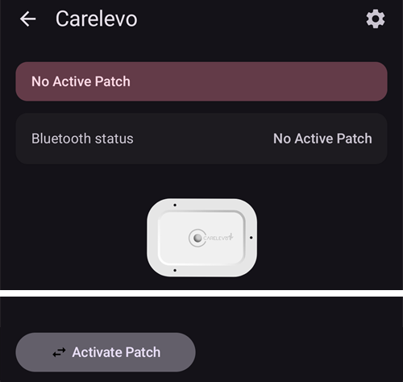

# CareLevo

CareLevo er en slangeløs patch-pumpe laget av CareMedi. Hver patch rommer opptil 300 E insulin og brukes i opptil 7 dager (168 timer). Den kommuniserer med **AAPS** over telefonens Bluetooth, uten ekstra enhet.

```{admonition} New driver
:class: warning
CareLevo-driveren er ny i **AAPS**. Les hele denne siden før du aktiverer din første patch, og ha pumpens egen bruksanvisning for hånden.
```

Den minste dosen patchen kan gi, er 0,05 E. Sett basaldosene i **Profil** til minst 0,05 E/t i steg på 0,05 E/t, ellers blir det en liten forskjell mellom insulinet **Profil** forventer og insulinet patchen gir. **AAPS** bruker de basaldosene patchen godtok.

```{contents} Table of contents
:depth: 1
:local: true
```

## Pumpefunksjoner med AAPS

* Kommuniserer med **AAPS** over telefonens innebygde Bluetooth, uten en ekstra kommunikasjonsenhet.
* Bolus i steg på 0,05 E.
* Basaldoser fra 0,05 E/t til 15 E/t i steg på 0,05 E/t, med basalsegmenter på 30 minutter.
* Midlertidige basaler settes som absolutt dose, opptil 12 timer.
* Forlenget bolus opptil 8 timer.
* Sommertid (DST) og tidssonebytte må håndteres manuelt. Patchen varsler deg når tidssonen endres.

## Pumpeoppsett

1. Åpne **menyen** (☰) øverst til venstre på hovedskjermen i **AAPS** og velg **Konfigurasjon**.
1. Velg **Carelevo** under Pumpe.
1. Trykk på Tilbake-knappen for å gå tilbake til hovedskjermen.


## Innstillinger

Åpne pumpeskjermen med **Administrer → Pumpe** (eller **Konfigurasjon → Pumpe → Åpne plugin**).

Åpne CareLevo-innstillingene ved å trykke på **Innstillinger**-ikonet (tannhjulet) øverst til høyre. Tre innstillinger er tilgjengelige:


### Varsel-innstilling for lavt insulin

Patchen varsler deg når insulinet som er igjen i reservoaret, når den valgte mengden. Den kan settes fra 20 E til 50 E i steg på 5 E. Standard er 30 E. Uavhengig av denne innstillingen gir patchen en kritisk alarm og slutter å levere insulin når det er mindre enn 10 E igjen.

### Varsel-innstilling for patchbruk

Patchen varsler deg når den har vært brukt i det valgte antallet timer, så du kan planlegge byttet. Den kan settes fra 24 til 167 timer. Standard er 116 timer.

### Patchinfo-alarm

Når dette er på, piper patchen når en bolus, forlenget bolus eller midlertidig basal starter, og når den slutter. Standard er av.

## Pumpeskjermen



Pumpeskjermen viser **Bluetooth-status** (Ingen aktiv patch, Frakoblet eller Tilkoblet), patchens **Serienr.**, dens **Aktiveringstid** og **Utløp**, gjeldende **Basaldose** og **Midlertidig basaldose**, **Gjenværende insulin** (igjen / fylt), **Gjenstående tid på patchen** og **Totalt levert insulin**.

Knappene avhenger av patchens tilstand:

* **Aktiver patch**: starter aktiveringen av en ny patch, se nedenfor.
* **Insulinveiledning**: viser de tolv stegene for å fylle en patch med insulin.
* **Pause infusjon** / **Gjenoppta infusjon**: pauser og starter insulinleveringen igjen, se nedenfor.
* **Forkast patch**: stopper den aktive patchen så en ny kan aktiveres.

## Aktivere en patch

Før du starter, sjekk at en **Profil** er aktiv i **AAPS** og at Bluetooth er på. Patchen må aktiveres innen en begrenset tid etter at den er slått på; hvis tiden går ut, gir patchen alarmen **Tidsavbrudd for patchpåføring** og kan ikke brukes.

Trykk på **Aktiver patch** på pumpeskjermen og følg stegene. Du kan avbryte når som helst før nålen er satt inn; det du har lagt inn, forkastes.

### Velg insulin

Bekreft insulinet du bruker. Patchen krever hurtigvirkende U-100-insulin.

### Fyll patchen med insulin

Fyll patchen med 50 til 300 E, ut fra hvor lenge du skal bruke den. Trykk på **Insulinveiledning** hvis du trenger fylleinstruksjonene. Trykk så på fyllmengden og velg mengden du fylte; **AAPS** bruker den til å vise gjenværende insulin.

### Koble til patchen

1. Ta patchen ut av pakningen og fjern nålehetten.
1. Hold inne av/på-knappen på patchen i mer enn ett sekund. Etter pipet trykker du på **Søk etter patch**.
1. Når patchen som ble funnet, er den riktige, trykker du på **Bekreft**. Trykk på **Skann på nytt** hvis den ikke er det.

### Sikkerhetssjekk

Når patchen er tilkoblet, trykker du på **Sikkerhetskontroll**. Patchen tester seg selv og primer. Kontroller at det har dannet seg en dråpe insulin på nålespissen. Hvis ingen dråpe er synlig, trykker du på **Prøv igjen**. Når kontrollen er fullført, trykker du på **Neste**.

### Sted og festing av patchen

1. Velg stedet der du skal bruke patchen.
1. Rengjør stedet grundig med en spritserviett.
1. Fjern beskyttelsesfilmen og fest patchen på huden med det merkede punktet vendt opp.
1. Trykk på **Neste** når patchen er festet.

### Sett inn nålen

1. Vri sikkerhetshetten i pilens retning og fjern den.
1. Trykk applikatorknappen helt ned og hold den inne i 10 sekunder. Det høres et pip når nålen er satt inn.
1. Fjern applikatoren og trykk på **Bekreft innsetting**.

Hvis innsettingen mislykkes, forteller **AAPS** deg hvor mange forsøk som er igjen. Når ingen forsøk er igjen, gir patchen alarmen **Feil ved nåleinnsetting** og må byttes.

Insulinleveringen starter så snart innsettingen er bekreftet.

## Bolusmeldinger

Hvis patchen avviser en bolus, forteller **AAPS** deg hvorfor. For eksempel betyr *Bolus kan ikke leveres. Tilgjengelig bolus: 2,8 E* at patchen bare kan gi den mengden nå.

Hvis du stopper en bolus og patchen ikke bekrefter stoppet, venter **AAPS** til bolusen er ferdig og registrerer mengden patchen rapporterer. Hvis en bolus ikke ble registrert (for eksempel fordi den ble stoppet mens den pågikk), legger **AAPS** den til fra patchens totalsum og ber deg sjekke IOB før du prøver igjen.

## Pause og gjenoppta insulinlevering

Trykk på **Pause infusjon** på pumpeskjermen og velg hvor lenge leveringen skal pauses: fra 30 minutter til 4 timer i steg på 30 minutter. Leveringen starter ikke igjen av seg selv: når pausen er over, gir patchen varselet **Start insulin**. Trykk på **Gjenoppta infusjon** på pumpeskjermen, eller **Start insulin** på varselet, og bekreft.

## Forkaste en patch

Trykk på **Forkast patch** på pumpeskjermen og bekreft. Insulinleveringen stopper, og patchen kan ikke brukes lenger. Fjern patchen fra kroppen og aktiver en ny.

Når en kritisk alarm har stoppet patchen, tilbyr alarmen **Deaktiver patch** i stedet. Trykker du på den, forkastes patchen på samme måte.

(carelevo-alarms-and-notifications)=

## Alarmer og varsler

Patchen rapporterer tre nivåer av hendelser. Alle vises som varsler i **AAPS**.

### Kritiske alarmer

Insulinleveringen har stoppet. Gjør noe nå:

* **Lite insulin**: mindre enn 10 E igjen. Deaktiver patchen og bytt den.
* **Patch utløpt**: patchen har nådd slutten av levetiden sin. Deaktiver patchen og bytt den.
* **Lavt batteri**: forkast patchen og bytt den.
* **For høy/lav temperatur**: flytt deg til et sted med egnet temperatur, mellom 4.4 ℃ og 37.2 ℃ (40 ℉ og 99 ℉).
* **Automatisk avslåing**: patchen stoppet fordi varselet om automatisk avslåing ble ignorert. Trykk på **Start insulin** for å starte basalleveringen igjen.
* **Tidsavbrudd for patchpåføring**, **Selvtest mislyktes**, **Patchfeil**, **Okklusjon** og **Feil ved nåleinnsetting**: deaktiver patchen og bytt den.

### Varsler

Insulinleveringen fortsetter, men noe trenger oppmerksomheten din:

* **Lite insulin**: reservoaret har nådd mengden som er satt i **Varsel-innstilling for lavt insulin**. Gjør deg klar til å bytte patchen.
* **Patch utløper snart** og **Patch sin brukstid er utløpt**: bytt patchen.
* **Lavt batteri**: gjør deg klar til å bytte patchen.
* **For høy/lav temperatur**: leveringen er pauset til patchen igjen er mellom 40 ℉ og 99 ℉ (4,4 ℃ og 37,2 ℃).
* **Automatisk avslåing**: trykk på **OK**. Hvis varselet ignoreres, eskalerer det til en kritisk alarm, og leveringen stopper.
* **Patchaktivering ikke fullført**: trykk på **OK** for å fullføre aktiveringen.
* **Start insulin**: pausen du satte, er over. Trykk på **Start insulin** for å gjenoppta leveringen.
* **Slå på Bluetooth** og **BLE ikke tilkoblet**: telefonen får ikke kontakt med patchen. Slå på Bluetooth eller kontroller patchtilkoblingen.

### Meldinger

Bare til informasjon: **Lite insulin**, **Varsel om patch sin brukstid** (tiden som er satt i **Varsel-innstilling for patchbruk**, er passert), **Varsel om kontroll av patch**, **Tidssoneendring** og **Kontroller blodsukker** (en fast tid etter en bolus).

Patchen rapporterer også når dens egen funksjon for stopp ved lavt blodsukker (**LGS**) starter eller slutter. **AAPS** bruker ikke denne funksjonen; loopen håndterer lavt blodsukker selv.

## Hvor du kan få hjelp

Rapporter problemer med CareLevo-driveren på [AAPS-siden for GitHub-saker](https://github.com/nightscout/AndroidAPS/issues) eller i AAPS-fellesskapets kanaler, se [Hvor kan jeg få hjelp](../GettingHelp/WhereCanIGetHelp.md).
