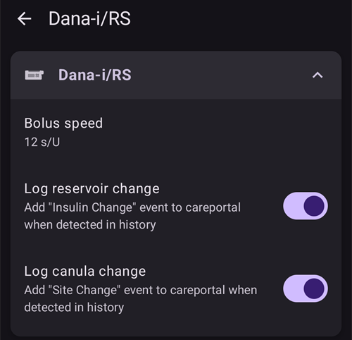

# DanaRS, Dana-i og Dana-i2

*Disse instruksjonene gjelder oppsett av appen og pumpen din hvis du har en DanaRS fra 2017 eller nyere, en Dana-i eller en Dana-i2. Gå til [DanaR](./DanaR-Insulin-Pump.md) hvis du har den opprinnelige DanaR i stedet.*

**Dana-i2 kan brukes fra AAPS versjon 4.0 og nyere.** Den bruker den samme **Dana-i/RS**-driveren som Dana-i.

* I DanaRS/i/i2-pumpen bruker appen «BASAL A». Eksisterende data blir overskrevet.

    {contents} Innhold
    :depth: 1
    :local: true

## Pumpefunksjoner med AAPS

* Kommuniserer med **AAPS** over telefonens innebygde Bluetooth, uten en ekstra kommunikasjonsenhet.
* Sommertid (DST) og tidssonebytte må håndteres manuelt (se [Tidssonebytte](#timezone-traveling-danarv2-danars)).

(DanaRS-Insulin-Pump-pairing-pump)=

## Sammenkobling med pumpen

* Åpne **menyen** (☰) øverst til venstre på hovedskjermen i **AAPS** og velg **Konfigurasjon**.
* Trykk på **Pumpe** og velg **Dana-i/RS**.
    
    
    
    Når den er valgt, viser **Dana-i/RS**-kortet to knapper, **Innstillinger** og **Åpne plugin**:
    
    
    
    **Innstillinger** åpner innstillingene for Dana-i/RS-driveren:
    
    
    
    **Åpne plugin** (eller **Administrer** > **Pumpe**) åpner pumpeskjermen for Dana-i/RS. Før en pumpe er sammenkoblet, ser den slik ut:
    
    

* På pumpeskjermen trykker du på **Sammenkobling**. **AAPS** søker etter pumper i nærheten.

* Trykk på oppføringen for pumpen din i listen.
    
    

* **Du må bekrefte sammenkoblingen på pumpen!** Dette fungerer på samme måte som andre Bluetooth-sammenkoblinger du kanskje kjenner (for eksempel smarttelefon og bilstereo).
    
    

* Følg sammenkoblingsprosessen ut fra typen og fastvaren på pumpen din:
    
    * For DanaRS v1 spør **AAPS** etter **Pumpepassord (kun v1)**. Skriv inn pumpepassordet ditt (se [Standardpassord](#DanaRS-Insulin-Pump-default-password)).
    * For DanaRS v3 ber **AAPS** deg trykke på OK på pumpen og skrive inn de 2 sekvensene med tall og bokstaver som vises på pumpen. Hold pumpeskjermen på ved å trykke på minusknappen til du er ferdig. Trykk deretter på **Ferdig**.
    * For Dana-i og Dana-i2 vises den vanlige Android-dialogen for sammenkobling. Skriv inn det 6-sifrede tallet som vises på pumpen.

* Når **Sammenkoblingen er vellykket!** vises, trykker du på **Ferdig**.
    
    
    
    Du er tilbake på pumpeskjermen, som nå viser statusen til pumpen din.
    
    

* I **Innstillinger** velger du **Bolushastighet** for å endre standard bolushastighet (12 s/E, 30 s/E eller 60 s/E).

* Sett basaltrinnet på pumpen til 0,01 E/t i Doctors menu (se brukerveiledningen til pumpen).
* Sett bolustrinnet på pumpen til 0,05 E i Doctors menu (se brukerveiledningen til pumpen). **AAPS** leser basal- og bolustrinnet fra pumpen og bruker dem for hver bolus, så en bolus passer alltid til trinnet som er satt på pumpen. Pumpeskjermen viser dem i raden **Basal-/bolustrinn**.
* Aktiver forlenget bolus på pumpen

### Valg som bare vises for noen modeller

* **Automatisk låsing**: på en Dana-i2 har skjermen **Brukerinnstillinger** (på pumpeskjermen, **Administrer** > **Pumpe**) en bryter **Automatisk låsing** for pumpens innstilling for automatisk låsing. Trykk på **Lagre valg til pumpen** etter at du har endret den.
* **Enkelmodus**: på pumpemodeller som har en enkel menymodus, viser pumpeskjermen en rad **Enkelmodus** med **På** eller **Av**.
* Hvis en Dana-i2 avviser en bolus, viser **AAPS** årsaken, for eksempel *Pumpen er ikke primet*, *Ikke nok insulin i reservoaret* eller *Enkel søvnmodus er aktivert på pumpen*.

(DanaRS-Insulin-Pump-default-password)=

### Standardpassord

* For DanaRS med fastvare v1 og v2 er standardpassordet 1234.
* For DanaRS med fastvare v3 eller Dana-i er standardpassordet utledet fra produksjonsdatoen og beregnes som MMDD, der MM er måneden og DD er dagen pumpen ble produsert (for eksempel «0124» for måned 01 og dag 24).
    
    * Fra MAIN MENU velger du REVIEW og åpner så SHIPPING INFORMATION fra undermenyen
    * Nummer 3 er produksjonsdatoen. 
    * For v3/i brukes dette passordet bare til å låse menyen på pumpen. Det brukes ikke til kommunikasjon, og du trenger ikke skrive det inn i AAPS.

(DanaRS-Insulin-Pump-change-password-on-pump)=

## Endre passord på pumpen

* Trykk på OK-knappen på pumpen
* I hovedmenyen velger du «OPTION» (flytt til høyre ved å trykke på pilknappen flere ganger)
    
    

* I alternativmenyen velger du «USER OPTION»
    
    

* Bruk pilknappen til å bla ned til «11. password»
    
    

* Trykk på OK for å skrive inn det gamle passordet.

* Skriv inn **gammelt passord** (standardpassord, se [ovenfor](#DanaRS-Insulin-Pump-default-password)) og trykk på OK
    
    

* Hvis du skriver inn feil passord her, får du ingen melding om at det gikk galt!

* Angi **nytt passord** (endre tallene med knappene + & - / flytt til høyre med pilknappen).
    
    

* Bekreft med OK-knappen.

* Trykk på OK for å lagre innstillingen.
    
    

* Flytt ned til «14. EXIT» og trykk på OK for å avslutte.
    
    

(DanaRS-Insulin-Pump-dana-rs-specific-errors)=

## Feil som gjelder spesielt Dana RS

### Feil under insulintilførsel

Hvis forbindelsen mellom AAPS og Dana RS blir brutt mens en bolus gis (for eksempel hvis du går fra telefonen mens Dana RS pumper insulin), ser du denne meldingen og hører en alarmlyd.

* I de fleste tilfeller er dette bare et kommunikasjonsproblem, og riktig mengde insulin er gitt.
* Sjekk i pumpehistorikken at riktig bolus ble gitt. Du kan gjøre dette på selve pumpen, eller i **AAPS** på pumpeskjermen (**Administrer** > **Pumpe**) > **Pumpehistorikk** > **Boluser**.
* Slett feiloppføringen i [behandlinger](#screens-bolus-carbs) hvis du vil.
* Den virkelige mengden leses og registreres ved neste tilkobling. For å tvinge dette fram trykker du på **Oppdater** på pumpeskjermen, eller du venter bare på neste tilkobling.

## Spesiell merknad ved bytte av telefon

Når du bytter til en ny telefon, må du gjøre disse stegene:

* [Eksporter innstillinger](../Maintenance/ExportImportSettings.md) på den gamle telefonen
* Overføre innstillinger fra gammel til ny telefon

### DanaRS v1

* **Koble Dana RS sammen manuelt** med den nye telefonen
* Hvis du krysser av for **Bytt også ut pumpeinnstillingene** ved import, importeres også innstillingene for pumpetilkoblingen, og AAPS på den nye telefonen «kjenner» da allerede pumpen og starter derfor ikke et Bluetooth-søk. Derfor må den nye telefonen og pumpen kobles sammen manuelt.
* Installer AAPS på den nye telefonen.
* [Importer innstillinger](../Maintenance/ExportImportSettings.md) på den nye telefonen

### DanaRS v3, Dana-i, Dana-i2

* Start sammenkoblingen som beskrevet [ovenfor](#DanaRS-Insulin-Pump-pairing-pump).
* Noen ganger må du først slette sammenkoblingsinformasjonen i **AAPS**. På pumpeskjermen (**Administrer** > **Pumpe**) trykker du på **Opphev sammenkobling** og bekrefter **Tilbakestill sammenkoblingsinformasjon?**. Trykk deretter på **Sammenkobling** igjen.

## Tidssonebytte med DanaRS-, Dana-i- og Dana-i2-pumper

For informasjon om reiser på tvers av tidssoner, se avsnittet [Tidssonebytte med pumper](#timezone-traveling-danarv2-danars).

## Hvor du kan få hjelp

Utviklingen av DanaRS/Dana-i/Dana-i2-driveren gjøres av fellesskapet på **frivillig** basis. Før du ber om hjelp, bør du:

1. **Lese** det aktuelle avsnittet i denne dokumentasjonen for å se hvordan funksjonen er ment å virke.
2. **Spørre** i kanalen *#AAPS* på [Discord](https://discord.gg/4fQUWHZ4Mw), eller i en av de andre [fellesskapskanalene](../GettingHelp/WhereCanIGetHelp.md).
3. **Rapportere en feil** ved å søke i [eksisterende saker](https://github.com/nightscout/AndroidAPS/issues); hvis din ikke er der, åpne en [ny sak](https://github.com/nightscout/AndroidAPS/issues) og legg ved [loggfilene](../GettingHelp/AccessingLogFiles.md) dine.

Når du ber om hjelp, ta med telefonens merke og modell, Android-versjon, **AAPS**-versjon og en enkel beskrivelse av problemet (hva som ble endret, når det sist virket).