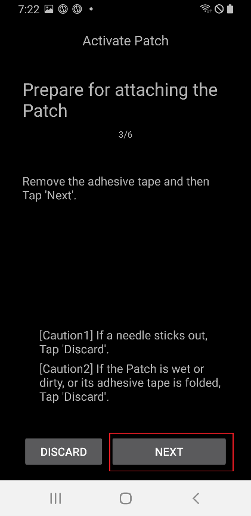
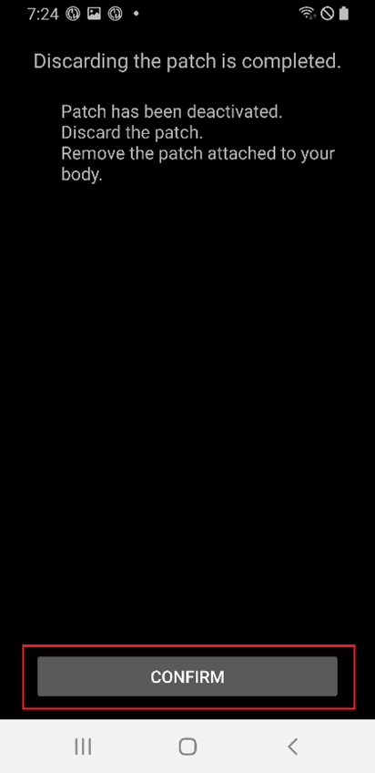
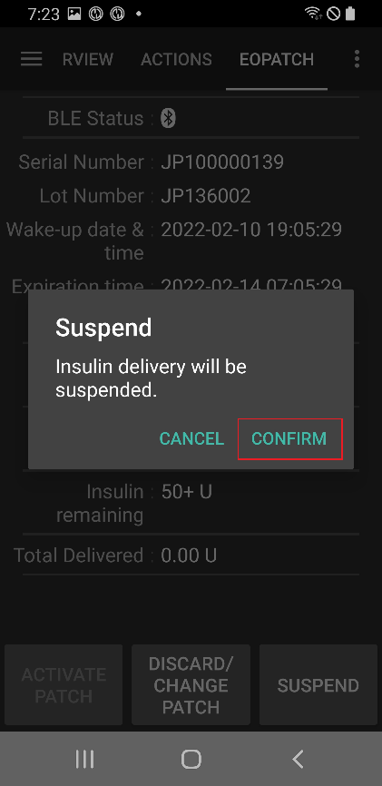
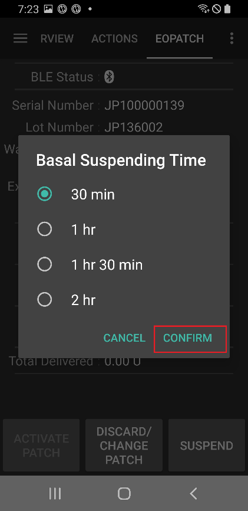

# EOPatch2

Patchen trenger hurtigvirkende U-100-insulin, for eksempel NovoRapid eller Humalog. Bruk det hurtigvirkende insulinet legen din har skrevet ut til deg.

Den minste dosen patchen kan gi, er 0,05 E. Sett hver basaldose i **Profil** til minst 0,05 E/t, i steg på 0,05 E/t. Ellers runder **AAPS** hver dose av til nærmeste 0,05 E/t (aldri ned til 0) og bruker de dosene patchen faktisk gir, så den totale insulinmengden per dag blir litt annerledes enn i **Profil**. På samme måte må boluser være minst 0,05 E.

```{contents} Table of contents
:depth: 1
:local: true
```

## Pumpefunksjoner med AAPS

* Kommuniserer med **AAPS** over telefonens innebygde Bluetooth, uten en ekstra kommunikasjonsenhet.
* Sommertid (DST) og tidssonebytte må håndteres manuelt.

## Pumpeoppsett

1. Åpne **menyen** (☰) øverst til venstre på hovedskjermen i **AAPS** og velg **Konfigurasjon**.
1. Under **Pumpe** velger du **EOPatch2**.
1. Trykk på Tilbake-knappen for å gå tilbake til hovedskjermen.

 

Når den er valgt, viser **EOPatch2**-kortet to knapper, **Innstillinger** og **Åpne plugin**:


## Innstillinger

Du kan åpne EOPatch2-innstillingene på to måter:

* trykk på **Innstillinger** på **EOPatch2**-kortet i **Konfigurasjon**, eller
* åpne pumpeskjermen (**Administrer** → **Pumpe**) og trykk på tannhjulet øverst til høyre.

Det er tre innstillinger:


### Varsler for lavt reservoar

En advarsel vises når insulinet som er igjen i patchen, kommer ned på denne mengden eller mindre. Du kan sette den fra 10 til 50 E, i steg på 5 E. Standard er 10 E.

### Patch-utløpspåminnelse

Minner deg på hvor lang tid som er igjen før den aktive patchen utløper. Du kan sette den fra 1 til 24 timer, i steg på 1 time. Standard er 4 timer.

### Lydpåminnelser fra patch

Når dette er på, piper patchen når en bolus, forlenget bolus eller midlertidig basal starter, og når den slutter. Det påvirker ikke den vanlige basalen din. Standard er av.

## Aktivere en ny patch

### Åpne aktiveringsveiviseren

Åpne pumpeskjermen med **Administrer** → **Pumpe** (eller trykk på **Åpne plugin** på **EOPatch2**-kortet i **Konfigurasjon**). Når ingen patch er aktiv, viser skjermen **Ikke aktivert** og en **Aktiver patch**-knapp nederst.

Trykk på **Aktiver patch** for å starte veiviseren.


Veiviseren leder deg gjennom hvert steg. Raden med prikker øverst viser hvor langt du har kommet.

```{note}
Hvis du aldri har aktivert en **Profil** i **AAPS**, viser veiviseren først en side med **Profil kreves**. Velg profilen du vil bruke, og trykk på **Aktiver profil**.
```

### Fyller insulin

Stikk nålen på sprøyten inn i insulinporten på patchen. Trykk stempelet sakte inn for å fylle patchen. Når det er mer enn 80 E i patchen, piper den én gang og starter opp.

Når du hører pipet, trykker du på **Start sammenkobling**.


```{warning}
- Ikke drei nålespaken før veiviseren sier at du skal gjøre det. Dreier du den for tidlig, kan det gi alvorlige problemer under fyllingen eller sikkerhetssjekken.
- Patchen rommer 80 til 200 E. Fyller du mindre enn 80 E, virker ikke patchen.
- Ta insulinet ut av kjøleskapet 15 til 30 minutter før fylling, så det får romtemperatur. Insulinet må være minst 10 °C.
```

### Patch-sammenkobling

**AAPS** prøver nå å koble seg sammen med patchen automatisk. Under sammenkoblingen vises to Bluetooth-forespørsler fra Android. Trykk på **OK** på den første. Trykk på **OK** igjen på den andre, som viser en kode (passkey).

```{warning}
- Hold patchen og telefonen innenfor 30 cm fra hverandre mens de kobles sammen.
- Etter at patchen har startet opp, piper den hvert 3. minutt til sammenkoblingen er ferdig.
- Du må fullføre aktiveringen av patchen innen 60 minutter etter at den startet opp. Klarer du ikke det, må du forkaste patchen.
```

  

```{admonition} Older screenshot
:class: note
De to skjermbildene av Bluetooth-sammenkoblingen er fra en eldre **AAPS**-versjon: **AAPS**-skjermen bak Android-forespørselen ser annerledes ut i **AAPS** 4.
```

### Velg insulin

Velg insulinet du fylte patchen med, og trykk på **Neste**. **AAPS** gjør et profilbytte med dette insulinet etter aktiveringen.

### Forbered på å plassere plasteret

Fjern den selvklebende tapen fra patchen, og trykk så på **Neste**.

Hvis en nål stikker ut, eller hvis patchen er våt eller skitten, eller den selvklebende tapen er brettet, trykker du på **Forkast** i stedet og bruker en ny patch.



### Stedplassering

Dette steget vises bare hvis **Administrer pumpe-stedsrotasjon** er slått på i innstillingene for rotasjon av sted. Trykk på stedet på kroppsfiguren der du skal feste patchen, og trykk på **Neste**, eller trykk på **Hopp over**.

### Fester plasteret

Insulinet bør gå inn i et sted med fettvev under huden, men få nerver eller blodårer. Magen, armen eller låret er gode valg. Rengjør og tørk stedet, og fest så patchen på huden.

Kontroller infusjonsstedet, og trykk så på **Start sikkerhetssjekk**.

```{warning}
- Trykk kantene på tapen jevnt ned, så hele patchen sitter godt fast på huden.
- Hvis patchen ikke sitter helt fast, kan det komme luft mellom patchen og huden. Det svekker både limet og vannmotstanden til patchen.
```


### Sikkerhetssjekk

Sikkerhetssjekken tar omtrent 30 sekunder. Når den er ferdig, piper patchen én gang. Hvis den mislykkes, trykker du på **Prøv igjen**.

```{warning}
For sikker bruk må du ikke dreie nålespaken før sikkerhetssjekken er fullført.
```

 

```{admonition} Older screenshot
:class: note
Skjermbildene fra **Forbered på å plassere plasteret** til **Sikkerhetssjekk** er fra en eldre **AAPS**-versjon og kan se annerledes ut i **AAPS** 4.
```

### Innføring av kanylen

Hold patchen godt fast. Drei nålespaken oppover mer enn 100° for å føre inn kanylen. Patchen piper én gang når kanylen er riktig ført inn. Fortsett så å dreie spaken helt rundt for å ta den av. Trykk på **Neste**.

```{caution}
Hvis du går til neste steg uten å ha hørt pipet, vises en **Feil ved innsetting av kanyle**. Sjekk at du hører pipet, og trykk på **Prøv igjen**. Hvis feilen fortsatt er der, trykker du på **Forkast** for å deaktivere patchen.
```

### Patch-aktiveringen er fullført

Den siste siden bekrefter at patchen er aktiv, og at den vil minne deg på når utløpstiden nærmer seg. Trykk på **Fullfør** for å gå tilbake til pumpeskjermen.

## Forkaste patchen

Bytt patchen når den har lite insulin igjen, når den utløper, eller hvis den er defekt. Vi anbefaler å bruke hver patch i høyst 84 timer etter at den startet opp.

1. Åpne pumpeskjermen (**Administrer** → **Pumpe**). Mens en patch er aktiv, trykker du på **Forkast patch**.
1. Siden **Forkast patch** viser hvor lang tid og hvor mye insulin som er igjen i patchen. Trykk på **Forkast patch**.
1. En dialog ber deg bekrefte. Trykk på **Forkast patch** igjen.
1. Når patchen er deaktivert, viser veiviseren **Depotplasteret er forkastet.** Fjern patchen fra kroppen og trykk på **Bekreft**.

Etter det går veiviseren rett videre til aktivering av en ny patch (se ovenfor). Trykk på tilbakepilen hvis du vil stoppe her.

Mens ingen patch er aktiv, viser **AAPS** pumpen som pauset og registrerer en midlertidig basal på 0 E/t, så ingen basalinsulin telles med i IOB før neste patch er aktivert.

   

```{admonition} Older screenshot
:class: note
Skjermbildene ovenfor er fra en eldre **AAPS**-versjon. I **AAPS** 4 åpner du pumpeskjermen fra **Administrer** → **Pumpe**, og knappen der heter **Forkast patch**.
```

```{admonition} If the patch does not respond
:class: warning
Hvis **AAPS** ikke får kontakt med patchen, kan den vise en side om å slå av alarmen på patchen manuelt: fjern patchen fra kroppen, dra av den selvklebende tapen, og bruk en binders til å trykke bestemt inn i hullet ved siden av insulinporten.

Siden **Forkast patch** har også en **Tving tilbakestilling**-knapp. Den fjerner bare patchen fra **AAPS**, uten å sende noen kommando til patchen. Patchen fortsetter å levere insulin til batteriet går tomt eller du slår den av manuelt. Bruk den bare hvis en vanlig forkasting mislykkes, og fjern patchen fra kroppen.
```

## Pause og gjenoppta insulinlevering

Når du pauser insulinleveringen, avbrytes også forlenget bolus og midlertidig basal. Når du gjenopptar, startes disse **ikke** på nytt. Mens insulinleveringen er pauset, piper patchen hvert 15. minutt.

### Pause insulinleveringen

1. Åpne pumpeskjermen (**Administrer** → **Pumpe**) og trykk på **Pause pumpe**.
1. En dialog forklarer hva som blir pauset. Trykk på **Bekreft**.
1. I dialogen **Basal pausetid** velger du hvor lenge pausen skal vare: 30 min, 1 t, 1 time 30 min eller 2 t. Trykk på **Bekreft**.

Insulinleveringen er pauset i den tiden du valgte.

  

```{admonition} Older screenshot
:class: note
Skjermbildene ovenfor er fra en eldre **AAPS**-versjon. I **AAPS** 4 åpner du pumpeskjermen fra **Administrer** → **Pumpe**, og knappen der heter **Pause pumpe**.
```

### Gjenoppta insulinleveringen

1. Åpne pumpeskjermen (**Administrer** → **Pumpe**) og trykk på **Gjenoppta pumpe**.
1. I dialogen **Gjenoppta insulinlevering** trykker du på **Bekreft**.

 

```{admonition} Older screenshot
:class: note
Skjermbildene ovenfor er fra en eldre **AAPS**-versjon. I **AAPS** 4 åpner du pumpeskjermen fra **Administrer** → **Pumpe**, og knappen der heter **Gjenoppta pumpe**.
```

```{warning}
Når pausetiden er over, viser **AAPS** advarselen **Slutt på insulinpause**. Insulinleveringen starter **ikke** igjen før du bekrefter det. Gjør du ikke det, kan du få hyperglykemi.
```

(eopatch2-alarms-and-warnings)=

## Alarmer og advarsler

### Alarmer

Alarmer gjelder akutte situasjoner med høyeste prioritet og krever at du handler med en gang. **AAPS** spiller en alarm som fortsetter til du kvitterer for den, og viser meldingen som et varsel på **Oversikt**-skjermen. En alarm betyr at det er et problem med patchen som er i bruk. I mange tilfeller må patchen forkastes og byttes ut med en ny.

Når du trykker på **Bekreft** på varselet, håndterer **AAPS** alarmen. For de fleste alarmer betyr det at patchen deaktiveres. For alarmen **Upassende temperatur** er knappen **Prøv igjen**.

 

```{admonition} Older screenshot
:class: note
Skjermbildene av alarmene er fra en eldre **AAPS**-versjon og kan se annerledes ut i **AAPS** 4.
```

De ulike alarmene forklares nedenfor.

| Alarm                         | Forklaring                                                                                                                                       |
| ----------------------------- | ------------------------------------------------------------------------------------------------------------------------------------------------ |
| Tomt reservoar                | Patchen er tom for insulin.                                                                                                                      |
| Patch utløpt                  | Brukstiden til patchen er over, og den kan ikke levere mer insulin.                                                                              |
| Blokkering oppdaget           | Insulinbanen i patchen ser ut til å være blokkert.                                                                                               |
| Feil i selvtest ved oppstart  | Patchen fant en uventet feil under selvtesten etter oppstart.                                                                                    |
| Upassende temperatur          | Patchen er utenfor normal driftstemperatur mens du aktiverer eller bruker den. Flytt patchen til et sted med egnet temperatur (4,4 til 37 °C).   |
| Feil ved innsetting av kanyle | Kanylen ble ikke ført riktig inn under aktiveringen. Kontroller at kanten der kanylen føres inn på patchen, og nålespaken står på en rett linje. |
| Patch-batterifeil             | Det innebygde batteriet i patchen er i ferd med å gå tomt, og patchen vil slå seg av.                                                            |
| Patch-aktiveringsfeil         | Patchen ble ikke ferdig aktivert innen 60 minutter etter oppstart.                                                                               |
| Patchfeil                     | Patchen fant en uventet feil mens den ble aktivert eller brukt.                                                                                  |

### Advarsler

Advarsler gjelder situasjoner med middels eller lav prioritet. En advarsel vises som et varsel på **Oversikt**-skjermen.


```{admonition} Older screenshot
:class: note
Dette skjermbildet er fra en eldre **AAPS**-versjon: i **AAPS** 4 vises advarselen på hovedskjermen, som ser annerledes ut.
```

De ulike advarslene forklares nedenfor.

| Advarsel                         | Forklaring                                                                                                                             |
| -------------------------------- | -------------------------------------------------------------------------------------------------------------------------------------- |
| Slutt på insulinpause            | Pausetiden du valgte, er over. Trykk på **Gjenoppta pumpe** på varselet for å starte insulinleveringen igjen.                          |
| Lavt reservoarnivå               | Insulinet som er igjen i patchen, er under mengden som er satt i **Varsler for lavt reservoar**.                                       |
| Patch-levetid er utløpt          | Brukstiden til patchen er over.                                                                                                        |
| Patch-levetid utløper snart      | Patchen må forkastes innen 1 time.                                                                                                     |
| Ufullstendig aktivering av patch | Aktiveringen av patchen ble avbrutt i mer enn 3 minutter etter sammenkoblingen. Åpne pumpeskjermen og fullfør aktiveringen av patchen. |
| Lavt batterinivå på patch        | Batteriet i patchen er lavt.                                                                                                           |

## Hvor du kan få hjelp

Utviklingen av EOPatch2-driveren gjøres av fellesskapet på **frivillig** basis. Før du ber om hjelp, bør du:

1. **Lese** det aktuelle avsnittet i denne dokumentasjonen for å se hvordan funksjonen skal fungere.
2. **Spørre** på kanalen *#AAPS* på [Discord](https://discord.gg/4fQUWHZ4Mw), eller i en av de andre [fellesskapskanalene](../GettingHelp/WhereCanIGetHelp.md).
3. **Rapportere en feil** ved å søke i [eksisterende saker](https://github.com/nightscout/AndroidAPS/issues); hvis din ikke er der, åpner du en [ny sak](https://github.com/nightscout/AndroidAPS/issues) og legger ved [loggfilene](../GettingHelp/AccessingLogFiles.md) dine.

Når du ber om hjelp, oppgi telefonens merke og modell, Android-versjon, **AAPS**-versjon og en enkel beskrivelse av problemet (hva som ble endret, når det sist virket).
