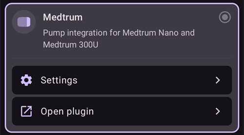
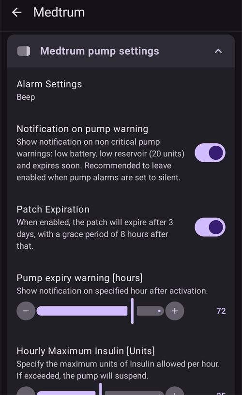
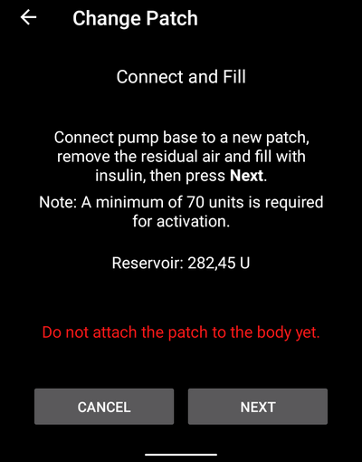
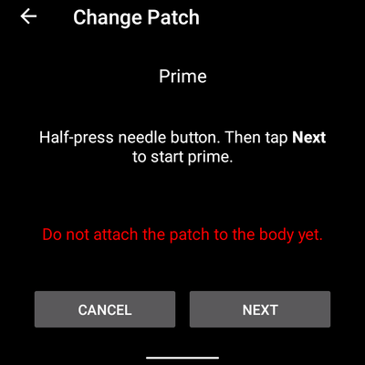
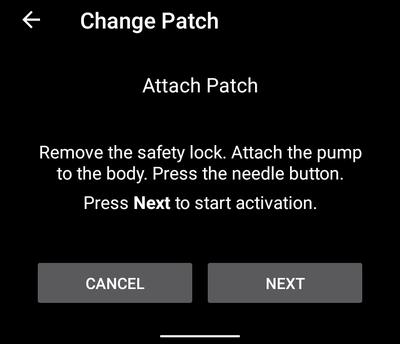
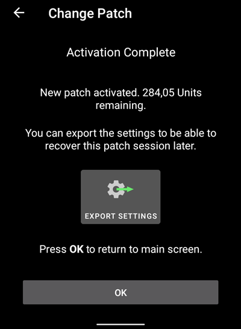
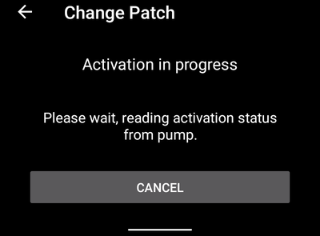
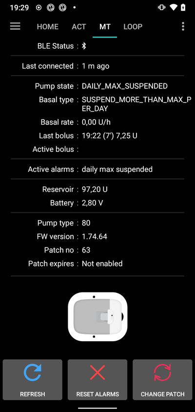

(medtrum-nano-300u)=
# Medtrum Nano 200U / 300U

Disse instruksjonene gjelder oppsett av Medtrum-insulinpumpen.

```{contents} Table of contents
:depth: 1
:local: true
```

## Pumpefunksjoner med AAPS
* All loop-funksjonalitet støttes (SMB, midlertidig basal osv.)
* Automatisk håndtering av sommertid og tidssoner
* Forlenget bolus støttes ikke av AAPS-driveren

## Krav til maskinvare og programvare
* **Kompatible Medtrum-pumpebaser og reservoarpatcher**
    - Støttes nå:
        - Medtrum TouchCare Nano 200U med pumpebase-ref.: **MD0201** og **MD8201**.
        - Medtrum TouchCare 300U med pumpebase-ref.: **MD8301**.
        - Hvis du har en modell som ikke støttes, og du er villig til å donere maskinvare eller hjelpe til med testing, kontakt oss på Discord [her](https://discordapp.com/channels/629952586895851530/1076120802476441641).
* **AAPS bygget og installert** etter instruksjonene i [Bygge AAPS](../SettingUpAaps/BuildingAaps.md).
* **Kompatibel Android-telefon** med BLE Bluetooth-tilkobling
    - Se AAPS [Versjonsnotater](../Maintenance/ReleaseNotes.md)

## Før du begynner

**SIKKERHET FØRST** Ikke prøv denne prosessen i en situasjon der du ikke kan rette opp en feil (ekstra patcher, insulin og enheter for å styre pumpen må du ha for hånden).

**PDM-en og Medtrum-appen fungerer ikke med en patch som er aktivert av AAPS.** Tidligere har du kanskje brukt PDM-en eller Medtrum-appen til å sende kommandoer til pumpen. Av sikkerhetsgrunner kan du bare bruke den aktiverte patchen med enheten eller appen som ble brukt til å aktivere den.

*Dette betyr IKKE at du skal kaste PDM-en. Vi anbefaler at du oppbevarer den på et trygt sted som reserve i nødstilfeller, for eksempel hvis telefonen blir borte eller AAPS ikke fungerer som den skal.*

**Pumpen slutter ikke å tilføre insulin når den ikke er koblet til AAPS** Standard basaldoser programmeres på pumpen slik de er definert i den aktive profilen. Så lenge AAPS er i drift, sender den kommandoer om midlertidig basal som varer i maks 120 minutter. Hvis pumpen av en eller annen grunn ikke mottar nye kommandoer (for eksempel fordi kommunikasjonen ble brutt på grunn av avstanden mellom pumpe og telefon), går pumpen tilbake til standard basaldose som er programmert på pumpen, når den midlertidige basalen slutter.

**AAPS-profilen støtter ikke basaldoser som starter på halvtimen** Hvis du er ny i AAPS og setter opp basalprofilen din for første gang, vær oppmerksom på at basaldoser som starter på halvtimen ikke støttes. Du må justere basalprofilen slik at alle tidene starter på hel time. For eksempel: Hvis du har en basaldose på 1,1 enheter som starter kl. 09:30 og varer i 2 timer til kl. 11:30, vil dette ikke fungere. Du må endre denne basaldosen på 1,1 enheter til tidsrommet 09:00–11:00 eller 10:00–12:00. Selv om selve Medtrum-pumpen støtter basalprofil med 30 minutters intervaller, kan AAPS foreløpig ikke ta hensyn til dem i algoritmene sine.

**Basaldoser på 0 E/t i profilen støttes IKKE i AAPS** Medtrum-pumpen støtter null basal, men AAPS bruker multipler av profilens basaldose til å bestemme automatisk behandling, og kan derfor ikke fungere med null basal. Den laveste basaldosen i profilen er 0,05 E/t.

En midlertidig null basal kan du få gjennom funksjonen «Koble fra pumpen» eller gjennom en kombinasjon av Deaktiver loop/midlertidig basal eller Pause loop/midlertidig basal.

## Oppsett

```{caution}
Når du aktiverer en patch med **AAPS**, **MÅ** du slå av alle andre enheter som kan snakke med Medtrum-pumpebasen, for eksempel en aktiv PDM eller Medtrum-appen.
```

### Steg 1: Velg Medtrum-pumpe

#### Alternativ 1: Nye installasjoner

Hvis du installerer **AAPS** for første gang, hjelper **Oppsettveiviseren** deg gjennom oppsettet. Velg **Medtrum** når du kommer til steget **Pumpe**.

Hvis du er i tvil, kan du også velge **Virtuell pumpe** og velge **Medtrum** senere, etter at du har satt opp **AAPS** (se alternativ 2).


#### Alternativ 2: Konfigurasjonsskjermen

På en eksisterende installasjon kan du velge **Medtrum**-pumpen i [Konfigurasjon > Pumpe](#Config-Builder-pump):

Åpne **menyen** (☰) øverst til venstre, trykk på **Konfigurasjon** > **Pumpe**, og velg kortet **Medtrum**. Bare én pumpe kan være aktiv om gangen.


Når den er valgt, viser kortet **Medtrum** to knapper, **Innstillinger** og **Åpne plugin**:



**Åpne plugin** (eller **Administrer → Pumpe**) åpner Medtrum-pumpeskjermen. Du bruker den til å bytte patch og se pumpestatus. Før en patch er aktivert, ser den slik ut:


(medtrum-step-2)=
### Steg 2: Endre Medtrum-innstillinger

Trykk på **Innstillinger** på kortet **Medtrum** i **Konfigurasjon** > **Pumpe**. Du kan også trykke på tannhjulet øverst til høyre på Medtrum-pumpeskjermen. Dette åpner **Medtrum pumpeinnstillinger**:



```{note}
Det finnes ikke lenger noen innstilling for **Serienummer**. **AAPS** finner pumpebasen din med et Bluetooth-søk første gang du aktiverer en patch (se [Steg 3](#medtrum-activate-patch)), og husker serienummeret. For å bruke en annen pumpebase, se [Opphev sammenkobling](#medtrum-unpair).
```

#### Alarminnstillinger

***Standard: Piping.***

Denne innstillingen endrer hvordan pumpen varsler deg når det er en advarsel eller feil.

- **Piping**: patchen piper ved alarmer og advarsler.
- **Stille**: patchen varsler deg ikke ved alarmer og advarsler.

Merk: I stille modus gir **AAPS** fortsatt alarm, avhengig av voluminnstillingene på telefonen din. Hvis du ikke reagerer på alarmen, piper patchen til slutt.

#### Varsel om pumpeadvarsel

***Standard: Aktivert.***

Denne innstillingen endrer hvordan **AAPS** viser varslinger for pumpeadvarsler som ikke er kritiske. Når den er aktivert, vises en varsling på telefonen når det kommer en pumpeadvarsel, blant annet:
- Lavt batteri
- Lavt reservoar (20 enheter)
- Patch utløper snart

Vi anbefaler å la denne være aktivert når pumpealarmene er satt til **Stille**. I begge tilfeller vises disse advarslene også på Medtrum-pumpeskjermen under [Aktive alarmer](#medtrum-active-alarms).

(medtrum-patch-expiration)=
#### Patch-utløp

***Standard: Aktivert.***

Denne innstillingen endrer hvordan patchen oppfører seg. Når den er aktivert, utløper patchen etter 3 dager og gir en lydvarsling hvis du har lyd på. Etter 3 dager og 8 timer slutter patchen å virke.

Hvis denne innstillingen er slått av, varsler ikke patchen deg før den stopper. Med nyere firmware på pumpebasen varer en patch i maks 5 dager.

#### Utløpsvarsel om pumpe [timer]

***Standard: 72 timer.***

Denne innstillingen endrer tidspunktet for utløpsvarselet. Når [Patch-utløp](#medtrum-patch-expiration) er aktivert, viser **AAPS** en varsling så mange timer etter aktiveringen.

#### Maks insulin per time [Enheter]

***Standard: 25 E.***

Denne innstillingen endrer den største mengden insulin som kan tilføres på én time. Hvis denne grensen overskrides, pauser patchen og gir en alarm. Du kan nullstille alarmen med knappen **Nullstill alarmer** på pumpeskjermen, se [Nullstill alarmer](#nano-reset-alarms).

Sett denne til en fornuftig verdi for ditt insulinbehov.

#### Maks insulin per dag [Enheter]

***Standard: 80 E.***

Denne innstillingen endrer den største mengden insulin som kan tilføres på én dag. Hvis denne grensen overskrides, pauser patchen og gir en alarm. Du kan nullstille alarmen med knappen **Nullstill alarmer** på pumpeskjermen, se [Nullstill alarmer](#nano-reset-alarms).

Sett denne til en fornuftig verdi for ditt insulinbehov.

#### Skann ved tilkoblingsfeil

***Standard: Av.***

Ligger under **Avanserte innstillinger**.

Aktiver denne bare hvis du har tilkoblingsproblemer. Når den er aktivert, skanner driveren etter pumpen på nytt før den prøver å koble til igjen. Pass på at posisjonstillatelsen for **AAPS** er satt til «Tillat hele tiden».

### Steg 2b: Varselinnstillinger i AAPS

Disse innstillingene er ikke en del av Medtrum-driveren. Du åpner dem fra **Innstillinger**-ikonet (tannhjulet) øverst til høyre på hovedskjermen. Se [Innstillinger](../SettingUpAaps/Preferences.md) for mer informasjon.

#### Bluetooth-overvåker

Åpne **Innstillinger** > **Pumpe**:


**Bluetooth-overvåker** slår av Bluetooth på telefonen i ett sekund hvis **AAPS** ikke får kontakt med pumpen. Dette kan hjelpe på noen telefoner der Bluetooth henger seg opp.

Aktiver denne innstillingen hvis du ofte har tilkoblingsproblemer med pumpen.

#### Lokale varsler

Åpne **Innstillinger** > **Lokale varsler**:


##### Varsle hvis pumpen ikke kan nås

***Standard: Aktivert.***

Denne innstillingen tvinges på når Medtrum-driveren er aktivert. Den varsler deg når pumpen ikke kan nås. Dette kan skje når pumpen er utenfor rekkevidde, eller når den ikke svarer på grunn av en defekt patch eller pumpebase, for eksempel når det lekker vann inn mellom pumpebasen og patchen.

Av sikkerhetsgrunner kan ikke denne innstillingen slås av.

##### Terskel for utilgjengelig pumpe

***Standard: 30 min.***

Denne innstillingen endrer hvor lenge **AAPS** venter før den varsler deg om at pumpen ikke kan nås.

Du kan endre denne innstillingen når du bruker Medtrum-pumpen, men av sikkerhetsgrunner anbefaler vi å beholde 30 minutter.

(medtrum-activate-patch)=
### Steg 3: Aktiver patch

**Før du fortsetter:**
- Ha Medtrum-pumpebasen og en ny reservoarpatch klar.
- Slå av andre enheter som kan snakke med Medtrum-pumpen (PDM og Medtrum-appen).
- Helst bør **AAPS** være satt opp og en [profil være aktivert](../DailyLifeWithAaps/ProfileSwitch-ProfilePercentage.md). Hvis ingen profil er aktiv, starter aktiveringen med steget **Profil kreves**, der du velger profilen som skal aktiveres.

#### Start aktiveringen

Åpne [Medtrum-pumpeskjermen](#nano-overview) (**Administrer → Pumpe**) og trykk på **Bytt patch**. Hvis du har satt opp [beskyttelse av innstillinger](#Preferences-protection), må du først skrive inn passordet eller PIN-koden din.

Hvis en patch allerede er aktiv, blir du bedt om å deaktivere den først, se [Deaktivere patch](#nano-deactivate-patch).

Aktiveringen er en veiviser med flere steg. Følg instruksjonene for å fylle og aktivere en ny patch. Trykk på **Avbryt** i et hvilket som helst steg for å stoppe.

```{important}
Sett patchen på kroppen og før inn kanylen bare når veiviseren sier det (etter at primingen er ferdig).
```

De første stegene du ser, avhenger av oppsettet ditt:

1. **Profil kreves**: bare hvis ingen profil er aktiv. Velg profilen som skal brukes, og fortsett.
2. **Finn pumpe**: bare første gang, eller etter at du har brukt [Opphev sammenkobling](#medtrum-unpair). Koble pumpebasen til en ny patch for å slå den på. **AAPS** skanner etter Medtrum-pumpebaser i nærheten (navnene begynner med `MT`). Trykk på din i listen. **AAPS** lagrer serienummeret og går rett videre til fylling av patchen.

   

3. **Aktivere patch**: bare når **AAPS** allerede kjenner pumpebasen din. Skjermen sier «Ingen aktiv patch. Trykk **Neste** for å starte aktiveringsprosessen.» Pass på at pumpebasen **ikke** er koblet til patchen ennå, og trykk så på **Neste**.


#### Koble til og fyll patchen



Koble pumpebasen til patchen, fjern overflødig luft og fyll patchen med insulin. Det trengs minst 70 enheter for aktivering. Skjermen viser reservoarnivået. Ikke fest patchen på kroppen ennå.

Når patchen er funnet og fylt, vises knappen **Neste**. Trykk på den.

#### Velg insulin

Dette steget vises bare hvis du har satt opp mer enn ett insulin i **AAPS**. Velg insulinet du fyller patchen med. **AAPS** gjør et profilbytte med dette insulinet etter aktiveringen.

#### Prime patchen



Fjern **ikke** sikkerhetslåsen. Trykk nålknappen på patchen halvveis inn, og trykk så på **Neste** for å starte primingen.


Vent til primingen er ferdig.


Når primingen er ferdig, trykk på **Neste** for å fortsette.

#### Rotasjon av sted

Dette steget vises bare hvis du administrerer pumpesteder med [Rotasjon av sted](#Aapsscreens-site-rotation) (innstillingen **Administrer pumpe-stedsrotasjon**). Velg hvor på kroppen du setter patchen, eller hopp over dette steget.

#### Fest patch



Rengjør huden og fjern klistremerkene. Fjern sikkerhetslåsen, fest patchen på kroppen og trykk på nålknappen for å føre inn kanylen.

Trykk på **Neste** for å aktivere patchen.

#### Aktiver patch


**AAPS** aktiverer pumpen og setter den første basaldosen. Vent litt. Når aktiveringen er fullført, vises dette skjermbildet:



```{admonition} Older screenshot
:class: note
Bortsett fra **Finn pumpe** er skjermbildene av aktiveringen ovenfor fra en eldre **AAPS**-versjon, og de kan se annerledes ut i **AAPS** 4.
```

Det viser hvor mange enheter som er igjen i patchen. Trykk på **OK** for å gå tilbake til pumpeskjermen.

```{tip}
Etter en ny aktivering bør du [eksportere innstillingene dine](../Maintenance/ExportImportSettings.md). Da kan du gjenopprette denne patch-økten senere, for eksempel på en ny telefon.
```

(nano-deactivate-patch)=

### Deaktivere patch

For å deaktivere den aktive patchen, åpne [Medtrum-pumpeskjermen](#nano-overview) (**Administrer → Pumpe**) og trykk på **Bytt patch**.


Du blir bedt om å bekrefte at du vil deaktivere den gjeldende patchen. **Dette kan ikke angres.** Trykk på **Neste** for å deaktivere, eller **Avbryt** for å gå tilbake til pumpeskjermen.


Hvis **AAPS** ikke kan deaktivere patchen (for eksempel fordi pumpebasen allerede er tatt av patchen), trykk på **Forkast** for å glemme den gjeldende patch-økten. Du kan så aktivere en ny patch.


Når deaktiveringen er fullført, trekk nålen tilbake og ta patchen av kroppen. Ta av pumpebasen og kast den brukte patchen. Trykk på **OK** for å gå tilbake til pumpeskjermen, eller **Neste** for å starte aktivering av en ny patch.

(nano-resume-interrupted-activation)=

### Gjenoppta avbrutt aktivering

Hvis en patch-aktivering blir avbrutt, for eksempel fordi telefonbatteriet går tomt, kan du gjenoppta den. Åpne [Medtrum-pumpeskjermen](#nano-overview) (**Administrer → Pumpe**) og trykk på **Bytt patch**.


Trykk på **Neste** for å gjenoppta aktiveringen. Trykk på **Forkast** for å tilbakestille aktiveringsstatusen, slik at du kan aktivere en ny patch.



```{admonition} Older screenshot
:class: note
Skjermbildene under **Deaktivere patch** og **Gjenoppta avbrutt aktivering** er fra en eldre **AAPS**-versjon, og de kan se annerledes ut i **AAPS** 4.
```

Driveren leser aktiveringsstatusen fra pumpen. Hvis dette lykkes, fortsetter veiviseren fra steget der den stoppet.

(nano-overview)=

## Pumpeskjermen

Medtrum-pumpeskjermen (**Administrer → Pumpe**) viser gjeldende status for Medtrum-patchen. Den har også knapper for å bytte patch, nullstille alarmer og oppdatere statusen. Et banner øverst viser viktige tilstander, for eksempel **Patch ikke aktivert** eller **Pumpen er pauset**.


Skjermen kan vise disse radene. Noen rader vises bare når de har en verdi.

- **Siste tilkobling**: hvor lenge siden **AAPS** sist var koblet til pumpen.
- **Siste bolus**: den siste bolusen som ble gitt.
- **Batteri**: gjeldende batterispenning i patchen.
- **Reservoar**: gjeldende reservoarnivå.
- **Serienummer**: serienummeret til pumpebasen din.
- **Pumpestatus**: pumpens gjeldende tilstand. For eksempel **Aktiv** (patchen er aktivert og går som normalt) eller **Stoppet** (patchen er ikke aktivert).
- **Profilens basal**: basaldosen fra profilen din som går nå.
- **Midlertidig basal**: den midlertidige basalen, hvis en er aktiv.
- **Aktiv bolus**: bolusen som gis akkurat nå.
- **Aktive alarmer**: se [nedenfor](#medtrum-active-alarms).
- **Pumpetype**: modellen til pumpebasen din.
- **FW versjon**: firmwareversjonen til pumpebasen.
- **Patch nr**: løpenummeret til den aktiverte patchen. Det øker med én hver gang du aktiverer en ny patch.
- **Aktivering**: dato og klokkeslett da patchen ble aktivert, og hvor lenge siden det var.
- **Patch utløper**: dato og klokkeslett når patchen utløper. Viser **Ikke aktivert** hvis [Patch-utløp](#medtrum-patch-expiration) er av.

(medtrum-active-alarms)=
### Aktive alarmer

Denne raden viser alarmer som er aktive akkurat nå, for eksempel lavt reservoar eller en patch som snart utløper.

### Oppdater

Denne knappen oppdaterer statusen til patchen. Den er bare tilgjengelig når en patch er aktiv og **AAPS** ikke er koblet til pumpen i øyeblikket.

### Bytt patch

Denne knappen starter veiviseren for å bytte patch. Se [Aktiver patch](#medtrum-activate-patch) for mer informasjon.

(medtrum-unpair)=
### Opphev sammenkobling

Denne knappen vises bare når **AAPS** kjenner en pumpebase. Den sletter det lagrede serienummeret til pumpebasen og kobler fra. Neste gang du aktiverer en patch, skanner **AAPS** etter en pumpebase igjen (steget **Finn pumpe**). Bruk denne hvis du bytter til en annen pumpebase. Gjør dette bare når ingen patch er aktiv.

(nano-reset-alarms)=

### Nullstill alarmer

Knappen **Nullstill alarmer** vises bare på pumpeskjermen når patchen har pauset seg selv, for eksempel etter en alarm for maks insulin per dag. Trykk på den for å nullstille alarmene og gjenoppta insulintilførselen.



```{admonition} Older screenshot
:class: note
Skjermbildet ovenfor er fra en tidligere **AAPS**-versjon. I **AAPS** 4 ser pumpeskjermen annerledes ut, men knappen **Nullstill alarmer** fungerer på samme måte.
```

## Bytte telefon, eksportere/importere innstillinger

Når du bytter til en ny telefon, gjør du slik:
* [Eksporter innstillinger](../Maintenance/ExportImportSettings.md) på den gamle telefonen.
* Overfør innstillingsfilen fra den gamle telefonen til den nye, og importer den i **AAPS**. Kryss av for **Bytt også ut pumpeinnstillingene** på importskjermen, ellers blir ikke patch-økten overført til den nye telefonen.

Den importerte innstillingsfilen må være fra patch-økten du bruker nå, ellers kobler ikke patchen til (se [Slangeløse pumper](#ExportImportSettings-tubeless-pumps)).

Etter en import av innstillinger synkroniserer driveren historikken med pumpen. Dette kan ta en stund, avhengig av hvor gammel innstillingsfilen er. Fremdriften («Synkroniserer poster, ... gjenstår») vises på hovedskjermen:


(medtrum-nano-troubleshooting)=

## Feilsøking

### Tilkoblingsproblemer

Hvis du får tidsavbrudd eller andre tilkoblingsproblemer:
- I Android-appinnstillingene for **AAPS**, sett posisjonstillatelsen til «Tillat hele tiden».
- Prøv å aktivere **Skann ved tilkoblingsfeil** (Medtrum-innstillinger > **Avanserte innstillinger**) og **Bluetooth-overvåker** (**Innstillinger** > **Pumpe**), se [Steg 2](#medtrum-step-2).

### Bluetooth-problemer
For kjente problemer med Bluetooth-tilkoblinger, frafall av pumpe/pods, eller problemer med aktivering og tilkobling: [Feilsøking av Bluetooth](../GettingHelp/BluetoothTroubleshooting.md)

### Aktivering avbrutt

Hvis aktiveringen blir avbrutt, for eksempel fordi telefonbatteriet er tomt eller telefonen krasjer, kan du gjenoppta den. Trykk på **Bytt patch** på pumpeskjermen og følg stegene i [Gjenoppta avbrutt aktivering](#nano-resume-interrupted-activation).

### Forebygge patch-feil

Patchen kan gi mange forskjellige feil. For å unngå hyppige feil:
- Pass på at pumpebasen sitter riktig i patchen og at det ikke er synlige åpninger.
- Når du fyller patchen, ikke bruk for mye kraft på stempelet. Ikke prøv å fylle patchen mer enn maksimum for din modell.

## Hvor du kan få hjelp

Alt utviklingsarbeid på Medtrum-driveren gjøres av fellesskapet på **frivillig** basis. Vi ber deg huske det og følge disse retningslinjene før du ber om hjelp:

-  **Nivå 0:** Les den aktuelle delen av denne dokumentasjonen, slik at du forstår hvordan funksjonen du har problemer med, er ment å virke.
-  **Nivå 1:** Hvis du fortsatt har problemer som du ikke klarer å løse ved hjelp av dette dokumentet, gå til kanalen *#Medtrum* på **Discord** via [denne invitasjonslenken](https://discord.gg/4fQUWHZ4Mw).
-  **Nivå 2:** Søk i eksisterende saker for å se om problemet ditt allerede er rapportert under [Issues](https://github.com/nightscout/AAPS/issues) Hvis saken finnes, bekreft/kommenter/legg til informasjon om problemet ditt. Hvis ikke, opprett en [ny sak](https://github.com/nightscout/AndroidAPS/issues) og legg ved [loggfilene dine](../GettingHelp/AccessingLogFiles.md).
-  **Vær tålmodig – de fleste i fellesskapet vårt er velvillige frivillige, og det tar ofte tid og tålmodighet fra både brukere og utviklere å løse problemer.**