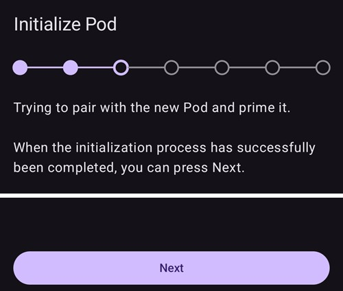
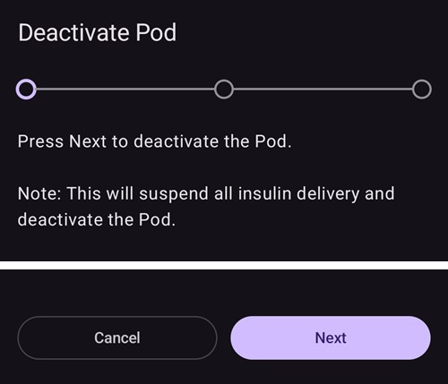
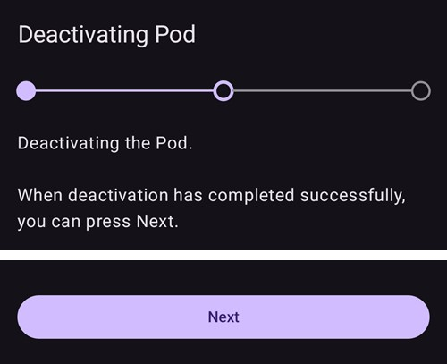

# Omnipod DASH

Disse instruksjonene gjelder oppsett av pumpegenerasjonen **Omnipod DASH** **(IKKE Omnipod Eros)**. DASH-driveren er en veletablert måte å loope med Omnipod på.

```{contents} Table of contents
:depth: 1
:local: true
```

## Omnipod DASH-spesifikasjoner

Viktige egenskaper ved **Omnipod DASH** («DASH»):

- DASH-podene kjennes igjen på den **blå kanylehetten** (den eldre EROS-poden har en gjennomsiktig kanylehette). Podene er ellers identiske når det gjelder fysiske mål.
- DASH trenger ingen BLE-bro (INGEN RileyLink, OrangeLink eller EmaLink er nødvendig).
- Bluetooth-tilkoblingen til DASH brukes bare når en kommando sendes (for eksempel en bolus), og kobles fra rett etter at kommandoen er sendt.
- **AAPS** venter til poden er tilgjengelig før kommandoer sendes.
- Ved pod-aktivering finner **AAPS** en ny DASH-pod og kobler til den.
- Forventet rekkevidde fra telefonen: 5–10 meter (kan variere).

(omnipod-dash-constraints)=

## Kjente begrensninger/problemer med Omnipod DASH i AAPS
- Det generelle rådet er å kjøre **AAPS** på Android 14 eller 16. Android 15 har mange rapporterte [problemer](https://github.com/nightscout/AndroidAPS/issues/3471) fra fellesskapet. Hvis du likevel kjører Android 15, må du sannsynligvis slå på **Bluetooth-paring** (i delen **Avanserte innstillinger** i [Dash-innstillingene](#omnipod-dash-advanced-settings)) for å kunne aktivere og bruke pods, se [Feilsøking](../GettingHelp/GeneralTroubleshooting.md) for mer informasjon om paringsinnstillingene.
- Sommertid og tidssonebytter brukes ikke automatisk. Etter en klokkeendring må du oppdatere poden manuelt: trykk på **Oppdater** på DASH-pumpeskjermen, og trykk deretter på **Angi tid** (vises når tidssonen på poden og telefonen er ulik), eller gjør et **Profilbytte** (se [Tidssonebytte for Omnipod Dash](#timezone-traveling-with-pumps)).
- Dash støtter bare basaldoser i steg på 0,05 E/t. Hvis du prøver å sette basal med steg på 0,01 i **AAPS-profilen** din, gir AAPS ingen advarsel, selv om poden runder dosen opp til steg på 0,05. Hvis du åpner **Pod-historikk** på DASH-pumpeskjermen, viser den at basal ble satt til 0,05. Det betyr også at den laveste basaldosen DASH tillater i **AAPS**, er 0,05 E/t.
- Innstillingsfilen inneholder den aktive pod-økten. Eksporter innstillingene dine etter hver pod-aktivering, og se [Eksportere og importere innstillinger](#omnipod-dash-export-import) før du importerer innstillinger.
- Når en ny basalprofil settes, pauser DASH leveringen før den nye basal-**profilen** settes. Hvis kommunikasjonen blir avbrutt eller det oppstår en feil, starter ikke basalprofilen automatisk igjen. Se avsnittet [Gjenoppta insulinleveringen](#omnipod-dash-resuming-insulin-delivery) for detaljer.
- Hvis varsler er satt opp og poden er i ferd med å utløpe, fortsetter poden å pipe til varslene dempes, se [Dempe pod-varsler](#omnipod-dash-silencing-pod-alerts) for detaljer.
- Det finnes en rekke kjente problemer med Bluetooth som kan gi problemer med pod-aktivering. Se [Feilsøking av Bluetooth](../GettingHelp/BluetoothTroubleshooting.md) for det kjente problemet og løsninger på disse problemene.

(hardware-software-requirements)=

(omnipod-dash-hardware-software-requirements)=
## Krav til maskinvare og programvare

- Omnipod DASH kjennes igjen på den blå kanylehetten.


- **En kompatibel Android-telefon** med Bluetooth Low Energy (BLE) (se [Telefoner](../Getting-Started/Phones.md) for mer informasjon). I tillegg vil informasjonen nedenfor hjelpe deg med andre viktige hensyn for å aktivere og bruke DASH på en kompatibel telefon:
    -  Omnipod Dash-driveren i **AAPS** kobler til DASH-poden med Bluetooth.  
      **AAPS** oppretter automatisk en ny Bluetooth-tilkobling til poden hver gang den må sende en kommando (for eksempel en bolus), og rett etter at kommandoen er sendt, kobles Bluetooth-tilkoblingen fra.
       - **MERK:**
         - Bluetooth-tilkoblingen kan bli avbrutt/forstyrret av andre Bluetooth-enheter som er koblet til telefonen som kjører **AAPS**, for eksempel ørepropper osv. Slike enheter kan gi tilkoblingsfeil eller problemer med pod-aktivering på noen telefonmodeller. Det er lurt å se gjennom listen over [testede maskinvareoppsett](https://docs.google.com/spreadsheets/u/1/d/e/2PACX-1vScCNaIguEZVTVFAgpv1kXHdsHl3fs6xT6RB2Z1CeVJ561AvvqGwxMhlmSHk4J056gMCAQE02sAWJvT/pubhtml?gid=683363241&single=true) for å finne konfigurasjoner som er kjent for å virke, når du velger telefon til et Omnipod DASH-oppsett.
         - Det finnes en rekke kjente problemer med Bluetooth som kan gi problemer med pod-aktivering (se [Feilsøking](#troubleshooting) for råd om andre Bluetooth-problemer), særlig avsnittet [Bluetooth-relaterte problemer](#omnipod-dash-bluetooth-related-issues).
    - Telefonen må kjøre **Android 12 eller nyere**, med **AAPS** bygd og installert etter instruksjonene i [**Bygge AAPS**](../SettingUpAaps/BuildingAaps.md). Kjør alltid den nyeste utgitte versjonen.
- En støttet [**kontinuerlig glukosemåler (CGM)**](../Getting-Started/CompatiblesCgms.md)

Instruksjonene nedenfor forklarer hvordan du aktiverer en ny pod-økt med **AAPS**. Du bør vente til den nåværende poden nærmer seg utløp, siden du må aktivere en ny pod med **AAPS**. Når en pod er deaktivert, kan den ikke brukes eller aktiveres på nytt; deaktiveringen er endelig.

## Før du begynner

Sørg for at du har lest og forstått hele denne veiledningen, at du har lest og forstått avsnittet **Før du begynner**, og også **[Begrensninger og problemer med Omnipod og AAPS](#omnipod-dash-constraints)**, så du unngår å støte på et kjent problem.

### **SIKKERHET FØRST** – Du **BØR IKKE** prøve å koble **AAPS** til en pod for første gang uten å ha tilgang til alt det følgende:
1. Ekstra pods (3 eller flere i reserve)
2. Insulin i reserve og utstyr for injeksjoner (MDI)
3. En fungerende Omnipod PDM (i tilfelle **AAPS** svikter)
4. En støttet telefon er et must! (Se [Krav til maskinvare/programvare](#hardware-software-requirements))
5. Riktig versjon av AAPS bygd og installert

### Omnipod Dash PDM-en din blir overflødig når AAPS Dash-driveren har aktivert poden din.
- Før du tok i bruk **AAPS**, måtte du eller omsorgspersonen din styre poden med Omnipod PDM (eller i noen regioner en telefonapp) for å sende kommandoer til DASH (for eksempel en bolus).
- DASH kan bare ha én Bluetooth-enhet (for eksempel PDM eller telefon) tilkoblet for å styre den og sende kommandoer.
- Enheten som aktiverer poden, er den eneste enheten som får kommunisere med den poden fra da av. Det betyr at når du har aktivert en DASH med Android-telefonen din ved hjelp av **AAPS**, **kan du ikke lenger bruke PDM-en med den poden!** Så lenge den poden er aktiv, er Dash-driveren i **AAPS** på Android-telefonen din den nye PDM-en for poden.
- **IKKE kast PDM-en din!** Det anbefales å ha den tilgjengelig som reserve og til nødstilfeller, for eksempel hvis du mister telefonen eller **AAPS** ikke virker som den skal.

### Poden din slutter **IKKE** å levere insulin når den ikke er koblet til AAPS.
Standard basaldoser programmeres inn i poden ved aktivering, slik de er definert i den aktive [**profilen**](../SettingUpAaps/YourAapsProfile.md).  
Så lenge **AAPS** er i drift, sender den kommandoer om justering av basaldosen som varer i maksimalt 120 minutter.  
Hvis poden av en eller annen grunn ikke mottar nye kommandoer (for eksempel fordi kommunikasjonen ble brutt på grunn av avstanden mellom pod ➜ telefon), går poden automatisk tilbake til standard basaldoser slik de er definert i [**profilen**](../SettingUpAaps/YourAapsProfile.md) din.

### AAPS-profiler støtter ikke basaldoser med tidsintervaller på 30 minutter
Hvis du er ny i **AAPS** og setter opp basaldosene i [**profilen**](../SettingUpAaps/YourAapsProfile.md) din for første gang, vær klar over at basaldoser som starter på en halvtime ikke støttes. Hvis du for eksempel har en basaldose på 1,1 enheter på Omnipod PDM-en din som starter kl. 09:30 og varer i 2 timer til kl. 11:30, er det ikke mulig å gjenskape nøyaktig denne basal-**profilen** i **AAPS**.  
Du må endre denne basaldosen på 1,1 enheter til tidsrommet enten 09:00–11:00 eller 10:00–12:00. Selv om DASH-maskinvaren i seg selv støtter 30-minutters intervaller for basaldoser i **profilen**, støtter **AAPS** IKKE denne funksjonen.

### Basaldoser på 0 E/t i profilen støttes IKKE i AAPS
Selv om DASH støtter en basaldose på null, bruker **AAPS** multipler av basaldosen i brukerens **profil** for å beregne automatisk behandling; den kan ikke fungere med en basaldose på null.  
I stedet kan du få en midlertidig basaldose på null gjennom funksjonen «Koble fra pumpen», eller gjennom en kombinasjon av Deaktiver loop/Midlertidig basaldose eller Pause loop/Midlertidig basaldose.  
**MERK:** Den laveste basaldosen DASH tillater i **AAPS**, er 0,05 E/t.

## Velge Dash i AAPS

Det finnes **to** måter å velge Omnipod DASH-driveren på i **AAPS**:

### Alternativ 1: Nye installasjoner

Når du installerer **AAPS** for første gang, leder **Oppsettveiviseren** deg gjennom de viktigste funksjonene og installasjonskravene i **AAPS**. Når du kommer til steget **Pumpe**, velger du **Omnipod Dash**.


Hvis du ikke er sikker ennå, kan du velge **Virtuell pumpe** for nå, og velge **Omnipod Dash** senere, etter at du har satt opp **AAPS** (se alternativ 2).

(omnipod-dash-option-2-config-builder)=
### Alternativ 2: Konfigurasjonsskjermen

På en eksisterende installasjon kan du velge pumpen **Omnipod Dash** fra skjermen **Konfigurasjon**:

1. Åpne **menyen** (☰) øverst til venstre på hovedskjermen, og velg **Konfigurasjon**.
2. Trykk på **Pumpe**, og velg radioknappen for **Omnipod Dash** (*«Pumpeintegrasjon for Omnipod Dash (den nye, Bluetooth-aktiverte modellen med en blå kanylehette)»*).

3. Når den er valgt, viser kortet **Omnipod Dash** to knapper:
   - **Innstillinger** åpner [Dash-innstillingene](#omnipod-dash-settings).
   - **Åpne plugin** åpner [DASH-pumpeskjermen](#omnipod-dash-tab).

   

### Kontroll av at Omnipod-driveren er valgt

For å kontrollere at **Omnipod Dash** er valgt, åpne **Administrer** (navigasjonslinjen nederst på hovedskjermen) og trykk på **Pumpe**. DASH-pumpeskjermen åpnes, slik det vises i neste avsnitt.

(omnipod-dash-tab)=

## The DASH pump screen

DASH-pumpeskjermen er der du administrerer podene dine: aktiverer og deaktiverer dem, oppdaterer podstatusen, demper varsler og ser på pod-historikken. Åpne den med **Administrer** > **Pumpe**, eller med **Åpne plugin** på kortet **Omnipod Dash** i **Konfigurasjon** > **Pumpe**.

Slik ser skjermen ut uten en aktiv pod:


Og slik ser skjermen ut med en aktiv pod:


Ikonet **Innstillinger** (tannhjulet) øverst til høyre åpner [Dash-innstillingene](#omnipod-dash-settings).

***MERK:** Hvis et felt på pumpeskjermen viser (usikker), trykk på **Oppdater** for å oppdatere podstatusen.*

### Felter

- **Bluetooth-adresse:** Bluetooth-adressen til poden.

- **Tilkoblingskvalitet:** Hvor pålitelig **AAPS** kobler til poden, vist som *vellykkede tilkoblinger / alle tilkoblingsforsøk :: suksessrate*, for eksempel `412/420 :: 98.10 %`. Etter mer enn 50 vellykkede tilkoblinger blir verdien gul under 90 % og rød under 70 %. En lav verdi tyder på et Bluetooth-problem (se [Bluetooth-relaterte problemer](#omnipod-dash-bluetooth-related-issues)).

- **Leveringsstatus:** Den rå leveringsstatusen som poden rapporterer. Dette feltet vises bare i bygg med engineering mode.

- **Unik ID:** Den unike ID-en som **AAPS** ga poden under aktiveringen.

- **LOT-nummer:** Produksjonspartiet (LOT) til poden.

- **Sekvensnummer:** Sekvensnummeret til poden.

- **Firmwareversjon:** Firmware- og Bluetooth-versjonene til poden.

- **Tid på Pod:** Gjeldende tid på poden, med tidssonen dens. Teksten blir rød når tidssonen på poden er en annen enn tidssonen på telefonen, og gul når tiden på poden avviker med mer enn 10 minutter.

- **Pod utløper:** Dato og klokkeslett når poden utløper (72 timer etter aktivering). Teksten blir gul de siste 4 timene før dette tidspunktet. Den blir aldri rød, fordi poden fortsetter å levere insulin etter dette.

- **Pod avslutter:** Slutten på podens ekstraperiode (8 timer etter **Pod utløper**, for en maksimal levetid på 80 timer). Teksten blir gul når ekstraperioden starter (ved **Pod utløper**), og rød de siste 4 timene før den endelige slutten. I ekstraperioden viser den også tiden som er igjen, for eksempel *(17 min igjen)*. Poden slutter å levere insulin ved den endelige slutten, og må byttes.

- **Podstatus:** Tilstanden til poden: **Ingen aktiv Pod**, **Oppsett pågår**, **Kjører**, **Pauset** eller, etter en pod-feil, **ALARM**.

- **Siste tilkobling:** Hvor lenge siden **AAPS** sist kommuniserte med poden.

  - *For litt siden* – mindre enn 10 sekunder siden.

  - *Mindre enn ett minutt siden* – mellom 10 og 60 sekunder siden.

  - *XX minutter siden* – mer enn 1 minutt siden (og *X timer og XX minutter siden* etter en time).

- **Siste bolus:** Mengden i den siste bolusen som ble sendt til poden, og hvor lenge siden den ble gitt. En ubekreftet bolus er merket (usikker).

- **Profilens basaldose:** Basaldosen som er programmert for gjeldende tidspunkt i basal-**profilen** din.

- **Midlertidig basaldose:** Den midlertidige basaldosen (TBR) som kjører nå, med starttid og varighet. Dette feltet vises bare mens en midlertidig basal kjører.

- **Reservoar:** Viser *Over 50 E igjen* når det er mer enn 50 enheter igjen i reservoaret. Under 50 enheter vises den nøyaktige mengden. Verdien blir rød under 20 enheter.

- **Totalt levert:** Den totale mengden insulin som er levert fra reservoaret. Dette inkluderer insulinet som ble brukt til priming.

- **Aktive Pod-varsler:** Varsler som er aktive på poden nå, for eksempel *Pod utløper snart* eller *Lavt reservoar*.

- **Feil:** Pod-feilen, hvis poden har sviktet, vist i rødt som *Pod-feil:* etterfulgt av feilkoden og navnet, for eksempel *Pod-feil: 020 ALARM_OCCLUDED*. Se gjennom [Pod-historikk](#omnipod-dash-view-pod-history) og loggfilene for tidligere feil og mer detaljert informasjon. Se [Pod-feil](#omnipod-dash-pod-failures).

- **PDM-varsel:** Vises bare etter en pod-feil. Det viser feilen slik Omnipod PDM-en ville ha vist den: en tittel (for eksempel *Blokkering oppdaget*, *Tomt reservoar* eller *Pod-en er utløpt*), hva som skjedde (for eksempel *Insulintilførselen er stoppet. Bytt pod nå.*) og en *Ref:*-kode.

### Knapper

Knappene nederst på pumpeskjermen endrer seg med tilstanden til poden. Bare knappene som gir mening i øyeblikket, vises.

- **Oppdater:** Ber poden om gjeldende status.
  - *Bruk den for å oppdatere podstatusen og for å fjerne (usikker) fra feltene som viser det.*
  - *Se avsnittet [Feilsøking](#omnipod-dash-troubleshooting) nedenfor for mer informasjon.*

- **Demp varsler:** Stopper varselpipene fra poden (for eksempel for utløp eller lavt reservoar). Vises bare mens poden har et aktivt varsel. Se [Dempe pod-varsler](#omnipod-dash-silencing-pod-alerts).

- **Gjenoppta levering:** Gjenopptar insulinleveringen på en pauset pod. Vises bare når leveringen er pauset. Se [Gjenoppta insulinleveringen](#omnipod-dash-resuming-insulin-delivery).

- **Angi tid:** Oppdaterer poden til tidssonen på telefonen din ved å sende basal-**profilen** din på nytt. Vises bare når tidssonen på poden er en annen enn tidssonen på telefonen din.

- [**Aktiver Pod**](#omnipod-dash-activate-pod): Primer og aktiverer en ny pod. Vises når ingen pod er aktiv.

- [**Deaktiver Pod**](#omnipod-dash-deactivate-pod): Deaktiverer den aktive poden. Vises så snart en pod er paret med **AAPS**, også når en aktivering stoppet underveis (for eksempel fordi poden sviktet under aktiveringen). **AAPS** ber deg bekrefte før den deaktiverer poden.

- **Spill av testlyd:** Får poden til å spille av ett enkelt testpip.

- [**Pod-historikk**](#omnipod-dash-view-pod-history): Viser aktivitetshistorikken til den aktive poden.

- **Forkast Pod:** Fjerner en uferdig pod fra **AAPS**. Vises bare når en pod-aktivering stoppet underveis. **AAPS** ber deg bekrefte. Etter forkastingen kan **AAPS** ikke lenger kommunisere med den poden: fjern den fra kroppen.


```{admonition} Older screenshot
:class: note
Skjermbildet ovenfor er fra en tidligere **AAPS**-versjon, som hadde en egen meny for **Pod Management** (pod-administrasjon). I **AAPS** 4 er alle disse handlingene, inkludert **Aktiver Pod**, **Deaktiver Pod**, **Spill av testlyd** og **Pod-historikk**, knapper med tekst direkte på pumpeskjermen.
```

(omnipod-dash-activate-pod)=

## Aktiver Pod

1. Åpne DASH-pumpeskjermen (**Administrer** > **Pumpe**), og trykk på **Aktiver Pod**. Aktiveringsveiviseren åpnes.

   

   ```{admonition} Older screenshot
   :class: note
   Skjermbildet ovenfor er fra en tidligere **AAPS**-versjon. I **AAPS** 4 er **Aktiver Pod** en knapp direkte på DASH-pumpeskjermen i stedet for i menyen **Pod Management**.
   ```

   Hvis du aldri har aktivert en **profil** i **AAPS** før, viser veiviseren først steget **Profil kreves**: velg profilen som skal brukes ved aktivering, og fortsett.

2. Steget **Fyll Pod** vises. Fyll en ny pod med nok insulin til 3 dager, **minst 80 enheter**. Lytt etter to pip fra poden: de betyr at minstemengden på 80 enheter er fylt. Tøm fyllesprøyten helt, også etter at du har hørt de to pipene. Ikke fjern kanylehetten på poden ennå.

   ***MERK:** Når du beregner hvor mye insulin du trenger til 3 dager, husk at priming av poden bruker omtrent 3–10 enheter.*

   

   

   Sørg for at den nye poden og telefonen som kjører **AAPS**, er nær hverandre, og trykk på **Neste**.

3. Hvis du bruker mer enn ett insulin i **AAPS**, vises steget **Velg insulin**. Det viser insulinet som er **Aktiv for øyeblikket**. Hvis du fylte poden med et annet insulin, trykk på **Endre** og velg det. **AAPS** utfører et **Profilbytte** med dette insulinet når aktiveringen er ferdig. Trykk på **Neste**.

   

4. På steget **Initialiser Pod** parer **AAPS** seg med den nye poden og primer den. Du hører et klikk etterfulgt av en rekke tikkelyder mens poden primer seg selv. Når dette er fullført, vises knappen **Neste**. Trykk på **Neste**.

       

   ***MERK**: Hvis det kommer en feilmelding som _Skanningen mislyktes_ eller _«Fant ingen tilgjengelig pod for aktivering»_ (det kan skje), ikke få panikk. Trykk på **Prøv på nytt**. I de fleste tilfeller fortsetter aktiveringen da som den skal.*

   

   Hvis poden har sviktet (for eksempel fordi aktiveringstiden ble overskredet), vises **Deaktiver Pod** i stedet for **Prøv på nytt**. Bruk den, og start på nytt med en ny pod.

   Hvis du trykker på **Avbryt** før aktiveringen er ferdig, ber **AAPS** deg bekrefte at du vil avslutte. Trykk på **OK** for å forlate veiviseren, eller **Avbryt** for å bli.

   

5. Hvis du administrerer rotasjon av pumpested i **AAPS** (**Administrer pumpe-stedsrotasjon** i innstillingene for [Rotasjon av sted](#Aapsscreens-site-rotation)), vises steget **Stedplassering**. Velg hvor du skal plassere poden på kroppsdiagrammet, og trykk på **Neste**, eller trykk på **Hopp over**.

   

6. Gjør deretter klar infusjonsstedet for den nye poden. Vask hendene for å unngå risiko for infeksjon. Rengjør infusjonsstedet med såpe og vann eller en spritserviett, og la huden lufttørke helt før du fortsetter. Hvis limet irriterer huden din, kan du vurdere en barriereserviett eller barrierespray.

   På steget **Fest Pod** fjerner du den blå kanylehetten i plast fra poden. Hvis kanylen eller noe annet stikker ut av poden, eller den ser uvanlig ut, **STOPP**: trykk på **Avbryt** og start på nytt med en ny pod. Hvis alt ser **OK** ut, fjern det hvite beskyttelsespapiret fra klebeflaten og fest poden på det valgte stedet på kroppen.

   Når du er ferdig, trykk på **Neste**.

   

7. En bekreftelsesdialog vises: *Når du trykker OK, vil kanylen settes inn.* **Trykk på OK BARE hvis du er klar til å sette inn kanylen!**

   

8. På steget **Sett inn kanyle** setter **AAPS** basalplanen din, og poden setter inn kanylen. Dette kan ta litt tid (maksimalt 1–2 minutter). **Vær tålmodig!**

   ***MERK:** Det er god praksis å klype sammen huden nær innstikkstedet før kanylen settes inn. Dette hjelper nålen til å gå jevnt inn og reduserer risikoen for okklusjoner (tilstoppinger).*

       

9. Når kanylen er satt inn, vises knappen **Neste**. Trykk på **Neste**.

   

10. Steget **Pod aktivert** vises. Kontroller at kanylen er satt riktig inn, og bytt pod hvis du tror den ikke er det.

    Trykk på **Fullfør**.

    Gratulerer! Du har nå startet en ny pod-økt.

    

11. Du er tilbake på DASH-pumpeskjermen. Den viser nå informasjon om den aktive poden din, inkludert gjeldende basaldose, reservoarnivå, levert insulin, pod-feil og varsler. **Aktiver Pod** er erstattet av **Deaktiver Pod**: du kan ikke aktivere en ny pod uten først å deaktivere den aktive poden.

    ***MERK:** For mer informasjon om det som vises, se [DASH-pumpeskjermen](#omnipod-dash-tab).*

    

    ***MERK:** Det er god praksis å eksportere innstillingene dine ETTER at du har aktivert poden. Eksporter innstillingene dine etter hvert pod-bytte og én gang i måneden. Kopier den eksporterte innstillingsfilen til en skylagring (for eksempel Google Drive) eller et annet sted utenfor telefonen, i tilfelle du mister telefonen (se [**Eksporter innstillinger**](../Maintenance/ExportImportSettings.md)).*

Hvis en tidligere aktivering stoppet etter at poden var primet, fortsetter **Aktiver Pod** fra steget **Fest Pod**.

(omnipod-dash-deactivate-pod)=

## Deaktiver Pod

Under normale forhold varer en pod i tre dager (72 timer), pluss en ekstraperiode på 8 timer etter utløpsvarselet: 80 timer totalt.

Slik deaktiverer du en pod (enten fordi den er utløpt, eller fordi den har sviktet):

1. Åpne DASH-pumpeskjermen (**Administrer** > **Pumpe**), og trykk på **Deaktiver Pod**.

   

2. På steget **Deaktiver Pod** trykker du på **Neste**. En dialog spør *En deaktivert Pod kan ikke brukes igjen. Vil du deaktivere denne Pod-en nå?* Trykk på **OK** for å starte deaktiveringen av poden, eller **Avbryt** for å beholde den. Deaktivering pauser all insulinlevering og kan ikke angres.

   

3. Steget **Deaktiverer Pod** vises mens **AAPS** deaktiverer poden. Poden piper for å bekrefte at deaktiveringen var vellykket.

   

   ```{admonition} Older screenshot
   :class: note
   Skjermbildet ovenfor er fra en tidligere **AAPS**-versjon. I **AAPS** 4 viser veiviseren framdriften som en rad med prikker øverst i stedet for en framdriftslinje.
   ```

   Når deaktiveringen er fullført, vises knappen **Neste**. Trykk på **Neste**.

   

   Hvis deaktiveringen mislykkes, vises en feilmelding og knappen **Forkast Pod**. Se [Forkaste en pod](#omnipod-dash-discard-pod) nedenfor før du bruker den. Du kan også trykke på **Avbryt** og prøve **Deaktiver Pod** igjen senere.

4. Steget **Pod deaktivert** vises. Fjern poden fra kroppen, og trykk på **Fullfør**.

   

5. Du er tilbake på DASH-pumpeskjermen. Kontroller at feltet **Podstatus** viser **Ingen aktiv Pod**, og at knappen **Aktiver Pod** vises igjen.

   

(omnipod-dash-discard-pod)=

### Forkaste en pod

Forkast en pod bare når all kommunikasjon med den fortsetter å mislykkes. Hvis **AAPS** fortsatt kan kommunisere med poden, bruk **Deaktiver Pod** i stedet.

- **AAPS** ber deg bekrefte før den forkaster poden.
- Etter det kan **AAPS** ikke lenger kommunisere med den poden.
- **Insulinleveringen er IKKE pauset**, fordi poden ikke ble deaktivert på riktig måte. **Fjern poden fra kroppen!**
- Steget **Pod forkastet** bekrefter at pod-tilstanden er forkastet. Trykk på **Fullfør**. Du kan nå aktivere en ny pod.

(omnipod-dash-resuming-insulin-delivery)=

## Gjenoppta insulinleveringen

**MERK**: Ved **profilbytter** må **AAPS**, som når du bruker PDM-en, pause leveringen på poden før den nye basal-**profilen** settes. Hvis kommunikasjonen svikter mellom pause- og gjenoppta-kommandoene, kan leveringen forbli pauset. Les [**Levering pauset**](#omnipod-dash-delivery-suspended) i feilsøkingsdelen for flere detaljer.

Når insulinleveringen er pauset, må du be poden om å gjenoppta insulinleveringen. Når kommandoen er behandlet, leverer poden insulin igjen med basaldosen for gjeldende tidspunkt fra den aktive basal-**profilen** din. Poden godtar igjen kommandoer for bolus, **midlertidig basal** og **SMB**.

1. Åpne DASH-pumpeskjermen, og kontroller at feltet **Podstatus** viser **Pauset**. Trykk på **Gjenoppta levering** for å be poden om å gjenoppta normal insulinlevering.

   

2. Når kommandoen var vellykket, viser feltet **Podstatus** **Kjører**, og knappen **Gjenoppta levering** forsvinner.

   

   

   ```{admonition} Older screenshot
   :class: note
   Skjermbildene ovenfor er fra en tidligere **AAPS**-versjon, som viste en bekreftelsesdialog. I **AAPS** 4 bekrefter du resultatet på DASH-pumpeskjermen: feltet **Podstatus** viser **Kjører**, og knappen **Gjenoppta levering** er borte.
   ```

   Hvis kommandoen mislykkes, viser **AAPS** en advarselsdialog som begynner med *Kunne ikke gjenoppta leveringen*. Trykk på **Oppdater**, og prøv igjen.

   

(omnipod-dash-silencing-pod-alerts)=

## Dempe pod-varsler

Dette avsnittet forklarer hvordan du stopper pipene fra poden når poden nærmer seg slutten av levetiden. Når disse pipene starter, avhenger av innstillingene under **Varsler** (se [Dash-innstillinger](#omnipod-dash-settings)):

- **Påminnelse før utløp (72 timer):** hvor mange timer før 72-timersutløpet poden begynner å pipe.
- **Påminnelse før nedstenging (80 timer):** hvor mange timer før 80-timersnedstengingen poden piper igjen.

Den maksimale levetiden til en pod er 80 timer (3 dager og 8 timer). Produsenten av poden anbefaler likevel å ikke gå lenger enn 72 timer (3 dager).

***MERK**: Knappen **Demp varsler** vises bare på DASH-pumpeskjermen mens poden har et aktivt varsel, for eksempel for utløp eller lavt reservoar. Hvis knappen **Demp varsler** ikke vises, men du hører poden pipe, trykk på **Oppdater**.*

1. Når påminnelsestidspunktet er nådd, piper poden for å fortelle deg at den snart utløper, og at du må bytte den. På DASH-pumpeskjermen viser feltet **Pod utløper (1)** det nøyaktige tidspunktet poden utløper (72 timer etter aktivering). Teksten blir gul 4 timer før dette tidspunktet. Etter dette blir **Pod avslutter** gul og viser tiden som er igjen til poden slutter å levere insulin. Feltet **Aktive Pod-varsler (2)** viser **Pod utløper snart**, og knappen **Demp varsler (3)** vises.

   

2. Trykk på **Demp varsler**. **AAPS** sender kommandoen til poden om å stoppe utløpspipene.

   

   ```{admonition} Older screenshot
   :class: note
   Skjermbildet ovenfor er fra en tidligere **AAPS**-versjon, der denne skjermen var fanen **DASH**. I **AAPS** 4 er knappen **Demp varsler** på DASH-pumpeskjermen (**Administrer** > **Pumpe**).
   ```

3. Når varslene er dempet, vises varselet ikke lenger i feltet **Aktive Pod-varsler**, knappen **Demp varsler** forsvinner, og poden stopper utløpspipene.

   

   ```{admonition} Older screenshot
   :class: note
   Skjermbildet ovenfor er fra en tidligere **AAPS**-versjon, som viste en bekreftelsesdialog. I **AAPS** 4 bekrefter du resultatet på DASH-pumpeskjermen: varselet er borte fra feltet **Aktive Pod-varsler**.
   ```

   Hvis kommandoen mislykkes, viser **AAPS** en advarselsdialog som begynner med *Kunne ikke dempe varsler*. Trykk på **Oppdater**, og prøv igjen.

Varselet om lavt reservoar virker på samme måte. Når insulinet som er igjen i poden, synker til **Antall enheter** som er satt i innstillingene under **Varsler**, piper poden. Feltet **Reservoar** viser mengden som er igjen, feltet **Aktive Pod-varsler** viser **Lavt reservoar**, og knappen **Demp varsler** vises. Trykk på **Demp varsler** for å stoppe pipene, og planlegg det neste pod-byttet ditt.


(omnipod-dash-view-pod-history)=

## Vise pod-historikken

Dette avsnittet forklarer hvordan du ser på historikken til den aktive poden din og filtrerer den etter type handling. Pod-historikken viser kommandoene som er sendt til den aktive poden din, og resultatene av dem, i løpet av podens levetid på tre dager (72–80 timer).

Den er nyttig for å kontrollere bolusene, de midlertidige basalene og basalkommandoene som ble sendt til poden. De andre kategoriene hjelper med feilsøking og viser rekkefølgen på hendelsene som førte til en feil.

**MERK:** **Bare den siste kommandoen kan være usikker**. Nye kommandoer *sendes ikke* før den **siste «usikre» kommandoen blir «bekreftet» eller «avvist»**. For å «fikse» en usikker kommando, trykk på **Oppdater** på DASH-pumpeskjermen.

1. Åpne DASH-pumpeskjermen, og trykk på **Pod-historikk**.

   

   ```{admonition} Older screenshot
   :class: note
   Skjermbildet ovenfor er fra en tidligere **AAPS**-versjon. I **AAPS** 4 er **Pod-historikk** en knapp direkte på DASH-pumpeskjermen i stedet for i menyen **Pod Management**.
   ```

2. Skjermen **Pod-historikk** åpnes med filteret **Alle** valgt. Den lister opp hver kommando med tidspunkt og resultat, nyeste først, gruppert etter dag. Bruk filterknappene øverst (for eksempel **Boluser** eller **Basaldoser**) for å vise bare én type kommando. Trykk på tilbakepilen for å gå tilbake til DASH-pumpeskjermen.

    

   ```{admonition} Older screenshot
   :class: note
   Det andre skjermbildet ovenfor er fra en tidligere **AAPS**-versjon, der du valgte kommandotypen fra en **Type**-liste. I **AAPS** 4 bruker du filterknappene som vises i det første skjermbildet.
   ```

   For boluser følges mengden av bolustypen når det ikke er en vanlig bolus, for eksempel *0,05 E (SMB)* eller *0,05 E (Basalkorreksjon)*. En basalkorreksjon er en svært liten bolus (én pod-puls, 0,05 E) som driveren sender på egen hånd; du har ikke bedt om den.

   ```{admonition} Why basal corrections happen
   :class: note
   Poden leverer basalinsulin i pulser på 0,05 E, styrt av en intern klokke. Hver gang basaldosen endres (for eksempel når loopen setter en ny **midlertidig basal**), starter poden denne klokken på nytt, og pulsen den var i ferd med å telle opp til, går tapt. Fordi loopen endrer basaldosen ofte, særlig om natten, kan poden ende opp med å levere mindre basalinsulin enn forventet.

   **AAPS** sammenligner basalinsulinet poden rapporterer som levert, med det den skulle ha levert. Når underskuddet når en halv puls eller mer, leverer driveren én ekstra puls som en basalkorreksjon, slik at du fortsatt får basalinsulinet som profilen din og loopen ba om. Ingen korreksjon sendes mens poden er pauset, eller mens en **midlertidig basal** på null kjører.
   ```

(omnipod-dash-settings)=

## Dash-innstillinger

Det finnes to måter å åpne innstillingene for Dash-driveren på:

- Trykk på ikonet **Innstillinger** (tannhjulet) øverst til høyre på [DASH-pumpeskjermen](#omnipod-dash-tab).
- Åpne **menyen** (☰) øverst til venstre på hovedskjermen, og velg **Konfigurasjon** > **Pumpe**. På kortet **Omnipod Dash** trykker du på **Innstillinger**.

Innstillingene er gruppert i fire deler som kan utvides: **Bekreftelseslyd**, **Varsler**, **Varslinger** (vises i appen også som «Varsler») og **Avanserte innstillinger**. Trykk på en del for å åpne den:


De fleste innstillingene er av/på-brytere.

### Bekreftelseslyd


Bekreftelsespip fra poden for levering og endringer av bolus, basal, SMB og midlertidig basal.

**Bolus-lyd aktivert:**    Poden piper når en bolus leveres. På som standard.

**Basal-lyd aktivert:**    Poden piper når en ny basaldose settes, eller når den aktive basaldosen avbrytes eller endres. Av som standard.

**SMB-lyd aktivert:**  Poden piper når en SMB leveres. På som standard.

**TBR-lyd aktivert:**  Poden piper når en midlertidig basal settes eller avbrytes. Av som standard.

### Varsler


```{admonition} Older screenshot
:class: note
Skjermbildet ovenfor er fra en tidligere **AAPS**-versjon. I **AAPS** 4 ligger disse innstillingene i den utvidbare delen **Varsler**.
```

Pod-varsler for utløp, nedstenging og lavt reservoar. Når du endrer disse innstillingene mens en pod er aktiv, sender **AAPS** de nye varselinnstillingene til poden.

***MERK:** En **AAPS**-varsling vises ALLTID for alle varsler så snart **AAPS** har kommunisert med poden etter at varselet ble utløst. Å forkaste varslingen stopper IKKE pod-varselet. For å stoppe varselet, åpne DASH-pumpeskjermen og trykk på **Demp varsler**.*

**Utløpspåminnelse aktivert:**    Når denne er på, piper poden når påminnelsestidspunktet er nådd. På som standard.

**Påminnelse før utløp (72 timer):** Hvor mange timer før 72-timersutløpet påminnelsen starter (1 til 24 timer; standard 4).

**Nedstengingspåminnelse aktivert:**   Når denne er på, piper poden når varseltidspunktet er nådd, og igjen 1 time før nedstenging. På som standard.

**Påminnelse før nedstenging (80 timer):**  Hvor mange timer før 80-timersnedstengingen varselet starter (1 til 8 timer; standard 8).

**Varsel om lavt reservoar aktivert:**    Poden varsler deg når insulinet som er igjen i reservoaret, synker til verdien i **Antall enheter**. På som standard.

**Antall enheter:**    Antall enheter der varselet om lavt reservoar utløses (5 til 50 enheter; standard 20).

### Varslinger


Velg om **AAPS** skal spille av en lyd med varslingene sine når det er usikkert om en midlertidig basal, SMB eller bolus ble levert, og når leveringen er pauset.

***MERK:** Dette er bare varslinger på telefonen; poden selv piper ikke.*

**Lydvarsel for ubekreftet midlertidig basal:**  Spiller av en lyd med varslingen når **AAPS** er usikker på om en midlertidig basal ble satt.

**Lydvarsel for ubekreftet SMB:**  Spiller av en lyd med varslingen når **AAPS** er usikker på om en SMB ble levert.

**Lydvarsel for ubekreftet bolus:**    Spiller av en lyd med varslingen når **AAPS** er usikker på om en bolus ble levert.

**Lyd når varsling om pauset levering er aktivert:**     Spiller av en lyd med varslingen når insulinleveringen er pauset.

(omnipod-dash-advanced-settings)=

### Avanserte innstillinger


**Bluetooth-paring:**  Parer poden med telefonen over Bluetooth. Prøv den bare hvis poden ikke klarer å holde en stabil tilkobling, for eksempel på Android 15 (se [Kjente begrensninger/problemer med Omnipod DASH i AAPS](#omnipod-dash-constraints)). Når den er på, viser telefonen paringsforespørsler som du må godta. La den være av hvis poden kobler til som den skal. Den har ingen effekt på versjoner eldre enn Android 15. Av som standard.

## Alder på insulin og kanyle

[Statusraden](#screens-sensor-level-battery) på hovedskjermen viser alderen på insulinet og kanylen din. Med Omnipod virker disse litt annerledes enn med slangepumper.

**AAPS** registrerer automatisk et kanylebytte og et insulinbytte hver gang du aktiverer en pod. Dette nullstiller alderen på **Insulin** og **Kanyle** etter hvert pod-bytte. Du trenger ikke å registrere dem selv med **Prime/fylling**. Det er fordi poden setter kanylen rett inn i huden der den er festet: Omnipod bruker ikke slange.

Alder på **Pumpebatteri** rapporteres ikke: batteriet og insulinreservoaret er innebygd i hver pod, og batteriet varer alltid lenger enn selve poden (maksimalt 80 timer).


```{admonition} Older screenshot
:class: note
Skjermbildet ovenfor er fra en tidligere **AAPS**-versjon, der disse aldrene ble vist i delen **Helseportal** på fanen **Handlinger**. I **AAPS** 4 vises de i statusraden på hovedskjermen.
```

### Nivå

**Insulinnivå**

Insulinnivået som vises, er mengden poden rapporterer. Poden rapporterer imidlertid bare det faktiske reservoarnivået når det er under 50 enheter. Fram til da vises *Over 50 E igjen*. Mengden som rapporteres, er ikke nøyaktig: når poden rapporterer «tomt», har reservoaret i de fleste tilfeller fortsatt noen få enheter insulin igjen.

DASH-pumpeskjermen viser nivået slik:

  * **Over 50 E igjen** – Poden rapporterer mer enn 50 enheter i reservoaret.
  * **Under 50 enheter** – Den nøyaktige mengden insulin som er igjen i reservoaret, slik poden rapporterer den.

Tilleggsmerknad:
  * **SMS** – Returnerer verdien, eller 50+U når det er over 50 enheter, i SMS-svar.
  * **Nightscout** – Laster opp verdien 50 til Nightscout når det er over 50 enheter (versjon 14.07 og eldre). Nyere versjoner rapporterer verdien 50+ når det er over 50 enheter.

(omnipod-dash-troubleshooting)=

## Feilsøking

Dette avsnittet dekker vanlige kjente problemer og løsninger ved bruk av Omnipod DASH med AAPS. Det finnes også et avsnitt om [generell feilsøking](../GettingHelp/GeneralTroubleshooting.md) i dokumentasjonen som du bør se gjennom, siden det dekker temaer som er relevante for noen pod-problemer også.

---

(omnipod-dash-bluetooth-related-issues)=

## Bluetooth-relaterte problemer

For kjente problemer med Bluetooth-tilkoblinger, frafall av pumpe/pods, eller problemer med aktivering og tilkobling: [Feilsøking av Bluetooth](../GettingHelp/BluetoothTroubleshooting.md)

---

(omnipod-dash-delivery-suspended)=

### Levering pauset

  - Det finnes ikke lenger noen pauseknapp. Hvis du vil «pause» poden, kan du sette en **midlertidig basal** på null i x minutter.
  - Ved **profilbytter** må DASH pause leveringen før den nye basal-**profilen** settes. Hvis kommunikasjonen svikter mellom de to kommandoene, kan leveringen forbli pauset. Når dette skjer:
     - Det blir ingen insulinlevering, og det gjelder basal, SMB, manuell bolus osv.
     - Det kan komme et varsel om at en av kommandoene er ubekreftet: det avhenger av når feilen oppsto.
     - **AAPS** prøver å sette den nye basalprofilen hvert 15. minutt.
     - **AAPS** viser et varsel om at leveringen er pauset hvert 15. minutt, så lenge leveringen fortsatt er pauset (gjenopptak av leveringen mislyktes).
     - Knappen [**Gjenoppta levering**](#omnipod-dash-resuming-insulin-delivery) vises på DASH-pumpeskjermen hvis du vil gjenoppta leveringen manuelt.
     - Hvis **AAPS** ikke klarer å gjenoppta leveringen selv (dette skjer hvis poden er utilgjengelig, lyden er dempet osv.), begynner poden å pipe 4 ganger hvert minutt i 3 minutter, og deretter gjentas det hvert 15. minutt hvis leveringen fortsatt er pauset i mer enn 20 minutter.
  - For ubekreftede kommandoer, trykk på **Oppdater** på DASH-pumpeskjermen for å bekrefte eller avkrefte dem.

*****MERK:** Når du hører pip fra poden, ikke ta det for gitt at leveringen fortsetter uten å sjekke telefonen; leveringen kan forbli pauset, ***så du må sjekke!******

---
(omnipod-dash-pod-failures)=

### Pod-feil

- Pods svikter av og til av ulike årsaker, blant annet maskinvarefeil i selve poden.
- Det er god praksis å ikke opprette support-/erstatningssaker hos Insulet, siden AAPS ikke er en godkjent måte å bruke podene på.
- En liste over feilkoder [**finner du her**](https://github.com/openaps/openomni/wiki/Fault-event-codes); den kan hjelpe deg med å finne årsaken.

Når en pod svikter, slutter den å levere insulin og piper uavbrutt. **AAPS** viser en varsling på hovedskjermen med feilkoden og navnet, og *Ref:*-koden, for eksempel *Pod-feil: 020 ALARM_OCCLUDED*. Trykk på **Forkast** for å lukke varslingen. Dette stopper ikke pipingen fra poden.


På DASH-pumpeskjermen viser feltet **Podstatus** **ALARM**, feltet **Feil** viser pod-feilen, og feltet **PDM-varsel** forklarer den, for eksempel *Blokkering oppdaget. Insulintilførselen er stoppet. Bytt pod nå. Kontroller blodsukkeret*.


En pod som har sviktet, kan ikke brukes igjen. Kontroller blodsukkeret ditt, og [deaktiver poden](#omnipod-dash-deactivate-pod) og aktiver en ny.

---
### Forebygge feil 49-podfeil

Denne feilen henger sammen med at poden er i feil tilstand for en kommando, eller med en feil under en kommando for insulinlevering. Det vil si at driveren og poden er uenige om den faktiske tilstanden. Poden reagerer da (som en innebygd sikkerhetsmekanisme) med den uopprettelige feilkoden 49 (0x31), og du ender opp med det som kalles en «screamer»: det lange, irriterende pipet som bare kan stoppes ved å stikke hull på riktig sted på baksiden av poden. Den nøyaktige årsaken til en «49-podfeil» er ofte vanskelig å spore. I situasjoner der det er grunn til å tro at denne feilen kan oppstå (for eksempel når appen krasjer, når du kjører en utviklingsversjon eller ved ny installasjon).

---

### Varsler om utilgjengelig pumpe

Når det ikke er mulig å få kontakt med poden i løpet av en forhåndsinnstilt tid, utløses varselet «Pumpe er utilgjengelig». Varsler om utilgjengelig pumpe kan settes opp ved å trykke på ikonet **Innstillinger** (tannhjulet) øverst til høyre på hovedskjermen, og deretter velge **Lokale varsler** ➜ **Terskel for utilgjengelig pumpe**. Anbefalt verdi er varsling etter **120** minutter.

---
(omnipod-dash-export-import)=
### Eksportere og importere innstillinger

Ved å eksportere **AAPS**-innstillingene kan du gjenopprette alle innstillingene og opplæringsmålene dine, for eksempel etter at du har installert **AAPS** på nytt eller på en ny telefon. **Eksporter innstillingene dine rett etter hver pod-aktivering**, og kopier filen til et trygt sted utenfor telefonen (for eksempel Google Drive), slik at den aktive poden også kan gjenopprettes. Se [Lage og gjenopprette sikkerhetskopier](#ExportImportSettings-Settings-Export).

```{admonition} Importing settings can end your active Pod
:class: warning
På telefonen som allerede kjører poden, lar du **Bytt også ut pumpeinnstillingene** stå uten hake: pod-økten beholdes, og bare de andre innstillingene importeres. Sett hake bare på en ny telefon, med en fil som ble eksportert mens du hadde på deg den poden du bruker nå. Se [Slangeløse pumper](#ExportImportSettings-tubeless-pumps).
```

Hvis de importerte innstillingene inneholder en pod som ikke lenger er aktiv, se neste avsnitt.

---
### Importere innstillinger som inneholder pod-tilstand fra en inaktiv pod

Når du importerer innstillinger som inneholder data for en pod som ikke lenger er aktiv, prøver AAPS å koble til den, noe som selvsagt mislykkes. Du kan ikke aktivere en ny pod i denne situasjonen.

Slik fjerner du den gamle pod-økten:
1. På DASH-pumpeskjermen trykker du på **Deaktiver Pod**. Deaktiveringen vil mest sannsynlig mislykkes.
2. Når den mislykkes, trykk på **Forkast Pod** og bekreft (se [Forkaste en pod](#omnipod-dash-discard-pod)).
3. Når den gamle poden er fjernet, kan du aktivere en ny pod.

### Generic error: java.lang.IllegalStateException: Trying to set a Bluetooth Address to ***, but it is already set to ***.

Hvis du får denne feilen når du prøver å initialisere en ny pod, mislykkes **AAPS** fordi den fortsatt har innstillinger for en gammel pod lagret i konfigurasjonen.


Dette kan skje hvis du gjenoppretter fra en sikkerhetskopi, eller hvis en pod-deaktivering mislykkes.

For å løse det, trykk på **Avbryt** for å forlate aktiveringen. På DASH-pumpeskjermen trykker du på **Forkast Pod** hvis den vises. Ellers trykker du på **Deaktiver Pod**, og når deaktiveringen mislykkes, trykker du på **Forkast Pod** (se [Forkaste en pod](#omnipod-dash-discard-pod)).

Du skal nå kunne aktivere en ny pod.

---
### Installere AAPS på nytt

Når du avinstallerer **AAPS**, mister du alle innstillingene, opplæringsmålene og den gjeldende pod-økten. **For å gjenopprette dem må du ha en nylig eksportert innstillingsfil tilgjengelig!**

Når du har en aktiv pod, bruk en eksport som ble laget i løpet av den gjeldende pod-økten (se [Eksportere og importere innstillinger](#omnipod-dash-export-import)).

1. Eksporter innstillingene dine, og lagre en kopi på et trygt sted (for eksempel Google Drive).
2. Avinstaller **AAPS** og start telefonen på nytt.
3. Installer den nye versjonen av **AAPS**.
4. Importer innstillingene dine.
5. Kontroller alle innstillingene (importer eventuelt innstillingene på nytt).
6. Aktiver en ny pod.
7. Når du er ferdig: Eksporter de gjeldende innstillingene.

---
### Oppdatere AAPS til en nyere versjon

I de fleste tilfeller er det ikke nødvendig å avinstallere. Du kan installere «oppå» den gamle ved å starte installasjonen av den nye versjonen. Dette er også mulig mens en pod-økt er aktiv.

1. Eksporter innstillingene dine.
2. Installer den nye **AAPS**-versjonen.
3. Kontroller at installasjonen var vellykket
4. GJENOPPTA poden, eller aktiver en ny pod.
5. Når du er ferdig: Eksporter de gjeldende innstillingene.

---
### Varsler fra Omnipod-driveren

Omnipod Dash-driveren viser en rekke egne varsler på **hovedskjermen**. De fleste er informative og kan forkastes, mens noen krever en handling fra brukeren for å løse årsaken til varselet.

Nedenfor finner du en oversikt over de viktigste varslene du kan møte:

- *Pod-feil: XXX NAVN*, etterfulgt av *Ref: ...*: poden har sviktet og sluttet å levere insulin. Bytt poden. Se [Pod-feil](#omnipod-dash-pod-failures).
- *Ingen aktiv Pod*: ingen pod-økt ble funnet. Denne varslingen kommer tilbake til du aktiverer en ny pod. Når en pod er aktivert, forsvinner den automatisk.
- *Insulinlevering er pauset*: poden har pauset insulinleveringen. Se [Gjenoppta insulinleveringen](#omnipod-dash-resuming-insulin-delivery).
- *Endring av basalprofil kan ha feilet. Insulinlevering kan bli pauset! Vennligst velg Oppdater Pod fra Omnipod-fanen og velg gjenoppta levering hvis nødvendig.* Det kan hende at det mislyktes å sette basal-**profilen** på poden. Trykk på **Oppdater** på DASH-pumpeskjermen (meldingen sier fortsatt «Omnipod-fanen»), og trykk på **Gjenoppta levering** hvis den vises.
- *Kunne ikke bekrefte om SMB (X E) ble utført. Oppdater pod-statusen for å bekrefte om kommandoen ble utført eller avvist.* **AAPS** kunne ikke bekrefte at **SMB-en** ble levert. Trykk på **Oppdater** på DASH-pumpeskjermen, og kontroller feltet **Siste bolus**.
- *Status for levering av bolus er usikker. Oppdater podstatus for å bekrefte eller avkrefte.* Det samme gjelder en vanlig bolus: trykk på **Oppdater** på DASH-pumpeskjermen.
- *Tidssone på pod er forskjellig fra tidssonen på telefon. Basaldoser er feil. Bytt profil for å korrigere* Se merknaden om sommertid og tidssoner i [Kjente begrensninger/problemer med Omnipod DASH i AAPS](#omnipod-dash-constraints).

(omnipod-dash-where-to-get-help-for-dash)=

## Hvor du kan få hjelp

Alt utviklingsarbeid for DASH gjøres av fellesskapet på **frivillig** basis; husk dette, og følg retningslinjene nedenfor før du ber om hjelp:

-  **Nivå 0:** Les den aktuelle delen av denne dokumentasjonen, slik at du forstår hvordan funksjonen du har problemer med, er ment å virke.
-  **Nivå 1:** Hvis du fortsatt har problemer som du ikke klarer å løse ved hjelp av dette dokumentet, gå til kanalen *#AAPS* på **Discord** ved å bruke [denne invitasjonslenken](https://discord.gg/4fQUWHZ4Mw). Det finnes også mange Facebook-grupper og andre grupper du kan spørre i (se [**Hvor kan jeg få hjelp**](../GettingHelp/WhereCanIGetHelp.md))
-  **Nivå 2:** Søk i eksisterende saker for å se om problemet ditt allerede er rapportert under [Issues](https://github.com/nightscout/AndroidAPS/issues) hvis det finnes, bekreft/kommenter/legg til informasjon om problemet ditt. Hvis ikke, opprett en [ny sak](https://github.com/nightscout/AndroidAPS/issues) og legg ved [loggfilene dine](../GettingHelp/AccessingLogFiles.md).
-  **Vær tålmodig – de fleste i fellesskapet vårt er velvillige frivillige, og det tar ofte tid og tålmodighet fra både brukere og utviklere å løse problemer.**

Når du ber om hjelp, bør du ha følgende informasjon klar, slik at de i fellesskapet kan hjelpe deg med dine konkrete spørsmål og problemer:
- Merke og modell på Android-telefonen
- Android OS-versjon (for eksempel 15 eller 16)
  - Har du nylig oppgradert Android OS-versjonen?
- Hvilken versjon av **AAPS** du kjører
- En beskrivelse i klartekst av problemet du har, der du tar med noe av det følgende
   - Virket det før?
   - Når virket det, og når virket det ikke?
   - Har du gjort endringer i konfigurasjonen eller profilinnstillingene?
   - Har du paret en ny Bluetooth-enhet?
   - Har du oppgradert eller installert en ny app?
   - Hvor lenge virket det før det sluttet å virke?
