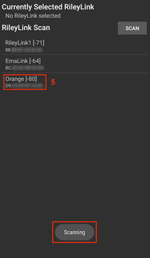
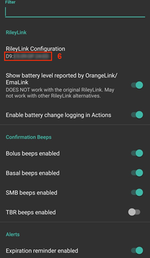
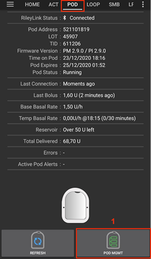
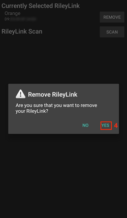

# Omnipod Eros

Disse instruksjonene gjelder oppsett av pumpen Omnipod Eros (**IKKE Omnipod Dash**).

```{admonition} Omnipod Eros is being phased out
:class: note

[Omnipod-systemet](https://www.omnipod.com/current-podders/resources/omnipod-system) (den originale Omnipod, som består av både Personal Diabetes Manager (PDM) og poden) blir faset ut, og sluttdatoen varierer fra land til land. I Canada vil det for eksempel ikke lenger være tilgjengelig etter 30. juni 2026. Hvis du er avhengig av Eros-pumpen, bør du planlegge overgangen til en pumpe som støttes.
```

**Denne programvaren er en del av en gjør-det-selv-løsning for kunstig bukspyttkjertel og er ikke et produkt. Den krever at DU leser, lærer og forstår systemet, også hvordan det brukes. Du alene er ansvarlig for hva du gjør med den.**

```{contents} Table of contents
:depth: 1
:local: true
```

## Krav til maskinvare og programvare

- **Pod-kommunikasjonsenhet**

> Komponent som formidler kommunikasjonen fra telefonen din med AAPS til pods av Eros-generasjonen.
> 
> > -   [OrangeLink-nettsted](https://getrileylink.org/product/orangelink)
> > -  [433 MHz RileyLink](https://getrileylink.org/product/rileylink433)
> > -   [EmaLink-nettsted](https://github.com/sks01/EmaLink) - [Kontaktinformasjon](mailto:getemalink@gmail.com)
> > -   DiaLink - [Kontaktinformasjon](mailto:Boshetyn@ukr.net)
> > -   [LoopLink-nettsted](https://www.getlooplink.org/) - [Kontaktinformasjon](https://jameswedding.substack.com/) - Ikke testet

-   **Mobiltelefon**

> Komponent som kjører AAPS og sender styrekommandoer til pod-kommunikasjonsenheten.
> 
> > - En [Android-telefon](#Phones-list-of-tested-phones) som støttes, med **AAPS** og tilhørende komponenter satt opp.

-   **Insulinleveringsenhet**

> Komponent som tolker kommandoene den mottar fra pod-kommunikasjonsenheten, og som kommer fra telefonen din med AAPS.
> 
> > - En ny Omnipod-pod (Eros-generasjonen – **IKKE DASH**)

Disse instruksjonene forutsetter at du starter en ny pod-økt. Hvis ikke, vær tålmodig og start denne prosessen ved neste pod-bytte.

På denne siden betyr **RileyLink** en hvilken som helst av pod-kommunikasjonsenhetene som er nevnt ovenfor.

## Før du begynner

**SIKKERHET FØRST** – ikke prøv denne prosessen et sted der du ikke kan rette opp en feil (ekstra pods, insulin, en ladet RileyLink og telefon er helt nødvendig).

**Omnipod PDM-en din vil ikke lenger virke etter at Omnipod-driveren i AAPS har aktivert poden din**. Tidligere brukte du Omnipod PDM-en til å sende kommandoer til Omnipod Eros-poden din. En Omnipod Eros-pod tillater bare at én enhet kommuniserer med den. Enheten som aktiverer poden, er den eneste enheten som får kommunisere med den fra da av. Det betyr at når du har aktivert en Omnipod Eros-pod med RileyLink gjennom Omnipod-driveren i AAPS, **kan du ikke lenger bruke PDM-en med poden din**. Omnipod-driveren i AAPS sammen med RileyLink er nå din PDM. *Det betyr IKKE at du skal kaste PDM-en. Vi anbefaler at du beholder den som reserve og til nødstilfeller der AAPS ikke virker som det skal.*

**Bare én RileyLink om gangen kan kommunisere med en pod.** **AAPS** husker én paret RileyLink. Hvis du parer en annen, erstatter den den forrige.

**Poden slår seg ikke av når RileyLink er utenfor rekkevidde.** Når RileyLink er utenfor rekkevidde, eller signalet til den aktive poden er blokkert, fortsetter poden å levere basalinsulin. Når du aktiverer en pod, blir basalprofilen som er definert i AAPS, programmert inn i den nye poden. Hvis du mister kontakten med poden, går den tilbake til denne basalprofilen. Du kan ikke sende nye kommandoer før RileyLink er innenfor rekkevidde igjen og har gjenopprettet forbindelsen.

**Basalprofiler med 30-minutters steg støttes IKKE i AAPS.** Hvis du er ny i AAPS og setter opp basalprofilen din for første gang, må du vite at basaldoser som starter på en halvtime ikke støttes. Du må justere basalprofilen slik at den starter på hel time. Hvis du for eksempel har en basaldose på 1,1 enheter som starter kl. 09:30 og varer i 2 timer til kl. 11:30, vil ikke det virke.  Du må endre denne basaldosen på 1,1 enheter til tidsrommet 09:00–11:00 eller 10:00–12:00.  Selv om selve Omnipod-maskinvaren støtter basalprofiler med 30-minutters steg, kan ikke algoritmene i AAPS ta hensyn til dem ennå.

## Aktivere Omnipod-driveren i AAPS

Du kan aktivere Omnipod-driveren i AAPS på **to måter**:

### Alternativ 1: Oppsettveiviseren

Etter at du har installert en ny versjon av AAPS, starter **Oppsettveiviseren** automatisk. Hvis du allerede har eksportert innstillingene dine fra en tidligere installasjon, kan du importere dem i veiviseren. For nye installasjoner, fortsett nedenfor.

Gå gjennom [Oppsettveiviseren i AAPS](../SettingUpAaps/SetupWizard.md) til du kommer til steget **Pumpe**, og velg **Omnipod Eros** (beskrivelsen er «Pumpeintegrering for Omnipod Eros»).


Oppsettveiviseren parer ikke RileyLink. Når veiviseren er ferdig, åpne Omnipod-pumpeskjermen og par den som beskrevet i delen [RileyLink-oppsett](#OmnipodEros-rileylink-setup).

**ELLER**

### Alternativ 2: Konfigurasjonsskjermen

Åpne **menyen** øverst til venstre (☰) > **Konfigurasjon** > **Pumpe** og velg **radioknappen** for **Omnipod Eros**.

Når den er valgt, viser kortet **Omnipod Eros** to knapper, **Innstillinger** og **Åpne plugin**:


**Innstillinger** åpner innstillingene for Omnipod-driveren (se [Omnipod-innstillinger](#OmnipodEros-omnipod-settings)):


**Åpne plugin** åpner Omnipod-pumpeskjermen. Du kan også åpne den når som helst fra hovedskjermen med **Administrer** > **Pumpe**. På denne siden kalles den **Omnipod-pumpeskjermen**. Før en RileyLink er paret og en pod er aktivert, ser den slik ut:


### Kontroll av at Omnipod-driveren er valgt

For å kontrollere at du har aktivert Omnipod-driveren, åpne **Administrer** > **Pumpe** fra hovedskjermen. Du skal nå se pumpeskjermen for **Omnipod Eros** som vist ovenfor. Hvis du ikke har paret en RileyLink ennå, viser **RileyLink-status** **Ikke startet**, og **Podstatus** viser **Ingen aktiv Pod**.

## Omnipod-konfigurasjon

Alle pod- og RileyLink-funksjoner er knapper på [Omnipod-pumpeskjermen](#OmnipodEros-omnipod-pod-tab) (**Administrer** > **Pumpe**). Noen knapper vises bare i bestemte situasjoner, for eksempel når en pod er aktiv.

>  Oppdater pod-tilkobling og -status
> 
>  Pod-administrasjon (aktivere, deaktivere, spille av testlyd, RileyLink-statistikk og pod-historikk)

```{admonition} Older screenshot
:class: note
Skjermbildene ovenfor er fra en eldre **AAPS**-versjon. I **AAPS** 4 finnes det ingen **POD MGMT**-knapp eller Pod-administrasjonsmeny: **Oppdater** og alle handlingene for pod-administrasjon er knapper på Omnipod-pumpeskjermen.
```

(OmnipodEros-rileylink-setup)=

### RileyLink-oppsett

Hvis du allerede har paret RileyLink, fortsett til delen [Aktivere en pod](#OmnipodEros-activating-a-pod) nedenfor.

*Merk: Et godt synlig tegn på at RileyLink ikke er tilkoblet, er at behandlingsknappene (Hurtigstart-verktøylinjen) på hovedskjermen mangler. Dette skjer også i omtrent de første 30 sekundene etter at AAPS starter, fordi appen da holder på å koble til RileyLink.*

1. Sørg for at RileyLink er fulladet og slått på.

2. Legg RileyLink [nær telefonen](#OmnipodEros-optimal-omnipod-and-rileylink-positioning) (ca. 30 cm eller mindre).

3. Åpne Omnipod-pumpeskjermen (**Administrer** > **Pumpe**) og trykk på **Par RileyLink**.

4. Skjermen **Par RileyLink** begynner å søke etter Bluetooth-enheter med en gang. Trykk på din RileyLink i listen over enheter som ble funnet.

   

5. Når **RileyLink er koblet sammen** vises med navnet og adressen til enheten din, trykk på **OK**.

6. Tilbake på Omnipod-pumpeskjermen, kontroller at **RileyLink-status** endres til **Tilkoblet**. **Podstatus** skal vise **Ingen aktiv Pod**. Hvis RileyLink ikke kobler til, trykk på **Tilbakestill RileyLink**, eller start **AAPS** på nytt.

 

 




```{admonition} Older screenshot
:class: note
De seks skjermbildene ovenfor (etter steg 6) er fra en eldre **AAPS**-versjon. I **AAPS** 4 parer du RileyLink med knappen **Par RileyLink** på Omnipod-pumpeskjermen i stedet for **RileyLink-konfigurasjon** i Omnipod-innstillingene, og søket starter automatisk.
```

```{note}
For å bytte til en annen RileyLink (for eksempel en reserveenhet), trykk på **Par RileyLink** igjen og velg den nye enheten. Den erstatter den som var paret før. Du trenger ikke å fjerne den gamle enheten først.
```

(OmnipodEros-activating-a-pod)=

### Aktivere en pod

Før du kan aktivere en pod, må du sørge for at RileyLink er paret og at **RileyLink-status** viser **Tilkoblet**. Knappen **Aktiver Pod** er deaktivert til RileyLink er klar.

*HUSK: Av sikkerhetsgrunner skjer pod-kommunikasjonen med begrenset rekkevidde under paringen ved pod-aktivering. Før paringen er radiosignalet fra poden svakere, men etter paringen sender den med full signalstyrke. Under disse prosedyrene må du sørge for at poden er* [nær](#OmnipodEros-optimal-omnipod-and-rileylink-positioning) *(ca. 30 cm eller mindre), men ikke oppå eller helt inntil RileyLink.*

01. Åpne Omnipod-pumpeskjermen (**Administrer** > **Pumpe**) og trykk på **Aktiver Pod**.

    Hvis du aldri har aktivert en profil, vises steget **Profil kreves** først. Velg profilen som skal brukes ved aktivering.

    >   
    > 
    > ```{admonition} Older screenshot
    >     :class: note
    >     Skjermbildene ovenfor er fra en eldre **AAPS**-versjon. I **AAPS** 4 er **Aktiver Pod** en knapp på Omnipod-pumpeskjermen i stedet for i menyen **POD MGMT**.
    > ```

02. Skjermen **Fyll Pod** vises. Fyll en ny pod med nok insulin til 3 dager og lytt etter to pip. De betyr at minimumsmengden på 80 enheter er fylt. Tøm fyllesprøyten helt, også etter at du har hørt de to pipene. Når du regner ut hvor mye insulin du trenger for 3 dager, må du ta med at priming av poden bruker 12 til 15 enheter. Ikke fjern kanylehetten på poden ennå.

    > 
    > 
    > Sørg for at den nye poden og RileyLink er nær hverandre (ca. 30 cm eller mindre), og trykk på **Neste**.

03. **Velg insulin** (vises bare hvis du har satt opp mer enn ett insulin): velg insulinet du fyller poden med, og trykk på **Neste**. Et profilbytte med dette insulinet gjøres etter aktiveringen.

04. På skjermen **Initialiser Pod** begynner poden å prime (du hører et klikk og deretter en rekke tikkelyder mens poden primer seg selv). Hvis RileyLink er utenfor rekkevidde av poden som aktiveres, får du feilmeldingen **Ingen svar fra Pod**. Hvis dette skjer, [flytt RileyLink nærmere](#OmnipodEros-optimal-omnipod-and-rileylink-positioning) poden (ca. 30 cm eller mindre), men ikke oppå eller helt inntil den, og trykk på **Prøv på nytt**.

    >  

05. Når primingen er vellykket, vises en grønn hake, og knappen **Neste** blir aktiv. Trykk på **Neste**.

    > 

06. **Stedplassering** (vises bare hvis **Administrer pumpe-stedsrotasjon** er aktivert i [Rotasjon av sted](#Aapsscreens-site-rotation)): velg hvor på kroppen du setter poden, og trykk på **Neste**.

07. Skjermen **Fest Pod** vises. Klargjør infusjonsstedet for den nye poden. Fjern plasthetten over nålen og det hvite papiret på limet, og fest poden på stedet du har valgt på kroppen. Hvis kanylen stikker ut, trykk på **Avbryt** og kast poden. Når du er ferdig, trykk på **Neste**.

    > 

08. En bekreftelsesdialog vises: «Når du trykker OK, vil kanylen settes inn». **Trykk BARE på OK hvis du er klar til å sette inn kanylen**.

    > 

09. På skjermen **Sett inn kanyle** kan det ta litt tid før Omnipod svarer og setter inn kanylen (maksimalt 1–2 minutter), så vær tålmodig.

    > Hvis RileyLink er utenfor rekkevidde av poden som aktiveres, får du feilmeldingen **Ingen svar fra Pod**. Hvis dette skjer, flytt RileyLink nærmere poden (ca. 30 cm eller mindre), men ikke oppå eller helt inntil den, og trykk på **Prøv på nytt**.
    > 
    > Hvis RileyLink er utenfor Bluetooth-rekkevidde eller ikke har en aktiv forbindelse til telefonen, får du feilmeldingen **Ingen respons fra RileyLink**. Hvis dette skjer, flytt RileyLink nærmere telefonen og trykk på **Prøv på nytt**.
    > 
    > *MERK: Før kanylen settes inn, er det lurt å klype sammen huden ved innstikkstedet. Det gjør at nålen går lettere inn, og det reduserer faren for okklusjoner.*
    > 
    > 
    > 
    >  

10. Når kanyleinnføringen er vellykket, vises en grønn hake, og knappen **Neste** blir aktiv. Trykk på **Neste**.

    > 

11. Skjermen **Pod aktivert** vises. Kontroller at kanylen er satt inn riktig, og bytt pod hvis du tror den ikke er det. Trykk på **Fullfør**. Gratulerer! Du har nå startet en ny aktiv pod-økt.

    >  
    > 
    > ```{admonition} Older screenshot
    >     :class: note
    >     Skjermbildene i steg 2 til 11 er fra en eldre **AAPS**-versjon og kan se annerledes ut i **AAPS** 4. Stegene **Velg insulin** og **Stedplassering** er ikke avbildet.
    > ```

12. Du kommer tilbake til Omnipod-pumpeskjermen. Knappen **Aktiver Pod** er erstattet av **Deaktiver Pod**, fordi du ikke kan aktivere en ny pod uten å deaktivere den aktive først.

    Pumpeskjermen viser nå informasjon om den aktive poden, blant annet gjeldende basaldose, reservoarnivå, levert insulin, pod-feil og varsler. Se delen [Omnipod-pumpeskjermen](#OmnipodEros-omnipod-pod-tab) for flere detaljer.

     

    ```{admonition} Older screenshot
    :class: note
    Skjermbildene ovenfor er fra en eldre **AAPS**-versjon. I **AAPS** 4 finnes det ingen Pod-administrasjonsmeny: du kommer rett tilbake til Omnipod-pumpeskjermen, der **Deaktiver Pod** erstatter **Aktiver Pod**.
    ```

```{note}
Hvis aktiveringen ble avbrutt etter primingen (for eksempel fordi appen ble lukket), trykk på **Aktiver Pod** igjen. Veiviseren fortsetter fra stegene for kanyleinnføring.
```

### Deaktivere en pod

Under normale forhold varer en pod i tre dager (72 timer) pluss 8 timer etter utløpsvarselet, til sammen 80 timer med bruk.

Slik deaktiverer du en pod (enten fordi den er utløpt eller på grunn av en pod-feil):

1. Åpne Omnipod-pumpeskjermen (**Administrer** > **Pumpe**) og trykk på **Deaktiver Pod**.

   >   
   > 
   > ```{admonition} Older screenshot
   >    :class: note
   >    Skjermbildene ovenfor er fra en eldre **AAPS**-versjon. I **AAPS** 4 er **Deaktiver Pod** en knapp på Omnipod-pumpeskjermen i stedet for i menyen **POD MGMT**.
   > ```

2. På skjermen **Deaktiver Pod**, sørg først for at RileyLink er nær poden, men ikke oppå eller helt inntil den. Trykk deretter på **Neste**. En dialog spør *En deaktivert Pod kan ikke brukes igjen. Vil du deaktivere denne Pod-en nå?* Trykk på **OK** for å starte deaktiveringen av poden, eller **Avbryt** for å beholde den. Deaktivering pauser all insulinlevering og kan ikke angres.

   > 

3. Skjermen **Deaktiverer Pod** vises, og du får et bekreftelsespip fra poden når deaktiveringen er vellykket.

   > 
   > 
   > **HVIS deaktiveringen mislykkes** og du ikke får et bekreftelsespip, kan du få meldingen **Ingen respons fra RileyLink** eller **Ingen svar fra Pod**. Trykk på **Prøv på nytt** for å prøve deaktiveringen igjen. Hvis deaktiveringen fortsetter å mislykkes, trykk på **Forkast Pod** og bekreft. **AAPS** glemmer da poden. Insulinleveringen er **ikke** pauset, så fjern poden fra kroppen. Hvis poden har en vedvarende alarm, må du kanskje stoppe den manuelt (med en nål eller en binders), fordi **Forkast Pod** ikke stopper den.
   > 
   > >   

4. En grønn hake vises når deaktiveringen er vellykket. Trykk på **Neste** for å vise skjermen **Pod deaktivert**. Du kan nå fjerne poden, siden den aktive økten er deaktivert.

   > 

5. Trykk på **Fullfør** for å gå tilbake til Omnipod-pumpeskjermen.

   >  
   > 
   > ```{admonition} Older screenshot
   >    :class: note
   >    Skjermbildene i steg 2 til 5 er fra en eldre **AAPS**-versjon og kan se annerledes ut i **AAPS** 4.
   > ```

6. På Omnipod-pumpeskjermen, kontroller at **RileyLink-status** viser **Tilkoblet** og at **Podstatus** viser **Ingen aktiv Pod**.

   >    
   > 
   > ```{admonition} Older screenshot
   >    :class: note
   >    Skjermbildene ovenfor er fra en eldre **AAPS**-versjon. I **AAPS** 4 tar **Fullfør** deg rett tilbake til Omnipod-pumpeskjermen; det finnes ingen Pod-administrasjonsmeny eller **Omnipod (POD)**-fane.
   > ```

### Pause og gjenoppta insulinlevering

Prosessen nedenfor viser hvordan du pauser og gjenopptar insulinleveringen.

*MERK – hvis du ikke ser en **Pause**-knapp*, er den skjult som standard. Aktiver **Vis knapp for å pause insulinlevering i Omnipod-fanen** i [Omnipod-innstillingene](#OmnipodEros-omnipod-settings) under **Annet**.

#### Pause insulinleveringen

Bruk denne kommandoen for å sette den aktive poden i pausetilstand. I pausetilstand leverer poden ikke lenger insulin. Denne kommandoen tilsvarer pausefunksjonen som den originale Omnipod PDM-en sender til en aktiv pod.

1. Åpne Omnipod-pumpeskjermen (**Administrer** > **Pumpe**) og trykk på **Pause**. Pausekommandoen sendes gjennom RileyLink til den aktive poden.

2. Når poden har pauset all insulinlevering, viser **Podstatus** **Pauset**, og knappen **Pause** er erstattet av **Gjenoppta levering**.

   >  
   > 
   > 
   > 
   >  
   > 
   > ```{admonition} Older screenshot
   >    :class: note
   >    Skjermbildene ovenfor er fra en eldre **AAPS**-versjon. I **AAPS** 4 gjøres disse stegene på Omnipod-pumpeskjermen i stedet for i **Omnipod (POD)**-fanen, og resultatet vises i **Podstatus**.
   > ```

Hvis kommandoen mislykkes, viser en **Advarsel**-dialog «Kunne ikke pause leveringen» med årsaken. Kontroller RileyLink-forbindelsen og prøv igjen.

#### Gjenoppta insulinleveringen

Bruk denne kommandoen for å be den aktive poden, som nå er pauset, om å gjenoppta insulinleveringen. Når kommandoen er behandlet, fortsetter den normale insulinleveringen med basaldosen som gjelder for klokkeslettet nå, fra den aktive basalprofilen. Poden godtar igjen kommandoer for bolus, midlertidig basal og SMB.

1. Åpne Omnipod-pumpeskjermen og kontroller at **Podstatus** viser **Pauset**. Trykk på **Gjenoppta levering**.

2. Når kommandoen lykkes, viser **Podstatus** **Kjører** igjen, og knappen **Gjenoppta levering** forsvinner (knappen **Pause** vises igjen hvis du har aktivert den).

   >  
   > 
   > 
   > 
   >  
   > 
   > ```{admonition} Older screenshot
   >    :class: note
   >    Skjermbildene ovenfor er fra en eldre **AAPS**-versjon. I **AAPS** 4 gjøres disse stegene på Omnipod-pumpeskjermen i stedet for i **Omnipod (POD)**-fanen, og resultatet vises i **Podstatus**.
   > ```

Hvis kommandoen mislykkes, viser en **Advarsel**-dialog «Kunne ikke gjenoppta leveringen» med årsaken. Kontroller RileyLink-forbindelsen og prøv igjen.

### Dempe pod-varsler

*MERK – Knappen **Demp varsler** vises bare på Omnipod-pumpeskjermen mens poden har et aktivt varsel (for eksempel varsel om pod-utløp eller lavt reservoar), og bare hvis **Demp Pod-varsler automatisk** er deaktivert.*

Prosessen nedenfor viser hvordan du demper pod-pipene som starter når poden når varslingstiden før den utløper. Denne varslingstiden settes med **Påminnelse før nedstenging (80 timer)** i Omnipod-innstillingene under **Varsler**. En pod kan maksimalt vare i 80 timer (3 dager og 8 timer), men Insulet anbefaler at du ikke går over grensen på 72 timer (3 dager).

*MERK – Hvis du har aktivert **Demp Pod-varsler automatisk** i Omnipod-innstillingene under **Varsler**, demper **AAPS** varselet automatisk ved neste kommunikasjon med poden, og du trenger IKKE å gjøre det manuelt.*

1. Når varslingstiden er nådd, piper poden for å fortelle deg at den snart utløper og må byttes. På Omnipod-pumpeskjermen viser **Pod utløper** det nøyaktige tidspunktet poden utløper (72 timer etter aktivering); feltet blir **gult** 4 timer før. **Pod avslutter** viser når poden slutter å levere insulin. **Aktive Pod-varsler** viser **Pod utløper snart**, og knappen **Demp varsler** vises. **AAPS** viser også et varsel om at poden snart utløper.

   >   
   > 
   > ```{admonition} Older screenshot
   >    :class: note
   >    Skjermbildene ovenfor er fra en eldre **AAPS**-versjon. I **AAPS** 4 heter knappen **ACK ALERTS** nå **Demp varsler**, og den er på Omnipod-pumpeskjermen.
   > ```

2. Trykk på **Demp varsler**. RileyLink sender kommandoen til poden om å stoppe utløpsvarselpipene.

   >  
   > 
   > ```{admonition} Older screenshot
   >    :class: note
   >    Skjermbildet ovenfor er fra en tidligere **AAPS**-versjon. I **AAPS** 4 heter knappen **Demp varsler**.
   > ```

3. Når varslene er dempet, piper poden to ganger. **Aktive Pod-varsler** viser ikke lenger varselet, knappen **Demp varsler** forsvinner, og poden slutter å pipe om utløpet.

   >  
   > 
   > ```{admonition} Older screenshot
   >    :class: note
   >    Skjermbildet ovenfor er fra en tidligere **AAPS**-versjon. I **AAPS** 4 vises resultatet på Omnipod-pumpeskjermen: varselet forsvinner fra **Aktive Pod-varsler**.
   > ```

Hvis kommandoen mislykkes (for eksempel fordi RileyLink er utenfor rekkevidde av poden), viser en **Advarsel**-dialog «Kunne ikke dempe varsler» med årsaken. Flytt RileyLink nærmere poden og prøv igjen.


```{admonition} Older screenshot
:class: note
Skjermbildet ovenfor er fra en tidligere **AAPS**-versjon. I **AAPS** 4 viser **Advarsel**-dialogen «Kunne ikke dempe varsler» med årsaken.
```

(OmnipodEros-view-pod-history)=

### Vise pod-historikken

Denne delen viser hvordan du ser gjennom historikken for den aktive poden og filtrerer etter ulike handlingskategorier. Pod-historikken lar deg se handlingene og resultatene som er sendt til den aktive poden i løpet av levetiden på tre dager (72–80 timer).

Funksjonen er nyttig for å kontrollere boluser, midlertidige basaler og basalendringer som ble sendt, men som du er usikker på om ble fullført. De andre kategoriene er generelt nyttige for feilsøking og for å finne rekkefølgen på hendelsene før en feil.

*MERK:* **Usikre** kommandoer vises i pod-historikken, men du kan ikke være sikker på at de er riktige, nettopp fordi de er usikre.

1. Åpne Omnipod-pumpeskjermen (**Administrer** > **Pumpe**) og trykk på **Pod-historikk**.

   >   
   > 
   > ```{admonition} Older screenshot
   >    :class: note
   >    Skjermbildene ovenfor er fra en eldre **AAPS**-versjon. I **AAPS** 4 er **Pod-historikk** en knapp på Omnipod-pumpeskjermen i stedet for i menyen **POD MGMT**.
   > ```

2. Skjermen **Pod-historikk** viser alle pod-handlinger og resultatene deres, nyeste først, gruppert etter dag. Som standard er **Alle** valgt. Trykk på en av filterknappene øverst for å vise bare én kategori. Bruk tilbakepilen øverst til venstre for å gå tilbake til Omnipod-pumpeskjermen.

   > 

   >  
   > 
   > ```{admonition} Older screenshot
   >    :class: note
   >    Det andre skjermbildet er fra en eldre **AAPS**-versjon og kan se annerledes ut i **AAPS** 4.
   > ```

### Vise RileyLink-innstillinger og -historikk

Skjermen **RileyLink-statistikk** viser innstillingene for RileyLink og den aktive poden, og kommunikasjonshistorikken for begge. Den har to faner: **Innstillinger** og **Historikk**.

Knappen **RileyLink-statistikk** er skjult som standard. For å vise den på Omnipod-pumpeskjermen, aktiver **Vis RileyLink-statistikk-knappen i Pod-menyen** i [Omnipod-innstillingene](#OmnipodEros-omnipod-settings) under **Annet**.

#### Gjenopprette Bluetooth-forbindelsen til pod-kommunikasjonsenheten manuelt

Hvis pod-kommunikasjonsenheten har vært utenfor Bluetooth-rekkevidde av telefonen en stund, kan **RileyLink-status** vise **RileyLink utilgjengelig** på Omnipod-pumpeskjermen. **AAPS** kobler normalt til igjen av seg selv når enheten er innenfor rekkevidde igjen. Hvis ikke:

1. Sørg for at RileyLink er slått på, ladet og nær telefonen.

2. Trykk på **Tilbakestill RileyLink** på Omnipod-pumpeskjermen. En melding bekrefter **Tilbakestilling av RileyLink-konfigurasjon**. Se [merknadene om Tilbakestill RileyLink](#OmnipodEros-reset-rileylink-config-notes) nedenfor.

3. Hvis **Bluetooth-forbindelsen** ikke blir gjenopprettet, prøv å slå Bluetooth på telefonen manuelt **av** og så **på** igjen.

4. Hvis den fortsatt ikke kobler til igjen, trykk på **Par RileyLink** og velg din RileyLink på nytt.

5. Etter en vellykket gjentilkobling viser **RileyLink-status** **Tilkoblet**. Du kan også sjekke **Tilkoblingsstatus** på fanen **Innstillinger** på skjermen **RileyLink-statistikk**. Gratulerer, du har nå koblet den konfigurerte pod-kommunikasjonsenheten til AAPS igjen!

 


```{admonition} Older screenshot
:class: note
Skjermbildene ovenfor er fra en eldre **AAPS**-versjon. I **AAPS** 4 kobler du til igjen med **Tilbakestill RileyLink** eller **Par RileyLink** på Omnipod-pumpeskjermen i stedet for oppdateringsknappen på skjermen RileyLink-innstillinger.
```

#### Innstillinger for pod-kommunikasjonsenheten og den aktive poden

Denne skjermen viser informasjon og status for både den parede pod-kommunikasjonsenheten og den aktive Omnipod Eros-poden. Informasjonen oppdateres automatisk.

1. Åpne Omnipod-pumpeskjermen (**Administrer** > **Pumpe**) og trykk på **RileyLink-statistikk**. Fanen **Innstillinger** viser din parede **RileyLink** og den aktive poden (**Enhet**).

   >   
   > 
   > ```{admonition} Older screenshot
   >    :class: note
   >    Skjermbildene ovenfor er fra en eldre **AAPS**-versjon. I **AAPS** 4 er **RileyLink-statistikk** en knapp på Omnipod-pumpeskjermen i stedet for i menyen **POD MGMT**.
   > ```

   > 

##### RileyLink-felt

> - **Adresse:** MAC-adressen til den parede pod-kommunikasjonsenheten.
> - **Navn:** Bluetooth-navnet til den parede pod-kommunikasjonsenheten.
> - **Batterinivå:** Gjeldende batterinivå for den tilkoblede pod-kommunikasjonsenheten. Vises bare når **Vis batterinivå rapportert av OrangeLink/EmaLink/DiaLink** er aktivert.
> - **Tilkoblingsstatus**: Gjeldende status for Bluetooth-forbindelsen mellom pod-kommunikasjonsenheten og telefonen som kjører AAPS.
> - **Tilkoblingsfeil:** Hvis det er en feil med Bluetooth-forbindelsen til pod-kommunikasjonsenheten, vises detaljene her.
> - **Firmwareversjon:** Firmwareversjonen som er installert på den tilkoblede pod-kommunikasjonsenheten.

##### Enhetsfelt – med en aktiv pod

> - **Enhetstype:** Typen enhet som kommuniserer med pod-kommunikasjonsenheten (Omnipod (Eros)).
> - **Konfigurert enhetsmodell:** Modellen til enheten som er satt opp til å kommunisere med pod-kommunikasjonsenheten.
> - **Tilkoblet enhetsmodell:** Modellen til enheten som nå kommuniserer med pod-kommunikasjonsenheten.
> - **Pumpens serienummer:** Serienummeret til den aktive poden.
> - **Pumpens frekvens:** Radiofrekvensen som brukes til å kommunisere med poden.
> - **Sist brukte frekvens:** Siste kjente radiofrekvens poden brukte for å kommunisere med pod-kommunikasjonsenheten.
> - **Siste tilkobling:** Dato og klokkeslett for siste gang poden hadde kontakt med pod-kommunikasjonsenheten.

(omnipod-eros-rileylink-and-active-pod-history)=
#### Historikk for RileyLink og den aktive poden

Denne fanen viser, nyeste først, hver tilstand eller handling for RileyLink eller den tilkoblede poden. Historikken er bare tilgjengelig for den aktive poden. Etter et pod-bytte slettes denne historikken, og bare hendelser fra den nye poden registreres og vises.

1. Åpne Omnipod-pumpeskjermen (**Administrer** > **Pumpe**), trykk på **RileyLink-statistikk** og deretter på fanen **Historikk**.

   >   
   > 
   > ```{admonition} Older screenshot
   >    :class: note
   >    Skjermbildene ovenfor er fra en eldre **AAPS**-versjon. I **AAPS** 4 er **RileyLink-statistikk** en knapp på Omnipod-pumpeskjermen i stedet for i menyen **POD MGMT**.
   > ```

   > 

##### Felter

Hver oppføring viser:

> - **Enhet:** Enheten som handlingen eller tilstanden gjelder.
> - **Tid:** Tidspunktet for hendelsen.
> - **Tilstand eller handling:** Enhetens tilstand eller handlingen den utførte.

(OmnipodEros-omnipod-pod-tab)=

## Omnipod-pumpeskjermen

Nedenfor forklares statusfeltene og knappene på **Omnipod-pumpeskjermen** (**Administrer** > **Pumpe**, eller **Konfigurasjon** > **Pumpe** > **Åpne plugin**).

Tannhjulet øverst til høyre åpner [Omnipod-innstillingene](#OmnipodEros-omnipod-settings).

*MERK: Hvis et statusfelt viser (usikker), trykk på **Oppdater** for å oppdatere pod-statusen og fjerne det.*


```{admonition} Older screenshot
:class: note
Skjermbildet ovenfor er fra en eldre **AAPS**-versjon, der denne skjermen var **Omnipod (POD)**-fanen. I **AAPS** 4 er det Omnipod-pumpeskjermen, og noen feltnavn og knapper er annerledes.
```

### Felter

- **RileyLink-status:** Viser gjeldende tilkoblingsstatus for RileyLink. Feil vises i rødt.

- *Ikke startet* – ingen RileyLink er paret ennå, eller tilkoblingen har ikke startet.
- *RileyLink utilgjengelig* – pod-kommunikasjonsenheten er enten utenfor Bluetooth-rekkevidde av telefonen, slått av eller har en feil som hindrer Bluetooth-kommunikasjon.
- *RileyLink er klar* – pod-kommunikasjonsenheten er slått på og holder på å sette opp Bluetooth-forbindelsen.
- *Tilkoblet* – pod-kommunikasjonsenheten er slått på, tilkoblet og kan kommunisere via Bluetooth.

- **Unik ID:** Viser adressen til den aktive poden.

- **LOT-nummer:** Viser LOT-nummeret til den aktive poden.

- **Sekvensnummer:** Viser serienummeret (TID) til poden.

- **Firmwareversjon:** Viser firmwareversjonen til den aktive poden.

- **Tid på Pod:** Viser klokkeslettet på den aktive poden nå. Det er uthevet når det avviker mer enn 5 minutter fra klokken på telefonen.

- **Pod utløper:** Viser dato og klokkeslett for når den aktive poden utløper. Teksten blir gul de siste 4 timene før dette tidspunktet. Den blir aldri rød, fordi poden fortsetter å levere insulin etter dette.

- **Pod avslutter:** Viser slutten på podens ekstratid (8 timer etter **Pod utløper**, som gir en maksimal levetid på 80 timer). Teksten blir gul når ekstraperioden starter (ved **Pod utløper**), og rød de siste 4 timene før den endelige slutten. I ekstraperioden viser den også tiden som er igjen, for eksempel *(17 min igjen)*. Poden slutter å levere insulin ved den endelige slutten, og må byttes.

- **Podstatus:** Viser statusen til den aktive poden (for eksempel **Ingen aktiv Pod**, **Kjører** eller **Pauset**).

- **Siste tilkobling:** Viser siste gang det var kommunikasjon med den aktive poden. Teksten blir rød når [terskelen for utilgjengelig pumpe](#OmnipodEros-troubleshooting) er overskredet.

- *For litt siden* – mindre enn 20 sekunder siden.
- *Mindre enn ett minutt siden* – mer enn 20, men mindre enn 60 sekunder siden.
- *1 minutt siden* – mer enn 60, men mindre enn 120 sekunder (2 min)
- *XX minutter siden* – mer enn 2 minutter siden, der XX er antall minutter

- **Siste bolus:** Viser dosen for den siste bolusen som ble sendt til den aktive poden, og i parentes hvor lenge siden den ble gitt.

- **Profilens basaldose:** Viser basaldosen som er programmert for klokkeslettet nå, fra basalprofilen.

- **Midlertidig basaldose:** Vises bare mens en midlertidig basal kjører. Den vises i dette formatet:

- Enheter/time @ klokkeslettet den midlertidige basalen ble satt (minutter gått / totalt antall minutter den skal vare)
- *Eksempel:* 0,00E/t @18:25 ( 90/120 minutter)

- **Reservoar:** Viser **Over 50 E igjen** når det er mer enn 50 enheter igjen i reservoaret. Under denne verdien vises det omtrentlige antallet enheter. Teksten blir rød under terskelen for lavt reservoar som er satt i [innstillingene for Varsler](#OmnipodEros-omnipod-settings).

- **Totalt levert:** Viser totalt antall enheter insulin som er levert fra reservoaret. *Merk at dette er et anslag, fordi priming og fylling av poden ikke er en nøyaktig prosess.*

- **Aktive Pod-varsler:** Viser varslene som er aktive på den aktive poden nå. Brukes vanligvis når poden har passert 72 timer og podens egne pipevarsler er i gang.

- **Feil:** Viser den siste feilen som oppstod (vist i rødt). Se gjennom [pod-historikken](#OmnipodEros-view-pod-history), [RileyLink-historikken](#omnipod-eros-rileylink-and-active-pod-history) og loggfilene for tidligere feil og mer detaljert informasjon.

### Knapper

Knappene nederst på pumpeskjermen endrer seg etter situasjonen. Knapper som ikke kan brukes akkurat nå, er nedtonet, for eksempel mens RileyLink ikke er tilkoblet.

**Pod-statusknapper** (vises når en pod er aktiv):

- **Oppdater:** Sender en oppdateringskommando til den aktive poden for å oppdatere statusen. Bruk den for å oppdatere pod-statusen og fjerne statusfelt som inneholder teksten (usikker). Se delen [Feilsøking](#OmnipodEros-troubleshooting) nedenfor for mer informasjon.

  

  ```{admonition} Older screenshot
  :class: note
  Skjermbildet ovenfor er fra en eldre **AAPS**-versjon. I **AAPS** 4 er dette en tekstknapp med navnet **Oppdater** på Omnipod-pumpeskjermen.
  ```

- **Demp varsler:** Demper pip og varsler om pod-utløp og lavt reservoar. Vises bare når poden har et aktivt varsel og **Demp Pod-varsler automatisk** er deaktivert. Når varslene er dempet, forsvinner knappen.

  

  ```{admonition} Older screenshot
  :class: note
  Skjermbildet ovenfor er fra en eldre **AAPS**-versjon. I **AAPS** 4 heter denne knappen **Demp varsler**.
  ```

- **Angi tid:** Oppdaterer klokken på poden med klokkeslettet på telefonen. Vises bare når klokken på poden avviker mer enn 5 minutter fra klokken på telefonen.

  

  ```{admonition} Older screenshot
  :class: note
  Skjermbildet ovenfor er fra en eldre **AAPS**-versjon. I **AAPS** 4 er dette en tekstknapp med navnet **Angi tid** på Omnipod-pumpeskjermen.
  ```

- **Pause:** Pauser insulinleveringen på den aktive poden. Vises bare hvis den er aktivert i innstillingene (**Vis knapp for å pause insulinlevering i Omnipod-fanen**).

  

  ```{admonition} Older screenshot
  :class: note
  Skjermbildet ovenfor er fra en eldre **AAPS**-versjon. I **AAPS** 4 er dette en tekstknapp med navnet **Pause** på Omnipod-pumpeskjermen.
  ```

- **Gjenoppta levering:** Gjenopptar insulinleveringen på den aktive poden som nå er pauset. Vises bare mens poden er pauset.

  

  ```{admonition} Older screenshot
  :class: note
  Skjermbildet ovenfor er fra en eldre **AAPS**-versjon. I **AAPS** 4 er dette en tekstknapp med navnet **Gjenoppta levering** på Omnipod-pumpeskjermen.
  ```

**Knapper for pod- og RileyLink-administrasjon:**


```{admonition} Older screenshot
:class: note
Skjermbildet ovenfor er fra en tidligere **AAPS**-versjon. I **AAPS** 4 finnes det ingen Pod-administrasjonsmeny: disse handlingene er knapper rett på Omnipod-pumpeskjermen.
```

- **Aktiver Pod:** Primer og aktiverer en ny pod. Vises når ingen pod er aktiv. Den er bare aktiv når RileyLink er tilkoblet.

  

  ```{admonition} Older screenshot
  :class: note
  Skjermbildet ovenfor er fra en eldre **AAPS**-versjon. I **AAPS** 4 er **Aktiver Pod** en knapp på Omnipod-pumpeskjermen i stedet for i Pod-administrasjonsmenyen.
  ```

- **Deaktiver Pod:** Deaktiverer den aktive poden. Vises så snart en pod er paret, også når en aktivering stoppet underveis (for eksempel fordi poden feilet under aktiveringen). Den er bare aktiv når RileyLink er tilkoblet. **AAPS** ber deg bekrefte før den deaktiverer poden.

- Bruk denne kommandoen for å deaktivere en pod med vedvarende alarm («screaming pod», feil 49).
- Hvis deaktiveringen mislykkes, tilbyr deaktiveringsveiviseren valget **Forkast Pod**.

  

  ```{admonition} Older screenshot
  :class: note
  Skjermbildet ovenfor er fra en eldre **AAPS**-versjon. I **AAPS** 4 er **Deaktiver Pod** en knapp på Omnipod-pumpeskjermen i stedet for i Pod-administrasjonsmenyen.
  ```

- **Spill av testlyd:** Spiller av ett testpip på poden når du trykker på den. Vises når en pod er paret.

  

  ```{admonition} Older screenshot
  :class: note
  Skjermbildet ovenfor er fra en eldre **AAPS**-versjon. I **AAPS** 4 er **Spill av testlyd** en knapp på Omnipod-pumpeskjermen i stedet for i Pod-administrasjonsmenyen.
  ```

- **Pod-historikk:** Viser aktivitetshistorikken for den aktive poden. Se [Vise pod-historikk](#OmnipodEros-view-pod-history).

  

  ```{admonition} Older screenshot
  :class: note
  Skjermbildet ovenfor er fra en eldre **AAPS**-versjon. I **AAPS** 4 er **Pod-historikk** en knapp på Omnipod-pumpeskjermen i stedet for i Pod-administrasjonsmenyen.
  ```

- **Par RileyLink:** Søker etter pod-kommunikasjonsenheten din og parer den. Se [RileyLink-oppsett](#OmnipodEros-rileylink-setup).

- **RileyLink-statistikk:** Åpner skjermen RileyLink-statistikk med to faner. Vises bare hvis den er aktivert i innstillingene (**Vis RileyLink-statistikk-knappen i Pod-menyen**).

- **Innstillinger** – viser innstillingene for RileyLink og den aktive poden
- **Historikk** – viser kommunikasjonshistorikken for RileyLink og poden

  

  ```{admonition} Older screenshot
  :class: note
  Skjermbildet ovenfor er fra en eldre **AAPS**-versjon. I **AAPS** 4 er **RileyLink-statistikk** en knapp på Omnipod-pumpeskjermen i stedet for i Pod-administrasjonsmenyen.
  ```

- **Tilbakestill RileyLink:** Tilbakestiller konfigurasjonen til den tilkoblede pod-kommunikasjonsenheten. Når kommunikasjonen startes, sendes bestemte data til RileyLink og settes der:

- Minneregistre settes
- Kommunikasjonsprotokoller settes
- Justert radiofrekvens settes
  > 
  > Se [flere merknader](#OmnipodEros-reset-rileylink-config-notes) nedenfor.

  

  ```{admonition} Older screenshot
  :class: note
  Skjermbildet ovenfor er fra en eldre **AAPS**-versjon. I **AAPS** 4 heter denne knappen **Tilbakestill RileyLink**, og den er på Omnipod-pumpeskjermen.
  ```

- **Forkast Pod:** Forkaster pod-tilstanden til en pod som ikke svarer, etter en bekreftelse. Vises bare når en pod er startet, men ikke ferdig paret, siden vanlig deaktivering da ikke lenger er mulig:

- En **pod er ikke ferdig paret** og ignorerer derfor deaktiveringskommandoer.
- En **pod sitter fast** mellom stegene i paringsprosessen.
- En **pod lar seg rett og slett ikke pare.**
  > 
  > Når du har forkastet en pod, kan **AAPS** ikke lenger kommunisere med den. Fjern poden fra kroppen.

  

  ```{admonition} Older screenshot
  :class: note
  Skjermbildet ovenfor er fra en eldre **AAPS**-versjon. I **AAPS** 4 er **Forkast Pod** en knapp på Omnipod-pumpeskjermen i stedet for i Pod-administrasjonsmenyen.
  ```

(OmnipodEros-reset-rileylink-config-notes)=

#### *Merknader om Tilbakestill RileyLink*

- Denne funksjonen brukes først og fremst når den aktive pod-kommunikasjonsenheten ikke svarer og kommunikasjonen har låst seg.
- Hvis pod-kommunikasjonsenheten slås av og på igjen, trykk på **Tilbakestill RileyLink** slik at disse kommunikasjonsparameterne settes på nytt i pod-kommunikasjonsenheten.
- Hvis du IKKE gjør dette, må AAPS startes på nytt etter at pod-kommunikasjonsenheten er slått av og på.
- Du trenger **IKKE** å trykke på denne knappen når du bytter mellom ulike pod-kommunikasjonsenheter.

(OmnipodEros-omnipod-settings)=

## Omnipod-innstillinger

For å åpne innstillingene for Omnipod-driveren, gjør ett av følgende:

- trykk på tannhjulet øverst til høyre på Omnipod-pumpeskjermen (**Administrer** > **Pumpe**), eller
- åpne **menyen** øverst til venstre (☰) > **Konfigurasjon** > **Pumpe** og trykk på **Innstillinger** på kortet **Omnipod Eros**.


```{admonition} Older screenshot
:class: note
Skjermbildet ovenfor er fra en tidligere **AAPS**-versjon. I **AAPS** 4 åpner du innstillingene med **Innstillinger** på kortet **Omnipod Eros** eller tannhjulet på Omnipod-pumpeskjermen, i stedet for innstillingstannhjulet i **Konfigurasjon** eller menyen med tre prikker.
```

Innstillingene er gruppert som vist nedenfor. Trykk på en gruppe for å utvide den. De fleste oppføringene er brytere du kan slå på eller av:


*MERK: En stjerne (\*) betyr at innstillingen er aktivert som standard.*

### RileyLink

Innstillinger for pod-kommunikasjonsenheten. Selve enheten parer du med knappen **Par RileyLink** på pumpeskjermen (se [RileyLink-oppsett](#OmnipodEros-rileylink-setup)).

- **Bruk skanning:** Søker før tilkobling til OrangeLink. Det kan gi bedre tilkobling. Den kan også brukes med andre RileyLink-kloner ved behov.

- **Vis batterinivå rapportert av OrangeLink/EmaLink/DiaLink:** Rapporterer det faktiske batterinivået til OrangeLink/EmaLink/DiaLink. Det er **sterkt anbefalt** at alle som bruker OrangeLink/EmaLink/DiaLink, aktiverer denne innstillingen.

- Virker IKKE med den originale RileyLink.
- Virker kanskje ikke med RileyLink-alternativer.
- Aktivert – rapporterer gjeldende batterinivå for pod-kommunikasjonsenheter som støttes.
- Deaktivert – rapporterer verdien n/a.

- **Aktiver logging av batteribytte i Handlinger:** Bare tilgjengelig når innstillingen for batterirapportering ovenfor er aktivert. Noen pod-kommunikasjonsenheter kan bruke vanlige batterier som du kan bytte. Med denne innstillingen aktivert kan du registrere **Bytte pumpebatteri** som en [helseportal-registrering](#aaps-screens-careportal) for å notere byttet og nullstille batterialderen.

### Bekreftelseslyd

Gir bekreftelsespip fra poden ved levering og endring av bolus, basal, SMB og midlertidig basal.

- **\*Bolus-lyd aktivert:** Slå bekreftelsespip av eller på når en bolus leveres.
- **Basal-lyd aktivert:** Slå bekreftelsespip av eller på når en ny basaldose settes, den aktive basaldosen avbrytes eller gjeldende basaldose endres.
- **\*SMB-lyd aktivert:** Slå bekreftelsespip av eller på når en SMB leveres.
- **TBR-lyd aktivert:** Slå bekreftelsespip av eller på når en midlertidig basal settes eller avbrytes.

### Varsler

Gir AAPS-varsler og Nightscout-meldinger for pod-utløp, nedstenging og lavt reservoar, basert på terskelen i enheter som du har angitt.

*Merk at AAPS ALLTID viser et varsel for alle varsler etter den første kommunikasjonen med poden etter at varselet ble utløst. Å avvise varselet demper IKKE alarmen MED MINDRE **Demp Pod-varsler automatisk** er aktivert. For å dempe varselet MANUELT, åpne Omnipod-pumpeskjermen og trykk på **Demp varsler**.*

- **\*Utløpspåminnelse aktivert:** Når den er aktivert, piper poden når tidspunktet som er satt nedenfor, er nådd.
- **Påminnelse før nedstenging (80 timer):** Antall timer før poden stenger ned (80 timer etter aktivering) som utløpspåminnelsen utløses (1 til 8 timer, standard 8).
- **\*Varsel om lavt reservoar aktivert:** Slå av eller på et varsel når antall enheter igjen i poden når grensen for lavt reservoar, som er angitt i feltet Antall enheter.
- **Antall enheter:** Antall enheter som utløser podens varsel om lavt reservoar (5 til 50, standard 20).
- **Demp Pod-varsler automatisk:** Når den er aktivert, vises det fortsatt et varsel, men alarmen dempes automatisk ved neste kommunikasjon med poden etter at den startet.

### Varslinger

Gir AAPS-varsler og lydvarsler på telefonen når det er usikkert om en midlertidig basal, SMB eller bolus ble vellykket.

*MERK: Dette er bare varsler, det gis ingen pipelyder.*

- **\*Lydvarsel for ubekreftet midlertidig basal:** Slå av eller på et lydvarsel og et synlig varsel når AAPS er usikker på om en midlertidig basal ble satt.
- **\*Lydvarsel for ubekreftet SMB:** Slå av eller på et lydvarsel og et synlig varsel når AAPS er usikker på om en SMB ble levert.
- **\*Lydvarsel for ubekreftet bolus:** Slå av eller på et lydvarsel og et synlig varsel når AAPS er usikker på om en bolus ble levert.

### Other

Gir avanserte innstillinger som hjelper til med feilsøking.

- **Vis knapp for å pause insulinlevering i Omnipod-fanen:** Skjul eller vis knappen **Pause** på Omnipod-pumpeskjermen.
- **Vis Pulslogg-knappen i Pod-menyen:** Denne innstillingen finnes fortsatt, men den nåværende versjonen av pumpeskjermen har ingen **Pulslogg**-knapp.

- **Vis RileyLink-statistikk-knappen i Pod-menyen:** Skjul eller vis knappen **RileyLink-statistikk** på Omnipod-pumpeskjermen.
- **\*DST/Tidssone-deteksjon aktivert:** Lar tidssonebytter bli oppdaget automatisk hvis telefonen brukes i et område med sommertid (DST).

### Bytte eller fjerne en aktiv pod-kommunikasjonsenhet (RileyLink)

Siden det finnes mange alternativer til den originale RileyLink (som OrangeLink eller EmaLink), eller fordi du trenger flere eller en reserve av samme pod-kommunikasjonsenhet, kan det hende du må bytte til en annen enhet.

For å bytte, åpne Omnipod-pumpeskjermen (**Administrer** > **Pumpe**), trykk på **Par RileyLink** og velg den nye enheten, som beskrevet i [RileyLink-oppsett](#OmnipodEros-rileylink-setup). Den nye enheten erstatter den som var paret før.

 


 

```{admonition} Older screenshot
:class: note
Skjermbildene ovenfor er fra en eldre **AAPS**-versjon. I **AAPS** 4 legger du til en enhet med **Par RileyLink** på Omnipod-pumpeskjermen i stedet for **RileyLink-konfigurasjon** i Omnipod-innstillingene, og søket starter automatisk.
```

Det finnes ingen egen knapp for å fjerne en paret enhet. Hvis du slutter å bruke en RileyLink, parer du bare den nye når du trenger den.





```{admonition} Older screenshot
:class: note
Skjermbildene ovenfor er fra en eldre **AAPS**-versjon. I **AAPS** 4 finnes det ingen **Fjern**-knapp: paring av en ny RileyLink erstatter den forrige.
```

## Statusraden og helseportalen

Det er noen ting som er spesielle for Omnipod-poden sammenlignet med slangepumper, særlig etter at du har satt på en ny pod.

Alderen for **insulin** og **kanyle** i [statusraden](#screens-sensor-level-battery) på hovedskjermen **nullstilles** til 0 dager og 0 timer **etter hvert pod-bytte**. Dette gjøres på grunn av måten Omnipod-pumpen er bygd og virker på. **Pumpebatteriet** og **insulinreservoaret** er bygd inn i hver pod. Siden poden setter kanylen rett inn i huden der poden sitter, bruker ikke Omnipod-pumper en vanlig slange. *Derfor nullstilles alderen for begge disse verdiene automatisk etter et pod-bytte.* **Batterialder for pumpe** rapporteres ikke, fordi batteriet i poden alltid varer lenger enn poden selv (maksimalt 80 timer).


### Nivåer

**Insulinnivå**

Rapporteringen av mengden insulin i en Omnipod Eros-pod er ikke nøyaktig. Det er fordi det ikke er kjent nøyaktig hvor mye insulin som ble fylt i poden, bare at det er fylt minst 80 enheter når de 2 pipene kommer under fyllingen. En pod rommer maksimalt 200 enheter. Priming kan også gi variasjon, siden det ikke er en nøyaktig prosess. På grunn av disse to faktorene er Omnipod-driveren skrevet slik at den gir best mulig anslag over hvor mye insulin som er igjen i reservoaret.

> - **Over 50 enheter** – rapporterer verdien 50+E når det er mer enn 50 enheter i reservoaret.
> - **Under 50 enheter** – rapporterer en beregnet, omtrentlig verdi for insulinet som er igjen i reservoaret.
> - **SMS** – returnerer verdien eller 50+E i SMS-svar
> - **Nightscout** – laster opp verdien 50 til Nightscout når det er over 50 enheter (versjon 14.07 og eldre).  Nyere versjoner rapporterer verdien 50+ når det er over 50 enheter.

**Batterinivå**

Rapportering av batterinivå er en innstilling du kan aktivere for å få gjeldende batterinivå fra pod-kommunikasjonsenheter som OrangeLink, EmaLink eller DiaLink.  RileyLink-maskinvaren kan ikke rapportere batterinivået sitt.  Batterinivået rapporteres etter hver kommunikasjon med poden, så under lading ser du kanskje ikke en jevn økning.  En manuell oppdatering henter gjeldende batterinivå.  Når en pod-kommunikasjonsenhet som støttes, er frakoblet, rapporteres verdien 0 %.

> - **RileyLink-maskinvaren kan IKKE rapportere batterinivå**
> - **Innstillingen «Vis batterinivå rapportert av OrangeLink/EmaLink/DiaLink» MÅ være aktivert i Omnipod-innstillingene for at batterinivået skal rapporteres**
> - **Rapportering av batterinivå virker BARE for OrangeLink, EmaLink og DiaLink**
> - **Rapportering av batterinivå KAN virke for andre enheter (ikke RileyLink)**
> - **SMS** – returnerer gjeldende batterinivå som svar når det finnes et faktisk nivå; verdien n/a returneres ikke
> - **Nightscout** – batterinivået rapporteres når det finnes et faktisk nivå; verdien n/a rapporteres ikke

(OmnipodEros-troubleshooting)=

## Feilsøking

### Pod-feil

Pods svikter av og til av ulike årsaker, blant annet maskinvarefeil i selve poden. Det er best å ikke melde disse til Insulet, siden AAPS ikke er en godkjent bruk. Du finner en liste over feilkoder [her](https://github.com/openaps/openomni/wiki/Fault-event-codes), som kan hjelpe deg med å finne årsaken.

### Forebygge feil 49-podfeil

Denne feilen henger sammen med at poden er i feil tilstand for en kommando, eller med en feil under en kommando for insulinlevering. Vi anbefaler at du setter Nightscout-synkroniseringen til *bare opplasting*: la alle valgene «Motta … fra NS» være deaktivert i synkroniseringsinnstillingene for Nightscout-klienten (se [Nightscout](../SettingUpAaps/Nightscout.md)) for å unngå mulige feil.

### Varsler om utilgjengelig pumpe

Vi anbefaler at du setter varselet for utilgjengelig pumpe til **120 minutter**. Trykk på **Innstillinger**-ikonet (tannhjulet) øverst til høyre på hovedskjermen, velg **Lokale varsler** > **Terskel for utilgjengelig pumpe** og sett den til **120**.

(OmnipodEros-import-settings-from-previous-aaps)=
### Importere innstillinger fra en tidligere AAPS

```{admonition} Importing settings can end your active Pod
:class: warning
På telefonen som allerede kjører poden, lar du **Bytt også ut pumpeinnstillingene** stå uten hake: pod-økten beholdes, og bare de andre innstillingene importeres. Kryss av for det bare med en fil som ble eksportert mens du brukte den poden du har på deg nå. Se [Slangeløse pumper](#ExportImportSettings-tubeless-pumps).
```

Den tryggeste måten å installere **AAPS** på nytt på, er mellom to pods:

1. Deaktiver pod-økten din. Kontroller at du ikke har en aktiv pod-økt.
2. Eksporter innstillingene dine og lagre en kopi på et trygt sted.
3. Avinstaller den forrige versjonen av AAPS og start telefonen på nytt.
4. Installer den nye versjonen av AAPS og kontroller at du ikke har en aktiv pod-økt.
5. Importer innstillingene dine og aktiver den nye poden.

### Varsler fra Omnipod-driveren

Merk at Omnipod-driveren viser flere egne varsler på **hovedskjermen**. De fleste er til informasjon og kan avvises, mens noen gir brukeren en handling for å løse årsaken til varselet. Nedenfor finner du en oversikt over de viktigste varslene du kan møte:

#### Ingen aktiv Pod

Ingen aktiv pod-økt funnet. Dette varselet kan avvises midlertidig ved å trykke på **SLUMRE**, men det kommer tilbake så lenge en ny pod ikke er aktivert. Når en pod er aktivert, dempes varselet automatisk.

#### Pod er pauset

Informasjonsvarsel om at poden er pauset.

#### Endring av basalprofil mislyktes. Insulinlevering kan bli pauset! Vennligst velg Oppdater Pod fra Omnipod-fanen og velg gjenoppta levering hvis nødvendig.

Informasjonsvarsel om at innstilling av basalprofilen på poden har mislyktes. Åpne Omnipod-pumpeskjermen og trykk på **Oppdater**, og deretter **Gjenoppta levering** hvis det trengs.

#### Klarte ikke å bekrefte om SMB-bolus ble gitt. Hvis du er sikker på at bolusen ikke ble levert, bør du manuelt slette SMB-oppføringen fra Behandlinger.

Varsel om at det ikke kunne bekreftes at SMB-bolusen ble gitt. Sjekk feltet **Siste bolus** på Omnipod-pumpeskjermen for å se om SMB-en ble gitt. Hvis ikke, fjern oppføringen fra behandlingene.

#### Usikkert om «bolus/midlertidig basal/SMB» ble fullført, kontroller manuelt om den var vellykket.

På grunn av måten RileyLink og Omnipod kommuniserer på, kan det oppstå situasjoner der det er *usikkert* om en kommando ble behandlet. Det var nødvendig å informere brukeren om denne usikkerheten.

Nedenfor er noen eksempler på når et slikt usikkert-varsel kan oppstå.

- **Boluser** – usikre boluser kan ikke kontrolleres automatisk. Varselet blir stående til neste bolus, men en manuell pod-oppdatering fjerner meldingen. *Som standard er varsellyd aktivert for denne varseltypen, fordi brukeren må kontrollere dem manuelt.*
- **Midlertidige basaler, pod-statuser, profilbytter, tidsendringer** – en manuell pod-oppdatering fjerner meldingen.
- **Tidsavvik på pod –** Når klokken på poden og klokken på telefonen avviker for mye, er det vanskelig for AAPS-loopen å fungere og gi nøyaktige prediksjoner og doseringsanbefalinger. Hvis tidsforskjellen mellom poden og telefonen er mer enn 5 minutter, vises knappen **Angi tid** på Omnipod-pumpeskjermen. Trykk på **Angi tid** for å synkronisere klokken på poden med klokken på telefonen. Hvis **Podstatus** viser **Pauset** etterpå, trykk på **Gjenoppta levering** for å fortsette normal drift av poden.

## Beste praksis

(OmnipodEros-optimal-omnipod-and-rileylink-positioning)=

### Beste plassering av Omnipod og RileyLink

Antennen som RileyLink bruker for å kommunisere med en Omnipod-pod, er en 433 MHz spiralantenne. På grunn av måten den er bygd på, sender den et signal i alle retninger, formet som en tredimensjonal smultring, der z-aksen er den loddrette antennen. Det betyr at det finnes plasseringer som er best for RileyLink, særlig under pod-aktivering og deaktivering.


> *(Fig. 1. Grafisk framstilling av en spiralantenne med signal i alle retninger*)

Av sikkerhetsgrunner må pod-*aktivering* gjøres på *kortere avstand (ca. 30 cm eller mindre)* enn andre handlinger, som å gi en bolus, sette en midlertidig basal eller bare oppdatere pod-statusen. På grunn av måten RileyLink-antennen sender signalet på, anbefales det IKKE å legge poden rett oppå eller helt inntil RileyLink.

Bildet nedenfor viser den beste plasseringen av RileyLink under pod-aktivering og deaktivering. Poden kan bli aktivert i andre posisjoner også, men du lykkes best med plasseringen på bildet nedenfor.

*Merk: Hvis kommunikasjonen feiler selv om poden og RileyLink er plassert riktig, kan det skyldes lavt batteri, som gir kortere rekkevidde for RileyLink-antennen. For å unngå dette, sørg for at RileyLink er godt ladet eller koblet rett til en ladekabel under prosessen.*


## Hvor du kan få hjelp

Alt utviklingsarbeid på Omnipod-driveren gjøres frivillig av fellesskapet. Vi ber deg om å vise hensyn og følge disse retningslinjene når du ber om hjelp:

- **Nivå 0:** Les den aktuelle delen av denne dokumentasjonen, slik at du forstår hvordan funksjonen du har problemer med, er ment å virke.
- **Nivå 1:** Hvis du fortsatt har problemer som du ikke klarer å løse med denne siden, gå til kanalen *#androidaps* på **Discord** via [denne invitasjonslenken](https://discord.gg/4fQUWHZ4Mw).
- **Nivå 2:** Søk i eksisterende saker for å se om problemet ditt allerede er rapportert. Hvis ikke, opprett en ny [sak (issue)](https://github.com/nightscout/AndroidAPS/issues) og legg ved [loggfilene](../GettingHelp/AccessingLogFiles.md) dine.
- **Vær tålmodig – de fleste i fellesskapet vårt er velvillige frivillige, og det tar ofte tid og tålmodighet fra både brukere og utviklere å løse problemer.**
