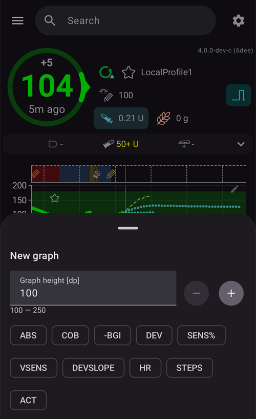
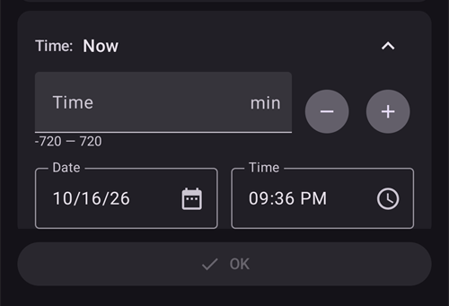
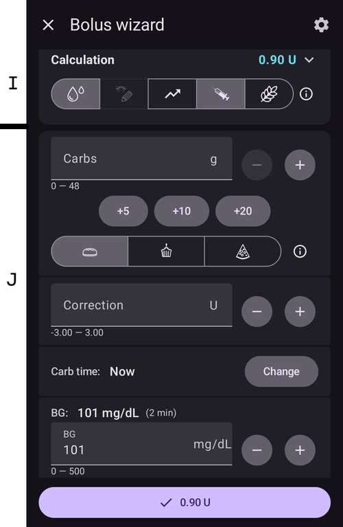
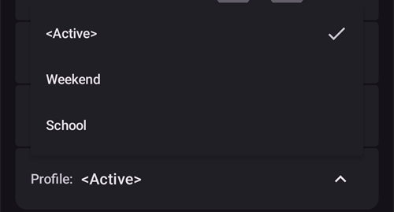
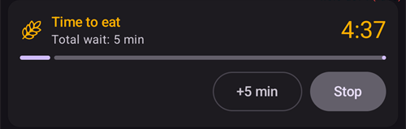
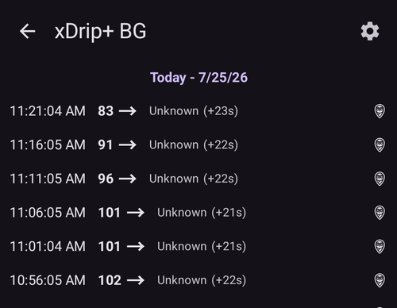
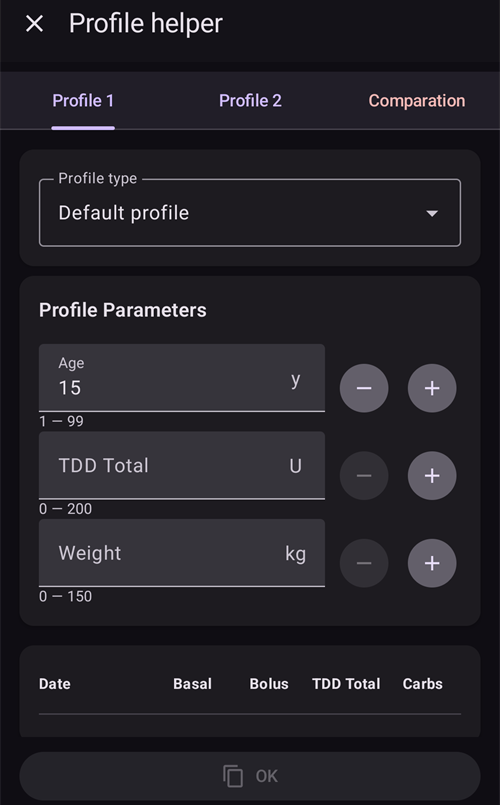

# AAPS-skjermbilder

```{contents}
:backlinks: entry
:depth: 2
```

(the-homescreen)= (AapsScreens-the-homescreen)=

## Hovedskjermen


Dette er det første skjermbildet du møter når du åpner **AAPS**, og det inneholder det meste av informasjonen du trenger i hverdagen.

### Del A - Topplinjen

* **Menyen** (☰) til venstre åpner sidemenyen med **Behandlingshistorikk**, **Historikkleser**, **Statistikk**, **Profilhjelper**, **Vedlikehold**, **Oppsettveiviser**, **Konfigurasjon** og mer.
* **Søkefeltet** finner innstillinger, dialoger og dokumentasjon — bare begynn å skrive (se [Globalt søk](../DailyLifeWithAaps/GlobalSearch.md)).
* Ikonet **Innstillinger** (tannhjul) til høyre åpner alle [Innstillinger](../SettingUpAaps/Preferences.md).

(aaps-screens-profile--target)=

### Del B - Statusblokken

#### Gjeldende blodsukker

Den siste blodsukkermålingen fra CGM-en din vises i den store sirkelen til venstre, sammen med forskjellen fra forrige måling (delta) og hvor gammel målingen er.

Fargen på BS-verdien viser hvor den ligger i forhold til det definerte [målområdet](#Preferences-range-for-visualization).

* grønn = i målområdet
* rød = under målområdet
* gul = over målområdet

  

(loop-status)= (AapsScreens-loop-status)=

#### Loopstatus


Ved siden av BS-sirkelen viser et ikon kjøremodusen til loopen (ovenfra og ned på bildet):

1. Grønn sirkel = [lukket loop](#KeyAapsFeatures-ClosedLoop), loopen kjører
2. Lilla sirkel med prikket linje = [stopp ved lavt BS (LGS)](#KeyAapsFeatures-LGS)
3. Blå sirkel med prikket linje = [åpen loop](#KeyAapsFeatures-OpenLoop)
4. Rød sirkel med kryss = loop deaktivert (virker ikke, permanent)
5. Rødt pauseikon = loop pauset (midlertidig pause, men basalinsulin gis) - gjenværende tid vises ved siden av ikonet
6. Grå sirkel med støpsel = pumpe frakoblet (midlertidig ingen insulindosering i det hele tatt) - gjenværende tid vises ved siden av ikonet

Trykk på ikonet for å åpne Loop-dialogen. Innholdet i dialogen avhenger av gjeldende tilstand:

* Mens loopen **kjører** (lukket, åpen eller LGS), kan du bytte kjøremodus (Lukket loop, Stopp ved lavt BS, Åpen loop eller Deaktiver loop), **pause** loopen eller **koble fra** pumpen for en valgt varighet.
* Mens loopen er **deaktivert**, kan du aktivere den igjen ved å velge en kjøremodus, eller koble fra pumpen.
* Mens loopen er **pauset**, kan du **gjenoppta** den, koble fra pumpen, eller velge en ny varighet under **Pause loop** for å forlenge pausen.
* Mens pumpen er **frakoblet**, kan du **koble til** pumpen igjen, eller velge en ny varighet under **Koble fra pumpen** for å forlenge frakoblingen.

Når du forlenger en pause eller en frakobling, **starter den nye varigheten fra nå**: den erstatter den gjenværende tiden, den legges ikke til. Du trenger ikke å gjenoppta eller koble til igjen først.

Dialogen mens loopen kjører i lukket loop:


Dialogen mens loopen er pauset, med **Gjenoppta** og varighetene for å forlenge pausen:


Dialogen mens pumpen er frakoblet, med **Koble til pumpen på nytt** og varighetene for å forlenge frakoblingen:


Dialogen i Stopp ved lavt BS, i åpen loop og mens loopen er deaktivert, skiller seg bare i hvilke kjøremoduser den tilbyr:


Slik ser hovedskjermen ut i hver modus. Fargebåndet øverst i grafen endrer seg på tidspunktet for byttet.

Stopp ved lavt BS:


Åpen loop:


Loop deaktivert:


Loop pauset — den gjenværende tiden vises ved siden av ikonet:


Pumpe frakoblet — den gjenværende tiden vises ved siden av ikonet. Behandlingsknappene blir værende på Hurtigstart-verktøylinjen, så du kan fortsatt registrere insulin gitt med penn eller karbohydrater:


Du må bekrefte etter hvert valg.

```{admonition} Alarm: pumpen godtok ikke nullbasal :class: warning Mens pumpen er frakoblet, holder **AAPS** en midlertidig nullbasal på pumpen og setter den på nytt hvis den mangler. Hvis dette fortsatt mislykkes etter 10 minutter, utløser **AAPS** en viktig alarm: *«Pumpen godtok ikke nullbasal. Den kan fortsatt levere basalinsulin. Kontroller pumpen.»* Alarmen gjentas hvert 15. minutt til nullbasalen er satt eller frakoblingen er over. Hvis du ser den, kontroller pumpen din: den kan levere basalinsulin selv om **AAPS** viser den som frakoblet.

    <br />Merk: hvilke moduser som tilbys, avhenger av hvor langt du har kommet i [Opplæringsmålene](../SettingUpAaps/CompletingTheObjectives.md) — Lukket loop og LGS blir først tilgjengelige etter hvert som du fullfører dem.
    
    (aaps-screens-bg-warning-sign)=
    #### BS-varselskilt
    
    Hvis **AAPS** oppdager et problem med BS-målingene den mottar, vises en snarvei til BS-kilden din (med kildens navn, for eksempel **xDrip+ BS**) i linjen nederst på hovedskjermen, med et rødt varselmerke. Trykk på den for å åpne [BS-kildeskjermen](#aaps-screens-bg-source).
    
    ##### Dupliserte BS-data
    
    Det røde varselskiltet sier at du må handle med en gang: Du mottar **dupliserte BS-data**, og det hindrer loopen i å gjøre jobben sin riktig. **AAPS** kan ikke beregne BS-trenden din pålitelig fra dupliserte målinger, så den slutter å korrigere.
    
    Hvis loopen din var lukket, bytter **AAPS** den til modusen [Stopp ved lavt BS (LGS)](#KeyAapsFeatures-LGS): loop-ikonet blir lilla.
    
      
    
    Trykk på loop-ikonet: kortet **Begrensninger** øverst forteller deg hvorfor: «BgQualityCheck: LGS-modus på grunn av doble verdier fra BS-kilden».
    
      
    
    ```{admonition} Loopen din kjører i Stopp ved lavt BS
    :class: note
    Loopen din fortsetter å kjøre, men bare for å beskytte deg mot lave verdier: **AAPS** kan fortsatt redusere eller stoppe basalen, men den gir ikke noe korreksjonsinsulin før du har løst dette problemet!
    

Du må finne ut hvorfor du får dupliserte BS-verdier:

* Er Dexcom bridge aktivert på Nightscout-siden din? Deaktiver bridge ved å gå til administrasjonspanelet for Nightscout-instansen din, redigere variabelen «enable» og fjerne delen «bridge» der. (For Heroku [finner du detaljer her](https://nightscout.github.io/troubleshoot/troubleshoot/#heroku).)
* Laster flere kilder opp BS-verdiene dine til Nightscout? Hvis du bruker BYODA-appen, aktiver opplastingen i **AAPS**, men ikke aktiver den i xDrip hvis du bruker det.
* Har du følgere som mottar BS-verdiene dine, men som også laster dem opp igjen til Nightscout-siden din?
* Siste utvei: I [NSClient-innstillingene](#Preferences-nsclient), velg innstillingene for Synkronisering og slå av valget «Motta BS-data fra NS».

For å fjerne varselet med en gang og få loopen til å korrigere igjen, slett de dupliserte oppføringene fra BS-kildeskjermen: trykk på snarveien i linjen nederst. Den dupliserte målingen er uthevet i rødt. Trykk og hold på en måling for å begynne å velge, kryss av duplikatene og trykk på søppelbøtte-ikonet øverst til høyre.


Men når det er mange duplikater, kan det være enklere å

* [sikkerhetskopiere innstillingene dine](../Maintenance/ExportImportSettings.md),
* tilbakestille databasen i Vedlikehold-menyen og
* [importere innstillingene dine](../Maintenance/ExportImportSettings.md) igjen

    {admonition} Bytt tilbake til Lukket loop selv
    :class: important
    **AAPS** går ikke tilbake til **Lukket loop** av seg selv når duplikatene er borte. Trykk på loop-ikonet på hovedskjermen og velg **Lukket loop** igjen.

##### Flate BS-data

Med noen BS-kilder (Libre 1, AiDEX, Glutec, Medtronic og kilder som ikke oppgir sensortype) sjekker **AAPS** også etter målinger som ikke endrer seg: hvis BS har endret seg mindre enn 2 mg/dL (0,1 mmol/L) på 45 minutter, regnes dataene som feil. BS-kildesnarveien viser da et rødt merke for flat trend, og loopen stopper enhver høy midlertidig basal og gir ikke noe korreksjonsinsulin før målingene endrer seg igjen. Kontroller sensoren din og appen som sender målingene.

##### Uregelmessige BS-data

Når målinger kommer med uregelmessige mellomrom eller noen mangler, beregner **AAPS** 5-minuttsverdier på nytt fra målingene den har. Dette skjer for eksempel etter et sensorbytte, eller med Libre-sensorer, der tidspunktene forskyver seg et minutt eller to med noen timers mellomrom. Loopen fortsetter å virke, og du trenger ikke å gjøre noe. **AAPS** 4 viser ikke lenger et gult varselskilt for dette.

#### Gjeldende profil

Den gjeldende profilen vises ved siden av stjerneikonet.

Trykk på profilnavnet for å åpne [Profil-skjermen](#aaps-screens-profile), der du kan se profildetaljene og [bytte mellom ulike profiler](../DailyLifeWithAaps/ProfileSwitch-ProfilePercentage.md).

For å **endre profilprosenten** (og varigheten), trykk på profilnavnet og deretter på den runde **▶**-knappen (Aktiver) nederst til høyre på Profil-skjermen. I **AAPS** 3.x åpnet du dette skjermbildet ved å trykke og holde på profilnavnet; i **AAPS** 4 gjør trykk og hold ingenting. Steg for steg: [Endre profilprosenten](#ProfileSwitch-change-percentage).


1. Vanlig visning med en standard profilaktivering.
2. Profilbytte med en bestemt prosent på 90 % og en gjenværende varighet på 9 minutter — profilnavnet blir gult mens et midlertidig profilbytte kjører.
3. Profilbytte med en tidsforskyving på 1 time og en gjenværende varighet på 9 minutter.

#### Mål


Det gjeldende blodsukkermålet vises under profilnavnet.

Trykk kort på målet for å åpne skjermen **[Midlertidig mål](../DailyLifeWithAaps/TempTargets.md)**.

1. Vanlig visning: målområdet som er definert i profilen din.
2. Hvis et midlertidig mål er satt, blir målet gult/oransje med ikonet til den brukte forhåndsinnstillingen, og den gjenværende tiden i minutter vises i parentes.

(AapsScreens-visualization-of-dynamic-target-adjustment)=

#### Visning av dynamisk måljustering

Når du bruker [SMB-algoritmen](#Config-Builder-aps) og [Autosens](#Open-APS-features-autosens), kan **AAPS** justere målet ditt dynamisk ut fra sensitiviteten.

Aktiver ett av eller begge de følgende valgene i [OpenAPS SMB-innstillingene](#Preferences-openaps-smb-settings):

* «Sensitivitet hever mål» og/eller
* «Resistens senker mål»

Hvis **AAPS** oppdager resistens eller sensitivitet, endres målet fra det som er satt i profilen, og det viste målet skifter farge for å vise justeringen.

(aaps-screens-iob-cob-basal-sens)=

#### IOB, COB, basal og sensitivitet


1. **Sprøyte**: aktivt insulin (IOB) - mengden aktivt insulin i kroppen din  
    Tallet for aktivt insulin ville vært null hvis bare standardbasalen din kjørte og det ikke var noe insulin igjen fra tidligere boluser. 
    * IOB kan være negativ hvis det nylig har vært perioder med redusert basal.
    * Trykk på brikken for å se fordelingen mellom bolus- og basalinsulin (første dialog på bildet — her med negativ IOB etter en periode med redusert basal)
2. **Korn**: [aktive karbohydrater (COB)](../DailyLifeWithAaps/CobCalculation.md) - karbohydrater du har spist som ennå ikke er tatt opp
3. Den blågrønne knappen til høyre viser **gjeldende basallevering**: en flat linje når profilbasalen kjører, et endret ikon mens en midlertidig basal er aktiv
4. **Prosentraden** viser gjeldende sensitivitet ([Autosens](#Open-APS-features-autosens) / [Dynamisk ISF (DynISF)](../DailyLifeWithAaps/DynamicISF.md)). Når loopen endrer ISF-en din, viser raden også profil-ISF, en pil og den ISF-en loopen bruker nå, for eksempel «80 % 2,0 ↗ 2,5». Trykk på den for å se Autosens-verdien og den effektive ISF-en (andre dialog på bildet). Hvis loopen bruker en annen verdi enn det siste Autosens-resultatet (for eksempel fordi et midlertidig mål endrer sensitiviteten din), viser dialogen også den verdien som **Algoritmens sensitivitet**. Når Autosens er av, beholder loopen profil-ISF-en din, og ingen effektiv ISF vises.

IOB-dialogen, som åpnes ved å trykke på IOB-brikken:


Trykk på den blågrønne knappen for å se den midlertidige basalen som kjører, når den startet og hvor lenge den har kjørt:


(aaps-screens-carbs-required)=

#### Karbohydrater kreves


Forslag om karbohydrater gis når algoritmen oppdager at det trengs karbohydrater.

Dette skjer når oref-algoritmen mener at den ikke kan redde deg med null midlertidig basal, og du trenger karbohydrater for å rette opp.

Karbovarslene er mye mer avanserte enn de i boluskalkulatoren. Du kan få et forslag om karbohydrater selv om boluskalkulatoren ikke viser manglende karbohydrater.

Varsler om at karbohydrater kreves kan sendes til Nightscout hvis du ønsker det. Da vises og kringkastes en melding (announcement) der.

### Del C - Statusraden


Statusraden gir en visuell advarsel for

* Kanylealder
* Insulinalder (dager reservoaret er brukt) og reservoarnivå (enheter)
* Sensoralder
* Alder og nivå for pumpebatteriet (%)

Hvis grensen for advarsel er overskredet, vises verdiene i gult.

Hvis grensen for kritisk er overskredet, vises verdiene i rødt.

The age is always shown in its short form, whatever the screen size: *4h* on the first day, *3d4h* later.

Grensene kan endres via det lille **Innstillinger**-ikonet som vises når statusraden er **utvidet** (pilen til høyre) — se [Statuslys](#Preferences-status-lights).

Det utvidede statuspanelet har også en knapp på slutten av noen rader for å registrere et bytte, som nullstiller den tilhørende alderen: **Legg til** på raden **Sensor** registrerer et sensorbytte. Hvis pumpen din støtter det, vises **Prime/fylling** på radene **Kanyle** (eller **Patchpumpe**) og **Insulin**, og **Legg til** på raden **Pumpebatteri**.


Avhengig av hvilken pumpe du bruker, har du kanskje ikke alle disse ikonene.

(screens-sensor-level-battery)=

#### Sensornivå (batteri)

Fungerer for CGM med en ekstra sender, for eksempel MiaoMiao 2. (Teknisk sett må sensoren sende informasjon om batterinivå til xDrip.)

Grensene kan settes i [Statuslys](#Preferences-status-lights).

(aaps-screens-main-graph)=

### Del D - Hovedgrafen


Grafen viser blodsukkeret ditt (BS) slik det leses av glukosemåleren din (CGM).

Bruk rulling og knip for å zoome på grafen for å endre tidsrommet som vises.

Det grønne området viser målområdet ditt.

Denne informasjonen vises også på denne grafen:

* Manuelle boluser: blå trekant rett over BS-kurven, som peker ned mot målingen på det tidspunktet, med insulinmengden
* Karboregistreringer: oransje trekant rett under BS-kurven, som peker opp mot målingen, med karbohydratmengden. Et måltid som er registrert sammen med bolusen, ser ut som ett merke, delt av målingen.
* Trekantene finnes i tre størrelser (liten, middels, stor), etter mengden sammenlignet med dagens største. Hvis det ikke finnes noen BS-måling på det tidspunktet (hull i sensordata), tegnes trekanten nederst i grafen.
* BS-kontroller og kalibreringer: tegnes ved sin egen målte verdi, så du kan sammenligne dem med sensorkurven
* Mål slik det er definert i profilen eller endret av et midlertidig mål: grønn linje
* Profilbytter: stjerneikoner øverst i grafen
* Loopstatus: fargebånd øverst i grafen når [kjøremodusen](#AapsScreens-loop-status) er noe annet enn lukket loop: blå = åpen loop, lilla = LGS, rød = loop deaktivert, gul = loop pauset, grå = pumpe frakoblet, oransje = superbolus (på skjermbildet: lilla, deretter gul). Historikken over disse endringene finner du under [Kjøremodus](#AapsScreens-running-mode)
* [SMB-er](#Open-APS-features-super-micro-bolus-smb) tegnes ikke i BS-grafen (det ville vært én med få minutters mellomrom): de vises i [IOB-grafen](#aaps-screens-iob).

Trykk på en **BS-kontroll** i grafen for å se verdien, og merknaden hvis du skrev en.

(aaps-screens-graph-press-and-hold)=

#### Se verdiene på et gitt tidspunkt

**Trykk og hold** på BS-grafen et øyeblikk for å se verdiene ved én måling. En prikk markerer nærmeste måling, en stiplet linje tegnes på det tidspunktet i alle grafene, og et lite vindu øverst i grafen viser:

* tidspunktet og BS-verdien
* IOB, COB (bare når den er over 0 g) og basaldosen på det tidspunktet — basalikonet viser om en midlertidig basal kjørte, som på hovedskjermen
* eventuell bolus, SMB eller karbohydrater på det tidspunktet, med de samme trekantene som i grafene

Hold fingeren på skjermen og flytt den til venstre eller høyre for å gå fra én måling til den neste. Du kjenner et lett tikk ved hver måling, og grafen ruller ikke mens du gjør dette. Vinduet blir stående i 2 sekunder etter at du løfter fingeren.

Dette virker på samme måte på de [ekstra grafene](#aaps-screens-additional-graphs) under BS-grafen (IOB, COB ...): trykk og hold på hvilken som helst av dem.


(aaps-screens-graph-clock-change)=

#### Clock changes

When the clock of the phone jumped, at a daylight saving change or in a new time zone, a dashed vertical line marks that moment in the BG graph, with a small clock icon at its foot. The same dashed line runs through the [additional graphs](#aaps-screens-additional-graphs) below.


(AapsScreens-activate-optional-information)=

#### Aktiver valgfri informasjon

Trykk på **blyant**-ikonet øverst til høyre i grafen for å åpne grafinnstillingene:


* **Grafhøyde** justerer hvor høy grafen tegnes.
* **ACT** legger insulinaktivitetskurven oppå: en heltrukket gulgrønn linje <span style="background:#141218;color:#D3F166;padding:0 0.3em;border:1px solid #141218;border-radius:4px">━━━━</span> (ikke å forveksle med den prikkede gule UAM-prediksjonen)
* **PRED** legger [prediksjonslinjene](#aaps-screens-prediction-lines) oppå (se nedenfor)

(aaps-screens-prediction-lines)=

#### Prediksjonslinjer

Når **PRED** er på, tegner AAPS prediksjonene sine som **prikkede linjer** til høyre for «nå»-linjen. Hver prediksjon har sin egen farge. Mørkt tema bruker lysere nyanser av de samme fargene, og en linje inne i det grønne målområdet kan se litt grønnere ut.

| Linje                   | Lyst tema                                                                                                                         | Mørkt tema                                                                                                                         | Hva den predikerer                       |
| ----------------------- | --------------------------------------------------------------------------------------------------------------------------------- | ---------------------------------------------------------------------------------------------------------------------------------- | ---------------------------------------- |
| **IOB** (blå)           | <span style="background:#FFFFFF;color:#1E88E5;padding:0 0.3em;border:1px solid #CCCCCC;border-radius:4px">●●●●</span>             | <span style="background:#141218;color:#64B5F6;padding:0 0.3em;border:1px solid #141218;border-radius:4px">●●●●</span>              | bare insulin                             |
| **COB** (oransje)       | <span style="background:#FFFFFF;color:#FB8C00;padding:0 0.3em;border:1px solid #CCCCCC;border-radius:4px">●●●●</span>             | <span style="background:#141218;color:#FFB74D;padding:0 0.3em;border:1px solid #141218;border-radius:4px">●●●●</span>              | aktive karbohydrater                     |
| **UAM** (gul)           | <span style="background:#FFFFFF;color:#C9BD60;padding:0 0.3em;border:1px solid #CCCCCC;border-radius:4px">●●●●</span>             | <span style="background:#141218;color:#E6D39A;padding:0 0.3em;border:1px solid #141218;border-radius:4px">●●●●</span>              | ikke-varslet måltid                      |
| **ZT** (cyan)           | <span style="background:#FFFFFF;color:#00D2D2;padding:0 0.3em;border:1px solid #CCCCCC;border-radius:4px">●●●●</span>             | <span style="background:#141218;color:#4DD4D4;padding:0 0.3em;border:1px solid #141218;border-radius:4px">●●●●</span>              | null midlertidig basal (insulin stoppet) |
| **aCOB** (blek oransje) | <span style="background:#FFFFFF;color:rgba(251,140,0,0.5);padding:0 0.3em;border:1px solid #CCCCCC;border-radius:4px">●●●●</span> | <span style="background:#141218;color:rgba(255,183,77,0.5);padding:0 0.3em;border:1px solid #141218;border-radius:4px">●●●●</span> | bare den eldre AMA-algoritmen            |

Når to prediksjoner gir de samme verdiene, overlapper prikkene deres, og du ser bare én av fargene (for eksempel UAM oppå IOB når BS er flatt).

* **COB**-linje (oransje): [aktive karbohydrater](CobCalculation) (oransje brukes i hele AAPS for COB og karbohydrater)
    
    Denne prediksjonslinjen viser hvor BS (ikke COB selv!) vil gå, basert på de gjeldende innstillingene i **profilen**, under forutsetning av at avvikene fra karbohydratopptaket holder seg konstante. Denne linjen vises bare når det finnes kjente COB.

* **IOB**-linje (blå): aktivt insulin (blå brukes i hele AAPS for IOB og insulin)
    
    Denne prediksjonslinjen viser hva som ville skjedd med påvirkning fra insulin alene. For eksempel hvis du ga litt insulin og så ikke spiste noen karbohydrater.

* **ZT**-linje (cyan): null midlertidig basal (predikert BS hvis en midlertidig basal på 0 % ble satt)
    
    Denne prediksjonslinjen viser hvordan BS-kurven ville endret seg hvis pumpen stoppet all insulinlevering (0 % TBR). Linjen stopper når den stiger over målet ditt.
    
    *Denne linjen vises bare når [SMB](#Config-Builder-aps)-algoritmen brukes.*

* **UAM**-linje (gul): [ikke-varslede måltider](#SensitivityDetectionAndCob-sensitivity-oref1)
    
    Ikke-varslede måltider betyr at det er oppdaget en betydelig økning i glukosenivået på grunn av måltider, adrenalin eller annen påvirkning. Prediksjonslinjen ligner på den **oransje COB-linjen**, men den antar at avvikene vil avta i jevnt tempo (ved å forlenge den nåværende nedgangstakten).
    
    *Denne linjen vises bare når [SMB](#Config-Builder-aps)-algoritmen brukes, **Aktiver UAM** er på i OpenAPS SMB-innstillingene, og BS stiger mer enn insulin alene kan forklare.*

* **aCOB**-linje (blek, gjennomsiktig oransje): akselerert karbohydratopptak
    
    Ligner på COB, men antar en fast karbohydratopptakshastighet på 10 mg/dL/5 min (-0,555 mmol/L/5 min). Utdatert og av begrenset nytte.
    
    *Denne linjen vises bare når den eldre [AMA](#Config-Builder-aps)-algoritmen brukes.*

Som regel havner den virkelige glukosekurven din midt mellom disse linjene, eller nær den linjen som bygger på antakelser som ligner mest på situasjonen din.

(aaps-screens-how-predictions-become-a-dosing-decision)=

#### Slik gjør AAPS prediksjoner om til en doseringsbeslutning

AAPS doserer ikke insulin ut fra det gjeldende BS alene — i hver loop-syklus (omtrent hvert 5. minutt) ser den på alle prediksjonslinjene ovenfor samlet og finner den tryggeste handlingen.

Hovedregelen er **sikkerhet først**: hvis *en eneste* prediksjonslinje, i et hvilket som helst tidsrom, faller under den nedre sikkerhetsgrensen din, setter AAPS en null midlertidig basal (0 % midlertidig basal) og holder tilbake mer insulin, selv om BS er høyt nå. Først når alle prediksjonslinjene holder seg over denne grensen, vurderer AAPS å gi mer insulin.

Når det er trygt å gi mer insulin, ser AAPS på hvor BS til slutt er predikert å ende (**eventual BG**, sluttverdien) på tvers av de kombinerte prediksjonene, og regner ut hvor mye korreksjon som trengs for å få denne sluttverdien tilbake til målet — gitt enten som en økt midlertidig basal, eller (hvis oref1/[SMB](#Open-APS-features-super-micro-bolus-smb)-algoritmen er aktivert) som en liten bolus med en gang. Hvis BS er høyt nå, men allerede er på vei nok ned av seg selv, venter AAPS, eller reduserer kanskje til og med basaldosen, i stedet for å gi insulin som bare ville presse en senere lav verdi enda lavere.

For gjennomgåtte eksempler på denne beslutningslogikken med ekte skjermbilder, se [doseringsscenarioene i veiledningen for behandlere](#clinicianguide-dosing-scenarios) — de ble skrevet for behandlere, men gjelder for alle AAPS-brukere.

*For den fulle tekniske forklaringen av hvordan disse prediksjonene og doseringsbeslutningen beregnes, se [OpenAPS-dokumentasjonen for determine-basal](https://openaps.readthedocs.io/en/latest/docs/While%20You%20Wait%20For%20Gear/Understand-determine-basal.html).*

#### Basaldoser

En **heltrukket blå** linje viser basalleveringen fra pumpen din og gjenspeiler den faktiske leveringen over tid.

Den **prikkede blå** linjen viser hva basaldosen ville vært uten midlertidige basaljusteringer (TBR).

Når standard basaldose gis, vises området under kurven i mørkeblått. Når basaldosen er midlertidig justert (økt eller redusert), vises området under kurven i lyseblått.

#### Aktivitet

Den **tynne gule** linjen viser insulinaktiviteten.

Den bygger på det forventede fallet i BS fra insulinet i kroppen din hvis ingen andre faktorer (som karbohydrater) var til stede.

(AapsScreens-section-g-additional-graphs)= (aaps-screens-additional-graphs)=

### Del E - Ekstra grafer

Du kan aktivere ekstra grafer under hovedgrafen. I [Enkelmodus](#preferences-simple-mode) er de ekstra grafene forhåndsinnstilt og kan ikke endres. Slå av **Enkelmodus** hvis du vil sette opp dine egne ekstra grafer.

De ekstra grafene følger hovedgrafen: når du ruller eller zoomer i BS-grafen, flytter de seg med. Å dra sidelengs på en ekstra graf ruller også alle grafene. De har ingen egne tidsetiketter — les tiden på BS-grafen.

For å sette opp en ekstra graf, trykk på **blyant**-ikonet øverst til høyre i den:


Velg brikkene for dataene du vil se på denne grafen; knappen **Fjern** sletter grafen.

For å lage enda en graf, trykk på **Legg til graf** under den siste grafen og velg brikkene på samme måte:



Den nye grafen legges til under de andre — her en andre ekstra graf med **SENS%** og **DEV**:


De fleste brukere synes følgende oppsett av ekstra grafer er tilstrekkelig:

* Graf 1 med IOB, COB og Sensitivitetsendring
* Graf 2 med Avvik og BGI.

#### Absolutt insulin (ABS)

Aktivt insulin inkludert boluser **og basal**.

(aaps-screens-iob)=

#### Aktivt insulin (IOB)

Viser insulinet du har «ombord» (= aktivt insulin i kroppen din). Det omfatter insulin fra bolus og midlertidig basal (**men ikke basaldosene som er satt i profilen din**).

Hvis det ikke var noen [SMB-er](#Open-APS-features-super-micro-bolus-smb), ingen boluser og ingen TBR i løpet av DIA-tiden, ville denne vært null.

SMB-er vises i denne grafen som blå trekanter, i tre størrelser etter mengden sammenlignet med dagens største SMB.

IOB kan være negativ hvis du ikke har noen gjenværende bolus og har hatt null/lav midlertidig basal over lengre tid.

Nedbrytingen avhenger av [innstillingene dine for DIA og insulintype](#Config-Builder-insulin-dia).

#### Karbo ombord (COB)

Viser karbohydratene du har «ombord» (= aktive karbohydrater i kroppen din som ennå ikke er brutt ned).

Nedbrytingen avhenger av [avvikene algoritmen oppdager](../DailyLifeWithAaps/CobCalculation.md).

Hvis det oppdages høyere karbohydratopptak enn forventet, gis det insulin, og dette øker IOB (mer eller mindre, avhengig av sikkerhetsinnstillingene dine).

#### Sensitivitetsendring (SENS%)

Viser sensitiviteten som [Autosens](#Open-APS-features-autosens) har oppdaget.

Sensitivitet er en beregning av insulinsensitiviteten som følge av trening, hormoner osv.

Merk: du må ha kommet til [opplæringsmål 8](#objectives-objective8) for at Sensitivitetsdeteksjon/[Autosens](#Open-APS-features-autosens) skal kunne justere insulinmengden automatisk. Før du har nådd det opplæringsmålet, vises linjen i grafen din bare til informasjon.

### Dynamisk ISF (DISF)

Viser sensitiviteten slik [Dynamisk ISF (DynISF)](../DailyLifeWithAaps/DynamicISF.md) beregner den. Fylles bare ut hvis du bruker denne funksjonen.

(screen-heart-rate-steps)=

#### Puls (HR) & Skritt

Disse dataene kan være tilgjengelige når du bruker en [Wear OS-smartklokke](../WearOS/WearOsSmartwatch.md). Aktiver dem i **AAPS** Wear-appen og gi tillatelse til helsedata.

Steps are drawn as columns, and the heart rate as a curved line that breaks where the watch sent no data.

#### Avvik (DEV)

* **Grå** stolper viser et avvik som skyldes karbohydrater.
* **Grønne** stolper viser at BS er høyere enn algoritmen forventet. Grønne stolper brukes til å øke resistensen i [Autosens](#Open-APS-features-autosens).
* **Røde** stolper viser at BS er lavere enn algoritmen forventet. Røde stolper brukes til å øke sensitiviteten i [Autosens](#Open-APS-features-autosens).
* **Gule** stolper viser et avvik som skyldes UAM.
* **Svarte** stolper viser små avvik som ikke tas med i sensitivitetsberegningen

#### BS-påvirkning (-BGI)

Denne linjen viser hvor mye BS «burde» stige eller falle ut fra insulinaktiviteten alene.


Det er en god kombinasjon å vise denne linjen sammen med avviksstolpene. De bruker samme skala, men den er en annen enn for de andre valgfrie dataene, så det er lurt å vise dem på en egen graf, som vist ovenfor. Å sammenligne BGI-linjen med avviksstolpene er en annen måte å forstå hvordan **BS** svinger på. Her, på tidspunktet merket **1**, ligger avviksstolpene godt over BGI-linjen: BS stiger mer enn insulinaktiviteten alene kan forklare (for eksempel etter karbohydrater). På tidspunktet merket **2** ligger avviksstolpene under null (røde): BS er lavere enn algoritmen forventet.

### Del F - Hurtigstart-verktøylinjen


Den flytende verktøylinjen nederst på skjermen inneholder **[Hurtigstart](../DailyLifeWithAaps/QuickLaunch.md)**-handlingene dine. Det lille **tannhjulet** åpner Hurtigstart-konfigurasjonen, der du velger hvilke knapper som vises (behandlinger, helseportal-oppføringer, CGM-handlinger, skjermene i **Administrer**-arket, [Hurtigknapp](../DailyLifeWithAaps/QuickWizards.md)-knapper, [Scener](../DailyLifeWithAaps/Scenes.md) og mer).

Et typisk oppsett er vist ovenfor: **Insulin**, **Karbo** og **Boluskalkulator**.

Mens pumpen er **frakoblet**, blir behandlingsknappene værende på verktøylinjen, for eksempel for å registrere insulin gitt med penn (se [Insulin](#aaps-screens-buttons-insulin) nedenfor). De samme handlingene finnes også i [arket Behandlinger](#aaps-screens-treatments-sheet) i navigasjonslinjen nederst.

(aaps-screens-buttons-insulin)=

#### Insulin


For å gi en bestemt mengde insulin uten å bruke [boluskalkulatoren](#aaps-screens-bolus-wizard).

Ved å slå på **Start midlertidig mål Spise snart** kan du automatisk starte ditt [midlertidige mål for Spise snart](#TempTargets-eating-soon-temp-target).

Hvis du ikke vil gi bolus gjennom pumpen, men bare registrere en insulinmengde (for eksempel insulin gitt med penn), slå på «**Bolus vil bare bli loggført**». En ekstra rad **Tid**, satt til **Nå**, lar deg registrere en insulininjeksjon som ble gitt tidligere: bruk **-** / **+** for å endre den, eller trykk på pilen for å skrive inn minuttene eller velge dato og klokkeslett.

 

Du kan bruke knappene **+0,5 / +1,0 / +2,0** for raskt å øke insulinmengden. Trinnverdiene kan endres i [Boluskalkulator-innstillingene](#Preferences-deliver-this-part-of-bolus-wizard-result).

Insulin-dialogen kan også brukes når pumpen er pauset eller frakoblet, for eksempel for å registrere insulin satt med penn. I så fall er «**Bolus vil bare bli loggført**» tvunget på (vist i rødt), og det vises ekstra felt for å velge insulintype og en **Tid**-forskyvning for en injeksjon som ble gitt tidligere:


#### Karbo


For å registrere karbohydrater uten å gi bolus.

Noen [forhåndsinnstilte midlertidige mål](#TempTargets-hypo-temp-target) (Hypo, Spise snart, Aktivitet) kan startes direkte med bryterne øverst.

**Karbotid**: Når skal du spise / spiste du karbohydrater.

**Varighet**: Brukes for [«forlengede karbohydrater»](ExtendedCarbs). Denne raden er sammenfoldet, slik at du ikke skriver grammene inn i den ved en feil: bruk **-** / **+** for å endre den, eller trykk på pilen for å åpne den og skrive inn en verdi.

Du kan bruke knappene **+5 / +10 / +20** for raskt å øke karbohydratmengden.

#### Hurtigknapp

Registrer enkelt en mengde karbohydrater og sett grunnlaget for beregningen med én forhåndsinnstilt knapp.

Detaljene settes opp under [Hurtigknapper](../DailyLifeWithAaps/QuickWizards.md).

(aaps-screens-treatments-sheet)=

### Del G - Navigasjonslinjen nederst

Navigasjonslinjen nederst gir tilgang til:

* **Behandlinger** — et ark med hurtighandlinger for behandlingene dine:
    
    

* **Scener** — vises bare når du har minst én [scene](../DailyLifeWithAaps/Scenes.md) eller en **Automasjon**-regel merket som **Brukerhandling**. Det åpner et ark der du kan starte dem; et merke viser hvor mange du kan starte akkurat nå. **Blyanten** øverst i arket åpner **Administrer → Scener**.

* **Administrer** — samlingspunktet for alt du administrerer i **AAPS**: Profil, Insulininnstillinger, Midlertidig mål, Hurtigknapp, Scener, Automasjon, Mat, Rotasjon av sted, Pumpe og Autoriserte klienter. Under dem finner du enhets- og basalhandlinger som Sensorbytte og Midlertidig basal. Noen elementer vises bare når de gjelder for oppsettet ditt — for eksempel avhenger Prime/fylling og batteribytte av pumpen din, og Midlertidig basal, Forlenget bolus og Helseportal-oppføringene er skjult i [Enkelmodus](#preferences-simple-mode):
    
    

* **Opplæringsmål** — fremdriften din gjennom [opplæringsmålene](../SettingUpAaps/CompletingTheObjectives.md); et merke viser hvor mange som er fullført. Dette elementet forsvinner når alle opplæringsmålene er fullført, og finnes ikke i **AAPSClient**.

(aaps-screens-notifications)=

#### Varslinger

En **varslingsboble** kan vises over linjen nederst, til høyre. Den samler de aktive varslingene fra **AAPS**; det lille tallet viser hvor mange det er. Fargen følger den viktigste: rød for en viktig melding, grønn for enkel informasjon.


Trykk på boblen for å åpne **Varsling**-panelet. Hver melding viser tidspunktet den ble utløst. Trykk på **Forkast** under en melding for å fjerne den; noen meldinger har en annen knapp i stedet, som tar deg til innstillingen som trenger oppmerksomhet.


(bolus-wizard)= (aaps-screens-bolus-wizard)=

## Boluskalkulator



Når du vil gi en måltidsbolus, er det vanligvis her du gjør det.

### Del I

Overskriften **Beregning** viser den beregnede bolusen. Hvis mengden aktivt insulin allerede er større enn den beregnede bolusen, viser den bare hvor mange karbohydrater som fortsatt trengs.

Boluskalkulatoren kan brukes uansett hva **BS** er nå, også når det er for høyt eller for lavt. Hvis **BS** er over målet, legges en korreksjon til måltidsbolusen. Hvis **BS** er under målet, reduseres bolusen, og hvis det aktive insulinet allerede er mer enn det som trengs, forteller kalkulatoren deg hvor mange karbohydrater du fortsatt trenger, i stedet for å foreslå insulin.

Ikonraden under overskriften viser hvilke verdier som inngår i beregningen (BS, trend, IOB, midlertidig mål, COB). Et trykk på et ikon tar denne verdien med i / ut av beregningen; **(i)**-ikonet viser de detaljerte tallene bak beregningen.

#### Kombinasjoner av COB og IOB og hva de betyr

* Av sikkerhetsgrunner kan ikke IOB slås av når COB er på, siden du da risikerer for mye insulin fordi **AAPS** ikke tar hensyn til det som allerede er gitt.
* Hvis du slår på COB og IOB, tas det hensyn til karbohydrater som ikke er tatt opp og ikke allerede er dekket med insulin + alt insulin som er gitt som TBR eller SMB.
* Hvis du slår på IOB uten COB, tar **AAPS** hensyn til insulin som allerede er gitt, men regner det ikke opp mot karbohydrater som ennå ikke er tatt opp. Dette fører til en melding om «manglende karbohydrater».
* Hvis du gir bolus for **mer mat** like etter en måltidsbolus (for eksempel en ekstra dessert), kan det være nyttig å **slå av alle verdiene** i beregningen. Slik legges bare de nye karbohydratene til, siden hovedmåltidet ikke nødvendigvis er tatt opp ennå, og IOB vil derfor ikke stemme nøyaktig med COB like etter en måltidsbolus.
* Av sikkerhetsgrunner tas et **midlertidig mål** bare med i beregningen hvis du slår det på manuelt.

(AapsScreens-section-j)=

### Del J - Inntastingsfelt

I feltet **Karbo** legger du inn ditt anslag for mengden karbohydrater, **i gram**, som du vil gi bolus for; **+**-knappene under legger raskt til karbohydrater. **AAPS** jobber bare med gram: hvis du teller i brødenheter eller porsjoner (*for eksempel* DAFNE «CHO»-porsjoner), regn dem om til gram før du legger dem inn. Se [merknaden om brødenheter](#your-aaps-profile-insulin-to-carbs-ratio) på profilsiden.

#### Karbotype: brød, kake eller pizza

Under feltet **Karbo** forteller knappene **Brød**, **Kake** og **Pizza** **AAPS** hvor raskt måltidet tas opp. Med **Kake** og **Pizza** dekker bolusen bare en del av karbohydratene nå, og resten legges til senere som eKarbo. Se [Karbotype: brød, kake eller pizza](#AapsScreens-carbs-type) på siden om forlengede karbohydrater for prosentene og tidspunktene.

Raden **Korreksjon** er for når du av en eller annen grunn vil endre den endelige dosen.

Bare feltet **Karbo** er alltid åpent. De andre radene (**Korreksjon**, **Karbotid**, **BS** og **Bruk prosent**) er sammenfoldet: de viser verdien sin med **-** / **+**-knapper, så du kan endre den i små steg. Trykk på pilen for å åpne en rad og skrive inn en verdi, og trykk på den igjen for å lukke raden. Dette hindrer at du skriver gram inn i feltet **Korreksjon** ved en feil.


Trykk hvor som helst på raden **Profil** for å åpne listen over profilene dine, og trykk så på et navn for å bruke den profilen i denne beregningen.



Feltet **Karbotid** er for forhåndsbolus, slik at du kan fortelle systemet at det vil gå en stund før karbohydratene kommer. Du kan skrive inn et negativt tall i dette feltet hvis du gir bolus for karbohydrater du allerede har spist.

**Sett alarm** (spisepåminnelse): når du legger inn en karbotid fram i tid, vises en bryter «**Sett alarm**», slik at du på det gitte tidspunktet blir minnet på å spise karbohydratene du har lagt inn i **AAPS**:


The reminder starts when the bolus has been delivered. While it runs, a **Time to eat** bar on the main screen counts down, with **Stop** and **+5 min**. **+5 min** moves the end of the wait five minutes later, and the bar shows the total wait. When the time has come, the reminder rings with its own sound, a soft kitchen timer. Besides **Silence alarm** (the screen stays open) and **Silence and close**, the alarm screen offers **+5 min**, which starts a new five-minute wait. Once it has rung, the bar reads *The time is up* with **+5 min** and **Dismiss**; **Silence and close** removes the bar too. The bar and the alarm are also shown on **AAPSClient**, and on the [watch](#WearOsSmartwatch-wizard-carb-time). The reminder does not create a timer in your phone's clock app. If Android does not let **AAPS** set alarms, the wizard asks you to allow *Alarms and reminders* for **AAPS** in the Android settings. The bell is not offered for a carb time in the past.




Feltet **BS** er vanligvis allerede fylt ut med den siste målingen fra CGM-en din. Hvis du ikke har en CGM som virker, er feltet tomt. Når målingen er fersk, forblir raden **BS** sammenfoldet. The field follows new readings while the wizard is open, until you change it yourself.

Resultatknappen nederst viser den foreslåtte bolusen; når du trykker på den, ber den om bekreftelse før noe insulin gis. While the confirmation is waiting, the loop gives no SMB, so the bolus you confirm is still right. If an SMB is being delivered at that moment, **OK** waits until it has finished.

Greit å vite:

* Hvis den beregnede bolusen er høyere enn din **[Maksimal bolus](#Preferences-maximum-bolus)**, reduseres den til maks bolus, og bekreftelsen viser advarselen «Bolusbegrensning brukt». En [hurtigknapp](../DailyLifeWithAaps/QuickWizards.md) blir i stedet avvist.
* Når bolusen bare registreres (for eksempel mens pumpen er frakoblet), blir advarselen «**Bolus vil bare bli loggført**» stående øverst i dialogen, også når du ruller.
* En bolus du gir manuelt, har prioritet over en [SMB](#Open-APS-features-super-micro-bolus-smb) som venter på å bli gitt: SMB-en forkastes, og loopen beregner på nytt. Hvis en SMB leveres akkurat nå, avvises bolusen din med meldingen «En SMB leveres akkurat nå. Prøv igjen når den er ferdig.» Det gis ikke noe insulin, og karbohydrater som ble lagt inn sammen med den bolusen, lagres ikke: vent et øyeblikk og legg dem inn igjen.

(AapsScreens-wrong-cob-detection)=

#### Feil COB-deteksjon


Hvis du ser advarselen ovenfor etter å ha brukt boluskalkulatoren, har **AAPS** oppdaget at den beregnede COB-verdien kan være feil. Så hvis du vil gi bolus igjen etter et tidligere måltid med COB, må du være oppmerksom på faren for overdosering!

For detaljer, se tipsene på siden [COB-beregning](#CobCalculation-detection-of-wrong-cob-values).

Leter du etter fanen **Handlinger** fra **AAPS** 3.x? Funksjonene er flyttet til hovedskjermen, **Administrer**-arket og Hurtigstart-verktøylinjen: se [Hvor ble det av Handlinger-fanen?](#screens-action-tab).

(aaps-screens-careportal)=

## Helseportal-oppføringer

Aldrene og nivåene som vises i [statusraden](#screens-sensor-level-battery) (sensor, insulin, kanyle, pumpebatteri) bygger på helseportal-oppføringer: **Prime/fylling** (registrerer bytte av pumpested og insulinampulle), **Sensorbytte** og **Bytte pumpebatteri**.

Du kan registrere dem fra det utvidede statuspanelet på hovedskjermen, fra **Administrer**-arket, eller med [Hurtigstart](../DailyLifeWithAaps/QuickLaunch.md)-knapper.

**Prime/fylling** registrerer et bytte av pumpested og/eller insulinampulle, og kan gi en primemengde:


**Sensorbytte** og **Bytte pumpebatteri** spør bare om tidspunktet for hendelsen:


 Oppføringene Trening, Melding, Spørsmål og Merknad gjenspeiler Nightscout-helseportalen og er spesielle former for notater.

I **Administrer**-arket, rull ned og trykk på **Helseportal** for å vise disse oppføringene: **BS-kontroll**, **Merknad**, **Trening**, **Spørsmål** og **Melding**.


**BS-kontroll**, **Spørsmål** og **Melding** lar deg legge inn en glukoseverdi (fra en måler, sensoren eller en annen kilde), en merknad og tidspunktet for hendelsen. I **Spørsmål** og **Melding** er glukoseraden sammenfoldet og viser målertypen ved siden av verdien: hvis du endrer verdien, endres typen fra **Sensor** til **Måler**.


**Merknad** og **Trening** lar deg legge inn en varighet (en sammenfoldet rad: bruk **-** / **+**, eller trykk på pilen for å skrive den inn), en merknad og tidspunktet for hendelsen:


I alle disse dialogene (**Prime/fylling**, **Sensorbytte**, **Bytte pumpebatteri** og helseportal-oppføringene) bruker tidspunktet for hendelsen den samme **Tid**-raden som [insulin-dialogen](#aaps-screens-buttons-insulin) og boluskalkulatoren: bruk **-** / **+** for å flytte tiden i steg på 5 minutter (opptil én uke tilbake og 12 timer fram), eller trykk på pilen for å velge en hvilken som helst dato og et klokkeslett.

## Rotasjon av sted

**Administrer → Rotasjon av sted** registrerer hvor hver kanyle og sensor ble plassert på et kroppskart, slik at du kan rotere stedene dine: se [Rotasjon av sted](#Aapsscreens-site-rotation) på siden Pumper og kanyler.

**TDD** (total daglig dose) og tommelfingerregelen for forholdet basal/bolus forklares under [Insulin-fanen i Statistikk](#reviewing-tdd).

(AapsScreens-insulin-profile)=

## Insulin


**Administrer → Insulininnstillinger** viser og administrerer insulinoppsettene dine. Hvert oppsett vises på et kort med **topptid** og **[DIA](#Config-Builder-insulin-dia)**; det som er i bruk, er merket **AKTIV**. Under kortet ser du aktivitetskurven. Du kan redigere kallenavn, topp og DIA for alle oppsett unntatt det aktive: for å bytte insulinet du bruker, [legg til et nytt oppsett og aktiver det](#Config-Builder-insulin-change-active).

Se [Insulinets virkningstid](#Config-Builder-insulin-dia) for å lære mer om hva det er og hvordan du setter det.

## Pumpestatus


**Administrer → Pumpe** (eller **Konfigurasjon → Pumpe → Åpne plugin**) viser statusen til pumpen din: siste tilkobling, basaldose, batteri, reservoar ...

* Hvilken informasjon som vises, avhenger av pumpemodellen din.
* Se siden [Kompatible pumper](../Getting-Started/CompatiblePumps.md) for detaljer.

## Loop, AMA / SMB

**Konfigurasjon → Loop → Åpne plugin** (og **Konfigurasjon → APS → Åpne plugin**) viser detaljer om algoritmens beregninger og hvorfor **AAPS** handler som den gjør: siste kjøring, den resulterende forespørselen og begrensningene. **Loop**-skjermen viser bare begrensningene som faktisk begrenset den midlertidige basalen eller SMB-en som ble gitt (og hvorfor lukket loop ikke er tillatt, hvis det er tilfelle); **APS**-skjermen viser alle begrensningene som inngikk i beregningen.

Beregningene kjøres hver gang systemet får en ny måling fra CGM-en.

For flere detaljer, se [APS-delen på siden Konfigurasjon](#Config-Builder-aps).

(aaps-screens-profile)=

## Profil


**Administrer → Profil** (eller et trykk på profilnavnet på hovedskjermen) åpner Profil-skjermen: profilene dine som en kortkarusell du kan sveipe i, med knapper for å legge til, redigere, duplisere, slette og **aktivere** en profil.

Profilen inneholder informasjon om dine individuelle diabetesinnstillinger. Se den detaljerte siden **[Din AAPS-profil](../SettingUpAaps/YourAapsProfile.md)** for mer informasjon.

## Automasjon


**Administrer → Automasjon** viser automasjonsreglene dine. Se den egne siden [her](../DailyLifeWithAaps/Automations.md).

## NSClient


**Konfigurasjon → Kommunikasjon → NSClientV3 → Åpne plugin** viser statusen for tilkoblingen til Nightscout-siden din: URL, websocket-status, kø og en logg over synkroniseringsaktiviteten.

Innstillingene kan endres i [NSClient-innstillingene](#Preferences-nsclient).

For feilsøking, se denne [siden](../GettingHelp/TroubleshootingNsClient.md).

(aaps-screens-bg-source)=

## BS-kilde - xDrip, BYODA ...



**Konfigurasjon → BS-kilde → Åpne plugin** viser historikken over CGM-målinger og gir mulighet til å fjerne målinger ved feil (for eksempel kompresjonslav) eller dupliserte målinger.

## Behandlingshistorikk

Åpne **menyen** (☰) og velg **Behandlingshistorikk** for å se, kontrollere og rette alt **AAPS** har registrert: karbohydrater og boluser, midlertidige basaler, midlertidige mål, profilbytter, helseportal-oppføringer, endringer av loop-modus og brukeroppføringer. Se [Behandlingshistorikk](#aaps-screens-treatments) på siden Gjennomgang av dataene dine.

## Historikkleser


Åpne **menyen** (☰) og velg **Historikkleser**.

Lar deg bla tilbake i **AAPS**-historikken. Se den egne siden [Gjennomgang av dataene dine > Historikkleser](../Maintenance/Reviewing.md).

(aaps-screens-statistics)=

## Statistikk


Åpne **menyen** (☰) og velg **Statistikk**.

Gir deg statistikk om total daglig dose, tid i målområdet, glukoseprofilen din gjennom dagen (AGP) og insulinmønsteret ditt gjennom døgnet, på fire faner. Se den egne siden [Gjennomgang av dataene dine > Statistikk](#reviewing-statistics).

(aaps-screens-profile-helper)=

## Profilhjelper

Åpne **menyen** (☰) og velg **Profilhjelper**.



Profilhjelperen lar deg sammenligne profiler og lage startprofiler for barn. Se [Din AAPS-profil](../SettingUpAaps/YourAapsProfile.md) — avsnittene [Lag en profil fra bunnen av for et barn](#your-aaps-profile-profile-from-scratch-for-a-kid) og [Sammenligne to profiler](#your-aaps-profile-compare-profiles).

(aaps-screens-widgets)=

## Widgeter på startskjermen

**AAPS** har fem widgeter som du kan legge til på startskjermen på telefonen, så du kan se dataene dine uten å åpne appen. Se den egne siden [Widgeter på startskjermen](../DailyLifeWithAaps/Widgets.md).

