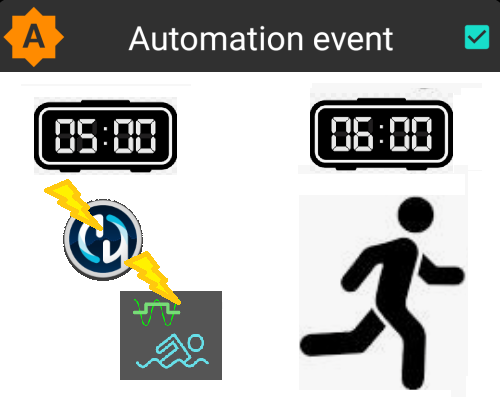
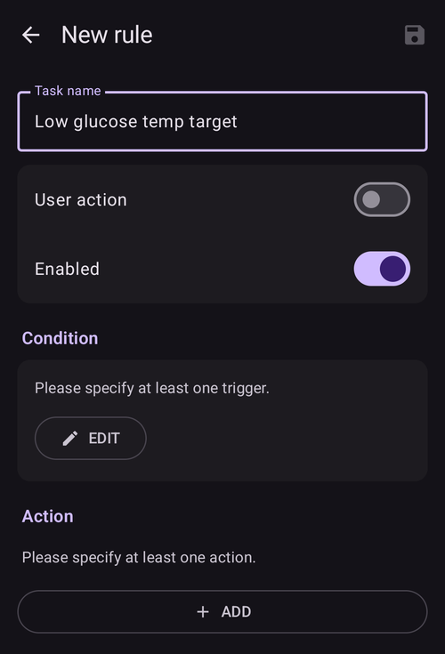
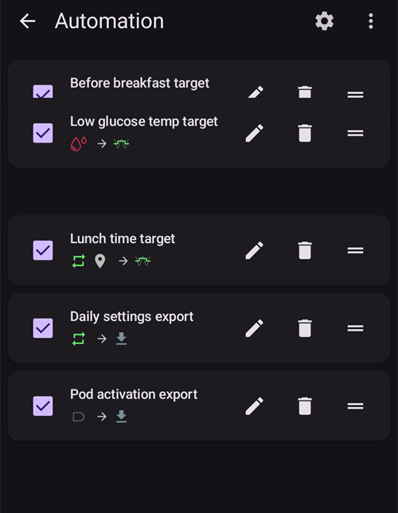
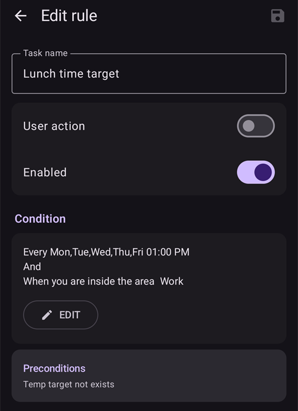
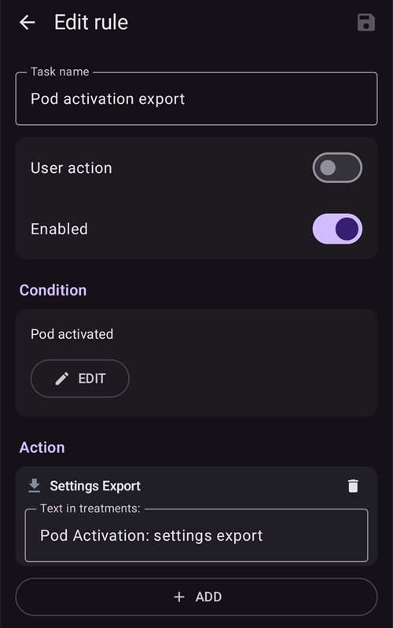

# Automasjon

```{contents} In this page
:backlinks: entry
:depth: 2
```

## Hva er en automasjon?

«**Automasjon**» er en funksjon som kan automatisere oppgaver i AAPS.

Automasjon utfører bestemte handlinger basert på én eller flere betingelser eller utløsere. Utløsere kan være uregelmessige hendelser som lavt eller høyt blodsukker (BS), eller en bestemt mengde negativt aktivt insulin (IOB). Automasjoner kan også håndtere gjentakende hendelser, som måltider eller trening på bestemte tider av døgnet, eller når brukeren er innenfor en bestemt avstand fra en GPS-posisjon eller innenfor rekkevidden til et Wi-Fi-nettverk (SSID). Automasjon kan ta sikkerhetskopi av AAPS-innstillingene etter en tidsplan eller ved hvert pod-bytte.

Automasjonsregler opprettes og endres fra skjermen **Automasjon** (**Administrer → Automasjon**). Hver regel er definert av to egenskaper:

- Én eller flere betingelser eller «utløsere» som starter en handling.

    Det kan være en bestemt tidsplan, en hendelse eller en verdi i AAPS

- Én eller flere handlinger som skal utføres.

    For eksempel en alarm, å sette en profilprosent eller å eksportere AAPS-innstillingene ved pod-bytte.


Det finnes mange muligheter for automasjon, og du oppfordres til å se nærmere på dem i AAPS-appen, under Automasjon. Du kan også søke i AAPS-brukergruppene på [**Facebook**](https://www.facebook.com/groups/AndroidAPSUsers) og [**Discord**](https://discord.gg/4fQUWHZ4Mw) etter eksempler på automasjoner fra andre brukere.

## Hvordan automasjon kan hjelpe

1. **Automatisere gjentakende oppgaver:** Programmerte handlinger utføres automatisk uten at brukeren gjør noe.

1. **Mindre beslutningstretthet:** Den viktigste fordelen med **automasjoner** er at brukeren slipper byrden med å gjøre manuelle inngrep i **AAPS**. [Forskning](https://www.ncbi.nlm.nih.gov/pmc/articles/PMC6286423/#ref4) anslår at personer som lever med diabetes type 1, i gjennomsnitt må ta 180 ekstra avgjørelser hver dag. **Automasjoner** kan gjøre den mentale belastningen mindre, og frigjøre energi til andre deler av livet.

1. **Kan gi bedre blodsukkerkontroll:** for eksempel kan **automasjoner** sørge for at **midlertidige mål** alltid blir satt når det trengs, også i travle perioder eller når du glemmer det. Hvis for eksempel et barn med diabetes har gym på skolen tirsdager kl. 10 og torsdager kl. 14, og trenger et høyt midlertidig mål («TT») 30 minutter før aktiviteten, kan det **midlertidige målet** settes av en **automasjon**.

1. **Gjøre det mulig å tilpasse AAPS i stor grad**, slik at systemet er mer eller mindre aggressivt i bestemte situasjoner, etter brukerens ønske. For eksempel kan en midlertidig redusert **profil**-prosent utløses for en bestemt periode hvis negativ **IOB** oppstår midt på natten, noe som tyder på at den gjeldende **profilen** kan være for sterk.

Eksempelet nedenfor viser hvordan en **automasjon** kan fjerne manuelle steg.

Brukeren trener hver morgen kl. 06: han må huske å sette et «Midlertidig mål – Aktivitet» manuelt i AAPS kl. 05, før treningen.


Brukeren har satt opp en **automasjon** som utløser «Midlertidig mål – Aktivitet» kl. 05, slik at **BS** og **IOB** er optimale før treningen kl. 06:



## Viktig å tenke på før du starter med automasjoner

1. Før du setter opp enkelte automasjoner, bør du ha rimelig god **BS**-kontroll med **AAPS**. Automasjoner bør ikke brukes til å kompensere for dårlig innstilt basal, **ISF** eller **CR** (mer om dette nedenfor). Unngå å sette opp et automatisk **profilbytte** for å kompensere for **BS**-stigninger som skyldes _for eksempel_ mat; slike håndteres bedre på andre måter (SMB osv.).

1. Som all annen teknologi kan **CGM-er**, **pumper** og telefoner svikte: Tekniske problemer eller sensorfeil kan forstyrre **automasjonens** handlinger, og du kan måtte gripe inn manuelt.

1. **Behovet for automasjoner vil trolig endre seg når rutinene dine endrer seg**. Når du bytter mellom jobb-, skole- og ferieperioder, bør du sette en påminnelse i kalenderen om å gå gjennom hvilke **automasjoner** som er aktive (de er enkle å aktivere og deaktivere). For eksempel hvis du drar på ferie og ikke lenger trenger en automasjon for skoleidrett eller daglig trening, eller må justere tidspunktene.

1. **Automasjoner** kan komme i konflikt med hverandre. Det er lurt å gå nøye gjennom alle nye **automasjoner** i trygge omgivelser, og forstå hvorfor en **automasjon** ble eller ikke ble utløst slik du forventet.

1. Hvis du bruker Autosens, bør du helst bruke **midlertidige mål** i stedet for **profilbytter**. **Midlertidige mål** tilbakestiller ikke Autosens til 0. **Profilbytter** tilbakestiller Autosens.

1. De fleste **automasjoner** bør bare settes for en **begrenset varighet**. Etterpå kan **AAPS** vurdere på nytt og gjenta **automasjonen** hvis det trengs, og hvis betingelsen fortsatt er oppfylt. For eksempel «start midlertidig mål på 7,0 mmol/L i 30 min» eller «start **profil** 110 % i 10 min» _og_ «start midlertidig mål på 5,0 mmol/L i 10 min». Å bruke **automasjoner** til å gjøre permanente endringer (for eksempel til en sterkere profilprosent) gir risiko for hypoglykemi.

## Når kan jeg begynne å bruke automasjon?

**Automasjoner** kan tas i bruk fra **opplæringsmål 10**.

## Hvor finner jeg automasjoner i AAPS?

Åpne **Administrer** i navigasjonslinjen nederst på hovedskjermen og velg **Automasjon**.

## Hvordan setter jeg opp en automasjon?

For å sette opp en **automasjon** trykker du på **+**-knappen på Automasjon-skjermen for å opprette en «regel»:



* gi «regelen» din et navn (Oppgavenavn);
* trykk på «**REDIGER**» under **Betingelse**. På skjermen **Betingelse** velger du hvordan utløserne skal kombineres (**Og**, **Eller**, **Eksklusiv eller**) og trykker på «**Legg til utløser**»:


* legg til minst én utløser:


* trykk på «**LEGG TIL**» under **Handling** og velg en handling:


* lagre regelen med **Lagre**-knappen, og pass på at det er «hake» i boksen til venstre for regelnavnet, slik at **automasjonen** er aktivert:


For å deaktivere en **automasjonsregel** fjerner du haken i boksen til venstre for navnet på **automasjonen**. Eksempelet nedenfor viser en **automasjon** som enten er aktivert («hake») eller deaktivert («ingen hake»):


Når du setter opp en **automasjon**, kan du først teste den ved å velge handlingen «Varsling» under «Handlinger». Da viser **AAPS** først en varsling i stedet for å utføre en handling automatisk. Når du er trygg på at varslingen blir utløst på riktig tidspunkt og under riktige betingelser, kan du oppdatere **automasjonsregelen** og bytte ut «Varsling» med en «Handling».


```{admonition} Important note
:class: note

**Automasjoner** er fortsatt aktive når loopen er deaktivert!
```


## Når reglene sjekkes

**AAPS** sjekker alle **automasjonsregler** hver gang en ny blodsukkermåling er behandlet. Reglene vurderes altså i samme takt som CGM-en din, også når telefonskjermen er av. Reglene sjekkes også når telefonen begynner å lade, når nettverket eller posisjonen endres, og når en Bluetooth-enhet kobler til. Bare én sjekk kjører om gangen, så en regel med handlinger som tar litt tid (for eksempel en pumpekommando) kan ikke bli utført to ganger.

## Sikkerhetsgrenser

Det finnes sikkerhetsgrenser for **automasjoner**:

* Et **midlertidig mål** som settes av en **automasjon**, må være mellom 72 og 180 mg/dL (eller 4 og 10 mmol/L).
* **Profilprosenten** må være mellom 50 % og 130 %.
* Det er en tidsgrense på 5 minutter mellom hver kjøring av en **automasjon** (og før første kjøring).

## Riktig bruk av negative verdier

```{admonition} Warning
:class: warning

Vær forsiktig når du velger en negativ verdi i en **automasjon**
```

Vær forsiktig når du velger en «negativ verdi» i en «Betingelse» som «mindre enn» i **automasjoner**. For eksempel:


**Eksempel 1:** En betingelse **«er mindre enn»** «-0,1 mmol/L» (eller «-2 mg/dL») vil:

Utløse en **automasjon** for alle tall som er **strengt mindre enn** -0,1 (-2). Dette gjelder tall som -0,2, -0,3, -0,4 (-4, -6, -8) og så videre. Husk at -0,1 (-2) i seg selv **ikke** er med i denne betingelsen. (Betingelsen «er lik eller mindre enn -0,1 mmol/L (-2 mg/dL)» _ville_ tatt med -0,1 mmol/L eller -2 mg/dL.)

**Eksempel 2:** En betingelse «er større enn» -0,1 mmol/L (-2 mg/dL) vil:

Utløse en **automasjon** for alle tall som er **større enn** -0,1 mmol/L (-2 mg/dL). Dette gjelder tall som 0, 0,2, 0,4 mmol/L (0, 4, 8 mg/dL) og alle andre positive tall.

Det er viktig å tenke nøye gjennom hva du egentlig vil oppnå med **automasjonen** din når du velger disse betingelsene og verdiene.

(automations-automation-triggers)=
## Utløsere for automasjon


Bla ned for å se resten av listen:


Det finnes ulike «utløsere» som du kan velge. Utløsere er betingelsene som må være oppfylt for at automasjonen skal kjøre. Listen nedenfor er ikke fullstendig:

**Utløser:** koble sammen betingelser

**Alternativer:**

Flere betingelser kan kobles sammen med
* «Og»
* «Eller»
* «Eksklusiv eller» (betyr at handlingen(e) bare skjer hvis én – og bare én – av betingelsene er oppfylt)

**Utløser:** tid eller gjentakende tidspunkt

**Alternativer:**

* tid = en enkelt hendelse på ett tidspunkt
* gjentakende tidspunkt = noe som skjer regelmessig (for eksempel én gang i uken, hver arbeidsdag osv.)

**Utløser:** plassering

**Alternativer:**

* i [Innstillinger > Automasjon](#preferences-maintenance-settings) kan du velge hvilken posisjonstjeneste som skal brukes.

**Utløser:** posisjonstjeneste

**Alternativer:**

* Bruk passiv posisjon: **AAPS** henter bare posisjonen når andre apper ber om den.
* Bruk nettverksposisjon: Posisjonen til Wi-Fi-nettverket ditt.
* Bruk GPS-posisjon (Obs! Dette kan bruke svært mye batteri!)

**Utløsere**: pumpe- og sensordata

* Utløseren Kanylealder: Tilgjengelig for alle pumper
* Utløseren Insulinalder: Tilgjengelig for pumper som støtter det
* Utløseren Batterialder: Tilgjengelig for pumper som støtter det
* Utløseren Sensoralder: alltid tilgjengelig
* Utløseren Pod-aktivering: Tilgjengelig for patch-pumper

Merk at for alle alder-utløserne vil sammenligningen «er lik» sjelden slå til, så da trenger du to utløsere for å lage et intervall

* Utløseren Reservoarnivå: Tilgjengelig for alle pumper. Sammenligningen «NOT\_AVAILABLE» virker ikke for denne utløseren, fordi verdien alltid er fylt ut i **AAPS**
* Utløseren Batterinivå for pumpe: Tilgjengelig for pumper som støtter det. Sammenligningen «NOT\_AVAILABLE» virker ikke for denne utløseren, fordi verdien alltid er fylt ut i **AAPS**

(automations-automation-action)=
## Handling


Bla ned for å se resten av listen:


**Handlinger:** start **Midlertidig mål**

**Alternativer:**

* **BS** må være mellom 72 mg/dL og 180 mg/dL (4 mmol/L og 10 mmol/L)
* **TT** virker bare hvis det ikke allerede er et midlertidig mål aktivt – **AAPS** legger automatisk til linjen «**Forutsetninger: Midlertidig mål finnes ikke**» i regelen

**Handlinger:** stopp **Midlertidig mål**

**Alternativer:**

ingen

**Handlinger:** **Profilprosent**

**Alternativer:**

* **Profil** må være mellom 50 % og 130 %
* virker bare hvis den forrige prosenten er 100 %

**Handlinger:** **Endre utjevning** (i gruppen **Loop & insulin**)

**Alternativer:**

* velg [utjevningsmetoden](../CompatibleCgms/SmoothingBloodGlucoseData.md) det skal byttes til. Listen er den samme som under **Konfigurasjon** > **Utjevning**, og handlingen gjør nøyaktig det samme som en endring der: den nye metoden lagres, synkroniseres til parede klienter, og BS-dataene utjevnes på nytt med en gang.
* kjører bare hvis den utjevningsmetoden ikke allerede er aktiv – **AAPS** legger automatisk til linjen «**Forutsetninger: Utjevning … er ikke aktiv**» i regelen. Når den valgte utjevningen er aktiv, hoppes regelen over uten melding.
* Eksempel: en ny sensor gir ofte mye støy den første dagen. To regler med utløseren **Sensoralder** gir sterkere filtrering mens sensoren stabiliserer seg, og utjevning uten forsinkelse etterpå:
  * **Sensoralder** mindre enn 24 t: **Endre utjevning** til **Unscented Kalman-filter**
  * **Sensoralder** mer enn 24 t: **Endre utjevning** til **Gjennomsnittlig utjevning**

**Handlinger:** **Merknad** (i gruppen **Varsler** i listen)

**Alternativer:**

* velg hendelsen som skal registreres: **Merknad**, **Trening**, **Spørsmål**, **Melding** eller **Bytte av pumpested**, og eventuelt en merknad. Navnet på handlingen endres til hendelsen du velger.
* **Varighet**: brukes for **Merknad**, **Trening** og **Bytte av pumpested**. **Spørsmål** og **Melding** har ingen varighet: de registrerer i stedet BS-verdien din akkurat nå.
* **Bytte av pumpested** nullstiller kanylealderen, som om du hadde registrert et bytte av sted manuelt. Eksempel: noen pumper (som Combo) registrerer reservoarbytte selv, men ikke bytte av sted. Hvis du alltid bytter begge samtidig, kan en regel med **Insulinalder** mindre enn 1 time og **Kanylealder** mer enn 24 timer registrere byttet av sted for deg.

 

**Handlinger:** **Send SMS til alle numre** (i gruppen **Varsler**)

**Alternativer:**

* skriv inn teksten i meldingen. Den sendes til alle telefonnumrene som er tillatt i innstillingene for [SMS-kommunikasjon](../RemoteFeatures/SMSCommands.md). Pluginen SMS-kommunikasjon må være aktivert.

**Handlinger:** **Endre profil til** (i gruppen **Profil**)

**Alternativer:**

* velg **profilen** som skal aktiveres. Den aktiveres med 100 %, uten tidsforskyvning. Hvis denne profilen allerede er aktiv, gjør handlingen ingenting.

**Handlinger:** **Aktiver/deaktiver SMB** (i gruppen **Loop & insulin**)

**Alternativer:**

* velg **PÅ** eller **AV**. Dette endrer innstillingen **Aktiver SMB** i OpenAPS SMB, akkurat som om du hadde endret den i **Innstillinger**, og den blir stående til du eller en annen regel endrer den tilbake.

**Handlinger:** **Kjør Autotune** (i gruppen **Loop & insulin**)

**Alternativer:**

* velg profilen som skal justeres, og antall dager: se [Kjør Autotune med en automasjonsregel](#autotune-run-autotune-with-an-automation-rule).

**Handlinger:** **Stopp prosessering** (i gruppen **Loop & insulin**)

**Alternativer:**

* ingen. Så lenge betingelsene i en regel med denne handlingen er sanne, sjekker **AAPS** ikke reglene under den i listen. Så snart betingelsene er usanne igjen, sjekkes reglene under som vanlig. Legg den til i en regel som skal ha prioritet over reglene under seg (se [rekkefølgen på automasjonene](#Automations-the-order-of-the-automations-in-the-list-matters)).

**Handlinger:** **Kjør scene**, **Aktiver scene**, **Deaktiver scene** (i gruppen **Scener**)

**Alternativer:**

* velg [scenen](Scenes.md) som skal kjøres, aktiveres eller deaktiveres.

Når «Handlingen» er lagt til, må du endre standardverdiene til det tallet du ønsker, ved å trykke på dem og justere.


(Automations-the-order-of-the-automations-in-the-list-matters)=
## Rekkefølgen på **automasjonene** i listen har betydning
 **AAPS** kjører reglene i prioritert rekkefølge, fra toppen av **automasjonslisten**. Hvis for eksempel **automasjonen** «Lavt» er den viktigste **automasjonen**, viktigere enn alle andre regler, bør denne **automasjonen** stå øverst i **automasjonslisten** din, som vist nedenfor:


For å endre prioriteten på **automasjonsreglene** trykker og holder du på **=**-håndtaket på høyre side av regelen. Endre rekkefølgen på **automasjonene** ved å flytte reglene opp eller ned.



## Slik sletter du automasjonsregler

For å slette en **automasjonsregel** trykker du på søppelbøtte-ikonet.


## Eksempler på automasjoner

Nedenfor er noen eksempler på **automasjoner**. Mer diskusjon om **automasjoner**, og om hvordan brukere har tilpasset sine egne **automasjoner**, finner du i diskusjonsgruppene på Facebook eller på Discord. Du bør ikke kopiere eksemplene nedenfor uten å forstå godt hvordan **automasjonen** vil virke.

(automations-low-glucose-temp-target)=
### Midlertidig mål ved lavt blodsukker

Denne **automasjonen** starter automatisk et **midlertidig mål** når **BS** faller under en bestemt grense – her startes et mål på 110 mg/dL i 30 minutter når blodsukkeret er mindre enn 70 mg/dL:


### Midlertidig mål til lunsj (med «Plassering»)



Denne **automasjonen** er laget for en bruker som spiser lunsj på jobb omtrent til samme tid hver ukedag, men den utløses bare hvis brukeren befinner seg innenfor en bestemt «plassering».  Så hvis brukeren ikke er på jobb en dag, vil denne **automasjonen** ikke bli aktivert.

Denne **automasjonen** setter et lavt **midlertidig mål** (Spise snart) kl. 13:00 for å få BS ned mot 90 mg/dL (eller 5 mmol/L) før lunsj.

«Utløseren» plassering har et navn, en posisjon (trykk på **Velg fra kart**, eller bruk posisjonen din akkurat nå) og en radius i meter, og slår til når du er innenfor (eller utenfor) området:


På grunn av «Og»-koblingen skjer **automasjonen** bare på det «valgte tidspunktet» og bare hvis brukeren er på det valgte stedet.

**Automasjonen** blir ikke utløst på andre tidspunkter på dette stedet, eller på dette tidspunktet utenfor en radius på 50 meter rundt den valgte posisjonen.

### Automasjon med Wi-Fi SSID som plassering

Å bruke en Wi-Fi SSID er et godt valg for å utløse en **automasjon** når du er innenfor rekkevidden til et bestemt Wi-Fi-nettverk (sammenlignet med GPS): det er ganske presist, bruker mindre batteri og virker innendørs der GPS og andre posisjonstjenester kanskje ikke er tilgjengelige.

Her er et annet eksempel på å sette opp et **midlertidig mål** bare på arbeidsdager, før frokost (1).


**Automasjonen** utløses kl. 05:30 bare mandag–fredag (2)  
og bare når telefonen er koblet til Wi-Fi-nettverket hjemme (3).


Den setter da et **midlertidig mål** på 75 mg/dL i 30 minutter (4). En av fordelene med å ta med plasseringen er at den ikke utløses hvis brukeren for eksempel er på ferie.


Bla ned for å se handlingen: et **midlertidig mål** på 75 mg/dL i 30 minutter (4).


Her er skjermbildet som viser utløserne for **automasjonen**:

1) Under hoved-«OG» (begge betingelsene må være oppfylt for å utløse) 1) Gjentakende tidspunkt = M,T,O,T,F kl. 05:30  
1) Wi-Fi SSID = My_Home_WiFi_Name


(automating-preference-settings-export)=

## Automatisk eksport av innstillinger

### Uovervåket eksport: etter tidsplan (daglig)

Skjermbilder som viser utløserne for automasjonen:

1) Betingelse: Gjentakende tidspunkt = M,T,O,T,F kl. 08:00 1) Handling: Eksporter innstillinger (skriv «Daglig» i «Tekst i behandlinger»)


Merk: Eksporten blir loggført i Helseportal

### Uovervåket eksport: Pod-aktivering (bare patch-pumper)

Skjermbilder som viser utløserne for automasjonen:

1) Betingelse: Pod-aktivering 1) Handling: Eksporter innstillinger (skriv «Pod-aktivering: eksport av innstillinger» i «Tekst i behandlinger»)



Merk: Eksporten blir loggført i Helseportal. Merk: Automasjonen vil **ikke** utløses i det hele tatt hvis du ikke har gjort en manuell eksport av innstillingene først. Se [Innstillinger → Vedlikehold](#preferences-maintenance-settings) for hvordan du aktiverer uovervåket eksport av innstillinger riktig.


## Automasjonslogg

**AAPS** viser en logg over de siste **automasjonshendelsene** nederst på **Automasjon**-skjermen, under reglene. Bruk den til å sjekke at reglene dine ble utløst når du forventet det.

I eksempelet nedenfor er regelen **Low glucose temp target** (1) (se [Midlertidig mål ved lavt blodsukker](#automations-low-glucose-temp-target) ovenfor) aktivert. Loggen (2) viser at blodsukkeret falt under 70 mg/dL kl. 15:09, og regelen ble utløst:
* handlingen var «Start midlertidig mål: 110mg/dL@30 min»: et **midlertidig mål** på 110 mg/dL i 30 minutter;
* **OK** til slutt betyr at handlingen ble utført.


(automations-troubleshooting)=

## Feilsøking

* Problem: __Automasjonene mine blir ikke utløst av AAPS?__

Sjekk at det er «hake» i boksen til venstre for navnet på **automasjonen**, slik at regelen er aktivert:


* Problem: __Automasjonene mine blir utløst i feil rekkefølge.__

Sjekk rekkefølgen og prioriteten på reglene dine, som beskrevet ovenfor.

* Problem: __En betingelse viser «Ukjent utløser … – blir aldri sann».__

Regelen inneholder en utløser som denne versjonen av **AAPS** ikke kan lese, for eksempel etter at du gikk tilbake til en eldre versjon eller importerte innstillinger fra en nyere. En slik utløser blir aldri sann, så regelen kjører ikke. Den beholdes uendret, slik at en nyere versjon fortsatt kan bruke den. Rediger regelen og bytt ut utløseren, eller oppdater **AAPS**.

## Alternativer til automasjoner

For avanserte brukere finnes det andre muligheter til å automatisere oppgaver med IFTTT eller en tredjeparts Android-app som heter Automate. 
