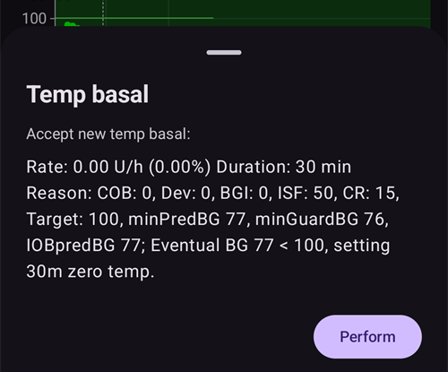

# Viktige funksjoner i AAPS

## Loop-modus

Loopstatusen vises på hovedskjermen med ett av ikonene nedenfor.

**AAPS** har flere loop-moduser, som Lukket Loop (1), Stopp ved lavt BS (LGS – 2) og Åpen Loop (3).

Se [AAPS-skjermbilder > Hovedskjermen > Loopstatus](#AapsScreens-loop-status) for informasjon om hvordan du velger loop-modus, og om de andre ikonene på bildet (4 til 6).

(KeyAapsFeatures-OpenLoop)=

### Åpen Loop

**AAPS** vurderer hele tiden alle tilgjengelige data (IOB, COB, BS …) og gir behandlingsforslag (midlertidige basaldoser) om hvordan behandlingen bør justeres om nødvendig.

Forslagene utføres ikke automatisk (slik som i lukket loop). Du må selv utføre forslagene manuelt på pumpen (hvis du bruker virtuell pumpe) eller med en knapp hvis **AAPS** er koblet til en ekte pumpe.

Når **AAPS** har et forslag, vises et **Loop**-element med et merke i navigasjonslinjen nederst på hovedskjermen. Trykk på det for å lese forslaget («Godta ny midlertidig basal») med dose, varighet og begrunnelse, og trykk deretter på **Utfør** for å utføre det:

Et forslag er bare gyldig i noen få minutter. Hvis det er eldre enn omtrent 9 minutter, eller hvis loopen er satt på pause eller pumpen er koblet fra i mellomtiden, avviser **AAPS** det, og ingenting sendes til pumpen (*«Dette forslaget er for gammelt. Ingenting ble sendt til pumpen. Vent på neste forslag.»*). Vent på neste forslag.

Dette valget er for å bli kjent med hvordan **AAPS** virker, eller hvis du bruker en pumpe som ikke støttes. Du er i Åpen Loop uansett hva du velger her, til du er ferdig med **[opplæringsmål 5](#objectives-objective5)**.

(KeyAapsFeatures-LGS)=

### Stopp ved lavt BS (LGS)

I denne modusen settes [maxIOB](#Open-APS-features-maximum-total-iob-openaps-cant-go-over) til null.

Det betyr at hvis blodsukkeret faller, kan **AAPS** redusere basalen for deg. Men hvis blodsukkeret stiger, gjøres det ingen automatisk korreksjon. Basaldosene dine forblir som de er definert i din gjeldende **profil**. Bare hvis IOB er negativ (etter en tidligere stopp ved lavt BS) gis det ekstra insulin for å senke **BS**.

Denne modusen er tilgjengelig fra **[opplæringsmål 6](#objectives-objective6)**.

I tillegg til at du kan velge den selv, kan **AAPS** også bytte til denne modusen på egen hånd: mens du jobber med **[opplæringsmål 6](#objectives-objective6)**, og når den oppdager dupliserte BS-målinger (se [BS-varselsymbol](#aaps-screens-bg-warning-sign)).

(KeyAapsFeatures-ClosedLoop)=

### Lukket Loop

**AAPS** vurderer hele tiden alle tilgjengelige data (IOB, COB, BS …) og justerer behandlingen automatisk om nødvendig (*det vil si* uten at du trenger å gjøre noe) for å nå det valgte [målområdet eller målverdien](#profile-glucose-targets) (bolus, midlertidig basaldose, stopp av insulin for å unngå føling osv.).

Lukket loop jobber innenfor mange sikkerhetsgrenser, som kan stilles inn individuelt.

Lukket loop er bare mulig hvis du er på **[opplæringsmål 7](#objectives-objective7)** eller høyere, og bruker en pumpe som støttes.

(autosens)= (Open-APS-features-autosens)=

## Autosens

- Autosens er en algoritme som ser på avvik i blodsukkeret (positive/negative/nøytrale).
- Den prøver å finne ut hvor sensitiv/resistent du er, basert på disse avvikene.
- Oref-implementasjonen i **OpenAPS** bruker en kombinasjon av data fra de siste 24 og 8 timene. Den bruker den av de to som gir høyest sensitivitet.
- Hvis du kommer fra oref1, vil du trolig merke at systemet kan reagere mindre dynamisk på endringer, fordi sensitiviteten veksler mellom 24 og 8 timer med data.
- Bytte av kanyle eller bytte av profil nullstiller Autosens-ratioen til 100 % (et profilbytte med prosent og varighet nullstiller ikke Autosens).
- Autosens justerer basaldosen og ISF (det vil si: den etterligner det et profilbytte gjør).
- Hvis du spiser karbohydrater sammenhengende over en lengre periode, er Autosens mindre effektiv i den perioden, fordi karbohydrater holdes utenfor beregningen av **BS**-delta.
- Avvikene gjøres om til en **sensitivitetsratio** (en prosent): en ratio under 100 % betyr at AAPS tror du er mer sensitiv for insulin enn **profilen** din antar (så den senker den effektive basalen og øker ISF-verdien), mens en ratio over 100 % betyr at du er mer resistent (så den øker basalen og senker ISF-verdien).
- Som standard holdes denne ratioen mellom 0,7 (70 %, mer sensitiv) og 1,2 (120 %, mer resistent), slik at en periode med uvanlige data ikke kan flytte doseringen din for langt fra **profilen**. Disse grensene kan justeres i de avanserte innstillingene for Sensitivitetsdeteksjon.
- Autosens og [Autotune](../AdvancedOptions/Autotune.md) løser det samme grunnleggende problemet på ulike tidsskalaer: Autosens justerer den *løpende* doseringen din minutt for minutt ut fra de siste 8–24 timene, mens Autotune sakte skriver om selve *profilen* din ut fra flere ukers historikk. Det er normalt og forventet å bruke begge — de utfyller hverandre i stedet for å gjøre det samme.

*For en full teknisk gjennomgang av Autosens-algoritmen, se [OpenAPS sin Autosens-dokumentasjon](https://openaps.readthedocs.io/en/latest/docs/Customize-Iterate/autosens.html).*

(Open-APS-features-super-micro-bolus-smb)=

## Supermikrobolus (SMB)

**SMB**, kort for **supermikrobolus**, er en OpenAPS-funksjon som ble innført fra 2018, som en del av Oref1-algoritmen. I motsetning til **AMA** bruker **SMB** ikke midlertidige basaldoser for å styre glukosen, men hovedsakelig **små supermikroboluser**. I situasjoner der **AMA** ville gitt 1,0 E insulin med en midlertidig basaldose, gir **SMB** flere supermikroboluser i små steg med **5 minutters mellomrom**, for eksempel 0,4 E, 0,3 E, 0,2 E og 0,1 E. Samtidig (av sikkerhetsgrunner) settes den faktiske basaldosen til 0 E/t i en viss periode for å hindre overdosering (**«zero-temping»**). Dermed kan systemet justere blodsukkeret raskere enn med økningen i midlertidig basaldose i **AMA**.

Takket være SMB kan det ved måltider med bare «langsomme» karbohydrater være nok å fortelle systemet hvor mye karbohydrater du planlegger å spise, og overlate resten til **AAPS**. Dette kan likevel gi høyere topper etter måltidet (postprandialt), fordi det ikke er mulig å gi bolus på forhånd. Eller du kan gi en **startbolus**, om nødvendig på forhånd, som **bare delvis** dekker karbohydratene (for eksempel 2/3 av den anslåtte mengden), og la **SMB** gi resten av insulinet.

SMB-er vises på [IOB-grafen](#aaps-screens-iob) som blå trekanter. [Trykk og hold](#aaps-screens-graph-press-and-hold) på grafen ved en trekant for å se hvor mye insulin som ble gitt, eller bruk [Behandlingshistorikk](#aaps-screens-treatments).

**SMB** har noen innebygde sikkerhetsmekanismer:

1. **Største enkeltdose SMB**  
  Den største enkeltdosen SMB kan aldri være større enn den minste av disse verdiene:
  
        * verdien som tilsvarer gjeldende basaldose (justert av Autosens) for tiden som er satt i «Maks antall minutter med basal som kan bli SMB», for eksempel basalmengden for de neste 30 minuttene, eller
        * halvparten av insulinmengden som trengs akkurat nå, eller
        * den delen av maxIOB-verdien i innstillingene som er igjen.
      

2. **Lave midlertidige basaldoser**  
  Lave midlertidige basaldoser (kalt «low temps») eller midlertidige basaldoser på 0 E/t (kalt «zero-temps») brukes oftere i **SMB**. Dette er gjort med vilje av sikkerhetsgrunner, og har ingen negative virkninger hvis **profilen** er riktig satt opp. På hovedgrafen sier IOB-kurven (den tynne gule linjen) mer enn forløpet av de midlertidige basaldosene.

3. **Ikke-varslede måltider**  
  Ekstra beregninger for å forutsi hvordan glukosen vil utvikle seg, for eksempel med **UAM** (ikke-varslede måltider). Selv uten at du registrerer karbohydrater manuelt, kan **UAM** automatisk oppdage en tydelig økning i glukosen som skyldes måltider, adrenalin eller andre påvirkninger, og prøve å justere dette med **SMB**. For sikkerhets skyld virker dette også motsatt vei, og kan stoppe SMB tidligere hvis glukosen uventet faller raskt. Derfor bør UAM alltid være aktivert når du bruker SMB.

SMB bestemmer ikke på egen hånd at det trengs insulin — den bygger på de samme kombinerte BS-prediksjonene (eventuelt BS, zero-temp, COB, UAM) som er beskrevet i [hvordan AAPS gjør prediksjoner om til en doseringsbeslutning](#aaps-screens-how-predictions-become-a-dosing-decision). SMB og zero-temping er rett og slett de to verktøyene AAPS bruker for å handle på den beslutningen.

**Du må ha startet [opplæringsmål 9](#objectives-objective9) for å bruke SMB.**

Se også [OpenAPS sin oref1/SMB-dokumentasjon](https://openaps.readthedocs.io/en/latest/docs/Customize-Iterate/oref1.html#understanding-super-micro-bolus-smb) for en full teknisk gjennomgang, eller [Tims informasjon om SMB](https://www.diabettech.com/artificial-pancreas/understanding-smb-and-oref1/) for en beskrivelse fra fellesskapet.

Innstillingene for OpenAPS SMB er beskrevet nedenfor.

(Open-APS-features-max-u-h-a-temp-basal-can-be-set-to)=

### Maksimal basaldose

Denne sikkerhetsinnstillingen bestemmer den høyeste midlertidige basaldosen insulinpumpen kan levere. Den kalles også **max-basal**.

Verdien måles i enheter per time (E/t). Det anbefales å sette denne til en fornuftig verdi. En god anbefaling for denne parameteren er:

**MAX-BASAL = HØYESTE BASALDOSE x 4**

Hvis for eksempel den høyeste basaldosen i profilen din er 0,5 E/t, kan du gange den med 4 og få en verdi på 2 E/t.

**AAPS** begrenser denne verdien med en «hard begrensning» ut fra [Innstillinger > Sikkerhet > Pasientalder](#preferences-patient-type). De harde begrensningene er slik:

- Barn: 2
- Tenåring: 5
- Voksen: 10
- Insulinresistent voksen: 12
- Gravid: 25

*Se også [oversikt over hardkodede begrensninger](#Open-APS-features-overview-of-hard-coded-limits).*

(Open-APS-features-maximum-total-iob-openaps-cant-go-over)=

### Maksimal total IOB som OpenAPS ikke kan gå over

Denne verdien bestemmer den høyeste mengden **aktivt insulin** (basal- og bolus-IOB) som **AAPS** holder seg under når den kjører i lukket loop. Den kalles også **maxIOB**.

Hvis gjeldende IOB (for eksempel etter en måltidsbolus) er over den angitte verdien, slutter loopen å dosere insulin til IOB igjen er under den angitte verdien.

Et godt utgangspunkt for denne parameteren er:

      maxIOB = gjennomsnittlig måltidsbolus + 3 x høyeste daglige basaldose
    

Vær forsiktig og tålmodig når du justerer **max-IOB**. Den er forskjellig fra person til person, og kan også avhenge av gjennomsnittlig total daglig dose (TDD).

**AAPS** begrenser denne verdien med en «hard begrensning» ut fra [Innstillinger > Sikkerhet > Pasientalder](#preferences-patient-type). De harde begrensningene er slik:

- Barn: 7
- Tenåring: 13
- Voksen: 22
- Insulinresistent voksen: 30
- Gravid: 70

*Se også [oversikt over hardkodede begrensninger](#Open-APS-features-overview-of-hard-coded-limits).*

Merk: Når du bruker **SMB**, beregnes **max-IOB** annerledes enn i AMA. I **AMA** er maxIOB en sikkerhetsparameter for basal-**IOB**, mens den i SMB-modus også omfatter bolus-IOB.

### Bruk dynamisk sensitivitet

Dette er funksjonen [Dynamisk ISF (DynISF)](../DailyLifeWithAaps/DynamicISF.md). Når den er aktivert, blir nye innstillinger tilgjengelige. Innstillingene er forklart på siden [Dynamisk ISF](#dyn-isf-preferences).

### Bruk Autosens

Dette er funksjonen [Autosens](#Open-APS-features-autosens). Når du bruker Dynamisk ISF, kan ikke Autosens brukes, fordi det er to ulike algoritmer som endrer den samme variabelen (sensitivitet).

Autosens ser på avvik i blodsukkeret (positive/negative/nøytrale). Den prøver å finne ut hvor sensitiv/resistent du er ut fra disse avvikene, og justerer basaldose og ISF ut fra dem.

Når den er aktivert, blir nye innstillinger tilgjengelige.

#### Sensitivitet hever mål

Hvis dette valget er aktivert, kan sensitivitetsdeteksjonen (Autosens) heve målet når den oppdager økt sensitivitet (under 100 %). Da heves målet ditt med prosentandelen for den oppdagede sensitiviteten.

Hvis målet endres på grunn av sensitivitetsdeteksjon, vises det med grønn bakgrunn på hovedskjermen.

Denne innstillingen er tilgjengelig når enten «Bruk dynamisk sensitivitet» eller «Bruk Autosens» er aktivert.

#### Resistens senker mål

Hvis dette valget er aktivert, kan sensitivitetsdeteksjonen (Autosens) senke målet når den oppdager resistens (over 100 %). Da senkes målet ditt med prosentandelen for den oppdagede resistensen.

Denne innstillingen er tilgjengelig når enten «Bruk dynamisk sensitivitet» eller «Bruk Autosens» er aktivert.

### Aktiver SMB

Aktiver denne for å bruke SMB-funksjonen. Hvis den er deaktivert, gis ingen **SMB-er**.

Når den er aktivert, blir nye innstillinger tilgjengelige.

(Open-APS-features-enable-smb-with-high-temp-targets)=

#### Aktiver SMB ved høyt midlertidig mål

Hvis denne innstillingen er aktivert, gis **SMB-er** fortsatt selv om du har valgt et høyt **midlertidig mål** (definert som 100 mg/dL eller 5,6 mmol/L og høyere, uavhengig av målet i **profilen**). Vær forsiktig når du aktiverer den: **SMB-er** kan bli altfor aggressive hvis innstillingene dine ikke er godt justert, eller hvis **profilen** din varierer ofte (for eksempel hos barn).

Når denne innstillingen er deaktivert, slår et høyt **midlertidig mål** av **SMB-er**. Hvis dette valget for eksempel er deaktivert, kan **SMB-er** slås av ved å sette et **midlertidig mål** på 100 mg/dL eller 5,6 mmol/L og høyere. Dette valget deaktiverer også **SMB-er** uansett hvilken annen betingelse som prøver å aktivere SMB — bortsett fra et lavt **midlertidig mål** som **Spise snart** (eller et hvilket som helst **midlertidig mål** på 98 mg/dL eller 5,4 mmol/L og lavere), som fortsatt kan gi **SMB-er** for å drive **BS** mot målet.

Denne innstillingen slår ikke på **SMB** alene. Med et høyt midlertidig mål gis **SMB** bare hvis en av de andre innstillingene nedenfor (for eksempel **Aktiver SMB alltid** eller **Aktiver SMB med COB**) også tillater det.

(Open-APS-features-enable-smb-always)=

#### Aktiver SMB alltid

Hvis denne innstillingen er aktivert, er SMB alltid aktivert (uavhengig av COB, midlertidige mål eller boluser). Hvis denne innstillingen er aktivert, har de andre «Aktiver»-innstillingene nedenfor ingen virkning. Men hvis **Aktiver SMB ved høyt midlertidig mål** er deaktivert og et høyt midlertidig mål er satt, blir SMB deaktivert.

Denne innstillingen er bare tilgjengelig hvis **AAPS** oppdager at du bruker en [pålitelig BS-kilde](#GettingStarted-TrustedBGSource) med avansert filtrering. FreeStyle Libre 1 regnes ikke som en pålitelig kilde, fordi den kan gjenta gamle BS-data i det uendelige hvis sensoren svikter.

Støyete data kan få **AAPS** til å tro at BS stiger veldig raskt, slik at det gis unødvendige SMB-er. Mer informasjon om støy og utjevning av data finner du [her](../CompatibleCgms/SmoothingBloodGlucoseData.md).

#### Aktiver SMB med COB

Hvis denne innstillingen er aktivert, er SMB aktivert når COB er større enn 0.

Denne innstillingen vises ikke hvis «Aktiver SMB alltid» er slått på.

#### Aktiver SMB ved lavt midlertidig mål

Hvis denne innstillingen er aktivert, er SMB aktivert når et midlertidig mål er satt (spise snart, aktivitet, hypo, egendefinert). Hvis denne innstillingen er aktivert, men **Aktiver SMB ved høyt midlertidig mål** er deaktivert, er SMB aktivert når et lavt midlertidig mål er satt (98 mg/dL eller 5,4 mmol/L og lavere), men deaktivert når et høyt midlertidig mål er satt.

Denne innstillingen vises ikke hvis «Aktiver SMB alltid» er slått på.

#### Aktiver SMB etter karbo

Hvis den er aktivert, er SMB aktivert i 6 timer etter at karbohydrater er registrert, selv om COB har nådd 0.

Av sikkerhetsgrunner er denne innstillingen bare tilgjengelig hvis **AAPS** oppdager at du bruker en pålitelig BS-kilde. Den vises ikke hvis «Aktiver SMB alltid» er slått på.

Denne innstillingen er bare tilgjengelig hvis **AAPS** oppdager at du bruker en [pålitelig BS-kilde,](#GettingStarted-TrustedBGSource) med avansert filtrering. FreeStyle Libre 1 regnes ikke som en pålitelig kilde, fordi den kan gjenta gamle BS-data i det uendelige hvis sensoren svikter.

Støyete data kan få **AAPS** til å tro at BS stiger veldig raskt, slik at det gis unødvendige SMB-er. Mer informasjon om støy og utjevning av data finner du [her](../CompatibleCgms/SmoothingBloodGlucoseData.md).  
Denne innstillingen vises ikke hvis «Aktiver SMB alltid» er slått på.

#### SMB-intervall

Denne funksjonen begrenser hvor ofte SMB-er gis. Verdien bestemmer den korteste tiden mellom to SMB-er. Merk at loopen kjører hver gang en ny glukoseverdi kommer inn (vanligvis hvert 5. minutt). Trekk fra 2 minutter for å gi loopen ekstra tid til å bli ferdig. Hvis du for eksempel vil at SMB skal gis ved hver loop-kjøring, setter du denne til 3 minutter.

Standardverdi: 3 min.

(Open-APS-features-max-minutes-of-basal-to-limit-smb-to)=

#### Maks antall minutter med basal som kan bli SMB

Dette er en viktig sikkerhetsinnstilling. Verdien bestemmer hvor mye SMB som kan gis, ut fra mengden basalinsulin i et gitt tidsrom, når det er dekket av COB.

En høyere verdi lar SMB være mer aggressiv. Du bør starte med standardverdien på 30 minutter. Når du har fått litt erfaring, kan du øke verdien i steg på 15 minutter og se virkningen over flere måltider.

Det anbefales å ikke sette verdien høyere enn 90 minutter, for da kan algoritmen komme til et punkt der den ikke lenger klarer å håndtere et fallende BS med 0 E/t basal («zero-temp»). Du bør også sette alarmer som varsler deg i god tid før en føling, særlig hvis du fortsatt tester nye innstillinger.

Standardverdi: 30 min.

#### Maks antall minutter med basal som kan bli SMB ved UAM

Med denne innstillingen kan du justere styrken på SMB under UAM, når det ikke er flere karbohydrater igjen.

Standardverdi: den samme som **Maks antall minutter med basal som kan bli SMB**.

Denne innstillingen vises bare hvis «Aktiver SMB» og «Aktiver UAM» er slått på.

(enable-uam)=

### Aktiver UAM

Når dette valget er aktivert, kan SMB-algoritmen gjenkjenne ikke-varslede måltider. Det hjelper hvis du glemmer å fortelle **AAPS** om karbohydratene dine, hvis du anslår feil og registrerer feil mengde karbohydrater, eller hvis et måltid med mye fett og protein varer lenger enn ventet. Uten noen karbohydratregistrering kan UAM gjenkjenne rask glukosestigning som skyldes karbohydrater, adrenalin osv., og prøver å justere den med SMB-er. Dette virker også motsatt vei: Hvis glukosen faller raskt, kan den stoppe SMB-er tidligere.

**Derfor bør UAM alltid være aktivert når du bruker SMB.**

(key-aaps-features-minimal-carbs-required-for-suggestion)=

### Terskel for forslag om behov for karbo

Minste antall gram karbohydrater før det vises et varsel med karbohydratforslag. Det foreslås å spise ekstra karbohydrater når referansealgoritmen oppdager at det trengs karbohydrater. Da får du en varsling som kan slumres i 5, 15 eller 30 minutter.

Varsler om at karbohydrater kreves kan sendes til Nightscout hvis du ønsker det. Da vises og kringkastes en melding (announcement) der.

Uansett vises karbohydratene som trengs i COB-feltet på hovedskjermen.

### Avanserte innstillinger

For en full oversikt over parameterne (også innstillinger som ikke er omtalt her), se [OpenAPS sin dokumentasjon om innstillinger og sikkerhetsinnstillinger](https://openaps.readthedocs.io/en/latest/docs/While%20You%20Wait%20For%20Gear/preferences-and-safety-settings.html).

**Bruk alltid kort gjennomsnittlig delta i stedet for enkel delta** Hvis du aktiverer denne funksjonen, bruker **AAPS** det korte gjennomsnittlige deltaet/blodsukkeret fra de siste 15 minuttene, som vanligvis er gjennomsnittet av de tre siste verdiene. Dette hjelper **AAPS** å være mer stabil med støyete datakilder som xDrip og Libre.

**Maks daglig sikkerhetsmultiplikator** Dette er en viktig sikkerhetsgrense. Standardinnstillingen (som du trolig ikke trenger å endre) er 3. Det betyr at **AAPS** aldri får lov til å sette en midlertidig basaldose som er mer enn 3 ganger den høyeste basaldosen per time som er lagt inn i pumpen og/eller profilen din. Eksempel: Hvis den høyeste basaldosen din er 1,0 E/t og maks daglig sikkerhetsmultiplikator er 3, kan **AAPS** sette en midlertidig basaldose på høyst 3,0 E/t (= 3 x 1,0 E/t).

Standardverdi: 3 (bør ikke endres med mindre du virkelig må, og vet hva du gjør)

**Nåværende basal sikkerhetsmultiplikator** Dette er en annen viktig sikkerhetsgrense. Standardinnstillingen (som du trolig heller ikke trenger å endre) er 4. Det betyr at **AAPS** aldri får lov til å sette en midlertidig basaldose som er mer enn 4 ganger den gjeldende basaldosen per time som er lagt inn i pumpen og/eller profilen din.

Standardverdi: 4 (bør ikke endres med mindre du virkelig må, og vet hva du gjør)

* * *

(Open-APS-features-auto-isf)=

## AutoISF

**AutoISF** er en **eksperimentell** algoritme for avanserte brukere. Den bygger på OpenAPS SMB og legger til regler som gjør insulinsensitivitetsfaktoren (ISF) sterkere eller svakere, avhengig av hvordan glukosen din oppfører seg.

Det er en utviklingsfunksjon: Den kan bare slås på i et [dev-bygg](../AdvancedOptions/DevBranch.md) med **Engineering Mode** aktivert. I et vanlig utgivelsesbygg er den tvunget av, og vises derfor ikke i **Konfigurasjon → APS**. Å fullføre [opplæringsmålene](../SettingUpAaps/CompletingTheObjectives.md) låser den ikke opp.

Når du har valgt den, inneholder **Innstillinger** for den OpenAPS SMB-innstillingene pluss en gruppe **AutoISF-innstillinger**:

- **Aktiver AutoISF**: slår på ISF-justeringene. Uten den oppfører algoritmen seg som OpenAPS SMB.
- **AutoISF minimum** og **AutoISF maksimum**: hvor svak og hvor sterk ISF kan bli, på samme måte som Autosens-grensene. Med standardverdien 1,0 er virkningen slått av.
- **Vekter**: hver av dem styrer én regel, og standardverdien 0,0 slår regelen av. 
  - mens glukosen **akselererer**, gjøres ISF sterkere (mer insulin);
  - mens glukosen **bremser**, gjøres ISF svakere (mindre insulin);
  - mens glukosen er **under målet**, gjøres ISF svakere;
  - mens glukosen er **over målet**, gjøres ISF sterkere;
  - en vekt for **postprandial** (etter måltid) og en vekt for **varighet** virker etter måltider og når glukosen holder seg høy lenge.
- **SMB leveringsratio** (med et minimum, et maksimum og et BS-område): hvor stor andel av insulinet som trengs, som kan gis som SMB.
- **SMB maks rekkeviddeforlengelse**: med hvilken faktor den vanlige grensen for SMB-størrelse ([maks antall minutter med basal](#Open-APS-features-max-minutes-of-basal-to-limit-smb-to), normalt 120 minutter) kan overskrides. Standardverdien 1 endrer ingenting; opptil 5 er mulig. Øk denne eksperimentelle verdien sakte og med forsiktighet.
- **IOB-terskelprosent**: prosentandelen av maks IOB som SMB-er deaktiveres over.

    {admonition} Bare for erfarne brukere
    :class: danger
    Med standardverdiene endrer AutoISF ingenting. Hver verdi du øker, gjør **AAPS** mer aggressiv. Endre én verdi om gangen, i små steg, og følg med på resultatet i flere dager. Vær ekstremt forsiktig med en **AutoISF maksimum** over 2,5.

(Open-APS-features-advanced-meal-assist-ama)=

## Advanced Meal Assist (AMA)

AMA, kort for «advanced meal assist», er en OpenAPS-funksjon fra 2017 (oref0). OpenAPS Advanced Meal Assist (AMA) lar systemet sette høy midlertidig basal raskere etter en måltidsbolus, hvis du registrerer karbohydrater pålitelig.

Du finner mer informasjon i [OpenAPS-dokumentasjonen](https://newer-docs.readthedocs.io/en/latest/docs/walkthrough/phase-4/advanced-features.html#advanced-meal-assist-or-ama).

### Maksimal basaldose (OpenAPS «max-basal»)

Denne sikkerhetsinnstillingen hindrer at **AAPS** noen gang kan gi en farlig høy basaldose, og begrenser den midlertidige basaldosen til x E/t. Det anbefales å sette denne til en fornuftig verdi. En god anbefaling er å ta den høyeste basaldosen i profilen din og gange den med 4, og minst med 3. Hvis for eksempel den høyeste basaldosen i profilen din er 1,0 E/t, kan du gange den med 4 og få 4 E/t, og sette 4 som sikkerhetsparameter.

Du kan ikke velge hvilken som helst verdi: Av sikkerhetsgrunner finnes det en «hard begrensning», som avhenger av pasientalderen. Den «harde begrensningen» for maxIOB er lavere i AMA enn i SMB. For barn er verdien lavest, mens den er høyest for insulinresistente voksne.

De hardkodede parameterne i **AAPS** er:

- Barn: 2
- Tenåring: 5
- Voksen: 10
- Insulinresistent voksen: 12
- Gravid: 25

*Se også [oversikt over hardkodede begrensninger](#Open-APS-features-overview-of-hard-coded-limits).*

### Maksimal basal-IOB OpenAPS kan levere \[E\] (OpenAPS «max-iob»)

Denne parameteren setter grensen for hvor høy basal-IOB kan være mens **AAPS** fortsatt jobber. Hvis IOB er høyere, slutter den å gi ekstra basalinsulin til basal-IOB er under grensen.

Standardverdien er 2, men du bør øke denne parameteren sakte for å se hvor mye den påvirker deg, og hvilken verdi som passer best. Den er forskjellig fra person til person, og avhenger også av gjennomsnittlig total daglig dose (TDD). Av sikkerhetsgrunner finnes det en grense som avhenger av pasientalderen. Den «harde begrensningen» for maxIOB er lavere i AMA enn i SMB.

- Barn: 3
- Tenåring: 5
- Voksen: 7
- Insulinresistent voksen: 12
- Gravid: 25

*Se også [oversikt over hardkodede begrensninger](#Open-APS-features-overview-of-hard-coded-limits).*

### Bruk Autosens (AMA)

Her kan du velge om du vil bruke [sensitivitetsdeteksjonen](../DailyLifeWithAaps/SensitivityDetectionAndCob.md) Autosens eller ikke.

### Autosens justerer mål

Hvis dette valget er aktivert, kan Autosens også justere mål (i tillegg til basal og ISF). Dette lar **AAPS** jobbe mer eller mindre «aggressivt». Det faktiske målet kan nås raskere med dette.

### Avanserte innstillinger

- Normalt trenger du ikke å endre innstillingene i denne dialogen!
- Hvis du likevel vil endre dem, må du være sikker på at du forstår hva du gjør — se den fulle oversikten over parameterne i [OpenAPS sin dokumentasjon om innstillinger og sikkerhetsinnstillinger](https://openaps.readthedocs.io/en/latest/docs/While%20You%20Wait%20For%20Gear/preferences-and-safety-settings.html).

**Bruk alltid kort gjennomsnittlig delta i stedet for enkel delta** Hvis du aktiverer denne funksjonen, bruker **AAPS** det korte gjennomsnittlige deltaet/blodsukkeret fra de siste 15 minuttene, som vanligvis er gjennomsnittet av de tre siste verdiene. Dette hjelper **AAPS** å jobbe mer stabilt med støyete datakilder som xDrip og Libre.

**Maks daglig sikkerhetsmultiplikator** Dette er en viktig sikkerhetsgrense. Standardinnstillingen (som du trolig ikke trenger å endre) er 3. Det betyr at **AAPS** aldri får lov til å sette en midlertidig basaldose som er mer enn 3 ganger den høyeste basaldosen per time som er lagt inn i pumpen din. Eksempel: Hvis den høyeste basaldosen din er 1,0 E/t og maks daglig sikkerhetsmultiplikator er 3, kan **AAPS** sette en midlertidig basaldose på høyst 3,0 E/t (= 3 x 1,0 E/t).

Standardverdi: 3 (bør ikke endres med mindre du virkelig må, og vet hva du gjør)

**Nåværende basal sikkerhetsmultiplikator** Dette er en annen viktig sikkerhetsgrense. Standardinnstillingen (som du trolig heller ikke trenger å endre) er 4. Det betyr at **AAPS** aldri får lov til å sette en midlertidig basaldose som er mer enn 4 ganger den gjeldende basaldosen per time som er lagt inn i pumpen din.

Standardverdi: 4 (bør ikke endres med mindre du virkelig må, og vet hva du gjør)

**Bolus snooze DIA-divisor** Funksjonen «bolus snooze» virker etter en måltidsbolus. **AAPS** setter ikke lave midlertidige basaldoser etter et måltid i en periode som er DIA delt på «bolus snooze»-parameteren. Standardverdien er 2. Det betyr at med en DIA på 5 t varer «bolus snooze» i 5 t : 2 = 2,5 t.

Standardverdi: 2

* * *

(Open-APS-features-overview-of-hard-coded-limits)=

## Oversikt over hardkodede begrensninger

|            | Barn | Tenåring | Voksen | Insulinresistent voksen | Gravid |
| ---------- | ---- | -------- | ------ | ----------------------- | ------ |
| MAXBOLUS   | 5    | 10       | 17     | 25                      | 60     |
| MINDIA     | 5    | 5        | 5      | 5                       | 5      |
| MAXDIA     | 9    | 9        | 9      | 9                       | 10     |
| MINIC      | 2    | 2        | 2      | 2                       | 0,3    |
| MAXIC      | 100  | 100      | 100    | 100                     | 100    |
| MAXIOB_AMA | 3    | 5        | 7      | 12                      | 25     |
| MAXIOB_SMB | 7    | 13       | 22     | 30                      | 70     |
| MAXBASAL   | 2    | 5        | 10     | 12                      | 25     |