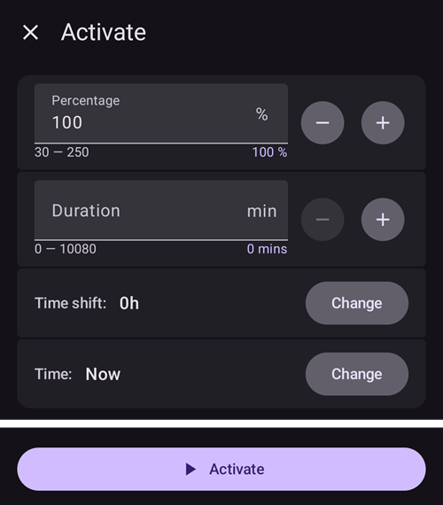

# Profilbytte og profilprosent

Dette avsnittet forklarer hva et **profilbytte** og en **profilprosent** er. Hvordan du oppretter en **profil**, kan du lese i [Din AAPS-profil](#your-aaps-profile-create-and-edit-profiles).

Når du begynner med **AAPS**, må du opprette en **profil**, forstå hvordan du gjør et **profilbytte**, og lære hvordan en **profilprosent** virker i **AAPS**. Funksjonene **profilbytte** og **profilprosent** kan være spesielt nyttige ved:

- menstruasjonssyklusen – en prosentjustering av **profilen** kan settes opp i **Automasjon**, slik at **AAPS** kan ta hensyn til de ulike fasene i hormonsyklusen og forventet insulinresistens.

- trening – en prosentjustering av **profilen** kan settes opp i **Automasjon** for trening, for å redusere basalen.

- natt- eller skiftarbeidere – en tidsforskyving i **profilen** kan settes opp for skiftarbeidere ved å endre antall timer i **profilen** etter hvor mye senere/tidligere du legger deg eller står opp.

Hvorfor bruke **profilprosent** i stedet for en midlertidig basaljustering? For å virke bedre bruker en **profilprosent** en forholdsmessig reduksjon eller økning på alle tre: basal, ISF og IK. Dette sikrer at **AAPS** beregner en balansert tilnærming når insulinet ditt doseres. En basalreduksjon alene i **profilen** din i **AAPS** gir liten gevinst hvis algoritmen fortsetter å bruke de samme forholdene for ISF og IK.

(ProfileSwitch-change-percentage)=

## Endre profilprosenten fra hovedskjermen

Du trenger minst én lagret **profil**. En **profilprosent** brukes alltid gjennom et **profilbytte**: du aktiverer en **profil** på nytt, denne gangen med en prosent.

```{admonition} Kommer du fra AAPS 3? :class: note Et langt trykk på profilnavnet åpner ikke lenger dialogen for profilbytte. **Trykk** på profilnavnet, og trykk så på den runde **▶**-knappen nederst til høyre: den åpner de samme innstillingene (prosent, varighet, midlertidig mål Aktivitet).

    <br />1. På hovedskjermen, **trykk på profilnavnet** (ved siden av stjerneikonet). [Profilskjermen](#ProfileSwitch-manage-v4) åpnes på kortet til **profilen** som kjører, merket **AKTIV**.
    
       
    
    2. For å beholde den samme **profilen**, la **AKTIV**-kortet være valgt. For å bytte **profil** samtidig, sveip til et annet kort.
    3. Trykk på den runde **▶**-knappen (**Aktiver**) nederst til høyre. Skjermen **Aktiver** åpnes.
    4. Sett **Prosent** med **−** / **+** (steg på 5 %), eller skriv den inn (30 til 250 %). Feltet starter alltid på **100 %**: det viser ikke prosenten som kjører nå. Skriv for eksempel **80** for 20 % mindre insulin, eller **120** for 20 % mer.
    5. Sett **Varighet** i minutter:
       * **0** beholder den nye prosenten til du gjør et nytt **profilbytte**,
       * alle andre verdier avslutter byttet etter den tiden, og **AAPS** går tilbake til **profilen** som kjørte før.
    
       
    
    6. Trykk på **▶ Aktiver** nederst på skjermen. Sjekk sammendraget i dialogen **Profilbytte** og trykk på **OK**.
    
       
    
    Tilbake på hovedskjermen viser profilnavnet prosenten og gjenstående tid, for eksempel *Normal (80%) (59')*, og blir gult mens et bytte med varighet kjører. En stjerne markerer byttet på glukosegrafen. Se [hovedskjermen](#aaps-screens-profile--target).
    
    
    
    For å **gå tilbake til 100 %** før tiden er ute, gjentar du stegene og lar **Prosent** stå på 100 og **Varighet** på 0.
    
    ```{admonition} Prosent med ett trykk
    :class: tip
    Hvis du ofte bruker den samme prosenten (sport, sykdom), kan du legge til en [profilsnarvei](#profile-shortcuts) på Hurtigstart-verktøylinjen, eller lage en [scene](Scenes.md). Begge bruker en profil med forhåndsinnstilt prosent og varighet med ett trykk.
    

(ProfileSwitch-manage-v4)=

## Administrere og aktivere profiler (Administrer → Profil)

I **AAPS** v4 administreres og aktiveres profiler fra skjermen **Administrer** (navigasjonslinjen nederst) → **Profil** (*«Administrer og aktiver profiler»*).

Profilskjermen viser profilene dine som en **karusell med kort du kan sveipe**. Kortet til profilen som kjører, er merket **AKTIV** og viser total daglig basal (f.eks. *∑ 30,15 E*). Under det valgte kortet ser du detaljene for den profilen — **insulintypen**, og tidsplanene for **IK**, **ISF**, **basal** og **mål** med grafer.

Når et midlertidig bytte kjører, viser kortet **AKTIV** prosenten og tidsforskyvingen sammen med tiden som er igjen, for eksempel *110% +2 t · 2 t 40 min*, over en fremdriftslinje. Begge oppdateres hvert 30. sekund. Detaljene under har da to kolonner: verdiene i profilen i blått, og verdiene som brukes med prosenten i rødt.


Knappene nederst virker på den **valgte** profilen: **➕ Legg til**, **✏️ Rediger**, **⧉ Dupliser** og **‘️ Slett**, og den runde **▶ Aktiver**-knappen til høyre. Hvordan du fyller ut de fire tidsplanene i redigeringsvinduet (IK / ISF / BAS / MÅL), se [Opprette og redigere profiler](#your-aaps-profile-create-and-edit-profiles).

**⧉ Dupliser** bruker ikonet med to firkanter som ofte brukes for *kopier*, men det er ikke noe å lime inn: den lager kopien i ett steg. Bekreft *Dupliser profil «Normal»?*, så legges en ny profil med navnet *Normal kopi* til sist i karusellen og velges, klar for **✏️ Rediger** (der du også kan gi den nytt navn). Dette er ikke det samme som å duplisere et tidligere **profilbytte** fra behandlingshistorikken, som lager en ny profil *der prosenten og tidsforskyvingen er lagt inn*. Se [Ta vare på et profilbytte til senere bruk](#ProfileSwitch-keep-for-later).

(ProfileSwitch-read-only-mode)= **Bare ▶ Aktiver-knappen?** Innstillingene dine er beskyttet, så skjermen åpnes skrivebeskyttet. Trykk på **✏️ blyanten** i linjen øverst og skriv inn passordet for innstillinger. Se [Sikkerhet for innstillinger låser nå også administrasjonsskjermene](#v4changes-read-only-management).

### Endre rekkefølgen på profiler

Hvis du har mer enn én profil, kan du velge rekkefølgen deres i karusellen: trykk på ikonet **Endre rekkefølge** (⇅, to piler som peker opp og ned) i linjen øverst. Sideindikatoren erstattes av **flytteknappene ◀ / ▶** med en *posisjon / totalt*-visning — flytt kortet i midten tidligere eller senere, og bekreft så med **✓** (eller forkast med **✕**). Den nye rekkefølgen lagres én gang, når du bekrefter.


### Aktivere en profil

Velg en profil og trykk på **▶ Aktiver**. Skjermen **Aktiver** lar deg tilpasse hvordan **profilbyttet** brukes:



- **Prosent** (30–250 %, starter på 100 % hver gang) — skalerer hele profilen. 100 % bruker den som den er; for eksempel reduserer 70 % basalen og den beregnede insulindosen (både måltidsboluser og korrigeringer) med 30 %. Den endrer ikke glukosemålene dine eller karbohydratabsorpsjonen. Se [Profilprosent](#ProfileSwitch-profile-percentage) for hele effekten.
- **Varighet** (0–10080 minutter, det vil si opptil 7 dager) — hvor lenge byttet varer. **0 = ubegrenset** (til du bytter igjen); en verdi over null går tilbake til forrige profil når tiden er ute.
- **Midlertidig mål / Aktivitet** — vises bare når du setter en **Varighet** og en **Prosent** under 100 %. Slå den på for også å starte et [midlertidig mål Aktivitet](#TempTargets-activity-temp-target) med samme varighet, slik du ville gjort før trening.
- **Tidsforskyving** — viser *0t*; trykk på **Endre** for å flytte tidsplanen fram eller tilbake med opptil 23 timer (nyttig ved skiftarbeid eller reise). Se [Tidsforskyving](#ProfileSwitch-ProfilePercentage-time-shift-of-the-circadian-percentage-profile).
- **Gjenbruk** — vises når byttet som kjører har en annen prosent enn 100 % eller en tidsforskyving, for eksempel **Gjenbruk 80% 0t**. Trykk på den for å fylle inn den samme prosenten og tidsforskyvingen, for eksempel for å forlenge et bytte som snart er over.
    
    

- **Tid** — *Nå* som standard. Du kan velge et annet tidspunkt, opptil 24 timer før eller etter nå. Et bytte som er satt fram i tid, starter på det tidspunktet; et midlertidig mål Aktivitet som er satt sammen med det, starter da også på det tidspunktet.
    
    

- **Merknader** — vises bare hvis [Vis merknadsfelt i dialoger](#Preferences-show-notes-field-in-treatments-dialogs) er på.

Hvis basaldosene ved den valgte prosenten ikke passer med pumpen din, vises en advarsel øverst, og **▶ Aktiver** forblir deaktivert: velg en annen prosent.

Trykk på **▶ Aktiver**, og så på **OK** i bekreftelsesdialogen. Profilen som kjører, har da merket **AKTIV** på kortet sitt.

```{admonition} Pumpen din kan avrunde basaldosene :class: note Hver pumpe kan bare gi basaldoser i sine egne steg (for eksempel 0,05 E/t), så den avrunder dosene i **profilen** din. **AAPS** bruker da basalen pumpen faktisk gir, slik at IOB og TDD forblir riktige. Hvis pumpen gir litt mer eller mindre insulin per dag enn **profilen** din, forteller meldingen *«Basalprofil i pumpen er oppdatert»* deg hvor mye, for eksempel *«den gir 10,00 E per dag i stedet for 10,12 E»*.

Hvis pumpen rapporterer en basal som er langt fra **profilen** din, beholder **AAPS** basalen fra **profilen** og ber deg sjekke basaldosene i pumpen.

    <br />```{admonition} Prosent og tidsforskyving gjør at én profil rekker langt
    :class: note
    I stedet for å lage mange like profiler kan du beholde én grunnprofil og bruke den med en annen **prosent** eller **tidsforskyving** i situasjoner som gjentar seg (sykdom, trening, reise). Dette er nøyaktig det [scener](Scenes.md) automatiserer.
    

Et profilbytte er ikke begrenset til denne skjermen. Det samme byttet kan også utløses fra en **Wear OS-klokke**, en paret **klient** (se [Hovedenhet ↔ klientstyring](../RemoteFeatures/ClientMasterControl.md)), en **[scene](Scenes.md)** eller en **Automasjon**-regel.

(ProfileSwitch-profile-percentage)=

## Profilprosent

Det er viktig at du forstår de grunnleggende egenskapene til en **profilprosent**. Når du legger en prosentøkning eller -reduksjon på et **profilbytte**, brukes den samme prosenten til å heve eller senke innstillingene dine slik de er satt i **profilen**.

For eksempel: et **profilbytte** til 130 % (som betyr at du er 30 % mer insulinresistent) ber **AAPS** om å

- **øke** basaldosen med 30 %, 
- **senke** **ISF**: ved å dele på 1,3,
- **senke** **IK** ved å dele på 1,3.

Husk at lavere **ISF** eller **IK** betyr et sterkere forhold og at det gis mer insulin. Dette er lett å overse for nye **AAPS**-brukere.

Når den er valgt, justerer **AAPS** standard basaldose, og **AAPS** (åpen eller lukket loop) fortsetter å jobbe oppå den valgte prosent-**profilen**.

Effekten av en **profil**-prosent er oppsummert i tabellen nedenfor:

| Profilbytte  
Prosent |    Effekt    |     IK  
g/E      | Eksempel  
15 g |          ISF  
mmol/L/E  
mg/dL/E          | E for å senke  
2 mmol/L  
40 mg/dL |
|:---------------------:|:------------:|:-----------------:|:---------------:|:------------------------------------------:|:-----------------------------------:|
|         90 %          |   Svakere    | 5/0,9  
=**5,55** |      2,7 E      | 2,2/0,9  
=**2,4**  
  
40/0,9  
=**44,4** |                0,8 E                |
|       **100 %**       | **Standard** |       **5**       |     **3 E**     |                **2,2  
40**                |              **0,9** E              |
|         130 %         |   Sterkere   | 5/1,3  
=**3,85** |      3,9 E      | 2,2/1,3  
=**1,7**  
  
40/1,3  
=**30,8** |                1,2 E                |

(ProfileSwitch-ProfilePercentage-time-shift-of-the-circadian-percentage-profile)=

## Tidsforskyving av den døgnbaserte prosentprofilen

En «tidsforskyving» i **profil**-funksjonen flytter innstillingene i **profilen** din rundt døgnklokken («circadian», døgnrytme) med det antallet timer du skriver inn. Dette kan være nyttig for:

- **natt- eller skiftarbeidere**: jobber nattskift ved å endre antall timer i **profilen** etter hvor mye senere/tidligere du legger deg eller står opp; 
- **brukere som bytter tidssone på reise**, eller
- **barn med type 1**: som har en fast leggerutine og insulinresistens som det er tatt hensyn til i **profilen**. Hvis barnet av en eller annen grunn ventes å legge seg senere, kan omsorgspersonen bruke en «tidsforskyving» på barnets **profil**, slik at **AAPS** reagerer på insulinresistensen i det tidsrommet brukeren ønsker.

Spørsmålet er alltid hvilken times innstillinger i **profilen** som skal erstatte innstillingene for tiden nå. Denne tiden må forskyves med x timer. Vær derfor oppmerksom på retningene, som beskrevet i dette eksempelet:

- Klokken nå: 12:00
- **Positiv** tidsforskyving 
    - 2:00 **+10 t** -> 12:00
    - Innstillingene fra 2:00 brukes i stedet for innstillingene som normalt brukes klokken 12:00, på grunn av den positive tidsforskyvingen.
- **Negativ** tidsforskyving 
    - 22:00 **-10 t** -> 12:00
    - Innstillingene fra 22:00 brukes i stedet for innstillingene som normalt brukes klokken 12:00, på grunn av den negative tidsforskyvingen.


Denne mekanismen med å ta øyeblikksbilder av **profilen** gir en mye mer nøyaktig beregning av fortiden, og gjør det mulig å følge endringer i **profilen**.

(ProfileSwitch-keep-for-later)=

## Ta vare på et profilbytte til senere bruk

Når du har gjort et profilbytte med prosent og/eller tidsforskyving, kan du kopiere denne midlertidige profilen til en ny profil.

For å gjøre dette åpner du menyen (☰) → **Behandlinger** og går til fanen **Profilbytte**, se [Dupliser et profilbytte til en ny profil](#your-aaps-profile-clone-profile-switch).