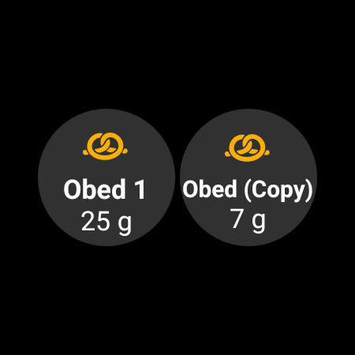

(quickwizards)=
# Hurtigknapper (bolus med ett trykk)

En **hurtigknapp** (QuickWizard) er en lagret knapp for et måltid eller en situasjon som gjentar seg, og som du bruker med ett trykk. Den har en fast mengde **karbohydrater** (og en regel for hvordan de skal doseres), så du kan gi en bolus — eller bare registrere karbohydrater — med ett trykk og en bekreftelse, i stedet for å åpne hele boluskalkulatoren hver gang.

```{contents} Table of contents
:depth: 2
:local: true
```

---

## Åpne Hurtigknapper

Åpne skjermen **Administrer** (navigasjonslinjen nederst) og velg **Hurtigknapp** (*«Administrer forhåndsinnstillinger for hurtigknapper»*).

---

## Administrere hurtigknapper

Hurtigknappene dine vises som en **karusell av kort du kan sveipe** (hvert kort viser knappeteksten, karbohydratene og det gyldige tidsrommet). Redigeringsfeltene under gjelder den **valgte** hurtigknappen; handlingslinjen nederst har **➕ legg til**, **⧉ dupliser**, **🗑️ slett** og en **▶**-knapp som kjører den valgte hurtigknappen.


De viktigste feltene er:

- **Knappetekst** — teksten som vises på knappen.
- **Karbo** og **Karbotid** — mengden karbohydrater og tidsforskyvningen for dem.
- **Gyldig tidsperiode** — se [Gyldighet](#quickwizard_validity).
- **Kalkulatoralternativer** og **Enhetsvalg** — se nedenfor.

---

## De tre modusene

Velgeren øverst — **Kalkulator / Insulin / Karbo** — bestemmer **hva knappen gjør** når du trykker på den:

- **Kalkulator** — kjører hele **boluskalkulatoren** for de innstilte karbohydratene, med gjeldende **BS, IOB, COB og trend** (etter *Kalkulatoralternativer* nedenfor). Den gir den *beregnede* bolusen og registrerer karbohydratene. Dette er den klassiske hurtigknappen.
- **Insulin** — gir en **fast, forhåndsinnstilt insulinmengde** som du bestemmer — ingen beregning.
- **Karbo** — registrerer **bare de innstilte karbohydratene**, **uten bolus**.

---

## Kalkulatoralternativer (Kalkulator-modus)

For en knapp i **Kalkulator**-modus velger du hvilke verdier beregningen skal bruke:

- **Bruk BS**, **Bruk COB**, **Bruk IOB** (med *Kun positiv IOB*), **Bruk trend** (*Alle / Kun positiv / Kun negativ*), **Bruk midlertidig mål**, **Bruk alarm**.
- **Bolusprosent** — skalerer den beregnede bolusen.
- **Legg til eKarbo** — planlegger også utvidede karbohydrater (eCarbs).


---

## Gyldighet — når knappen vises

(quickwizard_validity)= **Gyldig tidsperiode** (*Fra / Til*) styrer **når** en hurtigknapp vises og kan brukes. En knapp som er satt til for eksempel **06:00–10:00**, vises bare om morgenen — så en *Frokost*-hurtigknapp fyller ikke opp skjermen (eller blir trykket på ved en feil) ved middagstid. Utenfor tidsrommet sitt er knappen skjult i arket **Behandlinger** og på [Hurtigstart-verktøylinjen](QuickLaunch.md). En knapp på verktøylinjen slettes ikke: den kommer tilbake når tidsrommet åpner igjen.

Når den gyldige tidsperioden er kortere enn 4 timer, skjules knappen også i 30 minutter etter at du har brukt den, slik at det samme måltidet ikke registreres to ganger ved en feil.

---

## Hvor du bruker den

Bryterne under **Enhetsvalg** bestemmer hvor hver hurtigknapp vises:

- **Vis på telefon** — den vises i arket **[Behandlinger](../Maintenance/V4Changes.md)** (med den beregnede dosen rett på knappen). En hurtigknapp som vises på telefonen, kan også **festes som en hurtigstartsknapp i oversikten**: åpne *Konfigurer Hurtigstart* (tannhjulet ⚙ på [Hurtigstart](QuickLaunch.md)-verktøylinjen) og legg den til fra kategorien **Hurtigknapp**.
- **Vis på klokke** — den vises på **Hurtigknapp-flisen på Wear OS** (sveip til flisen i klokkens flis-karusell, og trykk så på en knapp for å kjøre den — akkurat som med [Scene-flisen](#scenes-from-watch)).

```{admonition} Don't see Device Selection?
:class: note
Delen **Enhetsvalg** vises bare i redigeringen når pluginen **Klokke** er aktivert og innstillingen **Styr fra klokke** er på. Uten den vises alle hurtigknapper rett og slett på telefonen.
```

På telefonen vises hurtigknappene øverst i arket **Behandlinger** nederst på skjermen:


… og som en hurtigstartsknapp i oversikten:




En paret **klient** (**AAPSClient**) kan også utløse en hurtigknapp — **hovedenheten** beregner og gir den (se [Hovedenhet ↔ klientstyring](../RemoteFeatures/ClientMasterControl.md)).

Uansett hvor den utløses fra, viser et trykk på en hurtigknapp alltid en **bekreftelse** (bekreftelsen laget av hovedenheten, når den utløses fra en klient eller klokke) før noe gis.

En hurtigknapp avvises når dosen er over din maksimale bolus, eller når karbohydratene eller eKarbo er over din maksimale karbohydratmengde (for eksempel etter at du har senket grensen). Når karbohydratene er over grensen, er knappen i arket **Behandlinger** deaktivert. Endre hurtigknappen eller grensen.

---

## Legge til og fjerne

- **➕ Legg til** — lag en ny hurtigknapp.
- **⧉ Dupliser** — kopier en som utgangspunkt.
- **🗑️ Slett** — fjern en.

Med to eller flere hurtigknapper kan du også endre rekkefølgen i karusellen: trykk på ikonet **Endre rekkefølge** (⇅) i linjen øverst, flytt kortet i midten med **flytteknappene ◀ / ▶**, og bekreft så med **✓**. (Kontrollene ser like ut som når du [endrer rekkefølgen på profiler](ProfileSwitch-ProfilePercentage.md).)

Hurtigknapper er en del av den synkroniserte konfigurasjonen, så de deles mellom hovedenheten og parede klienter.

---


<!-- =====================================================================
     Screenshots captured from a real master device:
       - quickwizard_editor.png   (Manage → QuickWizard: carousel, mode, carbs, carb time, valid time range)
       - quickwizard_options.png  (Calculator Options, Bolus percentage, Device Selection)
       - quickwizard_overview.png (the QuickWizard quick-action button on the overview)
       - quickwizard_watch_tile.png (the Wear OS QuickWizard tile)
     No QuickWizard was actually run (no bolus delivered).
     Maintainers: relocate page + images and fix cross-links as needed.
     ===================================================================== -->
