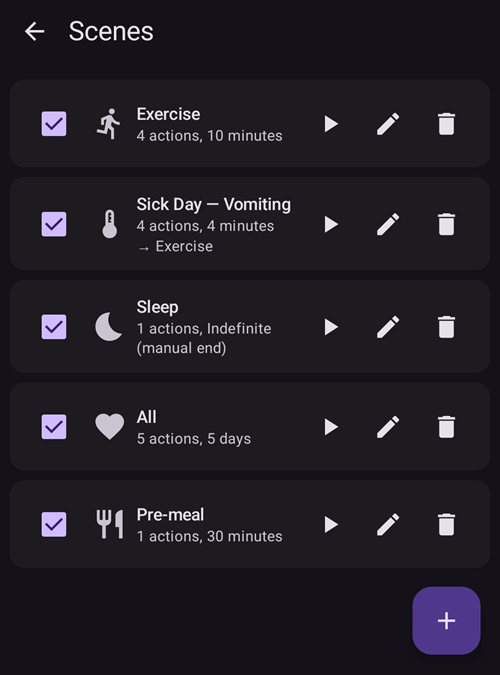

(scenes)=
# Scener (forhåndsinnstilte situasjoner)

En **scene** er en forhåndsinnstilling med navn som utfører **en pakke med handlinger på en gang** — for eksempel en *Søvn*-, *Trening*- eller *Sykedag*-innstilling som bytter profil, setter et midlertidig mål, slår SMB av eller på og legger til en merknad i helseportalen med ett trykk, eventuelt for en bestemt varighet.

```{contents} Table of contents
:depth: 2
:local: true
```

---

## Hva er en scene

I stedet for å endre flere ting for hånd hver gang en situasjon gjentar seg, setter du dem opp én gang som en scene og aktiverer den med ett trykk. En scene kan samle hvilke som helst av disse handlingene:

- **Profilbytte** — bytt profil og/eller skaler den i prosent (f.eks. 70 %).
- **Midlertidig mål** — sett et midlertidig mål (f.eks. *Aktivitet*, *Spise snart* eller en egen verdi).
- **SMB av/på** — aktiver eller deaktiver super-mikro-boluser mens scenen er aktiv.
- **Loop-modus** — endre kjøremodus (f.eks. til en mer forsiktig modus).
- **Merknad i helseportalen** — registrer en hendelse (f.eks. *Trening*, *Sykdom*) slik at den vises på grafen og i Nightscout.

En scene har også en **varighet** — en fast tid (minutter/timer/dager) eller *Ubestemt (manuell slutt)* — og en **avslutningshandling** som kjøres når den er ferdig: enten et **varsel**, eller den kan **gå videre** til en annen scene (for eksempel *Sykedag → Trening*).

---

## Administrere scener

Åpne **Administrer → Scener** for å se, lage, redigere, aktivere/deaktivere og endre rekkefølgen på scenene dine.



Hvert scenekort viser:

- en **avkrysningsboks** for å aktivere/deaktivere scenen,
- et **ikon** og et **navn**,
- et sammendrag — *«N handlinger, varighet»*, og **→ oppfølgingsscenen** hvis den går videre til en annen scene,
- og tre knapper: **▶ aktiver**, **✏️ rediger**, **🗑️ slett**.

Trykk på **+**-knappen for å lage en ny scene.

---

## Lage eller redigere en scene

### Start fra en mal

For å **lage** en scene, trykk på **+**-knappen på skjermen Scener. Det første steget er **Start fra mal**: velg en ferdig scene for en vanlig situasjon — *Trening*, *Sykedag*, *Sykedag — Oppkast*, *Søvn*, *Natt etter trening*, *Før måltid*, *Alkohol*, *Bilkjøring*, *Bading*, *Lutealfase*, *Varmt vær*, *Medisinsk prosedyre* — eller start fra en *Tom* scene. Hver mal **fyller inn de anbefalte handlingene på forhånd**, og du kan justere alt i de neste stegene.


Når du har valgt en mal, får du en forklaring på hva den er til — *når* og *hvorfor* du bør bruke den — før du går videre:


### Gå gjennom handlingene steg for steg

Resten av redigeringen er en kort veiviser **steg for steg**. Hvert steg er én handlingstype med en bryter *«Inkluder … i scenen»* — slå den på bare for de handlingene du vil at denne scenen skal utføre, og la resten være av.


Gå gjennom stegene med **Neste**/**Tilbake**: *Profilbytte*, *Midlertidig mål*, *SMB*, *Loop-modus*, *Merknad i helseportalen*, deretter **varigheten**, **avslutningshandlingen** (varsle eller gå videre til en annen scene), og til slutt scenens **navn og ikon**. Lagre når du er ferdig. (For å **redigere** en scene som finnes fra før, trykk på **✏️**-knappen — da går du rett inn i disse stegene.)

Hvert steg starter med en kort forklaring på hva handlingen gjør. Stegene ser slik ut, her med malen *Trening*:

**Midlertidig mål** — velg ett av dine forhåndsinnstilte midlertidige mål:


**SMB** — aktiver eller deaktiver SMB mens scenen er aktiv:


**Kjøremodus** — endre eventuelt loop-modus:


**Helseportal** — hendelsestypen og merknaden som skal registreres:


**Varighet** — hvor lenge scenen skal være aktiv; 0 betyr til du avslutter den selv:


**Oppfølgingsscene** — eventuelt scenen som starter når denne slutter:


**Scene** — navnet og ikonet. Trykk på **Fullfør** for å lagre:


---

## Aktivere en scene

Aktiver en scene fra listen **Scener** (**▶**-knappen) eller fra **Scener** i navigasjonslinjen nederst. I arket **Scener** i navigasjonslinjen nederst viser hver scene det samme sammendraget som i listen Scener, og **blyanten** øverst i arket åpner **Administrer → Scener**, der du kan lage eller redigere scenene dine.


Hvis [sikkerhet for bolus](#Preferences-protection) er slått på, ber **AAPS** om den før en scene starter eller avsluttes. For å endre en scene trengs i stedet [sikkerhet for innstillinger](#Preferences-settings-protection).

Før noe utføres, får du en **bekreftelse** som viser nøyaktig hva scenen vil gjøre, slik at du kan se over det:


Hvis scenen går videre til en annen scene, slutter bekreftelsen med **→** og navnet på oppfølgingsscenen, på samme måte som i listen Scener.

Når du starter scenen fra **Scener** i navigasjonslinjen nederst, er bekreftelsen en enklere dialog med den samme listen over handlinger. Trykk på **OK** for å aktivere:


Når du har bekreftet, utføres handlingene, og den **aktive scenen** vises øverst i oversikten med en **Avslutt scene**-knapp. Hvis scenen går videre til en annen scene, viser banneret også navnet på oppfølgingsscenen:


Scenens handlinger gjelder til:

- **varigheten** er over (da kjøres **avslutningshandlingen** — et varsel, eller den går videre til neste scene), eller
- du trykker på **Avslutt scene** for å avslutte den manuelt. Hvis scenen går videre til en annen scene, får du to valg: **Hopp over til** oppfølgingsscenen (den aktive scenen avsluttes og oppfølgingsscenen starter nå), eller **Avslutt scene** (den aktive scenen avsluttes og oppfølgingsscenen starter ikke).

En scene uten oppfølgingsscene ber deg bare om å bekrefte:


Når en scene avsluttes, **tilbakestilles** endringene den gjorde (for eksempel profilbyttet og det midlertidige målet den startet).

Mens en scene er aktiv, har profilen og målet på hovedskjermen et lite sceneikon når det var scenen som satte dem. Arket **Scener** i navigasjonslinjen nederst er fortsatt tilgjengelig for å starte en annen scene:


Når varigheten går ut av seg selv, tilbakestilles endringene med en gang, og banneret endres til **Scene avsluttet** med en **Forkast**-knapp. Å forkaste fjerner bare banneret fra skjermen — selve scenen er allerede over, så automasjonsregler og en oppfølgingsscene fortsetter uten å vente på det.

---

## Starte scener fra Automasjon

En scene trenger ikke å startes for hånd — **Automasjon** kan kjøre den for deg. Når du legger til en handling i en automasjonsregel (**Administrer → Automasjon**), har handlingsvelgeren en kategori **Scener**:

- **Kjør scene** — aktiver en scene når regelens utløsere slår til (for eksempel på et bestemt klokkeslett, når du kommer til et sted, eller når glukose krysser en grense).
- **Aktiver scene** / **Deaktiver scene** — gjør en scene tilgjengelig (eller utilgjengelig) uten å aktivere den.


Automasjon kan også **reagere på** en scene: listen over utløsere har en **Scene**-utløser, så en regel kan kjøre bare mens en bestemt scene er aktiv. Sammen med scenens **avslutningshandling** (tilbakestille, varsle eller gå videre til en annen scene) gjør dette at scener kan starte, følge etter hverandre og avslutte automatisk.

---

## Scener med hovedenhet/klient og en klokke

Den **aktive scenen synkroniseres** mellom alle de parede enhetene dine — aktiver den på én telefon, og de andre viser den også.

En paret **klient** (**AAPSClient**) kan også aktivere eller avslutte en scene: forespørselen sendes til **hovedenheten**, som lager bekreftelsen og utfører scenen på sin egen tilstand. Se [Hovedenhet ↔ klientstyring](../RemoteFeatures/ClientMasterControl.md) for hvordan det virker.

(scenes-from-watch)=
### Fra en Wear OS-klokke

Scener er tilgjengelige på en **Wear OS-klokke** som en **Scene-flis**. Sveip til **Scene**-flisen i klokkens flis-karusell (legg den til fra karusellens flisliste først hvis den ikke er der ennå), og trykk på scenen du vil starte:


Flisen har fire plasser. Som standard fylles hver plass **automatisk** med den neste av de aktiverte scenene dine, i samme rekkefølge som på telefonen. Hvis du vil velge selv, **trykk og hold på flisen** og åpne innstillingene: for hver av de fire plassene kan du beholde **Automatisk**, feste en **bestemt scene**, eller velge **Ingen** for å la plassen være tom. En plass som er festet til en scene som senere er slettet eller deaktivert, viser **Utilgjengelig** — velg en annen scene for den.

Klokken viser så en bekreftelse — trykk på **✓** for å aktivere, eller sveip tilbake for å avbryte:


Akkurat som på en klient er det **hovedenheten som lager bekreftelsen og kjører scenen**; klokken sender bare forespørselen videre (via klienttelefonen, hvis klokken er paret med en klient).

Mens en scene kjører — eller banneret **Scene avsluttet** fortsatt vises på telefonen — viser flisen en **Avslutt**-knapp med navnet på scenen under. Trykk på den for å avslutte den aktive scenen, eller for å fjerne banneret som er igjen, rett fra håndleddet.

Hvis scenen som kjører, går videre til en annen scene, viser flisen også en **Hopp over**-knapp med navnet på oppfølgingsscenen under. Dette er de samme to valgene som på telefonen:

- **Avslutt** — den aktive scenen avsluttes. Bekreftelsen forteller deg at oppfølgingsscenen ikke vil starte.
- **Hopp over** — den aktive scenen avsluttes, og oppfølgingsscenen starter nå. Bekreftelsen viser navnet på begge scenene.

Klokkens [Loopstatus-skjerm](#WearOsSmartwatch-loop-status) viser også den aktive scenen, hvor lang tid den har igjen, og oppfølgingsscenen.

---


<!-- =====================================================================
     Screenshots captured from a real master device:
       - scenes_list.png        (Manage → Scenes management list)
       - templates_picker.png   (create: "Start from template" picker)
       - template_explanation.png (create: chosen template's explanation)
       - scene_editor.png       (scene editor, Profile switch step)
       - scene_confirmation.png (scene activation confirmation — also used on the Client/Master page)
       - scene_active_banner.png (overview active-scene banner with the End Scene button)
       - automation_scene_action.png (Automation action picker — Scenes category)
       - scene_watch_tile.png    (Wear OS Scene tile)
       - scene_watch_confirm.png (Wear OS scene confirmation)
     Maintainers: relocate page + images and fix cross-links as needed.
     ===================================================================== -->
