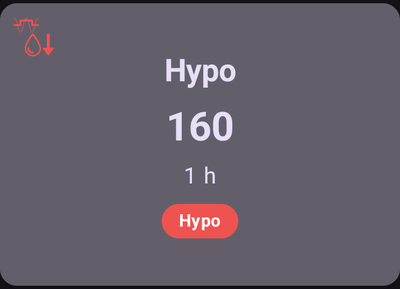

# Midlertidige mål

## Hva er midlertidige mål, og hvor kan jeg sette og konfigurere dem?

Et **midlertidig mål** (eller kort **TT**, Temp-Target) er en funksjon i **AAPS** som lar deg endre [**BS**-målområdet](#profile-glucose-targets) ditt for planlagte aktiviteter. Dette gjør **AAPS** ved å endre hvor mye insulin du får.

Et glukosemål, særlig hvis det bare er kortvarig (under 4 timer), trenger ikke å være den *faktiske verdien* du venter eller ønsker at glukosen din skal nå. Det er heller en god måte å si til **AAPS** at den skal være mer eller mindre aggressiv, samtidig som glukosen din holdes i målområdet.

Midlertidige mål kan settes innenfor disse grensene:

|          | Midlertidig mål           |
| -------- | ------------------------- |
| Minimum  | 4 mmol/L eller 72 mg/dL   |
| Maksimum | 10 mmol/L eller 180 mg/dL |

**AAPS** har tre innebygde forhåndsinnstilte **midlertidige mål**, laget for trening (**Aktivitet**), måltider (**Spise snart**) og forventet hypoglykemi (**Hypo**). De ligger på skjermen **Midlertidig mål** (**Administrer** → **Midlertidig mål**), som du også kan åpne ved å trykke på **målbrikken** på hovedskjermen.

Du bør ha realistiske forventninger til hva du kan oppnå når du velger et **midlertidig mål** i **AAPS**. Hvor godt du når ønsket **BS**-mål, avhenger av mange faktorer: hvor pålitelige **AAPS**-innstillingene dine er, den generelle **BS**-kontrollen, **IOB**, insulinfølsomhet, insulinresistens, hvor hardt du anstrenger deg under treningen, og så videre.

Et **midlertidig mål** kan trenge omtrent 30 minutter eller mer for å nå ønsket **BS**-mål. **AAPS** kan ikke nå et **BS**-mål med én gang, og du bør huske på dette når du velger et **midlertidig mål**.

Avsnittene nedenfor oppsummerer **midlertidig mål Aktivitet**, **midlertidig mål Spise snart** og **midlertidig mål Hypo**. Verdiene som vises, er standardverdiene — du kan [tilpasse hver forhåndsinnstilling](#TempTargets-change-preset-defaults) til dine egne behov.

### TT - Aktivitet


**BS-mål (standard forhåndsinnstilling, kan endres)**

AAPS vil prøve å nå 140 mg/dL eller 7,8 mmol/L i 1 t 30 min

**Annet du kan ta hensyn til når du velger**:

Avhengig av **BS**-nivået vil **AAPS** «redusere» insulinbruken for å nå **BS**-målet. Hvis **BS**-målet ikke er innenfor området (det vil si over **BS**-målet som er satt i **profilen** din), kan **AAPS** likevel holde basalen på.

I lukket loop vil **SMB**:

- *kanskje* bli deaktivert (mer om dette nedenfor), og/eller
- basal kan bli aktivert hvis **AAPS** har negativ **IOB**, eller <0.

Du kan også vurdere:

- å *velge* dette **midlertidige målet** 1–2 timer før den planlagte treningen for å sikre lavere IOB (riktig tidspunkt for dette midlertidige målet varierer fra person til person), og
- å *velge* en midlertidig profil (redusert) så lenge den planlagte aktiviteten varer, for å sikre lavere **IOB**,
- å *sørge for* at det **midlertidige målet** er tidsinnstilt slik at det *deaktiveres* kort tid før treningen, fordi **IOB** allerede er redusert og noen brukere opplever en rask stigning i **BS** etter trening.

### TT - Spise snart


**BS-mål (standard forhåndsinnstilling, kan endres)**

AAPS vil prøve å nå 90 mg/dL eller 5,0 mmol/L i 45 minutter

**Annet du kan ta hensyn til når du velger**:

I lukket loop vil **SMB**:

- forblir aktivert, og/eller
- basal kan også bli aktivert, avhengig av innstillingene i **profilen** din.

Avhengig av **BS**-nivået vil **AAPS** «øke» insulinbruken, innenfor grensene i **AAPS**-innstillingene dine, for å nå ønsket **BS**-mål.

### TT - Hypo



**BS-mål (standard forhåndsinnstilling, kan endres)**

AAPS vil prøve å nå 160 mg/dL eller 8,9 mmol/L i 1 time

**Annet du kan ta hensyn til når du velger**:

I lukket loop vil **SMB**:

- *kanskje* bli deaktivert (mer om dette nedenfor), og/eller
- basal kan bli aktivert hvis **AAPS** har negativ **IOB**, eller <0.

(TempTargets-manage-v4)=

## Sette og administrere midlertidige mål (Administrer → Midlertidig mål)

I **AAPS** v4 administrerer du **forhåndsinnstillingene** for midlertidige mål og starter et midlertidig mål fra skjermen **Administrer** (navigasjonslinjen nederst) → **Midlertidig mål** (*«Administrer og sett midlertidige mål»*).


Skjermen har tre deler:

1. **Karusell med forhåndsinnstillinger** (øverst) — sveip gjennom forhåndsinnstillingene dine for midlertidige mål. Hvert kort viser forhåndsinnstillingens **navn**, **mål** og **varighet**; det midlertidige målet som kjører nå, er uthevet.
2. **Redigeringsfelt** (midten) — **Midlertidig mål** og **Varighet** som faktisk vil bli brukt, pluss dato/klokkeslett for **Aktivering**.
3. **Handlingslinje** (nederst) — **➕ legg til**, **‘️ slett** og knappen **▶ aktiver**.

Når du velger et kort, lastes **målet** og **varigheten** inn i redigeringsfeltet.

```{admonition} Innebygde og egendefinerte forhåndsinnstillinger :class: note De innebygde forhåndsinnstillingene — **Spise snart**, **Aktivitet** og **Hypo** — finnes alltid og **kan ikke slettes** (men du kan endre verdiene deres og lagre). Forhåndsinnstillinger du lager selv, er **egendefinerte** og kan redigeres eller slettes fritt.

    <br />### Aktivere et midlertidig mål
    
    Sveip til forhåndsinnstillingen du vil bruke (verdiene lastes inn i redigeringsfeltet), juster eventuelt **målet**/**varigheten** i redigeringsfeltet, og trykk så på **▶ Aktiver**. En bekreftelse viser nøyaktig mål, varighet og årsak før noe starter:
    
    
    
    Når du har bekreftet, starter det midlertidige målet med en gang (eller på valgt **Aktivering**-tidspunkt) og kjører så lenge **varigheten** er satt til.
    
    ```{admonition} Å endre tallene gjelder bare én gang — forhåndsinnstillingen endres ikke
    :class: important
    **Målet** og **varigheten** i redigeringsfeltet er verdiene **Aktiver** vil bruke *nå*. Hvis du endrer dem, er endringen **midlertidig**: den gjelder bare denne aktiveringen og **endrer ikke den lagrede forhåndsinnstillingen**. Slik kan du «justere og aktivere» et midlertidig mål én gang (for eksempel aktivere *Aktivitet* med et litt annet mål i dag) uten å endre forhåndsinnstillingen permanent.
    

### Lagre endringer i en forhåndsinnstilling

Hvis du *vil* beholde en endret verdi, må du **lagre** den: når redigeringsfeltet avviker fra den valgte forhåndsinnstillingen, vises et **Lagre**-ikon i verktøylinjen øverst. Trykker du på det, lagres gjeldende **mål** og **varighet** (og navn, for egendefinerte forhåndsinnstillinger) i den valgte forhåndsinnstillingen. For de innebygde forhåndsinnstillingene vises også knappen **Tilbakestill til standardinnstillinger** (↺) i handlingslinjen: den henter tilbake forhåndsinnstillingens standardverdier.


Tommelfingerregelen er altså:

- **Aktiver** → bruk tallene **én gang** (forhåndsinnstillingen er uendret).
- **Lagre** → gjør tallene til forhåndsinnstillingens **nye standardverdier**.

For å sette en innebygd forhåndsinnstilling tilbake slik den var levert, velger du den og trykker på knappen **↺ Tilbakestill** — den vises i handlingslinjen bare for en **innebygd** forhåndsinnstilling der verdiene nå avviker fra fabrikkverdiene, og den gjenoppretter forhåndsinnstillingens opprinnelige **mål** og **varighet**.

### Legge til og fjerne forhåndsinnstillinger

- **➕ Legg til** — lag en **ny egendefinert forhåndsinnstilling** av verdiene som står i redigeringsfeltet nå. Det nye kortet vises i karusellen.
- **‘️ Slett** — fjern den valgte **egendefinerte** forhåndsinnstillingen. Innebygde forhåndsinnstillinger (*Spise snart*, *Aktivitet*, *Hypo*) kan ikke slettes.

Når du har minst to **egendefinerte** forhåndsinnstillinger, kan du også endre rekkefølgen deres i karusellen: trykk på ikonet **Endre rekkefølge** (⇅) i linjen øverst, flytt kortet i midten med **flytteknappene ◀ / ▶**, og bekreft så med **✓**. De innebygde forhåndsinnstillingene beholder plassene sine — bare egendefinerte forhåndsinnstillinger kan flyttes. (Kontrollene ser like ut som når du [endrer rekkefølgen på profiler](ProfileSwitch-ProfilePercentage.md).)

Forhåndsinnstillingene dine er en del av den synkroniserte konfigurasjonen, så de deles mellom hovedenheten og parede klienter.

### Andre måter å sette et midlertidig mål på

Du kan også sette et midlertidig mål uten å åpne denne skjermen:

- med **bryterne for midlertidig mål i Karbo-dialogen** — se [nedenfor](#TempTargets-carbs-dialog),
- med en **knapp for en forhåndsinnstilling på [Hurtigstart-verktøylinjen](QuickLaunch.md)** — kategorien *Forhåndsinnstilte midlertidig mål* i *Konfigurer Hurtigstart* gir en ett-trykks-knapp for hver av forhåndsinnstillingene dine,
- fra en **Wear OS-klokke** (menyvalget/flisen **Midlertidig mål**),
- fra en paret **klient** — se [Hovedenhet ↔ klientstyring](../RemoteFeatures/ClientMasterControl.md),
- som en del av en **[scene](Scenes.md)** (handlingen *Midlertidig mål*), eller
- fra en **Automasjon**-regel (*Start midlertidig mål* / *Avbryt midlertidig mål*).

* * *

(TempTargets-where-can-i-select-a-temp-target)=

## Hvor kan jeg velge et midlertidig mål?

Det raskeste er å trykke på **målbrikken** på hovedskjermen (den viser målområdet ditt nå):


Dette åpner skjermen **Midlertidig mål** som er beskrevet ovenfor — sveip til en forhåndsinnstilling og trykk på **▶ Aktiver**. Du når den samme skjermen også via **Administrer** → **Midlertidig mål**.

(TempTargets-carbs-dialog)= Når du registrerer karbohydrater, trenger du ikke å åpne skjermen **Midlertidig mål** i det hele tatt: **Karbo-dialogen** (**Behandlinger** → **Karbo**) har bryterne **Start midlertidig mål Hypo**, **Start midlertidig mål Spise snart** og **Start midlertidig mål Aktivitet** øverst. Slå på én av dem, så aktiveres den tilhørende forhåndsinnstillingen sammen med karbohydratregistreringen:


    {admonition} Automatisk midlertidig mål Hypo
    :class: note
    Hvis du åpner **Karbo-dialogen** mens glukosen din er under 72 mg/dL (4 mmol/L), velger **AAPS** bryteren **Start midlertidig mål Hypo** for deg på forhånd (med mindre et høyere midlertidig mål med lengre gjenstående varighet allerede kjører).

(TempTargets-change-preset-defaults)=

## Hvor kan jeg endre standardverdiene for et midlertidig mål og bruke mine egne?

**Målet** og **varigheten** for hver forhåndsinnstilling redigeres direkte på skjermen **Midlertidig mål** — det finnes ikke lenger noen egen innstilling for dette:

1. Åpne skjermen **Midlertidig mål** (trykk på målbrikken, eller **Administrer** → **Midlertidig mål**).
2. Sveip til forhåndsinnstillingen du vil endre.
3. Juster **Midlertidig mål** og/eller **Varighet** i redigeringsfeltet.
4. Trykk på **Lagre**-ikonet som vises i verktøylinjen øverst.


Så lenge redigeringsfeltet avviker fra fabrikkverdiene til en innebygd forhåndsinnstilling, vises også knappen **↺ Tilbakestill** i handlingslinjen — trykk på den for å gjenopprette forhåndsinnstillingens opprinnelige mål og varighet.

## Hvordan avbryter jeg et midlertidig mål?

Mens et midlertidig mål kjører, viser målbrikken på hovedskjermen målet og gjenstående tid. Trykk på den — på skjermen **Midlertidig mål** er forhåndsinnstillingen som kjører, uthevet som **AKTIV**, og en rød **✗ Avbryt**-knapp vises i enden av verktøylinjen nederst, rett til venstre for knappen **▶ Aktiver**. Trykk på den og bekreft:


Et midlertidig mål som kjører, kan også stoppes fra en **Wear OS-klokke**, fra en paret **klient** eller av en **Automasjon**-regel (*Avbryt midlertidig mål*).

(TempTargets-hypo-temp-target)=

## Midlertidig mål Hypo

**Midlertidig mål Hypo** lar **AAPS** hindre at du får lavt blodsukker, ved å redusere insulinet. Hvis du tror **BS** vil bli lav: vanligvis bør **AAPS** håndtere det, men mye avhenger av hvor stabile **AAPS**-innstillingene dine er. Et **midlertidig mål Hypo** lar deg komme i forkant av det forventede fallet og få **AAPS** til å redusere insulinet.

Noen ganger stiger **BS** raskt når du har spist karbohydrater mot føling, og **AAPS** vil korrigere den raskt stigende **BS** ved å gi **SMB-er**.

Noen brukere vil unngå at det gis **SMB-er** mens **midlertidig mål Hypo** er aktivt. Dette gjør du ved å slå av *«Aktiver SMB ved høyt midlertidig mål»* i **Innstillinger** → **OpenAPS SMB** (se lenger ned):

- I (Avansert, opplæringsmål 9): du kan slå på *«Høyt midlertidig mål øker sensitivitet»* for **midlertidige mål** på 100 mg/dL (5,6 mmol/L) eller høyere i OpenAPS SMB, så blir **AAPS** mer sensitiv.

- I (Avansert, opplæringsmål 9): du kan slå av *«Aktiver SMB ved høyt midlertidig mål»*, slik at **AAPS** ikke gir SMB-er mens høye midlertidige mål er aktive, selv om **AAPS** har COB > 0, «Aktiver SMB ved lavt midlertidig mål» eller «Aktiver SMB alltid» er på og OpenAPS SMB er aktiv.

Merk: hvis du åpner **Karbo-dialogen** mens blodsukkeret ditt er under 72 mg/dL eller 4 mmol/L, velger **AAPS** bryteren **Start midlertidig mål Hypo** automatisk på forhånd.

(TempTargets-activity-temp-target)=

## Midlertidig mål Aktivitet

Før og under trening kan du trenge et høyere mål for å unngå hypoglykemi under aktiviteten.

For å gjøre **midlertidig mål Aktivitet** enkelt kan du sette opp et standard **midlertidig mål Aktivitet** som hever **BS**-nivået ved å bruke mindre insulin, slik at **BS** faller saktere og du unngår hypoglykemi.

Nye **AAPS**-brukere må kanskje prøve seg fram og tilpasse standardinnstillingene for **midlertidig mål Aktivitet** for at funksjonen skal virke best mulig for dem. Alle er forskjellige når det gjelder å holde stabil BS-kontroll under trening. Se også [avsnittet om sport i FAQ](#FAQ-sports).

Noen brukere foretrekker også å aktivere et **profilbytte** (en redusert profil < 100 % så **AAPS** gir mindre insulin) før og mens **midlertidig mål Aktivitet** er på. Du kan starte begge i ett steg: trykk på profilnavnet på hovedskjermen, trykk på den runde **▶**-knappen, sett en **Prosent** under 100 % og en **Varighet**, og slå så på **Midlertidig mål / Aktivitet**. Se [Endre profilprosenten](#ProfileSwitch-change-percentage).

Avansert, opplæringsmål 9: du kan slå på *«Høyt midlertidig mål øker sensitivitet»* for **midlertidige mål** på 100 mg/dL (5,6 mmol/L) eller høyere i OpenAPS **SMB**. Et mål på 99 mg/dL (5,5 mmol/L) er et normalt mål, verken høyt eller lavt. Da er **AAPS** mer sensitiv.

I tillegg: hvis *«Aktiver SMB ved høyt midlertidig mål»* er slått av, gir **AAPS** ikke **SMB-er**, selv om COB > 0, *«Aktiver SMB ved lavt midlertidig mål»* eller *«Aktiver SMB alltid»* er på og OpenAPS **SMB** er aktiv.

(TempTargets-eating-soon-temp-target)=

## Midlertidig mål Spise snart

**Midlertidig mål Spise snart** kan hjelpe til med å senke **BS** forsiktig og sørge for at det er nok **IOB** før du spiser.

Dette kan være et viktig verktøy for brukere som ikke gir bolus på forhånd, men hvor godt **midlertidig mål Spise snart** virker, avhenger av flere faktorer, blant annet innstillingene dine, om du spiser lite karbohydrater, og om du bruker et hurtigvirkende insulin (som Fiasp eller Lyumjev) for å slippe å gi bolus på forhånd. Til du har fått erfaring med **AAPS**, bør du som regel regne med å gi bolus på forhånd når du bruker **midlertidig mål Spise snart**, særlig hvis du spiser mye karbohydrater.

Du kan lese mer om «Eating soon mode» i artikkelen ['How to do “eating soon” mode'](https://diyps.org/2015/03/26/how-to-do-eating-soon-mode-diyps-lessons-learned/) (engelsk) eller [her](https://diyps.org/tag/eating-soon-mode/).

Avansert, [opplæringsmål 9](#objectives-objective9): Hvis du bruker OpenAPS SMB og har på *«Lavt midlertidig mål senker sensitivitet»*, jobber **AAPS** litt mer aggressivt. For dette valget må det **midlertidige målet** være 98 mg/dL (5,4 mmol/L) eller lavere.

## Hvordan slår jeg av SMB under midlertidige mål?

For å gjøre dette åpner du **Innstillinger** → **OpenAPS SMB** og slår av *«Aktiver SMB ved høyt midlertidig mål»*.


Dette sikrer at **AAPS** ikke gir **SMB-er**, selv om COB > 0, *«Aktiver SMB ved lavt midlertidig mål»* eller *«Aktiver SMB alltid»* er på og OpenAPS SMB er aktiv.