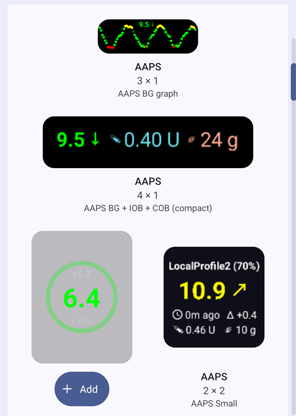

(widgets)=
# Widgeter på startskjermen

**AAPS** har widgeter som du kan legge til på startskjermen på telefonen. En widget viser gjeldende data uten at du må åpne appen. Trykk på en widget for å åpne **AAPS**.

```{contents} Table of contents
:depth: 2
:local: true
```

---

## Tilgjengelige widgeter

Det finnes fem widgeter. De ligger under **AAPS** i Androids widgetvelger:


| Widget                            | Standardstørrelse | Hva den viser                                                                                                                                                                                                                                                |
| --------------------------------- | ----------------- | ------------------------------------------------------------------------------------------------------------------------------------------------------------------------------------------------------------------------------------------------------------ |
| **AAPS widget**                   | 5 × 2             | Statusblokken fra hovedskjermen: BS med trend og delta, loopmodus som et ikon ved siden av profilnavnet, mål, sensitivitet (vist som på hovedskjermen), IOB og COB. Tekstene krymper så de passer til størrelsen du gir widgeten, i stedet for å bli kuttet. |
| **AAPS glukosesirkel**            | 2 × 2             | BS-sirkelen fra hovedskjermen: en ring i BS-fargen, trendbuen, delta, BS-verdien og tiden siden siste måling.                                                                                                                                                |
| **AAPS liten**                    | 2 × 2             | Profilnavn, BS med trendpil, tid siden siste måling, delta, IOB og COB.                                                                                                                                                                                      |
| **AAPS BS + IOB + COB (kompakt)** | 4 × 1             | Én linje med BS og trendpil, IOB og COB.                                                                                                                                                                                                                     |
| **AAPS BS-graf**                  | 3 × 1             | BS-verdien med en liten graf over de siste målingene.                                                                                                                                                                                                        |

**AAPS widget**, **glukosesirkel** og widgeten **liten** på en startskjerm:


Widgeten **kompakt** og widgeten **BS-graf**:


BS-verdier bruker de samme fargene som i **AAPS**: grønn i målområdet, gul over målområdet, rød under målområdet.

---

## Legge til en widget

De nøyaktige stegene avhenger av telefonen din og launcheren den bruker. På de fleste telefoner:

1. Trykk og hold på et tomt område på startskjermen, og velg **Widgeter**.

   

2. Åpne **AAPS** i listen, og trykk på den widgeten du vil ha.
3. Trykk på **Legg til** (eller dra widgeten dit du vil ha den).

   

Widgeten legges på startskjermen. Rett etter at du har lagt den til, vises den med håndtak: dra i et håndtak for å **endre størrelsen** på widgeten, eller dra widgeten for å flytte den. Glukosesirkelen kan endres til hvilken som helst størrelse.


Hvis siden på startskjermen er full, legger telefonen widgeten på en ny side.

---

## Widget-konfigurasjon

Trykk på **blyant**-knappen som vises på widgeten rett etter at du har lagt den til. Senere kan du trykke og holde på widgeten for å få frem håndtakene og blyanten igjen.

Dialogen **Widget-konfigurasjon** har to innstillinger:

- **Konfigurer gjennomsiktighet** — hvor ugjennomsiktig bakgrunnen på widgeten er. En lav verdi lar bakgrunnsbildet synes gjennom.
- **Bruk svart farge** — bruk svart bakgrunn i stedet for standardbakgrunnen.


Hver widget har sin egen konfigurasjon.

---

## Greit å vite

- En widget **viser** bare data. Du kan ikke gi bolus eller endre noe fra en widget.
- Widgeten oppdateres av **AAPS**. Hvis **AAPS** ikke kjører, eller hvis Android begrenser appen i bakgrunnen, kan widgeten vise gamle data. Sjekk tiden siden siste måling, og pass på at **AAPS** er unntatt fra [batterioptimalisering](#SetupWizard-StoragePermission).
- Med **AAPSClient**, **AAPSClient2** og **AAPSClient3** er bakgrunnen på widgeten gul, blå eller grønn, slik at du kan skille appene fra hverandre. Øk ugjennomsiktigheten i widget-konfigurasjonen hvis fargen er vanskelig å se. Se [Om AAPSClient, AAPSClient2 og AAPSClient3](#remotecontrol-aapsclient-versions).
