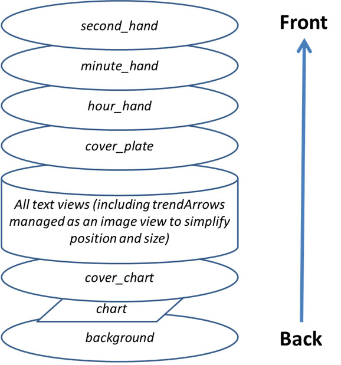

# Referansedokument for egendefinerte urskiver

Denne siden er for deg som utformer nye urskiver. Den lister opp alle nøkkelordene og funksjonene som er tilgjengelige når du vil lage eller animere en ny urskive.

- Nye funksjoner og nøkler som er tilgjengelige i Custom Watchface V2 (Wear-apk 3.3.0 eller nyere), finner du [her](#cwf-reference-new-v2-features)

## Formatet Custom Watchface

Custom Watchface er et åpent format laget for AAPS, og det er knyttet til den nye urskiven «AAPS(Egendefinert)» som finnes på klokken.

Urskivefilen er en enkel zip-fil, men for å bli gjenkjent som en urskivefil må zip-filen inneholde disse filene:

- Én bildefil med navnet CustomWatchface (kan være bitmap-filer `CustomWatchface.jpg`, `CustomWatchface.png` eller en vektorfil `CustomWatchface.svg`). Denne filen er det lille ikonet som brukes til å velge urskiven når du trykker på knappen «Last inn urskive», og også bildet som vises i Klokke-pluginen i AAPS.
- Én fil med navnet `CustomWatchface.json` (se [JSON-struktur](#cwf-reference-json-structure) nedenfor). Denne andre filen er kjernefilen som inneholder all informasjon som trengs for å utforme urskiven. Denne json-filen må være gyldig (det er trolig det vanskeligste punktet når du redigerer filen manuelt i et tekstredigeringsprogram, fordi ett komma for mye eller for lite er nok til å ødelegge json-formatet). Denne JSON-filen må også inneholde en `"metadata"`-blokk med en `"name"`-nøkkel som ikke er tom. Dette blir navnet på den egendefinerte urskiven din (se [Metadata-innstillinger](#cwf-reference-metadata-settings) nedenfor)
- zip-filen bør være så liten som mulig (mindre enn omtrent 500 kB). Hvis denne filen er for stor, blir den rett og slett blokkert og ikke sendt til klokken.

Zip-filen kan også inneholde noen ekstra ressursfiler:

- Hardkodede filnavn for bilder som brukes i standardvisningene i urskiven (som `Background`, `CoverChart` ... se [Liste over hardkodede ressursfiler](#cwf-reference-list-of-hardcoded-resource-files) nedenfor). Alle disse filene kan være i formatet `jpg`, `png` eller `svg`. men for de fleste av dem må du bruke `png` eller `svg`, som støtter gjennomsiktighet (jpg-filer er mindre enn png-filer, men uten gjennomsiktighet). Merk at best kvalitet i forhold til minst størrelse får du vanligvis med svg-filer (vektorformat).
- Ekstra ressursfiler med frie navn. Disse ekstra filene kan være enten bildefiler eller skriftfiler (formatene `ttf` og `otf` godtas for skrifter). Merk at for disse ekstra filene brukes `filename` (uten filtype) som nøkkelverdi i JSON-filen for å angi hvor eller når filene skal brukes.
  - bildefiler brukes ofte som bakgrunn for tekstvisninger eller til dynamisk animasjon (som batterinivå fra 0 % til 100 %)
  - skriftfiler lar deg bruke egne skrifter i urskiven din

(cwf-reference-json-structure)=

## JSON-struktur

JSON-filer kan redigeres i tekstredigeringsprogrammet Notisblokk (eller Notepad++). Notepad++ er å foretrekke, fordi det gjenkjenner JSON og bruker fargekoding.

- den inneholder strengnøkler `"string_key":` og nøkkelverdier som kan være strenger som `"key value"`, heltall, boolske verdier som `true` eller `false`, eller datablokker.
- hver verdi skilles med komma `,`
- En datablokk starter med `{`  og slutter med `}`
- json-filen er én samlet blokk, så den starter med  `{`  og slutter med `}`, og inne i filen er alle innebygde blokker knyttet til en `"key"` som må være unik innenfor blokken
- For å gjøre json-filen mer lesbar er den vanligvis innrykket (hver ny nøkkel på en ny linje, hver ny blokk flyttet 4 mellomrom til høyre)

(cwf-reference-metadata-settings)=

### Metadata-innstillinger

Denne blokken er den første blokken i json-filen, og den er obligatorisk. Den inneholder all informasjonen knyttet til denne urskiven, som navn, forfatter, dato for opprettelse eller oppdatering, forfatterens versjon og plugin-versjonen.

Nedenfor ser du et eksempel på en metadata-blokk:

```text
"metadata": {
    "name": "Default Watchface",
    "author": "myName",
    "created_at": "07\/10\/2023",
    "author_version": "1.0",
    "cwf_version": "1.0",
    "comment": "Default watchface, you can click on EXPORT WATCHFACE button to generate a template"
},
```

Merk at `/` som brukes i datoen, er et spesialtegn. For at den skal tolkes riktig i json-filen, må du sette et «escape»-tegn `\` foran

I noen json-filer ser du en ekstra nøkkel `"filename"`. Denne nøkkelen blir opprettet eller oppdatert automatisk når den egendefinerte urskiven lastes inn i AAPS (den brukes til å vise brukeren navnet på zip-filen i exports-mappen), så du kan fjerne denne nøkkelen fra metadata-blokken.

(cwf-reference-general-parameter-settings)=

### Generelle parameterinnstillinger

Etter den første blokken med metadata setter du noen generelle parametere (se [Liste over generelle parametere](#cwf-reference-list-of-general-parameters) nedenfor). Her kan du sette graffarger (karbohydrater, bolus, BS-verdier ...) og også standardfarger for verdier i målområdet, høyt eller lavt (standardfarger for BS-verdien og pilene)

Nedenfor ser du et eksempel på generelle parametere

```text
"highColor": "#FFFF00",
"midColor": "#00FF00",
"lowColor": "#FF0000",
"lowBatColor": "#E53935",
"carbColor": "#FB8C00",
"basalBackgroundColor": "#0000FF",
"basalCenterColor": "#64B5F6",
"gridColor": "#FFFFFF",
"pointSize": 2,
"enableSecond": true,
```
(cwf-reference-imageview-settings)=

### ImageView-innstillinger

Egne bilder kan settes opp ved å bruke riktig filnavn knyttet til hver ImageView i layouten til den egendefinerte urskiven. Json-blokken er da bare der for å angi posisjon, størrelse, om visningen er synlig eller ikke, og eventuelt justere fargen:

Nedenfor ser du et eksempel på en Image-blokk for second_hand (i dette tilfellet er det ikke tatt med noe bilde i zip-filen, så standardbildet for sekundviseren brukes, men med en egendefinert farge).

```text
"second_hand": {
    "width": 400,
    "height": 400,
    "topmargin": 0,
    "leftmargin": 0,
    "visibility": "visible",
    "color": "#BC906A"
}
```
For å få second_hand farget med standard BS-farge (lowRange, midRange eller highRange) trenger du bare å endre den siste linjen med nøkkelverdien `bgColor`

```json
    "color": "bgColor"
```

(cwf-reference-textview-settings)=

### TextView-innstillinger

TextView har flere tilgjengelige parametere enn ImageView: du kan justere rotation (heltall i grader), textsize (heltall i piksler), gravity (angir om tekstverdien skal sentreres (standard) eller justeres til venstre eller høyre), sette font, fontStyle og fontColor, og også bakgrunnsfargen til TextView

```text
"basalRate": {
    "width": 91,
    "height": 32,
    "topmargin": 133,
    "leftmargin": 249,
    "rotation": 0,
    "visibility": "visible",
    "textsize": 23,
    "gravity": "center",
    "font": "default",
    "fontStyle": "bold",
    "fontColor": "#BDBDBD"
},
```
Merk at hvis du ikke vil bruke en visning i urskiven din, setter du nøkkelen `"visibility"` til `"gone"`, men du setter også størrelse og posisjon utenfor det synlige området, slik:

```text
"second": {
    "width": 0,
    "height": 0,
    "topmargin": 0,
    "leftmargin": 0,
    "rotation": 0,
    "visibility": "gone",
    "textsize": 46,
    "gravity": "center",
    "font": "default",
    "fontStyle": "bold",
    "fontColor": "#BDBDBD"
},
```
Hvis størrelse og posisjon er innenfor det synlige området, kan du få et «blink» av den skjulte verdien når urskiven oppdateres.

Hvis du vil tilpasse bakgrunnsbildet til en tekstvisning, kan du bruke nøkkelen `"background":` og sette filnavnet til et bilde i zip-filen som nøkkelverdi. Du kan også bare endre bakgrunnsfargen med nøkkelen `"color:"`.

```json
"background": "fileName"
```

Du har også 4 spesielle textViews (kalt freetext1 til freetext4) som har en egen parameter `"textvalue":` som for eksempel kan brukes til å sette en etikett

(cwf-reference-chartview-settings)=

### ChartView-innstillinger

Grafvisningen (Chart view) er en helt spesiell visning som deler noen parametere med ImageView og noen med TextView ...

Standardinnstillingene for denne visningen er veldig enkle:

```text
"chart": {
    "width": 400,
    "height": 170,
    "topmargin": 230,
    "leftmargin": 0,
    "visibility": "visible"
},
```
De 2 ekstra parameterne du kan ta med for grafvisningen, er en bakgrunnsfarge (standard er gjennomsiktig) med nøkkelen `"color"`, eller et bakgrunnsbilde med nøkkelen `"background"`.

(cwf-reference-how-to-build-watchface)=

## Slik bygger/utformer du din første urskive

### Verktøy du trenger

- Tekstredigeringsprogram: Mitt råd er å bruke Notepad++ (eller tilsvarende), som er et enkelt tekstredigeringsprogram, men med den fordelen at du ser teksten formatert med fargekoder, så det er lettere å oppdage feil. et hvilket som helst enkelt tekstredigeringsprogram gjør jobben. Siden formålet er å justere json-informasjonen.
- Bilderedigeringsprogram (bitmap og/eller vektor)
  - Hvis du bruker bitmap
    - Bilderedigeringsprogrammet må kunne håndtere gjennomsiktighet (kreves for alle bilder over bakgrunnen) og png-formatet (hvis du bruker bitmap-bilder)
    - Bakgrunnsbildet kan være i jpg-format (mindre enn png)
    - Bilderedigeringsprogrammet må la deg måle grafiske objekter i piksler (kan være en enkel firkant) (top, left, width, height)
    - Bilderedigeringsprogrammet må kunne vise farger med RRGGBB-kode i heksadesimalt format
    - Bilderedigeringsprogrammet må kunne endre størrelsen på bilder til 400 px x 400 px (det er svært viktig å jobbe med denne oppløsningen)
  - Hvis du bruker vektor
    - Vektorbilder må eksporteres i svg-format

### Hent en mal så du slipper å starte fra bunnen av

Når du skal utforme din første urskive, er det best å starte med standard urskive (da er du sikker på å ha den nyeste versjonen med alle tilgjengelige visninger i riktig rekkefølge)

- Du får zip-filen ved å trykke på knappen «Eksporter mal» i Klokke-pluginen (Wear), og du finner den i mappen AAPS/exports
- Merk at du må ha en klokke koblet til AAPS for å se knappene for egendefinert urskive (men klokken trengs uansett for å kontrollere, teste og justere den egendefinerte urskiven din)

Standard urskive er veldig enkel, og zip-filen inneholder bare disse 2 filene:

- CustomWatchface.png (bilde av standard urskive for valg av urskive)
- CustomWatchface.json

### Organiser filene dine på datamaskinen

Den enkleste måten å jobbe på er å ha telefonen koblet til datamaskinen og jobbe med to bestemte mapper:

- en filutforsker åpen i en egen mappe som inneholder alle filene (json, bitmap-bilder, vektorbilder, skrifter) og filen CustomWatchface.zip
- en annen filutforsker (eller et tilpasset navigasjonstre) åpen slik at mappen Telefon/AAPS/exports er tilgjengelig

Da blir det veldig enkelt å jobbe: hver gang du justerer json-filen i et tekstredigeringsprogram eller et bilde i et bilderedigeringsprogram (bitmap eller vektor), trenger du bare å:

1. lagre endringene dine i hvert program
2. dra og slippe alle filene inn i filen CustomWatchface.zip
3. dra og slippe CustomWatchface.zip inn i mappen AAPS/exports på telefonen
4. sende CustomWatchface til klokken for å se resultatet

### Starte tilpasningen av urskiven

Første steg er å bestemme et navn på urskiven (nødvendig for å velge den enkelt ved testing), og begynne å justere metadata-nøklene i begynnelsen av json-filen

Deretter må du bestemme hvilken informasjon du vil vise, altså hvilke visninger som skal være synlige eller skjulte.

- skal du vise sekunder eller ikke?
- vil du utforme en analog klokke eller en digital klokke (eller begge deler ...)

Nå kan du begynne å endre json-filen ved å sette nøkkelen `"visibility":` for hver visning til `"visible"` eller `"gone"` (alt etter om du vil beholde visningen eller ikke)

Du kan også begynne å justere omtrentlige verdier for topp- og venstremarg og bredde/høyde for å begynne å organisere urskiven (disse verdiene finjusteres senere med bilderedigeringsprogrammet)

Merk: alt utformes innenfor et **rektangel på 400 px x 400 px**. Så alt plasseres med absolutte koordinater innenfor denne størrelsen.

Når du utformer din første urskive, må du vite at alt er organisert i lag fra bakerst til fremst, så hver visning (ImageView eller TextView) kan skjule noe som ligger bak ...





Så i json-filen er alle visningene sortert fra bakerst til fremst (det hjelper deg å huske hva som ligger bak hva ...)

Hvis du utformer eller justerer din første egendefinerte urskive, start med enkle ting: endre synligheten til noen visninger, ta med et eget bakgrunnsbilde uten å endre json-filen ...

### Håndtere farger

I json-filen har du flere nøkler for å angi farger: `"color"` og `"fontColor"` for visninger, men også `"highColor"`, `"midColor"`, `"lowColor"`, ... (se [Liste over generelle parametere](#cwf-reference-list-of-general-parameters))

Farger angis med et tekstfelt som starter med `#` etterfulgt av RRGGBB-verdier (rød, grønn, blå) i heksadesimalt format:

- `"#FFFFFF"` er hvit, `"#000000"` er svart, `"#FF0000"` er rød ...

Du kan også ta med 2 ekstra verdier for alfalaget og angi et nivå av gjennomsiktighet (AARRGGBB):

- `"#00000000"` er helt gjennomsiktig, og `"#FF000000"` er helt ugjennomsiktig ( så  `"#FF000000"` tilsvarer  `"#000000"`)

Du kan også bruke den spesielle nøkkelverdien `"bgColor"` for automatisk å bruke `"highColor"`, `"midColor"` eller `"lowColor"` fra de generelle parameterne, ut fra BS-verdien:

- `"fontColor": "bgColor",` setter automatisk skriftfargen i visningen etter BS-verdien
- Merk at visningene `sgv` (for BS-verdi) og `direction` (for trendpil) automatisk bruker BS-fargene som er satt i de generelle parameterne (hvis du vil ha andre farger for disse 2 visningene, må du bruke den avanserte funksjonen [dynData](#cwf-reference-dyndata-feature) med ett fargetrinn ...)

For mer informasjon om ImageViews og nøkkelen `"color":`, se eget kapittel [Justere bildefarge](#cwf-reference-tune-image-color) nedenfor.

### Ta med hardkodede bilder

den enkleste måten å begynne å tilpasse urskiven på er å ta med noen bilder med bestemte navn i zip-filen (se [Liste over hardkodede ressursfiler](#cwf-reference-list-of-hardcoded-resource-files))

- Bildet må være i formatet `.jpg`, `.png` eller `.svg`. men vær forsiktig: jpg håndterer ikke gjennomsiktighet, så det bør bare brukes for bakgrunnslaget. For alle mellomliggende lag (cover_chart, cover_plate, visere) bruker du enten `.png`- eller `.svg`-bilder

- Hvis du har et vektorbasert bilderedigeringsprogram (som for eksempel Illustrator), bør du bruke dette formatet. Det gir små tekstfiler med filtypen `.svg` og best kvalitet.
- Pass på å bruke nøyaktig riktig filnavn (også store/små bokstaver)

Hvis du nå vil ha et eget bakgrunnsbilde, trenger du bare å ta med en fil som heter `Background.jpg` i zip-filen (uten å endre noe annet). Send zip-filen til klokken og se resultatet!

Hvis du vil tilpasse hour_hand, minute_hand eller second_hand for en analog klokke, tar du rett og slett med `HourHand.png` (eller `HourHand.svg`), `MinuteHand.png` og `SecondHand.png`.

- disse bildene roterer automatisk rundt midten av bildet, så bildene må være laget for klokkeslettet 00:00:00 (og for en analog klokke i «full ramme» bruker du en størrelse på 400 x 400 px plassert med top 0 og left 0)

Du kan også legge merke til i [Liste over hardkodede ressursfiler](#cwf-reference-list-of-hardcoded-resource-files) at for hver bildevisning har du to ekstra hardkodede filnavn med `High` og `Low` (for eksempel kan du ta med andre bilder med navnene `BackgroundHigh.jpg` og `BackgroundLow.jpg` i zip-filen). da endres bildet automatisk etter BS-nivået ditt (i målområdet, høyt eller lavt). Se urskiven AIMICO som eksempel.

(cwf-reference-tune-image-color)=

### Justere bildefarge

Nøkkelen `"color"` kan brukes til å justere standard bildefarge:

- brukt på background-visningen setter den bakgrunnsfargen (standard svart)
- brukt på cover_plate (enkel tallskive) eller viserne bytter den standardbildet (hvitt) til den angitte fargen (også `"bgColor"`)

Når du bruker nøkkelen `"color"` på et bitmap-bilde (`.jpg` eller `.png`), gir fargen en interessant effekt på fargemetningen. Så du kjenner fortsatt igjen bitmap-bildet ditt.

Til slutt: for `.svg`-bildefiler har nøkkelen `"color"` ingen effekt. Regn fargen i vektorfiler som hardkodet i bildet. Hvis du vil endre farger, må du ta med flere `svg`-filer og bruke den avanserte funksjonen [dynData](#cwf-reference-dyndata-feature) til å bytte mellom dem

### Bruke ekstra skrifter for TextViews

Flere standardskrifter er allerede tilgjengelige i wear-apk-en (se skriftnøklene i kapittelet [Nøkkelverdier](#cwf-reference-key-values)). Men hvis du vil bruke ekstra skrifter som ikke finnes som standard, kan du ta med ekstra skrifter i zip-filen:

- de 2 skriftformatene som godtas, er `.ttf`- og `.otf`-filer
- hvis du tar med en egen skrift i zip-filen, for eksempel med en fil som heter `myCustomFont.ttf`, må du bruke filnavnet for å bruke den i json-filen for en TextView:

```
"font": "myCustomFont",
```

Husk at noen skrifter kan ligge i store filer (og du har en maksgrense for størrelsen på zip-filen). Så hvis du bare bruker svært få tegn (tall, `.`, `,`), kan du bruke gratisverktøy til å fjerne ubrukte tegn (for eksempel [her](https://products.aspose.app/font/generator/ttf-to-ttf)) og dermed redusere størrelsen på skriftfilen.

(cwf-reference-advanced-features)=

## Avanserte funksjoner

(cwf-reference-preference-feature)=

### Innstillingsfunksjonen (Preferences)

CustomWatchface kan automatisk justere noen innstillinger på klokken for at urskiven skal vises riktig (hvis brukeren har gitt tillatelse til det i Klokke-innstillingene).

Men denne funksjonen bør brukes med forsiktighet. Innstillingene er felles for alle de andre urskivene. Derfor er det flere regler å følge med denne funksjonen:

- sett aldri innstillinger som gjelder skjulte visninger
- prøv å ha så mange synlige visninger som mulig
- det er helt greit å gjøre bredden på enkelte visninger ekstra stor:
  - Midlertidig basal kan vises i prosent (liten bredde), men også som absolutte verdier (mye bredere)
  - delta eller gjennomsnittlig delta med detaljert informasjon kan bli bred
  - det samme gjelder iob2: denne visningen kan vise total IOB, men hvis detaljert IOB er valgt, kan teksten bli veldig lang

Hvis du likevel trenger noen helt spesielle innstillinger for at visningen skal bli riktig (i eksempelet nedenfor: hvis det ikke er nok plass til detaljert IOB, kan du «tvinge» denne parameteren til `false` på klokken), kan du ta med noen innstillingskrav i metadata-blokken, slik som dette

```text
"metadata": {
    "name": "Default Watchface",
    "author": "myName",
    "created_at": "07\/10\/2023",
    "author_version": "1.0",
    "cwf_version": "1.0",
    "comment": "Default watchface, you can click on EXPORT WATCHFACE button to generate a template",
    "key_show_detailed_iob": false
},
```

Hvis brukeren gir den egendefinerte urskiven lov til å endre klokkeparametere (en innstilling i Klokke-pluginen), blir «Vis detaljert IOB» satt til av og låst til av (parameteren kan ikke endres før tillatelsen slås av i innstillingene til Klokke-pluginen, eller en annen urskive velges)

- Merk at når en bruker velger en urskive, kan han se antallet «påkrevde parametere» under valget av urskive

I eksempelet nedenfor har Gota-urskiven én påkrevd parameter. Hvis tillatelse ikke er gitt, vises det i hvit farge, men hvis tillatelse er gitt, blir denne parameteren satt og låst på klokken (da vises tallet i oransje)


(cwf-reference-twinview-feature)=

### TwinView-funksjonen

Tvillingvisninger (twin views) gir en enkel måte å justere posisjonen til en visning ut fra hvilke visninger som er synlige. Dette er ikke like kraftig som en layout bygd helt opp av LinearLayout, men det dekker mange vanlige tilfeller.

I eksempelet nedenfor ser du urskiven AAPS (Cockpit) med alle visninger synlige i innstillingene, og den samme urskiven med «Vis riggens batteri» slått av og «Vis gj.snittsdelta» slått av


Du ser at når en av tvillingvisningene er skjult, flyttes den andre slik at den blir sentrert

i dette eksempelet ser du at i blokken `"uploader_battery"` er nøkkelen `"twinView":` lagt til for å angi visningen `"rig_battery"`, og i blokken `"rig_battery"`  angir nøkkelen `"twinView":` `"uploader_battery"` som tvilling. Deretter angir tilleggsnøkkelen `"leftOffsetTwinHidden":` hvor mange piksler visningen skal flyttes når tvillingen er skjult.

For å regne ut dette tallet ser du at forskjellen mellom leftMargin for de to tvillingvisningene er 50 piksler, så forskyvningen for å holde seg sentrert er halvparten, i den ene eller den andre retningen.

Hvis tvillingvisningene er plassert loddrett, må du i stedet bruke nøkkelen `"topOffsetTwinHidden":`

```text
"uploader_battery": {
    "width": 49,
    "height": 30,
    "topmargin": 354,
    "leftmargin": 150,
    "rotation": 0,
    "visibility": "visible",
    "textsize": 23,
    "gravity": "center",
    "font": "roboto_condensed_bold",
    "fontStyle": "bold",
    "fontColor": "#FFFFFF",
    "twinView": "rig_battery",
    "leftOffsetTwinHidden": 25
},
"rig_battery": {
    "width": 49,
    "height": 30,
    "topmargin": 354,
    "leftmargin": 200,
    "rotation": 0,
    "visibility": "visible",
    "textsize": 23,
    "gravity": "center",
    "font": "roboto_condensed_bold",
    "fontStyle": "bold",
    "fontColor": "#FFFFFF",
    "twinView": "uploader_battery",
    "leftOffsetTwinHidden": -25
},
```
(cwf-reference-dyndata-feature)=

### DynData-funksjonen

DynData er den kraftigste funksjonen hvis du vil ha animasjon i urskiven din, ut fra interne verdier (som BS-verdi, BS-nivå, delta, batteriprosent ... se listen over tilgjengelige data [her](#cwf-reference-dyndata-key-values))

For å vise denne funksjonen tar jeg urskiven AAPS (SteamPunk) som eksempel:


I denne urskiven må vi håndtere [rotasjonen av BS-verdien](#cwf-reference-background-management) (fra 30 grader til 330 grader) til høyre, [det dynamiske området for avg_delta](#cwf-reference-avg-delta-management) (skala opp til 5, 10 eller 20 mg/dl etter verdien), [rotasjonen av nålen](#cwf-reference-dynamic-rotation-management), som må være synkronisert med skalaen, og også de ulike lagene av visninger ...

For å kunne håndtere denne urskiven, se nedenfor alle bildene som er tatt med i zip-filen:

Merk: for å kunne se gjennomsiktigheten er alle disse bildene lagt på gul bakgrunn og rammet inn av en rød firkant


- På den første raden blir Background.jpg og CoverPlate.png automatisk knyttet til tilhørende visning (standard filnavn for visninger), og steampunk_pointer.png håndteres av dynData
- På den andre raden ser du de 3 skalaene for det dynamiske området til avg_delta, som også håndteres av dynData
- På den tredje raden blir chartBackground.jpg knyttet manuelt til grafvisningen, og til slutt blir HourHand.png og MinuteHand.png automatisk knyttet til tilhørende visninger

(cwf-reference-background-management)=

#### Håndtering av bakgrunn

Først, når det gjelder bildet for BS-verdien: her er det ikke noe valg, det kan bare ligge i bakgrunnslaget (ellers ligger det foran grafvisningen, og grafen blir ikke synlig!). Så vi må knytte BS-verdien til bakgrunnen, og deretter rotere bakgrunnsbildet etter BS-verdien.

I blokken `"background"` tar vi med 2 egne nøkler for å få til denne rotasjonen:

```text
"background": {
    "width": 400,
    "height": 400,
    "topmargin": 0,
    "leftmargin": 0,
    "dynData": "rotateSgv",
    "rotationOffset": true,
    "visibility": "visible"
},
```
Nøkkelen `"dynData":` angir hvilken blokk som skal brukes til å definere animasjonen (verdi, område, konvertering ...). Her fikk blokken navnet «rotateSgv» (velg et tydelig navn når du bruker denne funksjonen),

`"rotationOffset": true,` angir at den forventede animasjonen ut fra verdien skal være en rotasjon. (andre tilgjengelige nøkler er `"leftOffset"` og `"topOffset"` hvis du vil lage en glidebryter)

Nå går vi til slutten av filen, etter den siste visningen:

```text
"second_hand": {
    "width": 120,
    "height": 120,
    "topmargin": 140,
    "leftmargin": 140,
    "visibility": "gone"
},
"dynData": {
    "rotateSgv": {
        "valueKey": "sgv",
        "minData": 30,
        "maxData": 330
    },
```
Du ser at etter den siste visningen (`"second_hand"`) har vi lagt til en ny blokk `"dynData": { ... }` som  inneholder alle animasjonene:

Blokken som ble angitt i visningen `"background"`, het `"rotateSgv"`. Det er den første blokken du finner i `"dynData"`!

Denne blokken er enkel: du har en første nøkkel kalt `"valueKey":` som brukes til å angi hvilken verdi som skal brukes. i dette tilfellet er `"sgv"` en «keyValue» som står for BS-verdien (merk at keyValue i de fleste tilfeller har samme navn som visningen som viser denne informasjonen).

For BS-verdien er standard min-data satt til 39 mg/dl og maks-data til 400 mg/dl (se [DynData-referanse for nøkkelverdier](#cwf-reference-dyndata-key-values) nedenfor for alle tilgjengelige nøkkelverdier og tilhørende min-/maks-verdier).

I blokken `"rotateSgv"` brukes de to ekstra nøklene (`"minData":` og `"maxData":`) til å sette min- og maks-data til 30 og 330. Med disse min- og maks-verdiene kan vi bruke dataverdien direkte (uten noen konvertering) til å rotere bakgrunnen i grader. Da blir alle BS-verdier over 330 mg/dl begrenset til 330, som er øvre grense på bildet.

#### Håndtering av graf

Standardbakgrunnen for grafen er gjennomsiktig, så for å skjule BS-skalaen i bakgrunnsbildet må vi ta med et eget bakgrunnsbilde (dette bildet inneholder også de generelle skyggene i Steampunk-urskiven). Koblingen til filen chartBackground.jpg gjøres med nøkkelen `"background":`

Selvsagt må størrelsen og plasseringen av visningen gjøres helt nøyaktig, på pikselen!

```text
"chart": {
    "width": 216,
    "height": 107,
    "topmargin": 280,
    "leftmargin": 80,
    "visibility": "visible",
    "background": "chartBackground"
},
```
(cwf-reference-avg-delta-management)=

#### Håndtering av gjennomsnittlig delta

For å håndtere det dynamiske området for gjennomsnittlig delta bruker vi de fire freetext-visningene. freetext1 brukes til å håndtere skalabildet, og freetext2 til freetext4 brukes til å håndtere rotasjonen av nålen etter skalaen.

**freetext1**

Som forklart tidligere ligger freetext-visningene foran grafen og foran bakgrunnen. Derfor har vi lagt inn gjennomsiktige områder for å se disse bildene (høyre side og nederste del av bildet)

Merk at den fjernede nederste delen av disse bildene er brukt som bakgrunn for grafen, for å få en perfekt integrering.

```text
"freetext1": {
    "width": 400,
    "height": 400,
    "topmargin": 0,
    "leftmargin": 0,
    "rotation": 0,
    "visibility": "visible",
    "dynData": "avgDeltaBackground"
},
```
For denne visningen tar vi med lenken til en annen `"dynData"`-blokk med navnet `avgDeltaBackground`. Denne blokken håndterer avgDelta-skalaen ut fra avgDelta-verdien.

```text
"avgDeltaBackground": {
    "valueKey": "avg_delta",
    "minData": -20,
    "maxData": 20,
    "invalidImage": "steampunk_gauge_mgdl_5",
    "image1": "steampunk_gauge_mgdl_20",
    "image2": "steampunk_gauge_mgdl_20",
    "image3": "steampunk_gauge_mgdl_10",
    "image4": "steampunk_gauge_mgdl_5",
    "image5": "steampunk_gauge_mgdl_5",
    "image6": "steampunk_gauge_mgdl_10",
    "image7": "steampunk_gauge_mgdl_20",
    "image8": "steampunk_gauge_mgdl_20"
},
```
- `"valueKey":` lager koblingen til verdien `"avg_delta"`
- min- og maxData begrenser også området til den største verdien som finnes i denne urskiven (fra -20 mg/dl til 20 mg/dl). For deg som bruker mmol/L: husk at alle interne verdier i AAPS alltid er i mg/dl.

Her skal vi så se hvordan vi håndterer et dynamisk bakgrunnsbilde ut fra verdien.

`"invalidImage":` er nøkkelen for bildet som skal vises når vi har ugyldige data (eller manglende data). Her lager vi koblingen til et ekstra ressursbilde som er tatt med i zip-filen, med en skala på 5 mg/dl

Deretter bruker vi en serie bilder, fra `"image1":` til `"image8":`. Antallet bilder du oppgir, bestemmer antallet trinn mellom `minData` og `maxData`.

- `image1` angir bildet som vises når avg_delta er lik eller nær `minData`, og bildet med det høyeste nummeret (her `image8`) angir bildet som skal vises når avg_delta er lik eller nær `maxData`
- mellom -20 mg/dl og 20 mg/dl er hele området 40 mg/dl. Delt på 8 (antall bilder) gir det 8 trinn på 5 mg/dl
- Nå kan vi knytte bakgrunnsbilder til avg_delta-verdien, fra de laveste verdiene og oppover: mellom -20 og -15, og også mellom -15 og -10, bruker vi  `steampunk_gauge_mgdl_20` som skala, så mellom -10 og -5 `steampunk_gauge_mgdl_10`, og så videre fram til +15 og +20, der vi igjen bruker bakgrunnsbildet `steampunk_gauge_mgdl_20`

(cwf-reference-dynamic-rotation-management)=

**freetext2 til freetext4**

For disse visningene kombinerer vi dynamiske bilder og rotasjonsfunksjonen som ble forklart tidligere:

```text
"freetext2": {
    "width": 276,
    "height": 276,
    "topmargin": 64,
    "leftmargin": 64,
    "rotation": 0,
    "visibility": "visible",
    "dynData": "avgDelta5",
    "rotationOffset": true
},
"freetext3": {
    "width": 276,
    "height": 276,
    "topmargin": 64,
    "leftmargin": 64,
    "rotation": 0,
    "visibility": "visible",
    "dynData": "avgDelta10",
    "rotationOffset": true
},
"freetext4": {
    "width": 276,
    "height": 276,
    "topmargin": 64,
    "leftmargin": 64,
    "rotation": 0,
    "visibility": "visible",
    "dynData": "avgDelta20",
    "rotationOffset": true
},
```
Her er hver visning knyttet til en bestemt skala (og dermed til en egen dynData-blokk). Du kan også se at nøkkelen `"rotationOffset":` er slått på for disse 3 visningene. Nå ser vi på den første dynData-blokken:

```text
"avgDelta5": {
    "valueKey": "avg_delta",
    "minData": -20,
    "maxData": 20,
    "rotationOffset": {
        "minValue": -120,
        "maxValue": 120
    },
    "invalidImage": "null",
    "image1": "null",
    "image2": "null",
    "image3": "null",
    "image4": "steampunk_pointer",
    "image5": "steampunk_pointer",
    "image6": "null",
    "image7": "null",
    "image8": "null"
},
```
Her, selv om det dynamiske området bare brukes mellom -5 og +5 i avg_delta, er det viktig å beholde hele området på -20 til +20 mg/dl for å sikre at nålen er synkronisert med bakgrunnen når skalaen byttes. Derfor beholder vi det samme totale området som for `avgDeltaBackground`  og det samme antallet trinn (8 bilder).

Legg merke til at både `"invalidImage"` og flere `"imagexx"` har nøkkelverdien `"null"` (det kan være hvilken som helst streng som ikke finnes som filnavn i zip-filen). Når et filnavn ikke blir funnet, blir bakgrunnsbildet til visningen gjennomsiktig. Så innstillingen sikrer at nålen bare er synlig for trinn 4 og trinn 5 (gjennomsnittlig delta mellom -5 mg/dl og +5 mg/dl), og ikke er synlig utenfor dette området.

Nå ser vi en ny blokk `"rotationOffset":` som inneholder to nøkler, `"minValue":` og `"maxValue":`. Disse verdiene brukes til konverteringen mellom interne data (i mg/dl) og rotasjonsvinkelen vi ønsker.

- Steampunk-urskiven er laget for at nålen maksimalt skal rotere fra -30 grader til 30 grader. Så ut fra skalaen (her fra -5 mg/dl til 5 mg/dl) vil vi ha 30 grader for disse verdiene. Fordi `minData` og `maxData` er 4 ganger større, blir tilhørende minValue og maxValue 4 * 30 grader, altså -120 og +120 grader. Men for all rotasjon over eller under +-30 grader blir nålen skjult (ingen bilde synlig), og nålen er bare synlig for verdier mellom -5 og +5 mg/dl ... Så det er akkurat det vi ønsker her.

De andre dynData-blokkene defineres på samme måte for å justere `"avgDelta10"` og `"avgDelta20"`

#### loop-visningen

i Steampunk-urskiven er de grønne og røde pilene (for status) i loop-visningen slått av. Dette håndteres også med en egen dynData-blokk knyttet til loop-visningen.

```text
    "loopArrows": {
        "invalidImage": "greyArrows",
        "image1": "greenArrows",
        "image2": "redArrows"
    }
```
Fordi denne blokken bare kalles av loop-visningen, og standarddataene for denne visningen er loop-informasjon, er nøkkelen `"valueKey":` valgfri.

Standard `minData` og `maxData` for loop er satt til 0 min og 28 min, så med to bilder vises alle dataverdier under 14 min med bakgrunnen `image1`, og alle dataverdier over 14 min med `image2`. 14 min er nøyaktig terskelen for å bytte fra grønn pil til rød pil.

I dette eksempelet er filene `greyArrows`, `greenArrows` og `redArrows` ikke tatt med i zip-filen, så disse pilene blir rett og slett fjernet (usynlige), men du kan bruke denne blokken «som den er» hvis du vil justere statuspilene med egne bakgrunnsbilder.

#### visningene rig_battery og uploader_battery

For å avslutte oversikten over dynData-funksjonen tar vi en titt på håndteringen av batteri. Ideen her er å tilpasse tekstfargen etter batterinivået (fra 0 til 100 %)

```text
"uploader_battery": {
    "width": 60,
    "height": 28,
    "topmargin": 100,
    "leftmargin": 170,
    "rotation": 0,
    "visibility": "visible",
    "textsize": 20,
    "gravity": "center",
    "font": "default",
    "fontStyle": "bold",
    "fontColor": "#00000000",
    "dynData": "batteryIcons",
    "twinView": "rig_battery",
    "topOffsetTwinHidden": -13
},
"rig_battery": {
    "width": 60,
    "height": 28,
    "topmargin": 74,
    "leftmargin": 170,
    "rotation": 0,
    "visibility": "visible",
    "textsize": 20,
    "gravity": "center",
    "font": "default",
    "fontStyle": "bold",
    "fontColor": "#00000000",
    "dynData": "batteryIcons",
    "twinView": "uploader_battery",
    "topOffsetTwinHidden": 13
},
```
Du ser her at begge disse visningene deler den samme `dynData`-blokken med navnet `batteryIcons`. Det er mulig fordi dataene som er knyttet til blokken, som standard er dataene til visningen (så uten å angi en  `"valueKey":`-nøkkel i blokken  `batteryIcons`, brukes den med dataene for `uploader_battery` eller `rig_battery`, alt etter visningen).

Merk at disse to visningene også bruker TwinView-funksjonen som er forklart [her](#cwf-reference-twinview-feature).

Nå tar vi en titt på dynData-blokken:

```text
"batteryIcons": {
    "invalidFontColor": "#00000000",
    "fontColor1": "#A00000",
    "fontColor2": "#000000",
    "fontColor3": "#000000",
    "fontColor4": "#000000",
    "fontColor5": "#000000"
},
```
Her bruker vi nøyaktig samme logikk som for dynamiske bakgrunnsbilder, men med egne nøkler (`"invalidFontColor"` og  `"fontColor1"` til `"fontColor5"` for å angi 5 trinn på 20 % hver).

- `"fontColor1"` (mørk rød) brukes for alle verdier under 20 %, og hvit brukes for alle verdier over denne terskelen.
- Hvis du vil senke terskelen til «under 10 %», trenger du bare å legge til 5 ekstra nøkler fra `"fontColor6"` til `"fontColor10"` , men du kan også justere hver farge hvis du vil ha en gradvis overgang fra grønn til gul, oransje og rød ...

(cwf-reference-dynpref-feature)=

### DynPref-funksjonen

Før du leser dette kapittelet, må du forstå hvordan [dynData](#cwf-reference-dyndata-feature) fungerer, fordi DynPref er en avansert bruk av DynData: Nå kan du justere hver DynData-blokk etter innstillingene brukeren har valgt:

For å vise DynPref-funksjonen bruker vi to eksempler:

- Steampunk-urskiven (enkel bruk for å ha både mgdl- og mmol-versjon i samme urskive; urskiven bytter automatisk etter enheten som er valgt i AAPS).
- Urskiven AAPS V2 kombinerer ulike innstillinger for å kunne styre tekstfarge og bakgrunn ut fra innstillingene Mørkt og Matchende avdeler.

#### Enkel bruk av dynPref i Steampunk-urskiven

I Steampunk har vi to sett med bilder, ett for hver enhet: bildet `background`, som har BS-skalaen og roterer etter BS-verdien. og `freeText1`, som inneholder den dynamiske skalaen for avgDelta-verdien. For å ha én urskive som automatisk viser riktig enhet, må vi velge bilde etter den valgte enheten.

For å få til det erstatter vi nøkkelen `dynData` med en `dynPref`-nøkkel i visningsblokken:

```text
 "background": {
    "width": 400,
    "height": 400,
    "topmargin": 0,
    "leftmargin": 0,
    "dynPref": "rotateSgv",
    "rotationOffset": true,
    "visibility": "visible"
},
```
Bruken av `dynPref`-nøkler er svært lik `dynData`-nøklene som ble forklart i forrige kapittel

Nå tar vi en titt på slutten av json-filen, etter `dynData`-blokken:

```text
"dynData": {
    ...
},
"dynPref": {
    "rotateSgv": {
        "prefKey": "key_units",
        "true": {
            "valueKey": "sgv",
            "minData": 30,
            "maxData": 330,
            "invalidImage": "Background_mgdl",
            "image1": "Background_mgdl"
        },
        "false": {
            "valueKey": "sgv",
            "minData": 30,
            "maxData": 330,
            "invalidImage": "Background_mmol",
            "image1": "Background_mmol"
        }
    },
    ...
}
```
Du ser at dynpref-nøkkelen som er angitt i visningsblokken `background` (`"dynPref": "rotateSgv"`), finnes i json-blokken `dynPref` på slutten av json-filen:

Denne blokken må inneholde en `"prefKey"`-nøkkel som angir hvilken innstilling som skal brukes. I dette eksempelet er nøkkelen `"key_units"` koblet til enheten som er valgt i AAPS på telefonen, og verdien er `"true"` hvis valgt enhet er mgdl, og `"false"` hvis valgt enhet er mmol.

Deretter finner du to json-blokker som bruker «dynData»-formatet, og som brukes alt etter den valgte innstillingen

Merk at det «hardkodede» filnavnet for bakgrunnsbildet nå er erstattet av et dynamisk bilde som er det samme uansett BS-verdi (filen `Background_mgdl.png` hvis key_units er «true», `Background_mmol.png` hvis key_units er false), og vi tar også med en `"invalidImage"`-nøkkel for alltid å ha et bakgrunnsbilde, selv om ingen data er mottatt fra telefonen.

#### Kombinere ulike innstillinger i dynPref med AAPS V2

Som oftest, når du setter en innstilling, er det ikke for å få «dynamisk oppførsel», men bare resultatet ut fra det du velger. Men i dynPref regnes det som en dynamisk funksjon ...

- mens du i `dynData` angir én full blokk med parametere (med bilder, fontColor, color ...), kan du med `dynPref` kombinere hver parameter ut fra én bestemt innstilling.
- Her ser vi hvordan innstillingen Matchende avdeler kobles til innstillingen Mørkt, slik at når den er slått på (true), vises hvit tekst på svart bakgrunn på en mørk urskive (Mørkt-parameteren true) eller svart tekst på hvit bakgrunn på en lys urskive (Mørkt false) ...

Først ser vi på begynnelsen av json-filen:

```text
"dynPrefColor": "prefColorDark",
"pointSize": 2,
"enableSecond": false,
"background": {
    "width": 400,
    "height": 400,
    "topmargin": 0,
    "leftmargin": 0,
    "visibility": "visible",
    "dynPref": "dark"
},
```
`"dynPrefColor": "prefColorDark"` angir dynPref-blokken for alle standardfargene utenfor visningene. Disse fargene justeres etter innstillingen Mørkt i `"prefColorDark"`:

Og på slutten, i `dynPref`-blokken, har du en egen dynPref-blokk for standardfargene:

```text
"prefColorDark": {
    "prefKey": "key_dark",
    "true": {
        "highColor": "#FFFF00",
        "midColor": "#00FF00",
        "lowColor": "#FF0000",
        "lowBatColor": "#E53935",
        "carbColor": "#FB8C00",
        "basalBackgroundColor": "#0000FF",
        "basalCenterColor": "#64B5F6",
        "gridColor": "#FFFFFF"
    },
    "false": {
        "highColor": "#A0A000",
        "midColor": "#00A000",
        "lowColor": "#A00000",
        "lowBatColor": "#E53935",
        "carbColor": "#D07C00",
        "basalBackgroundColor": "#0000A0",
        "basalCenterColor": "#64B5F6",
        "gridColor": "#303030"
    }
}
```
Forskjellen mellom denne dynPref-blokken og de andre vanlige dynPref-blokkene for visninger er at her har du ikke en dynData-blokk for hver verdi av parameteren `"key_dark"`, men bare listen over hovedfargene (`highColor`, `midColor` , ...)

La oss nå se på elementene i «skillebanneret» (i eksempelet nedenfor visningen `"basalRate"`, koblet til dynPref-visningen `"matchDivider"`):

```text
"basalRate": {
    "width": 90,
    "height": 32,
    "topmargin": 127,
    "leftmargin": 242,
    "rotation": 0,
    ...
    "leftOffsetTwinHidden": 33,
    "dynPref": "matchDivider"
},
```
I dynPref-blokken ser du så at parameteren Matchende avdeler (nøkkelen `key_match_divider`) inneholder de 2 blokkene «true» og «false», men disse to blokkene brukes bare til å angi at visningen skal bruke enten dynBlokken «dark» (altså nøyaktig samme bakgrunns- og tekstfarge som de andre visningene utenfor banneret) eller dynBlokken «white», som setter motsatte farger for bakgrunn og tekst ...

```text
"matchDivider": {
    "prefKey": "key_match_divider",
    "true": {
        "dynPref": "dark"
    },
    "false": {
        "dynPref": "white"
    }
},
"dark": {
    "prefKey": "key_dark",
    "true": {
        "color1": "#000000",
        "fontColor1": "#FFFFFF"
    },
    "false": {
        "color1": "#FFFFFF",
        "fontColor1": "#000000"
    }
},
```
Merk at her er du inne i en «dynData»-blokk, så for å angi en color eller en fontColor bruker du en dynData (ikke vist her) og ett enkelt trinn (`"color1"` og `'fontColor1'` brukes)

- for alle parametere unntatt `image` vil standard «ugyldig verdi» (hvis den ikke er satt spesielt med nøkkelen `"invalidColor"` eller `"invalidFontColor"`) være `"color1"` og `"fontColor1"`.


Så ser vi på et tredje eksempel med iob-visningene (`iob1` og `iob2`), der vi bruker mindre tekst for detaljert IOB og større tekst for total IOB:

```text
"iob1": {
    "width": 125,
    "height": 33,
    "topmargin": 168,
    "leftmargin": 275,
    "rotation": 0,
    "visibility": "visible",
    "textsize": 19,
    ...
    "dynPref": "prefIob1"
},
"iob2": {
    "width": 125,
    "height": 33,
    "topmargin": 196,
    "leftmargin": 275,
    "rotation": 0,
    "visibility": "visible",
    "textsize": 24,
    ...
    "leftOffsetTwinHidden": -10,
    "dynPref": "prefIob2"
},
```
I standardinnstillingene for visningene ser du tekststørrelsen (19 på `iob1` og 24 på `iob2`) og de to ulike `dynPref`-blokkene som skal justere textsize (etter parameteren for detaljert IOB) og farger (etter parameteren Mørkt)

```text
"prefIob1": {
    "prefKey": "key_show_detailed_iob",
    "true": {
        "dynPref": "dark",
        "textsize1": 24
    },
    "false": {
        "dynPref": "dark"
    }
},
"prefIob2": {
    "prefKey": "key_show_detailed_iob",
    "true": {
        "dynPref": "dark",
        "textsize1": 19
    },
    "false": {
        "dynPref": "dark"
    }
},
```
Du ser her at ut fra parameteren for detaljert IOB (nøkkelen `"key_show_detailed_iob"`), når den er «true», settes textsize til en fast verdi som er større enn standard (24 i stedet for 19). Dette gjøres med «trinn»-funksjonen for textsize, med bare én verdi, altså ett trinn ... (merk at for alle parametere unntatt bilder brukes textsize1 for ugyldige data hvis invalidTextSize ikke er satt)

Deretter brukes dynPref-blokken «dark» til å sette color og fontColor

I dette eksempelet blir dynData-blokken som brukes for visningen iob1, når detaljert IOB er slått på og Mørkt er slått på:

```text
{
    "color1": "#000000",
    "fontColor1": "#FFFFFF",
    "textsize1": 24
},
```

Så teksten blir hvit på svart bakgrunn, og størrelsen 24 erstatter standardstørrelsen 19 som er satt i visningen

DynData-blokken som brukes for den samme visningen iob1 når detaljert IOB er slått av og Mørkt er slått av, blir:

```text
{
    "color1": "#FFFFFF",
    "fontColor1": "#000000"
},
```

Nå blir teksten svart på hvit bakgrunn med størrelse 19

#### Tips og triks for dynPref

- Du kan kombinere så mange innstillinger du vil, men vær forsiktig: antallet blokker du må beskrive, kan øke veldig fort (det er eksponentielt). Hvis du kjeder sammen 3 parametere og vil definere alle situasjoner, må du beskrive 8 blokker, selv om hver parameter bare har 2 verdier ...
- Pass på at du ikke lager en «uendelig løkke» (for eksempel hvis blokken dynpref1 skal fullføres av blokken dynpref2, som skal fullføres av blokken dynpref1 ...). I så fall regnes dynpref-blokkene som ugyldige ...
- Ikke glem å ta med indekstallet etter nøkkelen (når du for eksempel bruker nøkkelen `"textsize"` i en visning, må du bruke `"textsize1"` i dynPref-verdiblokken, fordi det er et «dynData»-format, altså koblet til en verdi med ett enkelt trinn i dette tilfellet)
- Bare én nøkkel `"valueKey"` skal settes for én visning, så hvis den endelige `dynData`-blokken bygges fra flere `dynPref`-blokker, må du ikke ta med flere `"valueKey"`  (og tilhørende `"minData"`, `"maxData"`, ...)

(cwf-reference-new-v2-features)=

### Nye funksjoner i CustomWatchface V2 (AAPS V3.3.0 eller nyere)

Merk at urskiver som bruker disse nye funksjonene eller visningene, krever den nyeste wear-apk-en bygd fra AAPS versjon 3.3.0.

Hvis du bruker en «v2»-zip med en klokke som har CustomWatchface V1, får du manglende informasjon eller feil innhold i urskiven.

CustomWatchface V2 har disse nye funksjonene:

- [Ny Status-visning](#cwf-reference-new-status-feature)
- [Ny TempTarget-visning](#cwf-reference-new-temp-target-feature)
- [Ny visning for reservoarnivå](#cwf-reference-new-reservoir-level-feature)
- [Ny formateringsfunksjon](#cwf-reference-new-formating-feature)
- [Vise eksterne data for følgere](#cwf-reference-show-external-datas) (opptil 3 datasett i én og samme urskive, for AAPS, AAPSCLIENT og AAPSCLIENT2)

(cwf-reference-new-status-feature)=

#### Ny Status-visning

Nøkkelen til denne visningen er `"status"`, og tilhørende blokk tas automatisk med i malen som eksporteres fra wear-apk-en «Custom Watchface V2» (bygd fra AAPS versjon 3.3.0 eller nyere)

Denne visningen fantes i de tidligere urskivene AAPS (NoChart), AAPS (BigChart) og AAPS (Large), og den inneholder en strengverdi (bygd i wear-apk-en).

Disse tidligere urskivene er fjernet og erstattet av 3 nye egendefinerte urskiver i AAPS 3.3.0.

- minimumsinformasjonen er IOB-verdien (alltid synlig uansett IOB-parameter på klokken)
- deretter har du detaljerte IOB-verdier (BolusIOB|BasalIOB) hvis det er slått på i innstillingene
- og BGI-verdien (igjen hvis det er slått på i innstillingene)

Visningen `"status"` er knyttet til nøkkelen `"key_show_loop_status"` (i dynPref) for å styre synligheten.

Denne visningen kunne håndteres i V1 med de eksisterende visningene `"iob1"`, `"iob2"` og `"bgi"`, men det krevde kompliserte dynPref-innstillinger for å styre avstanden mellom hver informasjon etter de ulike innstillingene som er valgt på klokken.

(cwf-reference-new-temp-target-feature)=

#### Ny TempTarget-visning

Nøkkelen til denne visningen er `"tempTarget"`, og tilhørende blokk tas automatisk med i malen som eksporteres fra wear-apk-en «Custom Watchface V2» (bygd fra AAPS versjon 3.3.0 eller nyere).

Den viser i urskiven:

- Profilmål (én verdi eller min–maks-målverdier) (standardfarge hvit)
- Mål justert av loopen (standardfarge grønn)
- Midlertidig mål satt av brukeren (standardfarge gul)

Visningen `"tempTarget"` er knyttet til nøkkelen `"key_show_temp_target"` (i dynPref) for å styre synligheten.

DynData-nøkkelen (knyttet til fargeinformasjon) er `"tempTarget"` (standard DynData-nøkkel knyttet til TempTarget-visningen)

DynData-verdien er lik:

- 0 (profilmål),
- 1 (loop-mål) eller
- 2 (midlertidig mål fra bruker)

Merk at denne visningen også er tilgjengelig for eksterne data (se [nedenfor](#cwf-reference-show-external-datas)) med nøklene `"tempTarget_Ext1"` og  `"tempTarget_Ext2"` (visning og DynData)

(cwf-reference-new-reservoir-level-feature)=

#### Ny visning for reservoarnivå

Nøkkelen til denne visningen er `"reservoir"`, og tilhørende blokk tas automatisk med i malen som eksporteres fra wear-apk-en «Custom Watchface V2» (bygd fra AAPS versjon 3.3.0 eller nyere).

Denne visningen viser reservoarnivået (i `U`) med hvit som standardfarge, gul ved advarselsnivå og rød ved kritisk nivå

Visningen `"reservoir"` er knyttet til nøkkelen `"key_show_reservoir_level"` (i dynPref) for å styre synligheten.

DynData-nøklene knyttet til reservoarnivå er:

-  `"reservoir"`  (standard DynData-nøkkel knyttet til visningen for reservoarnivå), knyttet til nivået i insulin-`U`
  - Minste verdi er 0,0 U
  - Største verdi er 500,0 U
-  `"reservoirLevel"`
  - 0 (standardnivå, hvit farge som standard)
  - 1 (advarselsnivå, gul farge som standard)
  - 2 (kritisk nivå, rød farge som standard)

Merk at denne visningen også er tilgjengelig for eksterne data (se [nedenfor](#cwf-reference-show-external-datas)) med nøklene `"reservoir_Ext1"`, `"reservoir_Ext2"`, `"reservoirLevel_Ext1"` og  `"reservoirLevel_Ext2"` (visning og DynData).

(cwf-reference-new-formating-feature)=

#### Ny formateringsfunksjon for DynData eller DynPref

Du kan nå styre egen formatering av råverdiene som klokken mottar, og som er tatt med i [tabellen over dyndata-nøkkelverdier](#cwf-reference-dyndata-key-values) nedenfor.

For å vise hvordan denne funksjonen fungerer, tar vi urskiven AAPS (Large) som eksempel og ser på resultatet ut fra «tid siden»-verdien og om den nye «status»-visningen er synlig eller ikke:


- På det første skjermbildet til venstre er status-visningen synlig (med IOB, detaljert IOB og BGI), så bare 1/3 av linjen er tilgjengelig for å vise timestamp (svært kompakt informasjon med `1'`, og for opplasterbatteriet `U: 55%`)
- På det andre skjermbildet er `status`-visningen skjult i klokkeinnstillingene, så det er god plass til å vise full etikett for timestamp-informasjonen og opplasterbatteriet (`1 minute ago` og `Uploader : 55%`)
- På det tredje skjermbildet til høyre har du nøyaktig samme innstilling på klokken, men nå har timestamp endret seg og er over «1». nå kan den egendefinerte urskiven vise etiketten oppdatert med håndtering av flertall (`2 minutes ago`)

Jeg forklarer ikke nedenfor hvordan alle visningene håndteres i zip-filen (plassering av hver visning etter ulike innstillinger), men konsentrerer meg bare om hvordan vi håndterer formateringsfunksjonen og tilhørende dynamisk verdi i urskiven AAPS (Large).


**Denne funksjonen krever en «dynamisk blokk»** (det kan være enten en `dynData`-blokk eller en `dynPref`-blokk)

- For urskiven AAPS (Large) ville vi ha formatet justert etter parameterne (kort eller langt format etter synligheten til `status`-visningen), så vi brukte en `dynPref`-blokk til det.

Først starter vi med visningene:

```text
"uploader_battery": {
    "width": 200,
    "height": 50,
    "topmargin": 175,
    "leftmargin": 0,
    "rotation": 0,
    "visibility": "visible",
    "textsize": 25,
    "gravity": "center",
    "font": "roboto_condensed_light",
    "fontStyle": "normal",
    "dynPref": "uploader",
    "dynValue": false,
    "fontColor": "#BDBDBD"
},

"timestamp": {
    "width": 200,
    "height": 50,
    "topmargin": 175,
    "leftmargin": 0,
    "rotation": 0,
    "visibility": "visible",
    "textsize": 25,
    "gravity": "center",
    "font": "roboto_condensed_light",
    "fontStyle": "normal",
    "dynPref": "timestamp",
    "dynValue": false,
    "fontColor": "#FFFFFF"
},
```
her er den viktigste nøkkelen `"dynValue"`: Når denne nøkkelen finnes, slås dynamisk håndtering av råverdien på. den boolske verdien bak (true eller false) angir om verdien skal «konverteres eller ikke»

- `false`: råverdien brukes som den er, uten noen begrensning eller konvertering
- `true`: råverdien konverteres (med nøklene `minData` og `maxData` i dynData-blokken og med `minValue` og `maxValue` definert i dynData)

For denne urskiven brukes råverdiene uten konvertering, så for begge visningene er nøkkelen `"dynValue"` satt til `false`.


Nå tar vi en titt på blokken `"uploader"` som er definert i `"dynPref"`:

```text
"uploader": {
    "prefKey": "key_show_loop_status",
    "true": {
        "dynPref": "uploader_true_ago",
        "invalidTextvalue": "U: --",
        "textvalue1": "U: %.0f%%"
    },
    "false": {
        "dynPref": "uploader_false_ago",
        "invalidTextvalue": "Uploader: --",
        "textvalue1": "Uploader: %.0f%%"
    }
},
```
Som standard er visningen  `"uploader_battery"` koblet til `"uploader_battery"` , så det er ikke nødvendig å legge til en egen linje med

`"valueKey": "uploader_battery"` (min-verdi 0, maks-verdi 100, og råverdien er telefonens batterinivå i prosent)

Formateringsstrengen ligger i nøkkelen `"textvalue1"` (nøklene `"textvalue1"`, `"textvalue2"` osv. er knyttet til nøkkelen `"textvalue"`, som kan ligge i `view`-blokken)

- Nøkkelen `"textvalue"`  kan brukes med formateringsinformasjon i visningsblokken (da er formatet statisk, uansett verdi eller innstillinger)
- Hvis du vil endre formateringsinformasjonen etter innstillinger eller verdier, kan hele dynData-funksjonen brukes, og de egne nøklene er `"invalidTextValue"` (uten «formateringsinformasjon», fordi verdien ikke er gyldig) og `"textvalue1"`, `"textvalue2"` ... (og så mange verdier du vil for å håndtere trinn mellom minData og maxData)
- de ekstra `"dynPref"`-nøklene brukes til å definere andre blokker for variasjon i plassering og farge ut fra synlige visninger og innstillingene Mørkt og Matchende avdeler

Når det gjelder formateringsstrengen, er syntaksen slik: `%[flags][width][.precision]f`

- `%` er starten på en formatering, `f` er slutten og skal brukes for konvertering av Double-verdier.
  - Merk at hvis du vil bruke tegnet `%` i strengen din, må du skrive `%%` for å angi at det ikke er en formateringsstreng, men et prosenttegn.
- `[flag]` er valgfri, og kan hovedsakelig være `+` hvis du alltid vil ha et fortegn foran tallet, eller `(` hvis du vil ha negative verdier i parentes
- `[width]`  er valgfri, og angir minste antall tegn som skal skrives ut
- `[.precision]` brukes til å angi antall desimaler.
  - Merk at verdiene er Double, så det er lurt å alltid sette en presisjon (for å unngå mange desimaler på grunn av kotlin-presisjonen)

Så i eksempelet ovenfor viser `%.0f` Double-verdien som et heltall


La oss nå se på dynPref-blokken timestamp for å håndtere flertall:

```text
"timestamp": {
    "prefKey": "key_show_loop_status",
    "true": {
        "dynPref": "timestamp_true_uploader",
        "invalidTextvalue": "U: --",
        "textvalue1": "%.0f'"
    },
    "false": {
        "dynPref": "timestamp_false_uploader",
        "minData": 0,
        "maxData": 3,
        "invalidTextvalue": "-- minute ago",
        "textvalue1": "%.0f minute ago",
        "textvalue2": "%.0f minutes ago"
    }
},
```
- her, hvis `status`-visningen er synlig (altså nøkkelen  `"key_show_loop_status"` er `true`), brukes ett enkelt format (`"textvalue1"`), med `'`  som «enhet»
- hvis  `status`-visningen er skjult, har du 2 ulike formater: ett for 0 eller 1 i entall, og et annet format for verdier fra 2 og oppover i flertall
  - `"minData"` og `"maxData"` brukes til å angi området og sikre at byttet fra entall til flertall skjer mellom verdiene 1 og 2
  - Merk at `"maxData"` (heltall) er satt til 3 og ikke 2, rett og slett fordi Double-dataene i systemet ikke er heltall, så en verdi litt over eller litt under 1 kan få entalls- eller flertallsformat selv om verdien er lik 1 etter avrunding til heltall.

- For `timestamp`-visningen er det viktig å sette nøkkelen `"dynValue"` til `false`,  ellers blir alle verdier over 3 begrenset til `3 minutes ago` på grunn av formateringen (entall/flertall) med konvertering via `maxData` ...


**Tilleggskommentar om formateringsfunksjonen**

- husk at de eneste dynamiske verdiene som er tilgjengelige, er de som er listet opp [her](#cwf-reference-dyndata-key-values)
- Alle `BG`-verdier er i enheten mgdl. Hvis du vil bruke formateringsfunksjonen til å vise verdier i mmol-enheter, må du selv håndtere konverteringen fra mgdl til mmol. I en `dynData`- eller `dynPref`-blokk skal nøkkelen som brukes til å navngi blokken som inneholder `"minValue"` og `"maxValue"` for verdikonvertering, hete `"dynValue": { ...  }`. (se [DynData-nøkler](#cwf-reference-dyndata-keys))
- Hvis du i en visning vil bruke en statisk formateringsstreng, med nøkkelen `"textvalue"` for å angi formatet og nøkkelen `"dynValue"` for å angi bruk av dynamisk verdi, må du også bruke en `"dynData"`- eller `"dynPref"`-blokk (selv om den er tom) for å kunne bruke formateringsfunksjonen.
- `"textvalue1"`, `"textvalue2"` til textvalue*n* kan brukes uten formateringsfunksjonen til å erstatte et double-verditrinn med en egen tekstetikett (for eksempel med nøkkelverdien `"day_name"` og  sju trinn for å angi egne navn på ukedagene ... )

- Full dokumentasjon finner du i [Class Formatter](https://docs.oracle.com/javase/8/docs/api/java/util/Formatter.html)

(cwf-reference-show-external-datas)=

#### Vise eksterne data for følgere

Custom Watchface kan nå vise opptil 3 datasett i samme urskive: AAPS, AAPSCLIENT og AAPSCLIENT2

For å bruke denne funksjonen må du:

- ha minst 2 av de 3 følgende appene installert på telefonen (AAPS, AAPSCLIENT, AAPSCLIENT2)
- slå på kringkasting av data i AAPSCLIENT og/eller AAPSCLIENT2 for å kringkaste data til hovedappen som synkroniserer med CustomWatchface (AAPS eller AAPSCLIENT)
- Bruke en CustomWatchface som har visninger med nøkler som inneholder `_Ext1` eller `_Ext2` (se [Referanse for nøkler og nøkkelverdier](#cwf-reference-key-and-keyvalue-reference) nedenfor)

Merk at hvis hovedappen på telefonen er AAPSCLIENT og den sekundære appen som kringkaster data er AAPSCLIENT2, må du slå på parameteren `Bytt eksterne data i urskiven` i de egne innstillingene for egendefinert urskive, hvis du bruker en urskive som bruker standardvisningene og de ekstra Ext1-visningene (Ext1 er koblet til AAPSCLIENT og Ext2 til AAPSCLIENT2)

I tillegg er tre nye visninger (`"patient_name"` , `"patient_name_Ext1"`  og `"patient_name_Ext2"` *) lagt til for automatisk å kunne ta med pasientnavnet (satt i AAPS-innstillingene) i urskiven (se eksempelet nedenfor)


(cwf-reference-key-and-keyvalue-reference)=

## Referanse for nøkler og nøkkelverdier

(cwf-reference-list-of-metadata-keys)=

### Liste over metadata-nøkler

(cwf-reference-list-of-standard-metadata-keys)=

#### Liste over standard informasjonsnøkler i metadata

| Nøkkel             | Kommentar                                                                                                                              |
| ------------------ | -------------------------------------------------------------------------------------------------------------------------------------- |
| `"name"`           | Navn på den egendefinerte urskiven                                                                                                     |
| `"author"`         | Navn eller kallenavn på forfatteren(e)                                                                                                 |
| `"created_at"`     | Dato for opprettelse (eller oppdatering). Vær forsiktig: `/` er et spesialtegn, så hvis du bruker det i datoen, må du sette `\` foran |
| `"cwf_version"`    | Urskive-plugin som er kompatibel med utformingen av urskiven din                                                                       |
| `"author_version"` | Forfatteren kan angi versjonen av urskiven sin her                                                                                     |
| `"comment"`        | Fritekst som kan brukes til å gi informasjon om eller begrensninger for denne urskiven                                                 |

(cwf-reference-preference-keys)=

#### Innstillingsnøkler

| Nøkkel                        | Standardverdi og kommentar                                                                                                                                                                                                                                      |
| ----------------------------- | --------------------------------------------------------------------------------------------------------------------------------------------------------------------------------------------------------------------------------------------------------------- |
| `"key_show_detailed_iob"`     | true låser detaljerte IOB-data i visningen `iob2`, og `iob1` (hvis synlig og ikke erstattet av et ikon) viser da total IOB.<br />false låser total IOB i visningen `iob2`. kan brukes hvis bredden på `iob2` er for liten til å vise detaljert IOB riktig |
| `"key_show_detailed_delta"`   | false (bare hvis utformingen ikke er kompatibel med bredden på detaljert delta for visningene `delta` og `avg_delta`)                                                                                                                                           |
| `"key_show_bgi"`              | true hvis utformingen din krever `bgi`-informasjon                                                                                                                                                                                                              |
| `"key_show_iob"`              | true hvis utformingen din krever visningene `iob1` eller `iob2`                                                                                                                                                                                                 |
| `"key_show_cob"`              | true hvis utformingen din krever visningene `cob1` eller `cob2`                                                                                                                                                                                                 |
| `"key_show_delta"`            | true hvis utformingen din krever `delta`-informasjon                                                                                                                                                                                                            |
| `"key_show_avg_delta"`        | true hvis utformingen din krever `avg_delta`-informasjon                                                                                                                                                                                                        |
| `"key_show_temp_target"`      | true hvis utformingen din krever `tempTarget`-informasjon                                                                                                                                                                                                       |
| `"key_show_reservoir_level"`  | true hvis utformingen din krever `reservoir`-informasjon                                                                                                                                                                                                        |
| `"key_show_uploader_battery"` | true hvis utformingen din krever `uploader_battery`-informasjon (telefonbatteri)                                                                                                                                                                                |
| `"key_show_rig_battery"`      | true hvis utformingen din krever `rig_battery`-informasjon                                                                                                                                                                                                      |
| `"key_show_temp_basal"`       | true hvis utformingen din krever `basalRate`-informasjon                                                                                                                                                                                                        |
| `"key_show_direction"`        | true hvis utformingen din krever `direction`-informasjon (piler for BS-endring)                                                                                                                                                                                 |
| `"key_show_ago"`              | true hvis utformingen din krever `timestamp`-informasjon (minutter siden siste mottatte BS)                                                                                                                                                                     |
| `"key_show_bg"`               | true hvis utformingen din krever `sgv`-informasjon (BS-verdi)                                                                                                                                                                                                   |
| `"key_show_loop_status"`      | true hvis utformingen din krever `loop`-informasjon (loopstatus og tid siden)                                                                                                                                                                                   |
| `"key_show_week_number"`      | true hvis utformingen din krever `week_number`-informasjon                                                                                                                                                                                                      |
| `"key_show_date"`             | true hvis utformingen din krever informasjon om `Date`, `Month` eller `Day of the week`                                                                                                                                                                         |

#### Interne nøkler

| Nøkkel                | Kommentar                                                                                                                                                                                 |
| --------------------- | ----------------------------------------------------------------------------------------------------------------------------------------------------------------------------------------- |
| `"filename"`          | Denne nøkkelen opprettes (eller oppdateres) automatisk når urskiven lastes inn, og inneholder det lokale navnet på zip-filen i exports-mappen                                             |
| `"cwf_authorization"` | denne nøkkelen opprettes (når urskiven lastes inn) og oppdateres hver gang tillatelsesinnstillingen endres i Klokke-innstillingene. Den brukes til å synkronisere tillatelsen til klokken |

(cwf-reference-list-of-general-parameters)=

### Liste over generelle parametere

| Nøkkel                   | Kommentar                                                                                                                                                                                                                                                            |
| ------------------------ | -------------------------------------------------------------------------------------------------------------------------------------------------------------------------------------------------------------------------------------------------------------------- |
| `"highColor"`            | `"#FFFF00"` (standard gul): Farge på BS-verdi, trendpiler og BS-verdi i grafen når BS er over øvre grense (høyt)                                                                                                                                                     |
| `"midColor"`             | `"#00FF00"` (standard grønn): Farge på BS-verdi, trendpiler og BS-verdi i grafen når BS er i målområdet                                                                                                                                                              |
| `"lowColor"`             | `"#FF0000"` (standard rød): Farge på BS-verdi, trendpiler og BS-verdi i grafen når BS er under nedre grense (lavt)                                                                                                                                                   |
| `"lowBatColor"`          | `"#E53935"` (standard mørk rød): Farge på `uploader_battery` når verdien er lav (under 20 %, ikke bekreftet)                                                                                                                                                         |
| `"carbColor"`            | `"#FB8C00"` (standard oransje): Farge på karbohydratpunkter i grafen                                                                                                                                                                                                 |
| `"basalBackgroundColor"` | `"#0000FF"` (standard mørk blå): Farge på kurven for midlertidig basal i grafen                                                                                                                                                                                      |
| `"basalCenterColor"`     | `"#64B5F6"` (standard lys blå): Farge på bolus- eller SMB-punkter i grafen                                                                                                                                                                                           |
| `"gridColor"`            | `"#FFFFFF"` (standard hvit): Farge på linjer og skalatekst i grafen                                                                                                                                                                                                  |
| `"pointSize"`            | 2 (standard): størrelse på punktene i grafen (1 for små punkter, 2 for store punkter)                                                                                                                                                                                |
| `"enableSecond"`         | false (standard): angir om urskiven skal håndtere sekunder eller ikke i visningene `time`, `second` og `second_hand`. det er viktig at synligheten til visningene stemmer med denne overordnede innstillingen, som gjør at tidsinformasjonen oppdateres hvert sekund |
| `"dayNameFormat"`        | "E" (standard): fra "E" til "EEEE" angir formatet for ukedagsnavn (tall, kort navn, fullt navn), ikke bekreftet                                                                                                                                                      |
| `"monthFormat"`          | "MMM" (standard): fra "M" til "MMMM" angir månedsformatet (tall, kort navn, fullt navn)                                                                                                                                                                              |

(cwf-reference-list-of-hardcoded-resource-files)=

### Liste over hardkodede ressursfiler

For de fleste bildene gjør suffiksene High og Low det mulig å tilpasse bildet etter BS-nivået (i målområdet, høyt eller lavt)

| Filnavn                                                         | Kommentar                                                                                                                                                                                      |
| --------------------------------------------------------------- | ---------------------------------------------------------------------------------------------------------------------------------------------------------------------------------------------- |
| CustomWatchface                                                 | Bilde som vises ved valg av urskive og i Klokke-pluginen                                                                                                                                       |
| Background,<br />BackgroundHigh,<br />BackgroundLow | ingen (standard svart): Bakgrunnsbilde. bakgrunnen er alltid synlig, og standardfargen er svart hvis det ikke er lagt inn noe bilde. Fargen kan endres for å passe til utformingen av urskiven |
| CoverChart,<br />CoverChartHigh,<br />CoverChartLow | ingen (standard): Bilde foran grafen (må ha gjennomsiktighet for at grafen bak skal synes). Kan brukes til å avgrense grafen                                                                   |
| CoverPlate,<br />CoverPlateHigh,<br />CoverPlateLow | enkel tallskive (standard): bilde foran alle tekstverdier. gjennomsiktighet er obligatorisk for å se alle verdiene som ligger bak                                                              |
| HourHand,<br />HourHandHigh,<br />HourHandLow       | hour_hand (standard): bilde av timeviseren. et standardbilde følger med og kan farges for å passe til en analog utforming. Merk at rotasjonsaksen er midten av bildet                          |
| MinuteHand,<br />MinuteHandHigh,<br />MinuteHandLow | minute_hand (standard): bilde av minuttviseren. et standardbilde følger med og kan farges for å passe til en analog utforming. Merk at rotasjonsaksen er midten av bildet                      |
| SecondHand,<br />SecondHandHigh,<br />SecondHandLow | second_hand (standard): bilde av sekundviseren. et standardbilde følger med og kan farges for å passe til en analog utforming. Merk at rotasjonsaksen er midten av bildet                      |
| ArrowNone                                                       | ?? (standard): bilde som vises når ingen gyldig pil er tilgjengelig.                                                                                                                           |
| ArrowDoubleUp                                                   | ↑↑ (standard): bilde av dobbel pil opp                                                                                                                                                         |
| ArrowSingleUp                                                   | ↑ (standard): bilde av enkel pil opp                                                                                                                                                           |
| Arrow45Up                                                       | ↗ (standard): bilde av pil 45 grader opp                                                                                                                                                       |
| ArrowFlat                                                       | → (standard): bilde av flat pil                                                                                                                                                                |
| Arrow45Down                                                     | ↘ (standard): bilde av pil 45 grader ned                                                                                                                                                       |
| ArrowSingleDown                                                 | ↓ (standard): bilde av enkel pil ned                                                                                                                                                           |
| ArrowDoubleDown                                                 | ↓↓ (standard): bilde av dobbel pil ned                                                                                                                                                         |

For hvert av filnavnene ovenfor kan filtypen være `.jpg`, `.png` eller `.svg`. Men vær forsiktig: `.jpg` håndterer ikke gjennomsiktighet (så de fleste filene bør være .png eller .svg for ikke å skjule visninger som ligger bak ...)

(cwf-reference-list-of-view-keys)=

### Liste over visningsnøkler

Denne listen er sortert fra bakgrunn til forgrunn. Det er svært viktig å kjenne denne rekkefølgen når du organiserer urskiven, fordi noen bilder eller tekster kan bli skjult av andre bilder.

Merk: alle nøkler som slutter på `_Ext1` eller `_Ext2`, er nye og laget for urskiver med flere brukere.

| Nøkkel                                                                                 | Type visning         | Tilknyttede data                                                                                                                           | DynData-nøkkel                                                                                                                                   |
| -------------------------------------------------------------------------------------- | -------------------- | ------------------------------------------------------------------------------------------------------------------------------------------ | ------------------------------------------------------------------------------------------------------------------------------------------------ |
| `"background"`                                                                         | Bildevisning         |                                                                                                                                            |                                                                                                                                                  |
| `"chart"`                                                                              | Spesiell grafvisning | Grafiske kurver                                                                                                                            |                                                                                                                                                  |
| `"cover_chart"`                                                                        | Bildevisning         |                                                                                                                                            |                                                                                                                                                  |
| `"freetext1"`                                                                          | Tekstvisning         |                                                                                                                                            |                                                                                                                                                  |
| `"freetext2"`                                                                          | Tekstvisning         |                                                                                                                                            |                                                                                                                                                  |
| `"freetext3"`                                                                          | Tekstvisning         |                                                                                                                                            |                                                                                                                                                  |
| `"freetext4"`                                                                          | Tekstvisning         |                                                                                                                                            |                                                                                                                                                  |
| `"patient_name"` *<br/>`"patient_name_Ext1"` *<br/>`"patient_name_Ext2"` * | Tekstvisning         | Pasientnavn                                                                                                                                |                                                                                                                                                  |
| `"iob1"`<br/>`"iob1_Ext1"` *<br/>`"iob1_Ext2"` *                           | Tekstvisning         | IOB-etikett eller total IOB                                                                                                                |                                                                                                                                                  |
| `"iob2"`<br/>`"iob2_Ext1"` *<br/>`"iob2_Ext2"` *                           | Tekstvisning         | Total IOB eller detaljert IOB                                                                                                              |                                                                                                                                                  |
| `"cob1"`<br/>`"cob1_Ext1"` *<br/>`"cob1_Ext2"` *                           | Tekstvisning         | Karbo-etikett                                                                                                                              |                                                                                                                                                  |
| `"cob2"`<br/>`"cob2_Ext1"` *<br/>`"cob2_Ext2"` *                           | Tekstvisning         | COB-verdi                                                                                                                                  |                                                                                                                                                  |
| `"delta"`<br/>`"delta_Ext1"` *<br/>`"delta_Ext2"` *                        | Tekstvisning         | Kort delta (5 min)                                                                                                                         | delta  
delta_Ext1<br/>delta_Ext2                                                                                                          |
| `"avg_delta"`<br/>`"avg_delta_Ext1"` *<br/>`"avg_delta_Ext2"` *            | Tekstvisning         | Gj.snittlig delta (15 min)                                                                                                                 | avg_delta<br/>avg_delta_Ext1<br/>avg_delta_Ext2                                                                                  |
| `"tempTarget"`*<br/>`"tempTarget_Ext1"` *<br/>`"tempTarget_Ext2"` *        | Tekstvisning         | BS-mål (én verdi eller min–maks-målverdier)                                                                                                | tempTarget<br/>tempTarget_Ext1<br/>tempTarget_Ext2                                                                                   |
| `"reservoir"`*<br/>`"reservoir_Ext1"` *<br/>`"reservoir_Ext2"` *           | Tekstvisning         | Reservoarnivå                                                                                                                              | reservoir<br/>reservoirLevel<br/>reservoir_Ext1<br/>reservoirLevel_Ext1<br/>reservoir_Ext2<br/>reservoirLevel_Ext2 |
| `"uploader_battery"`                                                                   | Tekstvisning         | telefonens batterinivå (%)                                                                                                                 | uploader_battery                                                                                                                                 |
| `"rig_battery"`<br/>`"rig_battery_Ext1"` *<br/>`"rig_battery_Ext2"` *      | Tekstvisning         | riggens batterinivå (%)                                                                                                                    | rig_battery<br/>rig_battery_Ext1<br/>rig_battery_Ext2                                                                            |
| `"basalRate"`<br/>`"basalRate_Ext1"` *<br/>`"basalRate_Ext2"` *            | Tekstvisning         | % eller absolutt verdi                                                                                                                     |                                                                                                                                                  |
| `"bgi"`<br/>`"bgi_Ext1"` *<br/>`"bgi_Ext2"` *                              | Tekstvisning         | mgdl/(5 min) eller mmol/(5 min)                                                                                                            |                                                                                                                                                  |
| `"status"` *<br/>`"status_Ext1"` *<br/>`"status_Ext2"` *                   | Tekstvisning         | Sammendrag av IOB (uansett IOB-innstilling på klokken), detaljert IOB (etter innstilling på klokken) og BGI (etter innstilling på klokken) |                                                                                                                                                  |
| `"time"`                                                                               | Tekstvisning         | HH:MM eller HH:MM:SS                                                                                                                       |                                                                                                                                                  |
| `"hour"`                                                                               | Tekstvisning         | HH                                                                                                                                         |                                                                                                                                                  |
| `"minute"`                                                                             | Tekstvisning         | MM                                                                                                                                         |                                                                                                                                                  |
| `"second"`                                                                             | Tekstvisning         | SS                                                                                                                                         |                                                                                                                                                  |
| `"timePeriod"`                                                                         | Tekstvisning         | AM eller PM                                                                                                                                |                                                                                                                                                  |
| `"day_name"`                                                                           | Tekstvisning         | navn på dagen (se dayNameFormat)                                                                                                           | day_name                                                                                                                                         |
| `"day"`                                                                                | Tekstvisning         | DD dato                                                                                                                                    | day                                                                                                                                              |
| `"week_number"`                                                                        | Tekstvisning         | (WW) ukenummer                                                                                                                             | week_number                                                                                                                                      |
| `"month"`                                                                              | Tekstvisning         | månedsnavn (se monthFormat)                                                                                                                |                                                                                                                                                  |
| `"loop"`<br/>`"loop_Ext1"` *<br/>`"loop_Ext2"` *                           | Tekstvisning         | min siden forrige kjøring og status (fargede piler i bakgrunnen), fargepilene kan justeres med DynData                                     | loop                                                                                                                                             |
| `"direction"`<br/>`"direction_Ext1"` *<br/>`"direction_Ext2"` *            | Bildevisning         | Trendpiler                                                                                                                                 | direction                                                                                                                                        |
| `"timestamp"`<br/>`"timestamp_Ext1"` *<br/>`"timestamp_Ext2"` *            | Tekstvisning         | heltall (min siden)                                                                                                                        | timestamp                                                                                                                                        |
| `"sgv"`<br/>`"sgv_Ext1"` *<br/>`"sgv_Ext2"` *                              | Tekstvisning         | sgv-verdi (mgdl eller mmol)                                                                                                                | sgv<br />sgvLevel<br/>sgv_Ext1<br />sgvLevel_Ext1<br/>sgv_Ext2<br />sgvLevel_Ext2                                  |
| `"cover_plate"`                                                                        | Bildevisning         |                                                                                                                                            |                                                                                                                                                  |
| `"hour_hand"`                                                                          | Bildevisning         |                                                                                                                                            |                                                                                                                                                  |
| `"minute_hand"`                                                                        | Bildevisning         |                                                                                                                                            |                                                                                                                                                  |
| `"second_hand"`                                                                        | Bildevisning         |                                                                                                                                            |                                                                                                                                                  |

**Visning lagt til i Custom Watchface V2.0 eller nyere (tilgjengelig med wear-apk for AAPS 3.3.0 eller nyere)*

(cwf-reference-list-of-json-keys)=

### Liste over json-nøkler

(cwf-reference-common-keys)=

#### Felles nøkler

 som kan brukes på alle visningstyper (tekstvisning, bildevisning, grafvisning)

| Nøkkel                   | type    | kommentar / verdi                                                                                                                                                                                     |
| ------------------------ | ------- | ----------------------------------------------------------------------------------------------------------------------------------------------------------------------------------------------------- |
| `"width"`                | int     | bredde på visningen i piksler                                                                                                                                                                         |
| `"height"`               | int     | høyde på visningen i piksler                                                                                                                                                                          |
| `"topmargin"`            | int     | toppmarg i piksler                                                                                                                                                                                    |
| `"leftmargin"`           | int     | venstremarg i piksler                                                                                                                                                                                 |
| `"rotation"`             | int     | rotasjonsvinkel i grader                                                                                                                                                                              |
| `"visibility"`           | string  | se tabellen over nøkkelverdier                                                                                                                                                                        |
| `"dynData"`              | string  | navn på nøkkelblokken som angir hvilke dynamiske data som skal kobles til, og tilhørende animasjon (farger, bilde, forskyvning, rotasjon)<br />`"dynData": "customName",` (se nedenfor )        |
| `"leftOffset"`           | boolean | ta med denne nøkkelen med nøkkelverdien true for å slå på vannrett forskyvning (positiv eller negativ verdi) ut fra dynData-verdien                                                                   |
| `"topOffset"`            | boolean | ta med denne nøkkelen med nøkkelverdien true for å slå på loddrett forskyvning (positiv eller negativ verdi) ut fra dynData-verdien                                                                   |
| `"rotationOffset"`       | boolean | ta med denne nøkkelen med nøkkelverdien true for å slå på rotasjon (positiv eller negativ verdi) ut fra dynData-verdien                                                                               |
| `"twinView"`             | string  | nøkkelen til den andre visningen (vanligvis inneholder den andre visningen også twinView-parameteren med nøkkelen til denne visningen)                                                                |
| `"topOffsetTwinHidden"`  | int     | antall piksler visningen skal flyttes loddrett hvis tvillingvisningen er skjult (positiv eller negativ verdi)<br />topOffsetTwinHidden = (topOffset twinView - topOffset thisView)/2            |
| `"leftOffsetTwinHidden"` | int     | antall piksler visningen skal flyttes vannrett hvis tvillingvisningen er skjult (positiv eller negativ verdi)<br />leftOffsetTwinHidden= (leftOffset twinView - leftOffset thisView)/2          |
| `"dynPref"`              | string  | navn på nøkkelblokken som angir hvilken dynamisk innstilling som skal kobles til, og tilhørende animasjon (farger, bilde, forskyvning, rotasjon)<br />`"dynPref": "customName",` (se nedenfor ) |

(cwf-reference-textview-keys)=

#### TextView-nøkler

| Nøkkel         | type    | comment                                                                                                                                                                                                                                                                                                                                                                                                                                                                                                                                                                                                                                                                                                                                                                                                                                        |
| -------------- | ------- | ---------------------------------------------------------------------------------------------------------------------------------------------------------------------------------------------------------------------------------------------------------------------------------------------------------------------------------------------------------------------------------------------------------------------------------------------------------------------------------------------------------------------------------------------------------------------------------------------------------------------------------------------------------------------------------------------------------------------------------------------------------------------------------------------------------------------------------------------- |
| `"textsize"`   | int     | skriftstørrelse i piksler (husk at skriften kan ha topp- og bunnmarg, så den faktiske tekststørrelsen blir vanligvis mindre enn antallet piksler du angir). Merk at størrelsen må være mindre enn høyden på visningen for at teksten ikke skal bli avkuttet                                                                                                                                                                                                                                                                                                                                                                                                                                                                                                                                                                                    |
| `"gravity"`    | string  | se tabellen over nøkkelverdier                                                                                                                                                                                                                                                                                                                                                                                                                                                                                                                                                                                                                                                                                                                                                                                                                 |
| `"font"`       | string  | se tabellen over nøkkelverdier for tilgjengelige skrifter.<br />Kan også være filnavnet (uten filtype) til skrifter som er tatt med i zip-filen                                                                                                                                                                                                                                                                                                                                                                                                                                                                                                                                                                                                                                                                                          |
| `"fontStyle"`  | string  | se tabellen over nøkkelverdier                                                                                                                                                                                                                                                                                                                                                                                                                                                                                                                                                                                                                                                                                                                                                                                                                 |
| `"fontColor"`  | string  | Angir fargen på skriften<br />`"#RRGGBB"`: fargekode i RGB-format, heksadesimale verdier, #FF0000 er rød<br />`"#AARRGGBB"`: AA inneholder alfainformasjon (gjennomsiktighet), 00 er gjennomsiktig, FF er ugjennomsiktig<br />`"bgColor"`: nøkkelverdien bgColor er en enkel måte å bruke highColor, midColor eller lowColor på, ut fra BS-verdien                                                                                                                                                                                                                                                                                                                                                                                                                                                                           |
| `"allCaps"`    | boolean | true hvis du vil ha teksten i store bokstaver (hovedsakelig dagnavn eller månedsnavn)                                                                                                                                                                                                                                                                                                                                                                                                                                                                                                                                                                                                                                                                                                                                                          |
| `"background"` | string  | `resource_filename` du kan ta med et ressursbilde som bakgrunn for tekstvisningen (ressursfilen skaleres slik at den passer til høyden og bredden på tekstvisningen, men beholder bildeforholdet). tekstverdien ligger foran bakgrunnsbildet.<br />- Merk at denne nøkkelen også kan brukes for `chart`-visningen for å sette en egen bakgrunn for grafen, foran bakgrunnsbildet                                                                                                                                                                                                                                                                                                                                                                                                                                                         |
| `"color"`      | string  | Angir fargen på bakgrunnen til visningen eller justerer fargen på bildet (bare bitmap)<br />`"#RRGGBB"`: fargekode i RGB-format, heksadesimale verdier, #FF0000 er rød<br />`"#AARRGGBB"`: AA inneholder alfainformasjon (gjennomsiktighet), 00 er gjennomsiktig, FF er ugjennomsiktig<br />`"bgColor"`: nøkkelverdien bgColor er en enkel måte å bruke highColor, midColor eller lowColor på, ut fra BS-verdien<br />- For standard innebygde bilder (visere, tallskive) brukes fargen direkte, for bitmap-bilder (jpg eller png) brukes et metningsfilter (gradient) på bildet<br />- For svg har denne parameteren ingen effekt (fargen i svg-filer kan ikke endres)<br />- Merk at denne nøkkelen også kan brukes for `chart`-visningen for å sette en egen bakgrunn for grafen, foran bakgrunnsbildet |
| `"textvalue"`  | string  | Nøkkel som er spesiell for de 4 fritekstvisningene i layouten (freetext1 til freetext4). Den lar deg sette teksten som skal vises (kan være en etikett, eller bare `:` hvis du vil ha et skilletegn mellom time-visningen og minutt-visningen ...)  
Fra Custom Watchface-plugin v2 (AAPS 3.3) kan textvalue brukes til å ta med en formatstreng for de andre textViews (brukes sammen med nøkkelen `dynValue` og `dynData` eller `dynPref`). for eksempel                                                                                                                                                                                                                                                                                                                                                                                     |
| `"dynValue"`*  | boolean | true hvis du vil ta med råverdien (double). Nyttig sammen med nøkkelen `textvalue` hvis du vil ha et eget format for å vise verdien                                                                                                                                                                                                                                                                                                                                                                                                                                                                                                                                                                                                                                                                                                            |

**Nøkkel lagt til i Custom Watchface V2.0 eller nyere (tilgjengelig med wear-apk for AAPS 3.3.0 eller nyere)*

(cwf-reference-imageview-keys)=

#### ImageView-nøkler

| Nøkkel    | type   | comment                                                                                                                                                                                                                                                                                                                                                                                                                                                                                                                                                                                                                                                                                                                                                                                                                                        |
| --------- | ------ | ---------------------------------------------------------------------------------------------------------------------------------------------------------------------------------------------------------------------------------------------------------------------------------------------------------------------------------------------------------------------------------------------------------------------------------------------------------------------------------------------------------------------------------------------------------------------------------------------------------------------------------------------------------------------------------------------------------------------------------------------------------------------------------------------------------------------------------------------- |
| `"color"` | string | Angir fargen på bakgrunnen til visningen eller justerer fargen på bildet (bare bitmap)<br />`"#RRGGBB"`: fargekode i RGB-format, heksadesimale verdier, #FF0000 er rød<br />`"#AARRGGBB"`: AA inneholder alfainformasjon (gjennomsiktighet), 00 er gjennomsiktig, FF er ugjennomsiktig<br />`"bgColor"`: nøkkelverdien bgColor er en enkel måte å bruke highColor, midColor eller lowColor på, ut fra BS-verdien<br />- For standard innebygde bilder (visere, tallskive) brukes fargen direkte, for bitmap-bilder (jpg eller png) brukes et metningsfilter (gradient) på bildet<br />- For svg har denne parameteren ingen effekt (fargen i svg-filer kan ikke endres)<br />- Merk at denne nøkkelen også kan brukes for `chart`-visningen for å sette en egen bakgrunn for grafen, foran bakgrunnsbildet |

(cwf-reference-chartview-keys)=

#### ChartView-nøkler

| Nøkkel         | type   | comment                                                                                                                                                                                                                                                                                                                                                                                                                                                                                                                                                                                                                                                                                                                                                                                                                                        |
| -------------- | ------ | ---------------------------------------------------------------------------------------------------------------------------------------------------------------------------------------------------------------------------------------------------------------------------------------------------------------------------------------------------------------------------------------------------------------------------------------------------------------------------------------------------------------------------------------------------------------------------------------------------------------------------------------------------------------------------------------------------------------------------------------------------------------------------------------------------------------------------------------------- |
| `"color"`      | string | Angir fargen på bakgrunnen til visningen eller justerer fargen på bildet (bare bitmap)<br />`"#RRGGBB"`: fargekode i RGB-format, heksadesimale verdier, #FF0000 er rød<br />`"#AARRGGBB"`: AA inneholder alfainformasjon (gjennomsiktighet), 00 er gjennomsiktig, FF er ugjennomsiktig<br />`"bgColor"`: nøkkelverdien bgColor er en enkel måte å bruke highColor, midColor eller lowColor på, ut fra BS-verdien<br />- For standard innebygde bilder (visere, tallskive) brukes fargen direkte, for bitmap-bilder (jpg eller png) brukes et metningsfilter (gradient) på bildet<br />- For svg har denne parameteren ingen effekt (fargen i svg-filer kan ikke endres)<br />- Merk at denne nøkkelen også kan brukes for `chart`-visningen for å sette en egen bakgrunn for grafen, foran bakgrunnsbildet |
| `"background"` | string | `resource_filename` du kan ta med et ressursbilde som bakgrunn for tekstvisningen (ressursfilen skaleres slik at den passer til høyden og bredden på tekstvisningen, men beholder bildeforholdet). tekstverdien ligger foran bakgrunnsbildet.<br />- Merk at denne nøkkelen også kan brukes for `chart`-visningen for å sette en egen bakgrunn for grafen, foran bakgrunnsbildet                                                                                                                                                                                                                                                                                                                                                                                                                                                         |

(cwf-reference-key-values)=

### Nøkkelverdier

| Nøkkelverdi                  | nøkkel     | comment                                                                                |
| ---------------------------- | ---------- | -------------------------------------------------------------------------------------- |
| `"gone"`                     | visibility | visningen er skjult                                                                    |
| `"visible"`                  | visibility | visningen er synlig i urskiven (men synligheten kan slås på eller av i innstillingene) |
| `"center"`                   | gravity    | teksten er sentrert loddrett og vannrett i visningen                                   |
| `"left"`                     | gravity    | teksten er sentrert loddrett, men venstrejustert i visningen                           |
| `"right"`                    | gravity    | teksten er sentrert loddrett, men høyrejustert i visningen                             |
| `"sans_serif"`               | font       |                                                                                        |
| `"default"`                  | font       |                                                                                        |
| `"default_bold"`             | font       |                                                                                        |
| `"monospace"`                | font       |                                                                                        |
| `"serif"`                    | font       |                                                                                        |
| `"roboto_condensed_bold"`    | font       |                                                                                        |
| `"roboto_condensed_light"`   | font       |                                                                                        |
| `"roboto_condensed_regular"` | font       |                                                                                        |
| `"roboto_slab_light"`        | font       |                                                                                        |
| `"normal"`                   | fontStyle  |                                                                                        |
| `"bold"`                     | fontStyle  |                                                                                        |
| `"bold_italic"`              | fontStyle  |                                                                                        |
| `"italic"`                   | fontStyle  |                                                                                        |

(cwf-reference-dyndata-keys)=

### DynData-nøkler

| Nøkkel                    | type   | comment                                                                                                                                                                                                                                                                                                                                                                                                                                                                                                                                                        |
| ------------------------- | ------ | -------------------------------------------------------------------------------------------------------------------------------------------------------------------------------------------------------------------------------------------------------------------------------------------------------------------------------------------------------------------------------------------------------------------------------------------------------------------------------------------------------------------------------------------------------------- |
| `"dynData"`               | blokk  | angir blokken med alle de dynamiske datablokkene som skal brukes for visningene. vanligvis etter den siste visningen.<br />Alle nøklene som er definert i denne blokken, brukes som nøkkelverdi i visningsblokken:<br />`"dynData": { dynData blocks }`<br />og hver blokk defineres med et eget navn og flere nøkler inni:<br />`"customName": { one dynData block }`                                                                                                                                                                 |
| `"valueKey"`              | string | navn på de dynamiske dataene som skal brukes (vanligvis det samme som nøkkelen til den tilknyttede visningen).<br />Hvis den ikke finnes, brukes som standard verdiene for visningen som bruker denne blokken. <br />for eksempel kan du definere én blokk for å tilpasse batterinivå i prosent uten å angi valueKey, og så bruke den samme blokken til å tilpasse uploader_battery og rig_battery                                                                                                                                               |
| `"minData"`               | int    | angir minste verdi som skal tas hensyn til for AAPS-data: for eksempel, hvis verdien er sgv (enhet mgdl internt) og minData er satt til 50, blir alle BS-verdier under 50 mg/dl satt til 50.<br />- Merk at minData og maxData brukes til å beregne dynamiske verdier (i piksler eller i grader).                                                                                                                                                                                                                                                        |
| `"maxData"`               | int    | angir største verdi som skal tas hensyn til for AAPS-data: for eksempel, hvis verdien er sgv (enhet mgdl internt) og maxData er satt til 330, blir alle BS-verdier over 330 mg/dl satt til 330.                                                                                                                                                                                                                                                                                                                                                                |
| `"leftOffset"`            | blokk  | Angir den vannrette forskyvningen av visningen i piksler ut fra min- og maks-verdiene.<br />- Den inneholder nøkkelen minValue, maxValueKey og nøkkelen invalidValue (valgfri)<br />- Hvis dataene er lavere enn eller lik minData, forskyves visningen med minValue piksler, og hvis dataene er høyere enn eller lik maxData, forskyves visningen med maxValue piksler<br />Merk at for at denne forskyvningen skal brukes, må `leftOffset` være satt til true i visningen                                                                  |
| `"topOffset"`             | blokk  | Angir den loddrette forskyvningen av visningen i piksler ut fra min- og maks-verdiene.<br />- Den inneholder nøkkelen minValue, maxValueKey og nøkkelen invalidValue (valgfri)<br />- Hvis dataene er lavere enn eller lik minData, forskyves visningen med minValue piksler, og hvis dataene er høyere enn eller lik maxData, forskyves visningen med maxValue piksler<br />Merk at for at denne forskyvningen skal brukes, må topOffset være satt til true i visningen                                                                     |
| `"rotationOffset"`        | blokk  | Angir rotasjonsvinkelen i grader for visningen ut fra min- og maks-verdiene.<br />- Den inneholder nøkkelen `minValue`, nøkkelen `maxValue` og nøkkelen `invalidValue` (valgfri)<br />- Hvis dataene er lavere enn eller lik `minData`, roteres visningen `minValue` grader, og hvis dataene er høyere enn eller lik `maxData`, roteres visningen `maxValue` grader<br />Merk at for at denne rotasjonen skal brukes, må `rotationOffset` være satt til true i visningen                                                                     |
| `"dynValue"`*             | blokk  | Angir dynValue-konverteringen fra min- og maks-området til min- og maks-verdier i piksler.<br />- Den inneholder nøkkelen `minValue`, nøkkelen `maxValue` og nøkkelen `invalidValue` (valgfri)<br />- Hvis dataene er lavere enn eller lik `minData`, blir dynValue som sendes minValue (konvertert til double), og hvis dataene er høyere enn eller lik `maxData`, blir den beregnede dynValue maxValue (konvertert til double)<br />Merk at for at denne konverteringen skal brukes, må nøkkelen `dynValue` være satt til true i visningen |
| `"minValue"`              | int    | resultatverdi som skal brukes på visningen (nøkkelen gjelder bare i en leftOffset-, topOffset- eller rotationOffset-blokk)                                                                                                                                                                                                                                                                                                                                                                                                                                     |
| `"maxValue"`              | int    | resultatverdi som skal brukes på visningen (nøkkelen gjelder bare i en leftOffset-, topOffset- eller rotationOffset-blokk)                                                                                                                                                                                                                                                                                                                                                                                                                                     |
| `"invalidValue"`          | int    | resultatverdi som skal brukes på visningen hvis dataene er ugyldige (nøkkelen gjelder bare i en leftOffset-, topOffset- eller rotationOffset-blokk)                                                                                                                                                                                                                                                                                                                                                                                                            |
| `"invalidImage"`          | string | `resource_filename` som skal brukes for ImageView eller som bakgrunn for TextView hvis dataene er ugyldige                                                                                                                                                                                                                                                                                                                                                                                                                                                     |
| image*1_to_n*           | string | `resource_filename` bilde som skal brukes for hvert trinn mellom minData (eller nær minData) med `"image1"` og maxData (eller nær maxData) med image*n*<br />Hvis du for eksempel legger inn 5 bilder (fra image1 til image5), deles området mellom minData og maxData i 5 trinn, og bildet som tilsvarer dataverdien, vises                                                                                                                                                                                                                             |
| `"invalidFontColor"`      | string | Angir fontColor-trinn hvis dataene er ugyldige<br />`"#RRGGBB"` eller `"#AARRGGBB"`: Farge som brukes hvis det mottas ugyldige data (kan være gjennomsiktig hvis AA=00)                                                                                                                                                                                                                                                                                                                                                                                  |
| fontColor*1_to_n*       | string | Angir fontColor-trinn<br />`"#RRGGBB"` eller `"#AARRGGBB"`: farge som brukes for hvert trinn mellom minData (eller nær minData) med `"fontColor1"` og maxData (eller nær maxData) med fontColor*n*                                                                                                                                                                                                                                                                                                                                                       |
| `"invalidColor"`          | string | Angir trinn for bakgrunnsfarge eller bildefarge hvis dataene er ugyldige<br />`"#RRGGBB"` eller `"#AARRGGBB"`: Farge som brukes hvis det mottas ugyldige data (kan være gjennomsiktig hvis AA=00)                                                                                                                                                                                                                                                                                                                                                        |
| color*1_to_n*           | string | Angir trinn for bakgrunnsfarge eller bildefarge<br />`"#RRGGBB"` eller `"#AARRGGBB"`: farge som brukes for hvert trinn mellom minData (eller nær minData) med `"color1"` og maxData (eller nær maxData) med color*n*                                                                                                                                                                                                                                                                                                                                     |
| `"invalidTextSize"`       | int    | Angir tekststørrelsestrinn hvis dataene er ugyldige                                                                                                                                                                                                                                                                                                                                                                                                                                                                                                            |
| textsize*1_to_n*        | int    | Angir tekststørrelsen som skal brukes for hvert trinn mellom minData (eller nær minData) med `"textsize1"` og maxData (eller nær maxData) med textsize*n*                                                                                                                                                                                                                                                                                                                                                                                                      |
| `"invalidLeftOffset"`     | int    | Angir leftOffset-trinn hvis dataene er ugyldige                                                                                                                                                                                                                                                                                                                                                                                                                                                                                                                |
| leftOffset*1_to_n*      | int    | Angir leftOffset som skal brukes for hvert trinn mellom minData (eller nær minData) med `"leftOffset1"` og maxData (eller nær maxData) med leftOffset*n*<br />Merk: kan brukes med dynPref for å flytte en visning når en annen er skjult ...                                                                                                                                                                                                                                                                                                            |
| `"invalidTopOffset"`      | int    | Angir topOffset-trinn hvis dataene er ugyldige                                                                                                                                                                                                                                                                                                                                                                                                                                                                                                                 |
| topOffset*1_to_n*       | int    | Angir topOffset som skal brukes for hvert trinn mellom minData (eller nær minData) med topOffset1 og maxData (eller nær maxData) med topOffset*n*<br />Merk: kan brukes med dynPref for å flytte en visning når en annen er skjult ...                                                                                                                                                                                                                                                                                                                   |
| `"invalidRotationOffset"` | int    | Angir rotationOffset-trinn hvis dataene er ugyldige                                                                                                                                                                                                                                                                                                                                                                                                                                                                                                            |
| rotationOffset*1_to_n*  | int    | Angir rotationOffset som skal brukes for hvert trinn mellom minData (eller nær minData) med rotationOffset1 og maxData (eller nær maxData) med rotationOffset*n*                                                                                                                                                                                                                                                                                                                                                                                               |
| `"invalidTextvalue"`*     | string | Angir textvalue hvis dataene er ugyldige                                                                                                                                                                                                                                                                                                                                                                                                                                                                                                                       |
| textvalue*1_to_n* *     | string | Angir textvalue som skal brukes for hvert trinn mellom minData (eller nær minData) med textvalue1 og maxData (eller nær maxData) med textvalue*n*<br />Merk: kan inneholde en formateringsstreng hvis `"dynValue"` er satt til true i visningen                                                                                                                                                                                                                                                                                                          |

**Nøkkel lagt til i Custom Watchface V2.0 eller nyere (tilgjengelig med wear-apk for AAPS 3.3.0 eller nyere)*

(cwf-reference-dyndata-key-values)=

### DynData-nøkkelverdier

| Nøkkelverdi                                                                                 | nøkkel   | comment                                                                                                                                                                                                                                                        |
| ------------------------------------------------------------------------------------------- | -------- | -------------------------------------------------------------------------------------------------------------------------------------------------------------------------------------------------------------------------------------------------------------- |
| `"sgv"`<br/>`"sgv_Ext1"` *<br>`"sgv_Ext2"` *                                    | valueKey | standard minData = 39 mgdl<br />standard maxData = 400 mgdl<br />- Merk at faktisk maxData avhenger av sensoren din, og enhetene er alltid mgdl for interne verdier                                                                                |
| `"sgvLevel"`<br/>`"sgvLevel_Ext1"` *<br/>`"sgvLevel_Ext2"` *                    | valueKey | standard minData = -1 (lavt)<br />standard maxData = 1 (høyt)<br />hvis BS er i målområdet = 0                                                                                                                                                     |
| `"direction"`<br/>`"direction_Ext1"` *<br/>`"direction_Ext2"` *                 | valueKey | standard minData = 1 (dobbel ned)<br />standard maxValue = 7 (dobbel opp)<br />flat pil = 4<br />Feil eller manglende data = 0 (??)                                                                                                          |
| `"delta"`<br/>`"delta_Ext1"` *<br/>`"delta_Ext2"` *                             | valueKey | standard minData = -25 mgdl<br />standard maxData = 25 mgdl<br />- Merk at faktisk min- og maxData kan være høyere, og enhetene er alltid mgdl for interne verdier                                                                                 |
| `"avg_delta"`<br/>`"avg_delta_Ext1"` *<br/>`"avg_delta_Ext2"` *                 | valueKey | standard minData = -25 mgdl<br />standard maxData = 25 mgdl<br />- Merk at faktisk min- og maxData kan være høyere, og enhetene er alltid mgdl for interne verdier                                                                                 |
| `"tempTarget"`*<br/>`"tempTarget_Ext1"` *<br/>`"tempTarget_Ext2"` *             | valueKey | standard minData = 0 (profilmål)<br />standard maxData = 2 (midlertidig mål)<br />Mål justert av loopen = 1<br/>Standard eller manglende informasjon = 0                                                                                     |
| `"reservoir"`*<br/>`"reservoir_Ext1"` *<br/>`"reservoir_Ext2"` *                | valueKey | standard minData = 0 U<br />standard maxData = 500 U                                                                                                                                                                                                     |
| `"reservoirLevel"`*<br/>`"reservoirLevel_Ext1"` *<br/>`"reservoirLevel_Ext2"` * | valueKey | standard minData = 0 (standardfarge)<br/>standard maxData = 2 (kritisk farge)<br/>Advarselsfarge = 1                                                                                                                                               |
| `"uploader_battery"`                                                                        | valueKey | standard minData = 0 %<br />standard maxData = 100%                                                                                                                                                                                                      |
| `"rig_battery"`<br/>`"rig_battery_Ext1"` *<br/>`"rig_battery_Ext2"` *           | valueKey | standard minData = 0 %<br />standard maxData = 100%                                                                                                                                                                                                      |
| `"timestamp"`<br/>`"timestamp_Ext1"` *<br/>`"timestamp_Ext2"` *                 | valueKey | standard minData = 0 min<br />standard maxData = 60 min                                                                                                                                                                                                  |
| `"loop"`<br/>`"loop_Ext1"` *<br/>`"loop_Ext2"` *                                | valueKey | standard minData = 0 min<br />standard maxData = 28 min<br />- Merk at statuspilene er grønne under 14 min og røde over 14 min, så hvis du legger inn 2 bilder, kan du erstatte statusbakgrunnen med dine egne bilder med standard min- og maxData |
| `"day"`                                                                                     | valueKey | standard minData = 1<br />standard maxData = 31                                                                                                                                                                                                          |
| `"day_name"`                                                                                | valueKey | standard minData = 1<br />standard maxData = 7                                                                                                                                                                                                           |
| `"month"`                                                                                   | valueKey | standard minData = 1<br />standard maxData = 12                                                                                                                                                                                                          |
| `"week_number"`                                                                             | valueKey | standard minData = 1<br />standard maxData = 53                                                                                                                                                                                                          |

**Nøkkel lagt til i Custom Watchface V2.0 eller nyere (tilgjengelig med wear-apk for AAPS 3.3.0 eller nyere)*

(cwf-reference-dynpref-keys)=

### DynPref-nøkler

| Nøkkel           | type   | comment                                                                                                                                                                                                                                                                                                                                                                                                                                                                                                                                       |
| ---------------- | ------ | --------------------------------------------------------------------------------------------------------------------------------------------------------------------------------------------------------------------------------------------------------------------------------------------------------------------------------------------------------------------------------------------------------------------------------------------------------------------------------------------------------------------------------------------- |
| `"dynPref"`      | blokk  | angir blokken med alle de dynamiske innstillingsblokkene som skal brukes for visningene. Vanligvis etter den siste visningen eller etter dynData-blokken.<br />Alle nøklene som er definert i denne blokken, brukes som nøkkelverdi i visningsblokken:<br />`"dynPref": { dynPref blocks }`<br />og hver blokk defineres med et eget navn og flere nøkler inni:<br />`"customName": { one dynPref block }`                                                                                                            |
| `"dynPref"`      | string | *I en visningsblokk*<br />navn på den dynamiske dynPref-blokken som skal brukes (vanligvis det samme som nøkkelen til den tilknyttede visningen eller den tilknyttede innstillingen).                                                                                                                                                                                                                                                                                                                                                   |
| `"dynPref"`      | string | *I en delvis dynData-blokk som ligger i en dynPref-blokk*<br />navn på den dynamiske dynPref-blokken som skal brukes til å fullføre dynData-blokken. Dette lar deg justere en dynData-blokk ut fra flere innstillinger                                                                                                                                                                                                                                                                                                                  |
| `"dynPrefColor"` | string | denne nøkkelen er spesiell for hovedblokken med alle hovedfargene (highColor, midColor, lowColor, graffarger ...). du bruker den hvis du vil justere hovedfargene etter innstillinger                                                                                                                                                                                                                                                                                                                                                         |
| `"prefKey"`      | string | angir innstillingsnøkkelen (nøkkelverdi) som brukes til å hente brukerens innstillinger (se [PrefKey-verdier](#cwf-reference-prefkey-values) nedenfor). Denne nøkkelen skal brukes i en `dynPref`-blokk.<br />Ut fra innstillingsnøkkelen skal `dynPref`-blokken da inneholde like mange nøkler som prefKey har verdier.<br />Merk at innstillinger som oftest er «boolske», så du finner vanligvis disse to dynData-blokkene i dynPref-blokken: <br />`"true": { dynData Block },`<br />`"false": { dynData Block }` |
| `"true"`         | blokk  | de fleste innstillinger setter en boolsk `"true"` eller `"false"`. Du angir dynData-blokken som skal brukes hvis innstillingen brukeren har valgt, er true.<br />Merk at hvis blokken også inneholder en `"dynPref":`-nøkkel, slås dynData-blokken sammen med den andre blokken. Dette lar deg for eksempel justere farge etter én innstilling, og tekststørrelse etter en annen innstilling                                                                                                                                            |
| `"false"`        | blokk  | de fleste innstillinger setter en boolsk `"true"` eller `"false"`. Du angir dynData-blokken som skal brukes hvis innstillingen brukeren har valgt, er false.<br />Merk at hvis blokken også inneholder en `"dynPref":`-nøkkel, slås dynData-blokken sammen med den andre blokken. Dette lar deg for eksempel justere farge etter én innstilling, og tekststørrelse etter en annen innstilling                                                                                                                                           |

(cwf-reference-prefkey-values)=

### PrefKey-verdier

Alle nøklene i kapittelet [Innstillingsnøkler](#cwf-reference-preference-keys) ovenfor kan brukes til å justere visningsparametere

Du kan også bruke disse ekstra nøklene nedenfor, som ligger i de egne innstillingene for AAPS (Egendefinert):

| Nøkkel                | type    | comment                                                                                                                                                                                                                                                                                                                                                              |
| --------------------- | ------- | -------------------------------------------------------------------------------------------------------------------------------------------------------------------------------------------------------------------------------------------------------------------------------------------------------------------------------------------------------------------- |
| `"key_units"`         | boolean | *true*: hvis enheten valgt i AAPS er mgdl<br />*false*: hvis enheten valgt i AAPS er mmol                                                                                                                                                                                                                                                                      |
| `"key_dark"`          | boolean | *true*: for å bruke mørk bakgrunn<br />*false*: for å bruke lys bakgrunn<br />Merk: denne parameteren brukes ofte i de tidligere AAPS-urskivene (AAPS, AAPS V2 ...)                                                                                                                                                                                      |
| `"key_match_divider"` | boolean | *true*: avdeleren i urskivene AAPS og AAPS v2 vil ikke være synlig<br />*false*: avdeleren i urskivene AAPS og AAPS v2 vil være synlig<br />Merk: denne innstillingen kombineres ofte med innstillingen Mørkt (med nøkkelen `dynPref` i en `dynData`-blokk) for å sette tekstfarge (og bakgrunn) til samme eller motsatt farge som Mørkt-parameteren ... |
