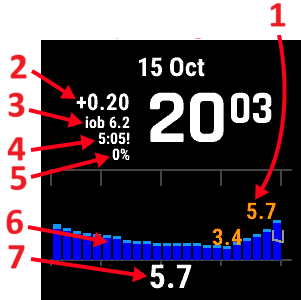
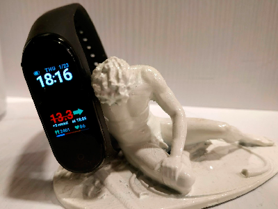

# Smartklokker og AAPS

Ulike smartklokker kan brukes til å vise noe av informasjonen som finnes i **AAPS**, eller til å utføre handlinger på avstand.

Å la en smartklokke styre **AAPS** direkte (pumpe og sensor) gjøres med fulle Android-klokker (som regnes som små [smarttelefoner](./Phones.md)).

Noen smartklokker lar deg registrere behandlinger, eller mer, men det er fortsatt telefonen som styrer **AAPS**.

Smartklokker brukes stadig mer sammen med **AAPS**, _både_ av voksne med diabetes og av omsorgspersoner/foreldre til barn med diabetes.

## Generelle fordeler med å bruke smartklokker sammen med **AAPS**


Smartklokker kan – avhengig av modell – brukes på mange ulike måter sammen med **AAPS**. De kan brukes til å styre **AAPS** helt eller delvis, eller bare til å sjekke glukoseverdier, aktivt insulin og andre verdier på avstand.

Å koble en smartklokke til **AAPS** kan være nyttig i mange situasjoner, for eksempel når du kjører bil eller (motor)sykkel, og under trening. Noen synes det er mer diskret å se på en klokke (i et møte, på fest, ved middagsbordet osv.) enn å se på en telefon. Med tanke på sikkerhet kan en smartklokke også være nyttig når du er på farten: du kan ha **AAPS**-telefonen gjemt bort (for eksempel i en veske) og likevel fjernstyre med smartklokken.

## Spesielle fordeler for foreldre/omsorgspersoner som bruker **AAPS**

For et barn – hvis **AAPS**-telefonen er i nærheten – kan en omsorgsperson bruke en smartklokke til å følge med eller gjøre endringer uten å måtte bruke **AAPS**-telefonen. Dette kan være nyttig, for eksempel hvis **AAPS**-telefonen ligger gjemt i et pumpebelte.

En smartklokke kan brukes enten _i tillegg_ til, eller som et _alternativ_ til de TELEFON-baserte løsningene for fjernstyring eller [bare følging](../RemoteFeatures/FollowingOnly.md).

I motsetning til følgertelefoner for foreldre/omsorgspersoner (som er avhengige av mobilnett eller Wi-Fi) kan smartklokker som er koblet til med Bluetooth, dessuten være nyttige på avsidesliggende steder, som i en hule, i en båt eller halvveis oppe på et fjell. Hvis begge enhetene (**AAPS**-telefonen og smartklokken) er på samme Wi-Fi-nettverk, kan de også bruke Wi-Fi.

## Ulike typer samspill mellom smartklokke og AAPS

Det er for tiden fem hovedmåter smartklokker brukes sammen med **AAPS** på. De er vist i tabellen nedenfor: 

| Klokkeoppsett     | Funksjoner                                     | Krav                                                                                                                                                                                                                                                                                                                    |
| ----------------- | ---------------------------------------------- | ----------------------------------------------------------------------------------------------------------------------------------------------------------------------------------------------------------------------------------------------------------------------------------------------------------------------- |
| Frittstående      | AAPS uten telefon                              | Full Android-smartklokke (sjekk minste Android-versjon)</br> Kjører **app-fullRelease**                                                                                                                                                                                                                                 |
| Full fjernstyring | De fleste AAPS-funksjoner                      | Android **Wear OS**-klokke (sjekk Android/API)</br>Kjører **wear-fullRelease**                                                                                                                                                                                                                                          |
| Fjernstyring      | AAPSClient-funksjoner                          | Android **Wear OS**-klokke (sjekk Android/API)</br>Kjører **[wear-aapsclientRelease](https://github.com/nightscout/AndroidAPS/releases)**                                                                                                                                                                               |
| Fjernstyring      | Noen AAPSClient-funksjoner                     | Garmin-klokker</br>(bare eldre oppsett med Samsung Tizen og Fitbit, anbefales ikke)</br>Se nedenfor.                                                                                                                                                                                                                    |
| Visning           | Glukose, trend, IOB, COB, loop- og pumpestatus | Mange smartklokker, via en hjelpeapp på **AAPS**-telefonen som får data fra kringkastingen [Eksterne hjelpeapper](#watches-external-companion-apps): [WatchDrip+](https://bigdigital.home.blog/) (Xiaomi, Amazfit), [GlucoDataHandler](https://github.com/pachi81/GlucoDataHandler) (Wear OS), G-Watch</br>Se nedenfor. |

## Før du kjøper en smartklokke …

Hvilken smartklokkemodell du bør kjøpe, avhenger av hva du vil bruke den til. Du kan finne nyttig informasjon på siden [Telefoner](#Phones-list-of-tested-phones), blant annet en liste over testede telefoner som også inneholder noen smartklokker.

Populære klokkemerker er Samsung Galaxy, Garmin, Fossil og Mi Band. De ulike alternativene i tabellen ovenfor forklares nærmere nedenfor, slik at du lettere kan velge den smartklokken som passer for deg.

Hvis du skal koble en smartklokke til **AAPS** på en telefon for å fjernstyre **AAPS**, må du også sjekke at de to enhetene er kompatible med hverandre, spesielt hvis du har en eldre eller uvanlig telefon.

Hvis du bare vil følge glukoseverdiene og ikke styre **AAPS**, finnes det et større utvalg av rimelige og enklere klokker du kan bruke.

Den beste måten å velge en smartklokke på er å søke etter innlegg om «watch» i **AAPS**-gruppene på Discord eller Facebook. Les om andres erfaringer, og still konkrete spørsmål hvis du ikke finner svar i eldre innlegg.

## Full Android

Det høres ut som et fristende alternativ, ikke sant? Men foreløpig er det bare noen få entusiaster som prøver ut **AAPS** på en frittstående klokke. Det finnes et begrenset antall smartklokker med et brukbart grensesnitt som også fungerer godt for frittstående bruk av **AAPS** og CGM-appen din. Populære modeller er LEMFO LEM 15 Pro og 16. Du må installere **AAPS** «full»-apk-en (den apk-en som vanligvis installeres på en smarttelefon) på klokken, ikke **AAPS** «wear»-apk-en.

Det finnes ingen klar spesifikasjon som sier om en klokke vil fungere godt for frittstående bruk av **AAPS**, men disse punktene hjelper:

1)  Android 12 eller nyere. 2)  Mulighet til å ta urskiven ut av «firkantet» modus, slik at teksten blir større og lettere å lese. 3)  Svært god batteritid. 4)  God Bluetooth-rekkevidde.

Det meste av frustrasjonen med frittstående **AAPS**-klokker kommer av å jobbe på en bitte liten skjerm, og av at dagens fulle AAPS-app ikke er laget for en klokke. Du vil kanskje bruke en pekepenn til å endre **AAPS**-innstillinger på klokken, fordi skjermen er så liten, og noen AAPS-knapper er kanskje ikke synlige på klokkeskjermen.

Andre utfordringer er at det er vanskelig å få god nok batteritid, og at klokker med nok batteri ofte er store og tykke. Brukere forteller om kamp mot operativsystemet og strømsparingsinnstillingene, problemer med å starte sensorer på klokken, dårlig Bluetooth-rekkevidde (for å holde kontakten med både sensor og pumpe) og tvilsom vanntetthet. Eksempler vises på bildene nedenfor.


Hvis du vil sette opp en frittstående klokke, les innlegg og kommentarer i **AAPS**-gruppen på Facebook (gode søkeord er «standalone» og «Lemfo») og på Discord for mer informasjon.

## Wear OS

**AAPS**-koden inneholder en app-utvidelse som kan installeres på [**Wear OS**-smartklokker](https://wearos.google.com/#oem-carousel).


Kontroller at smartklokken din oppfyller [kravene](#maintenance-android-version-aaps-version) til **AAPS**.

### Hva _er_ Wear OS?

De tre første smartklokkealternativene krever at smartklokken har **Wear OS** installert.

**Wear OS** er operativsystemet som kjører på noen moderne Android-smartklokker. Hvis beskrivelsen av smartklokken bare sier at den er _kompatibel_ med Android og iOS, betyr det ikke at den kjører Wear OS. Det kan være et annet, leverandørspesifikt operativsystem som ikke er kompatibelt med **AAPS**. For å kunne installere og bruke alle versjoner av **AAPS** eller **AAPSClient** må smartklokken kjøre **Wear OS 3.0, 3.2 eller 3.5** (Android 11, API-nivå 30) **eller nyere**. Hver Wear OS-versjon følger Android-versjonen den bygger på: **Wear OS 3** er Android 11 (API-nivå 30), **Wear OS 4** er Android 13 (API-nivå 33), **Wear OS 5** er Android 14 (API-nivå 34) og **Wear OS 6** er Android 16 (API-nivå 36). Klokker med Wear OS 2 kan ikke kjøre **AAPS**.

Hvis du installerer **AAPS** wear.apk på en **Wear OS**-klokke, kan du velge mellom flere egne **AAPS**-urskiver. Du kan også bruke en vanlig urskive fra smartklokken, med **AAPS**-informasjonen vist i små felt på urskiven, kalt «komplikasjoner». En komplikasjon er alt som vises på en urskive i tillegg til klokkeslettet.

```{note}
Nyere endringer i **Wear OS** ødelegger gradvis de egne **AAPS**-urskivene (jo høyere Wear OS-versjon, desto verre), men **komplikasjoner** fortsetter å virke. Før du kjøper eller oppdaterer en klokke, les [Endringer i urskiver på Wear OS](#wearos-watchface-changes).
```


### Hvordan kan smartklokken min se ut?

Etter at du har [installert **AAPS** på klokken](../WearOS/WearOsSmartwatch.md), kan du automatisk velge den urskiven du liker best blant disse egne **AAPS**-urskivene. På de fleste klokker trykker du og holder på startskjermen til skjermen krymper, og sveiper så mot høyre for å velge en annen skjerm:


Dette er de grunnleggende skjermene som er innebygd i **AAPS**. Det finnes [flere urskiver](#WearOS_changing-to-AAPS-watchface), og du kan også bruke [komplikasjoner](#Watchfaces-complications).

### Hvordan bruker jeg en Wear OS-klokke i hverdagen?

Mer om urskivene og daglig bruk, blant annet hvordan du lager (og deler) din egen tilpassede urskive, finner du i delen [Bruk av Wear AAPS på en smartklokke](../WearOS/WearOsSmartwatch.md).

(Watchfaces-tizen)= (watches-external-companion-apps)=

## Eksterne hjelpeapper

**AAPS** kan kringkaste statusen sin til andre apper på samme telefon: glukose og trend, IOB, COB, basal og midlertidig basal, profilnavn, loop-status, telefon- og pumpebatteri, reservoarnivå og bolusfremdrift. Flere hjelpeapper for klokker leser denne kringkastingen og viser dataene på klokker som **AAPS** ikke støtter direkte. For å sende dataene, aktiver **Eksterne hjelpeapper** i **Konfigurasjon** > **Kommunikasjon** (se [Eksterne hjelpeapper](#external-companion-apps) på siden Konfigurasjon). Kringkastingen sendes ved hver ny måling og kan ikke bes om: en oppdateringsknapp i hjelpeappen har ingen effekt på **AAPS**.


Hjelpeapper som er kjent for å bruke denne kringkastingen:

- [WatchDrip+](https://bigdigital.home.blog/) for Xiaomi- og Amazfit-klokker, se [Xiaomi- og Amazfit-klokker](#watches-xiaomi-amazfit) nedenfor.
- [GlucoDataHandler](https://github.com/pachi81/GlucoDataHandler) for Wear OS-klokker, som komplikasjon eller widget. Den er et nyttig alternativ på Wear OS-versjoner der **AAPS**-urskivene er upålitelige, se [Sett opp AAPS på Wear OS-klokken din](../WearOS/WearOsSmartwatch.md). Søsterappen GlucoDataAuto viser de samme dataene i en bil med Android Auto.
- [G-Watch-appen](https://play.google.com/store/apps/details?id=sk.trupici.g_watch) for Samsung Tizen-klokker, og den senere Wear OS-versjonen av den. I eldre **AAPS**-versjoner het pluginen **Samsung Tizen**, etter denne appen.

```{warning}
**G-Watch-appen** og **Wear OS**-versjonen av den vedlikeholdes ikke lenger, og Samsung har flyttet smartklokkene sine fra Tizen til Wear OS. G-Watch er bare aktuelt for eksisterende, eldre oppsett og anbefales ikke for en ny installasjon. Se den egne [Facebook-gruppen](https://www.facebook.com/groups/gwatchapp) for siste nytt.
```

(Watchfaces-garmin)=

## Garmin

Det finnes noen urskiver for Garmin som kobler seg til [AAPS](https://apps.garmin.com/search?keywords=androidaps), i Garmin ConnectIQ-butikken.


[AAPS Glucose Watch](https://apps.garmin.com/apps/3d163641-8b13-456e-84c3-470ecd781fb1) kobler seg direkte til **AAPS**. Den viser loop-status (aktivt insulin, midlertidig basal) i tillegg til glukoseverdier, og sender pulsmålinger til **AAPS**. Den er tilgjengelig i ConnectIQ-butikken; aktiver **Garmin**-pluginen i **Konfigurasjon → Kommunikasjon**. 

1. Høyeste og laveste glukoseverdi på grafen
2. Glukoseendring per minutt
3. Aktivt insulin (IOB)
4. Tid siden siste glukosemåling (minutter:sekunder)
5. Midlertidig basal, i prosent av profilens basal
6. Glukosegraf for de siste 2 timene
7. Gjeldende glukoseverdi


## Fitbit

```{warning}
Google flytter Fitbit inn i Google Health og fjerner tredjepartsapper og urskiver fra Fitbit-klokker i EU. Fitbit-urskiver er derfor **ikke lenger et anbefalt alternativ**, og det anbefales ikke å kjøpe en Fitbit for bruk med **AAPS**.
```

For eksisterende Fitbit-klokker viser [Nightscout-sidene](https://nightscout.github.io/nightscout/wearable/#fitbit) noen alternativer for bare visning, for eksempel [Glance](https://glancewatchface.com/). Dette er også tredjepartsurskiver, så den samme EU-begrensningen gjelder.

## Bare følging

Disse smartklokkene viser noe **AAPS**-informasjon; noen trenger andre apper.

Det finnes mange rimelige smartklokker som bare kan vise data. Hvis du bruker Nightscout, finner du en god oversikt over alle alternativene [her](https://nightscout.github.io/nightscout/wearable/#)

Her er noen av klokkene for bare følging som er populære blant **AAPS**-brukere:

(watches-xiaomi-amazfit)=
### Xiaomi- og Amazfit-klokker

**WatchDrip+** er en hjelpeapp utviklet av brukermiljøet som viser glukose- og loop-data på ulike smartklokkemodeller, for det meste Xiaomi (_f.eks._ Mi Band) og Amazfit:



Fra versjon 0.5 leser **WatchDrip+** dataene direkte fra **AAPS**, uten xDrip+ som mellomledd. På **AAPS**-telefonen:

1. Aktiver **Eksterne hjelpeapper** i **Konfigurasjon** > **Kommunikasjon**, se [ovenfor](#watches-external-companion-apps). Dette gir gjeldende glukose, delta, trendpil, IOB og pumpestatus.
2. Aktiver **xDrip**-pluginen i **Konfigurasjon** > **Kommunikasjon**, og slå på **Send status til xDrip+** i innstillingene til pluginen. Dette gir statuslinjen for IOB/COB, og glukosegrafen på klokken fylles ut etter noen få målinger.
3. Hvis xDrip+ er installert på telefonen, slå av **Broadcast Service API** der (xDrip+ > Settings > Inter-app settings), slik at klokken ikke får dataene to ganger. Hvis xDrip+ bare ble brukt til å sende data videre til klokken, kan du avinstallere den.

Oppdateringsknappen i WatchDrip+ har ingen effekt med **AAPS**: dataene kommer ved hver ny måling.


Du kan lese mer om dem, blant annet hvordan du setter dem opp, på [nettsiden til WatchDrip+](https://bigdigital.home.blog/). Fordelen med disse klokkene er at de er små og relativt rimelige. De er et populært valg, spesielt for barn og andre med smale håndledd.

### Pebble-klokke


Pebble-klokker ([produseres ikke lenger](https://en.wikipedia.org/wiki/Pebble_(watch))) ble solgt fra 2013 til 2016, og kan fortsatt finnes brukt. Fitbit overtok Pebbles eiendeler. Pebble-brukere kan bruke urskiven Urchin til å se Nightscout-data. Data som kan vises, er blant annet IOB, aktiv midlertidig basal og prognoser. Hvis du kjører åpen loop, kan du bruke IFTTT til å lage en applet som sender en SMS eller et Pushover-varsel når det kommer et varsel fra **AAPS**.

### [Bluejay-klokker](https://bluejay.website/)


Dette er unike enheter som kan motta glukosedata **direkte** fra Dexcom-senderen. Det er ikke så kjent at Dexcom G6/G7-sendere faktisk kringkaster gjeldende glukosedata på _to_ separate kanaler, en telefonkanal og en medisinsk kanal. Bluejay-klokkene kan settes til å motta glukosedata på hvilken som helst av kanalene, så hvis **AAPS** bruker telefonkanalen, kan Bluejay-klokkene bruke den medisinske kanalen.

Den store fordelen er at klokken er uavhengig av både telefonen og loop-systemet. Så hvis du for eksempel kobler fra pumpen og **AAPS**-telefonen på stranden eller i fornøyelsesparken, og er utenfor rekkevidde av **AAPS**-telefonen, kan du fortsatt få verdier fra Dexcom direkte til Bluejay-klokken.

Den opprinnelige **Bluejay GTS** produseres ikke lenger og kan ikke lese Dexcom G7. De senere modellene (U1, og nå **U3**, som selges som tidlig tilgang i skrivende stund) er fulle Android-klokker som kjører xDrip og henter data direkte fra Dexcom G6 og G7. Leverandøren beskriver klokken som et forskningsverktøy, ikke til medisinsk bruk. Rapporterte ulemper er at den ikke alltid fanger opp en måling hvert 5. minutt, og at batteriet må lades ofte. Se [Bluejay-nettsiden](https://bluejay.website/) for gjeldende modell og tilgjengelighet.

### Apple Watch

Se [Nightscout på klokken din](https://nightscout.github.io/nightscout/wearable/#).

Apple Watch støtter nå direkte tilkobling til G7 og kan brukes samtidig med **AAPS**.

