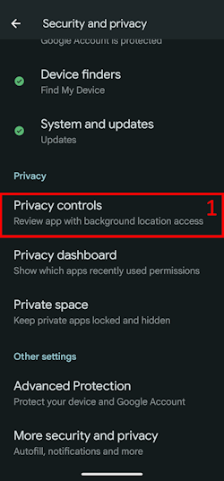

(bluetoothtroubleshooting-bluetooth-related-issues)=

# Bluetooth-relaterte problemer

Noen brukere har hatt problemer med at aktivering av Omnipod DASH mislykkes, tilkoblingsproblemer med Medtrum Nano og andre pod-feil som har med Bluetooth å gjøre. Mange av disse problemene kan spores tilbake til ett av problemene nedenfor.

Noen av disse problemene gjelder trolig også andre insulinpumper med Bluetooth. Medtrum Nano har kjente problemer med tillatelsen «Enheter i nærheten», akkurat som Omnipod DASH.

---

(bluetoothtroubleshooting-cannot-start-omnipod-with-android-16)=

## Kan ikke starte Omnipod med Android 16
- Android 16 krever minst **AAPS** versjon 3.3.2.1 for at Omnipod DASH skal fungere riktig, fordi denne versjonen har rettelser som er laget spesielt for kjente problemer som Android 16 innførte for Omnipod.

---

(bluetoothtroubleshooting-bluetooth-battery-optimisation)=

## Batterioptimalisering for Bluetooth

Nyere versjoner av Android har slått på batterioptimalisering for systemets Bluetooth-app. Dette er kjent for å gi problemer for pumper og CGM-er som bruker Bluetooth.

Hvis du fulgte [Oppsettveiviseren i AAPS](../SettingUpAaps/SetupWizard.md) og gjorde innstillingene i avsnittet [Batterioptimalisering for Bluetooth](#setup-wizard-bluetooth-battery-optimisation), skal denne innstillingen være riktig. Hvis du derimot fulgte en eldre versjon av denne veiledningen, er det mulig at du ikke har endret denne innstillingen.

Kontroller at dette er riktig satt opp hvis pumpen og CGM-en kobler fra.

---

(bluetoothtroubleshooting-apps-using-nearby-device-permission)=

## Apper som bruker Android-tillatelsen «Enheter i nærheten», kan føre til at tilkoblingen faller ut og til problemer med pod-aktivering

Android lar deg styre hva hver app kan gjøre og få tilgang til på telefonen din, gjennom en modell med tillatelser. For hver installerte app kan du velge å tillate eller nekte bestemte tillatelser, for eksempel tilgang til filer på enheten, tilgang til Bluetooth, søk etter enheter i nærheten osv.

**AAPS** trenger en rekke bestemte tillatelser for å fungere. En av dem, som kreves for at pods skal fungere, er tillatelsen «Enheter i nærheten». Mange andre apper krever også denne tillatelsen. Fellesskapet har funnet ut at en del apper, når de har fått denne tillatelsen, kan gi problemer med å aktivere nye pods på noen enheter.

(bluetoothtroubleshooting-apps-using-nearby-device-permission-known-apps)=

### Apper som bruker tillatelsen «Enheter i nærheten», og som er kjent for å ha gitt problemer:

Appene i denne listen er omtalt ett eller flere steder i fellesskapet som apper som gir problemer for Omnipod DASH, og i noen tilfeller også for Medtrum Nano.

```{admonition} Updating the list
:class: note
Send en melding til @XiTatiON i Discord-kanalen #omnipod-dash for å diskutere apper som bør legges til i denne listen.
```

- **myBMW** MyBMW forstyrret Medtrum Nano og Omnipod DASH. MyBMW-appen spør bare én gang om tillatelse til å «finne enheter i nærheten». Hvis du ikke gir den, fungerer appen likevel helt fint.

- **Amazon Alexa**  Å fjerne «Enheter i nærheten» for Alexa-appen løste problemet for noen, men da kan du ikke lenger pare Matter IoT-enheter

- **MINI-appen**  Appen ser ut til å være basert på myBMW-appen, og kan derfor oppføre seg på samme måte

- **BM2** App for overvåking av solcellebatterier, brukt i noen bobiler og solcelleanlegg for camping. Når appen kjørte, hindret den aktivering av en ny pod. En løsning er å tvangsstoppe appen mens du aktiverer en ny pod. Å kjøre appen etterpå så ikke ut til å forstyrre Dash (på en Pixel 8 Pro med Android 16).

(bluetoothtroubleshooting-revoke-nearby-device-permission)=

### Slik fjerner du tillatelsen «Enheter i nærheten» for andre apper:
Hvis du har problemer med å aktivere en ny pod, og du kjører den riktige, støttede versjonen av **AAPS** for din Android-versjon, kan det være nødvendig å fjerne tillatelsen for andre apper mens du aktiverer en ny pod.

Følg denne fremgangsmåten for å fjerne tillatelsen «Enheter i nærheten» for alle apper unntatt **AAPS**:

```{admonition} Menus and settings
:class: note
Skjermbildene og instruksjonene i denne veiledningen er fra en ren Android 16-installasjon på en Google Pixel 8 Pro. Andre produsenter og enheter har trolig ikke nøyaktig de samme menyene og innstillingsnavnene. Tilpass stegene til enheten din, og hvis du står fast, se avsnittet [Hvor du kan få hjelp med DASH](#omnipod-dash-where-to-get-help-for-dash) om hvordan du kan be fellesskapet om hjelp.
```

1. Åpne Android-innstillingene på telefonen, bla ned og trykk på **Sikkerhet og personvern (1)**.

    

2. Bla ned og trykk på **Personvernkontroller (1)**.

   

3. Trykk på **Tillatelsesadministrator (1)**.

   

3. Bla ned og trykk på **Enheter i nærheten (1)**.

   

4. Bla gjennom listen over apper, og trykk på appen du vil fjerne tillatelsen **Enheter i nærheten** for.

   I denne veiledningen er **Android Auto (1)** appen vi fjerner tillatelsen for.

   For å unngå å ødelegge flere pods anbefaler vi at alle først fjerner tillatelsen for alle apper unntatt **AAPS**.

```{admonition} Which app to select?
:class: tip
Hvis du ikke er sikker på hvilken app som gir problemet, slår du av tillatelsen for alle (husk å sjekke listen over kjente problemapper også, og start med dem). Hvis du har råd til å ødelegge noen pods underveis, kan du slå på tillatelsen for én ny app før hver nye pod-aktivering, til du finner ut nøyaktig hvilken app som gir pod-problemene dine. Hvis du finner nye problemapper, si fra til oss i Discord-kanalen #omnipod-dash.
```

   

5. For å fjerne tillatelsen trykker du på **Ikke tillat (1)**, og deretter på **Ikke tillat likevel (2)**. Hvis du har gjort det riktig, skal **Ikke tillat (3)** nå være det valgte alternativet. Du kan nå gå tilbake til menyen **Enheter i nærheten** ved å trykke på **tilbakepilen (4)**, og endre denne innstillingen for andre apper om nødvendig.

      

(bluetoothtroubleshooting-re-enable-nearby-device-permission)=

### Slik slår du på tillatelsen «Enheter i nærheten» igjen for systemapper og andre apper:

1. Se om nødvendig avsnittet **«Slik fjerner du tillatelsen ‘Enheter i nærheten’ for andre apper»** for hvordan du kommer til personverninnstillingene for apper. Når du er inne i **Enheter i nærheten**, fortsetter du med steg 2.

2. Bla gjennom listen over apper, og trykk på appen du vil gi tillatelsen **Enheter i nærheten** til.

   I denne veiledningen er **Android Auto (1)** appen vi gir tillatelsen til.

   Du vil se at **Android Auto (1)** mangler i applisten etter at tillatelsen er fjernet. Det er fordi **Android Auto**-appen er en **systemapp**, og systemapper er skjult som standard.

   

3. For å vise skjulte systemapper trykker du på **menyen med tre prikker (⋮) (1)** øverst til høyre, og deretter på **«Vis system» (2)**. Nå skal du kunne se den skjulte systemappen **Android Auto (3)** i listen.

```{admonition} Find your app
:class: tip
Hvis tillatelsen er fjernet for en app, må du bla ned til du ser listen over apper uten tillatelse lenger ned i listen.
```

     

5. Følg veiledningen i **«Slik fjerner du tillatelsen ‘Enheter i nærheten’ for andre apper»** i motsatt rekkefølge for å slå på tillatelsen igjen for hver app.

---

(bluetoothtroubleshooting-android-15-bluetooth-connection-problems)=

## Hyppige Bluetooth-tilkoblingsproblemer på Android 15

Etter en oppgradering av Android, eller etter bytte til en ny telefon, mister **AAPS** ofte Bluetooth-tilkoblingen til pumpen. Problemet forsvinner midlertidig når du starter telefonen på nytt. Hvis du bruker en **Omnipod DASH** og telefonen din kjører Android 15, kan det hjelpe å slå på innstillingen **Bluetooth-sammenkobling** (bonding) for å få en mer stabil Bluetooth-tilkobling. Slik slår du den på:

```{admonition} Android 16
:class: warning
Slå bare på **Bluetooth-sammenkobling** på Android 15, og bare hvis du har tilkoblingsproblemer. IKKE slå på Bluetooth-sammenkobling på Android 16.
```

1. Åpne [Dash-innstillingene](#omnipod-dash-settings): åpne DASH-pumpeskjermen med **Administrer** > **Pumpe**, og trykk på ikonet **Innstillinger** (tannhjulet) øverst til høyre.

   

2. Åpne delen **Avanserte innstillinger** og slå på **Bluetooth-sammenkobling**.

   

3. Hvis telefonen viser en forespørsel om sammenkobling, godtar du den.

4. Start telefonen på nytt.
