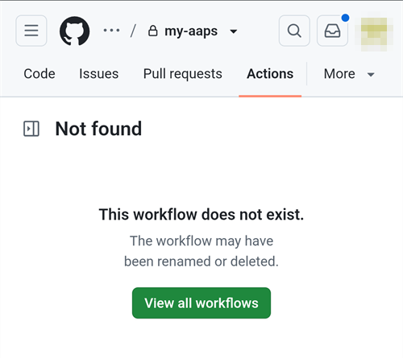
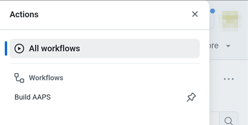
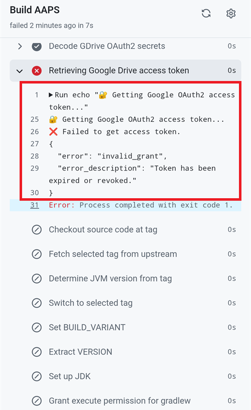

(aaps-ci-troubleshooting)=

# Nettleserbygg: feilsøking

```{note}
This page collects troubleshooting tips for the [Browser build](../SettingUpAaps/BrowserBuild.md).
```

(aaps-builder-troubleshooting)=

## AAPS Builder

### Step 1: the repository

(aaps-builder-ts-repo-exists)=

#### "my-aaps already exists in this account"


You already have this repository, for example from an earlier attempt. Close the GitHub tab, keep that name in step 1 of the setup page and go on. If you already did steps 2 and 3 for it, your key is still in it: continue with [step 4](#aaps-builder-step4). If it was made with an earlier version of the setup page, update its workflow once as explained in [Updating AAPS](#aaps-builder-updates). You prefer a fresh start? Type another name, for example `my-aaps-2`, and use the same keystore in step 2.

(aaps-builder-ts-user-not-found)=

#### "No GitHub user with this name"


- **«Ingen GitHub-bruker med dette navnet»** i steg 1: skriv inn GitHub-brukernavnet ditt, slik det vises i GitHub-profilen din, ikke e-postadressen din.
- **Ingen «Build AAPS»- eller «Run workflow»-knapp, eller repositoryet er tomt**: repositoryet ble ikke opprettet fra malen. Slett det (**Settings** → nederst på siden → **Delete this repository**) og gjør [steg 1](#aaps-builder-step1) på nytt med knappen **Opprett mitt private repository**.

### Step 3: the secret

(aaps-builder-ts-404)=

#### "Page not found" (404)


- **«Page not found» (404) når oppsettsiden åpner GitHub**: logg inn på github.com i den samme nettleseren (GitHub viser 404 for private repositoryer når du ikke er logget inn). Hvis du er logget inn, stemmer ikke brukernavnet eller navnet på repositoryet i steg 1 på oppsettsiden med repositoryet ditt. Skriv inn de nøyaktige navnene.

### Step 4: the build

(aaps-builder-ts-workflow-not-found)=

#### "This workflow does not exist"



Right after the repository is created, GitHub may not have read its workflow file yet: **Build AAPS** is missing from the **Actions** tab, and there is no **Run workflow** button. Any small change to the file makes GitHub read it:

1. In your repository, open **Code**, then the folder `.github`, then `workflows`, then the file `build.yml`.
2. Tap the **⋯** menu at the top right of the file, then **Edit file… In place** (on a computer, click the pencil).

   

3. Tap at the very end of the text and add an empty line (Enter). Tap **Commit changes…** at the top.

   

4. Tap **Commit changes** again.

   

5. Open the **Actions** tab again: **Build AAPS** is now in the list of workflows (on a phone, the list opens with the icon at the left of **All workflows**). Tap it, then **Run workflow**.

   

(aaps-builder-ts-build-failed)=

#### The build failed (red cross)

1. On the setup page, tap **Open my builds** and tap the build with the red cross.

   

2. The page of the build shows **Failure**, and which part failed: **AAPS / Check** (the repository, the secret, the version or the variant: nothing was built) or **AAPS / Build AAPS**.

   

3. Scroll down to **Annotations**, with your finger on the text, not on the diagram. The red lines explain the problem: tap **Show more** to read the whole message, then find it below.

   

- **«Secret KEYSTORE_SET is missing»** (hemmeligheten KEYSTORE_SET mangler): gjør steg 3 på oppsettsiden.
- **Bygget stopper med «This repository is PUBLIC»** (repositoryet er offentlig): i repositoryet ditt åpner du **Settings** → **General** → **Danger Zone** → **Change visibility** → **Private**, og bygger så på nytt.
- **"Version … does not exist"**: only released versions of **AAPS** can be built, the ones on the [tags page](https://github.com/nightscout/AndroidAPS/tags) of nightscout/AndroidAPS, such as `3.3.2.0`. A branch name such as `dev` doesn't work. Use `latest`, or type a tag exactly as listed.
- **«Variant … is not supported»** (varianten støttes ikke): arbeidsflytfilen din er en eldre versjon. Erstatt den som forklart under [Oppdatere AAPS](#aaps-builder-updates).
- **«The secret is too short»**, **«The secret is not a valid code»** eller **«The secret does not contain a keystore»** (hemmeligheten er for kort, er ikke en gyldig kode eller inneholder ingen keystore-fil): feil tekst ble limt inn i hemmeligheten, ofte selve ordet `KEYSTORE_SET`, eller bare en del av koden. I repositoryet ditt åpner du **Settings** → **Secrets and variables** → **Actions**, redigerer `KEYSTORE_SET` og limer inn den lange koden fra **Kopier hemmelighet** på nytt (gjør steg 2 på oppsettsiden på nytt først hvis du har lukket den).
- **«Keystore, password or alias is wrong»** (keystore-fil, passord eller alias er feil): kontroller passordet og aliaset til keystore-filen din, og gjør så steg 2 og 3 på oppsettsiden på nytt.
- **«Google Drive access has expired or was revoked»** (Google Drive-tilgangen er utløpt eller trukket tilbake): gjør [steg 6](#aaps-builder-google-drive) på nytt og oppdater hemmeligheten `GDRIVE_OAUTH2`.
- **Another error**: [read the build log](#aaps-ci-read-the-logs), then [run the build again](#aaps-ci-rerun). If it fails again the same way, ask for help with the name of the failed step and the error lines. Del aldri innholdet i hemmelighetene dine.

### Step 5: the app

- **Ingen Download-lenke, eller GitHub-appen åpnet seg**: GitHub-appen kan ikke laste ned bygg. Åpne bygget i Chrome som forklart i [steg 5](#aaps-builder-step5). For å hindre at GitHub-lenker åpnes i appen: Android-**Innstillinger** → **Apper** → **GitHub** → **Åpne som standard** → slå av **Åpne støttede linker**.

## Feilsøking av AAPS-CI

(aaps-ci-read-the-logs)=
### Først: finn ut hva som gikk galt

Når et bygg mislykkes, beholder GitHub en logg over hvert steg. Loggen forteller deg hvilket steg som mislyktes, og hvorfor. Les den før du prøver noe annet: feilmeldingen er det du skal lete etter på denne siden, og det de som hjelper deg, vil spørre om.

1. I GitHub-kopien din av AndroidAPS åpner du **Actions**. Et mislykket bygg har et rødt kryss. Trykk på navnet.

   

2. Sammendraget av kjøringen viser **Failure**, og under det jobben som mislyktes (**Build AAPS**, med et rødt kryss).

   

3. Bla ned til **Annotations** og trykk på den røde linjen **Build AAPS**.

   

4. Jobben åpnes. Steg med en grå hake gikk bra. Steget med det røde krysset er det som mislyktes: GitHub åpner det for deg. Stegene etter det ble hoppet over (grå sirkel).

   

5. Les linjene rett over `Error: Process completed with exit code 1.`: de forklarer problemet. I dette eksempelet mislyktes steget **Retrieving Google Drive access token** med `invalid_grant` og `Token has been expired or revoked.`, se [Google refresh token er utløpt](#aaps-ci-google-token-expired).

   

```{tip}
Skal du be om hjelp? Del navnet på steget som mislyktes, og feillinjene (et skjermbilde som det ovenfor er greit). Del aldri innholdet i hemmelighetene dine.
```

(aaps-ci-update-secret)=
#### Oppdatere en hemmelighet

Mange løsninger går ut på å bytte ut verdien til en hemmelighet. I GitHub-kopien din av AndroidAPS går du til **Settings** → **Secrets and variables** → **Actions** og trykker på blyanten ved siden av hemmeligheten.


Skriv inn eller lim inn den nye verdien, og trykk på **Update secret**. GitHub viser aldri den gamle verdien: feltet er alltid tomt.


(aaps-ci-rerun)=
#### Kjør bygget på nytt etter en rettelse

Når du har rettet årsaken, trenger du ikke starte fra begynnelsen: åpne den mislykkede kjøringen, trykk på **...** (øverst til høyre), og deretter på **Re-run failed jobs**.


Trykk på **Re-run jobs**. Du kan også starte et nytt bygg fra **Run workflow** som vanlig.


(aaps-ci-preparation-web)=
### Nettsiden aaps-ci-preparation
  - Forberedelsessiden vises av en midlertidig lokal server (for eksempel Simple Web Server på en datamaskin), som også tar imot Google refresh token.
  - Hvis du ser skjermbildet nedenfor, har den lokale serveren stoppet, eller den kan ikke nås.
  - Lukk forberedelsessiden, kontroller at den lokale serveren kjører, åpne så aaps-ci-preparation.html på nytt på samme måte som i steg 2, og fullfør de gjenstående stegene. Dette trengs særlig når du oppretter den første Google-tilkoblingen under oppsettet.

  

(aaps-ci-google-token-expired)=
### Google refresh token er utløpt
  - Et Google OAuth2 refresh token (oppdateringstoken) utløper hvis det ikke brukes på 6 måneder, og kan også bli ugyldig av andre grunner (for eksempel hvis du har endret passordet til Google-kontoen din, eller fjernet tilgangen manuelt). Flere detaljer finner du i [Google OAuth2-dokumentasjonen](https://developers.google.com/identity/protocols/oauth2).
  - I [byggeloggen](#aaps-ci-read-the-logs) mislykkes steget **Retrieving Google Drive access token** med `invalid_grant` og `Token has been expired or revoked.`:

  

  - Hvis bygget mislykkes fordi Google refresh token er utløpt eller trukket tilbake, må du gjøre stegene under [Google Drive Auth](#aaps-ci-google-drive-auth) på nytt for å få et nytt `GDRIVE_OAUTH2`-token, [oppdatere hemmeligheten](#aaps-ci-update-secret) i GitHub-repositoryet ditt, og deretter [kjøre bygget på nytt](#aaps-ci-rerun).
  - Hvis autorisasjonen mislykkes igjen, eller Google ikke lenger ber om samtykket ditt, fjerner du først den eksisterende AAPS-tilgangen fra Google-kontoen din, se [nedenfor](#aaps-ci-google-remove-access).

(aaps-ci-google-remove-access)=
### Fjern AAPS-tilgangen fra Google-kontoen din og start autorisasjonen på nytt
  - Hvis Google Drive-autorisasjonen fortsetter å mislykkes, eller du vil starte helt på nytt, fjerner du først tilgangen du tidligere ga til AAPS, og gjør deretter autorisasjonen på nytt.
  - På telefonen åpner du [https://myaccount.google.com](https://myaccount.google.com), trykker på **Security** (Sikkerhet), blar ned til **Your connections to third-party apps & services** (Dine tilkoblinger til tredjepartsapper og -tjenester) og åpner listen over tilkoblede apper. Du kan også gå rett til [https://myaccount.google.com/connections](https://myaccount.google.com/connections).
  - Trykk på **AAPS** i listen.

  

  - Siden viser tilgangen du ga til AAPS (Google Drive-filene som brukes med appen). Trykk på **Delete all** (Slett alle) for å fjerne tilkoblingen, eller trykk på **See details** (Se detaljer) for å se gjennom den først.

  

  - På detaljsiden trykker du på **Remove all access** (Fjern all tilgang).

  

  - Trykk på **Confirm** (Bekreft).

  

  - Google bekrefter at AAPS ikke lenger har tilgang. AAPS vises ikke lenger i listen over tilkoblede apper.

  

  - Start nå autorisasjonen på nytt fra bunnen av: lukk **både** forberedelsessiden og filbehandler-appen, åpne aaps-ci-preparation.html på nytt fra filbehandleren, og gjør stegene under [Google Drive Auth](#aaps-ci-google-drive-auth) på nytt. Google ber deg gi tilgang på nytt, og siden gir deg et nytt `GDRIVE_OAUTH2`-token.
  - [Oppdater hemmeligheten `GDRIVE_OAUTH2`](#aaps-ci-update-secret) i GitHub-repositoryet ditt med det nye tokenet, og [kjør deretter bygget på nytt](#aaps-ci-rerun).

(aaps-ci-disable-software)=
### Slå av programvare som kan forstyrre OAUTH-verifiseringen
  - Slå av alle VPN- og sikkerhetsapper (brannmur, antivirus …) på telefonen før du prøver å hente OAUTH-nøkkelen.

(aaps-ci-actions-permission)=
### Kontroller tillatelsesinnstillingene for GitHub Actions
  - Pass på at reglene for GitHub Actions er satt til «Allow all actions and reusable workflows» (Settings → Actions → General). Hvis du endrer det, trykker du på **Save** under alternativene.

  

`actions/checkout@v4` and `actions/setup-java@v4` are not allowed to be used in `xxxxx/AndroidAPS`. Actions in this workflow must be: within a repository owned by `xxxxx`

(aaps-ci-workflow-permissions)=
### Kontroller tillatelsesinnstillingene for GitHub-arbeidsflyter
  - Hvis bygget mislykkes med en gang med en feil av typen «Invalid workflow file» (ugyldig arbeidsflytfil) som ligner på den nedenfor, er standardtillatelsene for arbeidsflyter i repositoryet ditt for strenge:

```
Invalid workflow file
The workflow is not valid. .github/workflows/aaps-ci.yml (Line: 361, Col: 3):
Error calling workflow 'xxxxx/AndroidAPS/.github/workflows/cleanup-workflow-runs.yml@...'.
The nested job 'cleanup' is requesting 'actions: write', but is only allowed 'actions: none'.
```

  - Pass på at Workflow permissions er satt til «Read and write permissions» (Settings → Actions → General → Workflow permissions). Lagre, og kjør deretter byggearbeidsflyten på nytt.

  

(aaps-ci-password-special-characters)=
### Bygget mislykkes ved kontroll av keystore-passordet
  - I [byggeloggen](#aaps-ci-read-the-logs) mislykkes steget **Validating keystore, alias and password** med `Either KEYSTORE_BASE64, KEYSTORE_PASSWORD, KEY_PASSWORD, or KEY_ALIAS is incorrect`, etterfulgt av `Keystore was tampered with, or password was incorrect`. Bygget stopper der: keystore-filen og passordene kontrolleres før AAPS bygges.

  

  - Byggearbeidsflyten beholder hvert tegn i passordene dine uendret. Skriv inn `KEYSTORE_PASSWORD` og `KEY_PASSWORD` nøyaktig som de er, uten å legge til en omvendt skråstrek eller noe annet escape-tegn. Hvis du har lagt til omvendte skråstreker, [oppdaterer du hemmelighetene](#aaps-ci-update-secret) med passordet nøyaktig som det er. Eksempelet nedenfor er feil: passordet er `Example2026`, den omvendte skråstreken er lagt til.

  

  - Hvis bygget fortsatt mislykkes ved signering av APK-filen selv om passordet ditt er riktig, og passordet inneholder `$`, et backtick-tegn, `"` eller `\`, er arbeidsflytfilen i forken din eldre enn september 2026 og tolker fortsatt disse tegnene. [Synkroniser forken din](#Update-to-new-version-update-your-repo) med nyeste dev, og kjør deretter byggearbeidsflyten på nytt.
  - Den loddrette streken `|` er et spesialtilfelle. Forberedelsessiden i [alternativ 1](#aaps-ci-option1) slår sammen keystore-filen, passordene og aliaset til én hemmelighet, `KEYSTORE_SET`, med `|` som skilletegn, og arbeidsflyten deler den opp ved det tegnet. Passordet som forberedelsessiden lager, inneholder bare bokstaver og sifre, så dette kan ikke skje med alternativ 1. Det kan bare skje hvis du selv har satt sammen en `KEYSTORE_SET`-hemmelighet fra et passord som inneholder `|`. I så fall sletter du `KEYSTORE_SET` og legger inn de separate hemmelighetene fra [alternativ 2](#aaps-ci-option2) i stedet.
