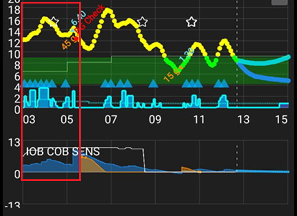

# Justering av AAPS-profilen

```{admonition} This is NOT a medical advice
:class: warning
Snakk med behandlingsteamet ditt for støtte og råd om diabetesbehandlingen din.</br>
Bruk denne veiledningen bare når du har [satt opp **Profilen** din riktig](https://androidaps.readthedocs.io/en/latest/SettingUpAaps/YourAapsProfile.md) og fulgt alle opplæringsmålene i **AAPS**.
```

Denne veiledningen forklarer logikken bak resultatene fra OpenAPS-algoritmen med en gitt __Profil__, og gir informasjon om hvilke verdier i **AAPS** som kan justeres når du ser bestemte situasjoner eller mønstre. Forslagene om basaltesting nedenfor kan avvike fra det behandlingsteamet ditt anbefaler.

Å bruke **lukket loop** kan gjøre basaltesting enklere og kan redusere risikoen for føling betydelig hvis __Profil__-basalen din er for sterk.

## Endre profilinnstillingene – slik går du fram

1. Sørg for at du har lest og forstått de anbefalte innstillingene og rådene fra __AAPS__ nedenfor. Hvis du ikke følger dette rådet, kan justeringen bli vanskelig, og det blir mindre sannsynlig at du får en godt justert __Profil__
2. Observer og sammenlign nøye, **over flere dager**, hva som skjer med __BS__ og __IOB__.
3. Se etter mønstre i **AAPS** som skjer rundt samme tid (nesten) hver dag.
4. Det er viktig å gjøre dette over flere dager. Du får ofte dårlige resultater hvis du bruker data fra én enkelt dag til å bestemme justeringer av __Profilen__.
5. Når du har sett et mønster som gjentar seg, f.eks. at du kl. 13:00 ser en topp i __BS__ eller en negativ __IOB__-verdi, først da begynner du å gjøre små endringer i __Profilen__ din.
6. Det er viktig å bare endre én ting om gangen. F.eks. øk basaldosen med 10 % rundt kl. 13:00.
7. Etter hver endring er det viktig å følge med på virkningen på __BS__ og __IOB__ de neste dagene.
8. Gjenta dette mønsteret: observer, bestem deg, juster igjen om nødvendig

Ikke stress, ta det rolig!

## Anbefalte innstillinger og råd mens du justerer basalen

- Gjør all testing med [lukket loop aktivert](#AapsScreens-loop-status).
- **Slå <u>AV</u> alle [automasjoner](../DailyLifeWithAaps/Automations.md)**
- **Slå <u>AV</u> [DynISF](#Open-APS-features-DynamicISF), [AutoISF](#Open-APS-features-auto-isf), [Autosens](#Open-APS-features-autosens)**, slik at de ikke prøver å tilpasse profilen din.
- Ikke gjør manuelle handlinger (manuell bolus, midlertidige mål osv.) mens du tester: la systemet bare bruke innstillingene i **Profilen**.
- For [ekstra grafer](#AapsScreens-section-g-additional-graphs): på graf 1 bruker du Aktivt insulin (IOB), Karbo ombord (og Sensitivitetsendring). På graf 2 bruker du Avvik og BS-påvirkning. Når du ber om råd, ta alltid med disse på skjermbildene dine.
- COB=0[*](#profiletuning-cob-zero)

Andre ting som helst bør unngås, fordi de påvirker dataene og kan føre til feil konklusjoner:
- Ingen fysisk aktivitet.
- Ikke noe stress.
- Ingen sykdom.
- Ikke ekstremvær som høye eller lave temperaturer.
- Ingen feil på pumpe- eller CGM-økter.
- Ingen ikke-varslede karbohydrater.

Merk også:
- Hvis [basaldoseprofilen](#your-aaps-profile-basal-rates) din er riktig, vil du, når du er på målet med COB=0[*](#profiletuning-cob-zero) og IOB=0, holde deg stabilt på målet uansett **ISF** (**ISF** brukes bare når du ligger over **BS**-målet).
- Du må sjekke den gjeldende **IOB**, men også **IOB**-grafen, for å se hvordan **IOB** har utviklet seg de siste timene.

(profiletuning-cob-zero)=

***COB = 0**

Det betyr at måltidet er fordøyd, og at det ikke er flere karbohydrater i kroppen din.

**AAPS** kan vise [COB=0 mens du fortsatt har aktive karbohydrater](../DailyLifeWithAaps/CobCalculation.md).

## Definisjoner i [Profilen](../SettingUpAaps/YourAapsProfile.md)

En for **sterk Profil** tyder på en kombinasjon av følgende:

- [ISF](#your-aaps-profile-insulin-sensitivity-factor)-tallet er for lavt.
- [Basal](#your-aaps-profile-basal-rates)-tallet er for høyt.
- [IK](#your-aaps-profile-insulin-to-carbs-ratio)-tallet er for lavt.

## Observasjoner av IOB

*Merk: du kan også bruke IOB-grafen i Loopalyzer i Nightscout-rapportene for å se IOB over flere dager.*

Hvis du ser følgende mønstre etter noen dager, bør du vurdere disse endringene:

### Positiv IOB

- **Profil**-basalen er kanskje ikke sterk nok (dette kan også skyldes ting som ikke-varslet mat, sykdom, dårlig absorpsjon på stedet osv.)


### Negativ IOB

- Standard basal for sterk.
- Kan være en ettervirkning av trening/fysisk aktivitet.


- Forrige måltid: for mye bolus (som ga en svært lang null midlertidig basal)


## Observasjoner av BS-målet

### Blir liggende høyt

- __ISF__-tallet er høyt og ikke sterkt nok (beregnet insulin er for svakt)



- __Profil__-basalen er kanskje ikke sterk nok (**SMB-er** har ikke nok «basallager» å bruke)
- En sikkerhetsinnstilling ([MaxIOB](#Open-APS-features-maximum-total-iob-openaps-cant-go-over)?) kan ha slått inn og begrenser insulintilførselen. Kontroller i **APS**-pluginskjermen (**Konfigurasjon → APS → Åpne plugin**); se [SMB](#Open-APS-features-super-micro-bolus-smb).
- Teknisk problem: absorpsjon på stedet, infusjonssett, ...

### Blir liggende lavt

- __ISF__ er for sterk, og tallet må økes
- __Profil__-basalen er for sterk (hvis IOB også er negativ)

### Berg-og-dal-bane (opp og ned)

- **ISF** for sterk? Se [AAPS-profilen din](#your-aaps-profile-insulin-sensitivity-factor)


## Observasjoner av BS etter måltider

### Rask stigning og BS går høyt

- Maten inneholder raske karbohydrater (som fruktjuice).
- Vurder en forhåndsbolus, eller en litt tidligere forhåndsbolus.
- Bolus (IK eller gitt %) ikke sterk nok.


### Rask stigning og så går BS lavt

- Vurder en forhåndsbolus; **Profilen** din kan være for aggressiv (overkorreksjon av stigningen)
- Bolus for sterk.


## [Slik regner du ut IK](#your-aaps-profile-insulin-to-carbs-ratio)

1. Først trenger du riktige standard basalinnstillinger i **Profilen** din.
2. Start på målet, helst uten negativ IOB.
3. Noter totalt gitt insulin i **Administrer → Pumpe** (eller pumpehistorikken) og kall det start-insulin. Mål opp en kjent porsjon karbohydrater svært nøyaktig, og noter starttiden og start-IOB. Legg så inn karbohydrater og bolus i **AAPS** med boluskalkulatoren (med den gjeldende IK). Ikke glem å spise karbohydratene ;)
4. Etter noen timer, når COB=0[*](#profiletuning-cob-zero) og du er tilbake på målet, noterer du sluttiden og slutt-IOB, sjekker totalt gitt insulin som før og kaller det slutt-insulin. *MERK: Tidsrommet er IKKE viktig, så lenge det er lengre enn fordøyelsen din*
5. Fra forskjellen mellom start- og slutt-insulin trekker du fra / legger du til forskjellen slutt-IOB - start-IOB. Trekk så fra basalinsulinet beregnet fra innstillingene i **Profilen** din.
6. Hvis __BS__ er på målet, har du nå det totale insulinet som ble brukt til å «fordøye» karbohydratene. Regn ut **IK**.

### Forklaring av IK-beregningene

- Med en **Profil** som har riktig standard basaldose, bør du i ethvert tidsrom holde deg på målet og ha en IOB nær 0. Du får bare **Profil**-basalen din.
- Så legger du til karbohydrater og bolus. Vent til kroppen har fordøyd alle karbohydratene og du er tilbake på **BS**-målet. Insulinforbruket ditt blir summen av basalen + insulinet som trengs til karbohydratene. Du regner ut insulinet som ble brukt til basal (ved hjelp av **Profilen** din), og overskuddet er insulinet som ble brukt til å fordøye karbohydratene.
- Hvis tidsrommet er for kort, er det fortsatt karbohydrater som ikke er fordøyd, og «insulinet som trengs til karbohydratene» blir feil.
- Hvis tidsrommet er for langt, skjer det ikke noe galt. Du bruker opp alle karbohydratene og får mer basal. Til slutt trekker du basalen fra det totale insulinforbruket; det lengre tidsrommet (med mer basal) påvirker ikke resultatet.

Opprinnelig skrevet av @Robby (Discord) som tips og triks for å justere **AAPS-profilen** din, gjennomgått og redigert av fellesskapet (takk!).
