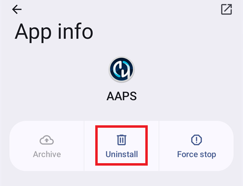

(reinstall-aaps)=
# Installere AAPS på nytt med en ny keystore-fil

Hver **AAPS**-apk er signert med en **keystore-fil**. En oppdatering installeres bare over den **AAPS** du har nå, hvis den er signert med den **samme keystore-filen**: da beholdes alle innstillingene og dataene dine. Derfor anbefales det å lagre keystore-filen og passordet til den på et trygt sted.

Hvis du prøver å installere en apk som er signert med en annen keystore-fil enn før, får du en feilmelding om at installasjonen mislyktes!

(reinstall-aaps-when)=
## Når må du installere på nytt?

Du må avinstallere og installere **AAPS** på nytt når den nye apk-en din er signert med en annen keystore-fil, for eksempel:

- Du finner ikke den gamle keystore-filen eller passordet til den.
- Du har laget en ny keystore-fil, for eksempel med [alternativ 1 i nettleserbygget](../SettingUpAaps/BrowserBuildKeystore.md) eller **Create a new key** i [AAPS Builder](../SettingUpAaps/BrowserBuildAapsBuilder.md).
- Du bygger på en ny datamaskin og har ikke kopiert keystore-filen dit.

Hvis du fortsatt har keystore-filen, trenger du ikke denne siden: bruk den på nytt og [oppdater **AAPS**](../Maintenance/UpdateToNewVersion.md) direkte.

(reinstall-aaps-before)=
## Før du starter

- Når du avinstallerer **AAPS**, slettes alle innstillingene, [opplæringsmålene](../SettingUpAaps/CompletingTheObjectives.md) dine og den gjeldende pumpetilkoblingen. Du får dem tilbake ved å importere **innstillingsfilen** din, så sørg for at du har en fersk en.
- Innstillingsfilen inneholder ikke behandlings- og blodsukkerhistorikken din. Hvis du laster opp til [Nightscout](../SettingUpAaps/SettingUpTheReportingServer.md), kan du hente den tilbake etter at du har installert på nytt (steg 8).
- Du trenger [**hovedpassordet**](#Preferences-master-password) ditt: innstillingsfilen er kryptert med det.
- **Omnipod- og Medtrum-brukere:** les [Slangeløse pumper](#ExportImportSettings-tubeless-pumps) først. Innstillingsfilen din må være eksportert mens du brukte den podden eller patchen du har på nå.
- Om nødvendig, [sett opp CGM-/BS-kildemottakeren din](../Getting-Started/CompatiblesCgms.md) før du starter.

(reinstall-aaps-steps)=
## Steg

Bildene viser en flytting fra **AAPS** 3.4 (steg 1 til 3) til **AAPS** 4 (steg 6 til 8). Andre versjoner ser litt annerledes ut.

(reinstall-aaps-export)=
### 1. Eksporter innstillingene dine

Eksporter innstillingene dine med den **AAPS** som nå er installert på telefonen din. Se [Eksporter innstillinger](#ExportImportSettings-Settings-Export) for detaljer.

I **AAPS** 3.4: åpne **Vedlikehold** og trykk på **Eksportalternativer**. Under **Brukerinnstillinger** huker du av for **Lokal lagring** og trykker på **OK**.

*Merk: du kan også bruke [Skylagring](#preferences-maintenance-cloud) for å ha en ekstra sikkerhetskopi. Det er lurt, men behold Lokal lagring for å kunne gjenopprette innstillingene raskt.*

Knappen heter nå **Eksporter innstillinger (lokalt)**. Trykk på den.

**AAPS** viser navnet på filen den vil lage. Trykk på **OK**, skriv inn hovedpassordet ditt og trykk på **OK**.

I **AAPS** 4: åpne **Vedlikehold**, velg brikken **Lokal** ved siden av **Eksporter innstillinger** og trykk på **Eksporter innstillinger**.

(reinstall-aaps-copy)=
### 2. Kopier innstillingsfilen ut av telefonen

Filen ligger i mappen **preferences** i [**AAPS**-mappen](#SetupWizard-StoragePermission) din, med et navn som `2026-10-13_222735_full.json`. Kopier eller last den opp til et eksternt sted (f.eks. datamaskinen din, en skylagringstjeneste ...). Filen blir normalt liggende på telefonen etter avinstalleringen, men ha en kopi et annet sted for sikkerhets skyld.

(reinstall-aaps-nightscout-before)=
### 3. Synkroniser med Nightscout

Dette steget er ikke obligatorisk, men anbefales hvis du bruker [DynISF](#Open-APS-features-DynamicISF): da kan du fortsette direkte med de gjeldende innstillingene i stedet for å vente 5 dager på at pluginen bygger opp dataene den trenger. NSClient V3 må være [aktivert og satt opp](../SettingUpAaps/SettingUpTheReportingServer.md).

Sørg for at Nightscout har alle dataene dine før du avinstallerer.

Åpne **NSClient**, trykk på knappen **Full synkronisering** nederst på skjermen, og så på **OK**.

*Merk: hvor lang tid det tar, avhenger av Nightscout-tjenesten din.*

**AAPS** tilbyr så å rydde opp i databasen sin. **OK** fjerner data eldre enn 3 måneder fra telefonen, og det gjør synkroniseringen mye raskere. **Avbryt** synkroniserer uten å rydde opp. Databasen på telefonen slettes uansett når du avinstallerer, så begge valg er greie.

La **AAPS** kjøre til synkroniseringen er ferdig.

(reinstall-aaps-build)=
### 4. Bygg den nye apk-en

[Bygg](../SettingUpAaps/BuildingAaps.md) en ny signert apk med den nye keystore-filen din og overfør den til telefonen.

(reinstall-aaps-uninstall)=
### 5. Avinstaller AAPS

I telefonens **Innstillinger** > **Apper** > **AAPS** trykker du på **Avinstaller** og bekrefter med **OK**.

(reinstall-aaps-install)=
### 6. Installer og start den nye AAPS

[Installer](../SettingUpAaps/TransferringAndInstallingAaps.md) den nye apk-en og start **AAPS**. [Oppsettveiviseren i AAPS](../SettingUpAaps/SetupWizard.md) ber om tillatelsene **AAPS** trenger: trykk på **Tillat** for hver av dem. Dette slår også av [batterioptimalisering](#setup-wizard-bluetooth-battery-optimisation) igjen.

For **AAPS-mappe** velger du den samme **AAPS**-mappen som før (den som har mappen **preferences** i seg), og trykker på **Bruk denne mappen** og **Tillat**.

Når **AAPS** finner de eksporterte innstillingene dine, viser oppsettveiviseren skjermen [Lagrede innstillinger funnet](#setup-wizard-import-settings), der du kan importere dem. Du kan også lukke veiviseren og importere fra **Vedlikehold** som beskrevet nedenfor.

(reinstall-aaps-import)=
### 7. Importer innstillingene dine

Hvis innstillingsfilen ikke lenger ligger på telefonen, kopierer du den tilbake til mappen **preferences** i **AAPS**-mappen din.

Åpne menyen (☰) > **Vedlikehold**, velg brikken **Lokal** ved siden av **Importer innstillinger** og trykk på **Importer innstillinger**.

Listen viser hver fil med **AAPS**-versjonen og hvor gammel den er. Velg filen du eksporterte i steg 1.

Du trenger ikke å sette et hovedpassord i den nye **AAPS** først. Skriv inn hovedpassordet du brukte ved eksporten i **Dekrypteringspassord** og trykk på **Dekrypter**. **Filen ble kryptert med et annet passord** er som ventet: den nye **AAPS** kjenner ikke passordet ditt ennå. Importen gjenoppretter det sammen med de andre innstillingene dine.

Huk av for **Bytt også ut pumpeinnstillingene**: uten det blir ikke pumpen og innstillingene dens gjenopprettet. Omnipod- og Medtrum-brukere: huk bare av hvis filen ble eksportert mens du brukte den podden eller patchen du har nå (se [Slangeløse pumper](#ExportImportSettings-tubeless-pumps)).

Trykk på **Importer**, så på **OK** for å ta i bruk innstillingene, og **OK** igjen på **Innstillinger tatt i bruk**.

(reinstall-aaps-nightscout-after)=
### 8. Hent historikken din tilbake fra Nightscout

Åpne menyen (☰) > [**Konfigurasjon**](../SettingUpAaps/ChangeAapsConfiguration.md) > **Kommunikasjon** og trykk på **Åpne plugin** under **NSClientV3**. Sjekk at statusen viser **Tilkoblet**. Hvis den ikke gjør det, se [Feilsøking av NSClient](TroubleshootingNsClient.md).

Trykk på knappen **Full synkronisering** nederst på skjermen og på **OK**. Databasen er ny, så du kan svare hva du vil på spørsmålet om opprydding.

**AAPS** laster inn dataene dine fra Nightscout. Loggen viser **Full sync finished** når den er ferdig.

(reinstall-aaps-check)=
### 9. Sjekk, og fortsett å loope

Sjekk at pumpen din er tilkoblet og at CGM-verdiene kommer inn, og fortsett så å loope.

(reinstall-aaps-afterwards)=
## Etterpå

Bruk alltid den nye keystore-filen fra nå av, og lagre den sammen med passordet et trygt sted, ikke på telefonen. Se [Lage sikkerhetskopier](../Maintenance/ExportImportSettings.md).
