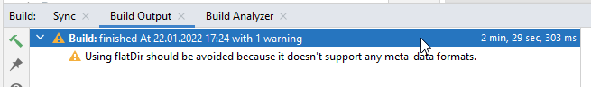

(troubleshooting_androidstudio-troubleshooting-android-studio)=

# Feilsøking av Android Studio

```{contents} List of common issues
:depth: 2
:local: true
```

(troubleshooting_androidstudio-lost-keystore)=
## Mistet keystore-fil
Hvis du har mistet keystore-filen eller passordet til den, kan en apk-fil signert med en ny keystore-fil ikke oppdatere din nåværende **AAPS**: du må avinstallere og installere på nytt. Se [Installere AAPS på nytt med en ny keystore-fil](#reinstall-aaps).

## Gradle-synkroniseringen mislyktes («Gradle Sync failed»)
Gradle-synkroniseringen kan mislykkes av flere grunner. Når du får en melding om at «gradle sync failed», åpner du fanen «Build» (1) nederst i Android Studio og ser hvilken feilmelding (2) som vises.


```{contents} Likely reasons for gradle sync failures are:
:depth: 1
:local: true
```

*Viktig*: Når du har fulgt instruksjonene for ditt problem, må du starte [Gradle-synkroniseringen](#gradle-resync) på nytt.

(troubleshooting_androidstudio-uncommitted-changes)=
### «Uncommitted changes» (endringer som ikke er committet)

Hvis du får en feilmelding som denne:


```
Build file 'C:\Data\50-Android\AndroidAPS\app\build.gradle.kts' line: 243

There are uncommitted changes.
Klon kildekoden på nytt som beskrevet i wikien, og ikke tillat gradle-oppdatering
```

#### Steg 1 – Kontroller Git-installasjonen
  * Åpne terminalfanen (1) nederst i Android Studio, kopier teksten nedenfor og lim den inn eller skriv den inn i terminalen (2).
    ```
    git --version
    ```

    

    Merk: Det er et mellomrom og to bindestreker mellom git og version!

  * Du skal få en melding som sier hvilken Git-versjon som er installert, som du ser på skjermbildet ovenfor. I så fall går du til [steg 2](#troubleshooting-android-studio-check-for-uncommitted-changes).

  * Hvis du får en melding som sier
    ```
    Git: command not found
    ```
    er Git-installasjonen din ikke riktig.

  * [Kontroller Git-installasjonen](#BuildingAaps-steps-for-installing-git)

  * Hvis du bruker Windows og Git nettopp ble installert, bør du starte datamaskinen på nytt for at Git skal bli tilgjengelig overalt etter installasjonen

  * Hvis Git er installert, du har startet på nytt (på Windows) og Git fortsatt ikke blir funnet:

  * Søk på datamaskinen din etter en fil som heter «git.exe».

    Noter deg hvilken mappe den er lagret i.

  * Gå til miljøvariablene (Environment variables) i Windows, velg variabelen «PATH» og klikk på rediger (Edit). Legg til mappen der du fant Git-installasjonen din.

  * Lagre og lukk.

  * Start Android Studio på nytt.

(troubleshooting-android-studio-check-for-uncommitted-changes)=
#### Steg 2: Se etter endringer som ikke er committet.

  * I Android Studio åpner du fanen «Commit» (1) på venstre side. 
  * Du ser enten «Changes» (kalt «Default changeset» i eldre versjoner av Android Studio) (2) eller «Unversioned Files» (3):

    * Ved «Changes» har du trolig oppdatert «Gradle» eller endret innholdet i noen filer ved en feil.

    * Høyreklikk på «Changes» og velg «Rollback…» (1)

      

    * Filene hentes på nytt fra Git-serveren. Hvis det ikke er andre endringer i Commit-fanen, går du til [steg 3](#gradle-resync).

  * Hvis du ser «Unversioned Files», kan du ved en feil ha lagret filer i kildekodemappen din. Kanskje er det viktige filer, for eksempel keystore-filen din, som bør flyttes et annet sted. Hvis du ikke vet hva disse filene er, og du ikke har laget dem selv, kan du slette dem.

    * Bruk den vanlige filutforskeren på datamaskinen til å flytte (eller klippe ut og lime inn) filen til et trygt sted.

    * Gå tilbake til Android Studio og klikk på Refresh-knappen (4) i Commit-fanen for å sikre at filen ikke lenger ligger i **AAPS**-mappen.

      Hvis det ikke er andre endringer i Commit-fanen, går du til [steg 3](#gradle-resync).


#### Steg 3: Synkroniser Gradle på nytt (igjen)

Følg instruksjonene under [Synkroniser Gradle på nytt](#gradle-resync).

### Git Pull Failed – Please tell me who you are (Git ber deg si hvem du er)

Hvis du ser denne meldingen, trenger Git at du identifiserer deg.


Åpne terminalen og skriv inn de to kommandoene nedenfor, én etter én.

```
git config --global user.name "Your name here"
git config --global user.email your.email@here.com
```

Navnet ditt må skrives mellom anførselstegn.


(troubleshooting_androidstudio-android-gradle-plugin-requires-java-11-to-run)=

(incompatible-gradle-jvm)=
### Incompatible Gradle JVM (inkompatibel Gradle JVM)


```
Your build is currently configured to use incompatible Java 21.0.3 and Gradle 8.2.
Cannot sync the project.

We recommend upgrading to Gradle version 8.9.

The minimum compatible Gradle version is 8.5.

The maximum compatible Gradle JVM version is 19.
```

Eller:

```
Cause: error: invalid source release: 21
```

Hvis du får feilmeldingen ovenfor, må du laste ned en riktig JVM-versjon før du kan prøve å bygge på nytt:

1.  Sjekk i [kravtabellen](#Building-APK-recommended-specification-of-computer-for-building-apk-file) hvilken JVM-versjon du trenger for **AAPS**-versjonen du bygger, og noter den.

2. Åpne Gradle-visningen ved å klikke på elefanten (1) på høyre side av Android Studio, åpne innstillingene (2) og velg **Gradle Settings** (3):


3.  I feltet **Gradle JDK** sjekker du om riktig versjon er valgt (1). Hvis ikke, klikker du på feltet og ser om den allerede finnes i listen. Eksempelet nedenfor viser at JVM 21 har navnet «jbr-21». Hvis du finner den, velger du den bare, og da er du ferdig. Hvis den ikke finnes, velger du **Download JDK** (2).


4. Under Version (1) velger du JDK-versjonen som kreves for din **AAPS**-versjon (den du noterte da du sjekket kravtabellen). Under Vendor (2) velger du hvilken som helst leverandør. Location (3): ikke endre. Klikk på **Download** (4).


5.  Lukk dialogen **Settings** med **OK**.
6. Nå må du starte Gradle-synkroniseringen på nytt. Følg instruksjonene under [Synkroniser Gradle på nytt](#gradle-resync).

(incompatible-version-of-android-gradle-plugin)=
### Inkompatibel versjon av Android Gradle plugin

  Hvis du får følgende feilmelding

`The project is using an incompatible version (AGP x.x.x) of the Android Gradle plugin. Latest supported version is AGP x.x.x`

  

  Du bruker en utdatert versjon av Android Studio. I menyen går du til Help > Check for updates og installerer alle oppdateringer av Android Studio og pluginene som blir funnet.

(troubleshooting_androidstudio-could-not-resolve-no-cached-version)=
### Could not resolve / No cached version

  Du kan få denne feilmeldingen:


  * På høyre side åpner du Gradle-fanen (1).

    Pass på at knappen vist ved (2) *IKKE* er valgt.

    

  * Nå må du starte en [ny Gradle-synkronisering](#gradle-resync)

(troubleshooting_androidstudio-unable-to-start-daemon-process)=
### Unable to start daemon process

  Hvis du ser en feilmelding som den nedenfor, bruker du trolig et 32-bits Windows 10-system. Dette støttes ikke av Android Studio 3.5.1 og nyere, og dessverre er det ingenting **AAPS**-utviklerne kan gjøre med det!

  På nettet finnes det informasjon om hvordan du finner ut om du har et 32-bits eller 64-bits operativsystem, for eksempel [denne siden](https://support.microsoft.com/en-us/windows/32-bit-and-64-bit-windows-frequently-asked-questions-c6ca9541-8dce-4d48-0415-94a3faa2e13d).

  

(gradle-resync)=
### Synkroniser Gradle på nytt (Gradle Resync)

  Hvis du fortsatt ser meldingen om at Gradle-synkroniseringen mislyktes, klikker du nå på lenken **Try again** (1). 


  Hvis du ikke ser meldingen lenger, kan du fortsatt starte dette manuelt:

  * Åpne Gradle-fanen (1) i høyre kant av Android Studio.

    

  * Høyreklikk på AAPS (2)

  * Klikk på «Reload Gradle Project» (3)

## Generate Signed APK generated successfully with 0 build variants

Når du genererer den signerte apk-filen, kan du få beskjed om at genereringen var vellykket, men at «0 build variants» ble generert:


Dette er en falsk advarsel. Sjekk mappen du valgte som «Destination folder» for genereringen (steget [Generate Signed APK](#Building-APK-generate-signed-apk)), så finner du den genererte apk-filen der!


## Appen ble laget med compiler-/kotlin-advarsler

Hvis bygget ble fullført, men du får compiler- eller kotlin-advarsler (vist med et gult eller blått utropstegn), kan du bare se bort fra disse advarslene.

 

Apk-filen din ble bygget uten feil og kan overføres til telefonen!


## AAPS mottar ingen CGM-data

* Hvis du bruker den modifiserte Dexcom G6-appen: denne appen er utdatert. Bruk [BYODA](#DexcomG6-if-using-g6-with-build-your-own-dexcom-app)-appen i stedet.

* Hvis du bruker xDrip: bruk «Identify receiver» som beskrevet på [siden om xDrip-innstillinger](#xdrip-identify-receiver).


## Apk-filen ble ikke installert


* Pass på at du har overført filen «app-full-release.apk» til telefonen.
* Denne feilen betyr vanligvis at den nye apk-filen er signert med en annen keystore-fil enn din installerte **AAPS**. Hvis du fortsatt har den forrige keystore-filen din, velger du den og bygger på nytt. Ellers, se [Installere AAPS på nytt med en ny keystore-fil](#reinstall-aaps).
* Hvis telefonen viser «Appen ble ikke installert» («App not installed»), følger du disse stegene:

1. [Eksporter innstillinger](../Maintenance/ExportImportSettings.md) (i AAPS-versjonen som allerede er installert på telefonen)
2. Avinstaller **AAPS** på telefonen.
3. Slå på flymodus og slå av Bluetooth.
4. Installer den nye versjonen («app-full-release.apk»)
5. [Importer innstillinger](../Maintenance/ExportImportSettings.md)
6. Slå på Bluetooth igjen og slå av flymodus

## Apk-filen ble installert, men versjonen er gammel

Hvis du bygde appen, overførte den til telefonen og installerte den uten problemer, men versjonsnummeret fortsatt er det samme, kan det hende du har glemt å [oppdatere den lokale kopien din](#Update-to-new-version-update-your-local-copy)

## Ingenting av dette hjalp

Hvis ingen av tipsene ovenfor hjalp, kan du vurdere å bygge apk-filen fra bunnen av:

1. [Eksporter innstillinger](../Maintenance/ExportImportSettings.md) (i AAPS-versjonen som allerede er installert på telefonen)

2. Ha nøkkelpassordet og keystore-passordet klart.

    Eller du bruker rett og slett en ny keystore-fil.

3. Bygg apk-filen fra bunnen av, som beskrevet [her](#Building-APK-download-AAPS-code).

4. Når du har bygget apk-filen uten feil, sletter du den eksisterende apk-filen på telefonen, overfører den nye apk-filen til telefonen og installerer den.
5. [Importer innstillinger](../Maintenance/ExportImportSettings.md) igjen for å gjenopprette opplæringsmålene og innstillingene dine.
6. Du bør sjekke innstillingene for batterioptimalisering og slå dem av igjen.

## I verste fall

Hvis dette ikke løser byggeproblemet ditt, kan du prøve å avinstallere Android Studio helt og bygge på nytt fra bunnen av.  Noen brukere opplever at dette løser byggeproblemet deres.  Når du sletter Android Studio, må du ikke slette Android-brukerinnstillingene, og **pass på å avinstallere alle filer som hører til Android Studio.** Hvis du ikke fjerner Android Studio helt, med alle skjulte filer, kan avinstalleringen gi nye problemer i stedet for å løse det du allerede har. Veiledninger for fullstendig avinstallering finnes på nettet, for eksempel

[https://stackoverflow.com/questions/39953495/how-to-completely-uninstall-android-studio-from-windowsv10](https://stackoverflow.com/questions/39953495/how-to-completely-uninstall-android-studio-from-windowsv10).

Installer Android Studio fra bunnen av, som beskrevet [her](#Building-APK-install-android-studio).
