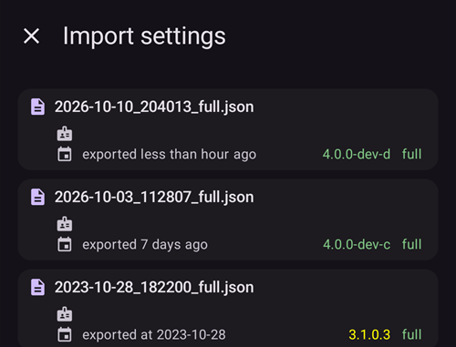

# Lage og gjenopprette sikkerhetskopier

Når du installerer AAPS på telefonen din, blir den et «medisinsk utstyr» som du er avhengig av hver dag. Det anbefales sterkt å ha en beredskapsplan for når telefonen din går i stykker, blir stjålet eller mistet. Derfor er det viktig å forberede seg ved å spørre seg selv: «Hva om?»

For å kunne gjenopprette AAPS-oppsettet ditt på en eksisterende eller ny telefon er det viktig å oppbevare følgende på et trygt sted (altså: ikke på telefonen din). Det beste er å ha minst to separate sikkerhetskopier: på en lokal harddisk eller USB-minnepinne, og (helst) i en skylagring som Google Drive eller Microsoft 365 OneDrive. Når du lagrer sikkerhetskopiene i skyen, har du alltid alt du trenger tilgjengelig fra telefonen, slik at du kan gjenopprette oppsettet ditt hvor som helst og når som helst.

Vurder å skaffe en ekstra reservetelefon og øv på å gjenopprette AAPS, slik at du vet at reservetelefonen fungerer som den skal. Dette gir deg trygghet for at beredskapsplanen din fungerer, og at du kan fortsette å bruke AAPS uten avbrudd hvis hovedtelefonen din blir utilgjengelig.

For å kunne gjenopprette er det viktig å ha følgende for hånden:

- **Keystore-filen fra Android Studio** og tilhørende **passord**: Trengs for å bygge AAPS-installasjonsfilen (.APK) (på nytt).
- En ny kopi av **AAPS-installasjonsfilen (.APK)**
- En ny **eksportfil med innstillinger**: For å gjenopprette viktige innstillinger (inkludert opplæringsmålene dine!).
- **AAPS-hovedpassordet** ditt
- Sikkerhetskopier av andre verktøy: for eksempel BYODA og/eller xDrip.
- Personlige notater om oppsettet ditt.

Nedenfor ser du hva det anbefales å ta sikkerhetskopi av.

## Lage sikkerhetskopier

### Keystore-filen fra datamaskinen du brukte til å bygge APK-filen
Når du bygger .APK-installasjonsfilen i Android Studio, brukes **keystore-filen og passordet til å signere .APK-installasjonsfilen**. For å oppdatere den AAPS-installasjonen du har, må den nye .APK-installasjonsfilen være signert med den samme keystore-filen som ble brukt ved den første installasjonen. Ved oppdatering beholdes alle innstillinger og AAPS-databasen. Merk at uten dette må du først avinstallere den nåværende appen og deretter [installere på nytt](#reinstall-aaps) og sette opp AAPS på nytt.

Hvis du tar vare på keystore-filen og passordet, blir det mye enklere å oppdatere APK-filen senere, særlig hvis du må bygge appen på en ny datamaskin. Se avsnittet [Oppdatere AAPS](../Maintenance/UpdateToNewVersion.md) for detaljer om hvordan du bruker keystore-filen når du bygger en ny APK-fil.

**Når du bør ta sikkerhetskopi:** Keystore-filen bør sikkerhetskopieres etter at du har bygd **AAPS**-installasjonsfilen (.APK) for første gang.

**Slik tar du sikkerhetskopi:** Finn stien til keystore-filen. Hvis du ikke husker den, finner du den i Android Studio ved å velge **Build > APK > Next**. Stien vises under «Key store path» (sti til keystore-filen). Gå til denne stien i filutforskeren din og lag en kopi av keystore-filen (den har filendelsen `.jks`). Lagre den på et trygt sted i skyen, i tilfelle datamaskinen din blir utilgjengelig. Pass på at du også noterer keystore-passordet, nøkkelaliaset og nøkkelpassordet.

### Kopier av den nyeste APK-filen
Hvis **AAPS**-hovedtelefonen din blir mistet eller skadet, kan du raskt fortsette å bruke **AAPS** på en ny telefon hvis du har en kopi av APK-filen tilgjengelig. Merk: du trenger også en sikkerhetskopi av innstillingene, som beskrevet nedenfor.

**Når du bør ta sikkerhetskopi:** Du bør alltid ha en sikkerhetskopi av den nyeste APK-filen du har installert på **AAPS**-hovedtelefonen din. Du kan også ta vare på én eldre versjon, i tilfelle du av en eller annen grunn må gå tilbake til den.

**Slik tar du sikkerhetskopi:** Ta vare på en kopi på datamaskinen du brukte til å bygge APK-filen med Android Studio. I tillegg anbefales det å lagre en kopi av installasjonsfilen (APK) i en skytjeneste. Pass på at du vet hvor du finner begge sikkerhetskopiene når du trenger dem. Vurder å opprette egne mapper for disse sikkerhetskopiene.

### AAPS-innstillingsfilen (også kalt «Preferences»)

```{admonition} Where are preferences stored on my phone?
:class: tip
Du finner innstillingene dine i **AAPS-mappen** du valgte under [AAPS-oppsettet](#SetupWizard-StoragePermission).</br>
Du kan også endre **AAPS-mappe** på skjermen **Vedlikehold** (**meny** (☰) > **Vedlikehold**), se [Velge den lokale AAPS-mappen](#preferences-maintenance-logdirectory).
```

Med en kopi av APK-installasjonsfilen (se ovenfor) og **Innstillinger**-filen din kan du raskt komme i gang igjen på en eksisterende eller ny telefon.

**Innstillinger**-filen brukes til å tilpasse AAPS-appen til ditt eget oppsett. De omfatter blant annet innstillingene i **Konfigurasjon**, status for opplæringsmålene, innstillinger for kommunikasjon med tredjeparter (f.eks. Nightscout, Tidepool), automasjoner og profiler.

Når du eksporterer AAPS-innstillingene til en fil, kan du gjenopprette konfigurasjonen slik den var på et bestemt tidspunkt. Som nevnt inneholder eksportfilen, i tillegg til alle konfigurasjonsinnstillingene, også statusen for opplæringsmålene dine, som du trenger å gjenopprette når du **(re)installerer** AAPS. Uten dette må du gjøre alle opplæringsmålene på nytt fra start for å kunne aktivere lukket loop. Innstillingsfiler lar deg også gjenopprette de «sist kjente gode» innstillingene, slik at du kan angre endringer i konfigurasjonen.

**Når du bør ta sikkerhetskopi av AAPS-innstillingene:**
* Hver gang du fullfører et opplæringsmål, så du ikke mister fremgangen din. _Uten en kopi av **Innstillinger** må du fullføre alle opplæringsmålene på nytt hvis du må installere AAPS på nytt eller bytte telefon._

* Hver gang du planlegger store endringer i konfigurasjonen (endre SMB-innstillinger, bytte insulintype, bytte pumpe, endre automasjoner), bør du ta sikkerhetskopi av **Innstillinger** både før og etter endringene. På den måten har du både de nyeste innstillingene dine og en kopi av slik de var før endringene, i tilfelle du må gå tilbake til dem.

* Bare for brukere av slangeløse pumper (som Omnipod og Medtrum): **Innstillinger**-filen inneholder tilkoblingsdetaljene for podden du bruker nå, og kan brukes til å gjenopprette tilkoblingen til den podden på en ny telefon. Hvis du ikke har en kopi av innstillingene som ble eksportert etter at du startet den podden du bruker nå, må du starte en ny pod hvis du må bytte telefon.

**Slik tar du sikkerhetskopi manuelt:**

1. Hvis det er første gang du importerer eller eksporterer **Innstillinger**, må du sette et hovedpassord under [Innstillinger > Beskyttelse](#Preferences-master-password). Sett et passord og noter det på et trygt sted. _Uten dette passordet får du ikke tilgang til sikkerhetskopiene av **Innstillinger**._

2. Fra hovedskjermen i **AAPS** åpner du **menyen** (☰) > **Vedlikehold**. Velg hvor filen skal lagres med brikkene **Lokal** og **Sky** ved siden av **Eksporter innstillinger** (se **Eksportere eller importere innstillinger** nedenfor), og trykk deretter på **Eksporter innstillinger**. **AAPS** viser hvor filen havner: filnavnet for **Lokal**, **Google Drive** for **Sky**. Trykk på **OK**.

   

   

   Skriv inn hovedpassordet du satte ovenfor, og trykk på **OK**.

   

   **Innstillinger eksportert** (lokalt) eller **Skyeksporten var vellykket** (sky) bekrefter eksporten.

   

   

3. Bruk filutforskeren på telefonen (ofte kalt «Filer» eller «Mine filer») og gå til Intern lagring > AAPS > preferences. Her ser du en kopi av alle eksporterte innstillingsfiler. Filnavnet skal være `YYYY-MM-DD_Time_appname.json`. Last opp denne filen til den skytjenesten du vil bruke. Last deretter også ned en kopi fra skytjenesten til datamaskinen din.

(ExportImportSettings-Settings-Export)=

## Eksport av innstillinger

```{admonition} Where are preferences stored on my phone?
:class: tip
Du finner innstillingene dine i **AAPS-mappen** du valgte under [AAPS-oppsettet](#SetupWizard-StoragePermission).</br>
Du kan også endre **AAPS-mappe** på skjermen **Vedlikehold** (**meny** (☰) > **Vedlikehold**), se [Velge den lokale AAPS-mappen](#preferences-maintenance-logdirectory).
```

Det anbefales å eksportere innstillingene regelmessig, særlig før og etter endringer i konfigurasjonen. Du kan velge å eksportere **manuelt eller (helst) gjennom automasjon**. Pass på å notere AAPS-hovedpassordet ditt, og ta sikkerhetskopi av innstillingsfilene ved å kopiere dem bort fra telefonen, for eksempel til en skylagring.

**Merk**: _De eksporterte innstillingene krypteres med AAPS-hovedpassordet ditt: uten hovedpassordet som ble brukt ved eksporten, kan du ikke importere innstillingsfilen!_

### Eksportere eller importere innstillinger
For å eksportere eller importere innstillinger åpner du **menyen** (☰) og velger **Vedlikehold**. Under **Filbehandling** velger brikkene **Lokal** og **Sky** ved siden av **Eksporter innstillinger** og **Importer innstillinger** hvor innstillingsfilen lagres til eller leses fra: **Lokal** er AAPS-mappen på telefonen din, **Sky** er tilgjengelig når en [Skymappe](#preferences-maintenance-cloud) er satt opp. Et trykk på en brikke slår den på eller av; minst én er alltid valgt, og begge radene bruker det samme valget. Trykk deretter på selve **Eksporter innstillinger** eller **Importer innstillinger** for å starte.


(ExportImportSettings-Automating-Settings-Export)=
### Automatisk eksport av innstillinger

For automatisk eksport av innstillinger [(**se Automasjon**)](../DailyLifeWithAaps/Automations.md#automating-preference-settings-export) åpner du [**Innstillinger** > **Vedlikehold**](#preferences-maintenance-settings), utvider **Uovervåket eksport av innstillinger** og slår på **Aktiver automatisk eksport av innstillinger**.

Du kan nå sette opp [Automasjon](../DailyLifeWithAaps/Automations.md#automating-preference-settings-export) til å eksportere innstillingene, enten regelmessig (_for eksempel_ hver uke) eller etter et pod-bytte.

_**Merk:** Når du importerer innstillinger, må du alltid skrive inn AAPS-hovedpassordet!_


(ExportImportSettings-restoring-from-your-backups-on-a-new-phone-or-fresh-installation-of-aaps)=
## Gjenopprette fra sikkerhetskopiene dine på en ny telefon eller en ny installasjon av AAPS

```{admonition} Where are preferences stored on my phone?
:class: tip
Du finner innstillingene dine i **AAPS-mappen** du valgte under [AAPS-oppsettet](#SetupWizard-StoragePermission).</br>
Du kan også endre **AAPS-mappe** på skjermen **Vedlikehold** (**meny** (☰) > **Vedlikehold**), se [Velge den lokale AAPS-mappen](#preferences-maintenance-logdirectory).</br>
Hvis **AAPS** mister tilgangen til den mappen (det kan skje etter en ny installasjon eller etter at appens lagring er tømt), viser den varselet **Tilgangen til AAPS-mappen gikk tapt** og slutter å lagre innstillinger på telefonen til du [velger mappen på nytt](#preferences-maintenance-logdirectory).
```

Bruk disse instruksjonene hvis du har en sikkerhetskopi av APK-filen og **Innstillinger** som du vil legge inn på en ny telefon, eller hvis du av en eller annen grunn måtte slette og installere APK-filen på nytt på den telefonen du har.

_Hvis du oppdaterer **AAPS** med en APK-fil som er bygd med den samme keystore-filen, trenger du ikke å følge denne fremgangsmåten. Det anbefales likevel å lage en sikkerhetskopi før du installerer oppdateringen._

Hvis du oppdaterer **AAPS** etter at du har mistet eller byttet ut den opprinnelige keystore-filen (for eksempel fordi du bygger på en ny datamaskin uten å ha overført keystore-filen), må du sikkerhetskopiere alle innstillingene som beskrevet ovenfor, og deretter avinstallere den eksisterende versjonen av **AAPS** på telefonen din. Se [Installere AAPS på nytt med en ny keystore-fil](#reinstall-aaps) for hele fremgangsmåten.

Hvis det trengs, [sett opp CGM-en/BS-kilden din](../Getting-Started/CompatiblesCgms.md) før du går gjennom stegene nedenfor

(ExportImportSettings-tubeless-pumps)=
```{admonition} Tubeless pumps (Omnipod and Medtrum) users
:class: warning
**Innstillinger**-filen inneholder økten til den podden eller patchen som var aktiv da du eksporterte den.
- **Eksporter rett etter hver aktivering av pod eller patch**, og kopier filen bort fra telefonen.
- **Samme telefon, podden kjører fortsatt:** ikke kryss av for **Bytt også ut pumpeinnstillingene**. Podden du bruker nå beholdes, og bare de andre innstillingene importeres.
- **Ny telefon som skal overta podden:** kryss av for **Bytt også ut pumpeinnstillingene**, og bruk bare en fil som ble eksportert mens du hadde på deg den podden du bruker nå. En fil fra en tidligere pod erstatter den nåværende pod-økten, og du må starte en ny pod.
- **En gammel pod-økt ble importert ved en feil:** **AAPS** fortsetter å prøve å nå den podden, og du kan ikke aktivere en ny. Deaktiver den; hvis det ikke går, forkast den (se for eksempel [Forkaste en pod](#omnipod-dash-discard-pod) for Omnipod DASH).
```

```{admonition} Pump settings are kept unless you say otherwise
:class: note
Som standard rører ikke en import pumpeinnstillingene dine: pumpen som er valgt i **Konfigurasjon**, sammenkoblingen og alle de andre innstillingene dens forblir som de er på denne telefonen. Kryss av for **Bytt også ut pumpeinnstillingene** på importskjermen bare når du gjenoppretter på en ny telefon som skal overta den samme pumpen. Innstillinger som ikke finnes i filen, blir aldri slettet av en import.
```

1. Bruk sikkerhetskopien av APK-filen fra ovenfor og følg instruksjonene for en [ny installasjon](../SettingUpAaps/TransferringAndInstallingAaps.md)

2. Start **AAPS** og gi alle tillatelsene appen ber om

3. Avslutt oppsettveiviseren. Vi skal importere alle nødvendige innstillinger fra sikkerhetskopien av **Innstillinger**

4. Fra hovedskjermen i **AAPS** trykker du på **Tillat** og gir alle tillatelsene som er listet i panelet **Tillatelser kreves** øverst

5. Fra hovedskjermen i **AAPS** setter du hovedpassordet under [Innstillinger > Beskyttelse](#Preferences-master-password) til det samme passordet som du brukte for sikkerhetskopiene dine.

6. Hvis du ikke har gjort det ennå, [velg **AAPS-mappe**](#preferences-maintenance-logdirectory): fra hovedskjermen i **AAPS** åpner du **menyen** (☰) > **Vedlikehold** > **AAPS-mappe**.

7. Fra hovedskjermen i **AAPS** åpner du **menyen** (☰) > **Vedlikehold** > **Eksporter innstillinger** > skriv inn hovedpassordet du satte ovenfor > **OK**. Dette oppretter mappen «preferences» hvis den ikke finnes på telefonen din fra før.

8. Last ned sikkerhetskopien av **Innstillinger**-filen din fra skytjenesten.

9. Bruk filutforskeren din (ofte kalt «Filer» eller «Mine filer») til å flytte filen fra nedlastingene dine til `/internal storage/AAPS/preferences` hvis **AAPS-mappe** er satt til `/internal storage/AAPS`

10. Fra hovedskjermen i **AAPS** åpner du **menyen** (☰) > **Vedlikehold** og trykker på **Importer innstillinger**. Velg innstillingsfilen du vil gjenopprette fra (den nyeste ligger øverst). Pass på at du velger riktig innstillingsfil; alle .json-filer fra mappen «preferences» (eller fra skymappen, med **Sky**) vises.

    

    **AAPS** viser detaljene om filen. Skriv inn hovedpassordet du satte ovenfor, og trykk på **Dekrypter & Gjennomgå**.

11. Når filen er dekryptert, bestemmer du hva som skal skje med pumpeinnstillingene. På en ny telefon som overtar den samme pumpen, krysser du av for **Bytt også ut pumpeinnstillingene**, slik at sammenkoblingen og pumpeinnstillingene hentes fra filen. La avkrysningsboksen stå tom for å beholde pumpen som denne telefonen allerede er sammenkoblet med. Trykk deretter på **Importer**.

    

12. **AAPS** spør **Bruk importerte innstillinger?** og forteller hvor mange innstillinger som endres, og, hvis du lot boksen stå tom, hvor mange pumpeinnstillinger som beholdes. Ingenting er skrevet ennå, så **Avbryt** lar telefonen være akkurat som den var. Trykk på **OK** for å ta dem i bruk.

    

13. **AAPS** tar de importerte innstillingene i bruk med en gang, uten omstart. Bare plugins med endrede innstillinger startes på nytt. Mens dette pågår, viser **AAPS** **Aktiverer innstillinger…**; hvis pumpen er opptatt, viser den **Venter på pumpen…** og tar innstillingene i bruk når pumpen er ledig. Hvis pumpen fortsatt er opptatt etter ett minutt, tilbyr **AAPS** å prøve på nytt. Meldingen **Innstillinger tatt i bruk** bekrefter at de importerte innstillingene er i bruk. En behandling som lå i kø mens importen pågikk, blir forkastet, og **AAPS** forteller deg at den ble avbrutt, slik at ingenting sendes til pumpen to ganger.

    

Hvis filen valgte en pumpe som denne versjonen av **AAPS** ikke har, går **AAPS** tilbake til **Virtuell pumpe** og forteller deg det. Velg pumpen din på nytt i **Konfigurasjon** og kontroller innstillingene dens.

14. Bare for brukere av slangeløse pumper (Omnipod og Medtrum): hvis du krysset av for **Bytt også ut pumpeinnstillingene** og **Innstillinger**-filen ikke ble sikkerhetskopiert fra den samme podden som du bruker nå, må du starte en ny pod for å komme i gang med insulintilførselen.

**Feilsøking:** hvis du ikke får satt en aktiv profil fra hovedskjermen i **AAPS**, åpner du **menyen** (☰) øverst til venstre > **Konfigurasjon** > **Pumpe** > bytt til **Virtuell pumpe** > og bytt så tilbake til pumpetypen din

### Merknad for Dana RS-brukere

- Hvis du krysset av for **Bytt også ut pumpeinnstillingene**, importeres også tilkoblingsinnstillingene for pumpen: **AAPS** på den nye telefonen «kjenner» allerede pumpen og starter derfor ikke et Bluetooth-søk.
- Koble den nye telefonen og pumpen sammen manuelt.