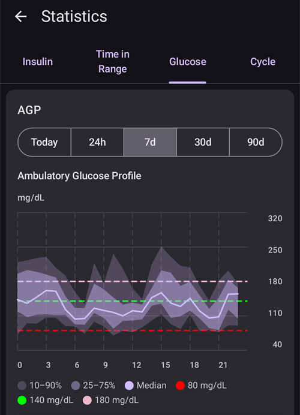

# Gjennomgang av dataene dine

## Historikkleseren i AAPS

**AAPS** lagrer hele historikken din (**BS**, behandlinger, basal, målverdier, **Profilbytte**, …) i en lokal database på telefonen. Denne databasen er ikke en del av [eksporten av innstillinger](../Maintenance/ExportImportSettings.md). Du kan gå gjennom den i **AAPS** selv med **Historikkleser** og skjermen **Statistikk**, som beskrives nedenfor. For gjennomgang og rapporter over lengre tid laster du opp dataene dine til [Nightscout](../SettingUpAaps/Nightscout.md) eller [Tidepool](../SettingUpAaps/Tidepool.md).

Historikken i **AAPS** kan gås gjennom i **Historikkleser**: åpne **menyen** (☰) og velg **Historikkleser**.

- Trykk på **datokortet** for å velge dagen du vil se på.
- Grafene åpnes zoomet ut, slik at de viser **hele den valgte dagen**. Knip for å zoome inn på en del av den.
- Bruk pilene **<** og **>** for å gå én dag tilbake eller fram, og **Nå** for å gå tilbake til dagen i dag.
- Grafene viser de samme dataene som grafene på hovedskjermen (BS, behandlinger, basal, IOB, COB, aktivitet, avvik ...).

(reviewing-statistics)=
## AAPS-statistikk

**AAPS** har enkel statistikk for oppfølging.

De fleste verdiene bygger på [anbefalingene](https://diabetesjournals.org/care/article/46/Supplement_1/S97/148053/6-Glycemic-Targets-Standards-of-Care-in-Diabetes) fra ADA 2023.

For å åpne dem åpner du **menyen** (☰) og velger **Statistikk**.

Skjermen **Statistikk** har fire faner: **Insulin**, **Tid i målområde**, **Glukose** og **Syklus**. Trykk på en fane, eller sveip til venstre eller høyre for å bytte mellom dem.

(reviewing-tdd)=
### Insulin-fanen: Total daglig dose

Kortet **Total daglig dose** viser én linje per dag for de foregående dagene (opptil én uke) som **AAPS** har insulindata for, deretter **Gjennomsnitt** av dem, og så **I dag** så langt. Rett etter at du har installert **AAPS**, vises bare **I dag**. Kolonnene er:

- **Basal**: bare basal.
- **Bolus**: summen av bolusbehandlinger og SMB-er.
- **TDD Total**: den totale daglige dosen med insulin (**TDD**), summen av bolus- og basalinsulin gitt i løpet av dagen.
- **Karbo**: registrerte karbohydrater og eKarbo-behandlinger.

**TDD**-delen beregnes når du åpner siden, og det tar noen sekunder. Trykk på **Rekalkuler** for å beregne den på nytt.

**TDD** er bolus pluss basalinsulin per dag. Noen leger bruker – særlig for nye pumpebrukere – et forhold mellom basal og bolus på 50:50: den totale basaldosen (**TBB**, summen av basaldosene dine over 24 timer) bør da være omtrent halvparten av TDD. Andre foretrekker en TBB på 32 % til 37 % av TDD.

Som de fleste tommelfingerregler har denne begrenset verdi i praksis. Din diabetes kan være annerledes!

### Fanen Tid i målområde

Tid i målområde (**TIR**): 70–180 mg/dL eller 3,9–10 mmol/L.

Informasjon om **TIR** er tilgjengelig for 7 og 30 dager, avhengig av hvor mye data som finnes i **AAPS**-databasen.

Statistikk for tid i snevert målområde (TITR), 70–140 mg/dL eller 3,9–7,8 mmol/L, finnes nedenfor (skjermen viser dette området som 70–141).

**Diskuter målene med endokrinologen din**

Din diabetes kan være annerledes. Alle foreslåtte mål bør diskuteres med endokrinologen din eller behandlingsteamet ditt. Brukt riktig kan statistikken i AAPS være et effektivt verktøy for å følge __BS__-trender og se fremgang.

Nedenfor viser kortet **Dexcom TIR** detaljert **TIR**-statistikk for 14 dager.

**SD**: standardavvik, en [indikator](https://www.ncbi.nlm.nih.gov/pmc/articles/PMC3125941/) på hvor mye BS varierer (høyest = verst).

HbA1c: et estimat av den resulterende glykerte hemoglobinen, basert på gjennomsnittet av CGM-målingene. Dette er en veiledende verdi som ikke nødvendigvis stemmer med HbA1c-målinger i blodet.

(reviewing-statistics-agp)=
### Glukose-fanen: Ambulatorisk glukoseprofil (AGP)

**Ambulatorisk glukoseprofil** (**AGP**) viser hvordan glukosen din vanligvis beveger seg gjennom dagen. Velg perioden med knappene øverst: **I dag**, **24t**, **7d**, **30d** eller **90d**.

- **Diagrammet**: én dag fra midnatt til midnatt. Linjen er **Median** (halvparten av målingene dine på det klokkeslettet var lavere, halvparten høyere). Rundt den viser ett bånd den midterste halvparten av målingene dine (**25–75%**), og et bredere bånd de fleste av dem (**10–90%**). Et smalt bånd betyr at glukosen din er lik fra dag til dag på det klokkeslettet. Stiplede linjer markerer **Lav verdi**, 140 mg/dL (7,8 mmol/L) og **Høy verdi**.
- **Glykemisk oversikt**: tiden i målområdet ditt, i det snevre målområdet (70–140 mg/dL eller 3,9–7,8 mmol/L), over målområdet og under det, deretter **Gjennomsnitt** og **Median** for glukosen. Målområdet ditt er **Lav verdi** og **Høy verdi** som er satt under [Område for visualisering](#Preferences-range-for-visualization).
- **eA1c** og **GMI**: to estimater av HbA1c beregnet ut fra CGM-målingene dine. Som HbA1c ovenfor stemmer de ikke nødvendigvis med HbA1c-målinger i blodet.
- **SD** (standardavvik) og **CV** (variasjonskoeffisient): hvor mye glukosen din varierer. En lavere verdi betyr jevnere glukose.
- **Dager**: hvor mange dager med CGM-data som ble brukt.

 

Under AGP tegner kortet **Glukosepentagon (CGP)** fem mål for glukosen din de siste 14 dagene som en femkant. En mindre femkant betyr bedre glukosekontroll.

### Syklus-fanen: TDD-syklusmønster

**TDD-syklusmønster** legger de daglige insulintotalene dine oppå hverandre i sykluser på 28 dager, for å hjelpe deg med å finne mønstre som gjentar seg. Hver syklus tegnes som en linje (**Individuelle sykluser**), sammen med gjennomsnittet av dem.

- **Rå TDD** / **Renset TDD**: velg den totale daglige dosen slik den ble gitt, eller TDD minus insulin for karbohydrater.
- **Syklusforskyvning**: flytter starten på syklusen (0 til 27 dager).

Det trengs minst 56 dager med data (2 sykluser). Med mindre data viser kortet **Ikke nok data (trenger minst 56 dager for 2 sykluser)**. Mønsteret beregnes bare når du åpner fanen **Syklus**, fordi det leser 168 dager med data.

(aaps-screens-treatments)=
## Behandlingshistorikk

Åpne **menyen** (☰) øverst til venstre på hovedskjermen og velg **Behandlingshistorikk**. I denne visningen kan du se og endre historikken for følgende behandlinger, hver på sin egen fane (sveip faneraden for å se alle):

* Karbo og bolus
* [Forlenget bolus](#Extended-Carbs-extended-bolus-and-switch-to-open-loop-dana-and-insight-pump-only)
* Midlertidig basal
* [Midlertidig mål](../DailyLifeWithAaps/TempTargets.md)
* [Profilbytte](../DailyLifeWithAaps/ProfileSwitch-ProfilePercentage.md)
* Helseportal: merknader og helseportal-oppføringer
* Kjøremodus: historikk over loop-status
* Brukeroppføring: andre merknader som ikke sendes til Nightscout

På slutten av hver linje viser små ikoner hvor dataene kommer fra eller er sendt til:
* **Nightscout**-ikonet (Nightscout-logoen): dataene kommer fra eller er registrert i Nightscout
* **Pumpe**-ikonet: dataene kommer fra pumpehistorikken (de er behandlet av pumpen)
* **Søppelbøtte**-ikonet: oppføringen er slettet (vises bare når du viser slettede oppføringer med **øye**-ikonet øverst til høyre)

(screens-bolus-carbs)=
### Karbo og bolus

På denne fanen kan du se loggen over bolus og karbohydrater. Hver bolus (linje **1**) viser gjenværende tilhørende IOB ved siden av insulinmengden. Bolusen kan komme fra:
* Måltid (registrert manuelt via knappene Insulin, Hurtigknapp eller Boluskalkulator)
* SMB, når SMB-funksjonen brukes

Karbohydratoppføringene (linje **2**) vises med mengden i gram.

Hvis du har brukt [Boluskalkulator](#aaps-screens-bolus-wizard) til å beregne insulindosen, kan du trykke på teksten «Kalk» på boluslinjen for å se detaljene om hvordan bolusen ble beregnet.

Avhengig av pumpen som brukes, kan insulin og karbohydrater vises på én enkelt linje, eller bli til flere linjer: én for beregningsdetaljene, én for karbohydratene og én for selve bolusen.

Behandlingshistorikk kan brukes til å rette feil karbohydratoppføringer (_det vil si_ at du har over- eller undervurdert karbohydratene). Merk at det ikke er mulig å redigere en eksisterende oppføring; du må følge denne fremgangsmåten:

1. Sjekk og husk gjeldende COB og IOB på hovedskjermen.
2. Avhengig av pumpen kan karbohydrater vises sammen med insulin på én linje eller som en egen oppføring (f.eks. med Dana RS).
3. Fjern oppføringen med feil karbohydratmengde: trykk på søppelbøtte-ikonet, velg linjene som skal fjernes, og trykk så på søppelbøtte-ikonet igjen for å fullføre.
4. Kontroller at karbohydratene faktisk ble fjernet ved å sjekke COB på hovedskjermen igjen.
5. Gjør det samme for IOB hvis det bare er én linje som inneholder både karbohydrater og insulin.

   → Hvis karbohydratene ikke blir fjernet som planlagt, og du legger til flere karbohydrater som forklart her (6.), blir COB for høy, og det kan føre til at det gis for mye insulin.

6. Registrer riktig karbohydratmengde på nytt (**Behandlinger → Karbo** i navigasjonslinjen nederst, eller en **Karbo**-knapp i [Hurtigstart](#quicklaunch)), og pass på å sette riktig tidspunkt for hendelsen.
7. Hvis det bare er én linje som inneholder både karbohydrater og insulin, må du også legge til insulinmengden. Pass på å sette riktig tidspunkt for hendelsen, og sjekk IOB på hovedskjermen etter at du har bekreftet den nye oppføringen.

### Midlertidig basal

De **midlertidige basalene** som loopen har satt, vises her. Når en oppføring fortsatt påvirker IOB, vises informasjonen ved siden av dosen (linje **1**). Det kan være:
* Positiv IOB hvis den midlertidige basalen var høyere enn den som er satt i profilen
* Negativ IOB for en null midlertidig basal («zero-temp», som på linje **1**), eller hvis den midlertidige basalen var lavere enn den som er satt i profilen

Å slette oppføringene påvirker bare rapportene dine i Nightscout og vil sannsynligvis forstyrre den reelle IOB-en din – det anbefales ikke.

Til venstre på en linje betyr en rød S «Pauset»: det skjer når det ikke gis basal for øyeblikket. Dette er normalt når du for eksempel er i ferd med å bytte pod.

### Midlertidig mål

Historikken over midlertidige mål kan ses her.

### Profilbytte

Historikken over profilbytter kan ses her. Du kan se flere oppføringer hver gang du bytter profil: linje **1**, som er lagret både i NS og i pumpehistorikken, tilsvarer selve byttet. Linje **2**, som er lagret i Nightscout, men ikke i pumpehistorikken, tilsvarer forespørselen om profilbytte som brukeren gjorde.

Å slette oppføringene påvirker bare rapportene dine i Nightscout og endrer aldri den gjeldende profilen.

Du kan bruke knappen **Dupliser** på linje **2** for å lage en kopi av et **Profilbytte**. Se [Din AAPS-profil > Administrer profilene dine](#your-aaps-profile-clone-profile-switch) for mer informasjon.

### Helseportal

Denne fanen viser alle merknader og helseportal-oppføringer som er registrert i Nightscout.

(AapsScreens-running-mode)= (aaps-screens-running-mode)=
### Kjøremodus

Denne fanen viser historikken over endringer i [loop-status](#AapsScreens-loop-status): åpen, lukket, LGS, pause, frakobling.

### Brukeroppføring

Denne fanen lister opp handlingene som er gjort i **AAPS** av brukeren eller av en **Automasjon** (endringer i loop-modus, profilbytter, behandlinger, eksport av innstillinger ...). Disse oppføringene sendes ikke til Nightscout.

------

## Hva er forskjellen på Nightscout og Tidepool?

Nightscout kan lagre dataene fra **AAPS** for brukeren og tilbyr mange [rapportverktøy](https://nightscout.github.io/nightscout/reports/).

Tidepool lar derimot brukeren [gå gjennom dataene sine](https://www.tidepool.org/viewing-your-data) og gir [enkel deling med endokrinologteamet ditt](https://www.tidepool.org/providers/how-it-works#tidepool-data-platform).