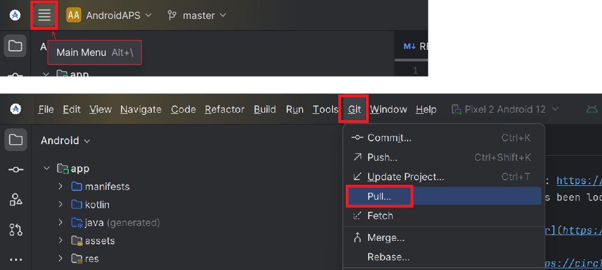

# Oppdatere med Android Studio

## Bygg selv i stedet for å laste ned

**AAPS** kan ikke lastes ned, på grunn av regelverket for medisinsk utstyr. Det er lovlig å bygge appen til eget bruk, men du må ikke gi en kopi til andre! Se [FAQ-siden](../UsefulLinks/FAQ.md) for detaljer.

```{note}
Hvis du vil bygge **AAPS** på en ny datamaskin: kopier sikkerhetskopien av keystore-filen din til den nye datamaskinen. Følg deretter [prosedyren for første bygg av **AAPS**](../SettingUpAaps/BuildingAaps.md) i stedet for denne veiledningen. Den eneste forskjellen er at i stedet for å lage en ny keystore-fil, kan du velge den du har kopiert til den nye datamaskinen.
```

## Oversikt over oppdatering til en ny versjon av AAPS med Android Studio

```{contents} Steps for updating to a new version of AAPS
:depth: 1
:local: true
```

Hvis du får problemer, se den egne siden om [Feilsøking av Android Studio](../GettingHelp/TroubleshootingAndroidStudio.md).

### Eksporter innstillingene dine

Eksporter innstillingene fra den **AAPS**-versjonen du har på telefonen nå. Du trenger dem kanskje ikke, men det er bedre å være på den sikre siden.

Se siden [Lage og gjenopprette sikkerhetskopier](ExportImportSettings.md) hvis du ikke husker hvordan du gjør dette.

### Kontroller Android Studio-versjonen din

Den eldste versjonen som kreves, står i [byggeinstruksjonene](#Building-APK-recommended-specification-of-computer-for-building-apk-file). Hvis versjonen din er eldre, må du [oppdatere Android Studio først](#Building-APK-install-android-studio)!

(Update-to-new-version-update-your-local-copy)=
### Oppdater din lokale kopi

* Åpne AAPS-prosjektet du har fra før, i Android Studio. Du må kanskje velge prosjektet ditt. (Dobbelt)klikk på AAPS-prosjektet.

  

* I menylinjen i Android Studio velger du Git -> Fetch

   

* Du ser en melding nederst til høyre om at Fetch var vellykket.

   

* I menylinjen velger du nå Git -> Pull

   

* La alle valgene stå som de er (origin/master) og velg Pull

   

* Vent mens nedlastingen pågår, du ser dette som informasjon i linjen nederst. Når den er ferdig, ser du en melding om at det gikk bra.

  ```{note}
  Hvilke filer som ble oppdatert, kan variere! Dette er ikke et tegn på at noe er galt.
  ```

   

* Gradle Sync kjører for å laste ned noen avhengigheter. Vent til den er ferdig.

  

### Kontroller JVM-versjonen

Denne kontrollen er særlig viktig hvis du allerede har bygget en tidligere versjon av **AAPS** på den samme datamaskinen.

Sjekk i [byggeinstruksjonene](#Building-APK-recommended-specification-of-computer-for-building-apk-file) hvilken JVM-versjon som kreves for den **AAPS**-versjonen du bygger nå. Følg deretter stegene som er beskrevet under [Inkompatibel Gradle JVM](#incompatible-gradle-jvm) for å være sikker på at du bruker riktig versjon.

(Update-to-new-version-build-the-signed-apk)=
### Bygg den signerte APK-filen

Kildekoden din er nå den gjeldende utgitte versjonen, og alle forutsetninger er kontrollert. Nå er det på tide å bygge den signerte APK-filen som beskrevet i [delen om å bygge en signert APK-fil](#Building-APK-generate-signed-apk).

(Update-to-new-version-transfer-and-install)=

### Overfør og installer APK-filen
Du må overføre APK-filen til telefonen din for å kunne installere den.

```{note}
Hvis du fullførte bygget med den samme keystore-filen du hadde fra før i Android Studio, trenger du ikke fjerne appen som allerede ligger på telefonen. Når du installerer APK-filen, følger du instruksjonene på skjermen for å installere oppdateringer.
I andre tilfeller, for eksempel hvis du lager en ny keystore-fil i Android Studio for den signerte APK-filen, må du slette den gamle appen før du installerer APK-filen. **Pass på at du eksporterer innstillingene dine!**
```

Se instruksjonene for [overføre og installere AAPS](../SettingUpAaps/TransferringAndInstallingAaps.md). Der Googles [Android-utviklerverifisering](#android-developer-verification) håndheves (fra september 2026, avhengig av landet ditt), installerer du med [ADB](#android-developer-verification-adb) i stedet for å trykke på APK-filen.

Fortsett [her](#Update-to-new-version-check-aaps-version-on-phone).

(update-computer-build-troubleshooting)=

## Feilsøking

Hvis noe går galt, ikke få panikk.

Pust rolig!

Sjekk så om problemet ditt allerede er beskrevet på den egne siden [Feilsøking av Android Studio](../GettingHelp/TroubleshootingAndroidStudio.md).

Hvis du trenger mer hjelp, ta kontakt med andre **AAPS**-brukere på [Facebook](https://www.facebook.com/groups/AndroidAPSUsers) eller [Discord](https://discord.gg/4fQUWHZ4Mw).