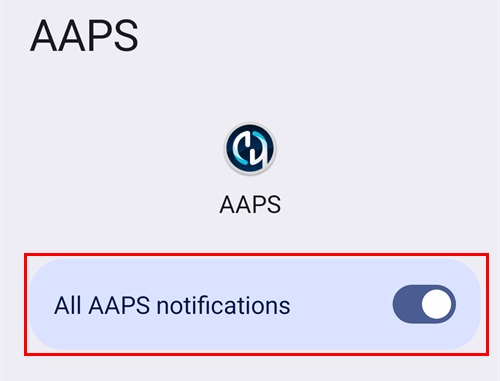

# Android Auto

**AAPS** kan sende deg informasjon om din nåværende status som en melding, rett inn i Android Auto i bilen.

## Krav

**AAPS** bruker en funksjon i Android Auto som lar meldinger fra apper på mobilen sendes videre til skjermen i bilens lydanlegg.

Det betyr at:

* Android må tillate at **AAPS** viser varsler, og
* Siden **AAPS** er en uoffisiell app, må du tillate bruk av «ukjente kilder» i Android Auto.

(androidauto-check-that-aaps-can-show-notifications)=

## Sjekk at AAPS kan vise varsler

**AAPS** viser alltid et statusvarsel med gjeldende blodsukker, IOB og COB. Dette er varselet Android Auto viser i bilen. Det er ingenting å slå på i **AAPS**, men Android må tillate at **AAPS** viser varsler.

På telefonen åpner du **Innstillinger** > **Apper** > **AAPS** > **Varsler** og sjekker at **Alle AAPS-varsler** er på.

Bla ned og sjekk at **Pågående status** er på: dette er kanalen for statusvarselet.

Sjekk nå at du ser statusvarselet fra **AAPS** på telefonen før du går til bilen!

(androidauto-allow-the-use-of-unknown-sources-with-android-auto)=

## Tillat bruk av «ukjente kilder» i Android Auto.

Siden **AAPS** ikke er en offisiell Android Auto-app, må varsler slås på for «ukjente kilder» i Android Auto. Dette gjøres ved hjelp av utviklermodus, som vi viser deg her.

Gå til bilen og koble mobilen til bilens lydanlegg.

Du bør nå se en skjerm som ligner på denne.

Trykk på **innstillinger**-ikonet for å starte konfigurasjonen.

Bla ned til slutten av siden og velg **se mer på telefonen**.

Nå skal vi slå på utviklermodus på mobilen.

Den første skjermen ser slik ut. Bla ned til slutten av siden.

Der ser du versjonen av Android Auto. Trykk 10 ganger (ti) på versjonsnummeret til Android Auto. Med denne skjulte kombinasjonen har du nå slått på utviklermodus.

Bekreft at du vil slå på utviklermodus i dialogen «Tillate utviklerinnstillinger?».

I **utviklerinnstillingene** slår du på «Ukjente kilder».

Nå kan du gå ut av utviklermodus hvis du vil. Trykk på menyen med tre prikker øverst til høyre for å gjøre det.

## Vise varsler i bilen

Trykk på **tallikonet** nederst til høyre i Android Auto i bilen.

CGM-dataene dine vises slik:

(android-auto-troubleshooting)=

## Feilsøking:

* Hvis du ikke ser varselet, sjekk om du har [tillatt at AAPS viser varsler](#androidauto-check-that-aaps-can-show-notifications) i Android, og om [Android Auto har tilgang til varsler](#androidauto-allow-the-use-of-unknown-sources-with-android-auto).