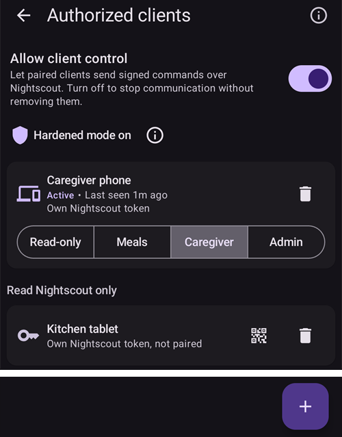

(client-master-control)=
# Hovedenhet ↔ klientstyring (signert fjernstyring)

Fra **AAPS** versjon 4 kan en følgertelefon med **AAPSClient** gjøre mye mer enn å *melde fra om* behandlinger gjennom Nightscout: når den er **sammenkoblet** med hovedtelefonen, kan den sende **signerte kommandoer** som hovedtelefonen (**hovedenheten**) kontrollerer, bekrefter og utfører — også å gi en **insulinbolus** på hovedenhetens pumpe.

Denne siden forklarer hvordan det virker, og hvordan du setter det opp og bruker det.

```{contents} Table of contents
:depth: 2
:local: true
```

```{admonition} Wording used on this page
:class: note
- **Hovedenhet** = hoved-**AAPS**-telefonen som eier pumpen og kjører loopen (`full`-appen).
- **Klient** = en **AAPSClient**-telefon uten pumpe som følger og nå også *styrer* hovedenheten.
- Begge telefonene må være koblet til det **samme Nightscout**-nettstedet. All kommunikasjon går fortsatt gjennom Nightscout — det trengs ingen direkte forbindelse mellom telefonene.
```

---

## Slik virker det

```{admonition} Coming from AAPS v3?
:class: note
I **AAPS** v3 kunne **AAPSClient** bare skrive usignerte helseportal-behandlinger til Nightscout, og kunne ikke gi en bolus. Fjernstyring krever nå en engangs [sammenkobling](#client_master_master_setup). Se også [Hva er endret i AAPS v4](#v4changes-remote-control).
```

**AAPS** v4 bruker en egen **klientstyringskanal** (Client-Control). Den går fortsatt via Nightscout-nettstedet ditt (i samlingen `settings`), men hver melding er **kryptografisk signert** med en hemmelighet som bare de to telefonene kjenner. Hemmeligheten overleveres én gang, under **sammenkoblingen**, og byttes ut med en ny rett etterpå, så den sendes aldri i klartekst.

Hovedprinsippet er at **hovedenheten bestemmer**:

1. Klienten sender en *intensjon* («bolus 2 E», «start scenen Trening», «sett dette midlertidige målet» …).
2. **Hovedenheten** regner ut handlingen på nytt og **begrenser** den mot sine **egne** sanntidsdata (profil, IOB, COB, gjeldende midlertidig mål, pumpe), og **skriver den nøyaktige bekreftelsen** som brukeren får se.
3. Klienten (eller klokken) viser **hovedenhetens** bekreftelsestekst — den lager aldri sin egen.
4. Når du bekrefter, **utfører hovedenheten handlingen én gang** og melder resultatet tilbake til klienten.

Hva dette betyr for deg:

- **Signerte kommandoer**: bare klientene du har sammenkoblet, kan sende kommandoer (egen sammenkoblingsnøkkel og signatur for hver klient). Gamle eller gjentatte kommandoer avvises.
- **En rolle for hver klient**: du bestemmer hva hver klient får gjøre, fra *Kun lesing* til *Administrator* — se [Klientroller](#client-master-control-roles).
- **Insulinbolus fra en klient**: hovedenheten gir den på sin pumpe, og klienten viser fremdriften.
- **Hovedenheten bestemmer**: den begrenser hver handling mot sine egne begrensninger og skriver bekreftelsen som vises på klienten.
- **Bare sammenkoblede klienter endrer behandlingen**: når klientstyring er på, tar hovedenheten ikke lenger imot behandlinger eller endringer som skrives rett inn i Nightscout — se [Herdet modus](#client-master-control-hardened-mode).
- **Hver klient får sitt eget Nightscout-token** med bare de rettighetene en klient trenger — se [Klientens eget Nightscout-token](#client-master-control-own-token).
- **Hovedenheten frakoblet**: handlinger blokkeres med en tydelig melding.
- **Å fjerne tilgangen for en klient** tar ett trykk (per klient), eller bruk bryteren på hovedenheten for å stoppe alle klienter.

Handlinger som kan utløses fra en klient: **bolus**, **karbohydrater / eKarbo**, **midlertidig mål** (sette & avbryte), **profilbytte**, endring av **loop / kjøremodus**, **midlertidig basal** (sette & avbryte), **forlenget bolus** (sette & avbryte), **valg av insulin** og **[scener](../DailyLifeWithAaps/Scenes.md)**. Et utvalg av toveis **innstillinger** holdes også synkronisert mellom hovedenheten og klientene.

---

## Roller og forutsetninger

```{admonition} Before you start
:class: important
- **Hovedenheten** kjører det vanlige `full`-bygget av **AAPS** og er koblet til pumpen din.
- **Hovedenheten** bruker **NSClientV3** med din Nightscout og viser *tilkoblet*. Gi den et **admin-token** for din Nightscout: med det kan hovedenheten lage et eget token for hver klient og vise det til klienten som en QR-kode.
- **Klienten** kjører **[AAPSClient](AapsClient.md)** (eller **AAPSClient2** / **AAPSClient3** for flere pasienter — se [Om AAPSClient, AAPSClient2 og AAPSClient3](#remotecontrol-aapsclient-versions)). Den må bruke den **samme** Nightscout. Hvis du setter den opp med hovedenhetens QR-kode, får klienten Nightscout-adressen og tokenet fra hovedenheten; ellers må du først sette opp **NSClientV3** på den selv.
- **Websockets** må være på på begge telefonene: kommandoer når hovedenheten bare over websocket-forbindelsen. Når klientstyring er på, holder **AAPS** websockets på, både på hovedenheten og på sammenkoblede klienter.
```

Sammenkobling og synkronisering er to forskjellige ting:

- **Synkronisering** (data: BS, behandlinger, profil) settes opp som før — se [Synkronisering](#RemoteControl_aapsclient). Hovedenhetens QR-kode kan gjøre det for deg på klienten.
- **Sammenkobling** (styring: den signerte kommandokanalen som beskrives her) er det nye steget nedenfor.

---

## Sette det opp

(client_master_master_setup)=
### 1. På hovedenheten — slå på styring og legg til en klient

På hovedenheten åpner du skjermen **Administrer** og velger **Autoriserte klienter**.

Slå på **Tillat klientstyring** (den er **av** som standard). Dette er hovedbryteren på hovedenheten: når den er av, kan ingen klient sende kommandoer, men de sammenkoblede klientene dine beholdes, så du kan slå den på igjen senere. Når du slår den på, slås også [herdet modus](#client-master-control-hardened-mode) på, vist som «*Herdet modus aktivert*» med en **(i)** som forklarer den. I [Enkelmodus](#preferences-simple-mode) er klientstyring alltid på, så bryteren vises ikke.


Trykk på **+**-knappen (nederst til høyre) for å legge til en klient. I dialogen **Ny klient**:

1. Skriv inn et **enhetsnavn**, så du kjenner den igjen i listen.
2. Velg **hvordan telefonen skal konfigureres** (se tabellen nedenfor).
3. Velg **[rollen](#client-master-control-roles)** dens. Ingenting er valgt for deg: riktig rolle avhenger av hvem som bruker telefonen.


| Måte                                     | Hva den nye telefonen får                                                         | Bruk den når                                                                                                   |
| ---------------------------------------- | --------------------------------------------------------------------------------- | -------------------------------------------------------------------------------------------------------------- |
| **QR-kode: Nightscout og sammenkobling** | Nightscout-adressen, sitt eget Nightscout-token og sammenkoblingen, i én skanning | den nye telefonen har kamera: den raskeste måten, ingenting å skrive inn                                       |
| **QR-kode: Bare Nightscout**             | Nightscout-adressen og sitt eget Nightscout-token, ingen sammenkobling            | telefonen bare skal **vise** data og aldri sende kommandoer                                                    |
| **PIN**                                  | bare sammenkoblingen; den beholder Nightscout-innstillingene den har              | telefonen ikke har kamera (eller hovedenheten ikke kan lage token); den må allerede være koblet til Nightscout |

De to QR-kode-måtene krever et **admin-token** i hovedenhetens **NSClientV3**-innstillinger, fordi hovedenheten lager klientens token i Nightscout. Uten et slikt token vises QR-kode-alternativene, men de kan ikke velges, og dialogen forklarer hvorfor; **PIN** virker alltid.

#### Med en QR-kode

Trykk på **OK**: hovedenheten lager klientens Nightscout-token og viser en **QR-kode**. En kode som også parer, virker i omtrent **to minutter**; skjermen teller ned og lukkes av seg selv når klienten er sammenkoblet. Skann den på den nye telefonen slik det er beskrevet i [På klienten](#client_master_client_setup).

```{admonition} The QR code is a secret
:class: warning
Alle som ser QR-koden, kan lese din Nightscout, og en kode som parer, inneholder også sammenkoblingen. Vis den bare til den nye telefonen. **AAPS** blokkerer skjermbilder mens koden er på skjermen.
```


#### Med en PIN-kode

Trykk på **OK**: hovedenheten viser en 8-sifret **sammenkoblings-PIN**, vist i to grupper på fire (for eksempel `1234 5678`). Denne PIN-koden er til **engangsbruk** og **utløper etter omtrent to minutter**. Som med QR-koden avviser hovedenheten et klientnavn som allerede finnes i listen: hver klient får sitt eget Nightscout-token under navnet sitt.


```{admonition} The pairing PIN is a secret
:class: warning
PIN-koden beskytter sammenkoblingsnøkkelen som utveksles gjennom Nightscout. Del den bare med enheten du parer, ikke legg den ut offentlig, og la den utløpe hvis du ikke bruker den. Du kan alltid lage en ny PIN-kode ved å trykke på **+** igjen.
```

(client_master_client_setup)=
### 2. På klienten — koble til hovedenheten

#### Skanne QR-koden

Du kan skanne hovedenhetens QR-kode to steder:

- i klientens **Oppsettveiviser**, på steget «**Sett opp fra hovedenheten**», som kommer før Nightscout-steget. Én skanning setter da opp Nightscout og, med en kode som parer, også sammenkoblingen, så oppsettet er ferdig: veiviseren lukkes og hovedskjermen åpnes;
- når som helst senere fra **Administrer → Koble til hovedenhet → Skann QR-kode**.

Første gang ber **AAPSClient** om tillatelse til å bruke **kameraet**. Hvis du avslår, sier skjermen at kameraet kreves, og du kan tillate det med **Prøv igjen** eller pare med PIN-koden i stedet.

Rett kameraet mot koden. Klienten viser hva koden gjør — Nightscout-adressen og, for en kode som parer, hovedenheten den parer med — og spør «**Vil du bruke denne koden?**». Trykk på **Bruk**: klienten slår på **NSClientV3**, erstatter Nightscout-adressen og tokenet sitt med dem fra koden, og slår på websockets. En kode som parer, parer også telefonen; den hilser på hovedenheten så snart den er koblet til Nightscout.


```{admonition} Scanning is available on Android
:class: note
Skanneren er ikke tilgjengelig på iOS ennå, og en datamaskin har ikke kamera: bruk PIN-koden der.
```

#### Skrive inn PIN-koden

På klienten åpner du **Administrer → Koble til hovedenhet** (eller veiviser-steget **Koble til hovedenhet**, etter Nightscout-steget), **skriver inn den 8-sifrede PIN-koden** som vises på hovedenheten, og trykker på **Koble til**. Klienten bruker PIN-koden til å hente paringstilbudet på en sikker måte gjennom Nightscout, spør så «**Koble til denne hovedenheten?**» og viser hovedenhetens identifikator. Trykk på **Koble til** for å bekrefte (se [Koble til hovedenheten](#aapsclient-pairing-with-the-master) for et skjermbilde).


#### Etter sammenkoblingen

Når en klient er sammenkoblet, sender den en **Hello**-melding til hovedenheten og vises i hovedenhetens liste **Autoriserte klienter** som **Aktiv**, med et *«sist sett»*-tidspunkt. Klienten kjenner [rollen](#client-master-control-roles) sin fra sammenkoblingen, så den viser de riktige knappene med en gang. En sammenkobling som gjøres i Oppsettveiviseren, fullfører veiviseren. I det samme steget bytter de to telefonene ut sammenkoblingsnøkkelen med en ny som aldri har blitt sendt (se [Sikkerhetsmerknader](#client-master-control-security)), og en klient som ble satt opp med PIN-koden, får sitt eget Nightscout-token (se [Klientens eget Nightscout-token](#client-master-control-own-token)). En klient kan være sammenkoblet med **én** hovedenhet om gangen; for å pare med en annen hovedenhet må du først velge **Koble fra**.


### 3. Administrere klienter

Fra hovedenhetens skjerm **Autoriserte klienter** kan du når som helst:

- **Endre rollen** til en klient med raden med fire knapper under navnet dens. Den nye rollen gjelder med en gang, uten ny sammenkobling.
- **Se hvilket Nightscout-token** en klient skriver med: «*Eget Nightscout-token*» er det du vil ha. En rød linje «*Bruker Nightscout-tokenet …, som har flere rettigheter enn en klient trenger*» betyr at klienten fortsatt bruker et token med flere rettigheter, vanligvis admin-tokenet ditt — se [Klientens eget Nightscout-token](#client-master-control-own-token).
- **Fjerne tilgangen** for en enkelt klient — trykk på **søppelbøtte**-ikonet ved siden av den. Klienten kan ikke lenger sende kommandoer før den er sammenkoblet på nytt. Dens eget Nightscout-token slettes også, så den kan heller ikke lese din Nightscout lenger.
- **Stoppe all styring** uten å miste paringene — slå av **Tillat klientstyring**.

Telefoner som er satt opp med **QR-kode: Bare Nightscout**, vises under klientene, under «**Bare lesetilgang til Nightscout**». For hver av dem kan du vise QR-koden igjen (for å sette opp den samme telefonen på nytt) eller slette tokenet dens, som avslutter tilgangen dens til din Nightscout.



---

(client-master-control-roles)=
## Klientroller

Hver sammenkoblet klient har en **rolle**. Hovedenheten kontrollerer den for hver kommando, og klienten viser bare det rollen dens tillater. En ny rolle gjelder med en gang, uten ny sammenkobling. Rollene bygger på hverandre: hver rolle kan gjøre alt den forrige kan.

| Rolle             | Klienten kan                                                                                                                                                                                                                                                            |
| ----------------- | ----------------------------------------------------------------------------------------------------------------------------------------------------------------------------------------------------------------------------------------------------------------------- |
| **Kun lesing**    | bare vise data. Den forblir sammenkoblet, så den er klar når du gir den en høyere rolle.                                                                                                                                                                                |
| **Måltider**      | gi en bolus, bruke boluskalkulatoren og hurtigknapper, registrere karbohydrater og stoppe en pågående bolus. Karbohydrater som registreres her, kan få loopen til å gi mer insulin.                                                                                     |
| **Omsorgsperson** | gjøre alt en bruker gjør i **AAPS**: midlertidige mål, profil- og insulinbytter, loop-modus, midlertidig basal, forlenget bolus, scener, helseportal-hendelser, kalibreringer og sletting av oppføringer. Den kan ikke endre innstillinger eller forhåndsinnstillinger. |
| **Administrator** | gjøre alt, også innstillinger og forhåndsinnstillinger (hurtigknapper, forhåndsinnstilte midlertidige mål, scener, profiler, automasjon, insulin).                                                                                                                      |

**(i)** øverst på skjermen **Autoriserte klienter** viser den samme forklaringen. På klienten viser **Administrer → Koble til hovedenhet** telefonens egen rolle.

---

(client-master-control-hardened-mode)=
## Herdet modus

Når **Tillat klientstyring** er på, er hovedenheten i **herdet modus**: den tar bare imot endringer fra sammenkoblede klienter. Den tar **ikke** imot behandlinger, midlertidige mål, profilendringer, endringer av kjøremodus eller slettinger som gjøres direkte i Nightscout, for eksempel på Nightscout-nettstedet eller i andre apper.

- Innstillingene for å ta imot data fra Nightscout (**NSClientV3 → Synkronisering**) er skjult mens herdet modus er på; **AAPS** behandler dem som om de var av.
- Hovedenheten **laster fortsatt opp** alle dataene sine til Nightscout, også BS, og holder **websockets** på.
- Hvis hovedenheten får **BS fra Nightscout**, henter den fortsatt BS derfra.
- For å hente historikken på en **ny** hovedenhet bruker du **Full synkronisering** i **NSClientV3**: den henter alt som ligger i Nightscout, også profiler.
- [SMS-kommandoer](SMSCommands.md) påvirkes ikke.

En sammenkoblet klient følger hovedenhetens herdede modus: den holder websockets på, og de samme Nightscout-innstillingene er skjult på den. En klient som ikke er sammenkoblet, beholder sine egne innstillinger.

[Enkelmodus](#preferences-simple-mode) slår alltid på herdet modus. For å slå den av, gå ut av Enkelmodus og slå av **Tillat klientstyring** på hovedenheten.

```{admonition} Why hardened mode
:class: note
Alt en sammenkoblet klient sender, er signert, kontrollert og bekreftet av hovedenheten. En behandling som skrives inn på Nightscout-nettstedet, er ikke det: hvem som helst med skrivetilgang til din Nightscout kan legge den inn. I herdet modus kan bare signerte kommandoer endre det hovedenheten gjør.
```

---

(client-master-control-own-token)=
## Klientens eget Nightscout-token

En klient trenger ikke et admin-token. Den leser bare din Nightscout og sender kommandoene sine til hovedenheten gjennom den; den laster ikke opp noe selv. Derfor gir hovedenheten hver klient et eget Nightscout-token, med bare disse rettighetene:

- lese alt,
- skrive til samlingen `settings`, kanalen til hovedenheten,
- slumre Nightscout-alarmer.

Tokenet tilhører en Nightscout-rolle som heter **`aaps-client`**, som hovedenheten oppretter første gang den trenger den. Du kan se rollen og tokenene (med navnet `aaps-` pluss klientens navn) i **Admin tools** på Nightscout-nettstedet ditt. Hvis rollen endres der, setter hovedenheten den tilbake neste gang den lager et token eller du åpner **Autoriserte klienter**.

Slik får en klient tokenet sitt:

- **Satt opp med en QR-kode**: tokenet ligger i koden.
- **Sammenkoblet med PIN-koden** (eller sammenkoblet før dette fantes): etter sammenkoblingen sender hovedenheten klienten dens eget token gjennom den sammenkoblede kanalen, kryptert. Klienten sjekker først at en innlogging med det virker, og bruker det så i stedet for tokenet den hadde. Dette krever et admin-token på hovedenheten; uten et slikt token beholder klienten tokenet sitt, og kortet dens på hovedenheten viser den røde linjen.

**En klient beholder sitt eget token.** Når hovedenheten én gang har sett en klient skrive med sitt eget token, tar den bare imot kommandoer fra den klienten med det tokenet. En kommando som er skrevet med et annet token (for eksempel et admin-token som senere skrives inn på klienten, eller en annen klients token) avvises, selv om klienten er sammenkoblet, og klienten sier «*Hovedenheten avviste forespørselen: Denne telefonen skriver til Nightscout med et annet token enn sitt eget*». Kortet dens på hovedenheten sier det samme i rødt. Klienten vises fortsatt som tilkoblet, så du kan se hva som er galt. For å rette det fjerner du klienten på hovedenheten og legger den til på nytt.

Hovedenheten sletter eller endrer aldri et Nightscout-token den ikke har laget selv (et med andre roller enn `aaps-client`): de er dine. Den sletter en klients eget token når du fjerner klienten.

---

## Bruke fjernstyring

### Utløse en handling fra klienten

Bruk klienten akkurat som du ville brukt telefonen selv: åpne **Karbo**, **Insulin**, **Midlertidig mål**, **Profil**, **Scener**, arket **Administrer** osv., og fyll inn verdiene.

Når du bekrefter, viser klienten kort **«Kontakter hovedenhet…»**, **hovedenheten** regner ut og begrenser handlingen, og klienten viser så **hovedenhetens egen bekreftelse** — nøyaktig de linjene, verdiene og fargene hovedenheten ville vist på sin egen skjerm. Se over dem og trykk på **OK** for å fortsette.


Det samme gjelder en enkel karbohydratregistrering — mengden som vises til bekreftelse, er den hovedenheten har regnet ut:


Når du har bekreftet, utfører hovedenheten handlingen én gang, og resultatet vises tilbake på klienten.

### Insulinbolus fra en klient

Dette er den viktigste nye funksjonen i v4. En bolus som startes på en klient, **gis av hovedenheten på dens pumpe**; hovedenheten begrenser den mot sine egne begrensninger, og klienten viser **fremdriften i sanntid** mens den pågår (og en alarm hvis pumpen melder om en feil).

```{admonition} Boluses are always confirmed and capped on the master
:class: note
En klient bestemmer aldri mengden som gis, på egen hånd. Hovedenheten regner den ut på nytt og begrenser den, du bekrefter mengden hovedenheten har skrevet, og først da gis den.
```

(clientmastercontrol-when-the-master-is-offline)=
### Når hovedenheten er frakoblet

Hvis hovedenheten ikke kan nås (telefonen er av eller i hvilemodus, ikke koblet til Nightscout, eller websockets er nede), blir styringshandlinger på klienten **blokkert før noe sendes**, og du får en tydelig melding. Ingenting blir halvveis utført.


Klienten sjekker automatisk på nytt om hovedenheten kan nås, og slår på styringen igjen når hovedenheten er tilbake.

(clientmastercontrol-wear-os-on-a-client)=

### Wear OS (klokke) på en klient

En klokke som er sammenkoblet med en **klient**-telefon, sender handlingene sine videre gjennom klienten til hovedenheten (klokke → klient → hovedenhet). Klokken viser **hovedenhetens** bekreftelseslinjer og det faktiske resultatet, akkurat som telefonen. Oppsettet av klokken er uendret — se [Wear OS](../WearOS/WearOsSmartwatch.md).


<!-- 📷 SCREENSHOT NEEDED (optional): watch confirmation screen relayed from the master,
     and/or the "Contacting master" state on the watch. Requires a paired Wear OS device. -->

---

(client-master-config-prefs)=
## Endre konfigurasjon og innstillinger

Sammenkoblingen gjør mer enn å videresende enkelthandlinger — den holder også **konfigurasjonen** og mange **innstillinger** like mellom hovedenheten og klientene dens.

### Konfigurasjon (hvilke plugins som er aktive)

De aktive **pluginene** (APS-algoritme, sensitivitet, utjevning …) velges på **hovedenheten** og **speiles** til hver sammenkoblet klient. På en klient er disse valgene merket med et lite **mobilikon** på skjermen [Konfigurasjon](#configuration_sync_icon) — endre dem på hovedenheten, så følger klientene automatisk etter, og omvendt.

På en klient vises mobilikonet på *Utjevning*, *Kalibrering*, *Sensitivitetsdeteksjon* og *APS* (synkronisert fra hovedenheten), men ikke på *Kommunikasjon*:


Tilkoblingsdetaljer som er unike for hver enhet — først og fremst **NSClient Nightscout-URL / tilgangstoken** — synkroniseres *ikke*. Hver telefon har sine egne; på en klient kommer de fra hovedenhetens QR-kode, eller du setter dem selv.

### Profiler

**Profillisten** din holdes også synkronisert mellom hovedenheten og de sammenkoblede klientene dens. På en sammenkoblet klient viser **Administrer → Profil** de samme profilene som hovedenheten; du kan **redigere** en profil eller **aktivere** en, og — som alle andre kommandoer — sendes endringen til **hovedenheten**, utføres der og synkroniseres tilbake.

Første gang du aktiverer en profil på en nyinstallert klient, kan klienten vise «*Ingen insulin er i bruk ennå*» og be deg **velge insulinet**. Velg insulinet som er aktivt på hovedenheten (**Administrer → Insulininnstillinger** på hovedenheten viser det).

På en klient som **ikke er sammenkoblet**, er Profil-skjermen fortsatt tilgjengelig, men **bare for visning**: klienten viser profilene den mottar gjennom Nightscout (den trenger dem til sine egne beregninger), men det finnes ingen knapp for å redigere eller aktivere — det er ingen hovedenhet å sende endringen til.

### Innstillinger

Et utvalg av **innstillingene** er **toveis**: du kan endre dem på **hovedenheten eller på en sammenkoblet klient**, og endringen synkroniseres til den andre siden. Når du endrer en slik innstilling på en klient, sendes den til hovedenheten over den signerte kanalen, brukes der, og den gjeldende verdien sendes tilbake — så det du ser på klienten, er alltid det hovedenheten har lagret. Hvis den samme innstillingen endres på to enheter nesten samtidig, **vinner den nyeste endringen**. For en innstilling med glidebryter sendes den nye verdien når du løfter fingeren.

Inne i innstillingene merker det samme lille **mobilikonet** de enkelte innstillingene som synkroniseres. I eksempelet nedenfor er *Absorpsjonsgrense* synkronisert (mobilikon), mens innstillinger uten ikonet er lokale for enheten:


```{admonition} The master must be online to change synced settings from a client
:class: note
Siden hovedenheten eier den lagrede verdien, må hovedenheten **kunne nås** når du endrer et konfigurasjonsvalg som hovedenheten styrer, eller en toveis innstilling, fra en klient. Når hovedenheten er frakoblet, er disse kontrollene deaktivert på klienten (se [Når hovedenheten er frakoblet](#clientmastercontrol-when-the-master-is-offline)).
```

---

(client-master-control-security)=
## Sikkerhetsmerknader

```{admonition} How the channel is protected
:class: tip
- **Paringshemmelighet**: hovedenheten gir den til klienten én gang — beskyttet av PIN-koden i et Nightscout-dokument, eller inne i QR-koden — og begge lagrer den kryptert.
- **En ny hemmelighet rett etter sammenkoblingen**: klientens første melding etter sammenkoblingen starter en nøkkelutveksling, og fra da av bruker begge telefonene en hemmelighet som aldri har blitt sendt. En hemmelighet som noen kan ha sett (en fotografert QR-kode, et PIN-tilbud lest fra Nightscout), er ubrukelig etterpå. Telefoner som ble sammenkoblet før dette fantes, gjør det samme én gang etter oppdateringen.
- **Hver kommando er signert** (HMAC). Hovedenheten avviser alt der signaturen ikke stemmer med en sammenkoblet klient.
- **Gjentatte kommandoer hindres** av en teller per klient som bare øker, og hver kommando **utløper** etter kort tid.
- **Minst mulig rettigheter i Nightscout**: hver klient har sitt [eget Nightscout-token](#client-master-control-own-token), som bare kan lese og skrive til klientstyringskanalen. Når den én gang har brukt det, tar hovedenheten bare imot kommandoene dens med det tokenet. Når du fjerner klienten, slettes det.
- **Bare signerte endringer**: i [herdet modus](#client-master-control-hardened-mode) ignorerer hovedenheten behandlingsendringer som skrives rett inn i Nightscout.
- **Hovedenheten signerer det den deler**: innstillingene, klientlisten og «hovedenheten lever»-signalet som hovedenheten legger i Nightscout for klientene sine, har hovedenhetens signatur. En klient tar bare imot dem når signaturen er hovedenhetens, så en annen klients token kan ikke endre dem. Klienten lærer hovedenhetens nøkkel når den parer, eller fra QR-koden for en telefon som bare leser Nightscout. Et avvist dokument vises i NSClient-loggen som «*✕ SETTINGS … refused*».
- **Du beholder kontrollen**: gi hver klient den [rollen](#client-master-control-roles) den trenger, fjern tilgangen for en klient med ett trykk, eller slå av alt med **Tillat klientstyring**.
```

```{admonition} After restoring a backup
:class: warning
Hvis en klient gjenopprettes fra en sikkerhetskopi som setter kommandotelleren dens tilbake, vil hovedenheten avvise de neste kommandoene dens som gjentakelser. Du løser det ved å **koble fra og koble til på nytt**.
```

---

(client-master-control-troubleshooting)=

## Feilsøking

| Symptom                                                                                                                       | Hva du bør sjekke                                                                                                                                                                                                                                                                                                                                                     |
| ----------------------------------------------------------------------------------------------------------------------------- | --------------------------------------------------------------------------------------------------------------------------------------------------------------------------------------------------------------------------------------------------------------------------------------------------------------------------------------------------------------------- |
| Klienten sier at **hovedenheten er frakoblet**                                                                                | Hovedtelefonen er våken og kjører **AAPS**; begge telefonene er tilkoblet i **NSClientV3**; **websockets** er på på begge; samme Nightscout-nettsted.                                                                                                                                                                                                                 |
| Klienten sier at den **ikke er sammenkoblet**                                                                                 | Par på nytt fra **Administrer → Koble til hovedenhet**. Sjekk at klienten er **Aktiv** i hovedenhetens liste **Autoriserte klienter**.                                                                                                                                                                                                                                |
| Kommandoen **avvises** av hovedenheten                                                                                        | Hovedenheten kontrollerer den på nytt mot sin nåværende tilstand — for eksempel finnes ikke den valgte profilen lenger, eller pumpetypen stemmer ikke. Sjekk på nytt på hovedenheten.                                                                                                                                                                                 |
| Kommandoene virker, men er **trege**                                                                                          | Slå på **websockets** på begge telefonene (ellers faller appene tilbake til tregere polling).                                                                                                                                                                                                                                                                         |
| Sammenkoblingen avbrytes med *«Paringshemmeligheten kunne ikke lagres»*                                                       | Ingenting ble endret. Start sammenkoblingen på nytt; hvis det fortsatt ikke virker, start **AAPSClient** på nytt og prøv en gang til.                                                                                                                                                                                                                                 |
| Ingenting skjer etter sammenkoblingen                                                                                         | Sjekk at **Tillat klientstyring** er PÅ på hovedenheten, og at hovedenheten er koblet til Nightscout.                                                                                                                                                                                                                                                                 |
| QR-kode-alternativene kan ikke velges i dialogen **Ny klient**                                                                | Dialogen forklarer hvorfor. *Ikke et admin-token*: gi hovedenheten et admin-token for din Nightscout, eller legg til klienten med **PIN**. *Ikke tilkoblet*: vent til hovedenheten viser *tilkoblet* i **NSClientV3**.                                                                                                                                                |
| *«Nightscout har et token med dette navnet og andre rettigheter»*                                                             | Ett av dine egne Nightscout-token heter `aaps-` pluss dette navnet. Velg et annet navn for klienten.                                                                                                                                                                                                                                                                  |
| *«En klient med dette navnet finnes allerede i listen»*                                                                       | Velg et annet navn, eller fjern den klienten først.                                                                                                                                                                                                                                                                                                                   |
| Klienten sier *«Denne koden er fra en annen AAPS-versjon»*                                                                    | Hovedenheten og klienten må kjøre den **samme** versjonen av **AAPS**. Oppdater den eldste.                                                                                                                                                                                                                                                                           |
| Klienten sier *«Denne koden har utløpt»*                                                                                      | En kode som parer, virker i omtrent to minutter. Legg til klienten på nytt på hovedenheten for å få en ny kode.                                                                                                                                                                                                                                                       |
| Klienten sier *«Denne telefonen er allerede sammenkoblet»*                                                                    | Koble den fra først (**Administrer → Koble til hovedenhet → Koble fra**), og skann så på nytt. En **Bare Nightscout**-kode virker også på en sammenkoblet telefon.                                                                                                                                                                                                    |
| Klienten sier *«Hovedenheten avviste forespørselen: Denne telefonen skriver til Nightscout med et annet token enn sitt eget»* | Klienten brukte sitt eget Nightscout-token før og skriver nå med et annet, for eksempel etter at et token ble skrevet inn i Nightscout-innstillingene dens. Fjern klienten på hovedenheten og legg den til på nytt (se [Klientens eget Nightscout-token](#client-master-control-own-token)).                                                                          |
| NSClient-loggen på klienten viser *«✕ SETTINGS … refused»* og innstillingene dens følger ikke lenger hovedenheten             | Noen andre har skrevet hovedenhetens innstillingsdokument, eller hovedenheten har en ny nøkkel (for eksempel etter at dataene dens ble slettet). En sammenkoblet klient henter en ny nøkkel selv neste gang den kobler til Nightscout. En telefon som bare leser Nightscout, trenger hovedenhetens QR-kode på nytt (**Bare lesetilgang til Nightscout → vis koden**). |
| Klientens kort viser *«Bruker Nightscout-tokenet …»* i rødt                                                                   | Klienten skriver fortsatt med et token som har flere rettigheter enn den trenger. Hovedenheten sender den dens eget token etter sammenkoblingen, men bare hvis hovedenheten har et admin-token. Sjekk hovedenhetens token, eller sett opp klienten på nytt med en QR-kode.                                                                                            |
| En klient kan ikke lenger lese Nightscout                                                                                     | Tokenet dens ble slettet, for eksempel fordi klienten ble fjernet på hovedenheten. Legg den til på nytt.                                                                                                                                                                                                                                                              |
| Behandlinger som registreres på Nightscout-nettstedet, blir ikke brukt                                                        | Forventet i [herdet modus](#client-master-control-hardened-mode): registrer dem på en sammenkoblet klient i stedet.                                                                                                                                                                                                                                                   |

Ved problemer med Nightscout / synkronisering, se først [Feilsøking av NSClient](../GettingHelp/TroubleshootingNsClient.md).

---


<!-- =====================================================================
     SCREENSHOTS STILL TO ADD:
       1. (optional) Wear OS confirmation relayed from the master
     Already included:
       - authorized_clients_master.png       (master: Allow client control, hardened mode, client card, + button)
       - authorized_clients_roles.png        (master: client card with roles, Read Nightscout only section)
       - new_client_master.png               (master: New client dialog, three ways and role row)
       - qr_code_master.png                  (master: pairing QR code with countdown, code blurred; console screenshot)
       - aapsclient_wizard_from_master.png   (client: Set up from the master wizard step)
       - pair_with_master_unpaired.png       (client: pairing screen, unpaired PIN entry)
       - pairing_pin_master.png              (master: one-time pairing PIN — expired demo PIN)
       - pair_with_master_client.png         (client: pairing screen, paired state)
       - confirmation_master_authored.png    (client: master-authored scene confirmation)
       - carbs_confirmation_client.png       (client: master-authored carbs confirmation)
       - master_offline_error.png            (client: master-offline message)
     Maintainers: relocate page + images and fix cross-links as needed.
     ===================================================================== -->
