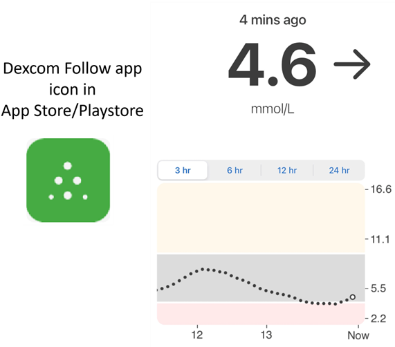
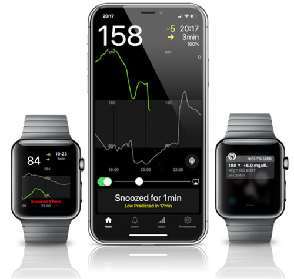
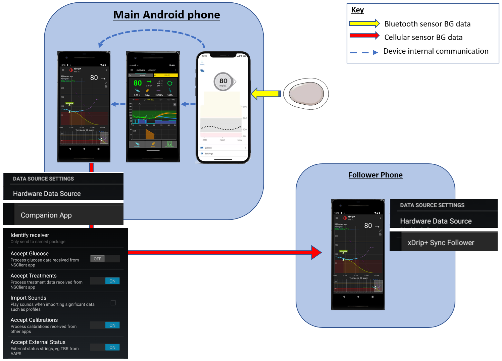
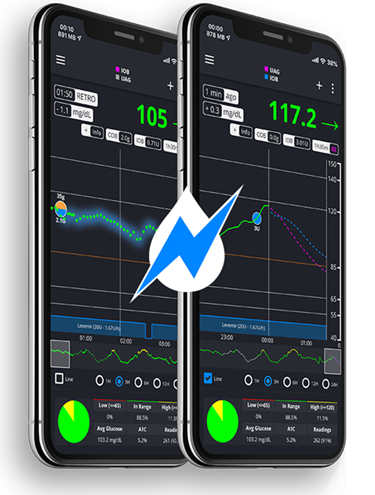

# Følge AAPS (uten å styre AAPS-systemet)

I tillegg til de mange mulighetene for å fjernstyre _og_ følge **AAPS** som er beskrevet under [Fjernstyring av AAPS](../RemoteFeatures/RemoteControl.md), finnes det flere apper og enheter som fellesskapet har utviklet, for bare å følge tallene (glukoseverdier og annen informasjon), uten å styre **AAPS**.

En god oversikt over de mange mulighetene for å følge **AAPS** finnes på nettsiden [Nightscout follower](https://nightscout.github.io/nightscout/downloaders/#).

```{contents} Table of contents
:depth: 1
:local: true
```

De vanligste strategiene som brukes sammen med **AAPS**, er forklart nærmere nedenfor.

## Apper for smarttelefon

```{contents} These are some of the main “follower” apps used by **AAPS** users. All of these apps are “free”: 
:depth: 1
:local: true
```

### Dexcom Follow ([Android](https://play.google.com/store/apps/details?id=com.dexcom.follow.region2.mgdl) og [iOS](https://apps.apple.com/fr/app/dexcom-follow-mg-dl-dxcm2/id1032203080))



* Dexcom Follow er kompatibel med mange telefoner (både Android og iPhone). Dexcom Follow kan brukes selv om du ikke bruker den offisielle Dexcom-appen til å motta sensordata.

* Mange omsorgspersoner kjenner Dexcom Follow fra før og foretrekker det enkle grensesnittet framfor noe mer komplisert.

* Dexcom Follow er svært godt egnet for lærere/besteforeldre og folk som vet lite om diabetes og blodsukker. Den har varsler du kan tilpasse (BS-nivå, hvilken lyd som skal spilles osv.). Alarmer kan slås helt av om nødvendig, noe som er svært nyttig hvis du har en sensor som ennå ikke har stabilisert seg og gir flere falske lave verdier.

#### Sette opp Dexcom Follow: steg for steg

Hvis du bruker den uoffisielle Dexcom-appen BYODA til å motta sensordata, kan du kanskje sende invitasjoner til følgere fra BYODA-appen.

Du kan ikke lenger sende invitasjons-e-poster til Dexcom-følgere fra tredjepartsapper. I xDrip gir invitasjonsforespørselen bare meldingen «invite not sent» (invitasjon ikke sendt).

Du må installere den offisielle Dexcom-appen, sende invitasjonen og deretter avinstallere den offisielle appen.

Slik gjør du det:

1)  Installer den offisielle «Dexcom»-appen på _hvilken som helst_ smarttelefon (Android/iPhone). Det kan være følgerens telefon, hvis det er enklere. 2)  Logg inn med Dexcom-brukernavnet og -passordet ditt. Dette er de samme innloggingsopplysningene som du bruker til Dexcom Clarity, hvis du allerede er Dexcom/Clarity-kunde. Hvis du ikke har en Dexcom-innlogging, kan du opprette en ny her.   
3)  Sveip gjennom introduksjonsmenyene. 4)  Velg «no code» (ingen kode) som sensorkode. 5)  Under Transmitter SN (serienummer for sender) velger du «enter manually» (skriv inn manuelt) og skriver inn en gyldig senderkode (bruk en av dine utløpte senderkoder hvis du kjenner en, så den ikke forstyrrer senderen du bruker nå; de følger et bestemt format med tall og bokstaver, «NLNNNL», og bare visse kombinasjoner brukes, så det er enklest å bruke en du vet er gyldig). 6)  Når appen prøver å finne senderen og sensoren, kan du invitere følgere: trykk på de tre små prikkene øverst til venstre i appen, og legg til en ny følger. Du kan også bruke dette hvis en av følgerne dine har byttet telefon og trenger en ny invitasjon. Her kan du slette dem fra følgerlisten og sende en ny invitasjons-e-post som de kan bruke på den nye telefonen. 7)  På følgerens telefon installerer du Dexcom Follow ved å laste den ned fra App Store (iPhone) eller Play (Android). Sett opp Dexcom Follow-appen, og du blir bedt om å åpne e-posten din for å finne invitasjonen til å bli følger.    
8)  Nå kan du slette den offisielle Dexcom G6-appen.

For Dexcom Follow eksporteres sensordataene da fra **AAPS**-telefonen, enten direkte fra BYODA eller fra xDrip, avhengig av hvilken app du bruker.


### [Nightguard](https://apps.apple.com/fr/app/nightguard/id1116430352) (iOS)



Fordeler (rapportert av brukere):

* Tilgjengelig i [App Store](https://apps.apple.com/us/app/nightguard/id1116430352), enkelt og brukervennlig grensesnitt.

* Sveip på en knapp eller rist telefonen for å utsette alarmer i ulike intervaller fra 5 min til 24 timer

* Tilpass alarmer (varsler for høyt og lavt, manglende målinger når det ikke har kommet data på 15–45 minutter).

* Rask stigning/raskt fall over 2–5 målinger på rad (du velger). Du kan også velge deltaen mellom to enkeltmålinger

* Smart utsettelse, så den varsler ikke hvis verdiene beveger seg i riktig retning

* Det finnes en Care-fane som ser ut til å la deg sette et nytt midlertidig mål for en viss varighet, slette det midlertidige målet eller registrere karbohydrater.

Ulemper (rapportert av brukere)

* Bare tilgjengelig for iOS

* Det midlertidige målet vises som 5 mmol uansett hvilket nivå som er satt

* Viser aldri verdien for midlertidig basal, selv om den viser at det er en midlertidig basal (TB)

### [Nightwatch](https://play.google.com/store/apps/details?id=se.cornixit.nightwatch) (Android)


* Nightwatch markedsfører seg som en Nightscout-klient og følger brukerens glukoseverdier fra Nightscout på enten Android-telefon eller -nettbrett.

* Appen kan lastes ned fra [Google Play](https://play.google.com/store/apps/details?id=se.cornixit.nightwatch) og viser BS-data i sanntid.

* Brukeren kan varsles med tilpassede, høye alarmer for lavt og høyt.

* BS-data kan vises i enten mmol/L eller mg/dL.

* Den krever Android 5.0 eller nyere.

* Den har et mørkt grensesnitt, store tall og knapper, laget for bruk om natten.

### xDrip (Android)

Du kan bruke xDrip som følger.

#### Med Nightscout

Sett xDrip som Nightscout-følger. Du får BS og behandlinger, ikke basal.


#### Uten Nightscout – xDrip som BS-kilde

Hvis BS-kilden i **AAPS** er xDrip (eller hvis xDrip også kan motta BS fra en annen app, som BYODA, Juggluco, …), kan du bruke den fra hovedenheten til å dele data med xDrip-følgere, og vise BS, behandlinger og basaldoser.


#### Uten Nightscout – xDrip som BS-hjelpeapp

Hvis BS-kilden i **AAPS** ikke er xDrip, men du kan vise BS-data fra datakilden Companion App, kan du bruke den fra hovedenheten til å dele data med xDrip-følgere, og vise BS, behandlinger og basaldoser.



### xDrip4iOS (iOS)


xDripSwift ble laget ved å portere den opprinnelige xDrip-appen til iOS, og utviklet seg til «xDrip for iOS», skrevet som **xDrip4iOS**.

```{admonition} Further detail about how to attempt to obtain the original **xDrip4iOS** app
:class: dropdown
[Facebook-gruppen for xDrip4iOS](https://www.facebook.com/groups/853994615056838/announcements) er den viktigste støttegruppen for xDrip4iOS og Shuggah. **xDrip4iOS** kan koble til mange ulike CGM-systemer og sendere og vise blodsukkerverdier, grafer og statistikk, og gi alarmer. Den kan også laste opp til Nightscout eller fungere som en [følgerapp for Nightscout](https://xdrip4ios.readthedocs.io/en/latest/connect/follower/). 

«Hvordan får jeg **xDrip4iOS** på iPhonen min?»
Det finnes to alternativer:

1. Hvis du har en Mac og en Apple Developer-konto (99 EUR/USD per år), kan du bygge din egen xDrip4iOS ved å [følge instruksjonene](https://xdrip4ios.readthedocs.io/en/latest/install/build/).

Hvis du vil, kan du deretter bli en «releaser» og [dele en personlig TestFlight-utgave av xDrip4iOS](https://xdrip4ios.readthedocs.io/en/latest/install/personal_testflight/) med opptil 100 andre for å hjelpe dem.

2. Du blir med i [Facebook-gruppen for xDrip4iOS](https://www.facebook.com/groups/853994615056838/announcements) og leser de festede innleggene om hvordan du får tak i appen nå. **Du skal ikke be om en invitasjon til appen** (les gruppereglene).
```


«Hva er **Shuggah**?» En gruppe ukrainske utviklere kopierte prosjektkoden til xDrip4iOS (som deles åpent på GitHub) og ga den ut på App Store under en bedriftskonto. Shuggah-utgivelsen styres ikke på noen måte av xDrip4iOS-utviklerne.

[Facebook-gruppen for xDrip4iOS](https://www.facebook.com/groups/853994615056838/announcements) gir støtte for xDrip4iOS og de tilhørende Apple Watch-appene.

### [Sugarmate](https://apps.apple.com/fr/app/sugarmate/id1111093108) (iOS)


[Sugarmate](https://sugarmate.io/) kan lastes ned til iPhone fra App Store. Sugarmate er kompatibel med:
* Apple iPhone (krever programvareversjon 13.0 eller nyere)
* Apple iPad (krever programvareversjon 13.0 eller nyere)
* Google Android (lagre web-appen på startskjermen)

Brukere av Sugarmate har rapportert at den kan brukes med Apple CarPlay i USA for å vise glukoseverdier mens du kjører. Det er ennå ikke avklart om dette er mulig i land utenfor USA. Hvis du vet mer om dette, kan du legge til detaljer her i dokumentasjonen ved å lage en [pull request](../SupportingAaps/HowToEditTheDocs.md), noe som er raskt og enkelt å gjøre.


### [Spike](https://spike-app.com/) (iOS)



Spike kan brukes som primær mottaker eller som følgerapp, og gir BS, alarmer, IOB og mer.

Nettsiden og appen utvikles ikke lenger. Støtte finnes på [Facebook](https://www.facebook.com/groups/1973791946274873) og [Gitter](https://gitter.im/SpikeiOS/Lobby).

## Smartklokker for **overvåking av AAPS** (fulle profildata, eller bare glukose) der **AAPS** kjører på en telefon.

Se [her](../Getting-Started/Watches.md).


## Enheter for å følge AAPS

```{contents} Devices include:
:depth: 1
:local: true
```

### M5 stack


M5Stack er en liten boks som kan programmeres til mange formål. Martins prosjekt [M5Stack NightscoutMon](https://github.com/mlukasek/M5_NightscoutMon/wiki) viser sensorglukoseverdier og trender, IOB og COB. Den ligger i en plastboks og har fargeskjerm, spor for micro SD-kort, 3 knapper, høyttaler og internt batteri. Den er en flott blodsukkerskjerm og er ganske enkel å sette opp hvis du har en Nightscout-konto. Brukere kjører den vanligvis på Wi-Fi hjemme, men noen brukere forteller at de bruker den som skjerm på motorsykkeltur, via Wi-Fi-deling fra en telefon.

### Sugarpixel

SugarPixel er en enhet som fungerer som en ekstra glukoseskjerm med varsler for kontinuerlig glukosemåling. Den kobles til Dexcom-appen eller Nightscout-appen på brukerens smarttelefon. Enheten viser blodsukkermålinger i sanntid. Denne CGM-skjermen har lydvarsler med tilfeldig genererte toner (som er utrolig høye), vibrasjonsvarsler for hørselshemmede, visningsvalg du kan tilpasse, og innebygd følging for flere brukere.


* SugarPixel har flere visningsvalg i mg/dL og mmol/L som passer brukerens behov, med fargekodede glukoseverdier.
* Standardvisningen viser BS, trendpil og delta. Delta er endringen, + eller -, fra forrige måling.
* SugarPixel kan tilpasses til bruk med lav lysstyrke med visningen «BG and Time», slik at brukeren ser BS-målingen og klokkeslettet på nattbordet.
* Fargevisningen i SugarPixel bruker hele skjermen til å vise én farge som representerer BS-verdien. Dette gjør at brukeren kan se BS-målinger på avstand gjennom vinduet mens barnet leker ute i hagen, på terrassen eller i bassenget.
* Visningen «Big BG» er nyttig for deg som har den på nattbordet og bruker briller eller kontaktlinser.

### Nightscout Clock på Ulanzi TC001

**Nightscout Clock** er programvare med åpen kildekode som kjører på enheten **Ulanzi TC001**. Den kobler til Dexcom-serverne eller Nightscout og viser blodsukkermålinger i sanntid.


* Klokken støtter både mmol/L og mg/dL, og har lydalarmer.
* Flere visninger er tilgjengelige, se [Github nightscout-clock](https://github.com/ktomy/nightscout-clock?tab=readme-ov-file#more-information-for-people-who-needs-it) for en oversikt.
* Det er bare noen få enkle steg å sette opp og konfigurere enheten. Når den er satt opp, trenger den bare strøm og Wi-Fi for å fungere.
* Ulanzi TC001-enheten er mye billigere å kjøpe enn SugarPixel.
* Programvaren og installasjonsinstruksjonene finnes på [Github nightscout-clock](https://github.com/ktomy/nightscout-clock?tab=readme-ov-file).
* Den utvikles og vedlikeholdes av Artiom Kenibasov, som gir støtte i [Facebook-gruppen AAPS Users](https://www.facebook.com/groups/cgminthecloud/posts/8776932509094594/).

### PC (TeamViewer)
Noen brukere synes et fullt fjerntilgangsverktøy som [TeamViewer](https://www.teamviewer.com/) er nyttig til avansert feilsøking på avstand.
