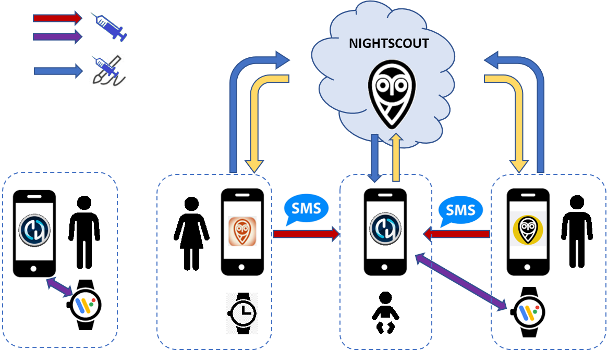
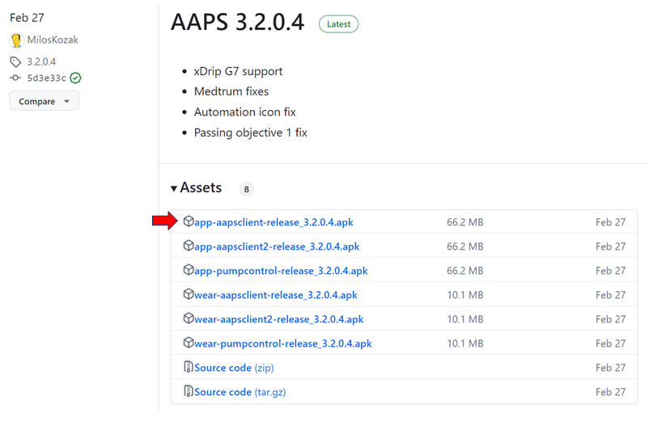
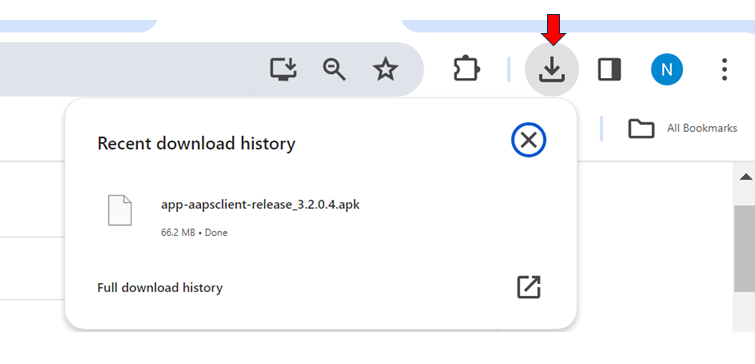
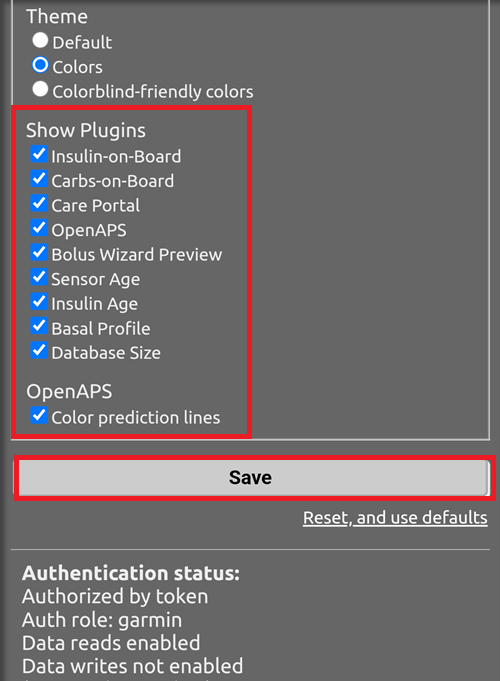
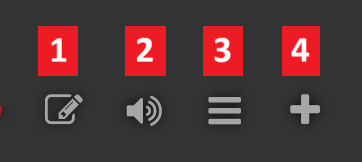
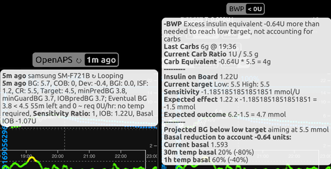

# Fjernstyring av AAPS

```{contents} In this page
:backlinks: entry
:depth: 2
```

Det finnes fire svært effektive verktøy for å styre **AAPS** på avstand:

1) [SMS-kommandoer](#RemoteControl_SMS-Commands) (følgertelefonen kan være enten Android eller iOS), 2) [AAPSClient](#RemoteControl_aapsclient) (følgertelefonen er Android; en iPhone-versjon er under utvikling) 3) [Nightscout](#RemoteControl_nightscout) (Android, iOS eller en annen datamaskin/enhet), mest for å følge: se merknaden om [klientstyring](#client-master-control) i den delen.  
4) [Smartklokker](#RemoteControl_smartwatches) (Android)

De tre første passer mest for omsorgspersoner/foreldre, men smartklokker er svært nyttige både for omsorgspersoner/foreldre **og** for voksne som selv har diabetes.



(RemoteControl_SMS-Commands)=

## 1) SMS-kommandoer

Se den egne siden [SMS-kommandoer](../RemoteFeatures/SMSCommands.md).

(RemoteControl_aapsclient)=
## 2) AAPSClient

**AAPSClient** ser svært lik ut som **AAPS** selv, og gir omsorgspersonen de samme skjermbildene og knappene for å sende kommandoer til **AAPS** på avstand:


(remotecontrol-aapsclient-versions)=
### Om AAPSClient, AAPSClient2 og AAPSClient3

Det finnes 3 versjoner av klientappen: **AAPSClient**, **AAPSClient2** og **AAPSClient3**. De fungerer på samme måte. Den eneste forskjellen er at de kan installeres side om side på samme følgertelefon.

En omsorgsperson som følger én person, trenger bare **AAPSClient**. For å følge og fjernstyre en person til (med egen **Nightscout**-side og egen **AAPS**-telefon) installerer du også **AAPSClient2**, og **AAPSClient3** for en tredje person. Hver app settes opp og [pares](#aapsclient-pairing-with-the-master) hver for seg, med **Nightscout**-siden og **AAPS**-telefonen til personen den følger.

For å skille appene fra hverandre har noen elementer ulik farge: gul for **AAPSClient**, blå for **AAPSClient2** og grønn for **AAPSClient3**. Disse elementene er appikonet, widget-bakgrunnen og **AAPS**-statusdelen på startskjermen i appen. <br/> Merk: hvor gjennomsiktig widget-bakgrunnen skal være, kan du sette i widget-konfigurasjonen. Hvis bakgrunnen er nesten gjennomsiktig, er fargen vanskelig å se.


### Nedlasting og installasjon

**AAPSClient** kan installeres på én telefon eller på flere følgertelefoner (for eksempel følgertelefonen til forelder 1 og følgertelefonen til forelder 2), slik at begge omsorgspersonene får tilgang og kan fjernstyre pasientens **AAPS**-telefon.

For å laste ned **AAPSClient** går du til [GitHub-repositoryet](https://github.com/nightscout/AndroidAPS/releases/) og trykker på filen **«app-AAPSClient-release_x.x.x.x»** (det kan være en nyere versjon enn den som vises på skjermbildet nedenfor):



Gå deretter til _nedlastinger_ på datamaskinen din. På Windows vises _nedlastinger_ i båndet til høyre:



Når filen er lastet ned, trykker du på _show in folder_ (vis i mappe) for å finne den.

**AAPSClient**-apk-filen kan nå enten:

Overføres med en USB-kabel til følgertelefonen, eller Dras inn i en Google Drive-mappe og deretter legges til på følgertelefonen ved å trykke på filen «app-AAPSClient-release».

Hvis du trenger **AAPS** til deg selv og **AAPSClient** for å overvåke noen andre, må du bygge **AAPSClient** selv i stedet for å laste den ned fra GitHub-repositoryet som beskrevet ovenfor. Grunnen er at du ikke kan installere både **AAPS** og **AAPSClient** på samme telefon hvis de er signert med ulike nøkler. <br/> For å bygge **AAPSClient** selv følger du samme prosess som for et [vanlig AAPS-bygg](../SettingUpAaps/BuildingAaps.md). På siden **Generate signed App Bundle or APK** velger du **aapsclientRelease** i stedet for **fullRelease**.

Den samme regelen gjelder når du installerer flere klientapper (**AAPSClient**, **AAPSClient2**, **AAPSClient3**) på én følgertelefon: alle må være signert med den **samme nøkkelen**. Ellers nekter Android å installere den andre (feil `INSTALL_FAILED_DUPLICATE_PERMISSION`).

### Synkronisering: oppsett av AAPSClient og AAPS

Når __AAPSClient__-apk-filen er installert på følgertelefonen, må du sørge for at **NSClientV3** er satt opp på samme måte på begge telefonene for Nightscout 15 (se [oppdateringsnotatene](../Maintenance/UpdateToNewVersion.md)). Eksempelet nedenfor viser synkroniseringsoppsettet med NSClientV3 og Nightscout 15; andre datakilder er tilgjengelige i __AAPS__ (f.eks. xDrip).

I **Konfigurasjon** > **Kommunikasjon** synkroniserer brukeren dataene sine med Nightscout gjennom __NSClientV3__ (som bruker v3-API-et), satt opp på samme måte både for __AAPS__ og for følgertelefonen.


Brukeren må sørge for at __både__ AAPS-telefonen og AAPSClient-telefonen er synkronisert sammen, ved å sette opp NSClientV3 på hver av dem. På følgertelefonen kan dette i stedet gjøres ved å skanne en QR-kode som **AAPS** viser, se [Pare AAPSClient med AAPS](#remotecontrol-pairing) nedenfor:

- Skriv inn **Nightscout URL** i **Innstillinger** for NSClientV3

- Skriv inn **Nightscout tilgangstoken** i de samme innstillingene. Følg veiledningen [her](https://nightscout.github.io/nightscout/security/#create-a-token). På **AAPS**-telefonen bruker du et **admin-token**: med det lager **AAPS** et eget token for hver følgertelefon.

- Slå på **Bruk websockets** på **begge** telefonene. På **AAPS**-telefonen er websockets **påkrevd** for fjernstyring: uten dem kan ikke **AAPS** motta kommandoer fra **AAPSClient**. På begge telefonene gjør de også synkroniseringen raskere, mot litt høyere batteribruk.


Brukeren bør sjekke at både __AAPSClient__ og __AAPS__ viser «Tilkoblet» på **NSClientV3**-skjermen på hver telefon. Nå følger **AAPSClient** **AAPS** (BS, behandlinger, profil), men den kan ikke styre den ennå: par de to telefonene som beskrevet nedenfor.

(remotecontrol-pairing)=
### Pare AAPSClient med AAPS (fjernstyring)

Fra **AAPS** versjon 4 styrer **AAPSClient** **AAPS** gjennom en sikker, **sammenkoblet** forbindelse. Synkronisering alene er ikke nok: til telefonene er sammenkoblet, viser **AAPSClient** bare **Administrer** med en skrivebeskyttet **Profil** og **Koble til hovedenhet**.

1. På **AAPS**-telefonen åpner du **Administrer → Autoriserte klienter** og slår på **Tillat klientstyring** (den er av som standard, og alltid på i Enkelmodus).
2. Trykk på **+**, skriv inn et navn på følgertelefonen, velg hvordan den skal settes opp, og velg **rollen** dens:
   - **QR-kode: Nightscout og sammenkobling** — **AAPS** viser en QR-kode som setter opp Nightscout på følgertelefonen og parer den, i én skanning. Dette krever et admin-token i NSClientV3-innstillingene på **AAPS**-telefonen.
   - **PIN** — for en følgertelefon uten kamera som allerede er koblet til Nightscout: noter engangs-**PIN**-koden (gyldig i omtrent to minutter).
3. På **AAPSClient**-telefonen skanner du koden (i Oppsettveiviseren, eller via **Administrer → Koble til hovedenhet → Skann QR-kode**), eller du åpner **Administrer → Koble til hovedenhet** og skriver inn PIN-koden. Bekreft.

Følgertelefonen vises da som **Aktiv** i listen **Autoriserte klienter**, og **AAPSClient** viser **Behandlinger**, **Scener** og **Administrer**. Følgertelefonen får et eget Nightscout-token, med bare de rettighetene den trenger. Hele prosedyren, med skjermbilder og feilsøking, finner du på [Hovedenhet ↔ klientstyring](#client_master_master_setup).

Sjekk at oppsettet fungerer: registrer karbohydrater i **AAPSClient**, bekreft mengden som vises, og sjekk at oppføringen vises under **Behandlinger** på begge telefonene.

(remotecontrol-nightscout-access-token)=

### Feilsøking av problemer med oppsett av «Nightscout tilgangstoken»

Det nøyaktige oppsettet av «Nightscout tilgangstoken» kan variere etter om Nightscout-leverandøren din er en betalt, hostet tjeneste eller ikke.

Hvis du sliter med å få **AAPS** til å godta «Nightscout tilgangstoken» og bruker en betalt, hostet Nightscout-side, kan det lønne seg å først ta kontakt med Nightscout-leverandøren din om hvordan problemene med «Nightscout tilgangstoken» kan løses. Ellers kan du ta kontakt med **AAPS**-gruppen, men dobbeltsjekk først at du har fulgt veiledningen [her](https://nightscout.github.io/nightscout/security/#create-a-token) riktig.

### Hva AAPSClient tilbyr

Når den er sammenkoblet, gir **AAPSClient** omsorgspersonen nesten de samme skjermbildene som **AAPS** selv:

- **Behandlinger**: insulinbolus, karbohydrater og boluskalkulatoren.
- **Scener**: starte og stoppe [scener](../DailyLifeWithAaps/Scenes.md).
- **Administrer**: profiler, insulininnstillinger, midlertidige mål, Hurtigknapp, automasjon, mat, rotasjon av sted, sammenkobling og den aktive midlertidige basalen.
- **Hovedmenyen**: behandlingshistorikk, historikkleser, statistikk, vedlikehold, konfigurasjon.

Det finnes ingen pumpe og ingen opplæringsmål i **AAPSClient**. Se [AAPSClient-appen](AapsClient.md) for en detaljert beskrivelse.

**AAPSClient** lar omsorgspersonen gjøre de fleste justeringene som er tillatt direkte i **AAPS**, **inkludert insulinboluser**, på avstand over mobilnettet eller internett. Hver kommando signeres og sendes gjennom Nightscout til **AAPS**-telefonen, som kontrollerer den mot sine egne data, begrenser den, viser sin egen bekreftelse og først da utfører den. **AAPSClient** _kan_ være mye raskere enn [SMS-kommandoer](../RemoteFeatures/SMSCommands.md), særlig for kommandoer som ville kreve autentisering.

Behandlinger som er registrert i Nightscout på andre måter (for eksempel på Nightscout-nettstedet), brukes ikke mens klientstyring er på: **AAPS** er da i [herdet modus](#client-master-control-hardened-mode) og tar bare imot endringer fra sammenkoblede klienter. Når klientstyring er av, brukes de bare hvis de tilsvarende **Motta**-valgene er slått på i [Synkronisering-delen av NSClient-innstillingene](#Preferences-nsclient-synchronization).

Fjernstyring gjennom **AAPSClient** anbefales bare hvis synkroniseringen din fungerer godt (_dvs._ at du ikke ser uønskede dataendringer, som at midlertidig mål, midlertidig basal osv. endrer seg av seg selv).

### AAPSClient med smartklokkealternativer

En smartklokke kan være et svært nyttig verktøy for å hjelpe til med å styre **AAPS** hos barn. Flere ulike oppsett er mulige. Hvis **AAPSClient** er installert på omsorgspersonens telefon, kan [**AAPSClient WearOS**-appen](https://github.com/nightscout/AndroidAPS/releases/) lastes ned og installeres på en kompatibel smartklokke som er koblet til forelderens telefon. Dette viser gjeldende BS og loop-status. Når **AAPSClient** er sammenkoblet med **AAPS**, videresendes handlingene fra klokken (inkludert boluser, karbohydrater, midlertidige mål og profilbytter) gjennom **AAPSClient** til **AAPS**, som bekrefter og utfører dem: se [Wear OS på en klient](#clientmastercontrol-wear-os-on-a-client). Du kan lese mer om smartklokker [her](#remotecontrol-smartwatches).

(RemoteControl_nightscout)=
## 3) Nightscout

I tillegg til at Nightscout er en server i «skyen», finnes det også en egen **Nightscout**-app som du kan laste ned direkte fra App Store på iPhonen din. Hvis du har en Android-følgertelefon, finnes det ingen egen Nightscout-app. Da er det bedre å bruke [**AAPSClient**](#2-aapsclient), eller, hvis du bare vil følge og ikke sende behandlinger, kan du laste ned og installere appen [Nightwatch](https://play.google.com/store/apps/details?id=se.cornixit.nightwatch) fra Play-butikken.

Når du har installert **Nightscout**-appen på iPhonen din, åpner du appen og følger oppsettstegene. Skriv inn Nightscout-adressen din (se nedenfor, til venstre). Hvordan denne ser ut, kan variere etter hvor Nightscout-siden din er hostet. (_f.eks._ http://youraddresshere.herokuapp.com). Skriv deretter inn API-nøkkelen (API secret) for Nightscout (se nedenfor, til høyre). Hvis du ikke blir bedt om API-passordet, må du skrive det inn ved å trykke på hengelåsen øverst i appen:


Mer informasjon om oppsettet finner du direkte hos [Nightscout](https://nightscout.github.io/nightscout/discover/)

Når du logger inn første gang, får du en svært enkel visning. Tilpass visningsvalgene ved å trykke på «hamburgermenyen» øverst til høyre og bla nedover:


Bla ned til «Settings» (innstillinger). Du kan vurdere å endre «scale» (skala) til «linear» (lineær), fordi BS-visningen er logaritmisk som standard, og velge «default» under «render basal», slik at pumpens basal vises.


Velg de alternativene du ønsker. Fjern haken ved alarmer hvis du bruker en annen app for alarmer.


Fortsett å bla nedover til du kommer til «show plugins».

Du må passe på at «careportal» er avkrysset. Du kan også velge flere andre verdier (de mest nyttige er: IOB, care portal, pump, cannula age, insulin age, basal profile og OpenAPS).

Det er viktig at du nå trykker på «save» nederst, for at endringene skal tre i kraft.



Når du har trykket på «save», går appen tilbake til Nightscout-hovedskjermen din, som vil se omtrent slik ut:

1. Gjeldende glukoseverdi
2. Informasjon om statusen til AAPS-systemet – trykk på de enkelte boksene på skjermen for å vise flere detaljer. Legg til eller fjern disse visningsvalgene i hamburgermenyen.
3. Nylig glukosekurve med behandlinger (karbohydrater, boluser) vist
4. Glukosekurve over lengre tid
5. «Hamburgermenyen» for å sette visningsvalg, lage rapporter, redigere profiler og Nightscout-administratorverktøy
6. «**+**»-menyen for å registrere behandlinger (se [nedenfor](#RemoteControl_nightscout-treatments) om når **AAPS** bruker dem).
7. Velg en annen tidsperiode som skal vises
8. Basalinsulinprofil
9. Grønn linje = historisk glukose Blå linjer = predikert glukose


Ser vi nærmere på menyen øverst til venstre i Nightscout-appen:

1. Redigere helseportalen i ettertid
2. Slå alarmer på/av
3. Hamburgermeny – for å sette innstillinger
4. Helseportal – logg behandling (se [nedenfor](#RemoteControl_nightscout-treatments) om når **AAPS** bruker disse)



Det er svært mye informasjon om statusen til **AAPS**-systemet i de grå boksene på dette skjermbildet (og enda mer informasjon vises hvis du trykker på en boks):

1. 5-minutters glukosetrend
2. Forhåndsvisning av boluskalkulator
3. Trykk på Basal for å se gjeldende profil og basalinformasjon
4. Tid siden siste CGM-måling i AAPS
5. **Pumpe**: insulin, batteriprosent og når AAPS sist var koblet til den
6. Sist AAPS oppdaterte – hvis dette er mer enn 5 minutter siden, kan det tyde på et tilkoblingsproblem mellom AAPS-telefonen og pumpen/CGM-en
7. Trykk på IOB for å se fordelingen mellom basal- og bolusinsulin
8. Insulinalder i reservoaret
9. Kanylealder
10. Batteristatus for AAPS-telefonen
11. Størrelsen på databasen din. Hvis den blir for full (gjelder bare DIY-Nightscout – hostede tjenester kan se bort fra dette), kan du begynne å få tilkoblingsproblemer. Du kan slette data for å redusere tallet, i menyen Admin tools (via hamburgermenyen).




Trykk på «refresh» nederst på siden for å lukke popup-vinduet.

(RemoteControl_nightscout-treatments)=
### Sende behandlinger gjennom Nightscout-appen til AAPS

I **AAPS** 4 er den støttede måten å fjernstyre **AAPS** på en **sammenkoblet AAPSClient**, se [Hovedenhet ↔ klientstyring](#client-master-control): hver klient har en [rolle](#client-master-control-roles) som begrenser hva den kan gjøre, og hver kommando signeres, kontrolleres og bekreftes av **AAPS**-telefonen. Mens klientstyring er på, er **AAPS**-telefonen i [herdet modus](#client-master-control-hardened-mode): behandlinger, midlertidige mål og profilbytter som registreres på Nightscout-nettstedet eller i Nightscout-appen, blir **ikke** brukt. Nightscout-appen er da bare et verktøy for å følge.

```{admonition} Only when client control is off
:class: warning
Hvis **Tillat klientstyring** er av i **Administrer → Autoriserte klienter** (og Enkelmodus er av), bruker **AAPS** helseportal-oppføringer fra Nightscout bare for de datatypene du har slått på under **Motta** i [Synkronisering-delen av NSClientV3-innstillingene](#Preferences-nsclient-synchronization): karbohydrater, midlertidige mål, profilbytter og de andre helseportal-oppføringene. Insulin gis aldri på denne måten: en «Korreksjonsbolus» som registreres i Nightscout, blir bare *meldt inn*, og **AAPS** regner den som aktivt insulin uten å gi den. Dette oppsettet anbefales ikke for fjernstyring; bruk en sammenkoblet **AAPSClient** i stedet.
```

Les mer om valgene i **Nightscout** [her](https://nightscout.github.io/)

### Tips for å få mest mulig ut av Nightscout-appen

1). Hvis du «står fast» på en side og vil se hovedskjermen igjen, trykker du bare på «refresh» (nederst i midten). Da kommer du tilbake til **Nightscout**-startsiden med BS-grafen.

For å se profilen som kjører på telefonen nå, trykker du på de ulike ikonene på skjermen over grafen. Mer informasjon (gjeldende IK, insulinsensitivitet, tidssone osv.) ser du ved å trykke på «basal», og «OpenAPS» gir informasjon om profilen, gjeldende mål osv. Både batteriprosenten på telefonen og batteriprosenten på pumpen kan også overvåkes. BWP gir informasjon om hva algoritmen tror vil skje framover, ut fra IOB og COB.

#### Andre ikoner i menyen: hva betyr blyanten (rediger)?

Du kan (teknisk sett) bruke redigeringsblyanten til å flytte eller slette bolus- eller korreksjonsbehandlinger fra de siste 48 timene.

Mer om dette [her](https://nightscout.github.io/nightscout/discover/#edit-mode-edit)

Selv om dette i teorien kan være nyttig for å slette karbohydrater som er meldt inn (men ikke gitt bolus for), fungerer det i praksis ikke godt sammen med **AAPS** i dag. Vi anbefaler at du gjør slike endringer direkte i **AAPS**-appen.

(RemoteControl_smartwatches)= (remotecontrol-smartwatches)=

## 4) Smartklokker

### Alternativ 1) Styre AAPS fra en Wear OS-klokke


Når du har [satt opp **AAPS** på klokken din](../WearOS/BuildingAapsWearOS.md), finner du utfyllende informasjon om urskivene og funksjonene deres på [Wear OS-smartklokke](../WearOS/WearOsSmartwatch.md).

Kort oppsummert kan følgende funksjoner utløses fra smartklokken:

* sette et midlertidig mål

* bruke boluskalkulatoren (beregningsvariablene kan angis i innstillingene på telefonen)

* gi eKarbo

* gi en bolus (insulin + karbohydrater)

* klokkeinnstillinger

* status

* sjekke pumpestatus

* sjekke loop-status

* sjekke og endre profil, CPP (Circadian Percentage Profile = tidsforskyving + prosent)

* vise TDD (total daglig dose = bolus + basal per dag)

* Fjernbolus når omsorgspersonen og barnet med T1D er på ulike steder (dette er mulig for **AAPS**-klokken og **AAPS**-telefonen så lenge begge enhetene er koblet til nettet)

#### Kommunikasjon fra omsorgspersoner til klokken med andre apper (som WhatsApp)

Det er mulig å legge til flere apper på klokken, som WhatsApp, for meldinger (for eksempel) mellom omsorgspersoner og barn. Det er viktig å ha bare ÉN Google-konto knyttet til telefonen, ellers overfører ikke klokken disse dataene. Du må være 13 år eller eldre for å ha en Samsung-konto, og den må settes opp med den samme e-postadressen som brukes på Android-telefonen.

En video som forklarer hvordan du setter opp WhatsApp for meldinger på Galaxy Watch 4 (du får ikke full WhatsApp-funksjonalitet), finner du [her](https://gorilla-fitnesswatches.com/how-to-get-whatsapp-on-galaxy-watch-4/)

Ved å gjøre justeringer både i **Galaxy Wearable**-appen på **AAPS**-telefonen og på klokken, kan WhatsApp-meldinger varsle med en svak vibrasjon, og WhatsApp-meldingen kan vises over urskiven.

### Alternativ 2) **AAPS** på klokken, for fjernstyring av **AAPS** på en telefon

På samme måte som med en følgertelefon med **AAPSClient** eller SMS-kommandoer (se delene ovenfor), kan en smartklokke brukes til å fjernstyre **AAPS** og gi fullstendige profildata. En viktig forskjell fra en følgertelefon er at forbindelsen mellom smartklokken og **AAPS**-telefonen går via Bluetooth, og den trenger verken Nightscout eller en autentiseringskode. Som en tilleggsopplysning: hvis både smartklokken og **AAPS**-telefonen, som er koblet sammen via Bluetooth, også er på et Wi-Fi-/mobildatanett, vil klokken også kommunisere med **AAPS**-telefonen over nettet, noe som gir lengre rekkevidde. Dette omfatter fjernbolus når omsorgspersonen med **AAPS**-klokken og barnet med T1D (med **AAPS**-telefonen) er på ulike steder, noe som kan være nyttig når barnet med T1D er på skolen.

En smartklokke for fjernstyring er derfor ofte nyttig i alle situasjoner der:

a)  **AAPSClient**- eller **SMS**-kommandoer ikke kan brukes, eller

b)  brukeren ønsker å slippe å skrive inn en autentiseringskode (som kreves for SMS-kommandoer).

En smartklokke trenger **Wear OS 3 eller nyere** for å kunne styre **AAPS**. Sjekk de tekniske spesifikasjonene til klokken, og se siden [Smartklokker og AAPS](../Getting-Started/Watches.md). Søk, eller spør i **AAPS**-gruppene på Facebook/Discord hvis du er usikker.

Egne veiledninger for å sette opp **AAPS** på den populære Samsung Galaxy Watch 4 (40 mm) finner du nedenfor. [Garmin](https://apps.garmin.com/en-US/apps/a2eebcac-d18a-4227-a143-cd333cf89b55?fbclid=IwAR0k3w3oes-OHgFdPO-cGCuTSIpqFJejHG-klBTm_rmyEJo6gdArw8Nl4Zc#0)-klokken er også et populært valg. Hvis du har erfaring med å sette opp en annen smartklokke som du tror kan være nyttig for andre, kan du legge det inn på disse sidene ([redigere dokumentasjonen](../SupportingAaps/HowToEditTheDocs.md)) for å dele det du har funnet ut med resten av **AAPS**-fellesskapet.

### Alternativ 3) AAPSClient på en klokke for fjernstyring av **AAPS** på en telefon


Programvaren til klokken, **AAPSClient** Wear-apk-filen, kan lastes ned direkte fra [GitHub](https://github.com/nightscout/AndroidAPS/releases/).

For å laste ned programvaren trykker du på klokkeappen som passer til klientappen på telefonen: **wear-aapsclient-release_**_versjon_ hører sammen med **AAPSClient**, **wear-aapsclient2-release_**_versjon_ hører sammen med **AAPSClient2** (se [Om AAPSClient, AAPSClient2 og AAPSClient3](#remotecontrol-aapsclient-versions)):


Velg deretter «save as» (lagre som) og lagre filen et passende sted på datamaskinen din:


**AAPSClient** Wear-apk-filen kan overføres til telefonen din og installeres direkte på klokken («sideloading») på samme måte som **AAPS** Wear-appen, som beskrevet i [Overføre Wear-appen til AAPS-telefonen din](#remote-control-transferring-the-aaps-wear-app-onto-your-aaps-phone)  


