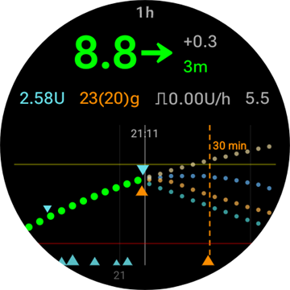
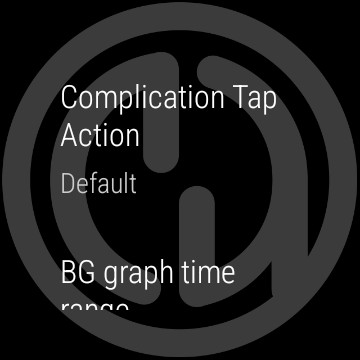
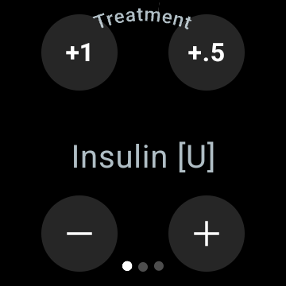
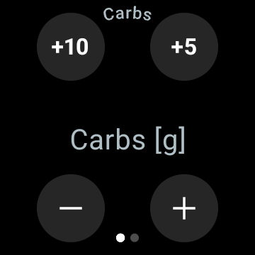

# Styring av AAPS fra Wear OS-smartklokken din

(Watchfaces-aaps-watchfaces)=

## AAPS-urskiver

```{warning}
De klassiske **AAPS**-urskivene kjører bare på Wear OS 5 og eldre, og Wear OS 5 begrenser dem allerede. På **Wear OS 6 og nyere** installerer klokkeappen i stedet én urskive i Googles Watch Face Format: den egendefinerte urskiven din som et bilde, eller **Komplikasjons-urskive**. Se [Endringer i urskiver på Wear OS](#wearos-watchface-changes) for hva som slutter å virke på hver Wear OS-versjon, og [urskiven AAPS installerer](#wearos-aaps-v4-watchface) for Wear OS 6.
```

På Wear OS 5 og eldre er flere klassiske urskiver innebygd i **AAPS**-klokkeappen. De viser glukoseverdien med delta, IOB, den aktive basaldosen og en graf over målingene. To trykk virker på dem:

* Dobbelttrykk på glukoseverdien for å åpne hovedmenyen i **AAPS**
* Dobbelttrykk på grafen for å endre tidsrommet

På alle Wear OS-versjoner virker [komplikasjonene](#Watchfaces-complications) og [flisene](#WearOsSmartwatch-wear-os-tiles) som er beskrevet på denne siden, med alle urskiver som har plass til dem.

## Konfigurasjon

Aktiver **Klokke** i [**Konfigurasjon** > **Kommunikasjon**](#Config-Builder-wear).

For å gi bolus eller gjøre andre handlinger fra klokken, slå på **Styr fra klokke**. Valgene for boluskalkulatoren på klokken settes samme sted: se [Innstillinger > Klokke](#preferences-wear). Når **Styr fra klokke** er av, avviser telefonen alle behandlinger og modusbytter som sendes fra klokken, og klokken viser *«Styr fra klokke er slått av i Klokke-innstillingene på telefonen.»*

Med **Åpne plugin** på **Klokke**-kortet åpner du Klokke-skjermen:


Den øverste linjen viser navnet på den tilkoblede klokken, eller **(Ingen klokke tilkoblet)**. Fra denne skjermen kan du

* Send alle data på nytt. Kan være nyttig hvis klokken ikke har vært tilkoblet på en stund, og du vil sende informasjonen til klokken.
* Åpne innstillingene på klokken direkte fra telefonen.
* Velge hvilken urskive **AAPS** installerer på klokken (**Urskive installert på klokken**: den egendefinerte urskiven din, eller komplikasjons-urskiven). Dette kortet vises bare når en klokke med **Wear OS 6** eller nyere er tilkoblet. Se [urskiven AAPS installerer](#wearos-aaps-v4-watchface).
* Administrere **Egendefinert urskive** (kortet vises når en klokke er tilkoblet): **Last inn urskive** sender en egendefinert urskive til klokken, **Info urskive** viser detaljene om den innlastede urskiven og feltene den inneholder, **Flere urskiver** åpner [utvekslingssiden](../ExchangeSiteCustomWatchfaces/index.md) i nettleseren, og **Eksporter mal** lagrer en mal du kan redigere. En forhåndsvisning av den innlastede urskiven vises under knappene. Se [Bytte til en AAPS-urskive](#WearOS_changing-to-AAPS-watchface).

Pass på at varsler fra AAPS ikke er blokkert på klokken. Bekreftelsen av en handling (f.eks. bolus, midlertidig mål) kommer som et varsel som du må sveipe og hake av.

## Åpne hovedmenyen i AAPS


For å åpne hovedmenyen i **AAPS** bruker du en av disse:

* åpne **AAPS** fra applisten på klokken
* trykk på en **AAPS**-komplikasjon som åpner menyen, se [Innstillinger for komplikasjoner](#WearOsSmartwatch-complication-settings)
* trykk på **BS-graf**-flisen med **Handling ved trykk** satt til **Hovedmeny**, se [Flisinnstillinger](#WearOsSmartwatch-wear-os-tiles)
* på en klassisk **AAPS**-urskive: dobbelttrykk på glukoseverdien

(WearOsSmartwatch-loop-status)=

## Loopstatus-skjermen

Skjermen **Loopstatus** gir et sammendrag av hva loopen gjør, uten at du må ta fram telefonen. Åpne den fra hovedmenyen i AAPS (**Loopstatus**, eller **Status → Loop**), eller ved å trykke på komplikasjonen **Blodsukker**. Menyen **Status** har også en **Pumpe**-side og en **TDD**-side med de totale døgndosene.


Skjermen er en liste med kort. Rull ned for å se alle:

* **Kjøremodus** — gjeldende modus (lukket loop, åpen loop, LGS, pauset, frakoblet …) og, for en midlertidig modus, hvor lenge den fortsatt varer.
* **Loop-resultat** — når loopen sist kjørte, og den midlertidige basalen eller SMB-en den ba om.
* **Scene** — bare når en [scene](#scenes-from-watch) er aktiv: navnet, tiden som er igjen (eller **Inntil avsluttet** for en scene uten sluttid) og **Oppfølgingsscene**, scenen som starter når den avsluttes.
* **Målverdier** — målet ditt, og det midlertidige målet hvis ett er aktivt.
* **Profil** — navnet på den aktive profilen, med **Prosent** og **Tidsforskyving** når de ikke har standardverdiene. Et midlertidig profilbytte er uthevet og viser hvor lenge det fortsatt varer, og profilen det **Returnerer til** når det avsluttes.
* **Sensitivitet** — de samme linjene som sensitivitetsbrikken på hovedskjermen på telefonen: autosens-verdien og profil-ISF, variabel ISF og effektiv ISF.

Et lite sceneikon ved siden av en kjøremodus, et midlertidig mål eller et profilbytte betyr at det ble **angitt av den aktive scenen**. Det samme ikonet vises i **Kjøremodus**-velgeren.


(WearOsSmartwatch-bolus-calculator)=

## Boluskalkulatoren på klokken

Åpne **Kalkulator** fra hovedmenyen i **AAPS**, fra [Handlinger-flisen](#WearOsSmartwatch-wear-os-tiles) eller fra en komplikasjon som er satt til å åpne kalkulatoren. Den går gjennom noen få sider; sveip fra høyre mot venstre for å gå videre:

| Karbo                                                            | Forespørsel                                                              | Resultat                                                             | Beregning                                                                        | Bekreft                                                              |
| ---------------------------------------------------------------- | ------------------------------------------------------------------------ | -------------------------------------------------------------------- | -------------------------------------------------------------------------------- | -------------------------------------------------------------------- |
|  |  |  |  |  |

1. **Karbo**: skriv inn karbohydratene med knappene **+10**, **+5**, **−** og **+**.
2. **Forespørsel**: den siste siden før telefonen tar over. Den viser det du har skrevet inn: karbohydratene, og måltidstype, karbotid og prosent når du bruker dem, se [Valgfrie sider](#WearOsSmartwatch-calculator-optional-pages). Trykk på haken for å sende det til telefonen, som gjør beregningen.
3. **Resultat**: bolusen **AAPS** foreslår, med karbohydratene under: karbohydratene nå og eKarbo senere, karbotiden og bjellen for spisepåminnelsen. Juster dosen med **−** og **+**, se nedenfor. Rull ned til kortet **Beregning**: trykk på det for å se hver linje i beregningen, de samme som på telefonen.
4. **Bekreft**: sveip til den andre siden og trykk på haken. Telefonen gir bolusen og registrerer karbohydratene.

(WearOsSmartwatch-calculator-optional-pages)=

### Valgfrie sider

Tre innstillinger på klokken legger hver til en side etter **Karbo**. De er av som standard. Åpne hovedmenyen i **AAPS**, deretter **Innstillinger** > **Grensesnitt**, og slå på dem du vil ha; når mer enn én er på, kommer sidene i rekkefølgen **Måltidstype**, **Karbotid**, **Prosent**. Prikkene nederst i kalkulatoren viser hvor mange sider den har.

| Innstillinger                                                                               | Måltidstype                                                                | Karbotid                                                                | Prosent                                                                 |
| ------------------------------------------------------------------------------------------- | -------------------------------------------------------------------------- | ----------------------------------------------------------------------- | ----------------------------------------------------------------------- |
|  |  |  |  |

* **Kalkulator måltidstype**: **Brød**, **Kake** eller **Pizza**, som deler karbohydratene i et langsomt måltid i karbohydrater nå og eKarbo senere, se [Velge måltidstype](#WearOsSmartwatch-wizard-meal-type).
* **Kalkulator karbotid**: minuttene til du spiser, med en **Sett alarm**-bjelle for spisepåminnelsen, se [Karbotid og spisepåminnelsen](#WearOsSmartwatch-wizard-carb-time).
* **Kalkulatorprosent**: en prosentandel av den beregnede bolusen, for eksempel 70 % når du vil ha en mindre dose. Den starter på **Bolusprosent** fra telefonens [innstillinger for boluskalkulatoren](#Preferences-deliver-this-part-of-bolus-wizard-result), 100 % hvis du ikke har endret den. Se også merknaden under [Justere bolusen på resultatsiden](#WearOsSmartwatch-wizard-result).

(WearOsSmartwatch-wizard-result)=

### Justere bolusen på resultatsiden

Resultatsiden viser bolusen **AAPS** foreslår, sammen med en **−**- og en **+**-knapp. Bruk dem til å justere dosen før du bekrefter den, uten å gå tilbake til telefonen.

| Foreslått                                                                             | Mer                                                                             | Mindre                                                                               |
| ------------------------------------------------------------------------------------- | ------------------------------------------------------------------------------- | ------------------------------------------------------------------------------------ |
|  |  |  |

* Hvert trykk endrer bolusen med **ett trinn på pumpen din**, så mengdene som tilbys, er alltid noe pumpen faktisk kan gi.
* **Trykk og hold** på en knapp for å fortsette å endre verdien. Jo lenger du holder, desto raskere går det.
* Du kan ikke gå under **0 E**, og ikke over innstillingen for **maks bolus**.

Den løpende summen vises på resultatsiden, så du ser alltid mengden du er i ferd med å bekrefte. Endringen vises etter karbohydratene, for eksempel *(+0,20 E)*, og knappen du brukte, blir grønn for mer eller rød for mindre.

Hvis **AAPS** måtte begrense dosen, for eksempel fordi den beregnede bolusen er over innstillingen for **maks bolus**, sier en gul advarselslinje under summen fra om det (for eksempel *«Bolusbegrensning brukt»*). Det samme gjelder en begrenset karbohydratmengde.

```{admonition} Dette er ikke det samme som Kalkulatorprosent :class: note Innstillingen **Kalkulatorprosent** lar deg skrive inn en *prosentandel* av den beregnede bolusen **før** resultatsiden vises. Knappene **−** og **+** justerer *den endelige mengden* **på** resultatsiden. Du kan bruke begge.

    <br />(WearOsSmartwatch-wizard-meal-type)=
    
    ### Velge måltidstype
    
    Kalkulatoren på klokken kan dele karbohydratene i et langsomt måltid i karbohydrater nå og eKarbo senere, som [karbotypen](#AapsScreens-carbs-type) i kalkulatoren på telefonen. Slå på **Kalkulator måltidstype** i klokkens **Innstillinger** > **Grensesnitt**. Innstillingen er av som standard, og da hoppes siden **Måltidstype** over.
    
    * Etter at du har skrevet inn karbohydratene, viser siden **Måltidstype** tre ikoner: **Brød**, **Kake** og **Pizza**. Trykk på et ikon: navnet og karbohydratene det gir, vises under ikonene, for eksempel *65 g* for brød, eller *52+22 g* for pizza (52 g nå og 22 g eKarbo senere). **Brød** er standard og beholder alle karbohydratene nå.
    * Forespørsel- og bekreft-sidene viser karbohydratene på samme måte (*52+22 g*). Resultatsiden viser også når eKarbo starter og hvor lenge de varer.
    * Bolusen beregnes bare for karbohydratene som spises nå. Delingen bruker de samme tallene som kalkulatoren på telefonen.
    
    (WearOsSmartwatch-wizard-carb-time)=
    
    ### Karbotid og spisepåminnelsen
    
    Med **Kalkulator karbotid** slått på i klokkens **Innstillinger** > **Grensesnitt** kommer en **Karbotid**-side etter karbohydratene: minuttene til du spiser, som [karbotiden](#aaps-screens-bolus-wizard) i kalkulatoren på telefonen. **Nå** er standard. **−** og **+** flytter den i steg på 5 minutter, opptil en time før eller etter nå. En tid i fortiden er for karbohydrater du allerede har spist.
    
    Med en tid i framtiden vises en **Sett alarm**-bjelle under verdien. Den er på som standard; trykk på den for å slå den av. Forespørsel- og resultatsidene viser karbotiden, for eksempel *+30 min*, og bjellen. Telefonen registrerer karbohydratene på det tidspunktet, flytter eKarbo fra måltidstypen med, og starter påminnelsen **Tid for å spise**.
    
    | Resultat | BS-graf | Pågår | Tid for å spise |
    | --- | --- | --- | --- |
    |  |  |  |  |
    
    Påminnelsen ligger også på klokken, så den ringer selv om telefonen er utenfor rekkevidde:
    
    * Skjermen **BS-graf**, flisen **BS-graf** og grafen på **Komplikasjons-urskive** tegner en stiplet oransje linje der påminnelsen ringer, med minuttene som er igjen ved siden av.
    * Mens den pågår, ligger et stille varsel **Tid for å spise** med **Stopp** og **+5 min** i varselstrømmen. Det kommer tilbake når du sveiper det bort, helt til påminnelsen er over.
    * Når tiden er inne, vibrerer klokken, og igjen hvert halve minutt i fem minutter til du svarer. Varselet tilbyr **Demp** og **+5 min**, og å sveipe det bort demper det også.
    
    **Stopp**, **Demp** og **+5 min** gjør det samme på klokken, på telefonen og på en **AAPSClient**, og alle viser den samme påminnelsen.
    
    (Watchfaces-complications)=
    
    ## Komplikasjoner
    
    _Komplikasjon_ er et begrep fra tradisjonell urmakerkunst, der det beskriver et tillegg til hovedurskiven – som et lite ekstra vindu eller en liten ekstra skive (med dato, ukedag, månefase osv.). Wear OS 2.0 tok med seg den ideen og lar egne datakilder, som vær, varsler, treningstellere og mer, legges til på alle urskiver som støtter komplikasjoner.
    
    AAPS Wear OS-appen støtter komplikasjoner siden bygg `2.6`, og lar alle tredjeparts-urskiver som støtter komplikasjoner, settes opp til å vise AAPS-data (BS med trend, IOB, COB osv.).
    
    Komplikasjoner fungerer også som **snarvei** til AAPS-funksjoner. Når du trykker på dem, kan du åpne menyer og dialoger i AAPS (avhengig av komplikasjonstype og konfigurasjon).
    
    
    
    ### Komplikasjonstyper
    
    AAPS Wear OS-appen leverer bare rådata, etter forhåndsdefinerte formater. Det er opp til tredjeparts-urskiven å bestemme hvor og hvordan komplikasjonene tegnes, inkludert plassering, ramme, farge og skrift. Av de mange komplikasjonstypene i Wear OS bruker AAPS:
    
    * `SHORT TEXT` – Inneholder to linjer med tekst, 7 tegn hver, noen ganger kalt verdi og etikett. Vises vanligvis inne i en sirkel eller en liten pille – under hverandre eller side om side. Det er en komplikasjon med svært liten plass. AAPS prøver å fjerne unødvendige tegn for å få plass: ved å runde av verdier, fjerne nuller foran og bak i verdier osv.
    * `LONG TEXT` – Inneholder to linjer med tekst, omtrent 20 tegn hver. Vises vanligvis inne i et rektangel eller en lang pille – under hverandre. Den brukes til flere detaljer og status som tekst.
    * `RANGED VALUE` – Brukes til verdier fra et forhåndsdefinert område, som en prosentandel. Den inneholder ikon og etikett, og vises vanligvis som en rund framdriftsviser.
    * `LARGE IMAGE` – Egendefinert bakgrunnsbilde som kan brukes som bakgrunn (når urskiven støtter det).
    * `SMALL IMAGE` / `MONOCHROMATIC IMAGE` – Et lite ikon. På en `SMALL IMAGE`-plass tegner AAPS det i sin egen farge; på en `MONOCHROMATIC IMAGE`-plass fargelegger urskiven det.
    
    ### Oppsett av komplikasjoner
    
    For å legge til en komplikasjon på urskiven, trykk og hold på urskiven og trykk så på tannhjulikonet under. Det avhenger av hvordan den enkelte urskiven setter dem opp: enten trykker du på plassholderne, eller så åpner du urskivens oppsettsmeny for komplikasjoner. AAPS-komplikasjonene er samlet under menyvalget AAPS.
    
    Når du setter opp komplikasjoner på en urskive, viser og filtrerer Wear OS listen over komplikasjoner som passer på den valgte komplikasjonsplassen på urskiven. Hvis du ikke finner en bestemt komplikasjon i listen, er det trolig fordi typen ikke kan brukes på den plassen.
    
    ### Komplikasjoner fra AAPS
    
    AAPS tilbyr komplikasjonene nedenfor. «Åpner» er det et trykk gjør når **Handling ved trykk på komplikasjon** står på **Standard**, se [Innstillinger for komplikasjoner](#WearOsSmartwatch-complication-settings).
    
    **Glukose**
    
    * **Blodsukker** (`SHORT TEXT`, åpner _Loopstatus_): glukoseverdien med trendpilen på første linje, alderen på målingen og delta på den andre.
    * **Blodsukker (stor)** (`SHORT TEXT`, åpner _BS-graf_): glukoseverdien alene på første linje, så urskiven kan tegne den stor. Alderen og trendpilen står på andre linje.
    * **BS-graf** (`SMALL IMAGE` / `LARGE IMAGE`, åpner _BS-graf_): BS-grafen som et bilde, for urskiver med en bildeplass. Dette er grafen på **Komplikasjons-urskive**.
    * **Full status** (`LONG TEXT`, åpner _Meny_): det meste av dataene på én linje: glukoseverdien med trendpilen, delta og alderen på målingen, deretter aktive karbohydrater, aktivt insulin og basaldosen.
    * **Full status (omvendt)** (`LONG TEXT`, åpner _Meny_): det samme, med de to linjene byttet om, for urskiver som bare viser én av de to linjene på en `LONG TEXT`-plass.
    
    **Insulin og karbohydrater**
    
    * **IOB** (`SHORT TEXT`, åpner _Bolus_): aktivt insulin med et sprøyteikon.
    * **IOB-detaljert** (`SHORT TEXT`, åpner _Bolus_): totalt aktivt insulin på første linje, bolus- og basaldelen på den andre.
    * **COB** (`SHORT TEXT`, åpner _Kalkulator_): aktive karbohydrater med et karbohydratikon.
    * **COB-detaljert** (`SHORT TEXT`, åpner _Kalkulator_): aktive karbohydrater nå på første linje, karbohydratene som fortsatt kommer (eKarbo) på den andre.
    * **COB & IOB** (`SHORT TEXT`, åpner _Kalkulator_): aktivt insulin på første linje, aktive karbohydrater på den andre.
    
    **Basal og mål**
    
    * **Basaldose** (`SHORT TEXT`, åpner _Meny_): gjeldende basaldose.
    * **Basaldose & IOB** (`SHORT TEXT`, åpner _Meny_): aktivt insulin på første linje, basaldosen på den andre.
    * **Basaldose & Mål/TT** (`SHORT TEXT`, åpner _Midlertidig mål_): målet på første linje, med tiden som er igjen når et midlertidig mål er aktivt, og basaldosen på den andre.
    * **Mål/TT** (`SHORT TEXT`, åpner _Midlertidig mål_): målet på første linje og, mens et midlertidig mål er aktivt, tiden som er igjen på den andre.
    * **Basaldose, COB & IOB** (`SHORT TEXT`, åpner _Meny_): basaldosen på første linje, aktive karbohydrater og aktivt insulin på den andre.
    
    **Loop og telefon**
    
    * **Kjøremodus** (`SMALL IMAGE` / `ICON`, åpner _Kjøremodus-velgeren_): gjeldende loop-modus som et ikon: lukket loop, åpen loop, stopp ved lavt BS, pauset, frakoblet eller deaktivert. Et trykk åpner en velger med modusbyttene som er tillatt akkurat nå, for eksempel **Pause loop**, **Koble fra pumpen**, **Gjenoppta loop** eller **Koble til pumpen på nytt**. Den samme velgeren finnes i hovedmenyen i **AAPS** under **Kjøremodus**.
    * **Opplaster/mobilbatteri** (`RANGED VALUE` / `SHORT TEXT` / `ICON`, åpner _Status_): batteriet på **AAPS**-telefonen, som en måler med et batteriikon, som et tall, eller bare som ikonet. Den oppdateres sammen med de andre **AAPS**-dataene, vanligvis hvert 5. minutt med en ny måling.
    
    **Kjøremodus**-velgeren, slik den åpnes fra komplikasjonen, hovedmenyen eller Kjøremodus-flisen:
    
    
    
    (WearOsSmartwatch-complication-settings)=
    
    ### Innstillinger for komplikasjoner
    
    I hovedmenyen i **AAPS** på klokken åpner du **Innstillinger** > **Komplikasjon**:
    
    
    
    * **Handling ved trykk på komplikasjon** (standard `Standard`): hva et trykk på en **AAPS**-komplikasjon åpner, for alle komplikasjonene på en gang:
      * _Standard_: det komplikasjonen selv åpner, se listen ovenfor
      * _Meny_: hovedmenyen i **AAPS**
      * _Kalkulator_: boluskalkulatoren
      * _Behandling_: behandlingsdialogen, insulin og karbohydrater
      * _eKarbo_: eKarbo-dialogen
      * _Status_: status-menyen
      * _Kjøremodus_: kjøremodus-velgeren. Krever at **Styr fra klokke** er slått på i Klokke-innstillingene på telefonen, ellers åpnes hovedmenyen i stedet.
      * _Ingen_: et trykk gjør ingenting
    * **BS-graf tidsintervall** (standard `3 timer`): hvor mange timer komplikasjonen **BS-graf** viser, 1, 3 eller 6. BS-graf-flisen har sin egen innstilling.
    * **Unicode i komplikasjoner** (standard `På`): komplikasjonene bruker Unicode-symboler som `Δ` for delta, `⁞` som skilletegn og `⎍` for basaldosen. Hvordan de ser ut, avhenger av skriften på urskiven. Slå dette `Av` når en urskive tegner dem som bokser eller tomrom.
    
    (WearOsSmartwatch-wear-os-tiles)=
    
    ## Fliser i Wear OS
    
    Fliser er sidene du kommer til ved å sveipe fra urskiven. **AAPS** har sju av dem, hver med opptil fire knapper. Et trykk på en knapp åpner den tilhørende dialogen på klokken, eller ber deg bekrefte, og telefonen gjør så jobben. En flis er en snarvei, ikke en statusvisning: den holder ikke på tilstanden til telefonappen.
    
    Før du bruker flisene, slå på **Styr fra klokke** i [Innstillinger > Klokke](#preferences-wear).
    
    ### Legge til en flis
    
    Det er to måter, avhengig av klokken og telefonen din:
    
    1. På klokken: sveip fra urskiven forbi den siste flisen til **Legg til flis**, og velg en **AAPS**-flis. På de fleste klokker åpner trykk og hold på en flis også visningen for å legge til og fjerne.
    2. På telefonen, i hjelpeappen for klokken din (**Galaxy Wearable** for Samsung, **Wear OS** for andre merker): åpne **Fliser**, trykk på **Legg til** og velg **AAPS**-flisene du vil ha. Rekkefølgen på flisene kan endres ved å dra.
    
    
    
    ### Flisinnstillinger
    
    Flisene **Handlinger**, **Midlertidig mål**, **BS-graf** og **Scene** har innstillinger på klokken. Åpne hovedmenyen i **AAPS**, deretter **Innstillinger** > **Fliser**, og velg flisen. Trykk og hold på flisen åpner også innstillingene, unntatt på Pixel-klokker. De tre andre flisene fylles fra telefonen og har ingenting å stille inn på klokken.
    
    | Hovedmeny | Innstillinger | Fliser |
    | --- | --- | --- |
    |  |  |  |
    
    Innstillingene for en flis er en liste over de fire plassene dens. Trykk på en plass for å velge hva den viser, eller **Ingen** for å la den stå tom.
    
    | Trykk og hold på flisen | Innstillingene for Midlertidig mål-flisen |
    | --- | --- |
    |  |  |
    
    Hver flis har fire plasser. En flis med flere oppføringer enn det viser de fire første.
    
    ### Handlinger-flisen
    
    
    
    Snarveier til dialogene i **AAPS**-klokkeappen. Velg opptil fire av disse i flisinnstillingene:
    
    * **Kalk**: boluskalkulatoren, med karbohydrater som inndata, en valgfri prosent [1] og en valgfri måltidstype [2]
    * **Behandle**: insulin og karbohydrater i én operasjon
    * **Insulin**: en bolus, angitt i enheter
    * **Karbo**: karbohydrater, også forlengede karbohydrater. En **negativ** mengde godtas, ned til gjeldende COB, for å rette karbohydrater du har registrert tidligere. Fjerning av karbohydrater vises i BS-grafen på klokken.
    * **eKarbo**: forlengede karbohydrater
    * **Midl. mål**: et midlertidig mål med egendefinert mål og varighet
    * **Profilbytte**: et profilbytte med prosent, tidsforskyving og varighet
    
    
    
    Dialogene knappene åpner. Sveip fra høyre mot venstre for å komme til neste side i en dialog, og trykk på haken på den siste siden for å sende forespørselen til telefonen:
    
    | Behandle | Insulin | Karbo | eKarbo | Midl. mål | Profilbytte |
    | --- | --- | --- | --- | --- | --- |
    |  |  |  |  |  |  |
    
    [1] I klokkens **Innstillinger** > **Grensesnitt** slår du på **Kalkulatorprosent** for å vise prosentfeltet i boluskalkulatoren. Standardprosenten kommer fra telefonens [«Bolusprosent»](#Preferences-deliver-this-part-of-bolus-wizard-result). De andre kalkulatorinnstillingene er telefonens under **Innstillinger** > **Innstillinger for boluskalkulator**.
    
    [2] I klokkens **Innstillinger** > **Grensesnitt** slår du på **Kalkulator måltidstype** for å vise siden **Måltidstype**, der du velger **Brød**, **Kake** eller **Pizza** for å dele karbohydratene i et langsomt måltid i karbohydrater nå og eKarbo senere. Se [Velge måltidstype](#WearOsSmartwatch-wizard-meal-type).
    
    ### Midlertidig mål-flisen
    
    
    
    Midlertidige mål fra telefonens forhåndsinnstillinger. Sett varigheten og målet for hver forhåndsinnstilling på telefonen under **Innstillinger** > [Standard midlertidige mål](#Preferences-default-temp-targets). Velg opptil fire av disse i flisinnstillingene:
    
    * **Aktivitet**: for sport
    * **Spise snart**: et lavere mål, så det er mer aktivt insulin ved måltidet
    * **Hypo**: et høyere mål under behandling av føling
    * **Manuell**: egendefinert mål og varighet
    * **Avbryt**: stopper det aktive midlertidige målet. Knappen vises bare mens et midlertidig mål er aktivt.
    
    ### Hurtigknapp-flisen
    
    
    
    [Hurtigknappene](#quickwizards) på telefonen som har **Vis på klokke** slått på, innenfor sine gyldige timer. En karbo-oppføring viser karbohydratene i g, en insulin-oppføring den faste dosen i E. Et trykk kjører oppføringen etter en bekreftelse på klokken. Det er ingenting å stille inn på klokken: rediger oppføringene på telefonen, og slå på **Vis på klokke** under **Enhetsvalg** for hver oppføring du vil ha på flisen. Utenfor de gyldige timene til alle oppføringene dine viser flisen **Ingen konfigurasjon tilgjengelig**.
    
    
    
    ### Scene-flisen
    
    
    
    [Scenene](#scenes-from-watch) på telefonen. Hver av de fire plassene settes til **Automatisk**, **Ingen** eller én scene i flisinnstillingene. En **Automatisk** plass tar den neste scenen fra telefonens liste som ingen annen plass har tatt. En plass satt til en scene som ikke finnes lenger på telefonen, viser **Utilgjengelig**.
    
    
    
    ### Kjøremodus-flisen
    
    
    
    [Kjøremodusene](#aaps-screens-running-mode) du kan bytte til fra den gjeldende, med de samme ikonene som på telefonen: lukket loop, stopp ved lavt BS, åpen loop, deaktiver loop, pause loop og koble fra pumpen, eller gjenoppta og koble til på nytt mens en av disse er aktiv. **Pause loop** og **Koble fra pumpen** spør først om en varighet. Telefonen bestemmer hvilke moduser som tilbys; klokken viser de fire første og utelater **Deaktiver loop** når **Pause loop** står på listen.
    
    ### Brukerhandling-flisen
    
    
    
    Én knapp for hver [automasjon](#automations-automation-triggers) på telefonen som har **Brukerhandling** som utløser. Et trykk ber deg bekrefte, og så kjører telefonen handlingene i automasjonen. Knappene får navn etter automasjonene, så gi dem korte navn. Det er ingenting å stille inn på klokken.
    
    ### BS-graf-flisen
    
    
    
    Glukoseverdien med pil, delta og alder, under den IOB, COB, basaldose og mål, og BS-grafen med prediksjoner, boluser, karbohydrater og SMB-er. To innstillinger på klokken: **Tidsrom** (1, 3 eller 6 timer) og **Handling ved trykk**, som åpner hele **BS-graf**-skjermen, **Hovedmeny** eller **Loopstatus**-skjermen.
    
    
    
    
    
    ## Alltid på
    
    Denne delen og den neste gjelder de klassiske **AAPS**-urskivene på Wear OS 5 og eldre. På Wear OS 6 har **Komplikasjons-urskive** sin egen alltid på-visning, se [urskiven AAPS installerer](#wearos-aaps-v4-watchface).
    
    Lang batteritid er en utfordring for Android Wear OS-smartklokker. Noen smartklokker klarer opptil 30 timer før de må lades. Skjermen bør være slått av når den ikke er i bruk, for å spare mest mulig strøm. De fleste klokker støtter «Alltid på»-skjerm.
    
    Siden AAPS versjon 3 kan vi bruke et «forenklet brukergrensesnitt» i alltid på-modus. Dette grensesnittet viser bare blodsukker, retning og klokkeslett. Dette grensesnittet er strømoptimalisert med sjeldnere oppdateringer. Det viser mindre informasjon og lyser opp færre piksler for å spare strøm på OLED-skjermer.
    
    Modusen med forenklet brukergrensesnitt er tilgjengelig for urskivene Digital Style og Custom. Det forenklede brukergrensesnittet er valgfritt og settes opp i urskivens innstillinger (trykk og hold på urskiven og trykk på «rediger» eller tannhjulikonet). Velg innstillingen «Forenkle brukergrensesnittet» og sett den til «Alltid På modus» eller «Alltid På og under lading».
    
    ### Nattmodus
    
    Under lading ville det være nyttig om skjermen kunne være «alltid på» og vise blodsukkeret ditt om natten. Men standard-urskivene er for lyse og har for mye informasjon, og detaljene er vanskelige å lese med søvnige øyne. Derfor har vi lagt til et valg for urskiven som forenkler grensesnittet bare under lading, når det er satt slik i konfigurasjonen.
    
    Modusen med forenklet brukergrensesnitt er tilgjengelig for urskivene Digital Style og Custom. Det forenklede brukergrensesnittet er valgfritt og settes opp i urskivens innstillinger (trykk og hold på urskiven og trykk på «rediger» eller tannhjulikonet). Velg innstillingen «Forenkle brukergrensesnittet» og sett den til «Under lading» eller «Alltid På og under lading».
    
    Med Androids utvikleralternativer kan klokken holde seg våken under lading. For å gjøre utvikleralternativene tilgjengelige, se den [offisielle dokumentasjonen](https://developer.android.com/training/wearables/get-started/debugging). Sett «Hold skjermen våken under lading» til «på» i utvikleralternativene.
    
    Merk: ikke alle skjermer tåler alltid på like godt. Det kan gi innbrenning i skjermen, særlig på eldre OLED-skjermer. Klokkene demper vanligvis skjermen for å hindre innbrenning; sjekk bruksanvisningen, produsenten eller internett for råd.
    
    
    
    
    
    (WearOsSmartwatch-phone-alarms)=
    
    ## Telefonalarmer på klokken
    
    
    
    Klokken viser alarmene fra telefonen, så du ser hvorfor telefonen lager lyd, og kan svare fra håndleddet. Klokken vibrerer, og igjen hvert halve minutt i fem minutter til du svarer. Et varsel viser tittelen og teksten til alarmen, med de samme svarene som påminnelsen [Tid for å spise](#WearOsSmartwatch-wizard-carb-time):
    
    * **Demp**, eller et sveip: alarmen stopper, og alarmskjermen på telefonen lukkes.
    * **Demp i 5 min**: alarmen stopper og ringer igjen etter fem minutter, på telefonen og på klokken.
    
    To typer alarm når klokken:
    
    * Alarmskjermen på telefonen (pumpefeil, automasjonsalarmer, BS-alarmer): **Demp** og **Demp i 5 min**.
    * Viktige varsler med lyd, som *Pumpe er utilgjengelig* eller en Nightscout-alarm: bare **Demp**. Telefonen har bare **Forkast** for disse, og de kommer tilbake av seg selv så lenge årsaken varer.
    
    Påminnelsen *Tid for å spise* sendes ikke på denne måten: den ringer klokken selv.
    
    ## Snarvei for å slumre varsler
    
    Klokken [viser alarmen](#WearOsSmartwatch-phone-alarms) selv; snarveien er en annen måte å dempe den på, med ett trykk. Du kan lage en snarvei for å slumre varslene/alarmen fra AAPS. Å slå av lyden fra klokken er praktisk og raskere enn å finne fram telefonen. Merk: du må fortsatt lese alarmmeldingen på telefonen og håndtere den, men det kan du gjøre senere. Når klokken din har to knapper, kan du tilordne en knapp til programmet `AAPS Snooze Alert` (på norsk: AAPS slumre-varsel).
    
    For å knytte knappen på Samsung Watch 4 går du til `Settings > Advanced Features > Customize Buttons > Double press > AAPS Snooze Alert`
    
    På en urskive med komplikasjoner gjør en **Appsnarvei**-komplikasjon satt til **AAPS slumre-varsel** det samme med ett trykk. Det [alternative oppsettet av Komplikasjons-urskive](#wearos-complications-watchface-setup) bruker plassen øverst til høyre til dette.
    
    ### Slumre xDrip
    
    Når du bruker xDrip og har xDrip installert på klokken, vil snarveien «AAPS slumre-varsel» også slumre alle xDrip-alarmer. 
    
    
    ## Tips om ytelse og batteritid
    
    Wear OS-klokker har svært begrenset strøm. Størrelsen på klokkehuset begrenser kapasiteten til batteriet. Selv med nye framskritt både på maskinvare- og programvaresiden må Wear OS-klokker fortsatt lades daglig.
    
    Hvis batteriet varer kortere enn en dag (fra morgen til kveld), er her noen tips for å feilsøke problemet.
    
    De største strømslukerne er:
    
    * Aktiv skjerm med bakgrunnslys på (for LED) eller i full styrke (for OLED)
    * Tegning på skjermen
    * Radiokommunikasjon over Bluetooth
    
    Siden vi ikke kan gå på akkord med kommunikasjonen (vi trenger oppdaterte data) og vil vise de nyeste dataene, kan de fleste optimaliseringene gjøres på området _skjermtid_:
    
    * Urskivene som følger med klokken, er vanligvis bedre optimalisert enn egendefinerte urskiver lastet ned fra butikken.
    * Det er bedre å bruke urskiver som begrenser mengden data som tegnes i inaktiv/dempet modus.
    * Vær oppmerksom når du blander inn andre komplikasjoner, som tredjeparts vær-widgeter eller andre som henter data fra eksterne kilder.
    * Start med enklere urskiver. Legg til én komplikasjon om gangen, og se hvordan de påvirker batteritiden.
    * Bruk et mørkt tema på urskiven. På OLED-skjermer betyr færre opplyste piksler mindre strøm og mindre innbrenning.
    * Sjekk hva som fungerer best på klokken din: AAPS sine egne urskiver eller andre urskiver med AAPS-komplikasjoner.
    * Observer over noen dager, med ulike aktivitetsmønstre. De fleste klokker slår på skjermen når du ser på den, beveger deg eller bruker den på andre måter.
    * Sjekk de globale systeminnstillingene som påvirker ytelsen: varsler, tidsavbrudd for bakgrunnslys/aktiv skjerm, når GPS slås på.
    * Sjekk [listen over testede telefoner og klokker](#Phones-list-of-tested-phones) og [spør fellesskapet](../GettingHelp/WhereCanIGetHelp.md) om andre brukeres erfaringer og rapportert batteritid.
    * **Vi kan ikke garantere at dataene som vises på urskiven eller komplikasjonen, er oppdaterte**. Til slutt er det Wear OS som bestemmer når en urskive eller en komplikasjon skal oppdateres. Selv når AAPS-appen ber om en oppdatering, kan systemet velge å utsette eller ignorere oppdateringer for å spare batteri. Er du i tvil, og klokken har lite batteri – sjekk alltid med AAPS-appen på telefonen.
    
    (Watchfaces-troubleshooting-the-wear-app)=
    
    ## Feilsøking av klokkeappen
    
    Hvis klokken ikke viser data, eller viser gamle data, sjekk først forbindelsen mellom klokken og telefonen, se [Feilsøking av kommunikasjonen mellom AAPS-klokken og AAPS-telefonen](#wear-os-watch-phone-communication). For en klokke med Wear OS 5, se også de [generelle feilsøkingsrådene for Wear OS 5](#wear-os-5-troubleshooting). En komplikasjon som ikke oppdateres, har de samme årsakene som en flis eller urskive som ikke oppdateres, så sjekk dem først.
    
    ## Flere egendefinerte AAPS-urskiver er også tilgjengelige
    
    [Her](../ExchangeSiteCustomWatchfaces/index.md) kan du laste ned zip-filer med egendefinerte urskiver laget av andre brukere.
    
    ## Lag din egen urskive
    
    Hvis du vil lage din egen urskive, følg [veiledningen her](../ExchangeSiteCustomWatchfaces/CustomWatchfaceReference.md).
    
    Når du har laget en egendefinert urskive, kan du dele din egen egendefinerte **AAPS**-urskive med andre: zip-filen kan lastes opp i mappen «ExchangeSiteCustomWatchfaces» via en pull request på GitHub. Når pull requesten flettes inn, henter dokumentasjonsteamet ut filen CustomWatchface.png og setter navnet på zip-filen foran.
    
    (WearOsSmartwatch-complications-watchface-download)=
    
    ## Lag din egen versjon av Komplikasjons-urskiven
    
    **Komplikasjons-urskive** som **AAPS** installerer på Wear OS 6 (se [urskiven AAPS installerer](#wearos-aaps-v4-watchface)), er laget med Samsungs **Watch Face Studio**. Prosjektfilen kan lastes ned fritt, så du kan endre den slik du vil, eller bruke den på en klokke med Wear OS 5 eller eldre der **AAPS** ikke installerer den:
    
    [Komplikasjons-urskive (AAPS V4), zip](https://github.com/openaps/AndroidAPSdocs/raw/refs/heads/master/docs/_static/wearos/Complications_watchface_AAPS_V4.zip)
    
    Zip-filen inneholder fire filer:
    
    * `AAPS V4_0_2.wfs`: prosjektet. Åpne det i [Watch Face Studio](https://developer.samsung.com/watch-face-studio/download.html), endre det du vil, og installer det på klokken derfra.
    * `com.watchfacestudio.aapsv4.apk`: urskiven slik den er, klar til å installeres med [adb](https://developer.android.com/tools/releases/platform-tools): `adb install com.watchfacestudio.aapsv4.apk` med klokken koblet til over ADB-feilsøking.
    * `README.txt`: de to anbefalte komplikasjonsoppsettene, de samme som på [Wear OS-siden](#wearos-complications-watchface-setup).
    * `AAPS V4.png`: en forhåndsvisning.
    
    ```{admonition} Dette er ikke en egendefinert urskive
    :class: note
    Zip-filen er ikke en egendefinert urskive for **Last inn urskive** i **Klokke**-pluginen, og telefonen kan ikke installere den. Den må pakkes ut og installeres på klokken med Watch Face Studio eller adb, som beskrevet ovenfor.