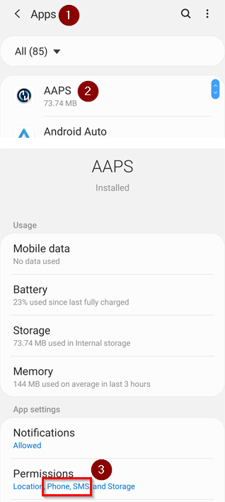
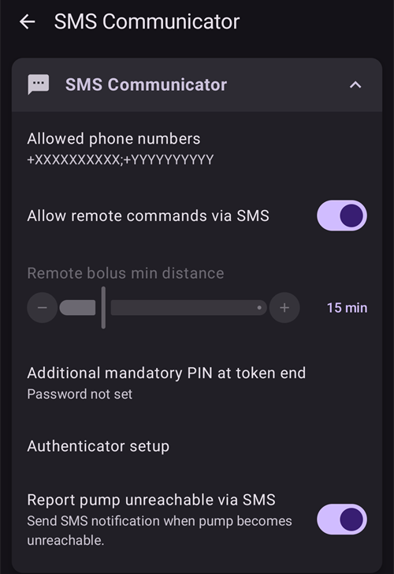

# SMS-kommandoer

```{contents} Table of contents
:depth: 2
```

De fleste fjernjusteringer (midlertidige mål, karbohydrater, profilbytter og, når klienten er sammenkoblet, boluser) kan gjøres med [**AAPSClient**-appen](../RemoteFeatures/RemoteMonitoring.md) på en Android-telefon med internettforbindelse, se [Hovedenhet ↔ klientstyring](#client-master-control) (en iPhone-versjon av **AAPSClient** er under utvikling, se [AAPSClient](AapsClient.md)). SMS-kommandoer er fortsatt et alternativ som fungerer uten internett, og det eneste fjernalternativet hvis du bruker en iPhone som følger og ikke har **AAPSClient** ennå.

**SMS-kommandoer er svært nyttige:**
1. Til daglig fjernstyring

2. Hvis du vil gi en fjernbolus med insulin uten en sammenkoblet **AAPSClient**

3. I et område med dårlig internettdekning, der tekstmeldinger kommer fram, men data-/internettdekningen på telefonen er begrenset. Dette er svært nyttig når du drar til avsidesliggende steder (for eksempel på camping eller skitur).

4. Hvis den andre fjernstyringsmetoden din (**AAPSClient**) midlertidig ikke fungerer

## Sikkerhet først

Hvis du aktiverer **SMS-kommunikasjon** i **AAPS**, må du tenke på at telefonen som er satt opp til å sende fjernkommandoer, kan bli stjålet og/eller brukt av noen andre. Lås alltid telefonen med minst en PIN-kode. Et sterkt passord og/eller biometrisk lås anbefales sterkt, og sørg for at dette er et annet passord enn hovedpassordet i AAPS (passordet som kreves for å eksportere **AAPS**-innstillinger).

I tillegg anbefales det å tillate [et telefonnummer til](#SMSCommands-authorized-phone-numbers) for SMS-kommandoer. På den måten kan du bruke det andre nummeret til å [deaktivere](#SMSCommands-other) SMS-kommunikasjon hvis den vanlige fjernstyringstelefonen din blir kompromittert.

Den minste ventetiden mellom boluskommandoer er som standard 15 minutter, regnet fra det øyeblikket pumpen godtar en bolus. Av sikkerhetsgrunner må du legge til minst to autoriserte telefonnumre for å kunne endre dette til en kortere ventetid. Hvis du prøver å gi en ny fjernbolus innen 15 minutter etter forrige bolus, får du svaret «Fjernbolus ikke tilgjengelig. Prøv igjen senere»

AAPS vil også fortelle deg med en tekstmelding om fjernkommandoene dine, for eksempel en bolus eller et profilbytte, er utført. Det er lurt å sette dette opp slik at bekreftelsesmeldinger sendes til minst to ulike telefonnumre, i tilfelle en av mottakertelefonene blir stjålet.

**Hvis du gir bolus via SMS-kommandoer, må du registrere karbohydratene separat (en SMS til, AAPSClient …)!** Hvis du ikke gjør det, blir IOB riktig, men COB for lav. Det kan føre til at en korreksjonsbolus ikke blir gitt, fordi **AAPS** antar at du har for mye aktivt insulin.

For de sensitive kommandoene må du bruke en autentiseringsapp med tidsbasert engangspassord, for å øke sikkerheten.

Hvis du vil fjerne muligheten for at en omsorgspersons telefon kan sende SMS-kommandoer, bruk nødknappen «[Tilbakestill autentiseringsfunksjoner](#sms-commands-authenticator-setup)» i **AAPS**, eller send SMS-kommandoen «[SMS stop](#SMSCommands-other)». Når du tilbakestiller autentiseringsfunksjonene, blir ALLE omsorgspersonenes telefoner ugyldige. Du må sette dem opp på nytt.

## Sette opp SMS-kommandoer

```{contents} The overall process is as follows
:depth: 1
:local: true
```

(sms-commands-authenticator-setup)=
### Oppsett av autentisering

Tofaktorautentisering brukes for å øke sikkerheten.

På omsorgspersonens telefon: last ned (fra App Store eller Google Play) og installer en autentiseringsapp. Populære gratisapper er:
  - [Authy](https://authy.com/download/)
  - Google Authenticator - [Android](https://play.google.com/store/apps/details?id=com.google.android.apps.authenticator2) / [iOS](https://apps.apple.com/de/app/google-authenticator/id388497605)
  - [LastPass Authenticator](https://lastpass.com/auth/)
  - [FreeOTP Authenticator](https://freeotp.github.io/)

Disse autentiseringsappene lager et tidsbegrenset 6-sifret engangspassord, på samme måte som i mobilbank eller netthandel. Du kan bruke en annen autentiseringsapp, så lenge den støtter RFC 6238 TOTP-tokener. Microsoft Authenticator fungerer ikke.

### Kontroller telefoninnstillingene

På telefonen går du til **Apper > AAPS > Tillatelser**. Pass på at **SMS** og **Telefon** er tillatt.



```{admonition} "App was denied access to SMS"
:class: tip
Android kan blokkere **SMS**-tillatelsen for apper som ikke er installert fra en appbutikk, slik som **AAPS**. Hvis du ser denne meldingen når du gir **SMS**-tillatelsen, åpner du telefonens **Innstillinger > Apper > AAPS**, trykker på **⋮**-menyen (øverst til høyre) og velger **Tillat begrensede innstillinger**. Gi deretter **SMS**-tillatelsen på nytt.
```


### Synkronisering av dato og klokkeslett

Klokken på begge telefonene må være synkronisert. Det beste er å la tiden settes automatisk fra nettverket. Tidsforskjeller kan føre til problemer med autentiseringen.

Kontroller at dato og klokkeslett er synkronisert på både **AAPS**-telefonen og omsorgspersonens telefon. Nøyaktig hvordan du gjør dette, avhenger av enheten din, og du må kanskje prøve ulike innstillinger.

Eksempel (for Samsung S23): **Innstillinger > Generell administrasjon > Dato og klokkeslett**: pass på at **Automatisk dato og klokkeslett** er slått på.

Noen valg kan være nedtonet, fordi de krever administratortilgang via en familiekonto hvis telefonen er satt opp med en barnekonto. På en iPhone som brukes av omsorgsperson/forelder heter denne innstillingen for dato og klokkeslett «Still inn automatisk». Hvis du ikke er sikker på om telefonene er synkronisert, trenger du ikke bekymre deg. Du kan sette opp SMS-kommandoene og feilsøke etterpå hvis det ser ut til å gi problemer (be om hjelp hvis du trenger det).

### AAPS-innstillinger

Nå som telefoninnstillingene er kontrollert, går du i selve **AAPS**-appen til [**Konfigurasjon** → **Kommunikasjon**](../SettingUpAaps/ConfigBuilder.md) og aktiverer pluginen **SMS-kommunikasjon**.

Åpne innstillingene for **SMS-kommunikasjon**.

Aktiver **Tillat fjernkommandoer via SMS**. Valgene **Ekstra obligatorisk PIN på slutten av token** og **Oppsett av autentisering** vises først når dette er aktivert:



(SMSCommands-authorized-phone-numbers)=
#### Tillatte telefonnumre

Skriv inn telefonnummeret (eller numrene) til omsorgspersonen(e). Ta med landskoden og utelat den første «0» i telefonnummeret, som i disse eksemplene:
* Britisk telefonnummer: +447976304596
* Amerikansk telefonnummer: +11234567890
* Fransk telefonnummer:  +33612344567
* _osv._

Merk at «+» foran nummeret kan være nødvendig eller ikke, avhengig av hvor du er. For å finne ut av dette kan du sende en test-SMS, så vises det mottatte formatet på skjermen til pluginen **SMS-kommunikasjon** (**Konfigurasjon** → **Kommunikasjon** → **SMS-kommunikasjon** → **Åpne plugin**).

Hvis du skal legge til mer enn ett telefonnummer, skiller du dem med semikolon, **UTEN mellomrom mellom numrene** (dette er viktig!). Velg **OK**:


#### Minimum avstand mellom fjernboluser

- Du kan angi minste ventetid (i minutter) mellom to boluser som gis via SMS.
- Av sikkerhetsgrunner må du legge til minst to autoriserte telefonnumre for å kunne endre denne verdien.

#### Ekstra obligatorisk PIN på slutten av token

Av sikkerhetsgrunner må svarkoden følges av en PIN-kode. Velg en PIN-kode som du (og eventuelle andre omsorgspersoner) skal bruke på slutten av autentiseringskoden når SMS-kommandoen sendes.

Kravene til PIN-koden er:

* minst 6 sifre
* bare sifre

For en sikrere PIN-kode bør du ikke bruke samme siffer mange ganger (_f.eks._ 111111) eller en tallrekke (_f.eks._ 123456).


#### Oppsett av autentisering

* Trykk på **Oppsett av autentisering** og følg instruksjonene steg for steg på skjermen.
* Åpne autentiseringsappen du har installert på _omsorgspersonens telefon_, sett opp en ny tilkobling og
* Bruk omsorgspersonens telefon til å skanne QR-koden som vises under **Skann koden for å sette opp AAPS OTP-koder**.


* Under **Test engangspassord** skriver du inn engangskoden fra autentiseringsappen på omsorgspersonens telefon, etterfulgt av PIN-koden din, i **Kode for å sjekke**:

Eksempel:
* Token fra autentiseringsappen er 457051
* Den obligatoriske PIN-koden din er 2401
* Kode for å sjekke: 4570512401

Hvis det du skrev inn er riktig, endres den røde teksten «FEIL PIN» automatisk til en grønn «OK». **Det er ingen knapp du skal trykke på!** Prosessen er nå fullført, det er ingen «OK»-knapp du må trykke på etter at du har skrevet inn koden:


Nå skal SMS-kommandoer være satt opp.

Bruk knappen **Tilbakestill autentiseringsfunksjoner** nederst på skjermen **Oppsett av autentisering** hvis du vil fjerne autentiseringsapper som er satt opp. (Når du tilbakestiller autentiseringen, gjør du ALLE autentiseringsapper som allerede er satt opp, ugyldige. Du må sette dem opp på nytt.)

## Bruk av SMS-kommandoer

### De første stegene med SMS-kommandoer

1)  For å kontrollere at alt er riktig satt opp, tester du forbindelsen ved å sende «bg» som SMS fra omsorgspersonens telefon til **AAPS**-telefonen. Du skal få et svar som ligner på dette:


Hvis du ikke får noe svar, se avsnittet [Feilsøking](#SMSCommands-troubleshooting) nedenfor.

2)  Prøv nå en SMS-kommando som krever autentisering, _f.eks._ «target hypo». Omsorgspersonens telefon får en melding tilbake som ber deg skrive inn det **sekssifrede autentiseringspassordet** fra autentiseringsappen, etterfulgt av den hemmelige ekstra **PIN-koden** som bare omsorgspersoner/følgere kjenner (til sammen tolv sifre, hvis PIN-koden din har 6 sifre).

Når du sender en SMS-kommando for første gang, bør du gjøre det i nærheten av **AAPS**-telefonen, så du ser hvordan det fungerer:


Omsorgspersonens telefon får en SMS som svar fra **AAPS**, som bekrefter om SMS-fjernkommandoen ble utført.

Hvis kommandoen lykkes, får du et svar som bekrefter dette. Hvis det oppstår et problem, får du en feilmelding. Se [Feilsøking](#SMSCommands-troubleshooting) nedenfor for vanlige feil.

**Tips**: Det kan være nyttig å ha ubegrenset SMS i mobilabonnementet (for hver telefon som brukes) hvis det skal sendes mange SMS-er.

### Gi måltidsboluser med SMS-kommandoer

Fjernbolus med insulin kan gjøres via **SMS-kommandoer** eller gjennom en sammenkoblet **AAPSClient** (se [Hovedenhet ↔ klientstyring](#client-master-control)); det kan ikke gjøres via Nightscout-nettsiden. Karbohydrater kan også registreres via SMS eller **AAPSClient**. Med SMS er det ikke mulig å sende både karbohydrat- og insulinkommandoer i én og samme SMS. Disse kommandoene må sendes hver for seg, slik:

1)  Å sende insulinbolusen (_f.eks._ «bolus 2» gir en bolus på 2 enheter) via SMS-kommandoer tilsvarer **Behandlinger** → **Insulin** i **AAPS**. 2)  Send karbohydratene (_f.eks._ «carbs 20» registrerer 20 g karbohydrater). Dette tilsvarer **Behandlinger** → **Karbo** i **AAPS**.

For å unngå føling er det lurt å begynne forsiktig, ved å gi **mindre insulin** enn IK-forholdet ditt tilsier, fordi du ikke tar hensyn til gjeldende glukosenivå eller glukosetrend.

**Rekkefølgen du sender disse kommandoene i, er viktig**. Hvis du registrerer en stor mengde karbohydrater på en hvilken som helst måte, og har SMB aktivert, kan **AAPS** straks svare med å gi en delvis bolus med insulin. Så hvis du da prøver å sende en insulinbolus _etter_ at du har registrert karbohydratene, kan du få en frustrerende forsinkelse og meldingen «bolus pågår», og du må så sjekke hva som er gitt som SMB. Eller, hvis du ikke oppdager at en SMB er i ferd med å bli gitt, og din egen bolus etterpå også lykkes, kan det bli gitt for mye insulin til måltidet totalt. Derfor: når du gir måltidsbolus eksternt, send alltid insulinbolusen _før_ du registrerer karbohydratene. Hvis du vil, kan du kombinere **AAPSClient** med SMS-kommandoer: karbohydrater som registreres på en sammenkoblet **AAPSClient**, trenger ingen autentiseringskode og er derfor raskere enn SMS-kommandoer. Karbohydrater eller andre behandlinger som registreres på Nightscout-nettsiden, blir **ikke** brukt mens klientstyring er på; **AAPS** er da i [herdet modus](#client-master-control-hardened-mode).

(SMSCommands-commands)=
## Kommandoer

```{contents} List of command groups
:depth: 1
:local: true
```

Kommandoene må sendes på engelsk. Svaret kommer på ditt eget språk hvis svarteksten allerede er [oversatt](#translations-translate-strings-for-AAPS-app). Kommandoene skiller ikke mellom store og små bokstaver, du kan bruke begge deler.


**Tabellene over SMS-kommandoer** nedenfor viser alle mulige SMS-kommandoer. _Eksempelverdier_ er tatt med for å gjøre det lettere å forstå. Kommandoene har det samme området av mulige verdier (mål, profilprosent osv.) som er tillatt i selve **AAPS**-appen.

(authentication-or-not)=
### Autentisering eller ikke?

Noen SMS-kommandoer gir svar med en gang, og noen SMS-kommandoer krever sterk **autentisering** gjennom autentiseringsappen. En enkel forespørsel som «**BG**» (som ber om en oppdatering av gjeldende glukose) er rask å skrive, trenger ingen autentisering og gir statusinformasjonen fra **AAPS** som vist nedenfor:


Kommandoer som trenger mer sikkerhet, krever at du skriver inn en kode, for eksempel:


Kolonnen *Aut.* i tabellene nedenfor viser om slik sterk autentisering kreves for hver kommando.

### CGM-data

| Kommando   | Aut. | Funksjon og *svar*                                                                                                                                                                                                               |
| ---------- | ---- | -------------------------------------------------------------------------------------------------------------------------------------------------------------------------------------------------------------------------------- |
| BG         | Nei  | Gir: siste BS, delta, IOB (bolus og basal), COB<br/>*Siste BS: 5,6 4min siden, Delta: -0,2 mmol, IOB: 0,20E (Bolus: 0,10E Basal: 0,10E)*                                                                                   |
| CAL 5.6/90 | Ja   | Kalibrerer CGM-en med verdien 5.6/90<br/>(bruk verdien som passer for glukoseenheten din)<br/>Fungerer bare hvis det er riktig satt opp i **AAPS**.<br/>*Kalibrering sendt. Mottak må være aktivert i xDrip+.* |

### Pumpe

| Kommando             | Aut. | Funksjon og *svar*                                                                                                  |
| -------------------- | ---- | ------------------------------------------------------------------------------------------------------------------- |
| PUMPE                | Nei  | Sist tilkoblet: 1 min siden<br/>Midl. basal: 0,00E/t @11:38 5/30min<br/>IOB: 0,5E Reserv: 34E Batt: 100 |
| PUMP DISCONNECT *30* | Ja   | Kobler fra pumpen i *30* minutter                                                                                   |
| PUMP CONNECT         | Ja   | Pumpen tilkoblet igjen                                                                                              |

### Basal

| Kommando          | Aut. | Funksjon og *svar*            |
| ----------------- | ---- | ----------------------------- |
| BASAL 0.3         | Ja   | Starter basal 0,3E/t i 30 min |
| BASAL 0.3 20      | Ja   | Starter basal 0,3E/t i 20 min |
| BASAL 30%         | Ja   | Starter basal 30 % i 30 min   |
| BASAL 30% 50      | Ja   | Starter basal 30 % i 50 min   |
| BASAL STOP/CANCEL | Ja   | Stopper midlertidig basal     |

Noen pumper tar midlertidig basal bare i prosent, andre bare i E/t. Hvis du bruker den andre formen, svarer **AAPS** *«Denne pumpen støtter midlertidig basaldose kun i prosent, ikke i E/t.»* (eller omvendt) og setter ingenting. Varigheten må være et multiplum av pumpens trinn for varighet av midlertidig basal.


### Loop

| Kommando          | Aut. | Funksjon og *svar*                                                                                                                                                                                                                                                                  |
| ----------------- | ---- | ----------------------------------------------------------------------------------------------------------------------------------------------------------------------------------------------------------------------------------------------------------------------------------- |
| LOOP STATUS       | Nei  | Svaret avhenger av gjeldende status:<br/> - *Loop er deaktivert* hvis loopen er deaktivert<br/> - *Loop er aktivert* hvis loopen er lukket, åpen eller i LGS<br/> - *Pumpe frakoblet* hvis pumpen er frakoblet<br/> - *Pauset (10 m)* hvis loopen er pauset |
| LOOP STOP/DISABLE | Ja   | Pumpen går tilbake til den forhåndsprogrammerte basaldosen.<br/>*Loop har blitt deaktivert*                                                                                                                                                                                   |
| LOOP SUSPEND 20   | Ja   | *Loop er pauset*                                                                                                                                                                                                                                                                    |
| LOOP RESUME       | Ja   | *Loop gjenopptatt*                                                                                                                                                                                                                                                                  |
| LOOP CLOSED       | Ja   | *Nåværende kjøremodus: Lukket Loop*                                                                                                                                                                                                                                                 |
| LOOP LGS          | Ja   | *Nåværende kjøremodus: Stopp ved lavt BS*                                                                                                                                                                                                                                           |

### Bolus

Fjernbolus er ikke tillatt innen 15 min (denne verdien kan bare endres hvis 2 telefonnumre er lagt til) etter forrige boluskommando eller fjernkommando! I så fall blir svaret *Fjernbolus ikke tilgjengelig. Prøv igjen senere.* Dette svaret sendes også når pumpen holder på å gi en bolus.

| Kommando             | Aut. | Funksjon og *svar*                                                                                                                                               |
| -------------------- | ---- | ---------------------------------------------------------------------------------------------------------------------------------------------------------------- |
| BOLUS 1.2            | Ja   |                                                                                                                                                                  |
| BOLUS 0.60 MEAL      | Ja   | Gir den angitte bolusen på 0,60E<br/>**og** setter det [midlertidige målet Spise snart](#TempTargets-eating-soon-temp-target)                              |
| CARBS 5              | Ja   | Registrerer 5 g, uten bolus                                                                                                                                      |
| CARBS 5 17:35/5:35PM | Ja   | Registrerer 5 g kl. 17:35.<br/>Hvilket tidsformat som godtas, avhenger<br/> av tidsinnstillingen (12t/24t) på telefonen.                             |
| EXTENDED 2 120       | Ja   | Starter forlenget bolus 2E i 120 min.<br/>Bare for [kompatible pumper](#Extended-Carbs-extended-bolus-and-switch-to-open-loop-dana-and-insight-pump-only). |
| EXTENDED STOP/CANCEL | Ja   | Stopper forlenget bolus                                                                                                                                          |

### Profil

| Kommando       | Aut. | Funksjon og *svar*                                                                                                                  |
| -------------- | ---- | ----------------------------------------------------------------------------------------------------------------------------------- |
| PROFILE STATUS | Nei  | Gjeldende profil og prosent                                                                                                         |
| PROFILE LIST   | Nei  | Den gjeldende listen over profiler i **AAPS**, f.eks.:<br/>1. Profil1<br/> 2. Profil2                                   |
| PROFILE 1      | Ja   | Bytter til profil 1 i listen.<br/>Bruk numrene slik **PROFILE LIST** gir dem,<br/>ikke profilnavnene slik du lagret dem |
| PROFILE 2 30   | Ja   | Bytter profil til Profil2 30 %                                                                                                      |

Prosenten må være mellom 30 og 250 %, som i appen. En verdi utenfor dette området avvises før du blir bedt om autentiseringskoden.

### Midlertidige mål

| Kommando                  | Aut. | Funksjon og *svar*                               |
| ------------------------- | ---- | ------------------------------------------------ |
| TARGET MEAL/ACTIVITY/HYPO | Ja   | Setter det midlertidige målet MEAL/ACTIVITY/HYPO |
| TARGET STOP/CANCEL        | Ja   | Avbryter midlertidig mål                         |


(SMSCommands-other)=
### Annet

| Kommando         | Aut. | Funksjon og *svar*                                                                                                                                                                                                                                        |
| ---------------- | ---- | --------------------------------------------------------------------------------------------------------------------------------------------------------------------------------------------------------------------------------------------------------- |
| RESTART          | Ja   | Starter AAPS på nytt. Nyttig hvis du har problemer som vanligvis løses med en omstart.                                                                                                                                                                    |
| SMS DISABLE/STOP | Ja   | Deaktiverer SMS-fjerntjenesten, svar med koden.<br/>Husk at du bare kan aktivere den på nytt direkte<br/>fra **AAPS**-hovedtelefonen.                                                                                                         |
| HELP             | Nei  | Gir alle funksjoner du kan spørre om:<br/>BG, LOOP, PUMP, BASAL, BOLUS, EXTENDED, CAL, PROFILE, TARGET, SMS, CARBS, HELP, RESTART<br/>Send en ny kommando ***HELP ***FUNKSJON****** for å se<br/>alle valgene som finnes i denne delen. |
| HELP BOLUS       |      | *BOLUS 1.2<br/>BOLUS 1.2 MEAL*                                                                                                                                                                                                                      |

(SMSCommands-troubleshooting)=
## Feilsøking og FAQ

```{contents} List of questions and issues
:depth: 1
:local: true
```

### Hva kan vi _ikke_ gjøre med SMS-kommandoer?

1)  **Du kan ikke sette et _midlertidig_ profilbytte** (for eksempel «profil trening» i 60 minutter), men du kan bytte permanent til «profil trening». Midlertidige profilbytter kan i stedet settes via **AAPSClient**.

2)  **Du kan ikke avbryte automasjoner** eller **sette egendefinerte mål**, men det finnes omtrentlige løsninger: Tenk deg for eksempel at det normale profilmålet er 5,5. Du har satt opp en automasjon i AAPS som alltid setter et høyt mål på 7,0 mellom kl. 14:30 og 15:30 på grunn av en gymtime på skolen, og en betingelse i automasjonen er at «det ikke finnes noe midlertidig mål». Denne uken har du fått beskjed på kort varsel om at gymtimen er avlyst og erstattet med pizzaspising, men barnet ditt er allerede på skolen med **AAPS**-telefonen. Hvis det høye midlertidige målet på 7,0 startes av automasjonen og du avbryter det (på **AAPS**-telefonen eller eksternt), er betingelsene for automasjonen fortsatt oppfylt, og **AAPS** setter rett og slett det høye målet igjen ett minutt senere.

**Hvis du hadde tilgang til AAPS-telefonen**, kunne du slå av/endre automasjonen, eller, hvis du ikke vil det, rett og slett sette et nytt midlertidig mål på 5,6 i 60 min ved å trykke på målet på hovedskjermen, eller via **Administrer** → **Midlertidig mål**. Dette ville hindre automasjonen i å sette det høye målet på 7,0.

**Hvis du ikke har tilgang til AAPS-telefonen**, kan SMS-kommandoer brukes som en omtrentlig løsning: for eksempel ved å bruke kommandoen «target meal» for å sette et mål på 5,0 i 45 min (andre standardmål er 8,0 for aktivitet eller føling, se tabellen). Men med SMS-kommandoer kan du ikke angi en _bestemt_ målverdi (på 5,6 i 60 minutter, for eksempel); da må du bruke **AAPSClient**.

### Hva skjer hvis jeg ombestemmer meg om en kommando jeg nettopp har sendt?

**AAPS** utfører bare den siste kommandoen. Så hvis du skriver «bolus 1.5» og deretter, uten å autentisere, sender en ny kommando «bolus 1», ignoreres den tidligere kommandoen på 1.5. **AAPS** sender alltid omsorgspersonens telefon et svar som bekrefter hva SMS-kommandoen er, før du blir bedt om å skrive inn autentiseringskoden, og også et svar etter at handlingen er utført.

### Hvorfor fikk jeg ikke svar på en SMS-kommando?

Det kan ha en av disse årsakene:

1)  Meldingen har ikke nådd fram til telefonen (nettverksproblemer). 2)  **AAPS** holder fortsatt på å behandle forespørselen (_f.eks._ en bolus, som kan ta litt tid å gi, avhengig av bolushastigheten din). 3)  **AAPS**-telefonen har ikke god Bluetooth-forbindelse til pumpen når kommandoen mottas, og kommandoen har mislyktes (dette gir vanligvis en alarm på **AAPS**-telefonen).

### Ingen svar i det hele tatt på SMS-kommandoer

På omsorgspersonens telefon og/eller **AAPS**-telefonen kan du prøve å slå av disse valgene:
* **Send som chatmelding** 
* Hvis du bruker Android Meldinger-appen eller Google Meldinger-appen, slå av RCS-meldinger:
  - åpne den aktuelle SMS-samtalen i Meldinger
  - Velg menyen med tre prikker øverst til høyre
  - velg «Detaljer»
  - Aktiver «Send bare SMS- og MMS-meldinger» 

### Feil ved utføring av kommandoer

Det er flere mulige grunner til at kommandoen ikke lykkes:

* Oppsettet av SMS-kommandoer er ikke fullført/riktig
* Du sendte en kommando med feil format (for eksempel «disconnect pump 45» i stedet for «pump disconnect 45»)
* Du brukte en feil eller utløpt autentiseringskode (det er ofte lurt å vente noen sekunder på en ny kode hvis den gjeldende er i ferd med å utløpe)
* Koden+PIN var riktig, men SMS-en ble forsinket på vei ut/inn, slik at **AAPS** regnet autentiseringskoden som utløpt
* **AAPS**-telefonen er utenfor rekkevidde / har ikke kontakt med pumpen
* Systemet er allerede opptatt med å gi en bolus

Vanlige feil vises i eksemplene nedenfor:


### Hvordan kan jeg stoppe en kommando når den er autentisert?

Det kan du ikke. Men du kan avbryte en bolus som er sendt via SMS på selve **AAPS**-telefonen, ved rett og slett å avbryte den i bolusvinduet, hvis du er rask. Mange SMS-kommandoer (bortsett fra bolus og registrering av karbohydrater) kan enkelt reverseres, eller du kan gjøre tiltak for å dempe utilsiktede virkninger hvis du gjør en feil.

Ved feil i bolus og registrering av karbohydrater kan du fortsatt gjøre noe. Hvis du for eksempel har registrert 20 g karbohydrater, men barnet ditt bare spiser 10 g, og du (eller en omsorgsperson som er til stede) ikke kan slette behandlingen direkte på **AAPS**-telefonen, kan du sette et høyt midlertidig mål eller en redusert profil, for å få **AAPS** til å være mindre aggressiv.

### Flere SMS-er

Hvis du får den samme meldingen igjen og igjen (_f.eks._ et profilbytte), kan du ved et uhell ha satt opp en uendelig sløyfe med andre apper. Det kan for eksempel være xDrip. I så fall må du sørge for at xDrip (eller en annen app) ikke laster opp behandlinger til Nightscout.

Hvis den andre appen er installert på flere telefoner, må du slå av opplasting på alle.

(sms-commands-too-many-messages)=
### Jeg får altfor mange tekstmeldinger fra SMS-kommandoer. Kan jeg redusere hyppigheten, eller få dem til å stoppe?

Bruk av SMS-kommandoer kan gi mange automatiske meldinger fra **AAPS**-telefonen til omsorgspersonens telefon. Du får også meldinger som for eksempel «basalprofil i pumpen oppdatert» hvis du har satt opp automasjoner i **AAPS**. Det kan være nyttig å ha ubegrenset SMS i mobilabonnementet til **AAPS**-telefonen (og for hver omsorgspersontelefon som brukes) hvis det skal sendes mange SMS-er, og å slå av SMS-varsler, -alarmer og -vibrasjon på alle telefonene. Det er ikke mulig å bruke SMS-kommandoer uten å få disse oppdateringene. Derfor kan det hende du vil ha en annen måte å kommunisere direkte med barnet ditt på (hvis det er gammelt nok), i stedet for SMS. Vanlige alternative kommunikasjonsapper som omsorgspersoner med **AAPS** bruker, er WhatsApp, LINE, Telegram og Facebook Messenger.

Det er mulig å slå av SMS-en «Basalprofil i pumpen er oppdatert» når profilbyttet kommer fra Nightscout. For å gjøre dette lager du en fil med **nøyaktig** navnet  `do_not_send_sms_on_profile_change` i mappen `extra` i AAPS-mappen din.
