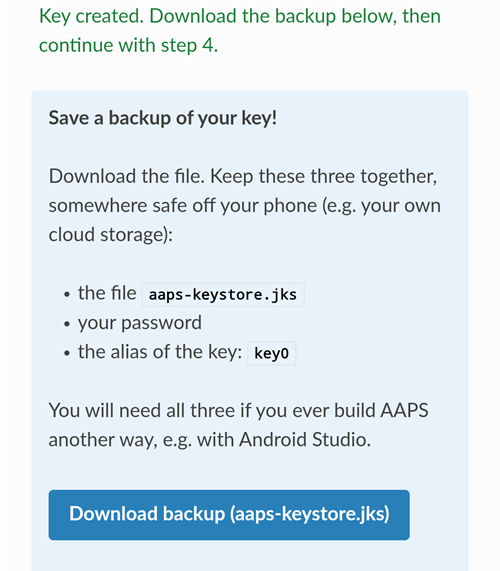
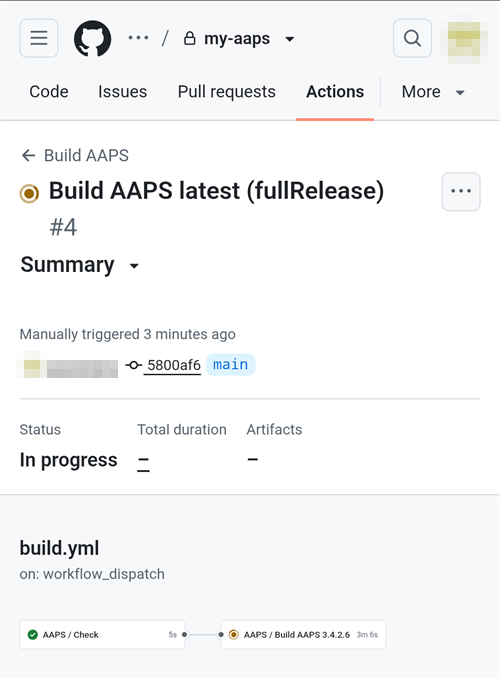

(aaps-builder)=

# Nettleserbygg med AAPS Builder

```{note}
Dette er den anbefalte måten å bygge AAPS på fra en **Android-telefon**. Det fungerer også fra en nettleser på en hvilken som helst datamaskin. De andre måtene å bygge på, fra en datamaskin eller en iPhone, finner du i oversikten [Nettleserbygg](BrowserBuild.md).
```

```{contents} In this page
:backlinks: entry
:depth: 2
```

**AAPS Builder** bygger AAPS-appen for deg i GitHub, det gratis nettstedet for lagring av kode. Du trenger ikke installere noe på telefonen, og det er ingen forberedelsesfil å åpne.

En oppsettside leder deg gjennom det. Det tar omtrent 10 minutter første gang:

1. Opprett din egen **private kopi** av AAPS Builder i GitHub-kontoen din: oppsettsiden åpner GitHub med alt fylt ut, du bare bekrefter. Byggearbeidsflyten, filen som forteller GitHub hvordan AAPS skal bygges, ligger allerede i den.
2. Opprett eller last opp **signeringsnøkkelen** din (keystore-filen).
3. Gi nøkkelen til repositoriet ditt som en GitHub-**hemmelighet** (secret).
4. **Bygg** appen. Ett bygg tar 15 til 30 minutter.
5. **Last ned og installer** appen på telefonen.

Du trenger **ikke** å forke AndroidAPS: AAPS-kildekoden lastes ned fra det offisielle AndroidAPS-repositoriet ved hvert bygg. Du trenger heller **ikke** Google Drive: du laster ned appen direkte fra GitHub.

```{admonition} Where the code comes from
:class: note

Byggearbeidsflyten vedlikeholdes av AAPS-utviklerne i repositoriet [nightscout/aaps-builder](https://github.com/nightscout/aaps-builder), og repositoriet ditt er en kopi av det. [Arbeidsflyten](https://github.com/nightscout/aaps-builder/blob/main/.github/workflows/build.yml) i kopien din er kort: den kjører [byggestegene](https://github.com/nightscout/aaps-builder/blob/main/.github/workflows/aaps-builder.yml) som ligger i det repositoriet, så forbedringer når deg uten noen endring i repositoriet ditt. Du kan lese begge filene. Når den bygger, laster arbeidsflyten bare ned den offisielle AAPS-kildekoden og GitHubs egne byggeverktøy. Keystore-filen din forlater aldri nettleseren din og det private repositoriet ditt.
```

(aaps-builder-before-you-start)=

## Før du starter

Du trenger:

- En **GitHub-konto** (gratis). Hvis du ikke har en, oppretter du den først på [github.com](https://github.com/signup).
- En **nettleser**: Chrome på telefonen, eller en hvilken som helst nettleser på en datamaskin. Logg inn på github.com i den nettleseren før du starter.
- **Har du GitHub-appen på telefonen?** Du kan beholde den. Noen av knappene på oppsettsiden åpner da appen i stedet for Chrome. Bygging fungerer i appen, men appen **kan ikke laste ned** den ferdige AAPS-appen: [steg 5](#aaps-builder-step5) viser hvordan du bytter til Chrome for nedlastingen.
- Din **eksisterende keystore-fil** (`.jks`-fil), passordet og aliaset til den, hvis du har bygget AAPS før og vil oppdatere uten å installere på nytt.

```{warning}
**Byggerepositoriet ditt må være privat.** Alt et bygg lager, er synlig for alle som kan se repositoriet. Oppsettsiden oppretter et privat repositorium for deg. Gjør det aldri offentlig, og ikke **fork** AAPS Builder i stedet: en fork er alltid offentlig.

Et privat repositorium får 2000 gratis GitHub Actions-minutter per måned, og det er nok til flere bygg.
```

```{warning}
**Ny nøkkel eller eksisterende nøkkel: dette avgjør om du kan oppdatere AAPS.**

- **Du har allerede AAPS på telefonen, bygget med en keystore-fil du fortsatt har**: velg **Jeg har allerede en keystore-fil** på oppsettsiden og last den opp. Neste bygg oppdaterer AAPS der den er. Har du bygget AAPS med det forrige nettleserbygget (din egen fork)? Keystore-filen din ligger i forken din: [hent en kopi av den først](#aaps-builder-from-fork).
- **Du bygger AAPS for første gang, eller du har mistet keystore-filen eller passordet til den**: velg **Opprett en ny nøkkel**. En app signert med en ny nøkkel **kan ikke oppdatere** en AAPS som er signert med en annen nøkkel. Du må eksportere innstillingene dine, kopiere filen bort fra telefonen, avinstallere den gamle AAPS-appen, installere den nye, og så importere innstillingene dine: se [Installere AAPS på nytt med en ny keystore-fil](#reinstall-aaps).

Bruk alltid den samme nøkkelen etterpå. Når du oppretter en ny nøkkel, laster du ned sikkerhetskopien som siden tilbyr, og lagrer den sammen med passordet og aliaset (`key0`) på et trygt sted, bort fra telefonen.
```

(aaps-builder-from-fork)=

## Kommer du fra det forrige nettleserbygget (fork)

Hopp over denne delen hvis du aldri har bygget AAPS med den forrige nettleserbygg-metoden (din egen kopi, eller fork, av AndroidAPS i GitHub, med forberedelsesfilen og Google Drive).

Keystore-filen din er lagret som hemmeligheter i forken din. GitHub viser aldri en hemmelighet igjen, så du kan ikke kopiere den til det nye repositoriet ditt. Hent først en kopi av keystore-filen din, og bruk den så i [steg 2](#aaps-builder-step2) med **Jeg har allerede en keystore-fil**.

```{warning}
Ikke velg **Opprett en ny nøkkel**. AAPS bygget med en ny nøkkel kan ikke oppdatere AAPS-appen på telefonen din.
```

Hvilket tilfelle gjelder for deg?

- **Du brukte alternativ 2** (du lastet opp din egen keystore-fil fra Android Studio), og du har fortsatt `.jks`-filen, passordene og aliaset: ingenting å gjøre her. Bruk den filen i steg 2.
- **Du brukte alternativ 1** (forberedelsesfilen opprettet nøkkelen din), eller du har ikke lenger keystore-filen: eksporter den fra forken din som beskrevet nedenfor.

Slik eksporterer du keystore-filen fra forken din:

1. I forken din åpner du **Settings** → **Secrets and variables** → **Actions** og legger til en hemmelighet med navnet `ZIP_PASSWORD`. Velg et passord med bare engelske bokstaver og tall. Det beskytter filen du er i ferd med å lage.
2. Åpne fanen **Actions** i forken din, trykk på **CI Keystore Export** og deretter på **Run workflow**. Flere detaljer: [Eksporter keystore-filen din](#ci-keystore-export).
3. Når kjøringen har fått grønn hake, åpner du Google Drive: filen `keystore.zip` ligger i mappen **AAPS** → **KeyStore**. Hvis kjøringen mislykkes i Google Drive-steget, har forken din mistet tilgangen til Google Drive: se [Google refresh token er utløpt](#aaps-ci-google-token-expired).
4. Last ned `keystore.zip` og åpne den med `ZIP_PASSWORD`: på en datamaskin, eller på telefonen med en filbehandler-app som kan åpne passordbeskyttede ZIP-filer. Den inneholder:
   - `keystore.jks`: keystore-filen din,
   - `keyStoreInfo.txt`: ditt `KEYSTORE_PASSWORD`, `KEY_PASSWORD` og `ALIAS` (vanligvis `key0`).
5. Kopier `keystore.jks` til telefonen (eller til Google Drive, så du kan velge den derfra).

I [steg 2](#aaps-builder-step2) på oppsettsiden:

1. Trykk på **Jeg har allerede en keystore-fil**.
2. I **Keystore-fil** velger du `keystore.jks`.
3. I **Keystore-passord** skriver du inn `KEYSTORE_PASSWORD` fra `keyStoreInfo.txt`.
4. I **Nøkkelalias** velger eller skriver du inn `ALIAS` fra `keyStoreInfo.txt`.
5. Hvis `KEY_PASSWORD` er forskjellig fra `KEYSTORE_PASSWORD`, fjerner du haken ved **Nøkkelpassordet er det samme som keystore-passordet** og skriver inn `KEY_PASSWORD`.

Oppbevar `keystore.zip` og `ZIP_PASSWORD` på et trygt sted, bort fra telefonen: det er sikkerhetskopien av nøkkelen din.

For også å lagre byggene fra AAPS Builder i Google Drive gjør du [steg 6](#aaps-builder-google-drive): oppsettsiden henter en ny `GDRIVE_OAUTH2` for deg. Du kan beholde forken din til AAPS bygget med AAPS Builder er installert på telefonen.

## Åpne oppsettsiden

**→ [Åpne oppsettsiden for AAPS Builder](#aaps-builder-setup)**

Oppsettsiden er en del av denne dokumentasjonen, på ditt språk. Hold også denne siden åpen i en annen fane: delene nedenfor forklarer hvert steg på oppsettsiden mer i detalj, med skjermbilder.

Oppsettsiden åpner hver GitHub-side i en ny Chrome-fane. For å komme tilbake til oppsettsiden trykker du på faneknappen ved siden av adressefeltet i Chrome (firkanten med et tall) og velger oppsettsiden for AAPS Builder.

Oppsettsiden kjører helt og holdent i nettleseren din: nøkkelen og passordene dine sendes aldri noe sted, bortsett fra inn i GitHub-hemmeligheten (secret) som du selv limer dem inn i. Bare GitHub-brukernavnet ditt sendes til GitHub, for å kontrollere at det finnes. Den husker GitHub-brukernavnet ditt og navnet på repositoriet, så du kan komme tilbake til den når som helst for å åpne siden for hemmeligheter eller byggene dine på nytt.


(aaps-builder-step1)=

## Steg 1 – Opprett ditt private byggerepositorium

Dette steget oppretter din egen private kopi av AAPS Builder i GitHub-kontoen din, med byggearbeidsflyten allerede på plass. Bare du kan se det og appene det bygger.

1. Pass på at du er logget inn på github.com i denne nettleseren.

2. I **Brukernavnet ditt på GitHub** skriver du inn GitHub-brukernavnet ditt, ikke e-postadressen din. Siden kontrollerer det mot GitHub: **✓ GitHub-bruker funnet** betyr at det er riktig.

3. I **Navnet på repositoriet ditt** beholder du forslaget `my-aaps`. Hvis du allerede har opprettet repositoriet ditt med et annet navn, skriver du inn akkurat det navnet.

   ```{note}
   **Har du allerede et AAPS Builder-repositorium** (laget med en tidligere versjon av oppsettsiden)? Ikke opprett et nytt: skriv inn det nøyaktige navnet, hopp over **Opprett mitt private repositorium**, og oppdater arbeidsflyten i det én gang, som forklart under [Oppdatere AAPS](#aaps-builder-updates). Hemmelighetene dine blir som de er. Hvis du likevel vil ha et nytt repositorium, velger du et navn du ikke har fra før, for eksempel `my-aaps-2`, og bruker den samme keystore-filen i steg 2.

   Ikke skriv inn navnet på forken din av AndroidAPS: en fork er offentlig, og den bygger allerede med sin egen **AAPS CI**-arbeidsflyt.
   ```

   

4. Kontroller linjen **Repositoriet ditt:** den viser `github.com/<brukernavnet ditt>/my-aaps`. Oppsettsiden husker navnet fra forrige besøk: kontroller det hver gang før du bruker knappene på den.

5. Trykk på **Opprett mitt private repositorium**.

   

6. GitHub åpner **Create a new repository** i en ny fane. Alt er allerede fylt ut: under **Start with a template** ligger malen `nightscout/aaps-builder` med **Include all branches** av, og under **General** står kontoen din som **Owner** og navnet du valgte.

   

   Ikke endre noe.

7. Bla nedover: under **Configuration** er **Choose visibility** allerede satt til **Private**. Trykk på den grønne knappen **Create repository**.

   

   GitHub viser det nye repositoriet ditt: det inneholder en mappe `.github` (med byggearbeidsflyten) og en fil `README.md`. **Gå tilbake til fanen med oppsettsiden** for steg 2: trykk på faneknappen ved siden av adressefeltet i Chrome og velg oppsettsiden.

```{warning}
**Er det nye repositoriet ditt tomt**, uten filer? Da ble det ikke opprettet fra malen, og det kan ikke bygge. Slett det (**Settings** → nederst på siden → **Delete this repository**), og trykk så på **Opprett mitt private repositorium** på oppsettsiden igjen.
```

(aaps-builder-step2)=

## Steg 2 – Signeringsnøkkelen din

Appen må signeres med din egen nøkkel. Velg én av de to fanene. Les [advarselen om ny nøkkel eller eksisterende nøkkel](#aaps-builder-before-you-start) først.


### Jeg har allerede en keystore-fil

1. Trykk på **Jeg har allerede en keystore-fil**.
2. I **Keystore-fil** velger du `.jks`-filen din (eller `.keystore`, `.p12`, `.pfx`). På en telefon må du først kopiere filen til telefonen eller til Google Drive.
3. I **Keystore-passord** skriver du inn passordet til keystore-filen.
4. I **Nøkkelalias** velger du aliaset ditt fra listen, eller skriver det inn hvis det ikke er noen liste. For keystore-filer laget med Android Studio er det vanligvis `key0`.
5. Hvis nøkkelpassordet ditt er forskjellig fra keystore-passordet, fjerner du haken ved **Nøkkelpassordet er det samme som keystore-passordet** og skriver inn nøkkelpassordet.
6. Trykk på **Kontroller og fortsett**.

Siden kontrollerer passordet og aliaset på enheten din. **Keystore OK! Fortsett med steg 3.** betyr at alt er riktig. Hvis den sier at passordet blir kontrollert når du bygger, fortsetter du likevel: bygget forteller deg om noe er galt.

### Opprett en ny nøkkel

1. Trykk på **Opprett en ny nøkkel**.

2. Velg et passord og skriv det inn to ganger. Regler: minst 8 tegn, bare bokstavene a–z og A–Z, sifrene 0–9 og symboler som `! ? #`. Ingen mellomrom, ingen bokstaver med aksent eller æ, ø, å, og ikke tegnet `|`.

3. Trykk på **Opprett nøkkel**. Det tar noen sekunder før **Nøkkel opprettet** vises.

   

4. Trykk på **Last ned sikkerhetskopi (aaps-keystore.jks)**. Hvis Chrome spør **Vil du laste ned filen på nytt?**, ligger det allerede en eldre sikkerhetskopi med samme navn på telefonen: trykk på **Last ned på nytt**. Chrome lagrer da den nye nøkkelen som `aaps-keystore (1).jks`: det er filen som hører til denne nøkkelen, så ta vare på den og ikke bland den sammen med den eldre.

   Oppbevar disse tre sammen, på et trygt sted bort fra telefonen (for eksempel din egen skylagring):

   - filen `aaps-keystore.jks`,
   - passordet ditt,
   - aliaset til nøkkelen: **`key0`**.

   Du trenger alle tre hvis du noen gang bygger AAPS på en annen måte, for eksempel med Android Studio. Nøkler laget med en tidligere versjon av oppsettsiden har aliaset `aaps`.

   

(aaps-builder-step3)=

## Steg 3 – Gi nøkkelen til repositoriet ditt

Steg 3 låses opp når steg 2 er ferdig. Nøkkelen din, passordene og aliaset pakkes sammen til én verdi, hemmeligheten `KEYSTORE_SET`.

1. Trykk på **Åpne siden for hemmeligheter**.


2. GitHub åpner siden **New secret** for repositoriet ditt. På en telefon ligger den under innstillingsmenyen: bla nedover.


3. Bytt til fanen med oppsettsiden og trykk på **Kopier navn**. Bytt tilbake til GitHub-fanen og lim det inn i det lille feltet **Name**. Navnet er `KEYSTORE_SET`.

4. Bytt til fanen med oppsettsiden og trykk på **Kopier hemmelighet**. Bytt tilbake til GitHub-fanen og lim den inn i den store boksen **Secret** (trykk og hold på en telefon). Hemmeligheten er en svært lang kode på tusenvis av tegn: oppsettsiden viser de første tegnene ved siden av knappen. Ikke lim inn ordet `KEYSTORE_SET` der.

5. Trykk på **Add secret**. `KEYSTORE_SET` vises nå under **Repository secrets**.


Du trenger bare å gjøre dette én gang.

```{tip}
Viser GitHub **Page not found** (404)? Kontroller først at du er logget inn på github.com i denne nettleseren: GitHub viser 404 for private repositorier når du ikke er logget inn. Ellers stemmer ikke brukernavnet eller navnet på repositoriet i steg 1 med repositoriet ditt. Kontroller navnet på github.com, rett det i steg 1, og trykk på knappen igjen.
```

(aaps-builder-step4)=

## Steg 4 – Bygg appen

1. På oppsettsiden trykker du på **Åpne byggesiden**. GitHub åpner siden **Build AAPS** for repositoriet ditt.

   

   Hvis **GitHub-appen** åpnes i stedet: trykk på **RUN WORKFLOW**, kontroller versjonen og varianten, og trykk på **RUN WORKFLOW** igjen. Appen kan fortsatt vise **Nothing to see here**: dra listen nedover for å oppdatere den og se bygget ditt. Fortsett deretter med steg 4 nedenfor.

2. Hvis GitHub spør, trykker du på den grønne knappen for å aktivere arbeidsflyter.

   Listen over arbeidsflyter viser to oppføringer: bruk **Build AAPS**. Ignorer **AAPS Builder**: den inneholder byggestegene og har ingen **Run workflow**-knapp.

3. Trykk på **Run workflow**. Et lite skjema åpnes:
   - **Version**: behold `latest` for å bygge den nyeste AAPS-versjonen, eller skriv inn et versjonsnummer, for eksempel `4.0.0`.
   - **Variant**: behold `fullRelease` for vanlig bruk med en pumpe. De andre variantene er forklart under [byggevarianter](#browserbuild-variant). `aapsclient3Release` bygger **AAPSClient3**, tilgjengelig fra **AAPS** versjon 4.0 (se [Om AAPSClient, AAPSClient2 og AAPSClient3](#remotecontrol-aapsclient-versions)).
   - Trykk på den grønne knappen **Run workflow**.

   

4. Bygget starter og viser **In progress**, med to deler: **AAPS / Check** og deretter **AAPS / Build AAPS**.

   

5. Vent 15 til 30 minutter. En grønn hake betyr at bygget er ferdig. Et rødt kryss betyr at det mislyktes: åpne bygget for å lese meldingen, og se deretter [feilsøking](#aaps-builder-troubleshooting).

   

   ```{tip}
   **E-post når et bygg er ferdig:** GitHub sender deg bare e-post når et bygg mislykkes. For også å få e-post når det lykkes: på github.com åpner du profilbildet ditt → **Settings** → **Notifications** → **System** → **Actions**, og fjerner haken ved **Only notify for failed workflows**.
   ```

Hvis det ikke finnes noen **Build AAPS**- eller **Run workflow**-knapp:

- Åpne repositoriet ditt og kontroller at det har en mappe `.github` med filen `workflows/build.yml`. Hvis repositoriet er tomt, ble det ikke opprettet fra malen: slett det (**Settings** → nederst på siden → **Delete this repository**) og gjør [steg 1](#aaps-builder-step1) på nytt med knappen.
- Åpne fanen **Actions**. Hvis det står at arbeidsflyter er deaktivert, trykker du på den grønne knappen for å aktivere dem, og deretter på **Build AAPS** i listen.

(aaps-builder-step5)=

## Steg 5 – Installer appen på telefonen

```{warning}
**Før hver oppdatering**: [eksporter innstillingene dine](#ExportImportSettings-Automating-Settings-Export) i AAPS og kopier filen **bort fra telefonen** (Google Drive, Dropbox …). Oppbevar flere eldre eksporter og APK-filene der også, slik at du alltid kan gå tilbake.
```

1. På telefonen åpner du oppsettsiden i **Chrome**. Logg inn på github.com hvis du blir bedt om det.
2. Trykk på **Åpne byggene mine**, og deretter på det nyeste bygget med grønn hake.

   ```{admonition} The GitHub app opened instead of Chrome?
   :class: note

   GitHub-appen kan ikke laste ned bygg. I appen åpner du det nyeste bygget og trykker på **Artifacts ↗**, eller trykker på delingsikonet øverst og velger **Chrome** (eller **Kopier link**, og limer så lenken inn i adressefeltet i Chrome). Bygget åpnes i Chrome: fortsett med neste steg der.

   For å hindre at GitHub-lenker åpnes i appen: Android-**Innstillinger** → **Apper** → **GitHub** → **Åpne som standard** → slå av **Åpne støttede linker**.
   ```

   

3. Bla ned til byggesammendraget og trykk på lenken **Download AAPS**.

   

   ```{tip}
   Bla med fingeren på teksten, ikke på diagrammet over byggestegene: da flytter diagrammet seg i stedet for siden.
   ```

   Du kan også bla lenger ned til **Artifacts** og trykke på nedlastingsikonet ved siden av `aaps-….apk`.

   

4. Når nedlastingen er ferdig, åpner du Chrome-menyen **⋮** → **Nedlastinger**, trykker på `aaps-….apk` og velger **Installer**. Hvis du blir spurt, tillat installering av apper fra denne kilden.

   

`aaps-wear-….apk` er smartklokkeappen. Hopp over den hvis du ikke bruker en smartklokke.

Appen ligger på byggesiden i **14 dager**. Den vises ikke under **Code** i repositoriet ditt. Kopier den til et trygt sted, bort fra telefonen, sammen med eksportene av innstillingene dine.

Flere måter å installere appen på finner du i [Overføre og installere AAPS](TransferringAndInstallingAaps.md).

```{note}
Fra september 2026 kan Googles [Android-utviklerverifisering](#android-developer-verification) blokkere installering av APK-filen ved å trykke på filen, avhengig av hvilket land du er i. Gratis løsninger er forklart på den siden.
```

(aaps-builder-google-drive)=

## Steg 6 (valgfritt) – Lagre appen i Google Drive også

Du kan også få hvert bygg lagret i Google Drive, i mappen `AAPS/<versjon>`. Dette er valgfritt: appen er alltid tilgjengelig på byggesiden.

Det krever én hemmelighet til, `GDRIVE_OAUTH2`. Steg 6 på oppsettsiden henter den fra Google for deg, på en telefon eller en datamaskin. **AAPS** kan da bare se og endre filene den selv lager i Google Drive, ingenting annet.

1. På oppsettsiden trykker du på **Koble til Google Drive**. Google åpnes i en ny fane.
2. Velg Google-kontoen din og gi tilgang. Hvis Google sier at appen ikke er verifisert, trykker du på **Avansert** og deretter på **Gå til …**.
3. Den nye fanen viser så en feil som **Får ikke tilgang til dette nettstedet** eller **127.0.0.1 avviste tilkoblingen**. **Dette er som forventet:** svaret fra Google ligger i adressen til den fanen. Trykk på adressefeltet, merk hele adressen (den begynner med `http://127.0.0.1:47913/`) og kopier den.
4. Gå tilbake til fanen med oppsettsiden innen noen få minutter: svaret fra Google er bare gyldig en kort stund, og bare én gang. Lim adressen inn i **Lim inn den kopierte adressen her** og trykk på **Hent GDRIVE_OAUTH2**. Siden viser **GDRIVE_OAUTH2 er klar**.
5. Trykk på **Åpne siden for hemmeligheter**. Trykk på **Kopier navn**, og lim det inn i det lille feltet **Name** (navnet er `GDRIVE_OAUTH2`). Trykk på **Kopier hemmelighet**, lim den inn i den store boksen **Secret** og trykk på **Add secret**.

Fra neste bygg lagres APK-filene også i Google Drive.

Har du allerede en `GDRIVE_OAUTH2`-verdi fra forberedelsesfilen til de andre nettleserbygg-metodene? Den fungerer også: legg den til som hemmeligheten `GDRIVE_OAUTH2`.

Google stopper tilgangen hvis du ikke bygger på 6 måneder, eller hvis du endrer Google-passordet ditt. Bygget sier da fra om det: gjør disse stegene på nytt. Se [Google refresh token er utløpt](#aaps-ci-google-token-expired).

(aaps-builder-updates)=

## Oppdatere AAPS

Repositoriet ditt bygger aldri noe av seg selv: du bestemmer når det skal bygges, hvilken versjon og hvilken variant. Når en ny AAPS-versjon er gitt ut:

1. [Sikkerhetskopier innstillingene dine](#aaps-builder-step5) som forklart i steg 5.
2. Bygg den nye versjonen som i [steg 4](#aaps-builder-step4). Behold `latest`, eller skriv inn versjonsnummeret.
3. Last ned og installer den som i [steg 5](#aaps-builder-step5).

**Oppdateringer av byggestegene** når deg av seg selv: ved hvert bygg kjører repositoriet ditt byggestegene som AAPS-utviklerne har gitt ut i nightscout/aaps-builder. Ingenting endres i repositoriet ditt, og det er ingen automatisk bygging.

**Oppdateringer av arbeidsflytfilen din** er sjeldne: bare når skjemaet **Run workflow** endres, for eksempel for en ny byggevariant, eller én gang hvis repositoriet ditt ble laget med en tidligere versjon av oppsettsiden (et tomt repositorium med en kort arbeidsflytfil) eller fra den gamle malen. Siden [Oppdateringer og endringer i dokumentasjonen](../Maintenance/DocumentationUpdate.md) sier fra om det. Your `KEYSTORE_SET` secret stays as it is. På oppsettsiden åpner du **Oppdatere kopien din** på slutten av steg 1:

1. Trykk på **Åpne den nyeste arbeidsflyten**. På en datamaskin klikker du på **kopieringsikonet** («Copy raw file») øverst til høyre i filen. På en telefon åpner du i stedet **ren tekst-versjonen**, trykker og holder på teksten, og velger så **Merk alt** og **Kopier**.
2. Trykk på **Åpne arbeidsflytfilen min**.
3. Erstatt hele teksten med den kopierte arbeidsflyten (trykk og hold på en telefon: **Merk alt**, deretter **Lim inn**).
4. Trykk på **Commit changes…**, og deretter på **Commit changes**.

Den første linjen i filen viser versjonen av den.

(aaps-builder-troubleshooting)=

## Feilsøking

For å se hvorfor et bygg mislyktes, [les byggeloggen](#aaps-ci-read-the-logs): stegnavnene er annerledes, men du finner feilen på samme måte. Du kan også [oppdatere en hemmelighet](#aaps-ci-update-secret) og [kjøre bygget på nytt](#aaps-ci-rerun) på samme måte.

- **Ingen «Build AAPS»- eller «Run workflow»-knapp, eller repositoriet er tomt**: repositoriet ble ikke opprettet fra malen. Slett det (**Settings** → nederst på siden → **Delete this repository**) og gjør [steg 1](#aaps-builder-step1) på nytt med knappen **Opprett mitt private repositorium**.
- **Bygget stopper med «This repository is PUBLIC»** (repositoriet er offentlig): i repositoriet ditt åpner du **Settings** → **General** → **Danger Zone** → **Change visibility** → **Private**, og bygger så på nytt.
- **«Secret KEYSTORE_SET is missing»** (hemmeligheten KEYSTORE_SET mangler): gjør steg 3 på oppsettsiden.
- **«The secret is too short»**, **«The secret is not a valid code»** eller **«The secret does not contain a keystore»** (hemmeligheten er for kort, er ikke en gyldig kode eller inneholder ingen keystore-fil): feil tekst ble limt inn i hemmeligheten, ofte selve ordet `KEYSTORE_SET`, eller bare en del av koden. I repositoriet ditt åpner du **Settings** → **Secrets and variables** → **Actions**, redigerer `KEYSTORE_SET` og limer inn den lange koden fra **Kopier hemmelighet** på nytt (gjør steg 2 på oppsettsiden på nytt først hvis du har lukket den).
- **«Keystore, password or alias is wrong»** (keystore-fil, passord eller alias er feil): kontroller passordet og aliaset til keystore-filen din, og gjør så steg 2 og 3 på oppsettsiden på nytt.
- **«Version … does not exist»** (versjonen finnes ikke): versjonen du skrev inn, er ikke en utgitt AAPS-versjon. Bruk `latest`, eller kontroller versjonsnummeret.
- **«Variant … is not supported»** (varianten støttes ikke): arbeidsflytfilen din er en eldre versjon. Erstatt den som forklart under [Oppdatere AAPS](#aaps-builder-updates).
- **«Page not found» (404) når oppsettsiden åpner GitHub**: logg inn på github.com i den samme nettleseren (GitHub viser 404 for private repositorier når du ikke er logget inn). Hvis du er logget inn, stemmer ikke brukernavnet eller navnet på repositoriet i steg 1 på oppsettsiden med repositoriet ditt. Skriv inn de nøyaktige navnene.
- **«Ingen GitHub-bruker med dette navnet»** i steg 1: skriv inn GitHub-brukernavnet ditt, slik det vises i GitHub-profilen din, ikke e-postadressen din.
- **Ingen Download-lenke, eller GitHub-appen åpnet seg**: GitHub-appen kan ikke laste ned bygg. Åpne bygget i Chrome som forklart i [steg 5](#aaps-builder-step5). For å hindre at GitHub-lenker åpnes i appen: Android-**Innstillinger** → **Apper** → **GitHub** → **Åpne som standard** → slå av **Åpne støttede linker**.
- **«Google Drive access has expired or was revoked»** (Google Drive-tilgangen er utløpt eller trukket tilbake): gjør [steg 6](#aaps-builder-google-drive) på nytt og oppdater hemmeligheten `GDRIVE_OAUTH2`.

For andre problemer med GitHub og Google Drive, se [Nettleserbygg: feilsøking](../GettingHelp/BrowserBuildTroubleshooting.md).

```{toctree}
:hidden:

Oppsettsiden for AAPS Builder <BrowserBuildAapsBuilderSetup.md>
```
