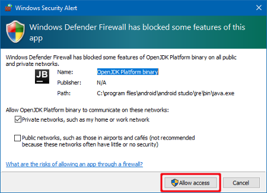

<!-- Android Studio Build, FKA Computer Build. Preserve filenames to avoid breaking URLs. -->

# Android Studio-bygg

Dette er den tradisjonelle måten å bygge AAPS-appen din på.

Du kan bygge appen uten datamaskin med metoden [Nettleserbygg](./BrowserBuild.md).

## Bygg selv i stedet for å laste ned

**AAPS-appen (en apk-fil) er ikke tilgjengelig for nedlasting, på grunn av regelverket for medisinsk utstyr. Det er lovlig å bygge appen til eget bruk, men du må ikke gi en kopi til andre!**

Se [FAQ-siden](../UsefulLinks/FAQ.md) for detaljer.

---

(Building-APK-recommended-specification-of-computer-for-building-apk-file)=
## Krav til datamaskin og programvare for å bygge AAPS

* En bestemt versjon av **[Android Studio](https://developer.android.com/studio/)** kan være nødvendig for å bygge APK-filen. Se tabellen nedenfor:

| AAPS-versjon            | Foretrukket<br/>Android Studio-<br/>versjon | Alternativ<br/>Android Studio-<br/>versjon | Gradle | JVM |
| ----------------------- | ------------------------------------------------------- | ------------------------------------------------------ | ------ |:--- |
| 2.6.2                   | 3.6.1                                                   |                                                        | 5.6.4  | 11  |
| 2.8.2.1                 | 4.1.1                                                   |                                                        | 6.1.1  | 13  |
| [3.1.0.3](#version3100) | 2020.3.1                                                | testet opptil Quail 4                                  | 7.3.3  | 17  |
| [3.2.0.4](#version3204) | Hedgehog (2023.1.1)                                     | testet opptil Quail 4                                  | 8.2    | 17  |
| [3.3.1.3](#version3300) | Ladybug Feature Drop (2024.2.2)                         | testet opptil Quail 4                                  | 8.10   | 21  |
| [3.3.2](#version3300)   | Meerkat (2024.3.1)                                      | testet opptil Quail 4                                  | 8.11.1 | 21  |
| [3.3.2.1](#version3321) | Narwhal (2025.1.2)                                      | testet opptil Quail 4                                  | 8.13   | 21  |
| [3.4.2.6](#version3426) | Panda 2 (2025.3.2)                                      | testet opptil Quail 4                                  | 9      | 21  |
| [4.0.0](#version400)    | Rabbit 2 (2026.2.2)                                     | Nyeste                                                 | 9.8    | 21  |

Den «foretrukne versjonen» leveres med den riktige JVM-versjonen. Den foretrukne versjonen er også den eldste versjonen du kan bruke for å bygge **AAPS**. Du kan **IKKE** bygge med en versjon som er eldre enn den «foretrukne». Hvis du bruker en annen versjon, kan du få problemer knyttet til JVM-versjonen. Se siden [Feilsøking av Android Studio](#troubleshooting_androidstudio-uncommitted-changes) for hjelp til å løse disse problemene. Hvis din nåværende Android Studio-versjon ikke står i tabellen, må du oppdatere den først.

Gradle-versjonen er knyttet til kildekoden, så du får alltid riktig Gradle-versjon når du laster ned / oppdaterer kildekoden. Den er bare nevnt her til informasjon, du trenger ikke gjøre noe med den.

* [32-biters Windows-systemer](#troubleshooting_androidstudio-unable-to-start-daemon-process) støttes ikke av Android Studio. Husk at både **64-biters CPU og 64-biters operativsystem er et absolutt krav.** Hvis systemet ditt IKKE oppfyller dette kravet, må du bytte den aktuelle maskinvaren eller programvaren, eller hele systemet.

<table class="tg">
<tbody>
  <tr>
    <th class="tg-baqh">Operativsystem (bare 64-biters)</th>
    <td class="tg-baqh">Windows 10 eller nyere</td>
    <td class="tg-baqh">macOS 12 eller nyere</td>
    <td class="tg-baqh">Enhver Linux-distribusjon som støtter Gnome, KDE eller Unity DE;&nbsp;&nbsp;GNU C Library (glibc) 2.31 eller nyere</td>
  </tr>
  <tr>
    <th class="tg-baqh"><p align="center">CPU (bare 64-biters)</th>
    <td class="tg-baqh">x86_64-prosessor fra 2017 eller nyere (Intel 8. generasjon Core i5, AMD Ryzen eller nyere) med <a href="https://developer.android.com/studio/install" target="_blank" rel="noopener noreferrer">støtte for virtualisering</a> (Intel VT-x eller AMD-V) aktivert i BIOS</td>
    <td class="tg-baqh">Apple Silicon (M1 eller nyere), eller 6. generasjon Intel Core eller nyere (støtten for Intel-Macer fases ut)</td>
    <td class="tg-baqh">x86_64-prosessor fra 2017 eller nyere (Intel 8. generasjon Core i5, AMD Ryzen eller nyere) med støtte for virtualisering (Intel VT-x eller AMD-V) aktivert i BIOS</td>
  </tr>
  <tr>
    <th class="tg-baqh"><p align="center">RAM</th>
    <td class="tg-baqh" colspan="3"><p align="center">16 GB eller mer (8 GB er det absolutte minimum for Android Studio alene, 32 GB anbefales)</td>
  </tr>
  <tr>
    <th class="tg-baqh"><p align="center">Disk</th>
    <td class="tg-baqh" colspan="3"><p align="center">Minst 32 GB ledig plass. SSD anbefales.</td>
  </tr>
  <tr>
    <th class="tg-baqh"><p align="center">Oppløsning</th>
    <td class="tg-baqh" colspan="3"><p align="center">1280 x 800 minimum (1920 x 1080 anbefales)<br></td>
  </tr>
  <tr>
    <th class="tg-baqh"><p align="center">Internett</th>
    <td class="tg-baqh" colspan="3"><p align="center">Bredbånd</td>
  </tr>
</tbody>
</table>

**Det anbefales sterkt (men er ikke et krav) å bruke SSD (Solid State Disk) i stedet for HDD (harddisk), fordi det tar kortere tid å bygge AAPS APK-filen.**  Du kan likevel bruke en HDD når du bygger **AAPS** APK-filen. Hvis du gjør det, kan byggeprosessen ta lang tid, men når den først har startet, kan du la den kjøre uten tilsyn.

## Hjelp og støtte under byggeprosessen

Hvis du får problemer underveis i byggingen av **AAPS**-appen, finnes det en egen del om [**feilsøking av Android Studio**](../GettingHelp/TroubleshootingAndroidStudio.md); se der først.

Hvis du mener at noe i byggeinstruksjonene er feil, mangler eller er forvirrende, eller du fortsatt sliter, ta kontakt med andre **AAPS**-brukere i gruppen på [Facebook](https://www.facebook.com/groups/AndroidAPSUsers) eller på [Discord](https://discord.gg/4fQUWHZ4Mw). Hvis du vil endre noe selv (oppdatere skjermbilder _osv._), send inn en [pull request (PR)](../SupportingAaps/HowToEditTheDocs.md).

## Steg-for-steg-veiledning for å bygge AAPS-appen

```{admonition} WARNING
:class: warning
Hvis du har bygd AAPS før, trenger du ikke gjøre alle de følgende stegene på nytt.
Gå rett til [oppdateringsveiledningen](../Maintenance/UpdateToNewVersion.md)!
```

```{contents} The overall steps for building the **AAPS** apk file
:depth: 1
:local: true
```

I denne veiledningen finner du skjermbilder som viser _eksempler_ på bygging av apk-filen til **AAPS**. Fordi **Android Studio** – programmet vi bruker til å bygge apk-filen til **AAPS** – oppdateres jevnlig, er disse skjermbildene kanskje ikke helt like din installasjon, men det skal fortsatt være mulig å følge dem.

Siden **Android Studio** kjører på Windows, Mac OS X og Linux, kan det også være små forskjeller i stegene på de ulike plattformene.

(install-git-if-you-dont-have-it)=
### Installer Git

```{admonition} Why Git? 
:class: dropdown

Git er kjent som et «_versjonskontrollsystem_» (VCS).\
Git er et program som lar deg følge med på endringer i kode og samarbeide med andre. Du bruker Git til å lage en kopi av kildekoden til **AAPS** fra nettstedet GitHub til din egen datamaskin. Deretter bruker du Android Studio på datamaskinen din til å bygge **AAPS**-appen (apk). 
```

(BuildingAaps-steps-for-installing-git)=
#### Steg for å installere Git

1.  Sjekk at du ikke allerede har **Git** installert. Det gjør du ved å skrive «git» i søkefeltet i Windows – hvis du ser **«Git bash»** eller en annen form for Git, er det allerede installert, og du kan gå rett til [installere Android Studio](#install-android-studio):


2. Hvis du ikke har Git installert, laster du ned og installerer den nyeste versjonen for systemet ditt fra delen «Download» [**her**](https://git-scm.com/downloads). Alle nyere Git-versjoner bør fungere. Velg riktig versjon for systemet ditt, enten Mac, Windows eller Linux.

**Merknad for Mac-brukere:** nettsiden til Git vil også veilede deg til å installere et ekstra program kalt «homebrew» som hjelper til med installasjonen. Hvis du installerer Git via Homebrew, trenger du ikke å endre noen innstillinger.

(Make_a_note_of_Git_path)=

* Under installasjonen, når du blir bedt om å «select destination location» (velge målplassering), noterer du deg _hvor_ Git blir installert («**installasjonsstien**») – du må sjekke den i neste steg. Den vil ligne på «C:\Program Files\Git\cmd\git.exe»

*  Når du går gjennom de ulike stegene i Git-installasjonen, godtar du bare alle standardvalgene.

*  Hvis du glemte å notere hvor Git ble installert, kan du finne det slik etter installasjonen: skriv «git» i søkefeltet på PC-en, høyreklikk på «Git bash», velg «open file location» (åpne filplassering), og hold musepekeren over «Git bash»-ikonet. Da ser du hvor det er installert.

* Start datamaskinen på nytt før neste steg.

(Building-APK-install-android-studio)=
### Installer Android Studio

- **Du må være på nett hele tiden under de følgende stegene, siden Android Studio laster ned flere oppdateringer**

```{admonition} What is Android Studio?
:class: dropdown
Android Studio er et program som kjører på datamaskinen din. Det lar deg laste ned kildekode fra internett (med Git) og bygge apper for smarttelefon (og smartklokke). Du kan ikke «ødelegge» en versjon av **AAPS** som allerede looper på en smarttelefon ved å bygge en ny eller oppdatert app på PC-en med Android Studio – dette er helt adskilte prosesser. 
```

Noe av det viktigste når du installerer Android Studio er å **være tålmodig!** Under installasjon og oppsett laster Android Studio ned mye, og det tar tid.

```{admonition} Different UI
:class: warning
Viktig merknad: Android Studio har endret brukergrensesnittet sitt i de siste versjonene. Denne veiledningen viser stegene med det *nye brukergrensesnittet*. Skjermbildene ble tatt med «Ladybug», så nyere versjoner kan se litt annerledes ut. Hvis du fortsatt bruker det gamle brukergrensesnittet, kan det være lurt å bytte Android Studio til det nye brukergrensesnittet først, ved å følge [disse instruksjonene](#computerbuild-NewUI).
```

Versjonen av Android Studio er svært viktig. Se [instruksjonene ovenfor](#Building-APK-recommended-specification-of-computer-for-building-apk-file) for å velge riktig versjon av Android Studio.

Last ned [den gjeldende versjonen av Android Studio](https://developer.android.com/studio) eller en eldre versjon fra [**Archives**](https://developer.android.com/studio/archive) (arkivet), og godta nedlastingsvilkårene.


Når nedlastingen er ferdig, starter du det nedlastede programmet for å installere det på datamaskinen din. Du må kanskje godta/bekrefte noen advarsler fra Windows om nedlastede apper!

Installer Android Studio ved å klikke på «Next», som vist på skjermbildene nedenfor. Du trenger **ikke** endre noen innstillinger!


Hvis du vil spare plass på harddisken, kan du fjerne avkrysningen for Android Virtual Device: den brukes ikke til å bygge **AAPS**.


Klikk nå på «Install»:


Når det er ferdig, trykker du på «Next»


I det siste steget klikker du på «Finished» for å starte Android Studio for første gang.


Du blir spurt om du vil hjelpe til med å forbedre Android Studio. Velg det alternativet du ønsker. Det har ingen betydning for de neste stegene.


Velkomstskjermen ønsker deg velkommen til installasjonen av Android Studio. Trykk på «Next».


Velg «Standard» som installasjonstype.


Bekreft innstillingene ved å klikke på «Next» igjen.


Nå må du godta lisensavtalene. Du har to seksjoner (1 + 3) på venstre side som du må velge etter tur, og for hver av dem velger du «Accept» (2 + 4) på høyre side.

Deretter kan du klikke på knappen «Finish» (5).


Noen Android-pakker blir nå lastet ned og installert. Vær tålmodig og vent.

Når det er ferdig, ser du følgende skjermbilde, der du kan velge «Finish» igjen.


Du ser nå velkomstskjermen i Android Studio.


(Building-APK-download-AAPS-code)=
### Last ned AAPS-koden

```{admonition} Why can it take a long time to download the AAPS code?
:class: dropdown

Første gang **AAPS** lastes ned, kobler Android Studio seg til nettstedet GitHub over internett for å laste ned kildekoden til **AAPS**. Dette bør ta omtrent 1 minutt. 

Android Studio bruker deretter **Gradle** (et utviklingsverktøy for Android-apper) til å finne ut hvilke andre komponenter som trengs for å bygge dette på datamaskinen din. 
```

På velkomstskjermen i Android Studio sjekker du at «**Projects**» (1) er uthevet til venstre.

Klikk så på «**Clone Repository**» (2) til høyre:


Nå skal vi fortelle Android Studio hvor koden skal hentes fra:


* «Repository URL» skal være valgt (som standard) til venstre (1).
* «Git» skal være valgt (som standard) som versjonskontroll (2).
* Kopier nå denne URL-en:
    ```
    https://github.com/nightscout/AndroidAPS.git
    ```
    og lim den inn i URL-feltet (3).

* Sjekk at (standard)mappen for lagring av den klonede koden ikke allerede finnes på datamaskinen din (4). Du kan endre den til en annen mappe, men husk hvor du lagret den!
* Klikk nå på knappen «Clone» (5).

```{admonition} INFORMATION
:class: note
Noter deg mappen. Det er der kildekoden din lagres!
```

Du ser nå et skjermbilde som forteller at repositoryet blir klonet:


På et tidspunkt lukkes Android Studio og starter på nytt. Du kan bli spurt om du stoler på prosjektet. Klikk på «Trust project»:

  


Bare for Windows-brukere: Hvis brannmuren din ber om tillatelse, gi tilgang:

 

Når repositoryet er klonet, åpner Android Studio det klonede prosjektet.

(computerbuild-NewUI)=
```{admonition} New UI
:class: note
Android Studio endret brukergrensesnittet sitt nylig. Nye installasjoner av Android Studio bruker det nye brukergrensesnittet (New UI) som standard!

Bare hvis din Android Studio ser annerledes ut, kan det hende du må bytte til det nye brukergrensesnittet:
Klikk på hamburgermenyen øverst til venstre, og velg så **Settings** (eller **Preferences** på Apple-maskiner).
Under **Appearance & Behavior** går du til **New UI** og krysser av for **Enable new UI**. Start så Android Studio på nytt for å ta det i bruk.

Hvis du ikke finner valget **New UI**, er det ingen grunn til bekymring: da bruker du det allerede!
```


Når Android Studio har åpnet, venter du tålmodig (dette kan ta noen minutter), og du må særlig **ikke** oppdatere prosjektet slik det foreslås i popup-vinduet.

Android Studio starter automatisk en «Gradle project sync», som tar et par minutter å fullføre. Du kan se at den (fortsatt) kjører:


```{admonition} NEVER UPDATE GRADLE!
:class: warning

Android Studio kan anbefale å oppdatere gradle-systemet. **Oppdater aldri gradle!** Det fører til problemer.
```

Bare på Windows-maskiner: Du kan få et varsel om at Windows Defender kjører: Klikk på **Automatically** og bekreft, det gjør at byggingen går raskere!


Du kan la gradle-synkroniseringen kjøre og allerede nå gå videre med de neste stegene.

(Building-APK-set-git-path-in-preferences)=
### Angi Git-stien i innstillingene i Android Studio

Nå skal vi fortelle Android Studio hvor den finner Git, som du installerte [tidligere](#install-git-if-you-dont-have-it).

* Bare for Windows-brukere: Sørg for at du har startet datamaskinen på nytt etter at du [installerte Git](#install-git-if-you-dont-have-it). Hvis ikke, start på nytt nå og åpne Android Studio igjen

Øverst til venstre i **Android Studio** åpner du hamburgermenyen og går til **File** > **Settings** (på Windows) eller **Android Studio** > **Preferences** (på Mac). Dette åpner følgende vindu; klikk for å utvide nedtrekksmenyen **Version Control** (1) og velg **Git** (2)


Sjekk om **Android Studio** kan finne riktig **Path to Git executable** (sti til Git-programmet) automatisk ved å klikke på knappen «Test» (1):


Hvis den automatiske innstillingen lykkes, vises din nåværende versjon av **Git** ved siden av stien.

   


Hvis **git.exe** ikke blir funnet automatisk, eller hvis du får en feil når du klikker på «Test», kan du enten
* skrive inn stien du lagret [tidligere](#BuildingAaps-steps-for-installing-git) manuelt, eller
* klikke på mappeikonet (1) og gå manuelt til mappen der **git.exe** ble installert [tidligere](#BuildingAaps-steps-for-installing-git)
* Kontroller innstillingene dine med **Test**-knappen!

  

(Building-APK-generate-signed-apk)=
### Bygg den «signerte» APK-filen til AAPS

```{admonition} Why does the AAPS app need to be "signed"?
:class: dropdown

Android krever at hver app er _signert_, for å sikre at den senere bare kan oppdateres fra den samme pålitelige kilden som ga ut den opprinnelige appen. Mer informasjon om dette emnet finner du via [denne lenken](https://developer.android.com/studio/publish/app-signing.html#generate-key). 

For vårt formål betyr dette bare at vi lager en signeringsfil, en «keystore»-fil, og bruker den når vi bygger **AAPS**-appen.
```


**Viktig: Sørg for at gradle-synkroniseringen er fullført uten feil før du går videre!**


Klikk på hamburgermenyen øverst til venstre for å åpne menylinjen. Velg **Build** (1), og velg så **Generate Signed App Bundle / APK** (2)


Velg «APK» (1) i stedet for «Android App Bundle» og klikk på «Next» (2):


På neste skjerm sjekker du at «Module» er satt til «AndroidAPS.app» (1). Delen før «.app» er navnet på mappen du klonet koden til.

(Building-APK-wearapk)=
```{admonition} INFORMATION!
:class: note
Hvis du vil lage apk-filen for klokken din, må du nå velge AndroidAPS.wear!
```


Klikk på «Create new...» (2) for å begynne å opprette keystore-filen din.

```{admonition} INFORMATION!
:class: note
Du trenger bare å opprette keystore-filen én gang.
Hvis du har bygd AAPS før, må du IKKE opprette en ny keystore-fil, men velge den du allerede har og skrive inn passordene til den!
```

**_Merknad:_** Keystore-filen er en fil der informasjonen som brukes til å signere appen, lagres. Den er kryptert, og informasjonen er sikret med passord.


* Klikk på «mappe»-symbolet (1) for å velge en sti på datamaskinen din for keystore-filen.

  Bruk **ikke** mappen der du lagret kildekoden, men en mappe som du også ville overført til en ny datamaskin.

```{admonition} WARNING!
:class: warning
Sørg for å notere deg hvor keystore-filen din er lagret. Du trenger den når du bygger neste AndroidAPS-oppdatering!
```

* Velg nå et enkelt passord (og noter det), skriv det inn i passordfeltet (2), og bekreft det (2).

  Passordene for keystore-filen og nøkkelen trenger ikke å være kompliserte. Hvis du mister passordet ditt senere, se [Installere AAPS på nytt med en ny keystore-fil](#reinstall-aaps).

```{warning}
**Unngå spesialtegn i passordene dine.** Bruk bare bokstaver og sifre i passordene for keystore-filen og nøkkelen. Særlig må du ikke bruke `$`, backtick (gravistegn), `"` eller `\`. Hvis du senere bytter til [nettleserbygget](#aaps-ci-option2) og gjenbruker denne keystore-filen, kan disse tegnene få signeringssteget til å feile, se [feilsøking av nettleserbygg](#aaps-ci-password-special-characters).
```

* Standardaliaset (3) for nøkkelen din er «key0». La det stå uendret.

* Nå trenger du et passord for nøkkelen din. For å gjøre det enkelt kan du, hvis du vil, bruke det samme passordet som du brukte for keystore-filen ovenfor. Skriv inn et passord (4) og bekreft det.

```{admonition} WARNING!
:class: warning
Noter deg disse passordene! Du trenger dem når du bygger neste AAPS-oppdatering!
```

* Gyldigheten er 25 år som standard. La den stå som den er.

* Skriv inn fornavnet og etternavnet ditt (5). Du trenger ikke å legge til annen informasjon, men du kan gjøre det hvis du vil (6-7).

* Klikk på «OK» (8) for å fortsette:


På siden **Generate signed App Bundle or APK** vises nå stien til keystore-filen din. Skriv nå inn passordet for keystore-filen (1) og passordet for nøkkelen (2) på nytt, og kryss av i boksen (3) for å huske passordene, slik at du ikke trenger å skrive dem inn igjen neste gang du bygger apk-filen (dvs. når du oppdaterer til en ny AAPS-versjon). Klikk på «Next» (4):


På neste skjerm velger du byggevarianten «fullRelease» (1) og klikker på «Create» (3). Husk målmappen som vises ved (2), for senere finner du den ferdige apk-filen der!

   

Android Studio bygger nå apk-filen til **AAPS**. Det vises «Gradle Build running» (2) nederst til høyre. Prosessen tar litt tid, avhengig av datamaskinen og internettforbindelsen din, så **vær tålmodig!** Hvis du vil følge med på framdriften i byggingen, klikker du på den lille hammeren «build» (1) nederst i Android Studio:


Nå kan du følge med på byggeprosessen:


Android Studio viser meldingen «BUILD SUCCESSFUL» når byggingen er ferdig. Du kan få opp et varsel der du kan klikke for å velge «locate». Hvis du gikk glipp av dette, klikker du på varslingsikonet (1) for å få fram varslene (Notifications), og deretter på **locate** (2):


**_Hvis byggingen ikke lyktes, se [delen om feilsøking av Android Studio](../GettingHelp/TroubleshootingAndroidStudio.md)._**

I varslingsboksen klikker du på den blå lenken «locate»:

 Filbehandleren din åpnes og viser deg apk-filen du nettopp har bygd.

   

Gratulerer! Nå har du bygd apk-filen til **AAPS**, og i neste del av dokumentasjonen skal du overføre denne filen til smarttelefonen din.

```{tip}
Hvis du tror du kan komme til å bruke en Android Wear-smartklokke i framtiden, er dette det beste tidspunktet å bygge AAPS Wear-apk-filen på, så du er sikker på at den er synkronisert med AAPS-apk-filen din.
```

Gå videre til neste steg, [Overføre og installere **AAPS**](../SettingUpAaps/TransferringAndInstallingAaps.md).


