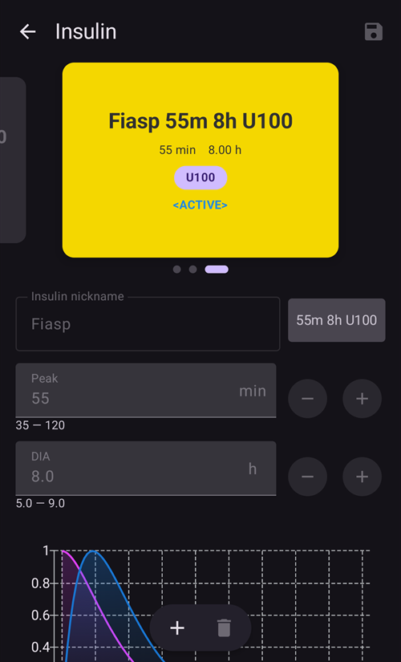
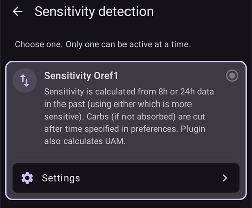

# Konfigurasjon (Config Builder)

```{admonition} Kommer du fra AAPS v3? :class: note **Config Builder** heter nå **Konfigurasjon** og ligger i **menyen** (☰). Se [Hva er endret i AAPS v4](#v4-changes).

    <br />**Konfigurasjon** er der du velger hvilke plugins som er aktive (CGM, pumpe, APS-algoritme, sensitivitet, synkronisering, …) og åpner hver plugin og innstillingene dens. [Gjennomgangen](#configuration-v4) finner du nedenfor; resten av siden beskriver hver del i detalj.
    
    (configuration-v4)=
    ## Konfigurasjon i AAPS v4
    
    I **AAPS** v4 trykker du på **menyen** (☰) **øverst til venstre** på hovedskjermen og velger **Konfigurasjon** (*«Konfigurer oppsettet ditt (sensor, pumpe osv.) og aktiver funksjonene»*).
    
    
    
    Plugins er gruppert etter **kategori** – for eksempel *Utjevning*, *Kalibrering*, *Sensitivitetsdeteksjon*, *APS*, *Kommunikasjon* og *Generelt*. Hver rad viser kategorinavnet og pluginen som er **aktiv nå** (f.eks. *APS → OpenAPS SMB*). Trykk på en rad for å åpne en kategori.
    
    
    
    Inne i en kategori ser du hvilke plugins som er tilgjengelige for den. I kategorier med ett valg velger du den som skal være aktiv; i noen kategorier kan du velge flere (*«Velg de som gjelder»*). Hver plugin har to handlinger:
    
    - **Åpne plugin** – åpner pluginens egen skjerm.
    - **Innstillinger** – åpner pluginens innstillinger (innstillingene kan være gruppert i deler som kan utvides).
    
    
    
    (configuration_sync_icon)=
    ### Mobilikonet – «synkronisert fra hovedenheten»
    
    Et lite **mobilikon (telefon)** ved siden av en kategori eller innstilling betyr at elementet er **synkronisert fra hovedenheten** – verdien/valget leveres til denne enheten over NSClientV3-kanalen (Nightscout).
    
    På en **klient** (**AAPSClient**) holdes disse elementene **synkronisert med hovedenheten**. Ikonet vises bare på en klient, så det er ikke med på skjermbildet over, som er tatt i hoved-appen **AAPS**. På en klient vises det vanligvis på *Utjevning*, *Kalibrering*, *Sensitivitetsdeteksjon* og *APS*. Nøyaktig hvordan hovedenheten og klientene holdes like – og hvilke innstillinger du kan endre fra hver side – er beskrevet under [Hovedenhet ↔ klientstyring](#client-master-config-prefs).
    
    Det samme ikonet vises også **inne i innstillingene**, ved siden av de enkelte innstillingene som synkroniseres. I eksempelet nedenfor har *Absorpsjonsgrense* ikonet; innstillinger uten ikonet settes per enhet:
    
    
    
    Elementer **uten** ikonet settes **per enhet**. Det viktigste eksempelet er selve **NSClientV3-tilkoblingen (Kommunikasjon)** – **Nightscout URL**, **tilgangstoken** og **websockets** settes på hver telefon for seg, så de viser **ikke** mobilikonet.
    
    ---
    
    (Config-Builder-tab-or-hamburger-menu)=
    ## Åpne en plugin-skjerm
    
    Hver plugin-skjerm kan åpnes på en av disse måtene (fanene og øye-avkrysningsboksen fra **AAPS** v3 er borte, se [Hva er endret i AAPS v4](#v4-changes)):
    
    - **Konfigurasjon** → pluginens kategori → **Åpne plugin**,
    - **Administrer**-arket i navigasjonslinjen nederst, for skjermene du bruker mest (Profil, Insulininnstillinger, Pumpe, Automasjon, Mat …),
    - en [Hurtigstart](../DailyLifeWithAaps/QuickLaunch.md)-knapp som du legger til selv,
    - **søkefeltet** på hovedskjermen.
    
    ```{contents}
    :backlinks: entry
    :depth: 2
    

(ConfigBuilder_Profile)=

## Profil

Denne modulen kan ikke deaktiveres, siden den er en kjernedel av **AAPS**.

Se [Din AAPS-profil](../SettingUpAaps/YourAapsProfile.md) for en grunnleggende forståelse av hva som ligger i **profilen** din.

(insulin)= (Config-Builder-insulin)=

## Insulin


I **AAPS** 4 er insulin ikke lenger en plugin som velges i **Konfigurasjon**. Åpne **Administrer → Insulininnstillinger** for å sette opp insulinet du bruker.

I insulineditoren kan du:

* gi profilen et **Kallenavn for insulin**, så den er lett å kjenne igjen,
* sette **Topp** (tid til maksimal insulinaktivitet, i minutter) og **DIA** (insulinets virketid, i timer), enten ved å skrive inn verdien eller med knappene **–** / **+**,
* trykke på en forhåndsinnstillingsknapp under **Last topp fra** – **Novorapid** (75 min), **Fiasp** (55 min) eller **Lyumjev** (45 min) – for å fylle inn standard topptid for det insulinet i ett steg.

De tillatte områdene er de samme uansett hvilket insulin du bruker:

* **DIA**: 5 til 9 timer (5 til 10 timer hvis pasienttypen er satt til **Graviditet**). Se [Insulinets virketid (DIA) og topp](#Config-Builder-insulin-dia) for å velge en verdi.
* **Topp**: 35 til 120 minutter.

Kurvene for **IOB** (aktivt insulin) og **Aktivitet** nederst i editoren oppdateres når du endrer verdiene, så du ser med en gang hvordan innstillingene dine former insulinvirkningen.

Mer informasjon om insulinprofilen slik den vises i **AAPS** finner du [her](#AapsScreens-insulin-profile).

(Config-Builder-insulin-change-active)=

### Bytte insulinet som er i bruk (DIA eller topp)

Insulinet som er merket **AKTIV**, er det som den kjørende profilen din bruker. Feltene er nedtonet: du kan ikke redigere eller slette det. Slik stemmer insulinnavnet som vises i den kjørende profilen alltid med innstillingene som faktisk er i bruk.

Slik endrer du DIA eller topp som du bruker:

1. Åpne **Administrer → Insulininnstillinger**. Hvis skjermen åpnes skrivebeskyttet (en **✏️ blyant** i toppfeltet), trykk på blyanten og lås opp innstillingene dine.
2. Trykk på **+** (*Legg til nytt insulin*). **AAPS** lager en kopi av insulinet som vises på skjermen.
3. Sett ny **Topp** og/eller **DIA**, og trykk så på lagre-ikonet (øverst til høyre).
4. Trykk på **▶** (*Aktiver insulin*) og bekreft. Det nye insulinet blir **AKTIV**.

```{admonition} Navnet inneholder topp og DIA :class: note **AAPS** legger automatisk topp, DIA og konsentrasjon til i insulinnavnet (for eksempel *Fiasp 55m 8h U100*), så du kan skille konfigurasjonene dine fra hverandre med ett blikk.

    <br />Du kan slette det gamle insulinet når det ikke lenger er aktivt.
    
    ### Forhåndsinnstillingene «Last topp fra»
    
    I **AAPS** 4 finnes det ingen liste over insulintyper å velge fra. Alle insuliner bruker den samme eksponentielle aktivitetskurven; bare **Topp** og **DIA** er forskjellige. Forhåndsinnstillingene under **Last topp fra** i insulineditoren fyller inn anbefalt topp for de vanligste insulinene med ett trykk (den lille ⓘ ved siden av **Last topp fra** viser dem med toppverdiene sine). Du kan fortsatt justere **Topp** og **DIA** etterpå.
    
    Endre toppen fra anbefalt verdi bare hvis du forstår hva det fører til. [Grafen over insulinkurven](#AapsScreens-insulin-profile) hjelper deg å forstå kurvene.
    
    #### Novorapid
    
    
    
    * anbefalt for Humalog, Novolog og Novorapid (kalt *Rapid-Acting Oref* i **AAPS** v3)
    * Topp = 75 minutter etter injeksjon
    
    #### Fiasp
    
    
    
    * anbefalt for Fiasp (kalt *Ultra-Rapid Oref* i **AAPS** v3)
    * Topp = 55 minutter etter injeksjon
    
    (Config-Builder-lyumjev)=
    #### Lyumjev
    
    
    
    * anbefalt for Lyumjev
    * Topp = 45 minutter etter injeksjon
    
    #### Egendefinert topp
    
    * Det finnes ingen egen insulintype «Free-Peak Oref» i **AAPS** 4: skriv inn en hvilken som helst **Topp** (35 til 120 minutter) direkte i [insulineditoren](#Config-Builder-insulin), uten å bruke en forhåndsinnstilling.
    * En egendefinert topp er nyttig hvis du bruker et insulin som ikke er i listen, eller en blanding av ulike insuliner.
    
    (Config-Builder-insulin-dia)=
    ### Insulinets virketid (DIA) og topp
    
    ```{warning}
    Ved looping vil lavere DIA eller topp alltid øke mengden insulin som gis. DIA fungerer annerledes i AAPS enn i kommersielle AID-systemer, og uforsiktige endringer i disse innstillingene kan endre insulindoseringen mye mer eller mye mindre enn du venter.
    

AAPS modellerer insulinvirkningen over tid med en matematisk formel, som styres av **DIA** og den nært beslektede innstillingen **topp**. DIA er den teoretiske tiden til IOB når null, og topp er tidspunktet når insulinvirkningen er sterkest. Dette gir en IOB-kurve og en aktivitetskurve, som rett og slett er **hastigheten** IOB brytes ned med.

Husk at når AAPS looper, er det normalt med perioder med [null-basal (zero-temping)](#Open-APS-features-super-micro-bolus-smb). Dette manglende basalinsulinet trekkes fullt ut fra IOB, og det forklarer hvorfor IOB i praksis når null mange timer tidligere enn den innstilte DIA. Du kan se [bolus-IOB og basal-IOB](#aaps-screens-iob-cob-basal-sens) hver for seg på hovedskjermen.

For å stille inn DIA og topp trykker du på **Administrer** på hovedskjermen og deretter på **Insulininnstillinger**. AAPS viser den aktive insulinkonfigurasjonen slik:



I dette eksempelet er toppen satt til 55 minutter, DIA er 8 timer og [insulinkonsentrasjonen](#Insulin-Concentration) er standard 100 E/ml.

På grunn av null-basal-effekten som er forklart over, og formelen AAPS bruker for nedbrytning av IOB, setter de fleste brukere en klart høyere DIA enn i kommersielle systemer. Generelt synes mange at en **DIA** på 9 t fungerer godt for dem. Når du har mer erfaring med AAPS og en godt innstilt profil, kan du prøve å finne dine egne verdier for DIA og topp med informasjonen nedenfor.

````{admonition} Detaljer om virkningen av DIA- og topp-innstillingene :class: dropdown

Siden basaldosen indirekte påvirker nedbrytningen av IOB i AAPS, kan for høye basaldoser skjule en for høy DIA, og omvendt. Det er fornuftig å først stille inn basaldosene nøye før du justerer DIA og topp. Husk også at innstillingene for DIA og topp påvirker hverandre: virkningen av DIA avhenger av topp, og omvendt.

Disse diagrammene viser nøyaktig hvordan DIA og topp påvirker IOB-kurvene, over hele området av tillatte verdier.

Justering av DIA:

```{image} ../images/iob_remaining_static_peak.png :width: 400px

    <br />Justering av topp:
    
    ```{image} ../images/iob_remaining_static_dia.png
    :width: 400px
    

Til slutt en sammenligning der DIA og topp justeres parallelt. Logikken her er at begge verdiene justeres like mye relativt sett, slik at `49/35 ~ 7/5`. Eller tilsvarende, `120/93 ~ 9/7`. Intervallene blir like uansett hvilken DIA eller topp du starter fra, så lenge den relative endringen er den samme for begge.

```{image} ../images/iob_remaining_uniform.png :width: 400px

    <br />Merk at når DIA og topp justeres på denne måten, flytter hvert punkt på kurven seg like mye relativt sett.
    
    ````
    
    #### Mer lesestoff om innstilling av DIA og topp
    
    * [Tekniske detaljer og historisk bakgrunn fra OpenAPS, forløperen til AAPS](https://openaps.readthedocs.io/en/latest/docs/While%20You%20Wait%20For%20Gear/understanding-insulin-on-board-calculations.html#understanding-the-new-iob-curves-based-on-exponential-activity-curves) (engelsk).
    * [Why we are regularly wrong in the duration of insulin action (DIA) times we use, and why it matters…](https://www.diabettech.com/insulin/why-we-are-regularly-wrong-in-the-duration-of-insulin-action-dia-times-we-use-and-why-it-matters/) på Diabettech (engelsk).
    * [Exponential Insulin Curves + Fiasp](https://web.archive.org/web/20220630154425/http://seemycgm.com/2017/10/21/exponential-insulin-curves-fiasp/) på See My CGM (arkiv, engelsk).
    * [Revised Humalog model in a closed loop](https://bionicwookiee.com/2022/04/13/revised-humalog-model-in-a-closed-loop/) og andre artikler på Bionic Wookie (engelsk), som anbefaler en DIA på 9 t for Lyumjev, Fiasp, NovoRapid og Humalog.
    
    (Config-Builder-bg-source)=
    ## BS-kilde
    Velg blodsukkerkilden du bruker. Se siden [BS-kilde](../Getting-Started/CompatiblesCgms.md) for mer informasjon om oppsett.
    
    
    
    Bla ned for å se de andre kildene:
    
    
    
    
    
    * [xDrip+ BS](../CompatibleCgms/xDrip.md) – også for kompatible apper som [Juggluco](../CompatibleCgms/Juggluco.md)
    * [NSClient BS](../CompatibleCgms/CgmNightscoutUpload.md) – bare hvis du vet hva du gjør, se [BS-kilde](../Getting-Started/CompatiblesCgms.md).
    * [MM640g](../CompatibleCgms/MM640g.md)
    * Glimp – bare versjon 4.15.57 og nyere støttes
    * [BYODA (Build Your Own Dexcom App)](#DexcomG6-if-using-g6-with-build-your-own-dexcom-app).
    * MicroTech sensorapp – for Aidex / LinX CGM
    * [Poctech](../CompatibleCgms/PocTech.md)
    * Tomato (MiaoMiao) – Tomato-appen for MiaoMiao-enheten
    * [Glunovo](https://infinovo.com/) – Glunovo-appen for Glunovo CGM-system
    * Intelligo – Intelligo-appen
    * Syai/Ottai – for Syai- og Ottai-appene (se [Syai Tag](../CompatibleCgms/SyaiTagX1.md) og [Ottai](../CompatibleCgms/OttaiM8.md))
    * SI app – modifisert SI App eller Sibionics App for Sibionics CGM
    * Sino app – modifisert app for Sinocare CGM
    * Varslingsleser – leser glukoseverdier fra varslingene som de offisielle CGM-appene viser (Dexcom, Medtronic, Eversense osv.)
    * Instara – Instara-appen
    * Vilkårlig BS – lager tilfeldige BS-data for testing. Den kan bare aktiveres i et engineering-bygg (utviklerbygg) med **Virtuell pumpe**, så i en vanlig **AAPS**-installasjon kan den ikke brukes.
    
    ## Utjevning
    
    
    
    Se [Utjevning av blodsukkerdata](../CompatibleCgms/SmoothingBloodGlucoseData.md).
    
    ## Kalibrering
    
    Velg hvordan **AAPS** skal behandle verdiene den får fra sensoren din:
    
    - **Ingen kalibrering**: sensorverdiene brukes som de er. Bruk dette når sensoren allerede er fabrikkalibrert og nøyaktig. Dette er standard.
    - **Lineær kalibrering**: **AAPS** korrigerer sensorverdiene med en stigning og en forskyvning som den beregner ut fra fingerstikkmålingene dine.
    
    Slik fungerer **Lineær kalibrering**:
    
    - Den trenger et registrert **sensorbytte**, så den vet når sensorøkten startet. De første 2 timene av en økt hoppes over som oppvarming.
    - Den trenger minst **2 fingerstikkmålinger**. Nye målinger teller mer enn gamle.
    - Korreksjonen brukes bare når resultatet er innenfor et trygt område. Hvis målingene dine ligger for tett i tid, korrigeres bare forskyvningen.
    - **Åpne plugin** viser status for kalibreringen, stigningen og korreksjonen som er i bruk, og listen over fingerstikkmålinger. Du kan legge til en måling med **Legg til kalibrering** og fjerne en som er feil.
    
    ```{admonition} Kalibrer med omhu
    :class: warning
    En feil fingerstikkverdi gir feil glukoseverdier og dermed feil insulindosering. Vask hendene før du måler, og ikke kalibrer mens blodsukkeret ditt endrer seg raskt.
    


(Config-Builder-pump)=

## Pump

Velg pumpen du bruker. Se siden [Kompatible pumper](../Getting-Started/CompatiblePumps.md) for mer informasjon om oppsett.


Bla ned for å se alle pumpedriverne:


Når du velger en annen pumpe, ber **AAPS** deg bekrefte byttet:


* [Dana R](../CompatiblePumps/DanaR-Insulin-Pump.md)
* Dana R Korean (for DanaR-pumpe solgt i Korea)
* Dana Rv2 (DanaR-pumpe med uoffisiell fastvareoppgradering)
* [Dana-i/RS](../CompatiblePumps/DanaRS-Insulin-Pump.md)
* [Accu Chek Insight](../CompatiblePumps/Accu-Chek-Insight-Pump.md)
* [Accu Chek Combo](../CompatiblePumps/Accu-Chek-Combo-Pump-v2.md)
* Omnipod for [Omnipod Eros](../CompatiblePumps/OmnipodEros.md)
* Dash for [Omnipod DASH](../CompatiblePumps/OmnipodDASH.md)
* [Medtronic](../CompatiblePumps/MedtronicPump.md)
* [Diaconn G8](../CompatiblePumps/DiaconnG8.md)
* [EOPatch2](../CompatiblePumps/EOPatch2.md)
* [Medtrum](../CompatiblePumps/MedtrumNano.md)
* [Equil 5.3](../CompatiblePumps/Equil5.3.md)
* [Carelevo](../CompatiblePumps/CareLevo.md)
* Virtuell pumpe: åpen loop – bare forslag fra **AAPS** 
  * når du tar dine første steg med **AAPS**, under de første [opplæringsmålene](../SettingUpAaps/CompletingTheObjectives.md)
  * for pumper som ikke har noen driver ennå

(config-builder-wrong-pump-data)=

### Melding: «Data kommer fra en annen pumpe»

**AAPS** husker pumpen den er koblet til (pumpetype og serienummer). Hvis den får data fra en annen pumpe, for eksempel etter at pumpen din er byttet ut med en ny av samme modell, viser den denne meldingen og ignorerer dataene fra den pumpen:


For å bruke den nye pumpen bytter du pumpedriver: velg **Virtuell pumpe**, bekreft, og velg så pumpen din på nytt. **AAPS** registrerer da pumpen den er koblet til nå.

(Config-Builder-sensitivity-detection)=

## Sensitivitetsdeteksjon



Velg type sensitivitetsdeteksjon. Mer informasjon om de ulike variantene finner du [her](../DailyLifeWithAaps/SensitivityDetectionAndCob.md). Dette analyserer historiske data fortløpende og justerer hvis det ser at du reagerer mer følsomt (eller motsatt, mer resistent) på insulin enn vanlig. Mer om hvordan selve sensitivitetsforholdet beregnes finner du i [Viktige AAPS-funksjoner > Autosens](#Open-APS-features-autosens).

Du kan se sensitiviteten din på hovedskjermen i en [ekstra graf](#AapsScreens-section-g-additional-graphs), ved å velge SEN og følge med på den hvite linjen. Merk: du må ha kommet til [opplæringsmål 8](#objectives-objective8) for at Sensitivitetsdeteksjon/[Autosens](#Open-APS-features-autosens) skal kunne justere insulinmengden automatisk. Før du når dette opplæringsmålet, vises Autosens-prosenten / linjen i grafen bare til informasjon.

### Absorberingsinnstillinger

Hvis du bruker Oref1 med **SMB**, må du endre **min_5m_carbimpact** til 8. Verdien brukes bare når det er hull i **CGM**-målingene, eller når fysisk aktivitet «bruker opp» hele den stigningen i blodsukkeret som ellers ville fått **AAPS** til å bryte ned COB. Når [karbohydratabsorpsjonen](../DailyLifeWithAaps/CobCalculation.md) ikke kan beregnes dynamisk ut fra hvordan blodsukkeret ditt reagerer, legger den inn en standard nedbrytning av karbohydratene dine. Det er altså en sikkerhetsmekanisme.

(Config-Builder-aps)=

## APS


Velg APS-algoritmen du vil bruke til å justere behandlingen. Du kan se detaljene for den valgte algoritmen med **Åpne plugin**.

* OpenAPS AMA 
  * Advanced Meal Assist: eldre algoritme som ikke lenger anbefales.
  * Enkelt sagt er fordelen at systemet kan sette en høy midlertidig basal raskere etter at du har gitt en måltidsbolus, HVIS du registrerer karbohydrater pålitelig.
* [OpenAPS SMB](#Open-APS-features-super-micro-bolus-smb) 
  * Super Micro Bolus: nyeste algoritme, anbefalt for alle brukere.
  * I motsetning til AMA bruker SMB ikke midlertidige basaler for å styre blodsukkeret, men hovedsakelig små **supermikroboluser**.
  * Merk: Det anbefales å bruke denne algoritmen fra starten, selv om du ikke får levert SMB-er før [opplæringsmål 9](#objectives-objective9).
* [AutoISF](#Open-APS-features-auto-isf) 
  * Eksperimentell algoritme for avanserte brukere. Den vises først når alle opplæringsmålene er fullført.

Hvis du bytter fra AMA- til SMB-algoritmen, må *min_5m_carbimpact* endres manuelt til **8** (standardverdi for SMB) i [Innstillinger → Absorberingsinnstillinger](#Preferences-min_5m_carbimpact).

## Loop

Denne modulen kan ikke deaktiveres, siden den er en kjernedel av **AAPS**.


## Begrensninger


### Opplæringsmål

**AAPS** har et opplæringsprogram (en rekke opplæringsmål) som du må fullføre steg for steg. Dette skal lede deg trygt gjennom oppsettet av et lukket loop-system.

Se siden [Opplæringsmålene](../SettingUpAaps/CompletingTheObjectives.md) for mer informasjon.

## Kommunikasjon

I denne kategorien (kalt **Synkronisering** i **AAPS** v3) velger du om og hvor **AAPS** skal sende dataene dine.


Bla ned for å se resten av listen:


### NSClientV3

Kan brukes som [rapporteringsserver](../SettingUpAaps/SettingUpTheReportingServer.md) og/eller til [fjernovervåking](../RemoteFeatures/RemoteMonitoring.md) og [fjernstyring](../RemoteFeatures/RemoteControl.md).

Se [Synkronisering med rapporteringsserveren](#SetupWizard-synchronization-with-the-reporting-server-and-more) for å sette opp NSClientV3-synkronisering.

### Tidepool

Kan brukes som [rapporteringsserver](../SettingUpAaps/SettingUpTheReportingServer.md).

Se [Tidepool](../SettingUpAaps/Tidepool.md).

### xDrip

Brukes til å **sende** data som glukoseverdier og behandlinger til xDrip+ på samme telefon. Innstillingene inneholder også **Send status til xDrip+**, en statuslinje med IOB og COB som xDrip+ og noen hjelpeapper for klokker viser.

### Open Humans

Se [Open Humans](../SupportingAaps/OpenHumans.md).

(Config-Builder-wear)=

### Klokke

Overvåk og styr **AAPS** fra en Wear OS-klokke. Oppsett av klokken er forklart på [Wear OS-smartklokke](../WearOS/WearOsSmartwatch.md). Når du har aktivert pluginen, velger du alternativene i [Innstillinger > Klokke](#preferences-wear). Bruk av klokken er forklart på [Styring av AAPS fra Wear OS-smartklokken din](../RemoteFeatures/RemoteControlWearOS.md).

(external-companion-apps)=

### Eksterne hjelpeapper

Kringkaster **AAPS**-statusdata på telefonen, slik at andre apper som er installert på den kan vise dem – for eksempel hjelpeapper for klokker eller widgeter. Kringkastingen inneholder glukose og trend, IOB, COB, basal og midlertidig basal, profilnavn, loop-status, telefon- og pumpebatteri, reservoarnivå og bolusfremdrift. Aktiver den bare hvis en hjelpeapp du bruker ber om disse dataene.

Apper som er kjent for å lese denne kringkastingen, er [WatchDrip+](https://bigdigital.home.blog/) (Xiaomi- og Amazfit-klokker), [GlucoDataHandler](https://github.com/pachi81/GlucoDataHandler) (Wear OS-komplikasjoner og widgeter, og Android Auto via GlucoDataAuto) og G-Watch-appen. Oppsettet av dem er beskrevet på [Smartklokker og AAPS](#watches-external-companion-apps). Noen av dem bruker også **Send status til xDrip+** fra **xDrip**-pluginen over for en statuslinje med IOB og COB.

I tidligere versjoner het denne pluginen **Samsung Tizen**, etter [G-Watch-appen for Samsung Tizen-klokker](#Watchfaces-tizen) som den først ble laget for.

### Garmin

Tilkobling til Garmin-enhet (Fenix, Edge …)

## Behandlinger

Åpne **menyen** (☰) og velg [Behandlingshistorikk](#aaps-screens-treatments) for å se behandlingene som er registrert. Hvis du vil redigere eller slette en oppføring (f.eks. du spiste mindre karbohydrater enn du trodde), velger du «Fjern» og legger inn den nye verdien (endre tidspunktet om nødvendig) via **Behandlinger → Karbo** i navigasjonslinjen nederst (se [Karbo](#screens-bolus-carbs)).

## General

I **AAPS** 4 inneholder kategorien **Generelt** i **Konfigurasjon** bare **Autotune**. De andre funksjonene som beskrives nedenfor, er alltid tilgjengelige og trenger ikke lenger aktiveres her; hvert avsnitt sier hvor du finner dem.


### Oversikt

[Hovedskjermen](#AapsScreens-the-homescreen) i **AAPS** er ikke lenger en plugin og har ingen egne innstillinger i **Konfigurasjon**. Valgene som før lå her, finner du i **Innstillinger** (tannhjulikonet): [Vis merknadsfelt i dialoger](#Preferences-show-notes-field-in-treatments-dialogs), [Statuslys](#Preferences-status-lights) og [Bolusprosent](#Preferences-deliver-this-part-of-bolus-wizard-result), som boluskalkulatoren bruker. Superbolus-valget fra **AAPS** 3.x er [ikke tilgjengelig som innstilling](#Preferences-advanced-settings-overview) i **AAPS** 4.

(Config-Builder-actions)=

### Handlinger

Handlinger-fanen i **AAPS** 3.x finnes ikke lenger. Knappene der ligger nå i **Administrer**-arket – se [Hvor ble det av Handlinger-fanen?](#screens-action-tab).

### Automasjon

**Administrer → Automasjon** lar deg administrere [automasjonene](../DailyLifeWithAaps/Automations.md) dine, fra [opplæringsmål 10](#objectives-objective10).

(Config-Builder-sms-communicator)=

### SMS-kommunikasjon

Lar omsorgspersoner fjernstyre noen **AAPS**-funksjoner via SMS, se [SMS-kommandoer](../RemoteFeatures/SMSCommands.md) for mer informasjon om oppsett.

### Mat

**Administrer → Mat** viser matforhåndsinnstillingene som er definert i matdatabasen i Nightscout, se [Nightscout Readme](https://github.com/nightscout/cgm-remote-monitor#food-custom-foods) for mer informasjon om oppsett.

Merk: Oppføringene kan ikke brukes i **AAPS**-kalkulatoren. (Bare visning)

(Config-Builder-autotune)=

### Autotune

Du kan aktivere Autotune, se [her](../AdvancedOptions/Autotune.md).

### Vedlikehold

Åpne **menyen** (☰) og velg **Vedlikehold** for å eksportere/importere innstillinger og håndtere loggfiler.


### Config Builder

Heter nå **Konfigurasjon**: denne siden.