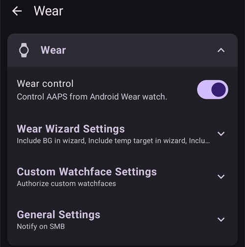

# Innstillinger

I **AAPS** v4 finner du innstillingene på skjermen **Innstillinger**. Det er tre veier dit – se [Endre AAPS-konfigurasjonen din](../SettingUpAaps/ChangeAapsConfiguration.md) for detaljer:

1. Trykk på **Innstillinger**-ikonet (tannhjulet) øverst til høyre på hovedskjermen: alle innstillinger, gruppert i seksjoner som kan utvides.
2. I **Konfigurasjon**, trykk på «**Innstillinger**» under en aktiv plugin: bare innstillingene til den pluginen.
3. Bruk **søkefeltet** øverst på hovedskjermen: begynn å skrive en del av teksten du leter etter. Dette finner enkeltinnstillinger (også de som ikke vises på Innstillinger-skjermen), dialoger og dokumentasjon.


- **Seksjoner** åpnes og lukkes ved å trykke på dem. Hvilke seksjoner du ser, avhenger av hvilke plugins du har aktivert, og av [Enkelmodus](#preferences-simple-mode).


```{contents}
:backlinks: entry
:depth: 2
```

(Preferences-general)=
## Generelt


**Enheter**

- Sett enheter til mmol/L eller mg/dL etter hva du foretrekker.

**Språk**

- Som standard følger **AAPS** språket på telefonen (anbefalt).

- Hvis du vil ha **AAPS** på et annet språk enn telefonen, velger du det her. På Android 13 og nyere registrerer **AAPS** det som sitt eget appspråk i Android, så alle skjermbildene, hovedskjermen, widgetene og måten tall skrives på følger det.

- Når du bytter språk, bytter tekstene i **AAPS** til det nye språket med en gang. Hvis noen tekster fortsatt vises på det gamle språket, start **AAPS** på nytt.
- På Android 12 vises ikke denne innstillingen: **AAPS** bruker alltid språket på telefonen.
- Innstillingen er skjult i [enkelmodus](#preferences-simple-mode).

(preferences-simple-mode)= **Enkelmodus**

**Enkelmodus** er aktivert som standard når du installerer **AAPS** første gang. I **enkelmodus** er mange innstillinger skjult, og innstillingene er erstattet av forhåndsdefinerte verdier. Du bør slå av Enkelmodus når du har blitt kjent med brukergrensesnittet og innstillingene i **AAPS**.

**Støtte for insulinkonsentrasjon**

- Slår på støtte for andre insulinkonsentrasjoner (U50, U200 ...). Slå dette på bare hvis du virkelig bruker en annen konsentrasjon enn U100, og les advarslene nøye.
- Innstillingen er skjult i [enkelmodus](#preferences-simple-mode).

**Hold skjermen på**

- Tvinger Android til å holde skjermen på hele tiden. Dette er nyttig for presentasjoner og lignende. Men det bruker mye batteri. Derfor anbefales det å koble telefonen til en lader.

**Instansnavn**

- Navnet på personen som bruker denne telefonen. Det skiller denne **AAPS**-instansen fra andre i rapporter og synkronisering, for eksempel hvis to barn med type 1-diabetes i familien din bruker **AAPS**.
- Brukes i navnene på eksporterte innstillingsfiler.
- Vises i urskiven [Dual](../WearOS/WearOsSmartwatch.md).

(Preferences-skin)=
### Skin

Valget av skin fra **AAPS** 3.x (Original, Lav oppløsning, Stor skjerm ...) finnes ikke lenger i **AAPS** 4. Det nye grensesnittet tilpasser seg skjermen din automatisk, og fargevalget kan endres under [Utseende](#preferences-appearance).

(preferences-appearance)=
## Utseende


(Preferences-range-for-visualization)=
### Område for visualisering

Velg høy og lav grense for BS-grafen på hovedskjermen i **AAPS** og på smartklokken. Det er bare visningen, ikke målområdet for BS-verdien din. Eksempel: 70 - 180 mg/dL eller 3,9 - 10 mmol/L

(Preferences-show-notes-field-in-treatments-dialogs)=
### Vis merknadsfelt i dialoger

Gir deg mulighet til å legge til korte tekstnotater på behandlingene dine (boluskalkulator, karbohydrater, insulin ...)

Innstillingen er skjult i [enkelmodus](#preferences-simple-mode).

### App fargevalg

Velg mellom lyst tema, mørkt tema eller å følge telefonens systeminnstilling.

(Preferences-protection)=
## Beskyttelse


(Preferences-master-password)=
### Hovedpassord

Obligatorisk for å kunne [eksportere innstillinger](../Maintenance/ExportImportSettings.md), siden de er kryptert fra versjon 2.7.

**Biometrisk beskyttelse fungerer kanskje ikke på OnePlus-telefoner. Dette er et kjent problem med OnePlus på noen telefoner.**


(Preferences-settings-protection)=
### Sikkerhet for innstillinger

- Beskytt innstillingene dine med et passord eller telefonens biometriske autentisering (f.eks. når [et barn bruker **AAPS**](../RemoteFeatures/RemoteMonitoring.md)). Hvis du slår på denne funksjonen, blir du bedt om autentisering hver gang du vil åpne en skjerm som har med innstillinger å gjøre.

- Administrasjonsskjermene (**Profil**, **Insulininnstillinger**, **Midlertidig mål**, **Hurtigknapp**) åpnes da **skrivebeskyttet**. Du kan fortsatt aktivere eller bruke en oppføring, men å legge til, redigere, duplisere og slette er skjult til du låser opp innstillingene dine. Se [Sikkerhet for innstillinger låser nå også administrasjonsskjermene](#v4changes-read-only-management).

- Egendefinert passord bør brukes hvis du vil bruke hovedpassordet bare til å sikre [eksporterte innstillinger](../Maintenance/ExportImportSettings.md), og et annet passord til å redigere innstillingene.

- Hvis du bruker et egendefinert passord, trykker du på linjen «Innstillingspassord» for å sette passordet som beskrevet [ovenfor](#Preferences-master-password).

### Sikkerhet for app

Hvis appen er beskyttet, må du skrive inn passordet eller bruke telefonens biometriske autentisering for å åpne **AAPS**, og igjen når du kommer tilbake til appen etter [beskyttelsestidsavbruddet](#Preferences-password-and-pin-retention).

**AAPS** avsluttes med en gang hvis feil passord skrives inn – men kjører fortsatt i bakgrunnen hvis appen tidligere ble åpnet med riktig passord.

### Sikkerhet for bolus

- Sikkerhet for bolus kan være nyttig hvis **AAPS** brukes av et lite barn og du [gir bolus via SMS](../RemoteFeatures/SMSCommands.md).

- **Sikkerhet for bolus** kan bare velges når **Sikkerhet for innstillinger** (nivå 2) er satt.

- I eksempelet nedenfor bruker sikkerhet for bolus **Hovedpassord**: **AAPS** ber om det før en behandlingsdialog som **Insulin** åpnes. Med **Biometrisk** kan du skrive inn hovedpassordet i stedet hvis biometrisk autentisering ikke virker.


(Preferences-password-and-pin-retention)=
### Hvor lenge passord og PIN gjelder

**Beskyttelsestidsavbrudd** angir hvor lenge (i sekunder) innstillingene eller bolusfunksjonene forblir ulåst etter at du har skrevet inn riktig passord.

## Behandlingssikkerhet


(preferences-patient-type)=
### Pasientalder

- Sikkerhetsgrensene settes ut fra alderen du velger i denne innstillingen.
- Hvis du begynner å treffe disse harde grensene (for eksempel maksimal bolus), er det på tide å gå ett trinn opp.
- Det er en dårlig idé å velge en høyere alder enn den reelle, fordi det kan føre til overdosering hvis du taster feil verdi i insulindialogen (for eksempel ved å hoppe over desimaltegnet).
- Hvis du vil vite de faktiske tallene for disse faste sikkerhetsgrensene, bla til algoritmen du bruker på [denne siden](../DailyLifeWithAaps/KeyAapsFeatures.md).

(Preferences-maximum-bolus)=
### Maksimal bolus

- Angir den største bolusen, i insulinenheter, som **AAPS** har lov til å gi på en gang.
- Denne innstillingen er en sikkerhetsgrense som skal hindre at en svært stor bolus blir gitt på grunn av feil inntasting eller brukerfeil.
- Det anbefales å sette denne til en fornuftig mengde som omtrent tilsvarer den største bolusen du noen gang vil trenge til et måltid eller en korreksjonsdose.
- Denne begrensningen gjelder også for resultatene fra boluskalkulatoren.

### Maks tillatte karbo

- Angir den største mengden karbohydrater, i gram, som boluskalkulatoren i **AAPS** har lov til å dosere for.
- Denne innstillingen er en sikkerhetsgrense som skal hindre at en svært stor bolus blir gitt på grunn av feil inntasting eller brukerfeil.
- Det anbefales å sette denne til en fornuftig mengde som omtrent tilsvarer den største mengden karbohydrater du noen gang vil trenge til et måltid.

## BS-kilde

Innstillingene for den valgte [BS-kilden](#Config-Builder-bg-source) vises som en egen seksjon. For eksempel med **xDrip+ BS**:


- **Last opp BS-data til NS**: la **AAPS** laste opp de mottatte BS-verdiene til Nightscout. Slå dette på bare hvis CGM-appen ikke allerede laster dem opp selv.
- **Logg sensorbytte**: opprett automatisk en behandlingshendelse for sensorbytte når sensoren settes inn.

## Hovedskjermen

I **AAPS** 3.x var disse innstillingene samlet i en «Oversikt»-seksjon. I **AAPS** 4 settes de opp direkte fra de elementene på hovedskjermen som de hører til.

(Preferences-buttons)=
### Hurtigstart-knapper

Bestem hvilke handlingsknapper som vises på hovedskjermen: trykk på det lille **tannhjulet** nederst i midten av hovedskjermen («Konfigurer Hurtigstart») og **Legg til** handlingene du vil ha rask tilgang til (behandlinger, CGM-handlinger, helseportal-oppføringer ...).


(Preferences-quick-wizard)=
### Hurtigknapp

Lag egne knapper for bestemte standardmåltider eller mellommåltider, som vises på hovedskjermen. Nyttig for standardmåltider du spiser ofte.

For hver knapp angir du karbohydratene og beregningsmetoden for bolusen. Deretter angir du i hvilket tidsrom knappen skal vises på hovedskjermen – bare én knapp per tidsrom. Knappen vises ikke utenfor det angitte tidsrommet, eller hvis du har nok aktivt insulin (IOB) til å dekke karbohydratene som er angitt i hurtigknappen. Hvis du angir ulike tider for de ulike måltidene, vil du alltid ha riktig standardmåltid-knapp på hovedskjermen, avhengig av tiden på døgnet.

For å administrere hurtigknappene dine skriver du «Hurtigknapp» i søkefeltet på hovedskjermen og åpner **Hurtigknapp - Administrer forhåndsinnstillinger for hurtigknapper**.

Hvis du trykker på hurtigknappen, vil **AAPS** beregne og foreslå en bolus for disse karbohydratene ut fra de gjeldende forholdstallene dine (og ta hensyn til blodsukkerverdi eller aktivt insulin hvis det er satt opp).

Forslaget må bekreftes før insulinet gis.

(Preferences-default-temp-targets)=
### Standard midlertidige mål

[Midlertidige mål (TT)](../DailyLifeWithAaps/TempTargets.md) lar deg endre blodsukkermålet ditt for en viss tid. Når du setter et standard midlertidig mål, kan du enkelt endre målet ditt ved aktivitet, før måltid osv.

Trykk på **målområdet** på hovedskjermen for å åpne skjermen **Midlertidig mål**. Sveip gjennom kortene med forhåndsinnstillinger (Spise snart, Aktivitet, Hypo) og endre målet og varigheten for hver forhåndsinnstilling under **Forhåndsinnstillinger**. Forhåndsinnstilte verdier er:

* Spise snart: mål 90 mg/dL / 5,0 mmol/L, varighet 45 min
* Aktivitet: mål 140 mg/dL / 7,8 mmol/L, varighet 90 min
* Hypo: mål 160 mg/dL / 8,9 mmol/L, varighet 60 min


Lær hvordan du [aktiverer midlertidige mål her](#TempTargets-where-can-i-select-a-temp-target).

### Standardmengder insulin for Prime/fylling

Hvis du vil fylle slangen eller prime kanylen gjennom **AAPS**, kan du gjøre det med **Prime/fylling**-knappene i det utvidede statuspanelet på hovedskjermen.

Standardmengdene for de tre fyllknappene kan angis i innstillingene for **Prime/fylling**, avhengig av lengden på kateteret ditt. Skriv «prime» i søkefeltet på hovedskjermen for å åpne dem.


(Preferences-status-lights)=
### Statuslys

Statuslys gir en visuell advarsel for:

- Sensoralder
- Insulinalder (dager reservoaret har vært i bruk)
- Reservoarnivå (enheter)
- Kanylealder
- Batterialder for pumpe
- Batterinivå for pumpe (%)

Hvis advarselsterskelen overskrides, vises verdiene i gult. Hvis den kritiske terskelen overskrides, vises verdiene i rødt.

For å endre tersklene utvider du statuspanelet på hovedskjermen (pilen til høyre i statusraden) og trykker på det lille **Innstillinger**-ikonet ved siden av «Status»:


Trykk på et element (**Kanyle**, **Insulin**, **Sensor** eller **Pumpebatteri**) for å åpne advarselsterskelen og den kritiske terskelen for det:


Det siste valget lar deg importere disse innstillingene fra Nightscout hvis de er definert der. Se [Nightscout-dokumentasjonen](https://nightscout.github.io/nightscout/setup_variables/#age-pills) for mer informasjon.

(Preferences-deliver-this-part-of-bolus-wizard-result)=
### Innstillinger for boluskalkulator

Skriv «bolus» i søkefeltet på hovedskjermen for å åpne innstillingene for **Boluskalkulator**:


**Bolusprosent** setter [standardprosenten](#AapsScreens-section-j) av bolusen som beregnes når du bruker boluskalkulatoren.

Standard er 100 %: ingen korreksjon. Selv om du setter en annen verdi her, kan du fortsatt endre den hver gang du bruker boluskalkulatoren. Hvis denne innstillingen er 75 % og du skulle ha gitt 10 E, vil boluskalkulatoren foreslå en måltidsbolus på bare 7,5 enheter.

Når du bruker [SMB](#objectives-objective9), er det mange som ikke gir 100 % av insulinet som trengs som måltidsbolus, men bare en del av det (f.eks. 75 %), og lar SMB med UAM (ikke-varslede måltider) gjøre resten. Å bruke en verdi under 100 % her kan være nyttig:
* for personer med langsom fordøyelse: å gi hele bolusen på forhånd kan gi føling, fordi insulinet virker raskere enn fordøyelsen.
* for å gi **AAPS** mer rom til selv å håndtere **BS-stigning**. I begge tilfeller vil **AAPS** kompensere for den manglende delen av bolusen med SMB-er, hvis/når det vurderes som riktig.

**Bruk bolusrådgiver**

Når dette er på og du bruker boluskalkulatoren mens du har hyperglykemi (høyt blodsukker), får du en advarsel som spør om du vil gi bolusen først og spise senere, når **BS** er tilbake i målområdet.

(Preferences-advanced-settings-overview)=
### Superbolus

Superbolus-valget fra **AAPS** 3.x finnes ikke som en innstilling i **AAPS** 4.

## Loop

Se [AAPS-skjermbilder > Hovedskjermen > Loopstatus](#AapsScreens-loop-status) for hvordan du nå endrer loop-modus.

(Preferences-minimal-request-change)=
### Minimumsendring i åpen loop

Når du bruker **Åpen loop**, får du et varsel hver gang **AAPS** anbefaler å justere basaldosen. For å få færre varsler kan du enten bruke [et bredere BS-målområde](#profile-glucose-targets) eller øke prosenten i innstillingen «**Minimumsendring i åpen loop**». Dette angir hvor stor den relative endringen må være for å utløse et varsel.


## Advanced Meal Assist (AMA) eller Super Micro Bolus (SMB)

Avhengig av innstillingene dine i [Konfigurasjon > APS](../SettingUpAaps/ConfigBuilder.md) kan du velge mellom to algoritmer:

- [Advanced meal assist (OpenAPS AMA)](#Open-APS-features-advanced-meal-assist-ama) – algoritmens tilstand i 2017
- [Super Micro Bolus (OpenAPS SMB)](#Open-APS-features-super-micro-bolus-smb) – nyeste algoritme, anbefalt for nybegynnere

Fra [**AAPS** versjon 3.3](#version3300) er funksjonen [Dynamisk ISF (DynISF)](../DailyLifeWithAaps/DynamicISF.md) flyttet inn som en del av OpenAPS SMB.

### OpenAPS AMA

Alle innstillingene for OpenAPS AMA er beskrevet i et eget avsnitt i [Viktige funksjoner i AAPS > Advanced Meal Assist (AMA)](#Open-APS-features-advanced-meal-assist-ama).

(Preferences-openaps-smb-settings)=
### OpenAPS SMB

Alle innstillingene for OpenAPS SMB er beskrevet i et eget avsnitt i [Viktige funksjoner i AAPS > Super Micro Bolus (SMB)](#Open-APS-features-super-micro-bolus-smb).

Hvilke innstillinger du ser, avhenger av hvor langt du har kommet i [opplæringsmålene](../SettingUpAaps/CompletingTheObjectives.md), og av [Enkelmodus](#preferences-simple-mode). På en ny installasjon vises bare **Bruk dynamisk sensitivitet**. Når opplæringsmålene er fullført, ser seksjonen slik ut:


**Avanserte innstillinger** nederst i seksjonen inneholder verdier du normalt ikke trenger å endre:


## Absorpsjonsinnstillinger


(Preferences-min_5m_carbimpact)=
### SMB min 5 min karboabsorpsjonsvirkning (min_5m_carbimpact)

Innstillingen er skjult i [enkelmodus](#preferences-simple-mode).

Algoritmen bruker BGI (blodsukkerpåvirkning) for å avgjøre når [karbohydrater er absorbert](../DailyLifeWithAaps/CobCalculation.md).

Når karbohydratabsorpsjonen ikke kan beregnes dynamisk ut fra hvordan blodsukkeret ditt reagerer, legger **AAPS** inn en standard nedbrytning av karbohydratene dine. Det er altså en sikkerhetsmekanisme. Denne verdien brukes bare ved hull i **CGM**-målingene, eller når fysisk aktivitet «bruker opp» hele blodsukkerstigningen som ellers ville fått **AAPS** til å bryte ned COB.

Enkelt sagt: Algoritmen «vet» hvordan BS-verdiene dine *burde* oppføre seg med den gjeldende insulindosen osv. Hver gang det er et positivt avvik fra forventet oppførsel, regnes noen karbohydrater som absorbert/nedbrutt. Stor endring = mange karbohydrater osv.

min_5m_carbimpact angir standard karbohydratabsorpsjon per 5 minutter. Den fullstendige beskrivelsen av parameteren finner du i [OpenAPS-dokumentasjonen om innstillinger og sikkerhetsinnstillinger](https://openaps.readthedocs.io/en/latest/docs/While%20You%20Wait%20For%20Gear/preferences-and-safety-settings.html?highlight=carbimpact#min-5m-carbimpact).

Standardverdien for AMA er 3, for SMB er den 8.

COB-grafen på hovedskjermen viser når min_5m_carbimpact er i bruk, med oransje prikker langs toppen av COB-kurven.


### Absorpsjonsgrense

Tidspunktet da et måltid regnes som absorbert; gjenværende karbohydrater kuttes. Hvis du ofte spiser måltider med mye fett eller protein, må du øke absorpsjonstiden for måltider.

### Avanserte innstillinger – autosens-forhold


- Angi min. og maks. [autosens](#Open-APS-features-autosens)-forhold.
- Normalt bør standardverdiene (maks. 1,2 og min. 0,7) ikke endres.

## Pumpe


### Bluetooth-overvåker

Aktiver Bluetooth-overvåker (BT watchdog) om nødvendig (f.eks. for Dana-pumper). Den slår av Bluetooth i ett sekund hvis det ikke er mulig å koble til pumpen. Dette kan hjelpe på noen telefoner der Bluetooth-stakken henger seg.

## Pumpeinnstillinger

Valgene her varierer etter hvilken pumpedriver du har valgt i [Konfigurasjon > Pumpe](#Config-Builder-pump). Par og sett opp pumpen din etter [veiledningen for pumpen din](../Getting-Started/CompatiblePumps.md).

For eksempel med **Virtuell pumpe** heter seksjonen **Innstillinger for virtuell pumpe**. Du velger hvilken **Pumpetype** den virtuelle pumpen skal etterligne, og om statusen skal lastes opp til Nightscout:


## Tidepool

Mer informasjon på den egne [Tidepool](../SettingUpAaps/Tidepool.md)-siden.

(Preferences-nsclient)=
## NSClientV3


NSClient-pluginen (vist som **NSClientV3** i konfigurasjonsmenyen) synkroniserer dataene dine med Nightscout. Den bruker Nightscout API v3.

```{admonition} Data uploaders
:class: warning

Når du bruker NSClientV3, må alle opplastere bruke Nightscout API v3. Hvis en annen opplaster (for eksempel CGM-appen din) ikke støtter API v3, **la AAPS laste opp alle data** (BS, behandlinger ...) til Nightscout, og slå av den andre opplasteren.
```

- Angi *Nightscout URL* (f.eks. <https://yoursitename.yourplatform.dom>).
- **Pass på at URL-en er UTEN /api/v1/ på slutten.**
- I Nightscout oppretter du et *[Admin-token](https://nightscout.github.io/nightscout/security/#create-a-token)* (krever [Nightscout 15](https://nightscout.github.io/update/update/) for å bruke V3-API-et) og skriver det inn i **Nightscout tilgangstoken** (ikke API Secret!). På **AAPSClient** kan du i stedet skanne QR-koden fra hovedtelefonen, som setter opp et eget token for klienten. En klient som er sammenkoblet med PIN, får sitt eget token fra hovedtelefonen etter sammenkoblingen. Se [Klientens eget Nightscout-token](#client-master-control-own-token).
- Dette gjør at data kan leses og skrives mellom Nightscout-nettstedet og **AAPS**.
- Dobbeltsjekk for skrivefeil her hvis du står fast i opplæringsmål 1.
- La «Bruk websockets» være på (anbefalt).

(Preferences-nsclient-synchronization)=
### Synkronisering


Valgene for synkronisering avhenger av hvordan du vil bruke **AAPS**.

Du kan velge hvilke data du vil [laste opp til og ned fra Nightscout](#Nightscout-aaps-settings).

Mens klientstyring er på (alltid i Enkelmodus), er disse innstillingene skjult: **AAPS** er da i [herdet modus](#client-master-control-hardened-mode), tar ikke imot endringer gjort direkte i Nightscout og laster opp alle dataene sine.

### Alarmvalg


- Alarmvalg lar deg velge hvilke Nightscout-alarmer appen skal bruke. **AAPS** alarmerer når en Nightscout-alarm utløses.
- For at alarmene skal lyde, må du sette alarmverdiene Urgent High, High, Low og Urgent Low i [Nightscout-variablene](https://nightscout.github.io/nightscout/setup_variables/#alarms) dine.
- De virker bare mens du har forbindelse til Nightscout, og er ment for foreldre/omsorgspersoner.
- Hvis du har **CGM**-kilden på telefonen din (f.eks. xDrip eller BYODA), bruk heller alarmene der i stedet for Nightscout-alarmer.
- NS-kunngjøringer gjentar [kunngjøringer](https://nightscout.github.io/nightscout/discover/#announcement) fra Nightscout i **AAPS**-varslene.
- Du kan endre terskelen for alarmene «gamle data» og «svært gamle data», som gis når det ikke er mottatt data fra Nightscout på en viss tid.

### Fjernstyring

Bryteren «**Tillat klientstyring**» finnes ikke lenger i disse innstillingene: den ligger øverst i **Administrer → Autoriserte klienter**, der de sammenkoblede klientene administreres. Se den egne siden [Hovedenhet ↔ klientstyring](../RemoteFeatures/ClientMasterControl.md), inkludert [herdet modus](#client-master-control-hardened-mode), som denne bryteren slår på.

### Tilkoblingsinnstillinger


- Tilkoblingsinnstillinger bestemmer når tilkoblingen til Nightscout skal være aktiv.
- Begrens opplasting til Nightscout til bare Wi-Fi, eller til bestemte Wi-Fi-nettverk (SSID-er).
- Hvis du bare vil bruke ett bestemt Wi-Fi-nettverk, kan du skrive inn SSID-en til nettverket.
- Flere SSID-er kan skilles med semikolon.
- For å slette alle SSID-er skriver du inn et mellomrom i feltet.

(Preferences-advanced-settings-nsclient)=
### Avanserte innstillinger (NSClientV3)


Valgene under avanserte innstillinger forklarer seg selv.

## SMS-kommunikasjon

Mer informasjon på den egne siden [SMS-kommandoer](../RemoteFeatures/SMSCommands.md).

(preferences-wear)=
## Klokke

Denne seksjonen vises når **Klokke**-pluginen er aktivert i [Konfigurasjon > Kommunikasjon](#Config-Builder-wear). Mer informasjon på de egne sidene [Wear OS-smartklokke](../WearOS/WearOsSmartwatch.md) og [Styring av AAPS fra Wear OS-smartklokken din](../RemoteFeatures/RemoteControlWearOS.md).



- **Styr fra klokke**: tillat at behandlinger og andre handlinger sendes fra klokken. Uten dette viser klokken bare data: telefonen avviser alle kommandoer fra klokken, og et trykk på en komplikasjon som ville åpnet en styringsskjerm, åpner i stedet **AAPS**-menyen på klokken.

**Innstillinger for boluskalkulator på klokken** bestemmer hvilke beregninger som tas med i resultatet fra boluskalkulatoren på klokken. På klokken skriver du bare inn karbohydratene; disse bryterne erstatter valgene du ellers ville gjort i boluskalkulatoren på telefonen:

- **Inkluder BS i kalkulatorberegninger**: legg til en korreksjon for forskjellen mellom nåværende BS og målet ditt.
- **Inkluder midlertidig mål i kalkulatorberegninger**: bruk det aktive midlertidige målet i stedet for profilmålet for denne korreksjonen.
- **Inkluder trend i kalkulatorberegninger**: ta hensyn til den nåværende BS-trenden.
- **Inkluder COB i kalkulatorberegninger**: legg til insulin for karbohydratene som fortsatt er aktive.
- **Inkluder IOB i kalkulatorberegninger**: trekk fra insulinet som fortsatt er aktivt.


**Innstillinger for egendefinert urskive** inneholder **Autoriser tilpassede urskiver**. En fil for egendefinert urskive kan inneholde verdier for noen klokkeinnstillinger. Når denne bryteren er på, får en slik urskive lov til å endre disse innstillingene på klokken når den lastes inn; når den er av, lastes urskiven inn, men innstillingene beholdes som de er:


**Generelle innstillinger** inneholder **Varsle ved SMB**, som gir et varsel på klokken hver gang en SMB gis:


## Autotune

Denne seksjonen vises når **Autotune**-pluginen er aktivert i [Konfigurasjon > Generelt](#Config-Builder-autotune). Innstillingene er beskrevet på den egne [Autotune](../AdvancedOptions/Autotune.md)-siden.


## Automasjon


Velg hvilken posisjonstjeneste som skal brukes:

- Bruk passiv posisjon: **AAPS** henter bare posisjon når andre apper ber om den
- Bruk nettverksposisjon: posisjonen til Wi-Fi-nettverket ditt
- Bruk GPS-posisjon (Obs! Kan bruke svært mye batteri!)

## Lokale varsler


Innstillingene bør forklare seg selv.

**Overstyr ikke forstyrr-modus** (på som standard): **AAPS**-alarmene ringer selv når telefonen er lydløs eller i Ikke forstyrr. Slå det av hvis **AAPS** skal respektere disse modusene: da ringer ikke alarmene, og i Ikke forstyrr vibrerer de bare, på telefonen og på klokken. Forslag fra loop som kommer under Ikke forstyrr, vises uten lyd.

Når en alarm ringer, tilbyr alarmskjermen **Demp alarm** (skjermen holdes åpen, så du kan lese meldingen) og **Demp og lukk**. Hvis du sveiper bort alarmvarselet i varslingspanelet, dempes alarmen. Når du åpner **AAPS** senere, vises en alarm du ikke har svart på, på nytt.

(preferences-maintenance-settings)=
## Vedlikeholdsinnstillinger


**E-postmottaker**: Standardmottaker for logger er <logs@aaps.app>.

**Antall logger som sendes**: hvor mange av de nyeste loggfilene som legges ved når du sender logger.

**Datavalg**


Du kan hjelpe til med å utvikle **AAPS** videre ved å sende krasjrapporter til utviklerne.

**Uovervåket eksport av innstillinger**<br/> Når du slår på denne funksjonen, lar du **AAPS** eksportere innstillinger uten at du gjør noe. For dette blir hovedpassordet lagret sikkert (bare) på telefonen din ved neste manuelle eksport. Det lagrede passordet brukes i opptil 4 uker. Etter 4 uker får du et varsel om at passordet snart utløper. I en frist på 1 uke kan passordet så fornyes ved å eksportere innstillingene manuelt fra vedlikeholdsmenyen.

Når fristen på 1 uke er over, utløper det lagrede passordet, og all automatisk eksport av innstillinger avbrytes med et varsel til brukeren om å skrive inn passordet på nytt. [(**Automatiske eksporter av innstillinger**)](../DailyLifeWithAaps/Automations.md#automating-preference-settings-export) logges i listene «Helseportal» og «Brukeroppføring» i **AAPS** under Behandlinger.

Når du har slått på dette valget, må du gjøre en manuell eksport av innstillingene, der du blir bedt om passordet ditt, slik at **AAPS** kan lagre det.

### Loggfiler

AAPS lagrer logger for feilsøking.

Ikke slå av denne funksjonen: den hjelper til med å forstå årsakene hvis noe går galt.

Hvis du må sende loggene til utviklerne, pass på å beskrive problemet nøyaktig i e-posten. Det er best å sende logger bare når du blir bedt om det, etter [en feilrapport (issue) på GitHub](https://github.com/nightscout/AndroidAPS/issues).

Du finner AAPS-loggene i telefonminnet -> Android -> data -> info.nightscout.androidaps -> files.

Logghåndtering (logginnstillinger, sending og sletting av logger) og filbehandling finner du på skjermen **Vedlikehold**, som åpnes fra **menyen** (☰) øverst til venstre på hovedskjermen:


(preferences-maintenance-logdirectory)=

### Velge den lokale AAPS-mappen

Skjermen **Vedlikehold** inneholder også **AAPS-mappe**. Denne innstillingen lar brukeren velge en mappe på telefonen der **AAPS** lagrer innstillinger, logger og andre filer. Når en mappe er valgt, vises stien (for eksempel `Documents/AAPS`) under **AAPS-mappe**, så du kan alltid se hvor filene dine lagres.

Det anbefales sterkt å bruke en mappe rett under roten av telefonminnet. Standard er AAPS.


Hvis du velger en undermappe av AAPS, får du en feilmelding. Trykk på «OK» og prøv igjen, og velg riktig mappe (den ett nivå over). Ikke velg «FORKAST» (DISMISS) med mindre du vet godt hva du gjør.


Android kan fjerne mappetillatelsen uten varsel, for eksempel etter at du har installert **AAPS** på nytt eller tømt lagringen til appen. Når det skjer, viser **AAPS** et vedvarende varsel **Mistet tilgang til AAPS-mappen**, og lokal eksport av innstillinger slutter å virke til du går tilbake hit og velger mappen på nytt. Gjør dette raskt, ellers blir ikke sikkerhetskopiene på telefonen oppdatert lenger.

(preferences-maintenance-cloud)=

### Velge en skymappe

Du kan eksportere innstillinger, logger og CSV-data til en skytjeneste.

1. Åpne **menyen** (☰), velg **Vedlikehold** og trykk på **Skymappe** (under **Filbehandling**).

   

2. I **Velg lagringstype** velger du **Google Drive**.

   

3. En Google-påloggingsside åpnes. Velg Google-kontoen som skal ha sikkerhetskopiene dine (du kan bruke en [egen Google-konto](../UsefulLinks/DedicatedGoogleAccountForAaps.md)).

   

4. Sjekk at kontoen er riktig, og trykk på **Fortsett** for å gi **AAPS** tilgang. Hvis du har satt opp skymappen før, sier siden at **AAPS** allerede har noe tilgang.

   

5. Tilbake i **AAPS** vises meldingen **Autentisering av skylagring vellykket** nederst på hovedskjermen:

   

   I **Vedlikehold**-menyen har **Skymappe** nå en grønn prikk, og **Sky**-knappene ved siden av **Send logger**, **Eksporter innstillinger**, **Importer innstillinger** og **Eksporter brukeroppføringer til Excel (csv)** er tilgjengelige.

   

For å slutte å eksportere til skyen trykker du på **✕**-ikonet (**Tøm innstillinger**) i enden av raden **Skymappe** i **Vedlikehold**-menyen (det vises når en skytjeneste er satt opp) og bekrefter **Tøm skyinnstillinger**. Dette bytter tilbake til lokal lagring og fjerner autorisasjonen.

## Open Humans

Du kan hjelpe fellesskapet ved å donere dataene dine til forskningsprosjekter! Detaljene er beskrevet på [Open Humans-siden](../SupportingAaps/OpenHumans.md).

I **Innstillinger → Open Humans** kan du angi når data skal lastes opp
- bare ved Wi-Fi-tilkobling
- bare ved lading
