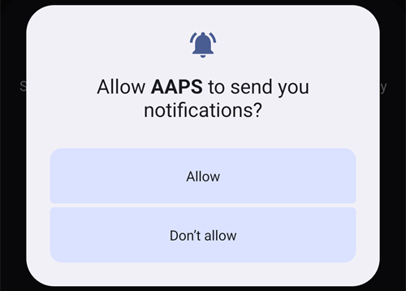
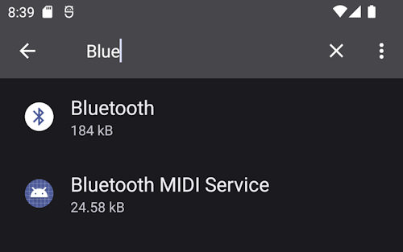
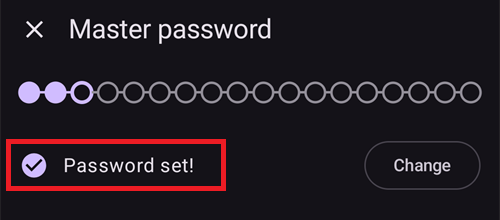
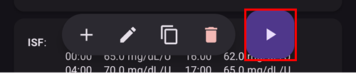
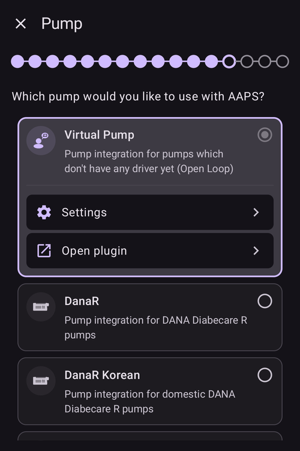

# AAPS Setup Wizard

```{contents} In this page
:backlinks: entry
:depth: 2
```

Når du starter **AAPS** for første gang, blir du ledet gjennom «**Oppsettveiviser**», som hjelper deg med å sette opp alle de grunnleggende konfigurasjonene i appen i én omgang. **Oppsettveiviseren** leder deg gjennom stegene, slik at du ikke glemmer noe viktig. For eksempel er **tillatelsene** helt grunnleggende for å sette opp **AAPS** riktig.

Du må likevel ikke få alt helt ferdig konfigurert første gang du bruker **Oppsettveiviseren**. Du kan enkelt avslutte veiviseren og komme tilbake til den senere. Etter **Oppsettveiviseren** finnes det tre veier videre for å forbedre eller endre konfigurasjonen. These will be explained in the next section. So, it's okay if you skip some points in the Setup Wizard, you can easily configure them later.

Mens du bruker **Oppsettveiviseren**, og rett etterpå, merker du kanskje ingen store synlige endringer i **AAPS**. For å aktivere **AAPS**-loopen din må du følge **Opplæringsmålene**, som låser opp funksjon etter funksjon. Du starter **Opplæringsmål 1** på slutten av Oppsettveiviseren. Det er du som styrer **AAPS**, ikke omvendt.

```{admonition} Preview Objectives
:class: note
Hvis du vil vite hvordan opplæringsmålene er bygd opp, kan du lese [Opplæringsmålene](../SettingUpAaps/CompletingTheObjectives.md), men kom tilbake hit og kjør Oppsettveiviseren først.

```

Fra tidligere erfaring vet vi at nye brukere ofte setter seg selv under press for å sette opp **AAPS** så raskt som mulig. Det kan føre til frustrasjon, for det er mye å lære.

Ta deg derfor god tid til å konfigurere loopen din. Gevinsten av en **AAPS**-loop som fungerer godt, er stor.

```{admonition} Ask for Help
:class: note
If there is an error in the documentation or you have a better idea for how something can be explained, you can ask for help from the community as explained at [Connect with other users](../GettingHelp/WhereCanIGetHelp.md).
```
## Welcome message

Når Oppsettveiviseren åpnes, møter den deg med en kort velkomstmelding og viser med en gang panelet «**Tillatelser kreves**» nederst på skjermen (se neste avsnitt).

Når du har gitt tillatelsene, lukkes panelet, og velkomstskjermen viser en «**Neste**»-knapp. Trykk på «**NESTE**» for å fortsette:


## Required permissions

**AAPS** trenger noen tillatelser for å fungere riktig. Veiviseren samler dem i ett panel, «**Tillatelser kreves**», med en egen «**Tillat**»-knapp for hver. Gi dem én etter én. Ikonet ved siden av hvert punkt blir til en hake når det er gjort.


### Battery optimization

Batteriforbruket på smarttelefoner er noe man må ta hensyn til, siden batteriene fortsatt har ganske begrenset kapasitet. Derfor er Android-operativsystemet på telefonen din strengt med å la apper kjøre og bruke prosessortid, og dermed batteri.

**AAPS** må likevel kjøre regelmessig, _f.eks._ for å motta blodsukkermålingene med noen minutters mellomrom og deretter bruke algoritmen til å bestemme hva som skal gjøres med blodsukkeret ditt, ut fra innstillingene dine. Derfor må appen unntas fra batterioptimalisering.

Trykk på «**Tillat**» ved siden av «**Batterioptimalisering**», og velg deretter «**Tillat**» i dialogen «Vil du la appen alltid kjøre i bakgrunnen?»:


(SetupWizard-StoragePermission)=

### AAPS-mappe

**AAPS** må lagre innstillingene sine og logginformasjon på det permanente lageret i telefonen din. Permanent storage means that it will be available even after rebooting your smartphone. Other information is just lost, as it is not saved to permanent storage.

Trykk på «**Tillat**» ved siden av «**AAPS-mappe**». Dette åpner filsystemet på telefonen og lar deg velge hvor **AAPS** skal lagre informasjonen sin.

```{tip}
Vi anbefaler at du velger standardmappen for AAPS.</br>
Velg **ikke** en undermappe av AAPS.
```

Standardmappen er **AAPS**, men du kan bruke en hvilken som helst egen mappe du vil. Opprett mappen om nødvendig, gå inn i den og velg «**BRUK DENNE MAPPEN**»:


Bekreft med «**TILLAT**» at du vil gi **AAPS** tilgang til den valgte mappen:


### Varslinger

Android requires special permission for apps if they want to send you notifications.

Det kan være fint å slå av varsler _f.eks._ fra sosiale medier, men det er helt nødvendig at du lar **AAPS** sende deg varsler.

Trykk på «**Tillat**» ved siden av «**Varsler**», og velg «**Tillat**» når systemet spør:



### Alarmer og påminnelser

På **Android 14 og nyere** trenger **AAPS** tillatelsen «**Alarmer og påminnelser**», slik at alarmer kan vekke skjermen mens **AAPS** er i bakgrunnen, og slik at påminnelser (for eksempel fra en **Automasjon**) ringer til riktig tid.

Dette punktet vises bare så lenge det trengs. Når **AAPS** er unntatt fra batterioptimalisering (se over), gir Android tillatelse til eksakte alarmer automatisk, og punktet forsvinner. Hvis det fortsatt står i listen, trykker du på «**Tillat**» ved siden av «**Alarmer og påminnelser**». Dette åpner en skjerm i systeminnstillingene for **AAPS**. Slå på bryteren og gå tilbake til **AAPS**. På Android 13 og eldre vises ikke dette punktet, og du trenger ikke gjøre noe.

Når alle tillatelsene viser en hake (tre, eller fire på Android 14 og nyere), lukkes panelet «**Tillatelser kreves**» av seg selv, og du kan trykke på «**NESTE**» på velkomstskjermen for å fortsette.

(setup-wizard-bluetooth-battery-optimisation)=
### Batterioptimalisering for Bluetooth

```{admonition} Extra Android setting, not part of the Wizard
:class: note
Det følgende er ekstra Android-konfigurasjon som gjøres utenfor Oppsettveiviseren. Det er ikke en av «Tillat»-knappene over, men det er viktig for en stabil forbindelse til pumpen.
```

Nyere versjoner av Android har lagt til batterioptimalisering også for systemets Bluetooth-app.

I tillegg til å slå av batterioptimalisering for **AAPS**, må du trolig også slå det av for Bluetooth-systemappen. Hvis du ikke gjør dette, kan det føre til at forbindelsen til pumpen faller ut og gir problemer.

***MERK: xDrip-dokumentasjonen beskriver hvordan du gjør dette her: [xDrip-dokumentasjonen](https://navid200.github.io/xDrip/docs/BluetoothBatteryOpt.html)***

Følg disse stegene på Android 16. Andre versjoner avviker litt fra skjermbildene som vises:

1. Åpne Android-innstillingene, søk etter **Apper** og åpne innstillingene for apper.

   

2. Du ser nå appinnstillingene, men vi må utvide listen for å se alle appene. Trykk på **Se alle apper** for å utvide.

   

3. Siden Bluetooth-appen er en systemapp, er den skjult som standard, så vi må vise systemapper. Trykk på de **tre prikkene** (⋮) øverst til høyre (1). Trykk deretter på **Vis system** (2).

   

4. Søk etter appen `Bluetooth` og trykk på `Bluetooth` og/eller `Legacy Bluetooth`. Hvis begge finnes, må du gjøre det samme for begge.

   ***MERK: Du kan trygt se bort fra `Bluetooth MIDI Service`. Den brukes ikke av AAPS.***

           

   1. På Android 12 trykker du på `Batteri`, på Android 13+ trykker du på `Appens batteribruk`,

   )

5. På Android 12+ velger du alternativet `Ubegrenset`. På Android 15+ må du utvide innstillingen `Tillat bakgrunnsbruk`. Trykk på delen som er merket med rødt for å gjøre dette, og følg deretter steg 6 for å fullføre.

       

6. På Android 16 velger du `Ubegrenset`

   

## License agreement

Lisensavtalen for sluttbrukere inneholder viktig informasjon om de juridiske sidene ved å bruke **AAPS**. Please read it carefully.

Hvis du ikke forstår eller ikke kan godta lisensavtalen for sluttbrukere, må du ikke bruke **AAPS** i det hele tatt!

Hvis du forstår og godtar, trykker du på knappen «**JEG FORSTÅR OG GODTAR**» og følger Oppsettveiviseren:


En «**Neste**»-knapp vises når du har godtatt. Trykk på «**NESTE**».

Neste skjerm, «**Tillatelser**», viser tillatelsene en gang til. Alle bør vise en hake, siden du ga dem i starten. Hvis en mangler, trykker du på «**Tillat**» ved siden av den. Trykk på «**NESTE**» for å fortsette:


## Hovedpassord

Siden konfigurasjonen av **AAPS** inneholder noen sensitive data (_f.eks._ tilgangstokenet til Nightscout-serveren din), krypteres den med et passord som du angir her.

Veiviseren viser «**Passord ikke angitt**». Trykk på «**Angi**»:


Dette åpner skjermen «**Beskyttelse**». Trykk på «**Hovedpassord**» (vises som «Passord ikke angitt»):


Skriv inn det samme passordet i begge feltene og trykk på «**OK**»:


Gå tilbake med pilen øverst til venstre. Veiviseren viser nå «**Passord definert!**»:



```{admonition} Do not lose your Master Password
:class: danger
**IKKE MIST HOVEDPASSORDET DITT**. Noter det _f.eks._ på Google Drive, som er et godt sted fordi Google tar sikkerhetskopi for deg. Your smartphone or PC can crash and you may have no actual copy. If you forget your Master Password, it can be difficult to recover your profile configuration and progress through the **Objectives** at a later date.
```

Når du er ferdig, trykker du på «**NESTE**» for å gå til neste skjerm.

(setup-wizard-import-settings)=
## Import settings

Denne skjermen vises bare når **AAPS** finner innstillinger som er eksportert tidligere i **AAPS**-mappen («Lagrede innstillinger funnet»), for eksempel når du installerer appen på nytt eller bytter til en ny telefon.

- For å gjenopprette den forrige konfigurasjonen din trykker du på «**Importer innstillinger**» – se [Eksport og import av innstillinger](../Maintenance/ExportImportSettings.md).
- For å starte med en ny konfigurasjon trykker du på «**NESTE**» og fortsetter med veiviseren.


## Enheter (mg/dL <-> mmol/L)

Velg om blodsukkerverdiene dine er i mg/dL eller mmol/L, og trykk deretter på «**NESTE**»-knappen:


## Visningsinnstillinger

Her setter du «**Lav verdi**» og «**Høy verdi**» for visningen av sensorglukose. Blodsukkerverdier mellom disse to merkene vises som «i målområdet». Du kan la standardverdiene (72 og 180 mg/dL) stå for nå, og endre dem senere.

The values you choose only affect the graphical presentation of the diagram, and nothing else.

Blodsukkermålet ditt, _f.eks._, stilles inn for seg i profilen din.

Your range to analyze TIR (time in range) is configured separately in your reporting server.

Juster verdiene med «−»/«+»-knappene om nødvendig, og trykk deretter på «**NESTE**»-knappen:


(SetupWizard-synchronization-with-the-reporting-server-and-more)=
## Kommunikasjon

Skjermen «**Kommunikasjon**» viser pluginene som brukes til å laste opp, synkronisere og kringkaste dataene dine:

- **SMS-kommunikasjon** – fjernstyring av **AAPS** med SMS-kommandoer
- **NSClientV3** – synkroniserer dataene dine med Nightscout via v3-API-et
- **Tidepool** – laster opp data til Tidepool
- **xDrip** – sender data til xDrip
- **Open Humans** – last opp og doner diabetesdataene dine til vitenskapelige prosjekter
- **Klokke** – overvåk og styr **AAPS** fra en WearOS-klokke
- **Eksterne hjelpeapper** – kringkasting av data til ulike eksterne apper
- **Garmin** – tilkobling til en Garmin-enhet


Bla ned for å se resten av listen:


Du kunne satt opp flere av disse nå, men første gang konsentrerer vi oss bare om rapporteringsserveren. Hvis du ikke kan sette den opp nå, hopper du over den for denne gang – du kan konfigurere den senere.

I dette eksempelet bruker vi Nightscout som rapporteringsserver. Kryss av i boksen til høyre for «**NSClientV3**» for å aktivere den. For Tidepool it is even simpler, as you only need your personal login information.

Når den er aktivert, trykker du på «**Innstillinger**» under NSClientV3 for å konfigurere den:


Her konfigurerer du rapporteringsserveren Nightscout. NSClientV3-innstillingene vises som én side du kan rulle i:


Trykk på «**Nightscout URL**» og skriv inn adressen til din egen Nightscout-server (URL-en du satte opp selv, eller fikk av tjenesteleverandøren din). Bekreft med «**OK**».

Trykk på «**Nightscout tilgangstoken**» og skriv inn tilgangstokenet for Nightscout-serveren din. Without this token, access will not work. Hvis du ikke har det ennå, se dokumentasjonen om å sette opp rapporteringsserveren.

La «**Bruk websockets**» stå på for kommunikasjon med Nightscout i sanntid.

De andre delene kan stå med standardverdiene for nå. De beskrives her, slik at du vet hvor du finner dem senere:

**Alarmvalg** – Nightscout-alarmer, kunngjøringer og grenser for gamle data. La bryterne stå av for nå. Vi åpner dem bare for at du skal kjenne til valgene.

**Tilkoblingsinnstillinger** – velg hvordan data skal overføres. Omsorgspersoner må slå på «**Bruk mobildata**», ellers kan ikke telefonen til personen de har omsorg for (_f.eks._ et barn) laste opp utenfor Wi-Fi-dekning, _f.eks._ på vei til skolen. Andre brukere kan slå av overføring via mobildata for å spare data eller batteri. Hvis du er i tvil, lar du alt stå på.


**Avanserte innstillinger** – slå på «**Logg appstart**» hvis du vil se i Nightscout når appen starter på nytt (nyttig for omsorgspersoner). La «**Lag kunngjøringer fra feil**» og «**Lag kunngjøringer ved behov for karbo**» stå på. La «**Bruk langsom synkronisering**» stå av. Den trenger du bare hvis Nightscout-serveren er treg til å behandle store datamengder.


Gå tilbake til listen over plugins og trykk på «**NESTE**» for å gå til neste skjerm.

## Klientstyring

Fra **AAPS** versjon 4 kan klientenheter som kjører **AAPSClient**, **pares** med denne telefonen (**hovedenheten**) og styre den med signerte kommandoer som sendes via Nightscout. Dette er den nye anbefalte måten å fjernstyre **AAPS** på – se [Hovedenhet ↔ klientstyring](../RemoteFeatures/ClientMasterControl.md) for full forklaring og oppsett.

Du trenger ikke konfigurere noe på denne skjermen nå. Du kan pare klienter når som helst senere fra **Administrer → Autoriserte klienter**. Der legger du til en klient med en **QR-kode** (den setter også opp Nightscout på klienten) eller med en **PIN**, og gir den en **rolle**.

- «**Autoriserte klienter**» – administrer de parede klientenhetene som har lov til å styre denne hovedenheten.
- «**Mottak av Nightscout-data**» – å godta behandlinger og data som er lagt inn direkte i Nightscout (den gamle, mindre sikre måten) er nå slått av som standard. Åpne disse innstillingene bare hvis du fortsatt trenger det, _f.eks._ for å legge inn data via Nightscout eller tredjepartsapper.

Når klientstyring allerede er på – alltid i [Enkel modus](#preferences-simple-mode) – er denne telefonen i [herdet modus](#client-master-control-hardened-mode): den godtar bare endringer fra parede klienter, så skjermen forklarer herdet modus i stedet for å tilby innstillingene for «**Mottak av Nightscout-data**».


«**Mottak av Nightscout-data**» åpner innstillingene for «**Synkronisering**», der hver type data som mottas fra Nightscout har sin egen bryter:


Trykk på «**NESTE**» for å gå til neste skjerm.

(setup-wizard-instance-name)=
## Hvem bruker denne telefonen?

Her skriver du inn navnet på personen som bruker denne telefonen. Det skiller denne **AAPS**-instansen fra andre i rapporter og ved synkronisering, for eksempel hvis to barn i familien din bruker **AAPS**. Det brukes også i navnene på eksporterte innstillingsfiler og vises på klokken.

It can be anything. Du kan endre det senere i **Innstillinger → Generelt → Instansnavn**.

Trykk på «**NESTE**» for å gå til neste skjerm.


## Patient type

Her velger du «Pasienttype». Dette er viktig, fordi **AAPS**-programvaren har ulike grenser avhengig av pasientens alder. This is important for security and safety reasons.

Her stiller du også inn **maks tillatt bolus** for et måltid. That is, the largest bolus you need to give to cover your typical meals. Det er en sikkerhetsfunksjon som hjelper deg å unngå en overdose ved et uhell når du gir bolus til et måltid.

The second limit is similar in concept, but relates to the max carbohydrate intake you expect.

Når du har satt disse verdiene, trykker du på «**NESTE**» for å gå til neste skjerm:


## Insulin

Her konfigurerer du insulinet som brukes i pumpen din. Nye insulinprofiler krever en **DIA på minst 5 t**.

Trykk på «**Insulin**»-knappen for å åpne insulinredigeringen:


I redigeringen kan du gi insulinet et **kallenavn** og sette **Topp** (i minutter) og **DIA** (i timer). Det raskeste er å laste inn en forhåndsinnstilling med «**Last topp fra**» – velg **Novorapid**, **Fiasp** eller **Lyumjev** – så fylles toppen inn for deg. Grafen nederst viser hvordan insulinets aktivitetskurve blir.


Velg forhåndsinnstillingen som passer insulinet ditt, for eksempel **Fiasp**:


```{admonition} Use your insulin brand's preset peak
:class: danger
Ikke endre toppen med mindre du er ekspert – vanligvis fungerer de forhåndsinnstilte verdiene godt for hvert insulinmerke.
```

Hvis du er ny **AAPS**-bruker, setter du **DIA** til 9 timer – se [Insulinets virketid (DIA) og topp](#Config-Builder-insulin-dia) for å forstå hvorfor.

```{admonition} "Insulin configuration changed" dialog
:class: note
Hvis en paret klient (_f.eks._ en annen telefon) har endret insulinkonfigurasjonen, vises en dialog. Trykk på **OK** for å laste inn endringene deres, eller **Avbryt** for å fortsette å redigere (neste gang du lagrer, overskrives deres endringer).
```


Trykk på lagre-ikonet (øverst til høyre), og trykk deretter på «**NESTE**» for å gå til neste skjerm.

## Blood sugar source

Her velger du hvor **AAPS** skal hente blodsukkerdataene sine fra. Les dokumentasjonen for [BS-kilden](../Getting-Started/CompatiblesCgms.md) din.

Mange kilder er tilgjengelige – rull gjennom listen og velg den du bruker:


Når du velger en kilde, utvides kortet dens og viser to knapper: «**Innstillinger**» for å justere hvordan dataene mottas, og «**Åpne plugin**» for å åpne kildens egen skjerm. I eksempelet under er **BYODA** valgt. Noen kilder har ingenting å konfigurere på dette stadiet, så du kan som regel gå rett til neste skjerm:


Når du har gjort valget ditt, trykker du på «**NESTE**» for å gå til neste skjerm.

(setup-wizard-profile)=
## Profil

Now we are entering a very important part of the Setup Wizard.

Les dokumentasjonen om [profiler](../SettingUpAaps/YourAapsProfile.md) før du prøver å legge inn profilopplysningene dine på neste skjerm.

```{admonition} Working profile required - no exceptions here !
:class: danger
En nøyaktig profil er nødvendig for at **AAPS** skal kunne handle trygt.

Du må ha funnet fram til profilen din og diskutert den med legen din, og den må være bekreftet gjennom vellykket testing av basaldoser, ISF og IK!

Hvis en robot får feil inndata, vil den feile – hver gang. **AAPS** kan bare arbeide med den informasjonen den får. Hvis profilen din er for sterk, risikerer du føling (hypoglykemi), og hvis den er for svak, risikerer du høyt blodsukker (hyperglykemi). 
```

Trykk på «**Profil**»-knappen for å åpne profilredigeringen:


Redigeringen åpnes tom («Ingen registreringer tilgjengelig»). Trykk på «**+**»-knappen nederst for å opprette en ny profil:


You can have several profiles in the long-term if needed. We only create one here.

```{admonition} Profile only for tutorial - not for your usage
:class: note
Eksempelprofilen her er bare for å vise deg hvordan du legger inn data.

Den er ikke ment som en nøyaktig profil eller noe som er godt optimalisert, siden hver persons behov er så forskjellige.

Ikke bruk den til å loope på ordentlig!
```

Den nye profilen (for eksempel «**LocalProfile1**») har fire faner: **IK**, **ISF**, **BAS** og **MÅL**. Trykk på blyanten ved siden av profilnavnet for å gi den nytt navn. Fyll ut hver fane – en fane forblir rød og viser en feilmelding til den inneholder gyldige verdier:


Trykk på «**IK**» og skriv inn [IK](#your-aaps-profile-insulin-to-carbs-ratio)-verdiene dine. Bruk «**+**»-knappen for å legge til flere tidsblokker:


Trykk på «**ISF**» og skriv inn [ISF-verdiene](#your-aaps-profile-insulin-sensitivity-factor) dine:


Trykk på «**BAS**» og skriv inn [basalverdiene](#your-aaps-profile-basal-rates) dine:


Trykk på «**MÅL**» og skriv inn målverdiene dine for blodsukker.

Ved åpen loop kan dette målet være et bredere område. Ellers varsler **AAPS** deg hele tiden om å endre midlertidig basal eller en annen innstilling, og det kan bli slitsomt.

Later, for closed looping, you will generally have only one value for top and bottom. Det gjør det lettere for **AAPS** å treffe målet og gir deg bedre kontroll på diabetesen totalt sett.


Når alle fire fanene er gyldige, blir **lagre-ikonet** (øverst til høyre) aktivt. Trykk på det for å lagre profilen:


Lukk redigeringen med «**X**» øverst til venstre. Profilsammendraget viser så navnet, total daglig basal (∑), enhetene og IK- og ISF-verdiene med grafene sine:



```{admonition} Several defined but only one active profile
:class: note
Du kan ha flere profiler definert, men bare én aktivert profil kan kjøre om gangen.
```

Trykk på «**▶**»-knappen (aktiver) nederst til høyre. Skjermen «**Aktiver**» åpnes. Siden ingen insulintype er i bruk ennå, ber den deg først velge insulinet du bruker, slik at profilbyttet kan registrere det. «**Aktiver**»-knappen forblir grå til du har gjort det:


Trykk på «**Velg insulin**» og velg insulinet du konfigurerte tidligere. La prosenten stå på 100 % og trykk på «**Aktiver**»:


En dialog for profilbytte vises. I dette tilfellet lar du den stå som forhåndsinnstilt og bekrefter med «**OK**»:

```{admonition} Profile switch dialog
:class: note
Senere lærer du hvordan du bruker denne generelle dialogen i situasjoner som sykdom eller trening, der du må endre profilen etter omstendighetene.
```


Profilen din er nå aktiv. Trykk på «**NESTE**» for å gå til neste skjerm.

## Insulinpumpe

Nå velger du insulinpumpen din. Les dokumentasjonen for [insulinpumpen](../Getting-Started/CompatiblePumps.md) din.

Rull i listen og velg pumpen din. I dette eksempelet bruker vi «**Virtuell pumpe**», som er nyttig mens du fortsatt lærer og ikke har koblet til en ekte pumpe ennå:



Mange pumper støttes – rull nedover for å finne din:


Når du velger en ekte pumpe, ber **AAPS** om en bekreftelse, fordi den vil kopiere basaldosene fra profilen din til pumpen og overskrive basaldosene som er lagret der. Trykk på «**OK**» bare hvis basaldosene i **AAPS**-profilen din er riktige. Ellers trykker du på «**Avbryt**» og bytter til pumpen senere:


Hvis pumpen du velger kommuniserer via Bluetooth, ber **AAPS** om tillatelse til å koble til enheter i nærheten når du er ferdig med veiviseren (se [Bluetooth-tillatelse](#bluetooth-permission)).

Hvis du allerede har satt opp profilen din og vet hvordan du kobler til pumpen, kan du gjerne koble den til nå. Ellers lar du den stå på **Virtuell pumpe** inntil videre – du kan endre det når som helst, eller gå ut av Oppsettveiviseren med pilen øverst til venstre og la **AAPS** først vise deg noen blodsukkerverdier.

Trykk på «**NESTE**» for å gå til neste skjerm.

## APS algorithm

Use the OpenAPS SMB algorithm as your APS algorithm. Til tross for navnet er SMB-funksjonen i algoritmen slått av til du er kjent med AAPS og har gjort de første opplæringsmålene. OpenAPS SMB er uansett nyere og generelt bedre enn OpenAPS AMA.

SMB er slått av i starten fordi SMB-funksjonen reagerer raskere på en stigning i blodsukkeret, med en supermikrobolus i stedet for å øke basalprosenten. Siden profilen din som regel ikke er like god i begynnelsen som etter litt erfaring, er funksjonen slått av til å begynne med.

```{admonition} Only use the older algorithm **OpenAPS AMA** if you know what you are doing
:class: note
OpenAPS AMA er den enkleste algoritmen. Den støtter ikke mikroboluser for å korrigere høye verdier. Det kan finnes situasjoner der det er bedre å bruke denne algoritmen, men det er ikke det som anbefales.
```

Velg «**OpenAPS SMB**», og trykk deretter på «**Innstillinger**» for å se detaljene:


Det eneste valget her er «**Bruk dynamisk sensitivitet**». La det stå av og ikke endre noe for nå – bare les teksten.

På grunn av begrensningene som **Opplæringsmålene** setter, kan du uansett ikke bruke verken «lukket loop» eller «SMB-funksjoner» ennå.

Gå tilbake og trykk på «**NESTE**» for å gå til neste skjerm:


## Sensitivitetsdeteksjon

La «**Sensitivitet Oref1**» stå valgt som standard sensitivitets-plugin:


Hvis du trykker på «**Innstillinger**», kan du se gjennom innstillingene for absorpsjon. Standardverdiene (_f.eks._ en absorpsjonsgrense på 6 t) er greie for nå.


Trykk på «**NESTE**» for å gå til neste skjerm.

## Start Objective 1

Nå kommer du til Opplæringsmålene – kvalifiseringen som gir tilgang til flere **AAPS**-funksjoner.

Trykk på «**Åpne opplæringsmål**»:


Here we start Objective 1, even if at the moment our setup is not completely ready to successfully complete this Objective. But this is the start.

Trykk på «**Start**»-knappen ved siden av «**1. Opplæringsmål**»:


Opplæringsmålet utvides og viser de enkelte punktene. Du ser at du allerede har gjort noen framskritt, mens andre punkter gjenstår:


Gå tilbake og trykk på «**AVSLUTT**» for å fullføre Oppsettveiviseren:


Når du har trykket på «**AVSLUTT**», kommer du til hovedskjermen i **AAPS**. Et «**Varsling**»-panel kan åpne seg med informasjonsmeldinger, for eksempel om profilbyttet du nettopp gjorde – trykk på «**Forkast**» under hver melding for å fjerne den.

Hvis du ved et uhell går ut av Oppsettveiviseren, kan du enten bare starte veiviseren på nytt, eller endre [konfigurasjonen av AAPS-loopen](../SettingUpAaps/ChangeAapsConfiguration.md) manuelt.

## Bluetooth-tillatelse

Hvis du velger en pumpe som kobler til via Bluetooth (for eksempel **Omnipod Dash**), minner et banner deg om at **AAPS** trenger Bluetooth-tillatelse. Du kan trykke på «**Forkast**» for nå – tillatelsen gis etter at du er ferdig med veiviseren:


Når Oppsettveiviseren er ferdig, viser hovedskjermen i **AAPS** panelet «**Tillatelser kreves**». De andre tillatelsene er allerede gitt. Trykk på «**Tillat**» ved siden av «**Bluetooth**»:


Velg «**Tillat**» slik at **AAPS** kan finne og koble til pumpen din:


Hvis **AAPS**-loopen din nå er ferdig satt opp, kan du gå videre til neste del, [«Opplæringsmålene»](../SettingUpAaps/CompletingTheObjectives.md).
