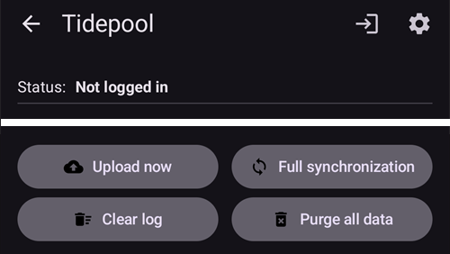

# Tidepool

Tidepool er et tredjepartsverktøy som samler inn data om BS, insulin og karbohydrater (og merknadene du legger til behandlingene dine), og kan brukes til å analysere og dele disse dataene med behandlingsteamet ditt. Fra AAPS versjon 3.2 kan den brukes som et alternativ til Nightscout for å oppfylle deler av Opplæringsmål 1. Den kan også brukes sammen med Nightscout som en alternativ rapporteringsplattform som fungerer godt i kliniske sammenhenger. Dette kan være et godt alternativ for barn som bruker AAPS og vil ha fjernovervåking og fjernstyring gjennom Nightscout, men som vil ha en rapporteringsplattform som behandlingsteamet deres er mer fortrolig med.

Det er viktig å forstå at Tidepool bare er for rapportering. Det er IKKE en følgeapp i sanntid. Hvis du trenger følgere utover AAPS-hovedtelefonen, må du også sette opp Nightscout.

Merk: Organisasjonen Tidepool har lansert produktet iOS Loop med FDA-godkjenning. Dette arbeidet har ingenting å gjøre med datarapporteringsplattformen deres eller AAPS.

## Steg 1 – Opprett en Tidepool-konto

- Gå til [tidepool.org](https://www.tidepool.org/)

- Velg «Personal Sign Up» eller «Sign Up»

- Opprett og noter en e-postadresse og et passord

- Velg «Personal Account» og trykk på «Continue»

- Fyll ut delen med pasientinformasjon og godta bruksvilkårene

- Bekreft e-postadressen din ved å følge instruksjonene du får på e-post

## Steg 2 – Koble AAPS til Tidepool

- Åpne **menyen** (☰) øverst til venstre på hovedskjermen og velg «**Konfigurasjon**»

- Åpne kategorien «**Kommunikasjon**» og aktiver «**Tidepool**»:

- Trykk på «**Åpne plugin**» under Tidepool, og trykk deretter på **Logg inn**-ikonet (en pil som går inn i en dør) øverst til høyre

- Et nettleservindu åpnes på innloggingssiden til Tidepool. Logg inn med e-postadressen og passordet du opprettet i steg 1 over:

- Etter vellykket innlogging lukkes nettleseren, og Tidepool-skjermen viser statusen «**Tilkoblet**». Loggen under viser dataopplastingene. Hvis innloggingen mislykkes, sjekk at innloggingsopplysningene dine er riktige og at du har bekreftet e-postadressen din hos Tidepool.

- I «**Innstillinger**» for Tidepool-pluginen åpner du «**Tilkoblingsinnstillinger**». Som standard er «**Bruk tilkoblingsinnstillingene for Nightscout**» på, så Tidepool laster opp under de samme vilkårene som du har satt for Nightscout. Slå den av hvis du vil ha egne vilkår for Tidepool, for eksempel å laste opp til Tidepool bare på Wi-Fi og under lading, mens Nightscout også bruker mobildata.

 

For mer hjelp til å bruke dataene dine når de er lastet opp til Tidepool, se: [https://www.tidepool.org/viewing-your-data](https://www.tidepool.org/viewing-your-data)

(tidepool-menu)=
## Tidepool-knappene

Øverst til høyre på Tidepool-skjermen:

- **Logg inn**- eller **Logg ut**-ikonet – koble til eller fra Tidepool-kontoen din. Bare ett av dem vises: **Logg inn** mens du er logget ut, **Logg ut** mens du er logget inn. **AAPS** ber deg bekrefte før den logger deg ut.
- Tannhjulet – Tidepool-innstillingene.

Knappene nederst på Tidepool-skjermen:

- «**Last opp nå**» – last opp nye data med en gang i stedet for å vente på neste automatiske opplasting.
- «**Full synkronisering**» – last opp alle data som er lagret i **AAPS** på nytt.
- «**Slett alle data**» – slett **alle** data som **AAPS** har lastet opp til Tidepool-kontoen din. Dette kan ikke angres. Bruk den bare for å fjerne feil eller dupliserte data, og kjør deretter «**Full synkronisering**» for å laste opp dataene dine på nytt.
- «**Tøm logg**» – tøm loggen som vises på Tidepool-skjermen.

I Tidepool vises dataene som **AAPS** 4 laster opp, under enhetsnavnet **AAPS**. Se [Hva er endret i AAPS v4](#v4changes-tidepool) hvis du brukte Tidepool med en eldre versjon. 
