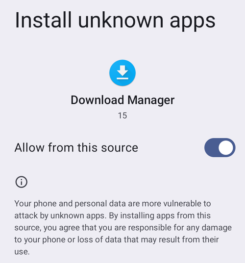

# Transferring and Installing AAPS on your smartphone

I forrige del, [bygge **AAPS**](../SettingUpAaps/BuildingAaps.md), bygde du **AAPS**-appen (som er en .apk-fil) på en datamaskin.

De neste stegene er å **overføre** APK-filen til **AAPS** (og andre apper du kan trenge, som BYODA, xDrip eller en annen CGM-mottakerapp) til Android-telefonen din, og deretter **installere** appen(e). Når **AAPS** er installert på telefonen, kan du gå videre til å [**konfigurere AAPS-loopen**](../SettingUpAaps/SetupWizard.md).

Denne siden forklarer også [Android-utviklerverifisering](#android-developer-verification), en endring Google ruller ut fra september 2026 som påvirker installasjon av apper du har bygd selv, og de [gratis installasjonsmetodene](#android-developer-verification-free-methods) som fortsatt virker etter endringen.

```{contents} Table of contents
:depth: 1
:local: true
```

## Installere AAPS ved å trykke på APK-filen

I dag installerer du **AAPS** ved å overføre APK-filen til telefonen og åpne («trykke på») den. Det finnes flere måter å overføre APK-filen til **AAPS** fra datamaskinen til smarttelefonen på. Here we explain two different ways:

* Option 1 -  Use your Google drive (Gdrive)
* Option 2 -  Use a USB cable

Please note that transfer by email might cause difficulties, and is discouraged.

```{admonition} Android developer verification
:class: warning
Google ruller ut [Android-utviklerverifisering](#android-developer-verification) fra september 2026 (først i Brasil, Indonesia, Singapore og Thailand; i hele verden i 2027). Der dette håndheves, blir installasjon av en APK ved å trykke på filen — slik det beskrives i begge alternativene nedenfor — blokkert. Bruk i så fall en av de [gratis installasjonsmetodene](#android-developer-verification-free-methods) lenger ned på denne siden.
```

### Option 1. Use Google drive to transfer files

Åpne [Google.com](https://www.google.com/) i nettleseren og logg inn på Google-kontoen din.

On the right upper side select the Drive app in the Google menu.


Klikk på **Ny** øverst til venstre (eller høyreklikk på et tomt område under filene og mappene dine) og velg **Filopplasting**.


The apk file should now be uploaded on Google Drive.

#### Use the Google Drive app to execute the apk file for installation

Switch to your mobile and start the Google Drive app. It is a preinstalled app and can be found where the other Google apps are located or with search for the name of the app.


Start installasjonen av apk-filen ved å trykke på filnavnet i Google Drive-appen på telefonen.


Hvis du får en sikkerhetsmelding om at du ikke har lov til å installere apper fra Google Drive akkurat nå, trykker du på «Innstillinger» og tillater det for et kort øyeblikk. Slå det av igjen etterpå, siden det er en sikkerhetsrisiko å la det stå på hele tiden.


Når installasjonen er ferdig, er du ferdig med dette steget.

Du bør se **AAPS**-ikonet og kunne åpne appen.

```{warning}
**VIKTIG SIKKERHETSMELDING**
Husket du å slå av tillatelsen til å installere fra Google Drive?
```

Gå videre med å [konfigurere AAPS-loopen](../SettingUpAaps/SetupWizard.md).

### Option 2. Use a USB cable to transfer files

Den andre måten å overføre apk-filen til AAPS på er med en [USB-kabel](https://support.google.com/android/answer/9064445?hl=en).

Transfer the file from its location on your computer to the "downloads" folder on the phone.

On your phone, you will have to allow installation from unknown sources. Forklaringer på hvordan du gjør dette finner du på internett (_f.eks._ [her](https://www.expressvpn.com/de/support/vpn-setup/enable-apk-installs-android/) eller [her](https://www.androidcentral.com/unknown-sources)).

Når du har overført filen ved å dra den over, åpner du mappen «Nedlastinger» på telefonen og trykker på apk-filen til AAPS:


Første gang forteller Android deg at telefonen ikke har lov til å installere ukjente apper fra denne kilden. Trykk på «**Innstillinger**»:


Slå på «**Tillat fra denne kilden**», og gå så tilbake:



Trykk på apk-filen igjen og velg «**Installer**»:


Når installasjonen er ferdig, trykker du på «**Åpne**» for å starte **AAPS**, eller «**Ferdig**» for å åpne den senere:


```{warning}
**VIKTIG SIKKERHETSMELDING**
Husk å slå av «Tillat fra denne kilden» igjen etter installasjonen, siden det er en sikkerhetsrisiko å la det stå på hele tiden.
```

Gå videre med å [konfigurere AAPS-loopen](../SettingUpAaps/SetupWizard.md).

(transferring-installing-play-protect-warning)=
## Advarsel fra Google Play Protect

Når du installerer **AAPS**, kan Google Play Protect advare om at appen er utrygg, at den er bygd for en eldre versjon av Android og at den ikke har de nyeste personvernbeskyttelsene.


Dette er som forventet for en app du har bygd selv. Trykk på **Flere detaljer** og deretter **Installer likevel**.

Hvis installasjonen blir **blokkert** med en melding om en uverifisert utvikler (ikke bare en advarsel), se [Android-utviklerverifisering](#android-developer-verification) nedenfor.

(android-developer-verification)=

## Android-utviklerverifisering

Google innfører **Android-utviklerverifisering**: på de fleste Android-telefoner vil apper bare kunne installeres hvis de er registrert hos Google av en verifisert utvikler. Dette gjelder også apper som installeres fra en APK-fil («sideloading») — som er måten du installerer **AAPS**-appen du har bygd selv på.

### Hva som endres

Når du installerer **AAPS** på en telefon med Google-tjenester (en «sertifisert» Android-enhet — så godt som alle telefoner som selges med Play Store), vil Android sjekke om appen kommer fra en utvikler som er registrert hos Google. Hvis ikke, blir den vanlige installasjonen ved å trykke på APK-filen blokkert.

**Kontrollen skjer når en app installeres eller oppdateres.** Den fjerner ikke apper som allerede er installert og kjører.

Google ruller dette ut gradvis:

| Når                | Hva skjer                                                                                                                                    |
| ------------------ | -------------------------------------------------------------------------------------------------------------------------------------------- |
| August 2026        | Gratis utviklerkontoer for «begrenset distribusjon» er åpne i hele verden, og «avansert flyt» begynner å rulles ut til telefoner             |
| 30. september 2026 | Verifisering håndheves i **Brasil, Indonesia, Singapore og Thailand** for apper som installeres fra Google Play og noen få andre appbutikker |
| 2027               | Håndhevingen utvides til **resten av verden** og til **alle installasjoner**, også fra APK-filer                                             |

Google publiserer detaljer på sidene om [Android-utviklerverifisering](https://developer.android.com/developer-verification), inkludert en [FAQ](https://developer.android.com/developer-verification/guides/faq). Google kan fortsatt endre datoer og detaljer; denne siden oppdateres etter hvert som utrullingen går framover.

### Gjelder dette meg?

- **Å bygge AAPS påvirkes ikke i det hele tatt.** [Nettleserbygget](#browser-build), [Android Studio-bygget](ComputerBuild.md) og [kommandolinjebygget](CLIBuild.md) virker akkurat som før, og keystore-filen din endres ikke.
- **Din nåværende AAPS fortsetter å kjøre.** Verifisering sjekkes bare når en app installeres eller oppdateres.
- **Hvis du bor i Brasil, Indonesia, Singapore eller Thailand:** fra 30. september 2026 håndheves verifisering for apper som installeres fra Google Play og noen få andre appbutikker. Google sier at direkte installasjon av en APK-fil ikke omfattes av dette første steget, så **AAPS** bør fortsatt kunne installeres som vanlig. Forbered likevel en av de [gratis installasjonsmetodene](#android-developer-verification-free-methods) nedenfor nå, så du ikke blir overrasket hvis dette endrer seg.
- **Hvis du bor et annet sted:** ingenting endres for deg før 2027, og det er helt greit å ikke gjøre noe foreløpig. Men sett opp en av de [gratis installasjonsmetodene](#android-developer-verification-free-methods) nedenfor mens ingenting er ødelagt: å oppdage blokkeringen den dagen en oppdatering blir avvist, med [den avanserte flytens](#android-developer-verification-advanced-flow) ventetid på 24 timer foran deg, er feil tidspunkt.
- **Gamle telefoner:** verifisering gjelder telefoner med Android 7 eller nyere, altså alle telefoner som kan kjøre **AAPS**.

(android-developer-verification-free-methods)=

## Gratis måter å installere AAPS på

Du trenger **ikke** betale Google noe for å fortsette å bruke **AAPS**. Det finnes flere gratis metoder; velg den som passer din situasjon.

```{admonition} Which method should I use?
:class: tip
- Du har en **datamaskin** (uansett hvordan du bygde **AAPS**): bruk [ADB](#android-developer-verification-adb) eller, hvis du helst vil unngå kommandolinjen, [nettinstallatøren](#android-developer-verification-web). Begge er unntatt fra verifisering, har ingen begrensninger og trenger ingen Google-konto.
- Du har **ingen datamaskin i det hele tatt**: bruk [avansert flyt](#android-developer-verification-advanced-flow) på telefonen.
- Du vil helst registrere deg hos Google slik at den vanlige «trykk på APK-filen»-installasjonen fortsetter å virke: det finnes en [gratis konto for begrenset distribusjon](#android-developer-verification-limited-account), men den er ikke testet med **AAPS**.
```

(android-developer-verification-adb)=

### Alternativ 1: Installere med ADB (krever datamaskin)

ADB (Android Debug Bridge) er Googles offisielle verktøy for å installere apper fra en datamaskin til en telefon med USB-kabel. Google har bekreftet at **apper som installeres med ADB ikke krever verifisering** — det er ingen ventetid, ingen grense for antall enheter og ingen registrering.

Engangsforberedelse:

1. På telefonen slår du på de skjulte utvikleralternativene: gå til **Innstillinger** > **Om telefonen** (på noen telefoner **Programvareinformasjon**) og trykk sju ganger på **Delenummer**, til telefonen bekrefter at du er utvikler.
1. Gå tilbake til hovedmenyen i **Innstillinger**, åpne det nye valget **Utvikleralternativer** og slå på **USB-feilsøking**.
1. På datamaskinen må du sørge for at ADB er tilgjengelig:
   - Hvis du bruker **Android Studio**, er ADB allerede installert sammen med det.
   - Ellers laster du ned Googles gratis [SDK Platform Tools](https://developer.android.com/tools/releases/platform-tools) og pakker ut mappen. Ingen installasjon er nødvendig; ADB er programmet `adb` inne i den mappen.

Installere (og senere oppdatere) **AAPS**:

1. Koble telefonen til datamaskinen med en USB-kabel. Du trenger ikke overføre APK-filen til telefonen først: ADB sender den rett fra datamaskinen.
1. På telefonen godtar du spørsmålet **Tillate USB-feilsøking?** (bare første gang).
1. På datamaskinen åpner du en terminal (ledetekst) i mappen som inneholder ADB og APK-filen til **AAPS**, og kjører:

   ```
   adb install -r app-full-release.apk
   ```

   Bytt ut `app-full-release.apk` med det faktiske navnet på APK-filen din. Valget `-r` oppdaterer en allerede installert **AAPS** og beholder alle data og innstillinger.

1. Vent til `Success` vises. **AAPS** er nå installert på telefonen din.

Den samme kommandoen brukes for alle framtidige oppdateringer. [Wear OS-sidene](../WearOS/WearOsSmartwatch.md) bruker allerede ADB på samme måte for å installere klokkeappen.

Hvis du helst ikke vil bruke kabel: på Android 11 og nyere kan **trådløs feilsøking** (også under **Utvikleralternativer**) gjøre det samme over Wi-Fi, etter en engangsparing med en kode som vises på telefonen.

(android-developer-verification-web)=

### Alternativ 2: Installere fra en nettside (datamaskin, ingen kommandolinje)

Hvis kommandolinjen ikke er noe for deg, kan en nettside gjøre akkurat det samme som ADB, rett fra nettleseren din. Fordi den snakker med telefonen gjennom den samme mekanismen som ADB, har den **det samme unntaket fra verifisering** — men det er ingenting å laste ned, ingen mappe å pakke ut og ingen kommando å skrive.

Dette er den enkleste veien hvis du brukte [nettleserbygget](#browser-build) og aldri har åpnet en kommandolinje.

1. Slå på **USB-feilsøking** på telefonen (steg 1 og 2 i [ADB-metoden](#android-developer-verification-adb) ovenfor — engangsoppsett).
1. Åpne **[AAPS nettinstallatør](#web-installer)** i nettleseren.
1. Koble til telefonen med en USB-kabel og følg instruksjonene på siden: koble til, velg APK-filen din, og installer.

Tre ting du bør vite:

- Den virker bare i **Chrome, Edge eller Opera**. Firefox og Safari kan ikke snakke med USB-enheter.
- Bare ett program kan bruke telefonens ADB-forbindelse om gangen, så **lukk Android Studio** (eller alt annet som bruker ADB) før du kobler til.
- En nettside som er koblet til på denne måten, får full kontroll over telefonen din. **Bruk bare adressen ovenfor**, fra **AAPS**-dokumentasjonen — aldri en installasjonsside du har funnet via en søkemotor. **AAPS** nettinstallatør kjører helt og holdent i nettleseren din: APK-filen din lastes ikke opp noe sted.

```{admonition} No computer? A second phone works too
:class: tip
Nettinstallatøren virker også fra **Chrome på en annen Android-telefon** med en USB-C-til-USB-C-kabel — så en forelder kan installere **AAPS** på barnets telefon uten noen datamaskin i huset.
```

(android-developer-verification-advanced-flow)=

### Alternativ 3: «Avansert flyt» på telefonen (ingen datamaskin nødvendig)

Google tilbyr en nødutvei for erfarne brukere som forstår risikoen ved å installere uverifiserte apper, kalt **avansert flyt** (advanced flow). Google begynte å rulle den ut til telefoner i august 2026, før håndhevingen starter, så du kan sette den opp nå. Det er et engangsoppsett på selve telefonen, som **tar 24 timer** å fullføre:

1. Slå på de skjulte utvikleralternativene (se steg 1 i ADB-metoden ovenfor), og åpne så **Innstillinger** > **Utvikleralternativer** > **Apper fra uverifiserte utviklere**.
1. Slå på **Tillat apper fra uverifiserte utviklere**. Telefonen ber om skjermlåsen din for å bekrefte at det er deg.
1. Telefonen spør om noen ber deg om å slå på denne innstillingen, og forklarer at banker, offentlige etater eller politiet aldri ville bedt deg om det. Les advarselen og bekreft at ingen presser eller veileder deg (dette er en beskyttelse mot svindlere).
1. **Start telefonen på nytt.** Dette starter en engangs **ventetid på 24 timer**.
1. Etter 24 timer går du tilbake til **Innstillinger** > **Utvikleralternativer** > **Apper fra uverifiserte utviklere** for å fullføre oppsettet.
1. Velg om du vil tillate uverifiserte apper i **7 dager** eller **på ubestemt tid**. For **AAPS** velger du **på ubestemt tid**, ellers blir neste oppdatering blokkert når de 7 dagene har gått.

Etter dette oppsettet virker installasjon og oppdatering av **AAPS** APK-filen som i dag, med én ekstra advarsel om at appen er fra en uverifisert utvikler — trykk på **Installer likevel**.

Greit å vite:

- Du kan slå av **Utvikleralternativer** igjen etterpå: avansert flyt forblir aktivert. Google gir heller ikke apper (for eksempel bankapper) noen mulighet til å oppdage at avansert flyt er aktivert.
- Hvis du slår av avansert flyt, blir installasjon **eller oppdatering** av **AAPS** blokkert igjen (den installerte **AAPS**-appen din fortsetter å kjøre). Du har et vindu på 10 minutter til å slå den på igjen; etter det starter ventetiden på 24 timer på nytt.
- Å endre klokken på telefonen forkorter ikke ventetiden, og ADB kan ikke hoppe over den.
- Google sier at valget ditt følger Google-kontoen din til de andre enhetene dine, så en ny telefon skal ikke bety en ny ventetid på 24 timer.
- Hvis du ikke finner **Apper fra uverifiserte utviklere** i utvikleralternativene, har ikke telefonen din fått funksjonen ennå. Den leveres av en systemkomponent kalt **Android Developer Verifier**, som Google ruller ut gradvis gjennom Play Store. Du kan hjelpe det på vei ved å åpne **Android Developer Verifier** i Play Store.

```{note}
Google beskriver dette som en første versjon og kan fortsatt endre skjermbildene og stegene; denne delen oppdateres med skjermbilder når den endelige versjonen er tilgjengelig.
```

(android-developer-verification-limited-account)=

### Alternativ 4: Registrere deg hos Google (gratis konto for begrenset distribusjon)

Google tilbyr en **gratis** type utviklerkonto for hobbybrukere og personlig bruk, kalt **konto for begrenset distribusjon** (limited distribution account), åpen for alle siden august 2026:

- **Ingen offentlig ID** og **ingen avgift** (i motsetning til den betalte utviklerkontoen, som ikke trengs for personlig bruk av **AAPS**). Du trenger likevel en Google-konto med totrinnsbekreftelse, en Google-betalingsprofil med ditt juridiske navn og din adresse, og en e-postadresse for kontakt.
- Du registrerer appens pakkenavn i Googles Android Developer Console og autoriserer telefonene den kan installeres på, opptil **20 enheter**, gjennom et håndtrykk med en QR-kode eller lenke mellom telefonen og konsollen.
- Når den er registrert, virker den vanlige installasjonen (trykke på APK-filen) igjen på de autoriserte telefonene, uten ADB og uten avansert flyt.
- En konto for begrenset distribusjon kan senere oppgraderes til en full konto, men ikke motsatt.

```{warning}
Google har ikke forklart hvordan registrering virker når mange mennesker bygger den samme appen med åpen kildekode: hver selvbygde **AAPS** bruker det samme pakkenavnet (`info.nightscout.androidaps`) med en annen signeringsnøkkel, og Googles FAQ sier at et pakkenavn som allerede er i bruk av andre ikke kan kreves uten videre, men krever en ekstra gjennomgang. Utfallet av en slik gjennomgang er ukjent, og den betalte utviklerkontoen (25 dollar og offentlig ID) hjelper ikke her: betaling fjerner bare grensen på 20 enheter, ikke gjennomgangen av pakkenavnet.

Derfor kan det ikke skrives steg-for-steg-instruksjoner ennå. Denne delen fullføres når registrering er testet med **AAPS**. I mellomtiden er ADB, nettinstallatøren og avansert flyt ovenfor pålitelige alternativer.
```

## Hva som ikke endres

- Å bygge **AAPS** selv, med hvilken som helst av de tre [byggemetodene](BuildingAaps.md).
- GitHub-kontoen din, bygg-repositoriet ditt (AAPS Builder) eller forken din, og keystore-filen din.
- Den installerte **AAPS**-appen din, innstillingene dine og [opplæringsmålene](CompletingTheObjectives.md) dine.
- Telefoner uten Google-tjenester, og [ADB-installasjoner](#android-developer-verification-adb) generelt.

## Hvor du kan få hjelp

1. **Les** Googles [FAQ om utviklerverifisering](https://developer.android.com/developer-verification/guides/faq) for spørsmål om selve verifiseringen.
2. **Spør** på kanalen *#AAPS* på [Discord](https://discord.gg/4fQUWHZ4Mw), eller i en av de andre [fellesskapskanalene](../GettingHelp/WhereCanIGetHelp.md), hvis en installasjon blir blokkert.
3. Når du ber om hjelp, ta med telefonens merke og modell, Android-versjon, landet ditt og den nøyaktige meldingen som vises når installasjonen mislykkes.

```{toctree}
:hidden:

AAPS nettinstallatør <WebInstaller.md>
```
