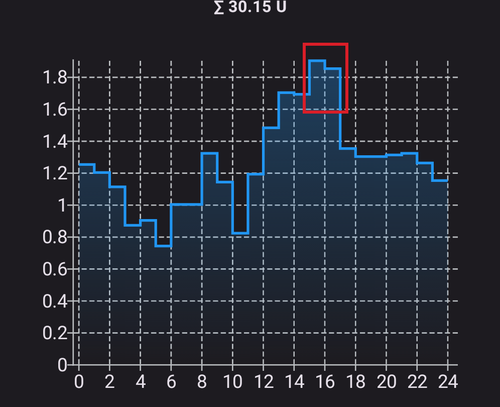
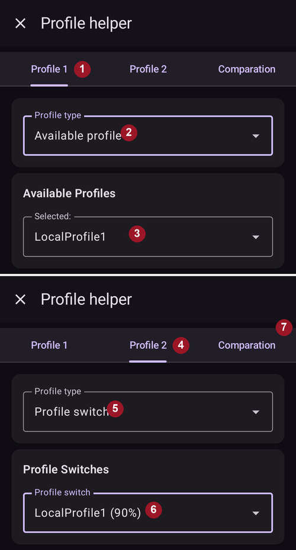

# Din AAPS-profil

**AAPS-profilen** din er et sett med fire nøkkelparametere som bestemmer hvordan **AAPS** skal gi insulin som svar på sensorverdiene dine. Dette er hovedparameterne som **AAPS** bygger på. Etter hvert som du går gjennom **Opplæringsmål**, låser du opp flere parametere du kan endre (som SMB-innstillinger), men hvor godt disse funksjonene virker, avhenger av at **Profil**-grunnlaget ditt er riktig. **Profilen** består av:
* [BS-mål](#profile-glucose-targets),
* [basaldoser](#your-aaps-profile-basal-rates) (BR),
* [insulinfølsomhetsfaktorer](#your-aaps-profile-insulin-sensitivity-factor) (ISF) og
* [insulin/karbohydrat-forhold](#your-aaps-profile-insulin-to-carbs-ratio) (IK, på engelsk IC eller ICR).

```{admonition} Where did DIA go?
:class: note
**Insulinets virketid (DIA)** er ikke lenger en del av **Profilen** din. Den settes per insulin i stedet – se [Administrer → Insulininnstillinger](#Config-Builder-insulin-dia).
```

Som en del av å bruke **AAPS** bør du hele tiden vurdere og granske hvor nøyaktige **Profil**-innstillingene dine er. Vi anbefaler at du tar innstillingene i den rekkefølgen de står her. Prøv å få én innstilling riktig før du endrer en annen. Arbeid i små steg i stedet for å gjøre store endringer på en gang. Ikke glem å aktivere den nye profilen etter hver endring. [Sikkerhetskopier **Profil**-innstillingene](#YourAapsProfile_Profile-backup) dine jevnlig ved å eksportere innstillingene.

**Profil**-innstillingene dine påvirker hverandre – du kan ha «feil» innstillinger som virker godt sammen i noen situasjoner, men ikke i andre. For eksempel hvis en for høy basaldose faller sammen med en for høy **IK**. Det betyr at du må vurdere innstillingene hver for seg og sjekke at de virker godt sammen i ulike situasjoner.

Du kan bruke [Autotune](https://autotuneweb.azurewebsites.net/) som en hjelp til å tenke, men du bør ikke følge den blindt: den virker kanskje ikke godt for deg eller i alle situasjoner.

```{admonition} Your diabetes may vary
:class: note
**Profiler** varierer mye fra person til person.

For basaldoser (BR), insulinfølsomhetsfaktorer (ISF) og insulin/karbohydrat-forhold (IK, på engelsk IC eller ICR) varierer både de absolutte verdiene og mønstrene i insulinbehovet mye fra person til person. Det avhenger av biologien din, kjønn, alder, form osv., og av mer kortvarige faktorer som sykdom og nylig trening. Vil du ha mer veiledning om dette, er boken [«Bright Spots and Landmines»](https://diatribe.org/bright-spots-and-landmines/) av Adam Brown svært god å lese.

```

De fire siste parameterne (BS-mål, basaldoser, insulinfølsomhetsfaktorer og insulin/karbohydrat-forhold) kan settes til ulike verdier gjennom døgnet, time for time om nødvendig.



Skjermbilder fra **AAPS** av en _eksempel_-profil vises nedenfor. Merk at eksempelprofilen nedenfor har mange tidspunkter. Når du starter med **AAPS**, er profilen din sannsynligvis mye enklere.


(profile-glucose-targets)=
## Glucose targets

### Beskrivelse

**BS-målet** ditt er en kjerneverdi, og alle beregninger i **AAPS** bygger på det. Det er ikke det samme som målområdet du vanligvis prøver å holde blodsukkeret innenfor. Målet brukes i beregningene til **AAPS**: hvis **AAPS** predikerer at **BS** vil havne utenfor målområdet, gjør den noe for å få deg tilbake i området.

The targets can be defined within those boundaries :

|          | _Lavt_ mål                | _Høyt_ mål                  |
| -------- | ------------------------- | --------------------------- |
| Minimum  | 4,4 mmol/L eller 80 mg/dL | 5 mmol/L eller 90 mg/dL     |
| Maksimum | 10 mmol/L eller 180 mg/dL | 11,1 mmol/L eller 200 mg/dL |

### Virkning

Hvis målet i **Profilen** din er svært bredt (si 3 mmol/L [50 mg/dL] eller mer), vil du ofte se at **AAPS** gjør lite. Det er fordi **BS**-nivået blir predikert til å ligge et sted i dette brede området, og da er det lite sannsynlig at **AAPS** setter i gang en midlertidig basal.

### Slik setter du den

**Figuren nedenfor** viser et eksempel på hvordan målet kan settes i en **AAPS**-profil.


**BS**-mål settes etter dine egne ønsker og behov. Hvis du for eksempel er bekymret for føling om natten, kan du sette målet litt høyere, til 117 mg/dL (6,5 mmol/L), fra kl. 21:00 til 07:00. If you want to make sure you have plenty of insulin on board (IOB) in the morning before bolusing for breakfast, you may set a lower target of 81 mg/dL (4.5 mmol/L) from 7 am - 8 am.

I [åpen loop](#KeyAapsFeatures-OpenLoop), særlig mens du går gjennom [de første opplæringsmålene](../SettingUpAaps/CompletingTheObjectives.md), kan et bredt målområde være et godt valg mens du lærer hvordan **AAPS** oppfører seg og justerer **Profilen** din.<br/> I [lukket loop](#KeyAapsFeatures-ClosedLoop) (fra **[opplæringsmål 6](#objectives-objective6)**) anbefales det å gjøre området smalere til du har ett enkelt mål for hver tid av døgnet (_Lavt_ mål = _Høyt_ mål), slik at **AAPS** reagerer raskt på svingninger i **BS**.

(your-aaps-profile-basal-rates)=

## Basal rates

### Beskrivelse

Your basal rate of insulin (Units/hour) provides background insulin, keeping your glucose levels stable in the absence of food or exercise.

The insulin pump delivers small amounts of rapid acting insulin every few minutes, to keep the liver from releasing too much glucose, and to move glucose into body cells. Basal insulin usually makes up between 40 - 50% of your total daily dose (TDD), depending on your diet, and typically follows a circadian rhythm, with one peak and one valley in insulin requirements over 24 hours. Vil du vite mer, er kapittel 6 i [«Think like a Pancreas»](https://amzn.eu/d/iVU0RGe) av Gary Scheiner svært nyttig.

De fleste diabetesveiledere (og personer med diabetes type 1!) er enige om at du bør få basaldosene dine riktige før du prøver å finjustere ISF og IK.

### Virkning

Accurate basal rates enable you to wake up in range, and to skip meals - or eat - earlier or later in the day, without going high or low.

For høy basaldose kan gi lavt BS. Og omvendt.

**AAPS** bruker standard basaldose som «grunnlinje». Hvis basaldosen er for høy, vil en null midlertidig basal («zero-temp») telle som en større negativ IOB enn den burde. Det fører til at **AAPS** senere gir flere korreksjoner enn den burde for å få IOB ned til null.

En for høy basaldose gir derfor lavt **BS** både med standarddosen, men også noen timer senere når **AAPS** korrigerer mot målet.

Omvendt kan en for lav basaldose gi høyt BS, og loopen klarer ikke å få nivået ned til målet.

### Slik setter du den

**Figuren nedenfor** viser et eksempel på hvordan basaldosene kan settes i en **AAPS**-profil.


Å sette basaldosene riktig gjøres ved prøving og feiling, og bør gjøres i samråd med diabetesteamet ditt.

Det finnes metoder for basaltesting som vanligvis går ut på å observere basaldosene og insulinbehovet ditt under <u>periodisk</u> faste gjennom et døgn. Selv om du må teste basaldosene dine for hele døgnet, anbefales det ikke å faste i 24 timer i strekk. Det er fordi kroppen setter i gang mekanismer, som hormoner, for å kompensere. En anbefalt måte er å faste i 8 timer på 3 ulike dager.

Den anbefalte metoden er å sette loopen på pause (for sikkerhets skyld kan du sette AAPS til [**LGS**](#KeyAapsFeatures-LGS) for å unngå lavt BS, slik du gjorde for å fullføre [opplæringsmål 6](#objectives-objective6)). Da går pumpen tilbake til standard basaldose. Se hvordan **BS** endrer seg: hvis det faller, er basaldosen for høy. Og omvendt.<br/> En annen metode (kan være vanskeligere) er å la loopen kjøre og se hvordan **IOB** endrer seg. Hvis **IOB** er negativ, er basaldosen din for høy. Og omvendt. Vær klar over at denne metoden er avhengig av at **ISF** korrigerer **BS**, og dermed av at andre verdier er rimelig godt satt for at den skal lykkes.<br/> En annen måte å justere basaldosene på er å følge med på hva loopen gjør om natten, når alle COB er brukt opp. Denne metoden er særlig nyttig for barn, der faste er vanskelig eller insulinbehovet endrer seg ofte. [Dr. Saleh Adi fra Tidepool](https://www.youtube.com/watch?v=-fpWnGRhLSo) viser nyttige måter å analysere BS-kurvene om natten på for å finjustere basaldosene dine.

Se [her](../GettingHelp/ProfileTuning.md) hvordan du justerer basalprofilen din ved å analysere mønstre i lukket loop.

Når du gjør endringer etter en basaltest, bør endringene i **Profilen** gjøres 1 til 2 timer (avhengig av insulintypen din) før stigningen/fallet. Gjenta testen så ofte som nødvendig til du er trygg på **basaldose**-innstillingene dine.

(your-aaps-profile-basal-not-compatible)=
#### Melding: «Basaldose er ikke kompatibel med gjeldende pumpe»

Hver pumpe har grenser: en laveste og en høyeste basaldose den kan gi, og for noen pumper (for eksempel Dana, Accu-Chek Combo, Medtronic og Diaconn G8) kan basaldosen bare endres på hel time. **AAPS** sjekker profilen din mot pumpen du bruker, **etter** at prosenten du velger er brukt.

Hvis en basaldose er utenfor disse grensene, viser **Aktiver**-skjermen denne meldingen, og **Aktiver**-knappen forblir grå:


For eksempel: med en basaldose på 0,10 E/t om natten og en profilprosent på 35 % måtte **AAPS** gi 0,035 E/t. Det er mindre enn en Dana-pumpe kan gi (0,04 E/t).

For å løse det kan du enten:

* velge en annen prosent: en **høyere** hvis en basaldose blir for lav, en **lavere** hvis en basaldose blir for høy, eller
* [redigere profilen](#your-aaps-profile-create-and-edit-profiles) og endre basaldosen.

Profileditoren lar deg bare starte basaldoser på hel time. En basaldose som starter f.eks. kl. 06:30 kan bare komme fra en eldre profil, for eksempel etter at du bytter til en pumpe som ikke støtter det.

(your-aaps-profile-insulin-sensitivity-factor)=

## Insulin sensitivity factor (ISF)

### Beskrivelse

The insulin sensitivity factor (sometimes called correction factor) is a measure of how much your blood glucose level will be reduced by 1 unit of insulin.

**I mg/dL:** Hvis du har en **ISF** på 40, vil hver enhet insulin senke blodsukkeret ditt med omtrent 40 mg/dL (for eksempel faller blodsukkeret fra 140 mg/dL til 100 mg/dL).

**I mmol/L:** Hvis du har en **ISF** på 1,5, vil hver enhet insulin senke blodsukkeret ditt med omtrent 1,5 mmol/L (for eksempel fra 8 mmol/L til 6,5 mmol/L).

Av disse eksemplene ser du at jo _lavere_ **ISF**-verdien er, jo mindre følsom er du for insulin. Så hvis du senker ISF fra 40 til 35 (mg/dL) eller fra 1,5 til 1,3 (mmol/L), kalles det ofte å gjøre **ISF** sterkere. Omvendt: å øke **ISF**-verdien fra 40 til 45 (mg/dL) eller fra 1,5 til 1,8 (mmol/L) gjør **ISF** svakere.

### Virkning

En **lavere / sterkere ISF** (f.eks. 40 i stedet for 50) betyr at insulin senker **BS** mindre per enhet. Det gir en mer aggressiv / sterkere korreksjon fra loopen med **mer insulin**. Hvis **ISF** er for sterk (lav verdi), kan det gi lavt **BS**.

En **høyere / svakere ISF** (f.eks. 45 i stedet for 35) betyr at insulin senker **BS** mer per enhet. Det gir en mindre aggressiv / svakere korreksjon fra loopen med **mindre insulin**. Hvis **ISF** er for svak (høy verdi), kan det gi høyt **BS**.

**Example:**
* **BS** er 190 mg/dL (10,5 mmol/L) og målet er 100 mg/dL (5,6 mmol/L).
* Du ønsker altså en korreksjon på `190 - 100 = 90 mg/dL` eller `10.5 - 5.6 = 4.9 mmol/L`
* Hvis `ISF = 30` -> `90 / 30 = 3` eller `ISF = 1.63` -> `4.9 / 1.63 = 3`: 3 enheter insulin
* Hvis `ISF = 45` -> `90 / 45 = 2` eller `ISF = 2.45` -> `4.9 / 2.45 = 2`: 2 enheter insulin

En **ISF** som er for lav (og dermed mer aggressiv, noe som ikke er uvanlig) kan føre til «overkorreksjoner», fordi **AAPS** regner ut at brukeren trenger mer insulin for å korrigere et høyt **BS** enn det som egentlig trengs. Det kan gi «berg-og-dal-bane» i BS-nivået (særlig når du faster), som vist på bildet nedenfor. I så fall bør **ISF**-verdien økes for å gjøre **AAPS** mindre aggressiv. Da gir **AAPS** mindre korreksjonsdoser, og du unngår at et høyt **BS** blir overkorrigert og ender i et lavt **BS**.


Omvendt kan en **ISF** som er satt for høyt, føre til underkorreksjoner, slik at **BS** blir liggende over målet – særlig merkbart om natten.

### Slik setter du den

Se **figuren nedenfor** for et eksempel på hvordan ISF-verdier kan settes i en **AAPS**-profil.


A basic starting point for determining your daytime ISF is to base it on your total daily dose (TDD) using the 1,700 (94) rule. Du finner mer om dette i kapittel 7 i [«Think like a Pancreas»](https://amzn.eu/d/iVU0RGe) av Gary Scheiner.

| 1700 (hvis du måler i mg/dL) eller 94 (mmol/L) / TDD = omtrentlig ISF.<br/><br/>Eksempel: TDD = 40 E<br/>Omtrentlig ISF (mg/dL) = 1700/40 = 43<br/>Omtrentlig ISF (mmol/L) = 94/40 = 2,4 |
| ---------------------------------------------------------------------------------------------------------------------------------------------------------------------------------------------------------------- |
|                                                                                                                                                                                                                  |

Hvis basaldosene dine er riktige, kan du teste dette ved å sette loopen på pause, sjekke at **IOB** er null, og ta noen druesukkertabletter for å komme opp på et stabilt «høyt» nivå.

Ta så en beregnet mengde insulin (etter gjeldende 1/ISF) for å komme ned til BS-målet ditt.

Vær forsiktig, for denne verdien er ganske ofte satt for lavt. For lav betyr at 1 E senker BS raskere enn ventet.

(your-aaps-profile-insulin-to-carbs-ratio)=

## Insulin to Carb ratio (ICR)

### Beskrivelse

**IK** er et mål på hvor mange gram karbohydrater som dekkes av én enhet insulin.

Noen bruker også **I:C** som forkortelse i stedet for **ICR**, eller snakker om karboforhold: **CR** (i AAPS heter det IK).

For example, a 1-to-10 (1:10) insulin-to-carb ratio means that you take 1U of insulin for every 10 grams of carbs eaten. A meal of 25g carbs would need 2.5U of insulin.

Hvis **IK** er svakere (høyere verdi), kanskje 1:20, trenger du bare 0,5 E insulin for å dekke 10 g karbohydrater. A meal of 25g of carbs would need 25/20 = 1.25U of insulin.

Det er vanlig å ha ulik **IK** til ulike tider av døgnet på grunn av hormonnivåer og fysisk aktivitet. Mange opplever at de har sin laveste/sterkeste **IK** rundt frokost, fordi de da er mer insulinresistente. En voksen bruker kan for eksempel ha **IK** 1:8 til frokost, 1:10 til lunsj og 1:10 til middag, men disse mønstrene gjelder ikke alle. Noen er mer insulinresistente ved middagstid og trenger en sterkere/lavere **IK** da.

> **MERK:**
> 
> I noen europeiske land ble brødenheter brukt for å finne ut hvor mye insulin som trengs til mat. I starten var 1 brødenhet lik 12 g karbohydrater, senere gikk noen over til 10 g karbohydrater.
> 
> I denne modellen var mengden karbohydrater fast og mengden insulin variabel. («Hvor mye insulin trengs for å dekke én brødenhet?»)
> 
> Når du bruker **IK**, er mengden insulin fast og mengden karbohydrater variabel. («Hvor mange gram karbohydrater kan dekkes av én enhet insulin?»)
> 
> Example:
> 
> Brødenhetsfaktor (BU = 12 g karbohydrater): 2,4 E/BU -> Du trenger 2,4 enheter insulin når du spiser én brødenhet.
> 
> Tilsvarende **IK**: 12 g / 2,4 E = 5,0 g/E -> 5,0 g karbohydrater kan dekkes av én enhet insulin.
> 
> BU-faktor 2,4 E / 12 g   ===>   IK = 12 g / 2,4 E = 5,0 g/E
> 
> Omregningstabeller finnes på nett, f.eks. [her](https://www.mylife-diabetescare.com/files/media/03_Documents/11_Software/FAS/SOF_FAS_App_KI-Verha%CC%88ltnis_MSTR-DE-AT-CH.pdf).

### Virkning

En **lavere / sterkere IK** betyr mindre mat per enhet, altså får du mer insulin for en fast mengde karbohydrater. Kan også kalles «mer aggressiv». Hvis IK er for sterk, får du for mye insulin, og det kan gi lavt **BS**.

En **høyere / svakere IK** = mer mat per enhet, altså får du mindre insulin for en fast mengde karbohydrater. Kan også kalles «mindre aggressiv». Hvis IK er for svak, får du mindre insulin enn du trenger, og det kan gi høyt **BS**.

### Slik setter du den

**Figuren nedenfor** viser et eksempel på en brukers **IK** og hvordan den kan settes i en **AAPS-profil**. Når du legger inn disse verdiene, skriver du bare siste del av forholdet, så et insulin/karbohydrat-forhold på 1:3,5 legges inn som «3,5».


Hvis **BS** fortsatt er høyere enn før måltidet etter at maten er fordøyd og **IOB** er tilbake på null, er **IK** sannsynligvis for svak (_dvs._ tallet er for høyt og bør senkes gradvis). Omvendt: hvis **BS** er lavere enn før måltidet, er **IK** for sterk (_dvs._ tallet er for lavt og bør økes gradvis).

Hvis basaldosene dine er riktige, kan du teste ved å sjekke at **IOB** er null og at du er i målområdet, spise en nøyaktig kjent mengde karbohydrater, og ta en beregnet mengde insulin basert på gjeldende insulin/karbohydrat-forhold. Best er det å spise mat du vanligvis spiser på den tiden av døgnet, og telle karbohydratene nøyaktig.

## Vanlige spørsmål om profilen

```{contents} Common questions related to the Profile
:depth: 1
:local: true
```

### About the importance of getting your profile right

**Hvorfor bør jeg prøve å få profilinnstillingene mine riktige? Kan ikke loopen bare ta seg av det?**

En hybrid lukket loop _kan_ prøve å justere insulintilførselen for å dempe dårlig blodsukkerkontroll som skyldes feil verdier i **Profilen**. It can do this, for example, by withholding insulin delivery if you are going to hypo. Men du kan få mye bedre blodsukkerkontroll hvis **Profil**-innstillingene dine allerede er så nær som mulig det kroppen din trenger. Dette er en av grunnene til at **AAPS** bruker trinnvise opplæringsmål for å gå fra åpen loop til hybrid lukket loop. I tillegg vil det være tider da du må åpne loopen (oppvarming av sensor, sensorfeil _osv._), noen ganger midt på natten, og da vil du ha riktige innstillinger for disse situasjonene.

Hvis du starter med **AAPS** etter å ha brukt et annet system med åpen eller lukket loop, har du allerede en rimelig god idé om hvilke verdier du skal bruke for basaldoser (**BR**), insulinfølsomhetsfaktorer (**ISF**) og insulin/karbohydrat-forhold (**IK**).

Hvis du går fra injeksjoner (MDI) til **AAPS**, er det lurt å lese om hvordan du går fra MDI til pumpe først, og planlegge og gjennomføre overgangen nøye i samråd med diabetesteamet ditt. [«Pumping insulin»](https://amzn.eu/d/iaCsFa2) av John Walsh og Ruth Roberts og [«Think like a Pancreas»](https://amzn.eu/d/iVU0RGe) av Gary Scheiner er svært nyttige.

### Hva gir høye topper etter måltid i lukket loop?
Sjekk først basaldosen din og gjør en basaltest uten karbohydrater. Hvis den er riktig og **BS** faller mot målet etter at karbohydratene er helt tatt opp, kan du prøve å sette et midlertidig mål «Spise snart» i **AAPS** en stund før måltidet, eller snakke med endokrinologen din om et passende tidspunkt for forhåndsbolus. <br/> Hvis **BS** er for høyt etter måltidet og fortsatt for høyt etter at karbohydratene er helt tatt opp, bør du vurdere å senke **IK** sammen med endokrinologen din. Hvis **BS** er for høyt mens du har **COB** og for lavt etter at karbohydratene er helt tatt opp, bør du vurdere å øke **IK** og finne et passende tidspunkt for forhåndsbolus sammen med endokrinologen din.

### Jeg ligger høyt og loopen får meg ikke ned
Mulige grunner til at **AAPS** ikke gir nok insulin er:
* **ISF** er ikke sterk nok
* Basaldosen er kanskje ikke sterk nok
* En sikkerhetsinnstilling kan slå inn, for eksempel **maxIOB**. Eller **SMB** er slått av på dette tidspunktet, avhengig av innstillingene dine.
* Automasjon er satt opp og har overstyrt **AAPS**.

Se også [Justering av AAPS-profilen](../GettingHelp/ProfileTuning.md).

### Jeg har negativ IOB, er det et problem?
Negativ **IOB** betyr at den samlede mengden insulin (basal + bolus) i kroppen din er mindre enn basalen. Det fører til at **AAPS** gir mer insulin så snart **BS** begynner å stige, fordi den regner med at det mangler insulin, og det kan gi lavt **BS** senere.

Her er noen grunner til at du kan ha negativ IOB, og hva du kan gjøre:
* for sterk basal: juster **Profilen** din
* for mye bolus til forrige måltid: juster **Profilen** din, eller sjekk om du tar bolus til riktig tid.
* DIA er satt for kort på insulintypen din, slik at insulin hoper seg opp («stacking»): juster den under [Administrer → Insulininnstillinger](#Config-Builder-insulin-dia)
* fysisk aktivitet: neste gang kan du vurdere en lavere [profilprosent](../DailyLifeWithAaps/ProfileSwitch-ProfilePercentage.md) under aktiviteten for å ta høyde for økt følsomhet.

## Administrer profilene dine

```{contents} Operations that you can perform on your **Profiles** in **AAPS**
:depth: 1
:local: true
```
(your-aaps-profile-create-and-edit-profiles)=
### Opprette og redigere profiler

I **AAPS** v4 ligger profilene dine på skjermen **Administrer** (navigasjonslinjen nederst) → **Profil**, vist som en karusell av kort du kan sveipe, med en handlingslinje (**➕ Legg til**, **✏️ Rediger**, **⧉ Dupliser**, **🗑️ Slett**, **▶ Aktiver**). Hvordan du administrerer og aktiverer en profil, se [Administrere og aktivere profiler](#ProfileSwitch-manage-v4). Kommer du fra **AAPS** v3, der profilene hadde sin egen fane? Se [Hva er endret i AAPS v4](#v4changes-manage).

Trykk på **✏️ Rediger** for å åpne editoren. Sett profilens **navn** og **enheter**, og fyll så ut de fire tidsplanene i fanene:

- **IK** – insulin/karbohydrat-forhold (g/E)
- **ISF** – insulinfølsomhetsfaktor
- **BAS** – basaldoser
- **MÅL** – målområde


Hver tidsplan er en liste med **tidsblokker**: legg til en blokk, sett starttid og verdi, og trykk så **Lagre**.

Hvis du gjør endringer i **Profilen** din, pass på at du redigerer riktig **Profil**: kortet til profilen som er i bruk, er merket **AKTIV**, men kortet som er valgt på skjermen kan være et annet.

(your-aaps-profile-profile-from-scratch-for-a-kid)=
### Lage en profil fra bunnen av for et barn

[Profilhjelper](#aaps-screens-profile-helper) (meny ☰ → **Profilhjelper**) kan hjelpe deg med å lage en profil for et barn (opp til 18 år).

**Viktig:**

**Profilhjelper er ment som en hjelp til å finne en startprofil for barnet ditt. Selv om den bygger på datasett fra to ulike sykehus, må du alltid snakke med behandlingsteamet ditt før du bruker en ny profil!**

Profilhjelper tilbyr datasett fra to ulike sykehus for barn, for å finne en startprofil for barnet ditt opp til 18 år.


1. Pass på at du er på fanen **Profil 1**.
2. Under **Profiltype**, pass på at «Standard profil» er valgt.
3. Juster Standard profil (basert på sykehusets datasett) ved å legge inn barnets alder og enten total TDD **eller** vekt.
4. Bytt til fanen **Profil 2**.
5. Trykk på **Profiltype** og velg «DPV standardprofil».
6. Juster DPV standardprofil (basert på et annet sykehus sitt datasett) ved å legge inn barnets alder, total TDD og prosent basal. Merk at DPV-datasettet bare gir **basaldoser**, så IK og ISF vises som null for denne profilen.
7. Åpne fanen **Sammenligning**. En sammenligning av de to justerte profilene vises (se skjermbildet nedenfor).
8. Hvis du vil begynne å justere profilen din ut fra ett av disse forslagene, bruk **Dupliser**-knappen nederst i sammenligningen.


### Bytte profil

Se [Profilbytte og profilprosent](../DailyLifeWithAaps/ProfileSwitch-ProfilePercentage.md).

(your-aaps-profile-clone-profile-switch)=
### Dupliser et profilbytte til en ny profil


[Behandlingshistorikk](#aaps-screens-treatments) viser alle tidligere **Profilbytter**. Når du går til fanen **Profilbytte**, kan du bruke et tidligere **Profilbytte** som grunnlag for å lage en ny **Profil**. I så fall blir tidsforskyving og prosent brukt på den nye lokale profilen. Bruk **Dupliser**-knappen som vises på linje **2**.

Nå kan du gå til [Profil-skjermen](#your-aaps-profile-create-and-edit-profiles) (**Administrer → Profil**) for å redigere den nye profilen.

(YourAapsProfile_Profile-backup)=
### Sikkerhetskopi av profilen

**Profilene** dine er en kjerneinnstilling i loopsystemet ditt. De er svært viktige og noe du virkelig ikke vil miste.

* **Profilene** dine lagres i **AAPS**-databasen.
* Når **NSClientV3** er satt opp (se [Synkronisering](#SetupWizard-synchronization-with-the-reporting-server-and-more)), lastes **Profilene** dine også automatisk opp til Nightscout.
* De er også en del av [eksporterte innstillinger](../Maintenance/ExportImportSettings.md). Så sørg for å ha en sikkerhetskopi på et trygt sted.

### Redigere profiler fra Nightscout

Hvis det er slått på, kan **Profil**-endringer gjort direkte i Nightscout mottas i **AAPS**. Innstillingen heter «**Motta profiler fra NS**» og er en del av valgene under **Mottak av Nightscout-data** (mottak av data fra Nightscout er slått av som standard, se [steget Klientstyring i Oppsettveiviseren](../SettingUpAaps/SetupWizard.md)); du finner den raskt med **søkefeltet** på hovedskjermen. Mens klientstyring er på, er innstillingen skjult, og **AAPS** tar ikke imot profilendringer fra Nightscout ([herdet modus](#client-master-control-hardened-mode)); rediger profilen på en paret klient i stedet, eller hent den inn én gang med **Full synkronisering**.

Det kan være nyttig når du skal gjøre større endringer i en mer omfattende **Profil**. De kan legges inn enklere via nettgrensesnittet, _f.eks._ for å kopiere data manuelt fra et regneark.

For å gjøre dette er det viktig å duplisere hele **databaseposten**, som består av flere profiler, i Nightscout-editoren (blå pil på skjermbildet nedenfor). De nye databasepostene får da dagens dato. Etter lagring kan den endrede/nye **Profilen** aktiveres i **AAPS** med et vanlig [profilbytte](../DailyLifeWithAaps/ProfileSwitch-ProfilePercentage.md).


(your-aaps-profile-compare-profiles)=
### Sammenligne to profiler

Du kan også bruke [Profilhjelper](#aaps-screens-profile-helper) (meny ☰ → **Profilhjelper**) til å sammenligne to ulike profiler eller profilbytter (prosent av en av profilene dine som er brukt i et [profilbytte](../DailyLifeWithAaps/ProfileSwitch-ProfilePercentage.md) tidligere).



1. Pass på at du er på fanen **Profil 1**.
2. Under **Profiltype**, velg «Tilgjengelige profiler» for å velge blant alle lagrede **Profiler**.
3. Velg **Profilen** du vil sammenligne fra.
4. Bytt til fanen **Profil 2**.
5. Under **Profiltype**, velg «Profilbytte» for å velge i historikken over alle **Profilbyttene** dine.
6. Velg **Profilbyttet** du vil sammenligne med.
7. Åpne fanen **Sammenligning**. En sammenligning av de to profilene vises (se skjermbildet nedenfor).


